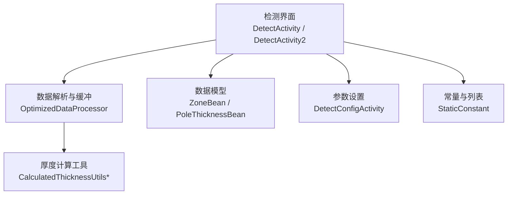
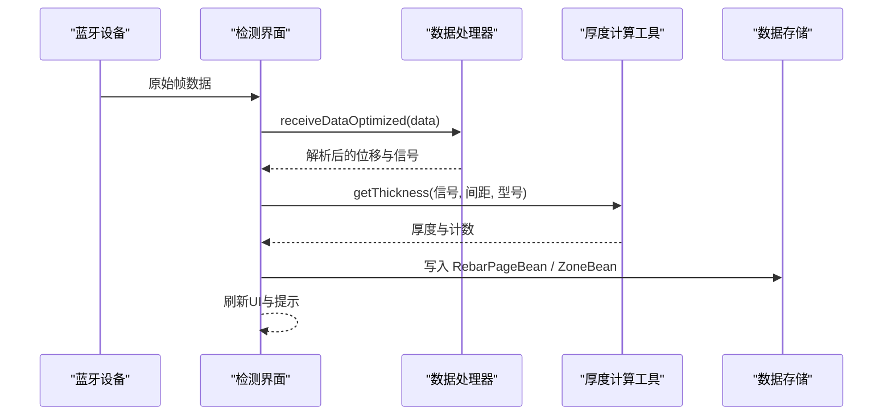
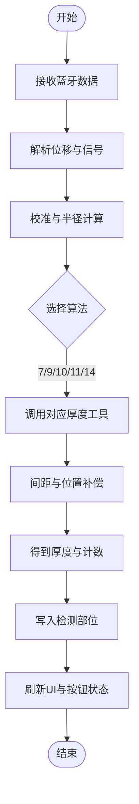
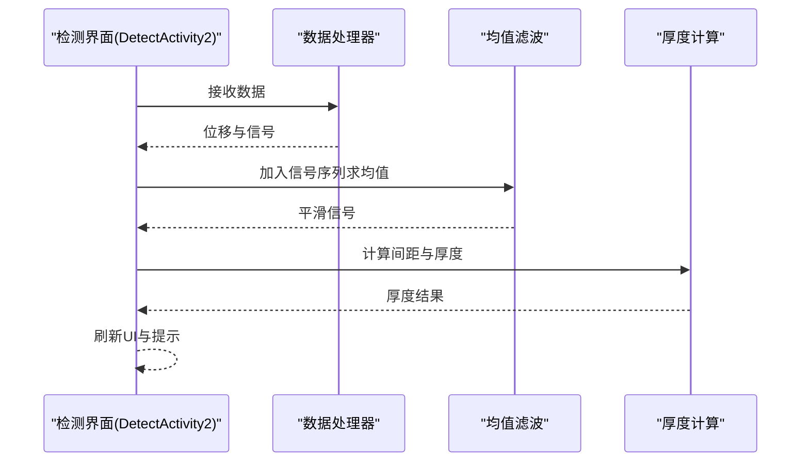
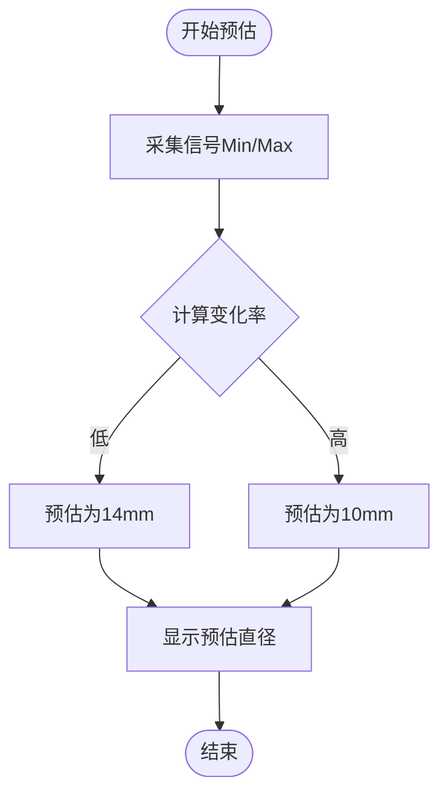
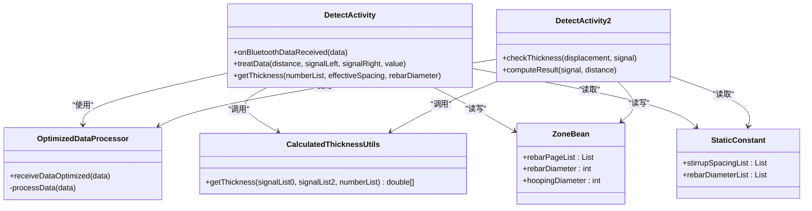

# 检测系统

<cite>
**本文引用的文件**
- [DetectActivity.java](file://app/src/main/java/com/example/gtj_sd_dg240/activity/testing/DetectActivity.java)
- [DetectActivity2.java](file://app/src/main/java/com/example/gtj_sd_dg240/activity/testing/DetectActivity2.java)
- [OptimizedDataProcessor.java](file://app/src/main/java/com/example/gtj_sd_dg240/utils/OptimizedDataProcessor.java)
- [CalculatedThicknessUtils.java](file://app/src/main/java/com/example/gtj_sd_dg240/utils/CalculatedThicknessUtils.java)
- [CalculatedThicknessUtils_7_3.java](file://app/src/main/java/com/example/gtj_sd_dg240/utils/CalculatedThicknessUtils_7_3.java)
- [ZoneBean.java](file://app/src/main/java/com/example/gtj_sd_dg240/model/ZoneBean.java)
- [PoleThicknessBean.java](file://app/src/main/java/com/example/gtj_sd_dg240/model/PoleThicknessBean.java)
- [DetectConfigActivity.java](file://app/src/main/java/com/example/gtj_sd_dg240/activity/testing/DetectConfigActivity.java)
- [StaticConstant.java](file://app/src/main/java/com/example/gtj_sd_dg240/StaticConstant.java)
</cite>

## 目录
1. [简介](#简介)
2. [项目结构](#项目结构)
3. [核心组件](#核心组件)
4. [架构总览](#架构总览)
5. [详细组件分析](#详细组件分析)
6. [依赖关系分析](#依赖关系分析)
7. [性能考虑](#性能考虑)
8. [故障排查指南](#故障排查指南)
9. [结论](#结论)
10. [附录](#附录)

## 简介
本检测系统面向混凝土电杆保护层厚度与主筋间距的现场检测，提供：
- 横向检测（厚度测量）：采集位移与信号，计算钢筋保护层厚度。
- 竖向检测（信号分析）：对信号进行统计与滤波，辅助质量判断。
- 预估直径计算：基于信号幅值范围估算电杆主筋直径规格。
系统支持不同型号电杆（如7、9、10、11、14等）的检测算法选择、参数配置与精度控制；提供实时显示、用户交互、异常处理、数据验证与结果导出能力。

## 项目结构
- 检测界面与流程：DetectActivity、DetectActivity2
- 数据处理与解析：OptimizedDataProcessor
- 厚度计算工具：CalculatedThicknessUtils 及按型号细分的工具类（如 CalculatedThicknessUtils_7_3）
- 数据模型：ZoneBean、PoleThicknessBean 等
- 参数配置：DetectConfigActivity
- 常量与枚举：StaticConstant

图表来源
- [DetectActivity.java:171-191](file://app/src/main/java/com/example/gtj_sd_dg240/activity/testing/DetectActivity.java#L171-L191)
- [DetectActivity2.java:165-203](file://app/src/main/java/com/example/gtj_sd_dg240/activity/testing/DetectActivity2.java#L165-L203)
- [OptimizedDataProcessor.java:34-133](file://app/src/main/java/com/example/gtj_sd_dg240/utils/OptimizedDataProcessor.java#L34-L133)
- [CalculatedThicknessUtils.java:22-59](file://app/src/main/java/com/example/gtj_sd_dg240/utils/CalculatedThicknessUtils.java#L22-L59)
- [ZoneBean.java:15-42](file://app/src/main/java/com/example/gtj_sd_dg240/model/ZoneBean.java#L15-L42)
- [DetectConfigActivity.java:229-367](file://app/src/main/java/com/example/gtj_sd_dg240/activity/testing/DetectConfigActivity.java#L229-L367)
- [StaticConstant.java:44-63](file://app/src/main/java/com/example/gtj_sd_dg240/StaticConstant.java#L44-L63)

章节来源
- [DetectActivity.java:171-191](file://app/src/main/java/com/example/gtj_sd_dg240/activity/testing/DetectActivity.java#L171-L191)
- [DetectActivity2.java:165-203](file://app/src/main/java/com/example/gtj_sd_dg240/activity/testing/DetectActivity2.java#L165-L203)
- [OptimizedDataProcessor.java:34-133](file://app/src/main/java/com/example/gtj_sd_dg240/utils/OptimizedDataProcessor.java#L34-L133)
- [CalculatedThicknessUtils.java:22-59](file://app/src/main/java/com/example/gtj_sd_dg240/utils/CalculatedThicknessUtils.java#L22-L59)
- [ZoneBean.java:15-42](file://app/src/main/java/com/example/gtj_sd_dg240/model/ZoneBean.java#L15-L42)
- [DetectConfigActivity.java:229-367](file://app/src/main/java/com/example/gtj_sd_dg240/activity/testing/DetectConfigActivity.java#L229-L367)
- [StaticConstant.java:44-63](file://app/src/main/java/com/example/gtj_sd_dg240/StaticConstant.java#L44-L63)

## 核心组件
- 数据采集与解析层：通过蓝牙接收原始帧，使用 OptimizedDataProcessor 进行分片拼接、完整性校验与解析，输出位移与信号。
- 检测业务层：DetectActivity（单点检测）、DetectActivity2（横竖双模式检测），负责状态管理、UI刷新、阈值判定与结果存储。
- 厚度计算层：根据电杆型号与箍筋间距选择对应算法工具类，结合标准曲线或查表法计算厚度，并进行间距补偿与位置补偿。
- 数据模型与配置：ZoneBean 承载工程与检测部位信息；DetectConfigActivity 完成参数录入与校验；StaticConstant 提供枚举与常量。

章节来源
- [DetectActivity.java:236-433](file://app/src/main/java/com/example/gtj_sd_dg240/activity/testing/DetectActivity.java#L236-L433)
- [DetectActivity2.java:205-335](file://app/src/main/java/com/example/gtj_sd_dg240/activity/testing/DetectActivity2.java#L205-L335)
- [OptimizedDataProcessor.java:82-133](file://app/src/main/java/com/example/gtj_sd_dg240/utils/OptimizedDataProcessor.java#L82-L133)
- [CalculatedThicknessUtils.java:22-59](file://app/src/main/java/com/example/gtj_sd_dg240/utils/CalculatedThicknessUtils.java#L22-L59)
- [ZoneBean.java:15-42](file://app/src/main/java/com/example/gtj_sd_dg240/model/ZoneBean.java#L15-L42)
- [DetectConfigActivity.java:281-367](file://app/src/main/java/com/example/gtj_sd_dg240/activity/testing/DetectConfigActivity.java#L281-L367)
- [StaticConstant.java:44-63](file://app/src/main/java/com/example/gtj_sd_dg240/StaticConstant.java#L44-L63)

## 架构总览
系统采用“采集-解析-计算-展示”的分层架构：
- 采集：蓝牙回调接收字节流
- 解析：OptimizedDataProcessor 线程安全队列 + 生产者消费者模式
- 计算：按型号与间距选择具体算法，执行厚度与间距补偿
- 展示：实时刷新UI，保存结果并支持导出

图表来源
- [DetectActivity.java:171-191](file://app/src/main/java/com/example/gtj_sd_dg240/activity/testing/DetectActivity.java#L171-L191)
- [DetectActivity2.java:165-203](file://app/src/main/java/com/example/gtj_sd_dg240/activity/testing/DetectActivity2.java#L165-L203)
- [OptimizedDataProcessor.java:34-133](file://app/src/main/java/com/example/gtj_sd_dg240/utils/OptimizedDataProcessor.java#L34-L133)
- [CalculatedThicknessUtils.java:22-59](file://app/src/main/java/com/example/gtj_sd_dg240/utils/CalculatedThicknessUtils.java#L22-L59)

## 详细组件分析

### 横向检测（厚度测量）
- 触发与采集：在 DetectActivity 中，收到蓝牙数据后解析为位移与左右信号，取平均作为当前信号值。
- 校准与补偿：根据输入距离插值计算半径，结合轱辘半径与几何关系得到校准偏移量；对不同型号电杆应用不同的间距补偿策略。
- 厚度计算：依据钢筋直径与箍筋间距选择对应工具类（如 7_3、9_3、9_4、10_4、11_3、11_4、14_4），调用通用算法匹配信号区间并返回厚度与置信度。
- 结果存储与展示：将厚度写入当前检测部位，计算平均值，更新UI并提示异常。

图表来源
- [DetectActivity.java:236-433](file://app/src/main/java/com/example/gtj_sd_dg240/activity/testing/DetectActivity.java#L236-L433)
- [CalculatedThicknessUtils.java:22-59](file://app/src/main/java/com/example/gtj_sd_dg240/utils/CalculatedThicknessUtils.java#L22-L59)
- [CalculatedThicknessUtils_7_3.java:17-95](file://app/src/main/java/com/example/gtj_sd_dg240/utils/CalculatedThicknessUtils_7_3.java#L17-L95)

章节来源
- [DetectActivity.java:236-433](file://app/src/main/java/com/example/gtj_sd_dg240/activity/testing/DetectActivity.java#L236-L433)
- [CalculatedThicknessUtils.java:22-59](file://app/src/main/java/com/example/gtj_sd_dg240/utils/CalculatedThicknessUtils.java#L22-L59)
- [CalculatedThicknessUtils_7_3.java:17-95](file://app/src/main/java/com/example/gtj_sd_dg240/utils/CalculatedThicknessUtils_7_3.java#L17-L95)

### 竖向检测（信号分析）
- 模式切换：DetectActivity2 支持横向与竖向两种模式，竖向模式下对信号进行时间窗内的最小/最大值统计。
- 信号滤波：使用均值滤波工具减少噪声影响。
- 结果计算：当收集到足够样本后，计算主筋间距与厚度，并叠加补偿项得到最终厚度。
- 异常提示：若信号为0或超出预期范围，提示重复测量或剔凿验证。

图表来源
- [DetectActivity2.java:165-203](file://app/src/main/java/com/example/gtj_sd_dg240/activity/testing/DetectActivity2.java#L165-L203)
- [DetectActivity2.java:205-335](file://app/src/main/java/com/example/gtj_sd_dg240/activity/testing/DetectActivity2.java#L205-L335)

章节来源
- [DetectActivity2.java:165-203](file://app/src/main/java/com/example/gtj_sd_dg240/activity/testing/DetectActivity2.java#L165-L203)
- [DetectActivity2.java:205-335](file://app/src/main/java/com/example/gtj_sd_dg240/activity/testing/DetectActivity2.java#L205-L335)

### 预估直径计算
- 信号范围采集：在预估模式下记录一段时间内的最小与最大信号值。
- 比率判断：根据信号变化率与当前位置（根部/梢部）判断主筋直径规格（如10mm或14mm）。
- 结果展示：在界面上显示预估直径，供后续检测参考。

图表来源
- [DetectActivity.java:441-459](file://app/src/main/java/com/example/gtj_sd_dg240/activity/testing/DetectActivity.java#L441-L459)
- [DetectActivity2.java:493-505](file://app/src/main/java/com/example/gtj_sd_dg240/activity/testing/DetectActivity2.java#L493-L505)

章节来源
- [DetectActivity.java:441-459](file://app/src/main/java/com/example/gtj_sd_dg240/activity/testing/DetectActivity.java#L441-L459)
- [DetectActivity2.java:493-505](file://app/src/main/java/com/example/gtj_sd_dg240/activity/testing/DetectActivity2.java#L493-L505)

### 不同型号电杆的检测算法选择与参数配置
- 型号选择：根据 ZoneBean.rebarDiameter 与 hoopingDiameter 决定使用哪个工具类（如 7_3、9_3、9_4、10_4、11_3、11_4、14_4）。
- 箍筋间距：从 StaticConstant.stirrupSpacingList 中选择（30/40/50/60/70/120），影响厚度计算与补偿。
- 位置补偿：根据距根部的距离插值计算半径，再计算校准偏移量。
- 精度控制：通过校准列表与标准曲线插值提高厚度计算精度；对异常数据进行剔除与提示。

章节来源
- [DetectActivity.java:513-640](file://app/src/main/java/com/example/gtj_sd_dg240/activity/testing/DetectActivity.java#L513-L640)
- [CalculatedThicknessUtils_7_3.java:17-95](file://app/src/main/java/com/example/gtj_sd_dg240/utils/CalculatedThicknessUtils_7_3.java#L17-L95)
- [ZoneBean.java:15-42](file://app/src/main/java/com/example/gtj_sd_dg240/model/ZoneBean.java#L15-L42)
- [StaticConstant.java:44-63](file://app/src/main/java/com/example/gtj_sd_dg240/StaticConstant.java#L44-L63)

### 检测界面的使用方法、结果解读与质量控制
- 使用方法：
  - 进入参数设置页面，填写工程信息、电杆编号、长度、根径/梢径、纵筋与螺旋筋直径、设计厚度等。
  - 添加检测部位（距根部距离），启动检测。
  - 横向模式：移动探头采集信号，系统自动计算厚度并显示。
  - 竖向模式：固定位置采集信号，统计Min/Max并计算厚度。
  - 预估直径：开启预估模式，采集信号范围后显示预估主筋直径。
- 结果解读：
  - 厚度单位为毫米，显示当前厚度与平均值。
  - 若厚度低于阈值或信号异常，弹出提示并要求重复测量或剔凿验证。
- 质量控制：
  - 校准列表与标准曲线插值提升精度。
  - 间距补偿与位置补偿修正系统误差。
  - 数据有效性检查（信号范围、样本数量）避免误判。

章节来源
- [DetectConfigActivity.java:229-367](file://app/src/main/java/com/example/gtj_sd_dg240/activity/testing/DetectConfigActivity.java#L229-L367)
- [DetectActivity.java:193-231](file://app/src/main/java/com/example/gtj_sd_dg240/activity/testing/DetectActivity.java#L193-L231)
- [DetectActivity2.java:205-335](file://app/src/main/java/com/example/gtj_sd_dg240/activity/testing/DetectActivity2.java#L205-L335)

### 异常处理、数据验证与结果导出
- 异常处理：
  - 信号为0或超出范围时提示异常，要求重复测量或剔凿验证。
  - 数据无效时清空缓存并重置统计。
- 数据验证：
  - 参数完整性校验（工程、电杆编号、尺寸等）。
  - 检测部位数量限制与去重校验。
- 结果导出：
  - 支持将检测结果保存到数据库，并通过数据管理页面导出。

章节来源
- [DetectActivity.java:461-466](file://app/src/main/java/com/example/gtj_sd_dg240/activity/testing/DetectActivity.java#L461-L466)
- [DetectActivity2.java:508-513](file://app/src/main/java/com/example/gtj_sd_dg240/activity/testing/DetectActivity2.java#L508-L513)
- [DetectConfigActivity.java:281-367](file://app/src/main/java/com/example/gtj_sd_dg240/activity/testing/DetectConfigActivity.java#L281-L367)

## 依赖关系分析
- 界面层依赖数据处理器进行高频数据的缓冲与解析。
- 厚度计算工具依赖标准曲线与型号常量，按型号与间距选择具体实现。
- 数据模型贯穿整个流程，承载工程信息与检测结果。
- 常量与配置集中管理，便于统一维护与扩展。

图表来源
- [DetectActivity.java:236-433](file://app/src/main/java/com/example/gtj_sd_dg240/activity/testing/DetectActivity.java#L236-L433)
- [DetectActivity2.java:205-335](file://app/src/main/java/com/example/gtj_sd_dg240/activity/testing/DetectActivity2.java#L205-L335)
- [OptimizedDataProcessor.java:34-133](file://app/src/main/java/com/example/gtj_sd_dg240/utils/OptimizedDataProcessor.java#L34-L133)
- [CalculatedThicknessUtils.java:22-59](file://app/src/main/java/com/example/gtj_sd_dg240/utils/CalculatedThicknessUtils.java#L22-L59)
- [ZoneBean.java:15-42](file://app/src/main/java/com/example/gtj_sd_dg240/model/ZoneBean.java#L15-L42)
- [StaticConstant.java:44-63](file://app/src/main/java/com/example/gtj_sd_dg240/StaticConstant.java#L44-L63)

章节来源
- [DetectActivity.java:236-433](file://app/src/main/java/com/example/gtj_sd_dg240/activity/testing/DetectActivity.java#L236-L433)
- [DetectActivity2.java:205-335](file://app/src/main/java/com/example/gtj_sd_dg240/activity/testing/DetectActivity2.java#L205-L335)
- [OptimizedDataProcessor.java:34-133](file://app/src/main/java/com/example/gtj_sd_dg240/utils/OptimizedDataProcessor.java#L34-L133)
- [CalculatedThicknessUtils.java:22-59](file://app/src/main/java/com/example/gtj_sd_dg240/utils/CalculatedThicknessUtils.java#L22-L59)
- [ZoneBean.java:15-42](file://app/src/main/java/com/example/gtj_sd_dg240/model/ZoneBean.java#L15-L42)
- [StaticConstant.java:44-63](file://app/src/main/java/com/example/gtj_sd_dg240/StaticConstant.java#L44-L63)

## 性能考虑
- 高频数据缓冲：使用阻塞队列与生产者-消费者模式降低丢包风险。
- 线程安全：解析与处理分离，避免UI阻塞。
- 信号滤波：均值滤波减少噪声干扰，提高稳定性。
- 算法选择：按型号与间距快速定位工具类，减少分支判断开销。

[本节为通用指导，不直接分析具体文件]

## 故障排查指南
- 信号为0或异常：检查蓝牙连接与设备状态，重新采集；必要时剔凿验证。
- 参数不完整：确保工程、电杆编号、尺寸与设计厚度已填写。
- 数据无效：超过2秒无新数据会清空缓存，需重新采集。
- 结果异常：查看厚度与间距补偿是否合理，确认型号与箍筋间距配置正确。

章节来源
- [DetectActivity.java:461-466](file://app/src/main/java/com/example/gtj_sd_dg240/activity/testing/DetectActivity.java#L461-L466)
- [DetectActivity2.java:508-513](file://app/src/main/java/com/example/gtj_sd_dg240/activity/testing/DetectActivity2.java#L508-L513)
- [DetectConfigActivity.java:281-367](file://app/src/main/java/com/example/gtj_sd_dg240/activity/testing/DetectConfigActivity.java#L281-L367)

## 结论
本检测系统通过分层架构实现了高效的数据采集、解析与厚度计算，支持多型号电杆与多种检测模式。系统具备完善的参数配置、实时显示、异常处理与结果导出能力，能够满足现场检测对精度与稳定性的要求。建议在实际使用中严格遵循参数配置与操作流程，并结合质量控制标准进行结果验证。

[本节为总结性内容，不直接分析具体文件]

## 附录
- 关键数据模型字段说明：
  - ZoneBean：工程与检测部位信息，包含电杆尺寸、钢筋直径、检测部位列表等。
  - PoleThicknessBean：单次检测的保护层厚度分解（信号厚度、各补偿项与最终厚度）。
- 常用常量与列表：
  - StaticConstant：电杆类型、结构、规范、纵筋直径、箍筋间距等枚举与列表。

章节来源
- [ZoneBean.java:15-42](file://app/src/main/java/com/example/gtj_sd_dg240/model/ZoneBean.java#L15-L42)
- [PoleThicknessBean.java:7-39](file://app/src/main/java/com/example/gtj_sd_dg240/model/PoleThicknessBean.java#L7-L39)
- [StaticConstant.java:44-63](file://app/src/main/java/com/example/gtj_sd_dg240/StaticConstant.java#L44-L63)