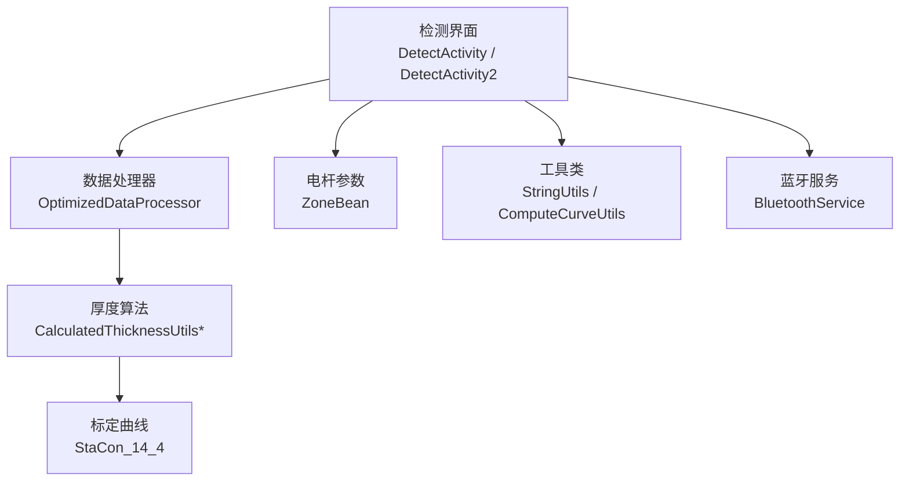
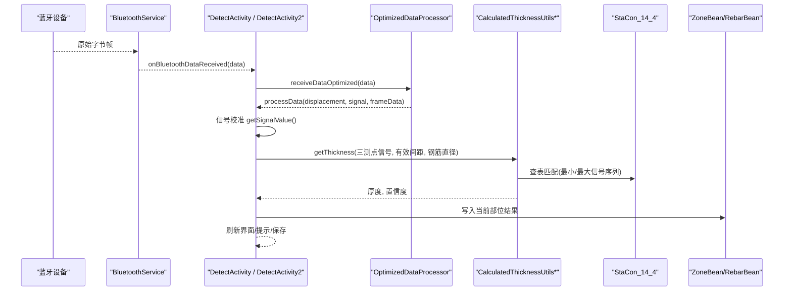
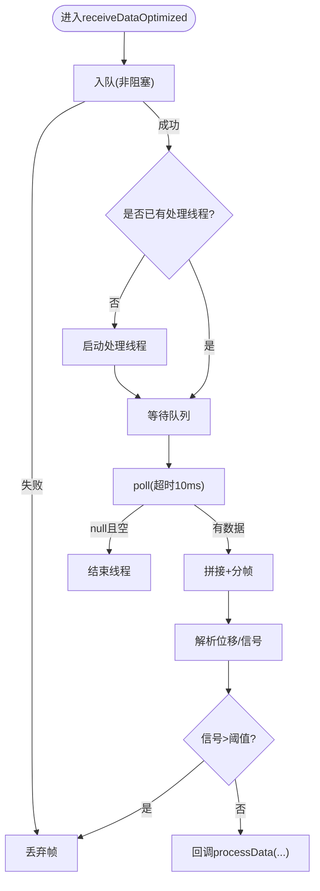
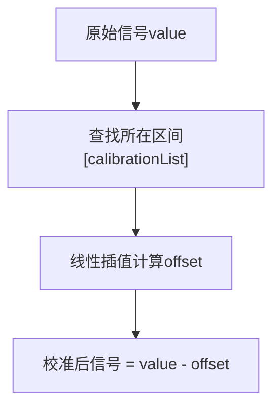
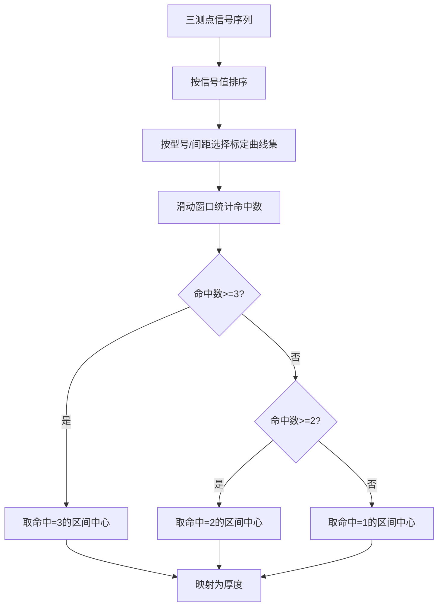
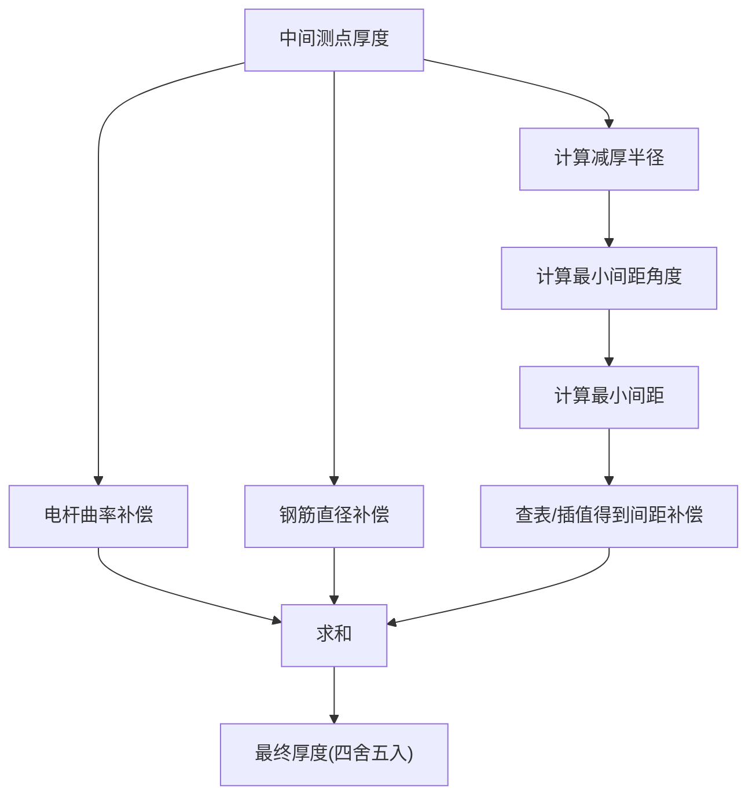
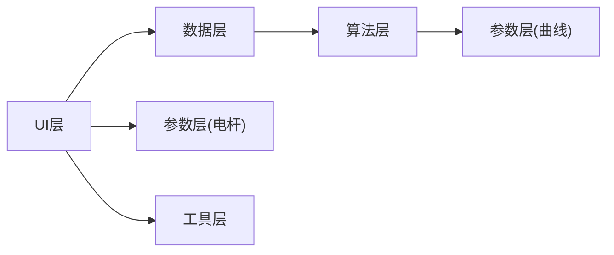

# 横向检测（厚度测量）

<cite>
**本文引用的文件**
- [DetectActivity.java](file://app/src/main/java/com/example/gtj_sd_dg240/activity/testing/DetectActivity.java)
- [DetectActivity2.java](file://app/src/main/java/com/example/gtj_sd_dg240/activity/testing/DetectActivity2.java)
- [CalculatedThicknessUtils.java](file://app/src/main/java/com/example/gtj_sd_dg240/utils/CalculatedThicknessUtils.java)
- [CalculatedThicknessUtils_7_3.java](file://app/src/main/java/com/example/gtj_sd_dg240/utils/CalculatedThicknessUtils_7_3.java)
- [StaCon_14_4.java](file://app/src/main/java/com/example/gtj_sd_dg240/stacon/StaCon_14_4.java)
- [OptimizedDataProcessor.java](file://app/src/main/java/com/example/gtj_sd_dg240/utils/OptimizedDataProcessor.java)
- [ComputeCurveUtils.java](file://app/src/main/java/com/example/gtj_sd_dg240/utils/ComputeCurveUtils.java)
- [ZoneBean.java](file://app/src/main/java/com/example/gtj_sd_dg240/model/ZoneBean.java)
- [RebarBean.java](file://app/src/main/java/com/example/gtj_sd_dg240/model/RebarBean.java)
- [PoleThicknessBean.java](file://app/src/main/java/com/example/gtj_sd_dg240/model/PoleThicknessBean.java)
- [StringUtils.java](file://app/src/main/java/com/example/gtj_sd_dg240/utils/StringUtils.java)
- [BluetoothService.java](file://app/src/main/java/com/example/gtj_sd_dg240/bluetooth/BluetoothService.java)
</cite>

## 目录
1. [简介](#简介)
2. [项目结构](#项目结构)
3. [核心组件](#核心组件)
4. [架构总览](#架构总览)
5. [详细组件分析](#详细组件分析)
6. [依赖关系分析](#依赖关系分析)
7. [性能与精度](#性能与精度)
8. [故障排查指南](#故障排查指南)
9. [结论](#结论)
10. [附录：界面操作与质量控制](#附录界面操作与质量控制)

## 简介
本文件面向混凝土电杆横向检测（保护层厚度测量）功能，系统性说明其工作原理、数据采集流程、信号处理、校准曲线拟合与厚度计算过程；覆盖不同型号电杆的参数配置、精度控制与误差来源；并提供检测界面使用方法、实时数据展示与质量控制标准，以及异常数据处理、结果验证与导出要点。

## 项目结构
围绕厚度测量的关键代码分布在以下模块：
- 采集与UI交互：DetectActivity / DetectActivity2
- 数据处理与算法：OptimizedDataProcessor、CalculatedThicknessUtils 系列、ComputeCurveUtils
- 设备与参数：StaCon_14_4（标定曲线）、ZoneBean（工程与电杆参数）、RebarBean（单点结果）
- 工具与蓝牙：StringUtils、BluetoothService

图表来源
- [DetectActivity.java:171-191](file://app/src/main/java/com/example/gtj_sd_dg240/activity/testing/DetectActivity.java#L171-L191)
- [DetectActivity2.java:165-186](file://app/src/main/java/com/example/gtj_sd_dg240/activity/testing/DetectActivity2.java#L165-L186)
- [OptimizedDataProcessor.java:34-75](file://app/src/main/java/com/example/gtj_sd_dg240/utils/OptimizedDataProcessor.java#L34-L75)
- [CalculatedThicknessUtils.java:22-59](file://app/src/main/java/com/example/gtj_sd_dg240/utils/CalculatedThicknessUtils.java#L22-L59)
- [StaCon_14_4.java:77-84](file://app/src/main/java/com/example/gtj_sd_dg240/stacon/StaCon_14_4.java#L77-L84)
- [ZoneBean.java:15-42](file://app/src/main/java/com/example/gtj_sd_dg240/model/ZoneBean.java#L15-L42)
- [StringUtils.java:228-246](file://app/src/main/java/com/example/gtj_sd_dg240/utils/StringUtils.java#L228-L246)
- [ComputeCurveUtils.java:121-128](file://app/src/main/java/com/example/gtj_sd_dg240/utils/ComputeCurveUtils.java#L121-L128)
- [BluetoothService.java:20-41](file://app/src/main/java/com/example/gtj_sd_dg240/bluetooth/BluetoothService.java#L20-L41)

章节来源
- [DetectActivity.java:171-191](file://app/src/main/java/com/example/gtj_sd_dg240/activity/testing/DetectActivity.java#L171-L191)
- [DetectActivity2.java:165-186](file://app/src/main/java/com/example/gtj_sd_dg240/activity/testing/DetectActivity2.java#L165-L186)
- [OptimizedDataProcessor.java:34-75](file://app/src/main/java/com/example/gtj_sd_dg240/utils/OptimizedDataProcessor.java#L34-L75)

## 核心组件
- 数据采集与解析：通过蓝牙接收原始帧，按固定长度分帧并提取位移与信号值，过滤异常值后回调上层。
- 信号校准：基于本地存储的校准表进行线性插值补偿，消除系统偏差。
- 厚度计算：依据电杆型号（钢筋直径、螺旋筋直径、箍筋间距等）选择对应标定曲线集合，结合三测点信号序列匹配得到厚度及置信度。
- 几何与补偿：根据最小主筋间距计算角度与弦长，叠加电杆曲率补偿、钢筋直径补偿与间距补偿，输出最终厚度。
- 结果聚合：每部位累计多次测量，计算平均值与统计量，支持删除与重新测量。

章节来源
- [OptimizedDataProcessor.java:82-133](file://app/src/main/java/com/example/gtj_sd_dg240/utils/OptimizedDataProcessor.java#L82-L133)
- [DetectActivity.java:647-687](file://app/src/main/java/com/example/gtj_sd_dg240/activity/testing/DetectActivity.java#L647-L687)
- [CalculatedThicknessUtils.java:22-59](file://app/src/main/java/com/example/gtj_sd_dg240/utils/CalculatedThicknessUtils.java#L22-L59)
- [DetectActivity.java:236-433](file://app/src/main/java/com/example/gtj_sd_dg240/activity/testing/DetectActivity.java#L236-L433)

## 架构总览
厚度检测的数据流从蓝牙到UI呈现的关键路径如下：

图表来源
- [BluetoothService.java:20-41](file://app/src/main/java/com/example/gtj_sd_dg240/bluetooth/BluetoothService.java#L20-L41)
- [DetectActivity.java:171-191](file://app/src/main/java/com/example/gtj_sd_dg240/activity/testing/DetectActivity.java#L171-L191)
- [DetectActivity2.java:165-186](file://app/src/main/java/com/example/gtj_sd_dg240/activity/testing/DetectActivity2.java#L165-L186)
- [OptimizedDataProcessor.java:34-75](file://app/src/main/java/com/example/gtj_sd_dg240/utils/OptimizedDataProcessor.java#L34-L75)
- [CalculatedThicknessUtils.java:22-59](file://app/src/main/java/com/example/gtj_sd_dg240/utils/CalculatedThicknessUtils.java#L22-L59)
- [StaCon_14_4.java:77-84](file://app/src/main/java/com/example/gtj_sd_dg240/stacon/StaCon_14_4.java#L77-L84)
- [ZoneBean.java:15-42](file://app/src/main/java/com/example/gtj_sd_dg240/model/ZoneBean.java#L15-L42)
- [RebarBean.java:5-25](file://app/src/main/java/com/example/gtj_sd_dg240/model/RebarBean.java#L5-L25)

## 详细组件分析

### 数据采集与解析（OptimizedDataProcessor）
- 采用生产者-消费者模式，使用阻塞队列缓存高频蓝牙数据，避免丢包与卡顿。
- 帧同步：以“F1 00”为起始标志，定位完整帧边界，按固定长度切分。
- 解析字段：位移（mm）与信号值（左右传感器平均），对异常信号（过大）直接丢弃。
- 线程安全：仅启动一个处理线程，空队列时退出循环释放资源。

图表来源
- [OptimizedDataProcessor.java:34-75](file://app/src/main/java/com/example/gtj_sd_dg240/utils/OptimizedDataProcessor.java#L34-L75)
- [OptimizedDataProcessor.java:82-133](file://app/src/main/java/com/example/gtj_sd_dg240/utils/OptimizedDataProcessor.java#L82-L133)

章节来源
- [OptimizedDataProcessor.java:34-75](file://app/src/main/java/com/example/gtj_sd_dg240/utils/OptimizedDataProcessor.java#L34-L75)
- [OptimizedDataProcessor.java:82-133](file://app/src/main/java/com/example/gtj_sd_dg240/utils/OptimizedDataProcessor.java#L82-L133)

### 信号校准与插值
- 校准表：通过持久化存储的“标准值-实测值”分段表，对原始信号做线性插值补偿，降低系统误差。
- 实现：在检测入口对每个信号值执行getSignalValue，返回校准后的信号用于后续厚度匹配。

图表来源
- [DetectActivity.java:670-687](file://app/src/main/java/com/example/gtj_sd_dg240/activity/testing/DetectActivity.java#L670-L687)
- [StringUtils.java:228-246](file://app/src/main/java/com/example/gtj_sd_dg240/utils/StringUtils.java#L228-L246)

章节来源
- [DetectActivity.java:670-687](file://app/src/main/java/com/example/gtj_sd_dg240/activity/testing/DetectActivity.java#L670-L687)
- [DetectActivity2.java:156-163](file://app/src/main/java/com/example/gtj_sd_dg240/activity/testing/DetectActivity2.java#L156-L163)
- [StringUtils.java:228-246](file://app/src/main/java/com/example/gtj_sd_dg240/utils/StringUtils.java#L228-L246)

### 厚度计算与标定曲线匹配
- 三测点策略：每次采集三个相邻测点的信号序列（左、中、右），排序后作为输入。
- 曲线匹配：根据电杆型号与箍筋间距选择对应的最小/最大信号序列集合，滑动窗口统计命中数，优先取命中数为3的位置，其次2，最后1；若多个候选则取首尾索引的平均位置，得到厚度索引。
- 不同型号：
  - 7/9/10/11号钢筋：分别调用对应CalculatedThicknessUtils_*，按有效间距（由最小间距推导）选择子方法。
  - 14号钢筋：直接使用StaCon_14_4中的signalList_14_70_min/max或signalList_14_120_min/max，并根据距端部距离选择70或120系列。

图表来源
- [CalculatedThicknessUtils.java:22-59](file://app/src/main/java/com/example/gtj_sd_dg240/utils/CalculatedThicknessUtils.java#L22-L59)
- [CalculatedThicknessUtils_7_3.java:17-94](file://app/src/main/java/com/example/gtj_sd_dg240/utils/CalculatedThicknessUtils_7_3.java#L17-L94)
- [StaCon_14_4.java:77-84](file://app/src/main/java/com/example/gtj_sd_dg240/stacon/StaCon_14_4.java#L77-L84)
- [DetectActivity.java:513-640](file://app/src/main/java/com/example/gtj_sd_dg240/activity/testing/DetectActivity.java#L513-L640)

章节来源
- [CalculatedThicknessUtils.java:22-59](file://app/src/main/java/com/example/gtj_sd_dg240/utils/CalculatedThicknessUtils.java#L22-L59)
- [CalculatedThicknessUtils_7_3.java:17-94](file://app/src/main/java/com/example/gtj_sd_dg240/utils/CalculatedThicknessUtils_7_3.java#L17-L94)
- [DetectActivity.java:513-640](file://app/src/main/java/com/example/gtj_sd_dg240/activity/testing/DetectActivity.java#L513-L640)

### 几何补偿与最终厚度合成
- 最小间距与角度：根据三测点的最小相邻位移差，计算夹角与弦长，得到最小主筋间距。
- 半径修正：用最大厚度反推“减厚半径”，再计算最小间距角度与弦长。
- 补偿项：
  - 电杆曲率补偿：根据当前位置插值得到半径，结合仪器滚轮半径计算。
  - 钢筋直径补偿：按钢筋直径查表或常量。
  - 间距补偿：根据主筋间距与电杆段（根/梢/中段）查表或插值得到。
- 最终厚度：中间测点厚度 + 电杆曲率补偿 + 钢筋直径补偿 + 间距补偿，四舍五入保留一位小数。

图表来源
- [DetectActivity.java:236-433](file://app/src/main/java/com/example/gtj_sd_dg240/activity/testing/DetectActivity.java#L236-L433)
- [ComputeCurveUtils.java:77-98](file://app/src/main/java/com/example/gtj_sd_dg240/utils/ComputeCurveUtils.java#L77-L98)
- [StringUtils.java:186-196](file://app/src/main/java/com/example/gtj_sd_dg240/utils/StringUtils.java#L186-L196)

章节来源
- [DetectActivity.java:236-433](file://app/src/main/java/com/example/gtj_sd_dg240/activity/testing/DetectActivity.java#L236-L433)
- [ComputeCurveUtils.java:77-98](file://app/src/main/java/com/example/gtj_sd_dg240/utils/ComputeCurveUtils.java#L77-L98)

### 不同型号电杆的参数配置
- 钢筋直径与螺旋筋直径：通过ZoneBean.rebarDiameter、ZoneBean.hoopingDiameter配置。
- 电杆尺寸：ZoneBean.poleHeight、poleBottomDiameter、poleTopDiameter用于半径插值与曲率补偿。
- 箍筋间距：界面下拉选择（如40/50/60/70/120），影响厚度计算分支与标定曲线选择。
- 设计厚度：ZoneBean.designThickness用于质量控制阈值判断。

章节来源
- [ZoneBean.java:15-42](file://app/src/main/java/com/example/gtj_sd_dg240/model/ZoneBean.java#L15-L42)
- [DetectActivity.java:103-106](file://app/src/main/java/com/example/gtj_sd_dg240/activity/testing/DetectActivity.java#L103-L106)

### 结果存储与展示
- 单点结果：RebarBean记录位移、左右信号、厚度与部位信息。
- 部位聚合：RebarPageBean维护该部位的多次测量结果，计算平均厚度。
- 界面展示：实时显示当前厚度、三测点信号、最小间距与角度等信息；支持删除某部位数据。

章节来源
- [RebarBean.java:5-25](file://app/src/main/java/com/example/gtj_sd_dg240/model/RebarBean.java#L5-L25)
- [DetectActivity.java:418-433](file://app/src/main/java/com/example/gtj_sd_dg240/activity/testing/DetectActivity.java#L418-L433)
- [DetectActivity.java:753-800](file://app/src/main/java/com/example/gtj_sd_dg240/activity/testing/DetectActivity.java#L753-L800)

## 依赖关系分析
- UI层（DetectActivity/DetectActivity2）负责蓝牙接入、用户交互与结果展示。
- 数据层（OptimizedDataProcessor）解耦蓝牙与业务逻辑，提供稳定可靠的数据流。
- 算法层（CalculatedThicknessUtils*）封装不同型号/间距的厚度匹配策略。
- 参数层（ZoneBean、StaCon_14_4）集中管理电杆与标定曲线。
- 工具层（StringUtils、ComputeCurveUtils）提供数值计算与曲线拟合能力。

图表来源
- [DetectActivity.java:171-191](file://app/src/main/java/com/example/gtj_sd_dg240/activity/testing/DetectActivity.java#L171-L191)
- [DetectActivity2.java:165-186](file://app/src/main/java/com/example/gtj_sd_dg240/activity/testing/DetectActivity2.java#L165-L186)
- [OptimizedDataProcessor.java:34-75](file://app/src/main/java/com/example/gtj_sd_dg240/utils/OptimizedDataProcessor.java#L34-L75)
- [CalculatedThicknessUtils.java:22-59](file://app/src/main/java/com/example/gtj_sd_dg240/utils/CalculatedThicknessUtils.java#L22-L59)
- [StaCon_14_4.java:77-84](file://app/src/main/java/com/example/gtj_sd_dg240/stacon/StaCon_14_4.java#L77-L84)
- [ZoneBean.java:15-42](file://app/src/main/java/com/example/gtj_sd_dg240/model/ZoneBean.java#L15-L42)
- [ComputeCurveUtils.java:121-128](file://app/src/main/java/com/example/gtj_sd_dg240/utils/ComputeCurveUtils.java#L121-L128)

章节来源
- [DetectActivity.java:171-191](file://app/src/main/java/com/example/gtj_sd_dg240/activity/testing/DetectActivity.java#L171-L191)
- [DetectActivity2.java:165-186](file://app/src/main/java/com/example/gtj_sd_dg240/activity/testing/DetectActivity2.java#L165-L186)
- [OptimizedDataProcessor.java:34-75](file://app/src/main/java/com/example/gtj_sd_dg240/utils/OptimizedDataProcessor.java#L34-L75)

## 性能与精度
- 性能
  - 高吞吐：OptimizedDataProcessor使用阻塞队列与单线程消费，避免UI卡顿与丢帧。
  - 低延迟：帧同步与快速切分，保证实时性。
  - 内存友好：空队列及时释放线程，减少常驻开销。
- 精度
  - 信号校准：分段线性插值补偿，提升一致性。
  - 多测点融合：三测点匹配提高鲁棒性，置信度（命中数）辅助质量评估。
  - 几何补偿：考虑电杆曲率、钢筋直径与主筋间距，减小系统误差。
- 误差来源与建议
  - 接触不良或探头偏移：建议重复测量，剔除异常点。
  - 标定曲线不匹配：确认电杆型号、箍筋间距与位置（根/梢/中段）选择正确。
  - 环境干扰：确保蓝牙连接稳定，必要时重启设备重连。

章节来源
- [OptimizedDataProcessor.java:34-75](file://app/src/main/java/com/example/gtj_sd_dg240/utils/OptimizedDataProcessor.java#L34-L75)
- [DetectActivity.java:670-687](file://app/src/main/java/com/example/gtj_sd_dg240/activity/testing/DetectActivity.java#L670-L687)
- [CalculatedThicknessUtils.java:22-59](file://app/src/main/java/com/example/gtj_sd_dg240/utils/CalculatedThicknessUtils.java#L22-L59)
- [DetectActivity.java:236-433](file://app/src/main/java/com/example/gtj_sd_dg240/activity/testing/DetectActivity.java#L236-L433)

## 故障排查指南
- 无数据或数据停滞
  - 检查蓝牙连接状态与权限；确认设备已配对并开启通知。
  - 查看OptimizedDataProcessor是否启动处理线程；队列是否为空。
- 厚度异常或频繁报警
  - 检查校准表是否正确加载；确认信号范围是否在标定区间内。
  - 核对电杆参数（钢筋直径、螺旋筋直径、箍筋间距、高度）是否与现场一致。
  - 观察三测点信号是否合理，必要时剔凿验证。
- 结果无法保存或导出
  - 确认当前部位已添加并至少完成一次有效测量；检查存储空间与权限。

章节来源
- [BluetoothService.java:20-41](file://app/src/main/java/com/example/gtj_sd_dg240/bluetooth/BluetoothService.java#L20-L41)
- [DetectActivity.java:461-466](file://app/src/main/java/com/example/gtj_sd_dg240/activity/testing/DetectActivity.java#L461-L466)
- [DetectActivity2.java:508-513](file://app/src/main/java/com/example/gtj_sd_dg240/activity/testing/DetectActivity2.java#L508-L513)

## 结论
本方案通过稳定的数据采集、严格的信号校准、基于标定曲线的厚度匹配与完善的几何补偿，实现了混凝土电杆保护层厚度的高精度横向检测。针对不同型号与工况提供了灵活的参数配置与质量控制机制，满足现场高效、可靠的检测需求。

## 附录：界面操作与质量控制
- 界面操作
  - 新建项目与选择电杆参数：设置电杆高度、根径/梢径、钢筋与螺旋筋直径、箍筋间距与设计厚度。
  - 添加检测部位：输入距根部距离，生成部位条目。
  - 开始检测：点击检测按钮，移动探头采集三测点数据，界面实时显示厚度与信号。
  - 删除与重测：长按部位可删除；异常时可重复测量。
  - 预估直径：切换至预估模式，采集信号范围估算钢筋直径。
- 实时数据展示
  - 当前厚度、三测点信号、最小间距与角度、补偿项明细。
- 质量控制标准
  - 设计厚度±容差：超出范围触发语音与弹窗提示，需重复测量或剔凿验证。
  - 置信度：命中数越低，结果越不可靠，应谨慎采信。
  - 平均厚度：同一部位多次测量取平均，提升稳定性。
- 结果验证与导出
  - 结果保存在数据库，支持查看与管理。
  - 导出功能：通过数据管理页面导出CSV/Excel等格式，便于归档与分析。

章节来源
- [DetectActivity.java:753-800](file://app/src/main/java/com/example/gtj_sd_dg240/activity/testing/DetectActivity.java#L753-L800)
- [DetectActivity.java:461-466](file://app/src/main/java/com/example/gtj_sd_dg240/activity/testing/DetectActivity.java#L461-L466)
- [DetectActivity2.java:508-513](file://app/src/main/java/com/example/gtj_sd_dg240/activity/testing/DetectActivity2.java#L508-L513)