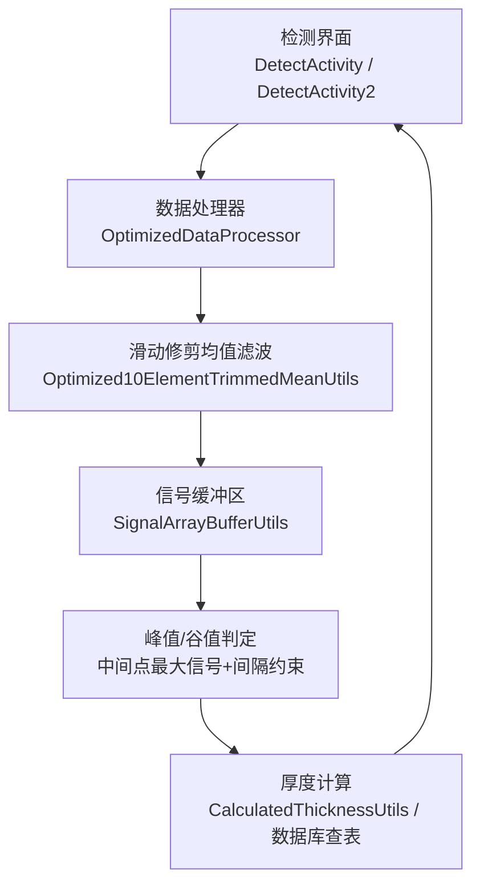
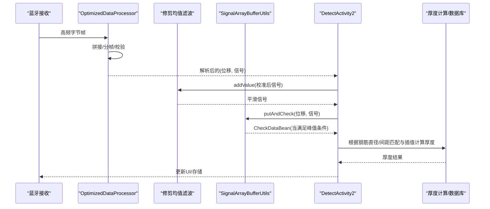
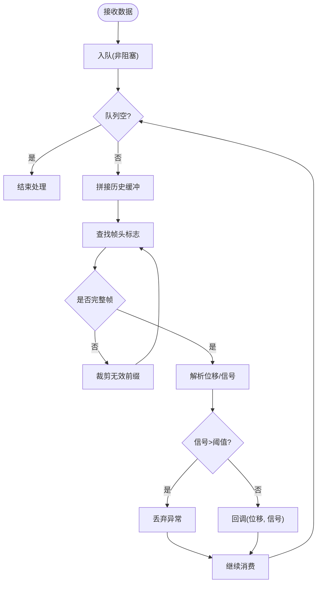
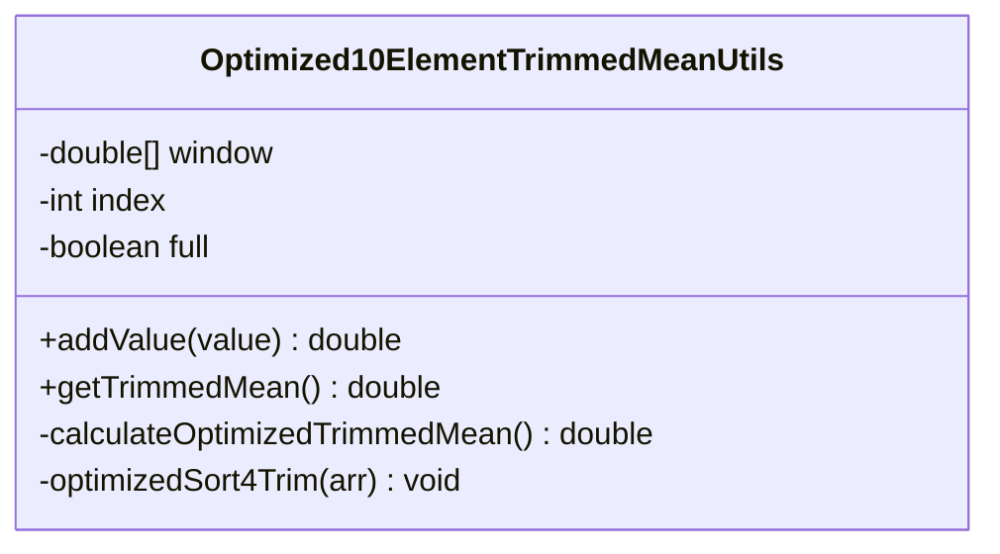
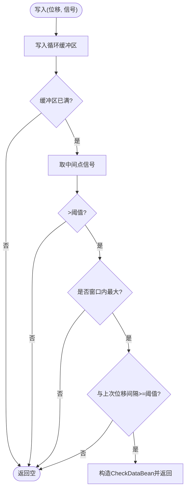
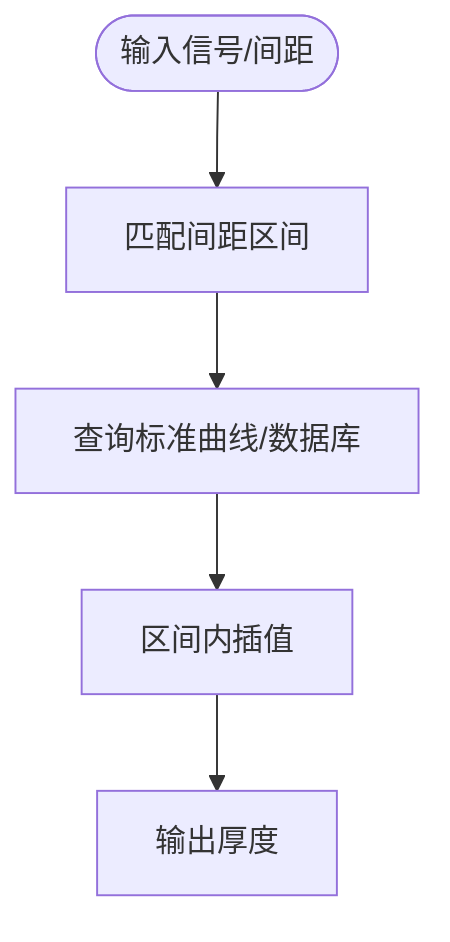
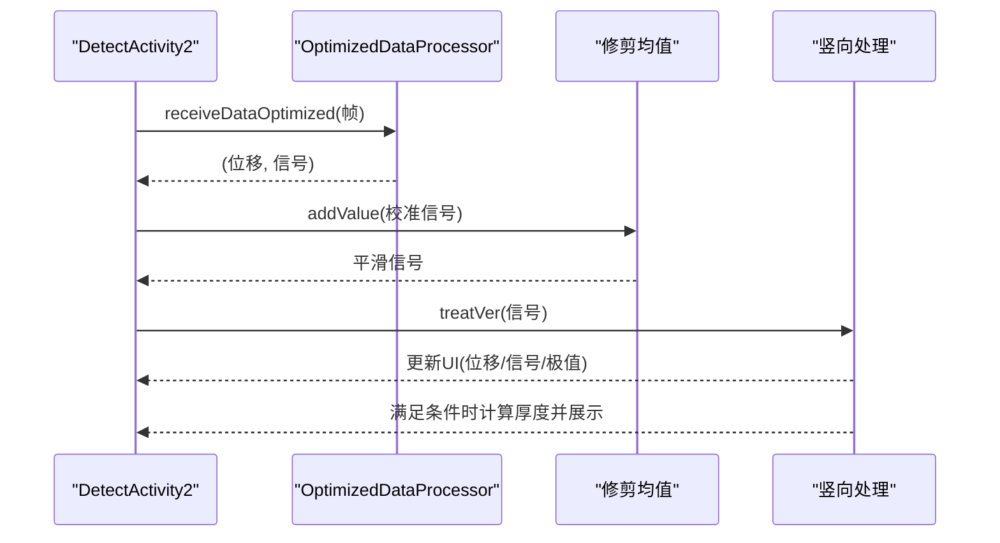
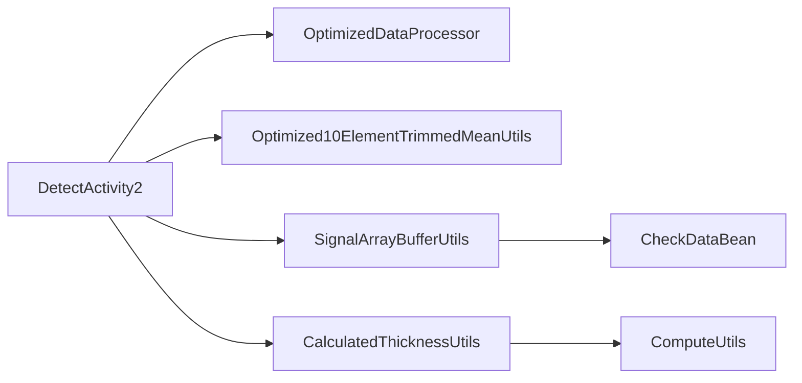

# 竖向检测（信号分析）

<cite>
**本文引用的文件**
- [OptimizedDataProcessor.java](file://app/src/main/java/com/example/gtj_sd_dg240/utils/OptimizedDataProcessor.java)
- [SignalArrayBufferUtils.java](file://app/src/main/java/com/example/gtj_sd_dg240/utils/SignalArrayBufferUtils.java)
- [Optimized10ElementTrimmedMeanUtils.java](file://app/src/main/java/com/example/gtj_sd_dg240/utils/Optimized10ElementTrimmedMeanUtils.java)
- [CalculatedThicknessUtils.java](file://app/src/main/java/com/example/gtj_sd_dg240/utils/CalculatedThicknessUtils.java)
- [DetectActivity2.java](file://app/src/main/java/com/example/gtj_sd_dg240/activity/testing/DetectActivity2.java)
- [DetectActivity.java](file://app/src/main/java/com/example/gtj_sd_dg240/activity/testing/DetectActivity.java)
- [MeteringDeviceActivity.java](file://app/src/main/java/com/example/gtj_sd_dg240/activity/setting/MeteringDeviceActivity.java)
- [ComputeUtils.java](file://app/src/main/java/com/example/gtj_sd_dg240/utils/ComputeUtils.java)
- [CheckDataBean.java](file://app/src/main/java/com/example/gtj_sd_dg240/model/CheckDataBean.java)
</cite>

## 目录
1. [简介](#简介)
2. [项目结构](#项目结构)
3. [核心组件](#核心组件)
4. [架构总览](#架构总览)
5. [详细组件分析](#详细组件分析)
6. [依赖关系分析](#依赖关系分析)
7. [性能考虑](#性能考虑)
8. [故障诊断指南](#故障诊断指南)
9. [结论](#结论)
10. [附录：操作流程与参数说明](#附录：操作流程与参数说明)

## 简介
本文件面向混凝土电杆竖向检测的信号处理与分析，系统性阐述以下要点：
- 信号最大值与最小值检测原理与实现
- 信号滤波算法与数据平滑策略
- 信号缓冲区管理与实时数据处理流水线
- 数据分析技术：厚度计算、间距匹配与插值
- 信号质量评估、噪声抑制与异常值检测机制
- 竖向检测的操作流程、关键参数设置与结果解读
- 信号采集优化、性能调优与常见故障诊断技巧

## 项目结构
本项目采用分层组织：UI层负责交互与展示；业务逻辑层负责检测流程控制；工具层提供信号处理、缓冲管理、数学计算等通用能力。竖向检测的核心路径由蓝牙数据接收、数据解析、信号滤波、峰值检测、厚度计算与结果输出组成。

图表来源
- [DetectActivity2.java:188-211](file://app/src/main/java/com/example/gtj_sd_dg240/activity/testing/DetectActivity2.java#L188-L211)
- [OptimizedDataProcessor.java:34-133](file://app/src/main/java/com/example/gtj_sd_dg240/utils/OptimizedDataProcessor.java#L34-L133)
- [Optimized10ElementTrimmedMeanUtils.java:93-129](file://app/src/main/java/com/example/gtj_sd_dg240/utils/Optimized10ElementTrimmedMeanUtils.java#L93-L129)
- [SignalArrayBufferUtils.java:26-66](file://app/src/main/java/com/example/gtj_sd_dg240/utils/SignalArrayBufferUtils.java#L26-L66)
- [CalculatedThicknessUtils.java:22-59](file://app/src/main/java/com/example/gtj_sd_dg240/utils/CalculatedThicknessUtils.java#L22-L59)

章节来源
- [DetectActivity2.java:188-211](file://app/src/main/java/com/example/gtj_sd_dg240/activity/testing/DetectActivity2.java#L188-L211)
- [OptimizedDataProcessor.java:34-133](file://app/src/main/java/com/example/gtj_sd_dg240/utils/OptimizedDataProcessor.java#L34-L133)

## 核心组件
- 数据接收与解析：将高频蓝牙帧按固定长度拼接、校验并解析出位移与信号值，过滤异常大信号。
- 信号滤波：使用滑动窗口修剪均值（去掉极端值后求平均），降低噪声影响。
- 缓冲区管理：循环数组维护最近N个采样点，支持并发安全访问。
- 峰值检测：在缓冲区满时检查中间点是否为全局最大，并结合位移间隔阈值确认有效峰值。
- 厚度计算：依据钢筋直径、主筋间距范围匹配与标准曲线/数据库区间插值得到保护层厚度。
- 单点检测：对左右双通道信号取平均，通过标准表插值快速得到厚度。

章节来源
- [OptimizedDataProcessor.java:82-133](file://app/src/main/java/com/example/gtj_sd_dg240/utils/OptimizedDataProcessor.java#L82-L133)
- [Optimized10ElementTrimmedMeanUtils.java:22-129](file://app/src/main/java/com/example/gtj_sd_dg240/utils/Optimized10ElementTrimmedMeanUtils.java#L22-L129)
- [SignalArrayBufferUtils.java:26-94](file://app/src/main/java/com/example/gtj_sd_dg240/utils/SignalArrayBufferUtils.java#L26-L94)
- [CalculatedThicknessUtils.java:22-59](file://app/src/main/java/com/example/gtj_sd_dg240/utils/CalculatedThicknessUtils.java#L22-L59)
- [MeteringDeviceActivity.java:110-134](file://app/src/main/java/com/example/gtj_sd_dg240/activity/setting/MeteringDeviceActivity.java#L110-L134)

## 架构总览
竖向检测的数据流从蓝牙接收开始，经线程安全的队列缓冲、帧拼接与解析，进入信号滤波与峰值检测模块，最终进行厚度计算与结果展示。

图表来源
- [OptimizedDataProcessor.java:34-133](file://app/src/main/java/com/example/gtj_sd_dg240/utils/OptimizedDataProcessor.java#L34-L133)
- [DetectActivity2.java:188-211](file://app/src/main/java/com/example/gtj_sd_dg240/activity/testing/DetectActivity2.java#L188-L211)
- [SignalArrayBufferUtils.java:26-66](file://app/src/main/java/com/example/gtj_sd_dg240/utils/SignalArrayBufferUtils.java#L26-L66)
- [CalculatedThicknessUtils.java:22-59](file://app/src/main/java/com/example/gtj_sd_dg240/utils/CalculatedThicknessUtils.java#L22-L59)

## 详细组件分析

### 数据接收与解析（OptimizedDataProcessor）
- 生产者-消费者模式：使用阻塞队列缓存高频数据，避免丢帧；仅启动一个处理线程消费队列。
- 帧拼接与完整性检查：按固定帧长（7字节）切分，定位帧头标志，丢弃不完整或错位数据。
- 解析与异常过滤：提取位移与信号值，对异常大信号直接丢弃，减少后续误检。

图表来源
- [OptimizedDataProcessor.java:34-133](file://app/src/main/java/com/example/gtj_sd_dg240/utils/OptimizedDataProcessor.java#L34-L133)

章节来源
- [OptimizedDataProcessor.java:34-133](file://app/src/main/java/com/example/gtj_sd_dg240/utils/OptimizedDataProcessor.java#L34-L133)

### 信号滤波（Optimized10ElementTrimmedMeanUtils）
- 滑动窗口：维护固定大小的环形缓冲区，新值进入后更新缓存平均值。
- 修剪均值：去除两端各若干极端值后对中间段求平均，有效抑制脉冲噪声与异常尖峰。
- 性能优化：针对小窗口采用部分选择/插入排序的展开实现，减少开销。

图表来源
- [Optimized10ElementTrimmedMeanUtils.java:22-129](file://app/src/main/java/com/example/gtj_sd_dg240/utils/Optimized10ElementTrimmedMeanUtils.java#L22-L129)

章节来源
- [Optimized10ElementTrimmedMeanUtils.java:22-129](file://app/src/main/java/com/example/gtj_sd_dg240/utils/Optimized10ElementTrimmedMeanUtils.java#L22-L129)

### 信号缓冲区与峰值检测（SignalArrayBufferUtils）
- 循环缓冲区：以固定容量保存最近N个(位移, 信号)对，支持并发安全写入。
- 峰值触发：当缓冲区满时，检查中间点信号是否达到当前窗口的最大值且大于阈值，同时要求该峰值与上次记录的位移间隔满足最小距离，避免重复触发。
- 输出：返回包含完整曲线数据的对象，供后续厚度计算使用。

图表来源
- [SignalArrayBufferUtils.java:26-66](file://app/src/main/java/com/example/gtj_sd_dg240/utils/SignalArrayBufferUtils.java#L26-L66)

章节来源
- [SignalArrayBufferUtils.java:26-66](file://app/src/main/java/com/example/gtj_sd_dg240/utils/SignalArrayBufferUtils.java#L26-L66)

### 厚度计算与数据分析（CalculatedThicknessUtils / ComputeUtils）
- 区间匹配：根据钢筋直径与主筋间距范围，匹配对应的标准曲线或数据库区间。
- 插值计算：在匹配的区间内进行线性插值，得到保护层厚度。
- 几何计算：利用余弦定理计算两点间弦长，用于主筋间距换算。

图表来源
- [CalculatedThicknessUtils.java:22-59](file://app/src/main/java/com/example/gtj_sd_dg240/utils/CalculatedThicknessUtils.java#L22-L59)
- [ComputeUtils.java:17-26](file://app/src/main/java/com/example/gtj_sd_dg240/utils/ComputeUtils.java#L17-L26)

章节来源
- [CalculatedThicknessUtils.java:22-59](file://app/src/main/java/com/example/gtj_sd_dg240/utils/CalculatedThicknessUtils.java#L22-L59)
- [ComputeUtils.java:17-26](file://app/src/main/java/com/example/gtj_sd_dg240/utils/ComputeUtils.java#L17-L26)

### 单点检测（MeteringDeviceActivity）
- 左右信号平均：对左右通道信号取平均，提高稳定性。
- 标准表插值：基于预置的标准信号-厚度表进行分段插值，快速得到厚度。
- 结果记录：将测量结果追加至列表并滚动显示。

章节来源
- [MeteringDeviceActivity.java:110-134](file://app/src/main/java/com/example/gtj_sd_dg240/activity/setting/MeteringDeviceActivity.java#L110-L134)

### 竖向检测流程（DetectActivity2）
- 初始化数据处理器：注册回调，完成信号校准与滤波。
- 横向/竖向分支：根据模式调用不同处理函数。
- 竖向峰值统计：维护时间窗口内的最小/最大信号，超过一定时间间隔后更新极值，并在满足条件时计算厚度。

图表来源
- [DetectActivity2.java:188-211](file://app/src/main/java/com/example/gtj_sd_dg240/activity/testing/DetectActivity2.java#L188-L211)
- [DetectActivity2.java:260-285](file://app/src/main/java/com/example/gtj_sd_dg240/activity/testing/DetectActivity2.java#L260-L285)

章节来源
- [DetectActivity2.java:188-211](file://app/src/main/java/com/example/gtj_sd_dg240/activity/testing/DetectActivity2.java#L188-L211)
- [DetectActivity2.java:260-285](file://app/src/main/java/com/example/gtj_sd_dg240/activity/testing/DetectActivity2.java#L260-L285)

## 依赖关系分析
- 高耦合点：
  - DetectActivity2 依赖 OptimizedDataProcessor 与 Optimized10ElementTrimmedMeanUtils，形成“解析-滤波”链路。
  - SignalArrayBufferUtils 作为峰值检测的核心，被上层检测流程调用。
  - CalculatedThicknessUtils 与数据库/标准表共同决定厚度计算精度。
- 低耦合点：
  - ComputeUtils 提供纯数学计算，无外部状态依赖。
  - CheckDataBean 为数据传输载体，结构简单。

图表来源
- [DetectActivity2.java:188-211](file://app/src/main/java/com/example/gtj_sd_dg240/activity/testing/DetectActivity2.java#L188-L211)
- [OptimizedDataProcessor.java:34-133](file://app/src/main/java/com/example/gtj_sd_dg240/utils/OptimizedDataProcessor.java#L34-L133)
- [SignalArrayBufferUtils.java:26-66](file://app/src/main/java/com/example/gtj_sd_dg240/utils/SignalArrayBufferUtils.java#L26-L66)
- [CalculatedThicknessUtils.java:22-59](file://app/src/main/java/com/example/gtj_sd_dg240/utils/CalculatedThicknessUtils.java#L22-L59)
- [ComputeUtils.java:17-26](file://app/src/main/java/com/example/gtj_sd_dg240/utils/ComputeUtils.java#L17-L26)
- [CheckDataBean.java:1-33](file://app/src/main/java/com/example/gtj_sd_dg240/model/CheckDataBean.java#L1-L33)

章节来源
- [DetectActivity2.java:188-211](file://app/src/main/java/com/example/gtj_sd_dg240/activity/testing/DetectActivity2.java#L188-L211)
- [OptimizedDataProcessor.java:34-133](file://app/src/main/java/com/example/gtj_sd_dg240/utils/OptimizedDataProcessor.java#L34-L133)
- [SignalArrayBufferUtils.java:26-66](file://app/src/main/java/com/example/gtj_sd_dg240/utils/SignalArrayBufferUtils.java#L26-L66)
- [CalculatedThicknessUtils.java:22-59](file://app/src/main/java/com/example/gtj_sd_dg240/utils/CalculatedThicknessUtils.java#L22-L59)
- [ComputeUtils.java:17-26](file://app/src/main/java/com/example/gtj_sd_dg240/utils/ComputeUtils.java#L17-L26)
- [CheckDataBean.java:1-33](file://app/src/main/java/com/example/gtj_sd_dg240/model/CheckDataBean.java#L1-L33)

## 性能考虑
- 高频数据吞吐：使用非阻塞入队与单消费者线程，避免锁竞争与频繁创建线程。
- 帧拼接优化：按固定帧长切分，减少字符串转换与正则匹配开销。
- 滤波效率：小窗口修剪均值采用展开排序与局部选择，降低CPU占用。
- 峰值检测：仅在缓冲区满时执行全局比较，结合位移间隔限制减少误判。
- UI更新：通过Handler在主线程批量刷新，避免频繁UI操作导致卡顿。

[本节为通用性能建议，不直接分析具体代码]

## 故障诊断指南
- 无峰值触发：
  - 检查缓冲区大小与有效间隔阈值是否合理。
  - 确认中间点信号阈值设置是否过低或过高。
  - 验证位移间隔约束是否过严导致无法触发。
- 信号异常波动：
  - 调整修剪均值的窗口大小与修剪数量，增强抗噪能力。
  - 检查蓝牙帧解析是否正确，是否存在粘包/断包问题。
- 厚度计算偏差：
  - 核对钢筋直径与主筋间距匹配规则是否符合实际构件。
  - 检查标准曲线/数据库区间是否与设备标定一致。
- 单点检测不准：
  - 确认左右信号平均是否有效，排除单侧传感器异常。
  - 检查标准表插值区间覆盖是否完整。

章节来源
- [SignalArrayBufferUtils.java:26-66](file://app/src/main/java/com/example/gtj_sd_dg240/utils/SignalArrayBufferUtils.java#L26-L66)
- [Optimized10ElementTrimmedMeanUtils.java:22-129](file://app/src/main/java/com/example/gtj_sd_dg240/utils/Optimized10ElementTrimmedMeanUtils.java#L22-L129)
- [OptimizedDataProcessor.java:82-133](file://app/src/main/java/com/example/gtj_sd_dg240/utils/OptimizedDataProcessor.java#L82-L133)
- [CalculatedThicknessUtils.java:22-59](file://app/src/main/java/com/example/gtj_sd_dg240/utils/CalculatedThicknessUtils.java#L22-L59)
- [MeteringDeviceActivity.java:110-134](file://app/src/main/java/com/example/gtj_sd_dg240/activity/setting/MeteringDeviceActivity.java#L110-L134)

## 结论
竖向检测通过“解析-滤波-缓冲-峰值-计算”的流水线实现了稳定可靠的信号分析与厚度估算。其关键点在于：
- 高效的帧拼接与异常过滤，保障数据完整性
- 滑动修剪均值滤波提升信号质量
- 循环缓冲区与间隔约束确保峰值检测准确性
- 基于钢筋直径与间距匹配的插值计算保证厚度精度
- 单点检测作为快速验证手段，便于现场标定与调试

[本节为总结性内容，不直接分析具体代码]

## 附录：操作流程与参数说明

### 操作流程
- 数据采集：
  - 开启蓝牙连接，接收F1帧数据，解析位移与信号。
  - 对左右信号取平均（单点检测）或进入竖向检测流程。
- 信号预处理：
  - 校准信号值（基于标定表）。
  - 滑动修剪均值滤波，输出平滑信号。
- 峰值检测：
  - 将(位移, 信号)写入循环缓冲区。
  - 缓冲区满时检查中间点是否为最大值且满足阈值与位移间隔。
  - 满足条件则输出CheckDataBean并进入厚度计算。
- 厚度计算：
  - 根据钢筋直径与主筋间距范围匹配标准曲线/数据库区间。
  - 区间内插值得到保护层厚度。
- 结果展示：
  - 更新UI显示厚度、信号极值与曲线。
  - 存储检测结果，支持导出与上传。

章节来源
- [DetectActivity2.java:188-211](file://app/src/main/java/com/example/gtj_sd_dg240/activity/testing/DetectActivity2.java#L188-L211)
- [DetectActivity2.java:260-285](file://app/src/main/java/com/example/gtj_sd_dg240/activity/testing/DetectActivity2.java#L260-L285)
- [SignalArrayBufferUtils.java:26-66](file://app/src/main/java/com/example/gtj_sd_dg240/utils/SignalArrayBufferUtils.java#L26-L66)
- [CalculatedThicknessUtils.java:22-59](file://app/src/main/java/com/example/gtj_sd_dg240/utils/CalculatedThicknessUtils.java#L22-L59)
- [MeteringDeviceActivity.java:110-134](file://app/src/main/java/com/example/gtj_sd_dg240/activity/setting/MeteringDeviceActivity.java#L110-L134)

### 关键参数与调优
- 缓冲区大小：影响峰值检测的灵敏度与响应速度，需根据采样频率与移动速度调整。
- 有效间隔阈值：防止重复触发，过大可能漏检，过小可能误检。
- 信号阈值：中间点信号必须大于阈值才参与峰值判断，需结合环境噪声标定。
- 修剪均值窗口与修剪数量：窗口越大越平滑但延迟增加；修剪越多抗噪越强但可能削峰。
- 钢筋直径与间距匹配：直接影响厚度计算准确性，需与实际构件一致。
- 标定表/标准曲线：确保设备标定与理论模型一致，定期复校。

[本节为通用指导，不直接分析具体代码]

### 结果解读
- 厚度值：保护层厚度，单位毫米，结合工程规范判断合格与否。
- 信号极值：反映信号强度与稳定性，异常波动提示可能存在干扰或传感器问题。
- 曲线形态：CheckDataBean中的曲线可用于离线分析与可视化，辅助诊断。
- 单点检测：快速验证设备状态与标定效果，便于现场调试。

章节来源
- [CheckDataBean.java:1-33](file://app/src/main/java/com/example/gtj_sd_dg240/model/CheckDataBean.java#L1-L33)
- [DetectActivity2.java:260-285](file://app/src/main/java/com/example/gtj_sd_dg240/activity/testing/DetectActivity2.java#L260-L285)
- [MeteringDeviceActivity.java:110-134](file://app/src/main/java/com/example/gtj_sd_dg240/activity/setting/MeteringDeviceActivity.java#L110-L134)