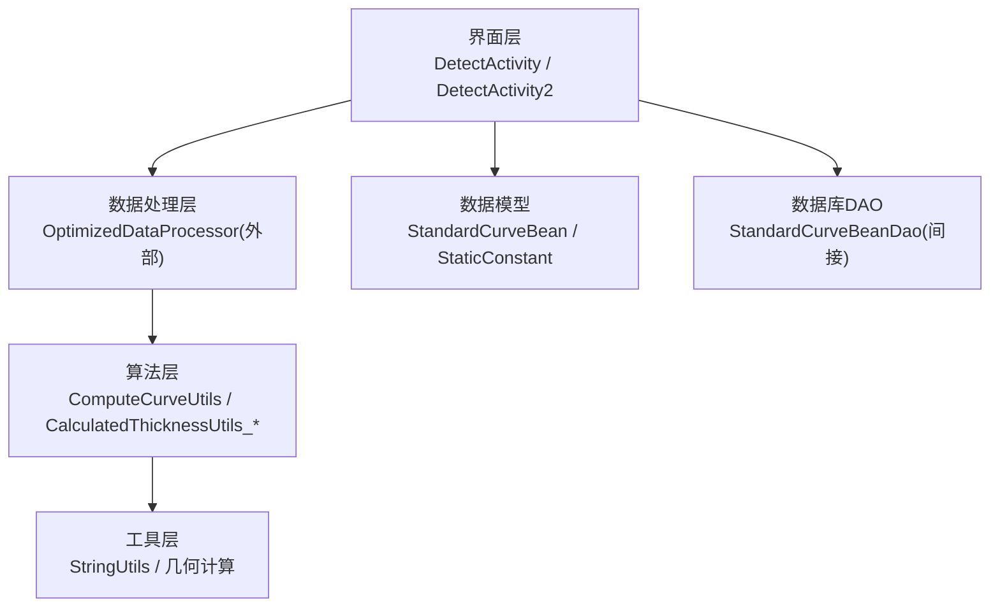
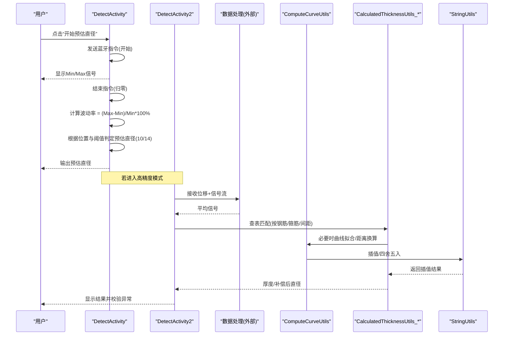
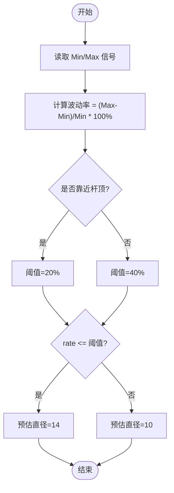
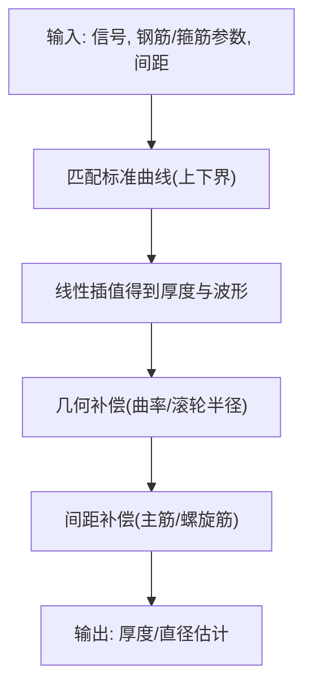
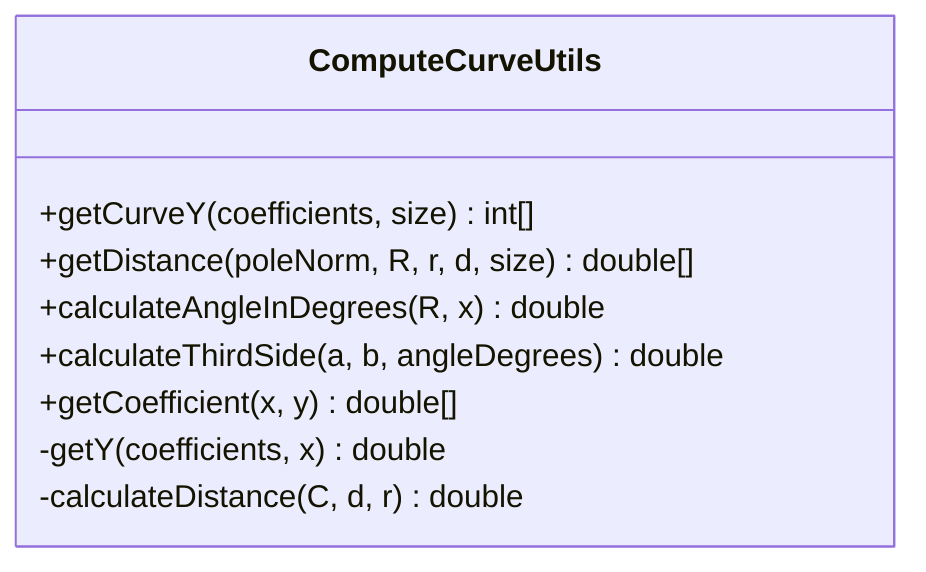
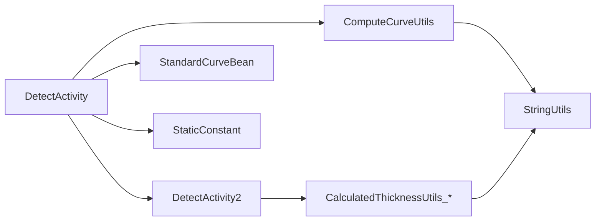

# 预估直径计算

<cite>
**本文引用的文件**
- [DetectActivity.java](file://app/src/main/java/com/example/gtj_sd_dg240/activity/testing/DetectActivity.java)
- [DetectActivity2.java](file://app/src/main/java/com/example/gtj_sd_dg240/activity/testing/DetectActivity2.java)
- [ComputeCurveUtils.java](file://app/src/main/java/com/example/gtj_sd_dg240/utils/ComputeCurveUtils.java)
- [CalculatedThicknessUtils.java](file://app/src/main/java/com/example/gtj_sd_dg240/utils/CalculatedThicknessUtils.java)
- [CalculatedThicknessUtils_11_4.java](file://app/src/main/java/com/example/gtj_sd_dg240/utils/CalculatedThicknessUtils_11_4.java)
- [CalculatedThicknessUtils_14_4.java](file://app/src/main/java/com/example/gtj_sd_dg240/utils/CalculatedThicknessUtils_14_4.java)
- [StringUtils.java](file://app/src/main/java/com/example/gtj_sd_dg240/utils/StringUtils.java)
- [StandardCurveBean.java](file://app/src/main/java/com/example/gtj_sd_dg240/model/StandardCurveBean.java)
- [StaticConstant.java](file://app/src/main/java/com/example/gtj_sd_dg240/StaticConstant.java)
</cite>

## 目录
1. [简介](#简介)
2. [项目结构](#项目结构)
3. [核心组件](#核心组件)
4. [架构总览](#架构总览)
5. [详细组件分析](#详细组件分析)
6. [依赖关系分析](#依赖关系分析)
7. [性能与精度考量](#性能与精度考量)
8. [故障排查指南](#故障排查指南)
9. [结论](#结论)
10. [附录：操作与验证流程](#附录操作与验证流程)

## 简介
本文件围绕混凝土电杆检测应用中的“预估直径”功能，系统阐述其数学模型、算法原理与计算流程。重点覆盖：
- 基于信号波动率的快速直径预估（实时模式）
- 基于标准曲线拟合与插值的厚度/直径反演（离线或高精度模式）
- 不同型号电杆的参数配置与精度控制
- 曲线拟合（最小二乘）、插值计算与分析技术
- 操作步骤、结果验证与质量评估方法
- 误差来源、模型优化与扩展开发建议

## 项目结构
该功能涉及界面交互、数据处理与工具库三类代码：
- 界面与流程控制：DetectActivity、DetectActivity2
- 算法与工具：ComputeCurveUtils、CalculatedThicknessUtils_*、StringUtils
- 数据模型与常量：StandardCurveBean、StaticConstant

图表来源
- [DetectActivity.java:830-849](file://app/src/main/java/com/example/gtj_sd_dg240/activity/testing/DetectActivity.java#L830-L849)
- [DetectActivity2.java:188-203](file://app/src/main/java/com/example/gtj_sd_dg240/activity/testing/DetectActivity2.java#L188-L203)
- [ComputeCurveUtils.java:114-139](file://app/src/main/java/com/example/gtj_sd_dg240/utils/ComputeCurveUtils.java#L114-L139)
- [CalculatedThicknessUtils.java:22-58](file://app/src/main/java/com/example/gtj_sd_dg240/utils/CalculatedThicknessUtils.java#L22-L58)
- [StandardCurveBean.java:16-39](file://app/src/main/java/com/example/gtj_sd_dg240/model/StandardCurveBean.java#L16-L39)
- [StaticConstant.java:52-63](file://app/src/main/java/com/example/gtj_sd_dg240/StaticConstant.java#L52-L63)

章节来源
- [DetectActivity.java:830-849](file://app/src/main/java/com/example/gtj_sd_dg240/activity/testing/DetectActivity.java#L830-L849)
- [DetectActivity2.java:188-203](file://app/src/main/java/com/example/gtj_sd_dg240/activity/testing/DetectActivity2.java#L188-L203)
- [ComputeCurveUtils.java:114-139](file://app/src/main/java/com/example/gtj_sd_dg240/utils/ComputeCurveUtils.java#L114-L139)
- [CalculatedThicknessUtils.java:22-58](file://app/src/main/java/com/example/gtj_sd_dg240/utils/CalculatedThicknessUtils.java#L22-L58)
- [StandardCurveBean.java:16-39](file://app/src/main/java/com/example/gtj_sd_dg240/model/StandardCurveBean.java#L16-L39)
- [StaticConstant.java:52-63](file://app/src/main/java/com/example/gtj_sd_dg240/StaticConstant.java#L52-L63)

## 核心组件
- 预估直径主流程（实时）：通过蓝牙采集信号，统计最小/最大信号值，计算波动率，结合位置阈值判定预估直径类别（如10mm/14mm）。
- 厚度/直径反演（高精度）：基于标准曲线表（按钢筋直径、保护层厚度组织），对实测信号进行匹配与插值，得到厚度；再结合几何补偿与间距补偿，反推直径。
- 曲线拟合与插值：使用最小二乘法多项式拟合生成理论曲线；使用线性插值在相邻标准曲线间估算中间厚度对应的信号波形。
- 参数配置：钢筋直径、箍筋直径、桩型结构、规范等来自静态常量与用户配置。

章节来源
- [DetectActivity.java:438-459](file://app/src/main/java/com/example/gtj_sd_dg240/activity/testing/DetectActivity.java#L438-L459)
- [DetectActivity.java:830-849](file://app/src/main/java/com/example/gtj_sd_dg240/activity/testing/DetectActivity.java#L830-L849)
- [DetectActivity2.java:188-203](file://app/src/main/java/com/example/gtj_sd_dg240/activity/testing/DetectActivity2.java#L188-L203)
- [ComputeCurveUtils.java:114-139](file://app/src/main/java/com/example/gtj_sd_dg240/utils/ComputeCurveUtils.java#L114-L139)
- [CalculatedThicknessUtils.java:22-58](file://app/src/main/java/com/example/gtj_sd_dg240/utils/CalculatedThicknessUtils.java#L22-L58)
- [StaticConstant.java:52-63](file://app/src/main/java/com/example/gtj_sd_dg240/StaticConstant.java#L52-L63)

## 架构总览
下图展示从数据采集到结果输出的端到端流程，包括两种路径：快速预估与高精度反演。

图表来源
- [DetectActivity.java:830-849](file://app/src/main/java/com/example/gtj_sd_dg240/activity/testing/DetectActivity.java#L830-L849)
- [DetectActivity2.java:188-203](file://app/src/main/java/com/example/gtj_sd_dg240/activity/testing/DetectActivity2.java#L188-L203)
- [ComputeCurveUtils.java:114-139](file://app/src/main/java/com/example/gtj_sd_dg240/utils/ComputeCurveUtils.java#L114-L139)
- [CalculatedThicknessUtils.java:22-58](file://app/src/main/java/com/example/gtj_sd_dg240/utils/CalculatedThicknessUtils.java#L22-L58)
- [StringUtils.java:228-246](file://app/src/main/java/com/example/gtj_sd_dg240/utils/StringUtils.java#L228-L246)

## 详细组件分析

### 1) 快速预估直径（波动率法）
- 输入：蓝牙信号的最小值valueMin与最大值valueMax，当前距根部距离currentDistance，电杆高度zoneBean.poleHeight
- 处理：
  - 计算波动率 rate = (valueMax - valueMin) / valueMin × 100%
  - 判断是否接近杆顶（currentDistance ≥ poleHeight - 3）
  - 根/梢段与中段采用不同阈值（例如20%/40%）
  - 根据阈值选择预估直径类别（如10mm或14mm）
- 输出：预估直径（字符串形式）

图表来源
- [DetectActivity.java:830-849](file://app/src/main/java/com/example/gtj_sd_dg240/activity/testing/DetectActivity.java#L830-L849)

章节来源
- [DetectActivity.java:438-459](file://app/src/main/java/com/example/gtj_sd_dg240/activity/testing/DetectActivity.java#L438-L459)
- [DetectActivity.java:830-849](file://app/src/main/java/com/example/gtj_sd_dg240/activity/testing/DetectActivity.java#L830-L849)

### 2) 高精度直径反演（标准曲线+插值+补偿）
- 数据准备：
  - 标准曲线表：按钢筋直径、保护层厚度组织，包含信号波形数组
  - 用户配置：钢筋直径、箍筋直径、主筋间距、电杆规格等
- 匹配与插值：
  - 将实测信号与标准曲线比对，定位上下两条相邻曲线
  - 使用线性插值估算对应厚度下的完整信号波形
- 几何与间距补偿：
  - 电杆曲率补偿：根据半径与传感器滚轮半径计算补偿量
  - 主筋/螺旋筋间距补偿：依据间距区间查表或公式修正
- 直径反推：
  - 由厚度与已知钢筋布置，结合几何关系推算直径（或用于后续直径分类）

图表来源
- [ComputeCurveUtils.java:114-139](file://app/src/main/java/com/example/gtj_sd_dg240/utils/ComputeCurveUtils.java#L114-L139)
- [CalculatedThicknessUtils.java:22-58](file://app/src/main/java/com/example/gtj_sd_dg240/utils/CalculatedThicknessUtils.java#L22-L58)
- [CalculatedThicknessUtils_11_4.java:17-31](file://app/src/main/java/com/example/gtj_sd_dg240/utils/CalculatedThicknessUtils_11_4.java#L17-L31)
- [CalculatedThicknessUtils_14_4.java:17-31](file://app/src/main/java/com/example/gtj_sd_dg240/utils/CalculatedThicknessUtils_14_4.java#L17-L31)
- [StringUtils.java:228-246](file://app/src/main/java/com/example/gtj_sd_dg240/utils/StringUtils.java#L228-L246)

章节来源
- [ComputeCurveUtils.java:114-139](file://app/src/main/java/com/example/gtj_sd_dg240/utils/ComputeCurveUtils.java#L114-L139)
- [CalculatedThicknessUtils.java:22-58](file://app/src/main/java/com/example/gtj_sd_dg240/utils/CalculatedThicknessUtils.java#L22-L58)
- [CalculatedThicknessUtils_11_4.java:17-31](file://app/src/main/java/com/example/gtj_sd_dg240/utils/CalculatedThicknessUtils_11_4.java#L17-L31)
- [CalculatedThicknessUtils_14_4.java:17-31](file://app/src/main/java/com/example/gtj_sd_dg240/utils/CalculatedThicknessUtils_14_4.java#L17-L31)
- [StringUtils.java:228-246](file://app/src/main/java/com/example/gtj_sd_dg240/utils/StringUtils.java#L228-L246)

### 3) 曲线拟合与距离换算
- 多项式拟合：使用最小二乘法拟合二次多项式，得到系数，用于生成理论信号曲线或校正测量轨迹
- 距离换算：基于电杆半径R、钢筋半径r、厚度d，利用余弦定理与勾股关系计算沿圆周行走的直线距离，以对齐信号与空间位置

图表来源
- [ComputeCurveUtils.java:15-45](file://app/src/main/java/com/example/gtj_sd_dg240/utils/ComputeCurveUtils.java#L15-L45)
- [ComputeCurveUtils.java:77-112](file://app/src/main/java/com/example/gtj_sd_dg240/utils/ComputeCurveUtils.java#L77-L112)
- [ComputeCurveUtils.java:121-139](file://app/src/main/java/com/example/gtj_sd_dg240/utils/ComputeCurveUtils.java#L121-L139)

章节来源
- [ComputeCurveUtils.java:15-45](file://app/src/main/java/com/example/gtj_sd_dg240/utils/ComputeCurveUtils.java#L15-L45)
- [ComputeCurveUtils.java:77-112](file://app/src/main/java/com/example/gtj_sd_dg240/utils/ComputeCurveUtils.java#L77-L112)
- [ComputeCurveUtils.java:121-139](file://app/src/main/java/com/example/gtj_sd_dg240/utils/ComputeCurveUtils.java#L121-L139)

### 4) 不同型号电杆的参数配置与精度控制
- 钢筋直径与箍筋直径：由StaticConstant提供可选列表，界面中供用户选择
- 主筋间距：按30/40/50/60/70/120等离散档位选择，影响查表与补偿
- 电杆结构与规范：锥形杆/法兰杆/等径杆，遵循GB/T 4623-2014
- 精度控制：
  - 信号均值滤波（外部处理器）
  - 插值与四舍五入（StringUtils）
  - 几何与间距补偿（CalculatedThicknessUtils_*）

章节来源
- [StaticConstant.java:52-63](file://app/src/main/java/com/example/gtj_sd_dg240/StaticConstant.java#L52-L63)
- [CalculatedThicknessUtils_11_4.java:17-31](file://app/src/main/java/com/example/gtj_sd_dg240/utils/CalculatedThicknessUtils_11_4.java#L17-L31)
- [CalculatedThicknessUtils_14_4.java:17-31](file://app/src/main/java/com/example/gtj_sd_dg240/utils/CalculatedThicknessUtils_14_4.java#L17-L31)

### 5) 标准曲线数据模型
- StandardCurveBean：存储钢筋直径、保护层厚度、变化率、信号数组等
- 支持按直径查询、排序与导出，便于标定与更新

章节来源
- [StandardCurveBean.java:16-39](file://app/src/main/java/com/example/gtj_sd_dg240/model/StandardCurveBean.java#L16-L39)

## 依赖关系分析
- 界面层依赖算法层进行计算，并通过工具层完成数值处理
- 算法层依赖工具层进行插值、四舍五入与几何计算
- 数据模型与常量提供参数与标准曲线定义
- 数据库DAO用于标准曲线的存取（间接引用）

图表来源
- [DetectActivity.java:830-849](file://app/src/main/java/com/example/gtj_sd_dg240/activity/testing/DetectActivity.java#L830-L849)
- [DetectActivity2.java:188-203](file://app/src/main/java/com/example/gtj_sd_dg240/activity/testing/DetectActivity2.java#L188-L203)
- [ComputeCurveUtils.java:114-139](file://app/src/main/java/com/example/gtj_sd_dg240/utils/ComputeCurveUtils.java#L114-L139)
- [CalculatedThicknessUtils.java:22-58](file://app/src/main/java/com/example/gtj_sd_dg240/utils/CalculatedThicknessUtils.java#L22-L58)
- [StandardCurveBean.java:16-39](file://app/src/main/java/com/example/gtj_sd_dg240/model/StandardCurveBean.java#L16-L39)
- [StaticConstant.java:52-63](file://app/src/main/java/com/example/gtj_sd_dg240/StaticConstant.java#L52-L63)

章节来源
- [DetectActivity.java:830-849](file://app/src/main/java/com/example/gtj_sd_dg240/activity/testing/DetectActivity.java#L830-L849)
- [DetectActivity2.java:188-203](file://app/src/main/java/com/example/gtj_sd_dg240/activity/testing/DetectActivity2.java#L188-L203)
- [ComputeCurveUtils.java:114-139](file://app/src/main/java/com/example/gtj_sd_dg240/utils/ComputeCurveUtils.java#L114-L139)
- [CalculatedThicknessUtils.java:22-58](file://app/src/main/java/com/example/gtj_sd_dg240/utils/CalculatedThicknessUtils.java#L22-L58)
- [StandardCurveBean.java:16-39](file://app/src/main/java/com/example/gtj_sd_dg240/model/StandardCurveBean.java#L16-L39)
- [StaticConstant.java:52-63](file://app/src/main/java/com/example/gtj_sd_dg240/StaticConstant.java#L52-L63)

## 性能与精度考量
- 实时预估：
  - 优点：低延迟、无需复杂标定
  - 风险：易受噪声与接触状态影响；需保证Min信号非零且稳定
- 高精度反演：
  - 优点：可量化厚度与补偿，精度更高
  - 成本：需要标准曲线与参数准确；计算开销略高
- 关键优化点：
  - 信号均值滤波（外部处理器）
  - 插值与四舍五入策略（StringUtils）
  - 几何与间距补偿（CalculatedThicknessUtils_*）
  - 曲线拟合（最小二乘）提升理论曲线一致性

[本节为通用指导，不直接分析具体文件]

## 故障排查指南
- 预估失败（最小信号为0）：检查蓝牙连接与传感器接触，确保有效信号采集
- 结果异常提示：当厚度超出范围时弹出异常提示，建议重复测量或剔凿验证
- 数据为空或未添加检测部位：需在界面中添加检测部位并正确设置参数

章节来源
- [DetectActivity.java:830-849](file://app/src/main/java/com/example/gtj_sd_dg240/activity/testing/DetectActivity.java#L830-L849)
- [DetectActivity.java:461-466](file://app/src/main/java/com/example/gtj_sd_dg240/activity/testing/DetectActivity.java#L461-L466)

## 结论
本项目提供了两套直径预估方案：快速波动率法适用于现场快速判断；标准曲线+插值+补偿的高精度反演适用于需要量化厚度与直径的场景。通过合理的参数配置、曲线拟合与补偿机制，可在不同型号电杆上实现稳定可靠的预估。实际应用中应结合现场条件选择合适的模式，并进行必要的校准与验证。

[本节为总结性内容，不直接分析具体文件]

## 附录：操作与验证流程

### 操作步骤（快速预估）
- 进入检测界面，点击“开始预估直径”，设备发送开始指令
- 采集过程中记录Min/Max信号
- 点击“结束/归零”，系统计算波动率并按阈值输出预估直径

章节来源
- [DetectActivity.java:830-849](file://app/src/main/java/com/example/gtj_sd_dg240/activity/testing/DetectActivity.java#L830-L849)

### 操作步骤（高精度反演）
- 配置参数：钢筋直径、箍筋直径、主筋间距、电杆规格
- 采集信号与位移，进入厚度计算流程
- 查表匹配标准曲线，进行插值与补偿，输出厚度/直径

章节来源
- [DetectActivity2.java:188-203](file://app/src/main/java/com/example/gtj_sd_dg240/activity/testing/DetectActivity2.java#L188-L203)
- [CalculatedThicknessUtils.java:22-58](file://app/src/main/java/com/example/gtj_sd_dg240/utils/CalculatedThicknessUtils.java#L22-L58)
- [ComputeCurveUtils.java:114-139](file://app/src/main/java/com/example/gtj_sd_dg240/utils/ComputeCurveUtils.java#L114-L139)

### 结果验证与质量评估
- 验证：对比预估直径与已知设计值或剔凿实测值
- 质量评估：关注波动率稳定性、信号Min是否非零、厚度是否在合理范围
- 异常处理：出现异常提示时重新测量或剔凿验证

章节来源
- [DetectActivity.java:461-466](file://app/src/main/java/com/example/gtj_sd_dg240/activity/testing/DetectActivity.java#L461-L466)
- [DetectActivity.java:830-849](file://app/src/main/java/com/example/gtj_sd_dg240/activity/testing/DetectActivity.java#L830-L849)

### 误差分析与模型优化
- 误差来源：
  - 信号噪声与接触不稳定
  - 参数配置错误（钢筋/箍筋直径、间距）
  - 几何补偿不准确（半径、滚轮半径）
- 优化建议：
  - 增加信号滤波窗口与剔除极端值
  - 完善标准曲线覆盖度（更多厚度档位）
  - 引入自适应阈值（随位置动态调整）
  - 定期标定与更新标准曲线

[本节为通用指导，不直接分析具体文件]

### 扩展开发指南
- 新增电杆型号：在StaticConstant中扩展配置项，并在CalculatedThicknessUtils_*中添加对应查表逻辑
- 改进拟合算法：在ComputeCurveUtils中扩展多项式阶数或引入鲁棒拟合
- 增强可视化：在界面层增加曲线对比与误差分布图

[本节为通用指导，不直接分析具体文件]