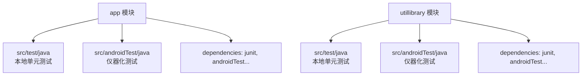
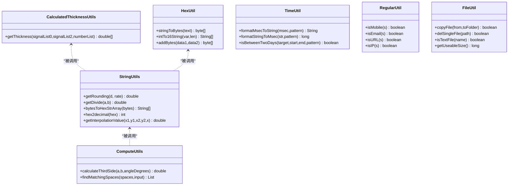
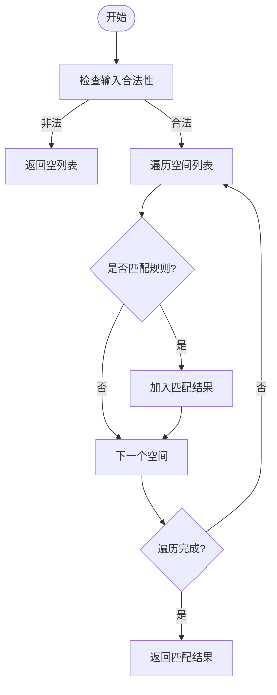
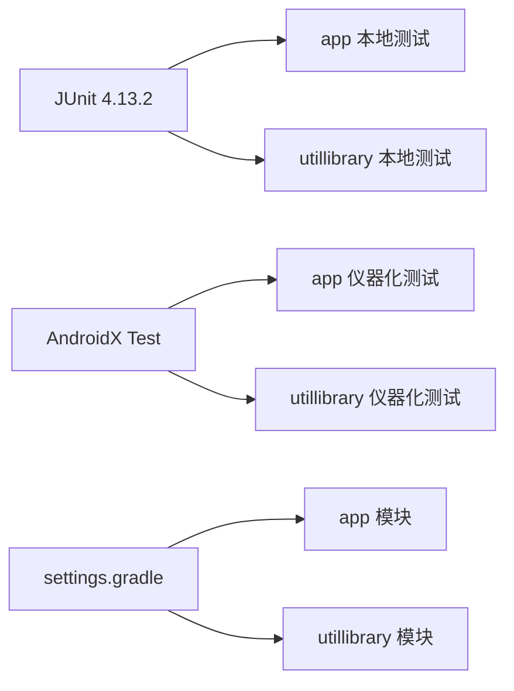

# 单元测试

<cite>
**本文引用的文件**
- [app/build.gradle](file://app/build.gradle)
- [utillibrary/build.gradle](file://utillibrary/build.gradle)
- [settings.gradle](file://settings.gradle)
- [gradle.properties](file://gradle.properties)
- [ExampleUnitTest.java（app）](file://app/src/test/java/com/example/gtj_sd_dg240/ExampleUnitTest.java)
- [ExampleInstrumentedTest.java（app）](file://app/src/androidTest/java/com/example/gtj_sd_dg240/ExampleInstrumentedTest.java)
- [ExampleUnitTest.java（utillibrary）](file://utillibrary/src/test/java/com/blackhao/utillibrary/ExampleUnitTest.java)
- [StringUtils.java](file://app/src/main/java/com/example/gtj_sd_dg240/utils/StringUtils.java)
- [ComputeUtils.java](file://app/src/main/java/com/example/gtj_sd_dg240/utils/ComputeUtils.java)
- [CalculatedThicknessUtils.java](file://app/src/main/java/com/example/gtj_sd_dg240/utils/CalculatedThicknessUtils.java)
- [HexUtil.java](file://app/src/main/java/com/example/gtj_sd_dg240/utils/HexUtil.java)
- [FileUtil.java](file://utillibrary/src/main/java/com/blackhao/utillibrary/file/FileUtil.java)
- [TimeUtil.java](file://utillibrary/src/main/java/com/blackhao/utillibrary/time/TimeUtil.java)
- [RegularUtil.java](file://utillibrary/src/main/java/com/blackhao/utillibrary/regular/RegularUtil.java)
</cite>

## 目录
1. [简介](#简介)
2. [项目结构](#项目结构)
3. [核心组件](#核心组件)
4. [架构总览](#架构总览)
5. [详细组件分析](#详细组件分析)
6. [依赖关系分析](#依赖关系分析)
7. [性能考虑](#性能考虑)
8. [故障排查指南](#故障排查指南)
9. [结论](#结论)
10. [附录](#附录)

## 简介
本单元文档面向本项目中的工具类、算法模块与数据处理逻辑，提供基于 JUnit 的本地单元测试实践指南。内容涵盖：
- 测试框架与环境配置（JUnit 4、AndroidX Test）
- 测试用例编写、断言使用、测试数据准备
- Mock 对象的使用策略与异步测试处理建议
- 针对字符串处理、数学计算、文件操作等场景的具体测试示例
- 覆盖率统计与持续集成自动化执行建议

## 项目结构
本项目为多模块 Android 工程，包含应用模块 app 与工具库模块 utillibrary。测试相关目录与依赖如下：
- 本地单元测试（JVM）：位于各模块的 src/test/java 下，运行于开发机 JVM，适合纯 Java 逻辑与无 Android 依赖的工具方法
- 仪器化测试（Android 设备/模拟器）：位于各模块的 src/androidTest/java 下，需要 Android 环境，适合涉及 Android API 的测试

图表来源
- [app/build.gradle:86-99](file://app/build.gradle#L86-L99)
- [utillibrary/build.gradle:43-50](file://utillibrary/build.gradle#L43-L50)

章节来源
- [app/build.gradle:86-99](file://app/build.gradle#L86-L99)
- [utillibrary/build.gradle:43-50](file://utillibrary/build.gradle#L43-L50)
- [settings.gradle:39-41](file://settings.gradle#L39-L41)

## 核心组件
- 字符串处理工具：StringUtils、RegularUtil
- 数学与算法工具：ComputeUtils、CalculatedThicknessUtils、HexUtil
- 时间与日期工具：TimeUtil
- 文件操作工具：FileUtil

这些组件大多为静态方法或无状态工具类，非常适合用本地单元测试进行覆盖。对于依赖 Android 环境的工具（如 FileUtil），在本地单元测试中应通过隔离外部依赖或使用可替换实现进行测试；若需真实文件系统行为，可在仪器化测试中验证。

章节来源
- [StringUtils.java:1-300](file://app/src/main/java/com/example/gtj_sd_dg240/utils/StringUtils.java#L1-L300)
- [ComputeUtils.java:1-152](file://app/src/main/java/com/example/gtj_sd_dg240/utils/ComputeUtils.java#L1-L152)
- [CalculatedThicknessUtils.java:1-131](file://app/src/main/java/com/example/gtj_sd_dg240/utils/CalculatedThicknessUtils.java#L1-L131)
- [HexUtil.java:1-124](file://app/src/main/java/com/example/gtj_sd_dg240/utils/HexUtil.java#L1-L124)
- [TimeUtil.java:1-262](file://utillibrary/src/main/java/com/blackhao/utillibrary/time/TimeUtil.java#L1-L262)
- [FileUtil.java:1-374](file://utillibrary/src/main/java/com/blackhao/utillibrary/file/FileUtil.java#L1-L374)
- [RegularUtil.java:1-134](file://utillibrary/src/main/java/com/blackhao/utillibrary/regular/RegularUtil.java#L1-L134)

## 架构总览
下图展示了被测工具类与其典型测试关注点之间的关系，便于理解如何组织测试用例与断言。

图表来源
- [StringUtils.java:1-300](file://app/src/main/java/com/example/gtj_sd_dg240/utils/StringUtils.java#L1-L300)
- [ComputeUtils.java:1-152](file://app/src/main/java/com/example/gtj_sd_dg240/utils/ComputeUtils.java#L1-L152)
- [CalculatedThicknessUtils.java:1-131](file://app/src/main/java/com/example/gtj_sd_dg240/utils/CalculatedThicknessUtils.java#L1-L131)
- [HexUtil.java:1-124](file://app/src/main/java/com/example/gtj_sd_dg240/utils/HexUtil.java#L1-L124)
- [TimeUtil.java:1-262](file://utillibrary/src/main/java/com/blackhao/utillibrary/time/TimeUtil.java#L1-L262)
- [RegularUtil.java:1-134](file://utillibrary/src/main/java/com/blackhao/utillibrary/regular/RegularUtil.java#L1-L134)
- [FileUtil.java:1-374](file://utillibrary/src/main/java/com/blackhao/utillibrary/file/FileUtil.java#L1-L374)

## 详细组件分析

### 字符串处理工具（StringUtils、RegularUtil）
- 测试目标
  - 数值格式化与四舍五入：例如 getRounding、getDivide
  - 十六进制转换：bytesToHexStrArray、hex2decimal
  - 插值计算：getInterpolationValue、getInterpolationValueInt
  - 正则校验：RegularUtil 的 isMobile、isEmail、isURL、isIP 等
- 测试要点
  - 边界值：空串、超长串、非法字符、除零、NaN/Infinity
  - 精度控制：BigDecimal 舍入模式与期望误差范围
  - 正则匹配：常见合法/非法输入组合
- 推荐断言
  - 相等断言、近似相等断言（浮点数容差）
  - 集合/数组长度与元素断言
  - 异常断言（如非法输入抛出异常）

章节来源
- [StringUtils.java:31-76](file://app/src/main/java/com/example/gtj_sd_dg240/utils/StringUtils.java#L31-L76)
- [StringUtils.java:186-204](file://app/src/main/java/com/example/gtj_sd_dg240/utils/StringUtils.java#L186-L204)
- [StringUtils.java:231-257](file://app/src/main/java/com/example/gtj_sd_dg240/utils/StringUtils.java#L231-L257)
- [StringUtils.java:262-289](file://app/src/main/java/com/example/gtj_sd_dg240/utils/StringUtils.java#L262-L289)
- [RegularUtil.java:56-131](file://utillibrary/src/main/java/com/blackhao/utillibrary/regular/RegularUtil.java#L56-L131)

### 数学与算法工具（ComputeUtils、CalculatedThicknessUtils、HexUtil）
- 测试目标
  - 余弦定理计算第三边：calculateThirdSide
  - 空间匹配查找：findMatchingSpaces（含特殊区域规则）
  - 厚度计算：getThickness（含索引定位、标记计数、取最大区间中点）
  - 字节/十六进制转换：stringToBytes、intTo16String、addBytes
- 测试要点
  - 几何边界：角度为 0/180/360、边长为 0、负数
  - 空间匹配：覆盖所有分支条件（特殊坐标与扩展区域）
  - 厚度计算：不同信号序列与标记分布下的稳定性
  - 字节转换：奇偶长度、越界、符号位处理
- 推荐断言
  - 结果集大小、元素顺序、特定位置值
  - 浮点近似断言（设置合理容差）
  - 异常路径（如数组越界、非法参数）

图表来源
- [ComputeUtils.java:39-61](file://app/src/main/java/com/example/gtj_sd_dg240/utils/ComputeUtils.java#L39-L61)
- [ComputeUtils.java:66-150](file://app/src/main/java/com/example/gtj_sd_dg240/utils/ComputeUtils.java#L66-L150)

章节来源
- [ComputeUtils.java:17-26](file://app/src/main/java/com/example/gtj_sd_dg240/utils/ComputeUtils.java#L17-L26)
- [ComputeUtils.java:39-61](file://app/src/main/java/com/example/gtj_sd_dg240/utils/ComputeUtils.java#L39-L61)
- [ComputeUtils.java:66-150](file://app/src/main/java/com/example/gtj_sd_dg240/utils/ComputeUtils.java#L66-L150)
- [CalculatedThicknessUtils.java:22-59](file://app/src/main/java/com/example/gtj_sd_dg240/utils/CalculatedThicknessUtils.java#L22-L59)
- [CalculatedThicknessUtils.java:79-129](file://app/src/main/java/com/example/gtj_sd_dg240/utils/CalculatedThicknessUtils.java#L79-L129)
- [HexUtil.java:14-23](file://app/src/main/java/com/example/gtj_sd_dg240/utils/HexUtil.java#L14-L23)
- [HexUtil.java:38-50](file://app/src/main/java/com/example/gtj_sd_dg240/utils/HexUtil.java#L38-L50)
- [HexUtil.java:72-84](file://app/src/main/java/com/example/gtj_sd_dg240/utils/HexUtil.java#L72-L84)

### 时间工具（TimeUtil）
- 测试目标
  - 时间格式转换：formatMsecToString、formatStringToMsec
  - 日期区间判断：isBetweenTwoDays
  - 时间信息提取：formatMsecToTimeInfo、getTimeType
- 测试要点
  - 时区与格式：确保使用固定 Locale 与默认格式
  - 边界日期：闰年、月末、跨月跨年
  - 网络时间获取：避免在单元测试中发起网络请求，采用隔离或跳过
- 推荐断言
  - 字符串格式断言（按模式）
  - 毫秒值断言（精确）
  - 布尔区间断言

章节来源
- [TimeUtil.java:45-69](file://utillibrary/src/main/java/com/blackhao/utillibrary/time/TimeUtil.java#L45-L69)
- [TimeUtil.java:82-125](file://utillibrary/src/main/java/com/blackhao/utillibrary/time/TimeUtil.java#L82-L125)
- [TimeUtil.java:127-179](file://utillibrary/src/main/java/com/blackhao/utillibrary/time/TimeUtil.java#L127-L179)
- [TimeUtil.java:200-231](file://utillibrary/src/main/java/com/blackhao/utillibrary/time/TimeUtil.java#L200-L231)

### 文件操作工具（FileUtil）
- 测试目标
  - 文件类型判断：isTextFile、isImageFile、isOfficeFile、isVideoFile
  - 文件复制与删除：copyFile、delSingleFile、delFolder
  - 可用空间查询：getUseableSize
- 测试要点
  - 本地单元测试无法直接访问真实文件系统，建议使用：
    - 隔离外部依赖：将文件 IO 抽象为接口，注入测试替身
    - 临时目录：利用系统临时目录进行最小化 IO 测试（谨慎）
    - 仪器化测试：在 Android 设备/模拟器上执行完整流程
- 推荐断言
  - 布尔类型断言（存在性、类型判断）
  - 返回值断言（成功/失败）
  - 资源清理断言（删除后不存在）

章节来源
- [FileUtil.java:103-149](file://utillibrary/src/main/java/com/blackhao/utillibrary/file/FileUtil.java#L103-L149)
- [FileUtil.java:184-220](file://utillibrary/src/main/java/com/blackhao/utillibrary/file/FileUtil.java#L184-L220)
- [FileUtil.java:288-328](file://utillibrary/src/main/java/com/blackhao/utillibrary/file/FileUtil.java#L288-L328)
- [FileUtil.java:351-371](file://utillibrary/src/main/java/com/blackhao/utillibrary/file/FileUtil.java#L351-L371)

## 依赖关系分析
- 测试依赖
  - 本地单元测试：junit:junit:4.13.2
  - 仪器化测试：androidx.test:runner、espresso-core、androidx.test.ext:junit
- 构建与仓库
  - 统一仓库源与版本管理在 settings.gradle 与 gradle.properties 中配置
  - 多模块包含关系由 settings.gradle 声明

图表来源
- [app/build.gradle:94-99](file://app/build.gradle#L94-L99)
- [utillibrary/build.gradle:46-50](file://utillibrary/build.gradle#L46-L50)
- [settings.gradle:39-41](file://settings.gradle#L39-L41)

章节来源
- [app/build.gradle:94-99](file://app/build.gradle#L94-L99)
- [utillibrary/build.gradle:46-50](file://utillibrary/build.gradle#L46-L50)
- [settings.gradle:39-41](file://settings.gradle#L39-L41)

## 性能考虑
- 单元测试应尽量轻量，避免耗时 IO 与网络请求
- 对复杂算法（如空间匹配、厚度计算）采用小数据集快速验证核心分支
- 浮点比较使用容差断言，减少精度抖动导致的失败
- 正则表达式预编译已在工具类中实现，测试无需重复编译

## 故障排查指南
- 常见问题
  - 本地测试无法访问 Android 资源或 Context：改用仪器化测试或重构代码以解耦 Android 依赖
  - 网络请求导致测试不稳定：在单元测试中跳过或 Mock 网络层
  - 文件 IO 失败：确认权限与路径，或在仪器化测试中执行
- 调试建议
  - 打印关键中间变量（日志输出）
  - 逐步缩小输入范围定位问题
  - 使用断言细化失败原因

章节来源
- [ExampleUnitTest.java（app）:1-17](file://app/src/test/java/com/example/gtj_sd_dg240/ExampleUnitTest.java#L1-L17)
- [ExampleInstrumentedTest.java（app）:1-26](file://app/src/androidTest/java/com/example/gtj_sd_dg240/ExampleInstrumentedTest.java#L1-L26)
- [ExampleUnitTest.java（utillibrary）:1-17](file://utillibrary/src/test/java/com/blackhao/utillibrary/ExampleUnitTest.java#L1-L17)

## 结论
本项目已具备基础的 JUnit 测试环境与示例。建议围绕工具类与算法模块补充系统化单元测试，重点覆盖边界条件、异常路径与核心分支。对于依赖 Android 环境的逻辑，优先通过解耦与隔离在本地测试中验证，必要时使用仪器化测试保证端到端正确性。结合覆盖率统计与 CI 自动化，持续提升代码质量与回归防护能力。

## 附录

### 测试环境配置
- 本地单元测试
  - 依赖：junit:junit:4.13.2
  - 运行：Gradle 任务（如 :app:testDebugUnitTest）
- 仪器化测试
  - 依赖：androidx.test:runner、espresso-core、androidx.test.ext:junit
  - 运行：Gradle 任务（如 :app:connectedAndroidTest）
- 仓库与版本
  - 统一仓库源与插件版本在 settings.gradle 与根 build.gradle 中管理
  - Gradle 优化参数在 gradle.properties 中配置

章节来源
- [app/build.gradle:94-99](file://app/build.gradle#L94-L99)
- [utillibrary/build.gradle:46-50](file://utillibrary/build.gradle#L46-L50)
- [settings.gradle:1-41](file://settings.gradle#L1-L41)
- [gradle.properties:1-36](file://gradle.properties#L1-L36)

### 测试用例编写与断言使用
- 基本结构
  - 使用 @Test 标注测试方法
  - 使用 assertEquals、assertTrue、assertFalse 等进行断言
  - 使用 @Before/@After 进行数据准备与清理
- 示例参考
  - 基础加法断言：参见示例测试类
  - 字符串与正则：对 RegularUtil 的手机号、邮箱、URL、IP 校验进行覆盖
  - 数学计算：对 ComputeUtils 的第三边计算与空间匹配进行断言
  - 文件操作：对 FileUtil 的类型判断与复制/删除进行断言（建议在仪器化测试中执行）

章节来源
- [ExampleUnitTest.java（app）:1-17](file://app/src/test/java/com/example/gtj_sd_dg240/ExampleUnitTest.java#L1-L17)
- [ExampleUnitTest.java（utillibrary）:1-17](file://utillibrary/src/test/java/com/blackhao/utillibrary/ExampleUnitTest.java#L1-L17)
- [RegularUtil.java:56-131](file://utillibrary/src/main/java/com/blackhao/utillibrary/regular/RegularUtil.java#L56-L131)
- [ComputeUtils.java:17-26](file://app/src/main/java/com/example/gtj_sd_dg240/utils/ComputeUtils.java#L17-L26)
- [FileUtil.java:288-328](file://utillibrary/src/main/java/com/blackhao/utillibrary/file/FileUtil.java#L288-L328)

### 测试数据准备
- 构造最小有效输入集，覆盖正常、边界与异常路径
- 对复杂数据结构（如信号列表、标记列表）准备多种分布情况
- 对时间格式准备不同模式与极端日期

章节来源
- [CalculatedThicknessUtils.java:22-59](file://app/src/main/java/com/example/gtj_sd_dg240/utils/CalculatedThicknessUtils.java#L22-L59)
- [TimeUtil.java:127-179](file://utillibrary/src/main/java/com/blackhao/utillibrary/time/TimeUtil.java#L127-L179)

### Mock 对象使用与异步测试
- 当前项目未引入 Mockito，建议在本地单元测试中通过接口抽象与测试替身替代外部依赖
- 对于异步逻辑（如网络请求、回调），可采用：
  - 同步等待机制（谨慎使用，避免阻塞）
  - 事件驱动验证（监听回调并断言）
  - 在仪器化测试中使用 Espresso 等框架进行 UI 与异步交互验证

章节来源
- [TimeUtil.java:233-260](file://utillibrary/src/main/java/com/blackhao/utillibrary/time/TimeUtil.java#L233-L260)
- [ExampleInstrumentedTest.java（app）:1-26](file://app/src/androidTest/java/com/example/gtj_sd_dg240/ExampleInstrumentedTest.java#L1-L26)

### 覆盖率统计与持续集成
- 覆盖率统计
  - 可使用 JaCoCo 生成覆盖率报告（需在 Gradle 中启用）
  - 关注核心工具类的行覆盖率与分支覆盖率
- 持续集成
  - 在 CI 流水线中执行本地与仪器化测试
  - 失败即阻断合并，保障代码质量
  - 定期生成覆盖率报告并归档

章节来源
- [app/build.gradle:94-99](file://app/build.gradle#L94-L99)
- [utillibrary/build.gradle:46-50](file://utillibrary/build.gradle#L46-L50)