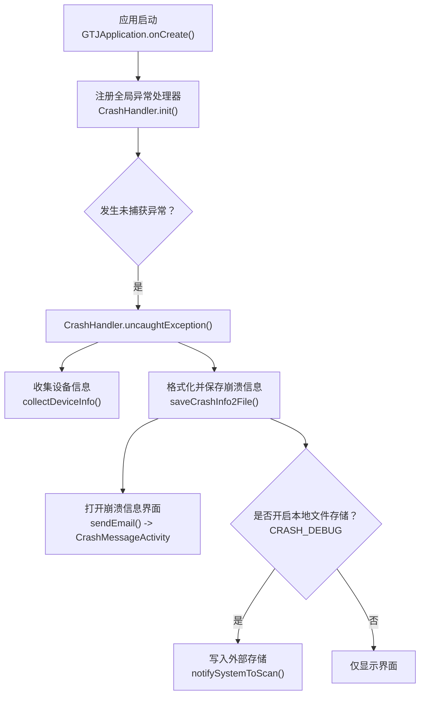
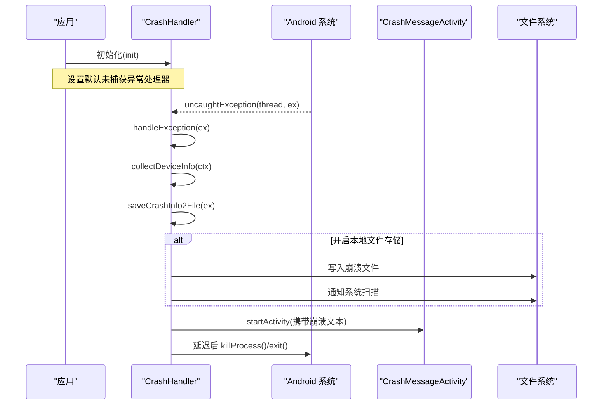
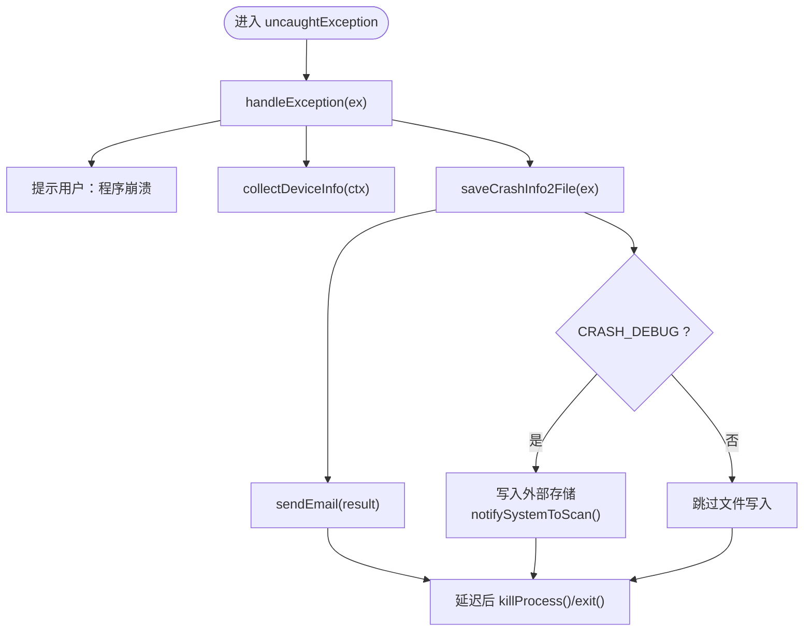
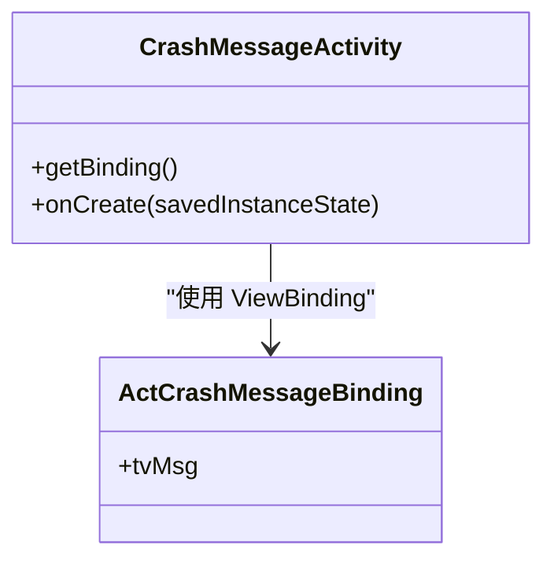
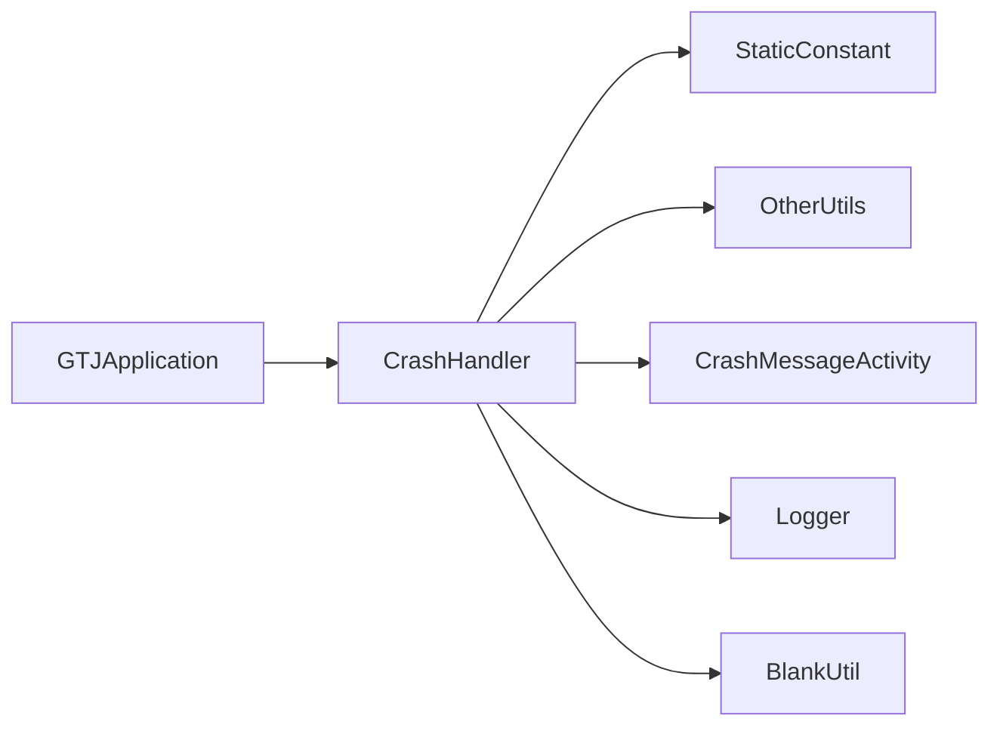

# 崩溃处理

<cite>
**本文引用的文件**
- [CrashHandler.java](file://app/src/main/java/com/example/gtj_sd_dg240/utils/CrashHandler.java)
- [GTJApplication.java](file://app/src/main/java/com/example/gtj_sd_dg240/GTJApplication.java)
- [StaticConstant.java](file://app/src/main/java/com/example/gtj_sd_dg240/StaticConstant.java)
- [CrashMessageActivity.java](file://app/src/main/java/com/example/gtj_sd_dg240/activity/start/CrashMessageActivity.java)
- [act_crash_message.xml](file://app/src/main/res/layout/act_crash_message.xml)
- [OtherUtils.java](file://app/src/main/java/com/example/gtj_sd_dg240/utils/OtherUtils.java)
</cite>

## 目录
1. [简介](#简介)
2. [项目结构](#项目结构)
3. [核心组件](#核心组件)
4. [架构总览](#架构总览)
5. [详细组件分析](#详细组件分析)
6. [依赖关系分析](#依赖关系分析)
7. [性能与稳定性考量](#性能与稳定性考量)
8. [故障排查指南](#故障排查指南)
9. [结论](#结论)
10. [附录](#附录)

## 简介
本文件面向“崩溃处理”主题，系统化说明该 Android 项目的全局异常捕获机制、崩溃信息收集与存储、用户界面展示、日志策略、以及问题定位与修复验证方法。同时给出与第三方崩溃监控服务集成的建议方案，帮助团队在现有实现基础上进行扩展与优化。

## 项目结构
本项目采用模块化组织，崩溃处理相关代码集中在 app 模块的 utils、activity.start、application 及资源文件中：
- 全局异常处理器：utils/CrashHandler.java
- 应用初始化入口：GTJApplication.java（注册全局异常处理器）
- 崩溃展示界面：activity.start/CrashMessageActivity.java + res/layout/act_crash_message.xml
- 配置常量：StaticConstant.java（是否写文件、路径等）
- 系统扫描工具：utils/OtherUtils.java（用于通知媒体扫描器发现崩溃文件）

图表来源
- [GTJApplication.java:20-30](file://app/src/main/java/com/example/gtj_sd_dg240/GTJApplication.java#L20-L30)
- [CrashHandler.java:74-100](file://app/src/main/java/com/example/gtj_sd_dg240/utils/CrashHandler.java#L74-L100)
- [CrashHandler.java:105-207](file://app/src/main/java/com/example/gtj_sd_dg240/utils/CrashHandler.java#L105-L207)
- [StaticConstant.java:30-33](file://app/src/main/java/com/example/gtj_sd_dg240/StaticConstant.java#L30-L33)
- [OtherUtils.java:38-40](file://app/src/main/java/com/example/gtj_sd_dg240/utils/OtherUtils.java#L38-L40)

章节来源
- [GTJApplication.java:20-30](file://app/src/main/java/com/example/gtj_sd_dg240/GTJApplication.java#L20-L30)
- [CrashHandler.java:74-100](file://app/src/main/java/com/example/gtj_sd_dg240/utils/CrashHandler.java#L74-L100)
- [StaticConstant.java:30-33](file://app/src/main/java/com/example/gtj_sd_dg240/StaticConstant.java#L30-L33)

## 核心组件
- 全局异常处理器：CrashHandler
  - 职责：接管 UncaughtException，收集设备信息，格式化堆栈，持久化到文件（可选），展示崩溃信息界面，必要时退出进程。
- 应用初始化：GTJApplication
  - 职责：在应用启动时初始化崩溃处理器、日志、数据库、定位等基础设施。
- 崩溃信息界面：CrashMessageActivity + act_crash_message.xml
  - 职责：以滚动视图展示崩溃详情文本，便于用户或测试人员查看。
- 配置常量：StaticConstant
  - 职责：集中管理崩溃开关、存储路径等配置项。
- 工具类：OtherUtils
  - 职责：提供系统媒体扫描通知，使崩溃文件可被系统相册/文件管理器识别。

章节来源
- [CrashHandler.java:39-207](file://app/src/main/java/com/example/gtj_sd_dg240/utils/CrashHandler.java#L39-L207)
- [GTJApplication.java:20-30](file://app/src/main/java/com/example/gtj_sd_dg240/GTJApplication.java#L20-L30)
- [CrashMessageActivity.java:9-21](file://app/src/main/java/com/example/gtj_sd_dg240/activity/start/CrashMessageActivity.java#L9-L21)
- [act_crash_message.xml:1-23](file://app/src/main/res/layout/act_crash_message.xml#L1-L23)
- [StaticConstant.java:30-33](file://app/src/main/java/com/example/gtj_sd_dg240/StaticConstant.java#L30-L33)
- [OtherUtils.java:38-40](file://app/src/main/java/com/example/gtj_sd_dg240/utils/OtherUtils.java#L38-L40)

## 架构总览
崩溃处理的总体流程如下：
- 应用启动阶段：在 Application 中完成 CrashHandler 的初始化，将自身设置为默认未捕获异常处理器。
- 运行时异常：当任意线程抛出未捕获异常时，Android 框架回调至 CrashHandler.uncaughtException。
- 信息收集与持久化：收集设备信息与包信息，生成包含完整堆栈的文本；可选择写入外部存储。
- 用户交互：启动崩溃信息界面，展示错误详情；随后延迟退出进程，避免残留状态影响后续行为。

图表来源
- [GTJApplication.java:20-30](file://app/src/main/java/com/example/gtj_sd_dg240/GTJApplication.java#L20-L30)
- [CrashHandler.java:74-100](file://app/src/main/java/com/example/gtj_sd_dg240/utils/CrashHandler.java#L74-L100)
- [CrashHandler.java:105-207](file://app/src/main/java/com/example/gtj_sd_dg240/utils/CrashHandler.java#L105-L207)
- [CrashMessageActivity.java:15-21](file://app/src/main/java/com/example/gtj_sd_dg240/activity/start/CrashMessageActivity.java#L15-L21)

## 详细组件分析

### 全局异常捕获机制（CrashHandler）
- 注册方式
  - 通过单例模式获取实例并在 Application 中调用 init(context)，将自身设为 Thread 的默认未捕获异常处理器。
- 异常处理流程
  - uncaughtException 中优先执行自定义处理；若失败则回退到系统默认处理器。
  - 成功处理后，提示用户“程序崩溃”，收集设备信息，保存崩溃信息，并启动崩溃信息界面。
  - 最后休眠短暂时间后强制结束进程，确保崩溃上下文不再继续运行。
- 设备信息收集
  - 使用 PackageManager 获取版本名与版本码。
  - 通过反射遍历 Build 类字段，收集设备型号、系统版本、厂商等关键信息。
- 崩溃信息格式化与存储
  - 将设备信息与异常堆栈拼接为文本。
  - 根据 CRASH_DEBUG 开关决定是否写入外部存储目录，并使用 MediaScanner 通知系统扫描新文件。
- 用户界面跳转
  - 通过 Intent 启动 CrashMessageActivity，并将崩溃文本作为额外参数传递。

图表来源
- [CrashHandler.java:85-100](file://app/src/main/java/com/example/gtj_sd_dg240/utils/CrashHandler.java#L85-L100)
- [CrashHandler.java:105-207](file://app/src/main/java/com/example/gtj_sd_dg240/utils/CrashHandler.java#L105-L207)
- [StaticConstant.java:30-33](file://app/src/main/java/com/example/gtj_sd_dg240/StaticConstant.java#L30-L33)
- [OtherUtils.java:38-40](file://app/src/main/java/com/example/gtj_sd_dg240/utils/OtherUtils.java#L38-L40)

章节来源
- [CrashHandler.java:74-100](file://app/src/main/java/com/example/gtj_sd_dg240/utils/CrashHandler.java#L74-L100)
- [CrashHandler.java:105-207](file://app/src/main/java/com/example/gtj_sd_dg240/utils/CrashHandler.java#L105-L207)

### 崩溃信息收集、存储与上报
- 收集内容
  - 应用版本信息（versionName、versionCode）。
  - 设备与环境信息（Build 字段集合）。
  - 异常类型与完整堆栈（包括 cause 链）。
- 存储策略
  - 内存中构建字符串，先用于界面展示与潜在上报。
  - 若开启 CRASH_DEBUG，则在外部存储指定目录创建带时间戳的文件名，并触发系统扫描以便用户导出。
- 上报机制
  - 当前实现通过启动 Activity 展示崩溃文本，未直接上传至服务器。
  - 可在 sendEmail 处扩展为网络上报逻辑（见“集成方案”部分）。

章节来源
- [CrashHandler.java:128-151](file://app/src/main/java/com/example/gtj_sd_dg240/utils/CrashHandler.java#L128-L151)
- [CrashHandler.java:156-199](file://app/src/main/java/com/example/gtj_sd_dg240/utils/CrashHandler.java#L156-L199)
- [CrashHandler.java:201-206](file://app/src/main/java/com/example/gtj_sd_dg240/utils/CrashHandler.java#L201-L206)
- [StaticConstant.java:30-33](file://app/src/main/java/com/example/gtj_sd_dg240/StaticConstant.java#L30-L33)

### 崩溃界面设计与用户交互
- 界面构成
  - 使用 ScrollView 包裹 LinearLayout，内部 TextView 展示崩溃详情。
- 数据绑定
  - CrashMessageActivity 从 Intent 中读取崩溃文本并设置到 TextView。
- 交互行为
  - 当前仅展示信息，无进一步操作按钮；可通过增加“复制/分享/上报”按钮增强用户体验。

图表来源
- [CrashMessageActivity.java:9-21](file://app/src/main/java/com/example/gtj_sd_dg240/activity/start/CrashMessageActivity.java#L9-L21)
- [act_crash_message.xml:1-23](file://app/src/main/res/layout/act_crash_message.xml#L1-L23)

章节来源
- [CrashMessageActivity.java:9-21](file://app/src/main/java/com/example/gtj_sd_dg240/activity/start/CrashMessageActivity.java#L9-L21)
- [act_crash_message.xml:1-23](file://app/src/main/res/layout/act_crash_message.xml#L1-L23)

### 异常类型分类与错误信息格式化
- 异常类型
  - 当前统一捕获所有未捕获异常，未做细粒度分类。
  - 建议在 handleException 中按异常类型分支记录不同维度信息（如网络异常、IO 异常、空指针等）。
- 信息格式化
  - 设备信息键值对 + 异常堆栈文本。
  - 可扩展加入用户会话 ID、操作轨迹、关键业务上下文等，提升复现效率。

章节来源
- [CrashHandler.java:156-174](file://app/src/main/java/com/example/gtj_sd_dg240/utils/CrashHandler.java#L156-L174)

### 日志记录策略
- 日志框架
  - 使用 Logger（Orhanobut）进行调试输出，已在 Application 中初始化。
- 崩溃日志
  - 崩溃信息通过字符串拼接并写入文件（可选），同时通过界面展示。
- 建议
  - 将崩溃日志与常规日志分离，避免污染日常日志。
  - 对敏感信息进行脱敏处理后再落盘或上报。

章节来源
- [GTJApplication.java:26-28](file://app/src/main/java/com/example/gtj_sd_dg240/GTJApplication.java#L26-L28)
- [CrashHandler.java:156-199](file://app/src/main/java/com/example/gtj_sd_dg240/utils/CrashHandler.java#L156-L199)

### 崩溃复现、问题定位、修复验证
- 复现步骤
  - 在测试设备上触发已知崩溃点，等待崩溃界面出现。
  - 若开启 CRASH_DEBUG，前往外部存储目录下载崩溃文件。
- 定位方法
  - 结合崩溃文件中的设备信息与应用版本，定位问题环境。
  - 分析堆栈信息，定位具体类与方法。
- 修复验证
  - 修复后重新打包，重复上述步骤确认不再崩溃。
  - 可结合单元测试与集成测试覆盖关键路径。

章节来源
- [StaticConstant.java:30-33](file://app/src/main/java/com/example/gtj_sd_dg240/StaticConstant.java#L30-L33)
- [CrashHandler.java:175-199](file://app/src/main/java/com/example/gtj_sd_dg240/utils/CrashHandler.java#L175-L199)

### 与第三方崩溃监控服务的集成方案
- 集成时机
  - 在 CrashHandler.saveCrashInfo2File 完成后，或在 sendEmail 中发起网络请求。
- 推荐做法
  - 异步上报：避免阻塞崩溃处理主流程。
  - 重试与去重：对同一崩溃事件进行幂等上报，避免重复统计。
  - 隐私保护：对敏感字段进行脱敏或过滤。
  - 降级策略：在网络不可用时缓存本地，待网络恢复再补报。
- 示例接入点
  - 在 sendEmail 中替换为 HTTP 上报逻辑，或调用第三方 SDK 的上报接口。

章节来源
- [CrashHandler.java:201-206](file://app/src/main/java/com/example/gtj_sd_dg240/utils/CrashHandler.java#L201-L206)

## 依赖关系分析
- 组件耦合
  - GTJApplication 依赖 CrashHandler 进行初始化。
  - CrashHandler 依赖 StaticConstant 控制行为开关与路径。
  - CrashHandler 依赖 OtherUtils 进行系统扫描通知。
  - CrashHandler 通过 Intent 启动 CrashMessageActivity 展示结果。
- 外部依赖
  - 日志框架：Logger（Orhanobut）。
  - 工具库：BlankUtil（ToastUtils 等）。
  - Android 系统 API：PackageManager、Build、Environment、MediaScannerConnection。

图表来源
- [GTJApplication.java:20-30](file://app/src/main/java/com/example/gtj_sd_dg240/GTJApplication.java#L20-L30)
- [CrashHandler.java:74-100](file://app/src/main/java/com/example/gtj_sd_dg240/utils/CrashHandler.java#L74-L100)
- [CrashHandler.java:156-207](file://app/src/main/java/com/example/gtj_sd_dg240/utils/CrashHandler.java#L156-L207)
- [StaticConstant.java:30-33](file://app/src/main/java/com/example/gtj_sd_dg240/StaticConstant.java#L30-L33)
- [OtherUtils.java:38-40](file://app/src/main/java/com/example/gtj_sd_dg240/utils/OtherUtils.java#L38-L40)

章节来源
- [CrashHandler.java:74-100](file://app/src/main/java/com/example/gtj_sd_dg240/utils/CrashHandler.java#L74-L100)
- [CrashHandler.java:156-207](file://app/src/main/java/com/example/gtj_sd_dg240/utils/CrashHandler.java#L156-L207)

## 性能与稳定性考量
- 线程安全
  - 崩溃处理发生在非 UI 线程，需确保 UI 操作（Toast、Activity 启动）在主线程或通过 Looper 调度。
- I/O 开销
  - 文件写入应仅在必要场景启用（CRASH_DEBUG），避免频繁 IO 影响崩溃响应速度。
- 内存占用
  - 崩溃文本可能较大，注意避免在低内存设备上造成二次崩溃。
- 进程退出时机
  - 延迟退出有助于界面渲染与日志落盘，但过长会影响用户体验，需权衡。

[本节为通用指导，不直接分析具体文件]

## 故障排查指南
- 常见问题
  - 崩溃文件未生成：检查 CRASH_DEBUG 是否为 true，外部存储是否可写。
  - 无法查看崩溃文件：确认已调用系统扫描，或手动刷新存储。
  - 界面未显示：检查 Intent 启动是否成功，是否存在 Activity 注册问题。
- 诊断步骤
  - 在 Application 中打印初始化日志，确认 CrashHandler 已注册。
  - 在 saveCrashInfo2File 中增加异常捕获与日志，定位写入失败原因。
  - 使用 adb 命令查看外部存储目录与日志输出。

章节来源
- [StaticConstant.java:30-33](file://app/src/main/java/com/example/gtj_sd_dg240/StaticConstant.java#L30-L33)
- [CrashHandler.java:175-199](file://app/src/main/java/com/example/gtj_sd_dg240/utils/CrashHandler.java#L175-L199)
- [OtherUtils.java:38-40](file://app/src/main/java/com/example/gtj_sd_dg240/utils/OtherUtils.java#L38-L40)

## 结论
该项目实现了基于 UncaughtExceptionHandler 的全局崩溃捕获机制，具备设备信息采集、堆栈格式化、本地文件存储（可选）、崩溃信息界面展示等能力。当前未内置网络上报，但提供了清晰的扩展点。建议在此基础上完善异常分类、敏感信息脱敏、网络上报与重试机制，以提升问题定位效率与用户体验。

[本节为总结性内容，不直接分析具体文件]

## 附录
- 配置项说明
  - CRASH_DEBUG：是否将崩溃信息写入外部存储。
  - crashFilePath：崩溃文件存储路径。
- 扩展建议
  - 在 sendEmail 中接入第三方崩溃监控服务（如 Firebase Crashlytics、腾讯 Bugly 等）。
  - 增加用户反馈入口，支持一键复制/分享崩溃信息。
  - 引入业务上下文埋点，辅助复现复杂场景。

章节来源
- [StaticConstant.java:30-33](file://app/src/main/java/com/example/gtj_sd_dg240/StaticConstant.java#L30-L33)
- [CrashHandler.java:201-206](file://app/src/main/java/com/example/gtj_sd_dg240/utils/CrashHandler.java#L201-L206)