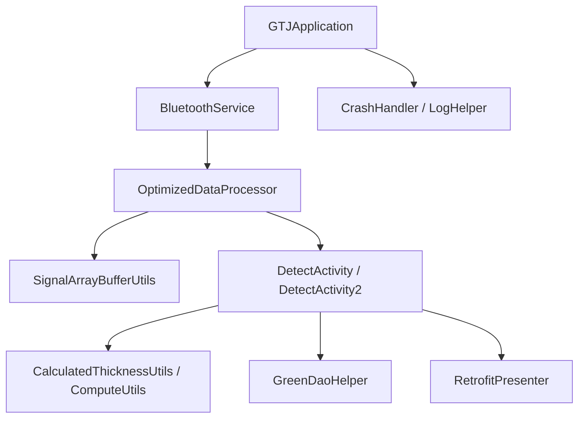
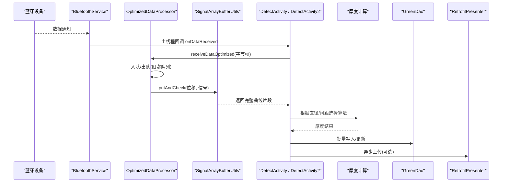
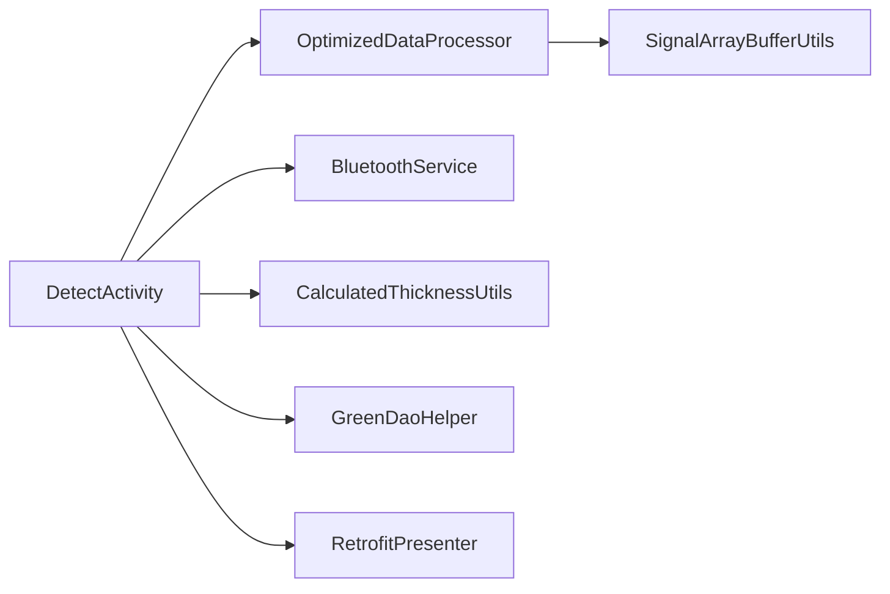

# 性能分析

<cite>
**本文引用的文件**
- [GTJApplication.java](file://app/src/main/java/com/example/gtj_sd_dg240/GTJApplication.java)
- [BluetoothService.java](file://app/src/main/java/com/example/gtj_sd_dg240/bluetooth/BluetoothService.java)
- [OptimizedDataProcessor.java](file://app/src/main/java/com/example/gtj_sd_dg240/utils/OptimizedDataProcessor.java)
- [SignalArrayBufferUtils.java](file://app/src/main/java/com/example/gtj_sd_dg240/utils/SignalArrayBufferUtils.java)
- [DetectActivity.java](file://app/src/main/java/com/example/gtj_sd_dg240/activity/testing/DetectActivity.java)
- [DetectActivity2.java](file://app/src/main/java/com/example/gtj_sd_dg240/activity/testing/DetectActivity2.java)
- [CalculatedThicknessUtils.java](file://app/src/main/java/com/example/gtj_sd_dg240/utils/CalculatedThicknessUtils.java)
- [ComputeUtils.java](file://app/src/main/java/com/example/gtj_sd_dg240/utils/ComputeUtils.java)
- [RetrofitPresenter.java](file://app/src/main/java/com/example/gtj_sd_dg240/net/RetrofitPresenter.java)
- [GreenDaoHelper.java](file://app/src/main/java/com/example/gtj_sd_dg240/storage/GreenDaoHelper.java)
- [CrashHandler.java](file://app/src/main/java/com/example/gtj_sd_dg240/utils/CrashHandler.java)
- [BaseActivity.java](file://app/src/main/java/com/example/gtj_sd_dg240/activity/start/BaseActivity.java)
- [LogHelper.java](file://utillibrary/src/main/java/com/blackhao/utillibrary/log/LogHelper.java)
- [build.gradle](file://app/build.gradle)
</cite>

## 目录
1. [简介](#简介)
2. [项目结构](#项目结构)
3. [核心组件](#核心组件)
4. [架构总览](#架构总览)
5. [详细组件分析](#详细组件分析)
6. [依赖关系分析](#依赖关系分析)
7. [性能考量与优化建议](#性能考量与优化建议)
8. [故障排查指南](#故障排查指南)
9. [结论](#结论)
10. [附录：Android性能工具使用指南](#附录android性能工具使用指南)

## 简介
本文件面向本项目（混凝土电杆检测应用）的性能分析与优化，覆盖CPU、内存、I/O、网络等关键指标的分析方法，并结合代码中的信号处理、数据缓冲、线程管理、数据库与网络模块，给出可落地的优化策略与基准测试方法。同时提供生产环境的监控与告警建议，帮助在真实场景中持续保障性能与稳定性。

## 项目结构
- 应用入口与全局初始化：GTJApplication
- 蓝牙数据采集与重连：BluetoothService
- 高频数据处理与缓冲：OptimizedDataProcessor、SignalArrayBufferUtils
- 检测主流程与UI刷新：DetectActivity、DetectActivity2
- 厚度计算与算法：CalculatedThicknessUtils、ComputeUtils
- 网络请求与重试：RetrofitPresenter
- 本地数据库访问：GreenDaoHelper
- 崩溃捕获与日志：CrashHandler、LogHelper
- 构建配置与依赖：build.gradle

图表来源
- [GTJApplication.java:18-41](file://app/src/main/java/com/example/gtj_sd_dg240/GTJApplication.java#L18-L41)
- [BluetoothService.java:20-52](file://app/src/main/java/com/example/gtj_sd_dg240/bluetooth/BluetoothService.java#L20-L52)
- [OptimizedDataProcessor.java:7-75](file://app/src/main/java/com/example/gtj_sd_dg240/utils/OptimizedDataProcessor.java#L7-L75)
- [SignalArrayBufferUtils.java:5-66](file://app/src/main/java/com/example/gtj_sd_dg240/utils/SignalArrayBufferUtils.java#L5-L66)
- [DetectActivity.java:57-106](file://app/src/main/java/com/example/gtj_sd_dg240/activity/testing/DetectActivity.java#L57-L106)
- [DetectActivity2.java:185-211](file://app/src/main/java/com/example/gtj_sd_dg240/activity/testing/DetectActivity2.java#L185-L211)
- [CalculatedThicknessUtils.java:22-59](file://app/src/main/java/com/example/gtj_sd_dg240/utils/CalculatedThicknessUtils.java#L22-L59)
- [ComputeUtils.java:39-61](file://app/src/main/java/com/example/gtj_sd_dg240/utils/ComputeUtils.java#L39-L61)
- [RetrofitPresenter.java:25-52](file://app/src/main/java/com/example/gtj_sd_dg240/net/RetrofitPresenter.java#L25-L52)
- [GreenDaoHelper.java:10-40](file://app/src/main/java/com/example/gtj_sd_dg240/storage/GreenDaoHelper.java#L10-L40)
- [CrashHandler.java:35-123](file://app/src/main/java/com/example/gtj_sd_dg240/utils/CrashHandler.java#L35-L123)
- [LogHelper.java:128-187](file://utillibrary/src/main/java/com/blackhao/utillibrary/log/LogHelper.java#L128-L187)

章节来源
- [GTJApplication.java:18-41](file://app/src/main/java/com/example/gtj_sd_dg240/GTJApplication.java#L18-L41)
- [build.gradle:1-77](file://app/build.gradle#L1-L77)

## 核心组件
- 蓝牙服务：单例管理连接、自动重连、数据通知分发，主线程回调保证UI安全。
- 数据处理：生产者-消费者模式的高频数据队列，避免阻塞；循环缓冲区稳定存储位移与信号序列，便于峰值检测与曲线输出。
- 厚度计算：按钢筋直径与箍筋间距选择不同算法路径，包含插值与补偿逻辑。
- 网络层：OkHttp+Retrofit统一封装，带超时、重试与日志拦截器。
- 数据库：GreenDao会话管理，批量写入提升吞吐。
- 崩溃与日志：全局异常捕获、设备信息收集、日志分级与分片输出。

章节来源
- [BluetoothService.java:20-52](file://app/src/main/java/com/example/gtj_sd_dg240/bluetooth/BluetoothService.java#L20-L52)
- [OptimizedDataProcessor.java:29-75](file://app/src/main/java/com/example/gtj_sd_dg240/utils/OptimizedDataProcessor.java#L29-L75)
- [SignalArrayBufferUtils.java:15-66](file://app/src/main/java/com/example/gtj_sd_dg240/utils/SignalArrayBufferUtils.java#L15-L66)
- [CalculatedThicknessUtils.java:22-59](file://app/src/main/java/com/example/gtj_sd_dg240/utils/CalculatedThicknessUtils.java#L22-L59)
- [RetrofitPresenter.java:31-52](file://app/src/main/java/com/example/gtj_sd_dg240/net/RetrofitPresenter.java#L31-L52)
- [GreenDaoHelper.java:16-40](file://app/src/main/java/com/example/gtj_sd_dg240/storage/GreenDaoHelper.java#L16-L40)
- [CrashHandler.java:74-123](file://app/src/main/java/com/example/gtj_sd_dg240/utils/CrashHandler.java#L74-L123)
- [LogHelper.java:128-187](file://utillibrary/src/main/java/com/blackhao/utillibrary/log/LogHelper.java#L128-L187)

## 架构总览
下图展示从蓝牙采集到数据处理、计算、存储与上传的完整链路，以及各阶段的性能关键点。

图表来源
- [BluetoothService.java:175-198](file://app/src/main/java/com/example/gtj_sd_dg240/bluetooth/BluetoothService.java#L175-L198)
- [OptimizedDataProcessor.java:34-75](file://app/src/main/java/com/example/gtj_sd_dg240/utils/OptimizedDataProcessor.java#L34-L75)
- [SignalArrayBufferUtils.java:23-66](file://app/src/main/java/com/example/gtj_sd_dg240/utils/SignalArrayBufferUtils.java#L23-L66)
- [DetectActivity.java:171-191](file://app/src/main/java/com/example/gtj_sd_dg240/activity/testing/DetectActivity.java#L171-L191)
- [DetectActivity2.java:185-211](file://app/src/main/java/com/example/gtj_sd_dg240/activity/testing/DetectActivity2.java#L185-L211)
- [RetrofitPresenter.java:61-142](file://app/src/main/java/com/example/gtj_sd_dg240/net/RetrofitPresenter.java#L61-L142)

## 详细组件分析

### 蓝牙服务（BluetoothService）
- 职责：连接状态管理、自动重连、数据通知分发、资源清理。
- 并发与线程：使用主线程Handler回调，避免跨线程UI风险；监听列表采用CopyOnWriteArrayList保证并发安全。
- 性能要点：
  - 重连定时器间隔固定，避免频繁连接造成耗电与抖动。
  - 数据通知在主线程分发，注意在高吞吐场景下避免在回调中做重计算或I/O。
- 优化建议：
  - 将耗时解析移出主线程，交由OptimizedDataProcessor处理。
  - 对频繁注册/注销监听进行节流，减少重复开销。

章节来源
- [BluetoothService.java:20-52](file://app/src/main/java/com/example/gtj_sd_dg240/bluetooth/BluetoothService.java#L20-L52)
- [BluetoothService.java:175-198](file://app/src/main/java/com/example/gtj_sd_dg240/bluetooth/BluetoothService.java#L175-L198)
- [BluetoothService.java:203-234](file://app/src/main/java/com/example/gtj_sd_dg240/bluetooth/BluetoothService.java#L203-L234)

### 高频数据处理（OptimizedDataProcessor）
- 职责：以生产者-消费者模式接收蓝牙帧，拼接、校验、分段解析后回调业务。
- 数据结构：
  - 阻塞队列容量2000，非阻塞offer防止背压时阻塞上游。
  - 当前累积字节数组用于帧边界识别与切片。
- 复杂度：
  - 入队O(1)，出队poll带超时，空队列时退出循环释放线程。
  - 帧解析线性扫描，时间复杂度O(n)。
- 性能要点：
  - 通过volatile状态与锁控制仅启动一个处理线程，避免多线程竞争。
  - 解析阈值过滤（如信号过大直接丢弃），降低无效计算。
- 优化建议：
  - 若队列长期满，考虑增大容量或在上游限流。
  - 字符串化frameData仅在调试需要时启用，避免频繁String创建。

章节来源
- [OptimizedDataProcessor.java:7-75](file://app/src/main/java/com/example/gtj_sd_dg240/utils/OptimizedDataProcessor.java#L7-L75)
- [OptimizedDataProcessor.java:77-133](file://app/src/main/java/com/example/gtj_sd_dg240/utils/OptimizedDataProcessor.java#L77-L133)

### 信号缓冲与峰值检测（SignalArrayBufferUtils）
- 职责：循环缓冲区维护最近N个位移与信号，检测中间点是否为最大值并满足最小间隔条件，输出完整曲线片段。
- 数据结构：int[] positions/signals，环形索引currentIndex，count计数。
- 复杂度：putAndCheck为O(1)插入，isMiddleMax为O(count)扫描。
- 性能要点：
  - 同步块保护共享状态，避免并发写冲突。
  - 有效间隔阈值避免重复触发。
- 优化建议：
  - 若count较大，可引入滑动窗口最大值的增量维护以降低扫描成本。
  - 合理设置MAX_SIZE平衡延迟与内存占用。

章节来源
- [SignalArrayBufferUtils.java:5-66](file://app/src/main/java/com/example/gtj_sd_dg240/utils/SignalArrayBufferUtils.java#L5-L66)
- [SignalArrayBufferUtils.java:68-94](file://app/src/main/java/com/example/gtj_sd_dg240/utils/SignalArrayBufferUtils.java#L68-L94)

### 厚度计算（CalculatedThicknessUtils / ComputeUtils）
- 职责：依据钢筋直径、箍筋间距与信号范围，选择对应算法计算保护层厚度，含插值与补偿。
- 复杂度：主要遍历与比较操作，整体O(n)级别。
- 性能要点：
  - 多分支选择不同实现类，避免冗余计算。
  - 插值与四舍五入在关键路径上调用，需控制频率。
- 优化建议：
  - 预计算常量表，减少运行时查找。
  - 对频繁调用的排序/查找进行缓存或近似算法替代。

章节来源
- [CalculatedThicknessUtils.java:22-59](file://app/src/main/java/com/example/gtj_sd_dg240/utils/CalculatedThicknessUtils.java#L22-L59)
- [CalculatedThicknessUtils.java:79-129](file://app/src/main/java/com/example/gtj_sd_dg240/utils/CalculatedThicknessUtils.java#L79-L129)
- [ComputeUtils.java:39-61](file://app/src/main/java/com/example/gtj_sd_dg240/utils/ComputeUtils.java#L39-L61)

### 检测界面与数据流（DetectActivity / DetectActivity2）
- 职责：接收蓝牙数据、校准信号、调用处理器、刷新UI、保存结果。
- 性能要点：
  - 主线程仅负责UI更新，计算与解析下沉至OptimizedDataProcessor。
  - 使用ViewBinding减少findViewById开销。
- 优化建议：
  - 对高频UI刷新进行节流（如每N条更新一次）。
  - 避免在onBluetoothDataReceived中进行复杂逻辑。

章节来源
- [DetectActivity.java:171-191](file://app/src/main/java/com/example/gtj_sd_dg240/activity/testing/DetectActivity.java#L171-L191)
- [DetectActivity2.java:185-211](file://app/src/main/java/com/example/gtj_sd_dg240/activity/testing/DetectActivity2.java#L185-L211)

### 网络请求（RetrofitPresenter）
- 职责：统一Retrofit实例与OkHttpClient配置，发起列表查询与数据上传。
- 性能要点：
  - 超时配置合理，重试拦截器提升弱网鲁棒性。
  - 日志拦截器仅开发阶段开启，生产关闭以减少IO。
- 优化建议：
  - 对大响应体启用GZIP压缩。
  - 使用连接池复用，避免频繁握手。

章节来源
- [RetrofitPresenter.java:31-52](file://app/src/main/java/com/example/gtj_sd_dg240/net/RetrofitPresenter.java#L31-L52)
- [RetrofitPresenter.java:61-142](file://app/src/main/java/com/example/gtj_sd_dg240/net/RetrofitPresenter.java#L61-L142)

### 数据库（GreenDaoHelper）
- 职责：提供DaoSession单例，支持事务批量写入。
- 性能要点：
  - 会话懒加载，避免重复创建。
  - 批量删除/插入减少磁盘IO次数。
- 优化建议：
  - 对热点表建立合适索引。
  - 使用事务包裹多条写入，降低锁竞争。

章节来源
- [GreenDaoHelper.java:16-40](file://app/src/main/java/com/example/gtj_sd_dg240/storage/GreenDaoHelper.java#L16-L40)

### 崩溃与日志（CrashHandler / LogHelper）
- 职责：全局异常捕获、设备信息收集、日志分级与分片输出。
- 性能要点：
  - 崩溃时记录堆栈并跳转错误页，避免ANR。
  - 日志按级别控制，避免生产环境过度输出。
- 优化建议：
  - 日志落盘异步化，避免阻塞主流程。
  - 对超大JSON进行采样或截断。

章节来源
- [CrashHandler.java:74-123](file://app/src/main/java/com/example/gtj_sd_dg240/utils/CrashHandler.java#L74-L123)
- [CrashHandler.java:156-199](file://app/src/main/java/com/example/gtj_sd_dg240/utils/CrashHandler.java#L156-L199)
- [LogHelper.java:128-187](file://utillibrary/src/main/java/com/blackhao/utillibrary/log/LogHelper.java#L128-L187)

## 依赖关系分析
- 模块耦合：
  - BluetoothService与Activity通过回调解耦，Activity依赖OptimizedDataProcessor进行解析。
  - 计算模块独立于UI，便于单元测试与替换。
  - 网络与数据库通过Presenter/Helper抽象，便于替换实现。
- 外部依赖：
  - OkHttp/Retrofit用于网络，GreenDao用于本地存储，Logger用于日志。
- 潜在循环依赖：无显式循环引用，模块间通过接口与回调通信。

图表来源
- [DetectActivity.java:57-106](file://app/src/main/java/com/example/gtj_sd_dg240/activity/testing/DetectActivity.java#L57-L106)
- [OptimizedDataProcessor.java:29-75](file://app/src/main/java/com/example/gtj_sd_dg240/utils/OptimizedDataProcessor.java#L29-L75)
- [SignalArrayBufferUtils.java:15-66](file://app/src/main/java/com/example/gtj_sd_dg240/utils/SignalArrayBufferUtils.java#L15-L66)
- [CalculatedThicknessUtils.java:22-59](file://app/src/main/java/com/example/gtj_sd_dg240/utils/CalculatedThicknessUtils.java#L22-L59)
- [GreenDaoHelper.java:16-40](file://app/src/main/java/com/example/gtj_sd_dg240/storage/GreenDaoHelper.java#L16-L40)
- [RetrofitPresenter.java:31-52](file://app/src/main/java/com/example/gtj_sd_dg240/net/RetrofitPresenter.java#L31-L52)

章节来源
- [DetectActivity.java:57-106](file://app/src/main/java/com/example/gtj_sd_dg240/activity/testing/DetectActivity.java#L57-L106)
- [OptimizedDataProcessor.java:29-75](file://app/src/main/java/com/example/gtj_sd_dg240/utils/OptimizedDataProcessor.java#L29-L75)
- [SignalArrayBufferUtils.java:15-66](file://app/src/main/java/com/example/gtj_sd_dg240/utils/SignalArrayBufferUtils.java#L15-L66)
- [CalculatedThicknessUtils.java:22-59](file://app/src/main/java/com/example/gtj_sd_dg240/utils/CalculatedThicknessUtils.java#L22-L59)
- [GreenDaoHelper.java:16-40](file://app/src/main/java/com/example/gtj_sd_dg240/storage/GreenDaoHelper.java#L16-L40)
- [RetrofitPresenter.java:31-52](file://app/src/main/java/com/example/gtj_sd_dg240/net/RetrofitPresenter.java#L31-L52)

## 性能考量与优化建议

### CPU使用率分析
- 关注点：
  - 高频数据解析与厚度计算在检测过程中密集调用。
  - 主线程回调中应避免重计算与I/O。
- 分析方法：
  - 使用Profiler的CPU采样，定位热点函数（如putAndCheck、getThickness）。
  - 结合Systrace观察系统调用与线程切换。
- 优化建议：
  - 将解析与计算移至工作线程，主线程仅做UI更新。
  - 对循环扫描进行优化（如滑动窗口最大值）。
  - 减少对象分配，复用缓冲区与临时变量。

章节来源
- [OptimizedDataProcessor.java:34-75](file://app/src/main/java/com/example/gtj_sd_dg240/utils/OptimizedDataProcessor.java#L34-L75)
- [SignalArrayBufferUtils.java:23-66](file://app/src/main/java/com/example/gtj_sd_dg240/utils/SignalArrayBufferUtils.java#L23-L66)
- [CalculatedThicknessUtils.java:22-59](file://app/src/main/java/com/example/gtj_sd_dg240/utils/CalculatedThicknessUtils.java#L22-L59)

### 内存占用分析
- 关注点：
  - 高频byte[]与String创建可能导致GC压力。
  - 循环缓冲区大小影响内存占用与延迟。
- 分析方法：
  - 使用Memory Profiler观察分配热点与GC事件。
  - 检查是否存在长生命周期对象持有短生命周期引用导致泄漏。
- 优化建议：
  - 使用ByteBuffer或池化对象减少分配。
  - 限制MAX_SIZE与队列容量，避免内存膨胀。
  - 及时释放不再使用的资源（如MediaPlayer、WakeLock）。

章节来源
- [OptimizedDataProcessor.java:7-75](file://app/src/main/java/com/example/gtj_sd_dg240/utils/OptimizedDataProcessor.java#L7-L75)
- [SignalArrayBufferUtils.java:5-66](file://app/src/main/java/com/example/gtj_sd_dg240/utils/SignalArrayBufferUtils.java#L5-L66)
- [BaseActivity.java:309-335](file://app/src/main/java/com/example/gtj_sd_dg240/activity/start/BaseActivity.java#L309-L335)

### I/O操作分析
- 关注点：
  - 数据库批量写入与网络上传可能成为瓶颈。
  - 日志落盘与崩溃日志写入影响性能。
- 分析方法：
  - 使用Profiler的File I/O与Network面板观察读写与请求耗时。
  - 结合Systrace查看磁盘与网络调度。
- 优化建议：
  - 使用事务批量写入，减少锁竞争。
  - 网络请求启用压缩与连接复用，合理设置超时与重试。
  - 日志异步落盘，生产环境降低日志级别。

章节来源
- [GreenDaoHelper.java:16-40](file://app/src/main/java/com/example/gtj_sd_dg240/storage/GreenDaoHelper.java#L16-L40)
- [RetrofitPresenter.java:31-52](file://app/src/main/java/com/example/gtj_sd_dg240/net/RetrofitPresenter.java#L31-L52)
- [CrashHandler.java:156-199](file://app/src/main/java/com/example/gtj_sd_dg240/utils/CrashHandler.java#L156-L199)

### 网络请求分析
- 关注点：
  - 弱网下的重试与超时策略。
  - 大响应体的序列化与反序列化开销。
- 分析方法：
  - 使用Network面板观察请求耗时与带宽占用。
  - 结合日志拦截器分析请求/响应内容。
- 优化建议：
  - 启用GZIP压缩，减少传输体积。
  - 分页加载与按需请求，避免一次性拉取大量数据。
  - 对失败请求进行指数退避重试。

章节来源
- [RetrofitPresenter.java:61-142](file://app/src/main/java/com/example/gtj_sd_dg240/net/RetrofitPresenter.java#L61-L142)

### 数据处理算法优化
- 关注点：
  - 峰值检测与厚度计算的复杂度。
  - 插值与补偿逻辑的调用频率。
- 分析方法：
  - 使用CPU采样定位热点函数。
  - 通过单元测试对比不同算法的时间复杂度。
- 优化建议：
  - 使用滑动窗口维护最大值，降低扫描成本。
  - 预计算常量表与查表法替代复杂判断。
  - 对频繁调用的数学运算进行近似与缓存。

章节来源
- [SignalArrayBufferUtils.java:68-94](file://app/src/main/java/com/example/gtj_sd_dg240/utils/SignalArrayBufferUtils.java#L68-L94)
- [CalculatedThicknessUtils.java:79-129](file://app/src/main/java/com/example/gtj_sd_dg240/utils/CalculatedThicknessUtils.java#L79-L129)

### 线程池使用
- 关注点：
  - 主线程不应执行耗时任务。
  - 后台任务应复用线程池，避免频繁创建销毁。
- 分析方法：
  - 使用Thread Profiler观察线程创建与生命周期。
  - 结合Systrace分析线程切换与阻塞。
- 优化建议：
  - 使用ExecutorService统一管理后台任务。
  - 对定时任务使用ScheduledThreadPool，避免重复创建。
  - 在Activity销毁时正确关闭线程池。

章节来源
- [BaseActivity.java:309-335](file://app/src/main/java/com/example/gtj_sd_dg240/activity/start/BaseActivity.java#L309-L335)

### 性能基准测试方法
- 目标：量化算法与I/O的性能变化，确保优化有效。
- 步骤：
  - 定义输入数据集（如信号序列、厚度参数）。
  - 使用System.nanoTime测量关键函数耗时。
  - 多次运行取平均值与方差，排除抖动。
  - 对比优化前后结果，验证改进幅度。
- 工具：
  - JUnit/Robolectric进行单元测试。
  - Android Studio Benchmark库进行端到端测试。

[本节为通用指导，不直接分析具体文件]

### 生产环境监控与告警
- 指标：
  - CPU使用率、内存占用、GC频率、ANR率、崩溃率。
  - 网络成功率、延迟、丢包率。
  - 数据库写入延迟与失败率。
- 手段：
  - 集成APM（如Firebase Performance、Sentry）上报关键指标。
  - 自定义埋点统计关键路径耗时。
  - 设置阈值告警（如CPU>80%持续5分钟、内存OOM前兆）。
- 实践：
  - 日志分级与采样，避免生产环境过度输出。
  - 崩溃日志自动上报与聚合分析。

[本节为通用指导，不直接分析具体文件]

## 故障排查指南
- 常见问题：
  - 蓝牙数据丢失或卡顿：检查队列容量与处理线程是否阻塞。
  - 内存泄漏：检查未释放的资源（如MediaPlayer、WakeLock）。
  - 网络失败：检查超时与重试策略，确认服务端可用性。
  - 数据库写入慢：检查事务使用与索引设计。
- 排查步骤：
  - 使用Profiler定位热点与异常。
  - 结合Systrace分析系统调用与线程切换。
  - 查看崩溃日志与网络日志，复现问题。
- 优化措施：
  - 调整队列容量与线程数。
  - 优化算法复杂度与对象分配。
  - 调整网络超时与重试策略。

章节来源
- [CrashHandler.java:74-123](file://app/src/main/java/com/example/gtj_sd_dg240/utils/CrashHandler.java#L74-L123)
- [LogHelper.java:128-187](file://utillibrary/src/main/java/com/blackhao/utillibrary/log/LogHelper.java#L128-L187)
- [RetrofitPresenter.java:61-142](file://app/src/main/java/com/example/gtj_sd_dg240/net/RetrofitPresenter.java#L61-L142)

## 结论
本项目在高频数据采集与处理方面已具备较好的架构基础，通过生产者-消费者模式与循环缓冲区有效降低了主线程压力。进一步优化方向包括：算法复杂度优化、内存分配控制、网络与数据库I/O优化、线程池管理与生产监控告警。借助Android性能工具与基准测试，可持续提升应用的稳定性与用户体验。

[本节为总结，不直接分析具体文件]

## 附录：Android性能工具使用指南

### Profiler（CPU、内存、网络、电池）
- 打开方式：Android Studio -> View -> Tool Windows -> Profiler
- CPU分析：
  - 选择采样模式，录制检测过程，定位热点函数。
  - 关注方法调用栈与自耗时。
- 内存分析：
  - 观察分配热点与GC事件，识别内存泄漏。
  - 使用Heap Dump分析对象图。
- 网络分析：
  - 查看请求/响应大小与耗时，优化传输。
- 电池分析：
  - 检查唤醒锁与后台任务对功耗的影响。

[本节为通用指导，不直接分析具体文件]

### Systrace（系统追踪）
- 用途：分析系统调用、线程切换、I/O与网络调度。
- 使用方法：
  - 使用adb命令或Android Studio录制trace。
  - 分析关键时间段内的系统行为。
- 关注点：
  - 主线程阻塞、频繁GC、磁盘与网络I/O等待。

[本节为通用指导，不直接分析具体文件]

### Memory Profiler（内存分析）
- 用途：监控内存分配、GC与泄漏。
- 使用方法：
  - 录制内存快照，对比优化前后差异。
  - 使用Allocation Tracker定位分配热点。
- 优化建议：
  - 减少对象分配，复用缓冲区。
  - 及时释放资源，避免内存泄漏。

[本节为通用指导，不直接分析具体文件]

### 性能基准测试
- 目标：量化优化效果，确保回归不出现性能退化。
- 方法：
  - 使用JUnit/Robolectric编写单元测试。
  - 使用Benchmark库进行端到端测试。
- 指标：
  - 关键函数耗时、内存分配量、GC次数。

[本节为通用指导，不直接分析具体文件]