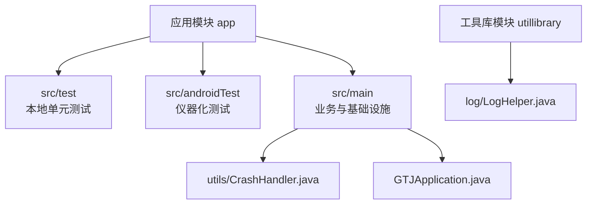
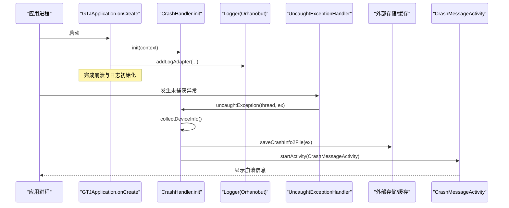
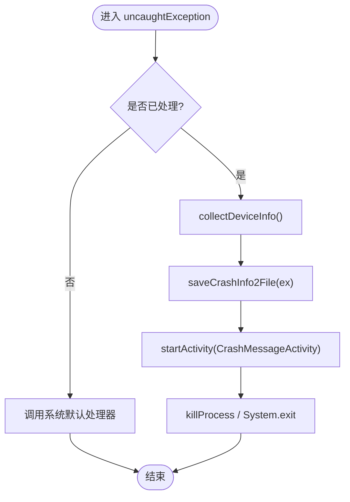
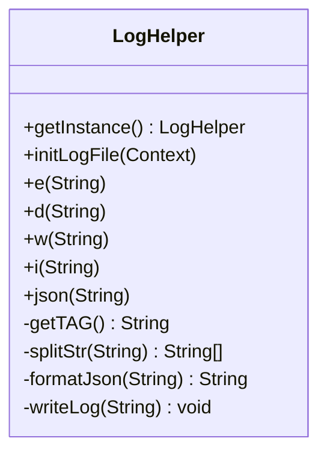
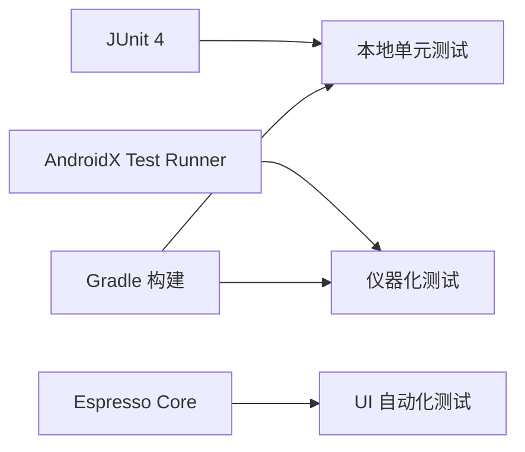

# 测试与调试

<cite>
**本文引用的文件**
- [ExampleInstrumentedTest.java](file://app/src/androidTest/java/com/example/gtj_sd_dg240/ExampleInstrumentedTest.java)
- [ExampleUnitTest.java](file://app/src/test/java/com/example/gtj_sd_dg240/ExampleUnitTest.java)
- [CrashHandler.java](file://app/src/main/java/com/example/gtj_sd_dg240/utils/CrashHandler.java)
- [LogHelper.java](file://utillibrary/src/main/java/com/blackhao/utillibrary/log/LogHelper.java)
- [CrashMessageActivity.java](file://app/src/main/java/com/example/gtj_sd_dg240/activity/start/CrashMessageActivity.java)
- [GTJApplication.java](file://app/src/main/java/com/example/gtj_sd_dg240/GTJApplication.java)
- [build.gradle（应用模块）](file://app/build.gradle)
- [build.gradle（根项目）](file://build.gradle)
</cite>

## 目录
1. [简介](#简介)
2. [项目结构](#项目结构)
3. [核心组件](#核心组件)
4. [架构总览](#架构总览)
5. [详细组件分析](#详细组件分析)
6. [依赖分析](#依赖分析)
7. [性能考虑](#性能考虑)
8. [故障排除指南](#故障排除指南)
9. [结论](#结论)
10. [附录](#附录)

## 简介
本文件面向混凝土电杆检测应用的测试与调试，覆盖单元测试、集成测试、UI测试的编写与执行；说明崩溃处理、日志记录、性能分析与内存泄漏排查方法；提供测试环境搭建、测试数据准备、模拟设备与真机测试流程；并给出调试技巧、常用工具与自动化测试、持续集成与质量保证建议。

## 项目结构
- 应用模块 app：包含业务代码、资源与测试目录
  - src/test：本地单元测试（JVM）
  - src/androidTest：仪器化测试（Android 设备/模拟器）
  - src/main：主工程代码，含崩溃处理、日志、初始化等
- 工具库模块 utillibrary：通用工具，包含日志封装 LogHelper
- 构建配置：根 build.gradle 管理插件版本；app/build.gradle 定义 Android 编译选项与测试依赖

图表来源
- [build.gradle（根项目）:7-10](file://build.gradle#L7-L10)
- [build.gradle（应用模块）:7-77](file://app/build.gradle#L7-L77)

章节来源
- [build.gradle（根项目）:7-10](file://build.gradle#L7-L10)
- [build.gradle（应用模块）:7-77](file://app/build.gradle#L7-L77)

## 核心组件
- 崩溃处理：全局未捕获异常收集、设备信息抓取、错误文件落盘与展示
- 日志系统：统一日志封装，支持分级输出、JSON格式化、可选文件写入
- 测试基线：本地与仪器化测试示例，验证运行环境与上下文
- 应用初始化：在 Application 中启动崩溃处理与日志适配器

章节来源
- [CrashHandler.java:35-208](file://app/src/main/java/com/example/gtj_sd_dg240/utils/CrashHandler.java#L35-L208)
- [LogHelper.java:18-290](file://utillibrary/src/main/java/com/blackhao/utillibrary/log/LogHelper.java#L18-L290)
- [ExampleUnitTest.java:12-16](file://app/src/test/java/com/example/gtj_sd_dg240/ExampleUnitTest.java#L12-L16)
- [ExampleInstrumentedTest.java:17-25](file://app/src/androidTest/java/com/example/gtj_sd_dg240/ExampleInstrumentedTest.java#L17-L25)
- [GTJApplication.java:18-42](file://app/src/main/java/com/example/gtj_sd_dg240/GTJApplication.java#L18-L42)

## 架构总览
崩溃与日志在应用启动时完成初始化，运行时通过全局异常处理器捕获崩溃并持久化；日志工具贯穿各模块用于问题定位与调试。

图表来源
- [GTJApplication.java:20-42](file://app/src/main/java/com/example/gtj_sd_dg240/GTJApplication.java#L20-L42)
- [CrashHandler.java:74-100](file://app/src/main/java/com/example/gtj_sd_dg240/utils/CrashHandler.java#L74-L100)
- [CrashHandler.java:105-206](file://app/src/main/java/com/example/gtj_sd_dg240/utils/CrashHandler.java#L105-L206)
- [CrashMessageActivity.java:15-20](file://app/src/main/java/com/example/gtj_sd_dg240/activity/start/CrashMessageActivity.java#L15-L20)

## 详细组件分析

### 崩溃处理（CrashHandler）
- 职责
  - 作为全局 UncaughtExceptionHandler，接管未捕获异常
  - 收集设备与应用信息（包名、版本、Build 字段）
  - 将堆栈与设备信息写入文件（可配置路径），并在开发开关开启时落盘
  - 启动 CrashMessageActivity 展示崩溃详情
- 关键流程
  - 初始化：保存默认处理器，设置全局处理器
  - 异常处理：提示用户、收集信息、写文件、跳转展示页
- 注意事项
  - 文件写入需确保存储可用与权限正确
  - 线程安全：Toast 与 UI 操作在主线程或 Looper 环境下执行
  - 退出策略：处理完成后终止进程，避免不稳定状态继续运行

图表来源
- [CrashHandler.java:85-100](file://app/src/main/java/com/example/gtj_sd_dg240/utils/CrashHandler.java#L85-L100)
- [CrashHandler.java:105-206](file://app/src/main/java/com/example/gtj_sd_dg240/utils/CrashHandler.java#L105-L206)

章节来源
- [CrashHandler.java:35-208](file://app/src/main/java/com/example/gtj_sd_dg240/utils/CrashHandler.java#L35-L208)
- [CrashMessageActivity.java:1-22](file://app/src/main/java/com/example/gtj_sd_dg240/activity/start/CrashMessageActivity.java#L1-L22)

### 日志系统（LogHelper）
- 职责
  - 统一日志输出，自动附加文件名与行号
  - 支持 e/d/w/i/json 等级输出
  - JSON 格式化便于阅读
  - 可选将日志写入文件（按天分文件）
- 关键点
  - 单例模式与双重检查锁定保证线程安全
  - 根据 BuildConfig.DEBUG 控制调试开关
  - 长文本分割输出，避免单次日志过长
- 使用建议
  - 在业务层以 LogHelper.getInstance().x(...) 方式输出
  - 生产环境关闭文件写入，仅保留必要级别

图表来源
- [LogHelper.java:18-290](file://utillibrary/src/main/java/com/blackhao/utillibrary/log/LogHelper.java#L18-L290)

章节来源
- [LogHelper.java:18-290](file://utillibrary/src/main/java/com/blackhao/utillibrary/log/LogHelper.java#L18-L290)

### 应用初始化（GTJApplication）
- 职责
  - 初始化蓝牙管理器
  - 启动全局崩溃处理
  - 注册日志适配器（PrettyFormatStrategy）
  - 初始化工具类、数据库、定位服务与 Toast 样式
- 对测试与调试的意义
  - 确保崩溃与日志在应用生命周期早期生效
  - 为后续测试提供稳定的基础能力

章节来源
- [GTJApplication.java:18-42](file://app/src/main/java/com/example/gtj_sd_dg240/GTJApplication.java#L18-L42)

### 测试用例现状
- 本地单元测试（JVM）
  - ExampleUnitTest：基础断言示例，适用于纯逻辑验证
- 仪器化测试（Android）
  - ExampleInstrumentedTest：获取应用 Context，验证包名
- 扩展建议
  - 基于现有示例扩展业务逻辑、UI 交互与数据流测试
  - 使用 Espresso 进行 UI 自动化测试
  - 使用 Mock 框架隔离外部依赖（网络、蓝牙、传感器）

章节来源
- [ExampleUnitTest.java:12-16](file://app/src/test/java/com/example/gtj_sd_dg240/ExampleUnitTest.java#L12-L16)
- [ExampleInstrumentedTest.java:17-25](file://app/src/androidTest/java/com/example/gtj_sd_dg240/ExampleInstrumentedTest.java#L17-L25)

## 依赖分析
- 测试相关依赖
  - JUnit 4：本地单元测试框架
  - AndroidX Test Runner、Espresso、JUnit 扩展：仪器化测试与 UI 测试
- 构建配置
  - 根项目声明 Android 插件版本
  - 应用模块启用 ViewBinding、BuildConfig，配置 Lint 与签名

图表来源
- [build.gradle（应用模块）:94-98](file://app/build.gradle#L94-L98)
- [build.gradle（根项目）:7-10](file://build.gradle#L7-L10)

章节来源
- [build.gradle（应用模块）:94-98](file://app/build.gradle#L94-L98)
- [build.gradle（根项目）:7-10](file://build.gradle#L7-L10)

## 性能考虑
- 日志性能
  - 合理选择日志级别，避免在热点路径频繁输出
  - 生产环境关闭文件写入，减少 I/O 开销
- 崩溃处理
  - 仅在必要时落盘，避免大文件频繁写入影响性能
- 数据处理
  - 对高频信号处理采用均值滤波与优化算法，降低 CPU 占用
- 内存管理
  - 注意 Activity/Fragment 生命周期，及时释放监听器与资源
  - 避免静态引用导致内存泄漏

[本节为通用指导，不直接分析具体文件]

## 故障排除指南
- 崩溃无法复现
  - 开启崩溃文件落盘，收集设备信息与堆栈
  - 结合日志定位触发点
- 日志缺失
  - 确认 LogHelper 初始化与日志级别
  - 检查是否被混淆或过滤
- 测试失败
  - 确认测试依赖版本兼容
  - 使用模拟器或真机逐步缩小范围
- 性能问题
  - 使用 Profiler 观察 CPU、内存、网络与磁盘 I/O
  - 针对热点路径优化算法与数据结构

章节来源
- [CrashHandler.java:156-199](file://app/src/main/java/com/example/gtj_sd_dg240/utils/CrashHandler.java#L156-L199)
- [LogHelper.java:268-289](file://utillibrary/src/main/java/com/blackhao/utillibrary/log/LogHelper.java#L268-L289)

## 结论
本项目已具备基础的崩溃处理与日志体系，测试框架依赖齐全但用例较少。建议在现有基础上完善单元测试与 UI 测试，建立自动化测试与持续集成流程，配合性能与内存分析工具，持续提升质量与稳定性。

[本节为总结性内容，不直接分析具体文件]

## 附录

### 测试环境搭建
- 本地单元测试
  - 使用 JUnit 4，直接在 JVM 上运行
  - 适合纯函数与无 Android 依赖的逻辑
- 仪器化测试
  - 使用 AndroidX Test Runner 与 Espresso
  - 需要连接设备或启动模拟器
- 模拟设备与真机
  - 推荐使用 Android Studio 内置模拟器快速验证
  - 真机测试用于验证硬件相关功能（蓝牙、传感器等）

章节来源
- [build.gradle（应用模块）:94-98](file://app/build.gradle#L94-L98)

### 测试数据准备
- 使用 assets 中的 CSV 文件作为标准曲线与参数数据
- 在测试中通过 InstrumentationRegistry 获取应用上下文读取资源
- 构造边界值与异常输入，覆盖正常与异常分支

[本节为通用指导，不直接分析具体文件]

### 自动化测试与持续集成
- 本地执行
  - 单元测试：./gradlew test
  - 仪器化测试：./gradlew connectedAndroidTest
- CI 流水线
  - 安装 SDK、构建 APK、运行测试、生成报告
  - 失败时阻断合并，保障质量门禁

[本节为通用指导，不直接分析具体文件]

### 调试技巧与常用工具
- 崩溃处理
  - 利用 CrashHandler 落盘与 CrashMessageActivity 展示
  - 结合日志定位触发点
- 日志
  - 使用 LogHelper 统一输出，生产环境关闭文件写入
  - 使用 Orhanobut Logger 美化输出
- 性能分析
  - Android Studio Profiler：CPU、内存、网络、能耗
  - LeakCanary：内存泄漏检测（可按需引入）
- 常见问题
  - 权限不足导致文件写入失败：检查存储权限与路径
  - 测试无法访问 Context：确保在仪器化测试中使用 InstrumentationRegistry

章节来源
- [CrashHandler.java:156-206](file://app/src/main/java/com/example/gtj_sd_dg240/utils/CrashHandler.java#L156-L206)
- [LogHelper.java:18-290](file://utillibrary/src/main/java/com/blackhao/utillibrary/log/LogHelper.java#L18-L290)
- [GTJApplication.java:20-42](file://app/src/main/java/com/example/gtj_sd_dg240/GTJApplication.java#L20-L42)