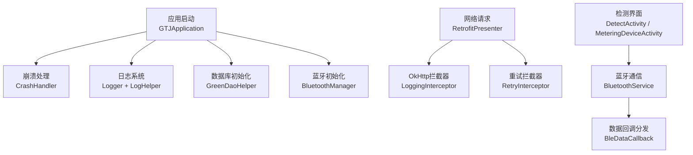
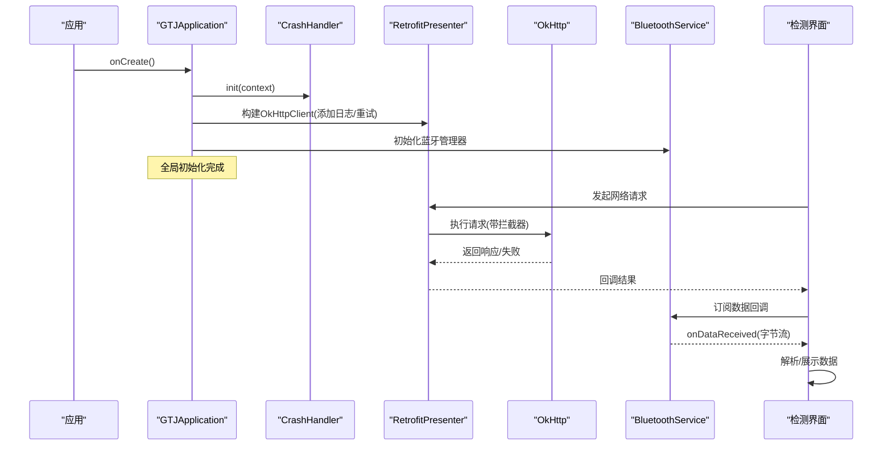
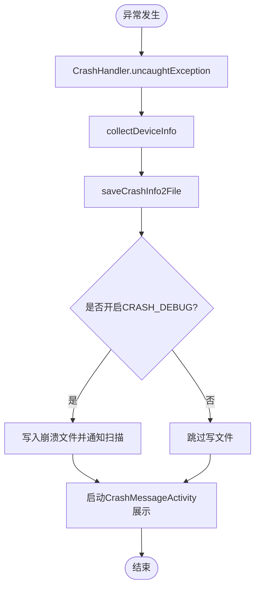
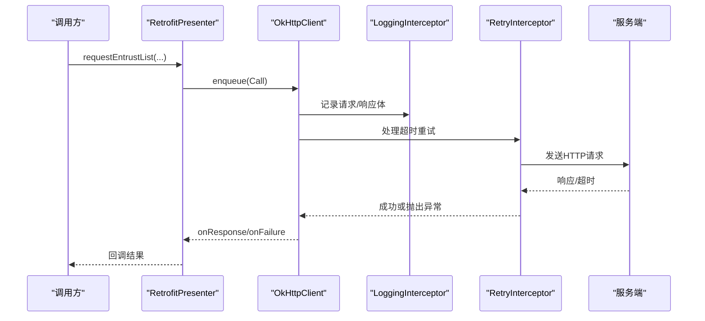
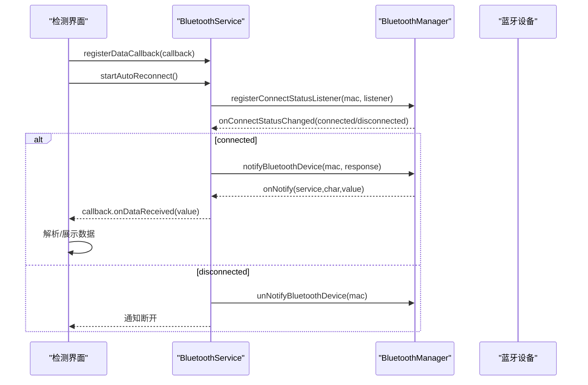
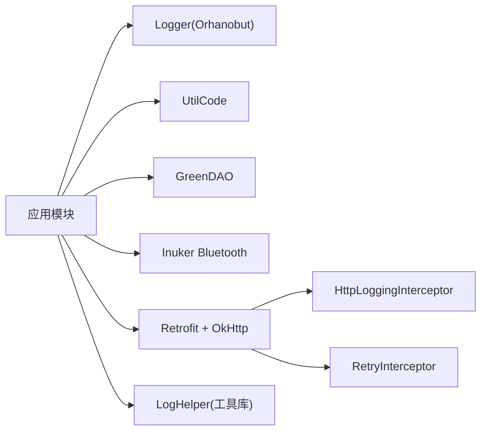

# 调试工具

<cite>
**本文引用的文件**
- [GTJApplication.java](file://app/src/main/java/com/example/gtj_sd_dg240/GTJApplication.java)
- [CrashHandler.java](file://app/src/main/java/com/example/gtj_sd_dg240/utils/CrashHandler.java)
- [CrashMessageActivity.java](file://app/src/main/java/com/example/gtj_sd_dg240/activity/start/CrashMessageActivity.java)
- [LogHelper.java](file://utillibrary/src/main/java/com/blackhao/utillibrary/log/LogHelper.java)
- [RetrofitPresenter.java](file://app/src/main/java/com/example/gtj_sd_dg240/net/RetrofitPresenter.java)
- [RetryInterceptor.java](file://app/src/main/java/com/example/gtj_sd_dg240/net/RetryInterceptor.java)
- [NetworkUtils.java](file://app/src/main/java/com/example/gtj_sd_dg240/net/NetworkUtils.java)
- [BluetoothService.java](file://app/src/main/java/com/example/gtj_sd_dg240/bluetooth/BluetoothService.java)
- [DetectActivity.java](file://app/src/main/java/com/example/gtj_sd_dg240/activity/testing/DetectActivity.java)
- [MeteringDeviceActivity.java](file://app/src/main/java/com/example/gtj_sd_dg240/activity/setting/MeteringDeviceActivity.java)
- [build.gradle](file://app/build.gradle)
</cite>

## 目录
1. [简介](#简介)
2. [项目结构](#项目结构)
3. [核心组件](#核心组件)
4. [架构总览](#架构总览)
5. [详细组件分析](#详细组件分析)
6. [依赖关系分析](#依赖关系分析)
7. [性能与稳定性建议](#性能与稳定性建议)
8. [故障排查指南](#故障排查指南)
9. [结论](#结论)
10. [附录](#附录)

## 简介
本调试文档面向Android Studio开发者，围绕本项目中的日志、崩溃捕获、网络请求、蓝牙通信与数据库操作等关键路径，提供断点设置、变量查看、调用栈分析、远程调试与线上问题定位的实操方法。文档同时给出日志记录最佳实践（含Logger框架使用、日志级别控制、敏感信息过滤），并总结常见问题（内存泄漏、ANR、性能瓶颈）的定位思路。

## 项目结构
本项目采用模块化组织：应用模块 app 包含业务逻辑、网络层、蓝牙服务、数据库访问；工具库 utillibrary 提供通用日志封装。启动入口在 Application 中完成全局初始化（蓝牙、崩溃处理、日志、数据库等）。

图表来源
- [GTJApplication.java:20-41](file://app/src/main/java/com/example/gtj_sd_dg240/GTJApplication.java#L20-L41)
- [RetrofitPresenter.java:38-51](file://app/src/main/java/com/example/gtj_sd_dg240/net/RetrofitPresenter.java#L38-L51)
- [BluetoothService.java:20-52](file://app/src/main/java/com/example/gtj_sd_dg240/bluetooth/BluetoothService.java#L20-L52)

章节来源
- [GTJApplication.java:20-41](file://app/src/main/java/com/example/gtj_sd_dg240/GTJApplication.java#L20-L41)
- [build.gradle:86-144](file://app/build.gradle#L86-L144)

## 核心组件
- 崩溃捕获与上报：CrashHandler 统一接管未捕获异常，收集设备信息、保存崩溃日志并跳转至展示页面。
- 日志系统：应用内使用 Logger（Orhanobut）进行格式化输出；工具库提供 LogHelper 支持分级打印、JSON格式化、可选落盘。
- 网络层：RetrofitPresenter 构建 OkHttpClient，集成 HttpLoggingInterceptor 与自定义 RetryInterceptor，统一超时与重试策略。
- 蓝牙通信：BluetoothService 管理连接状态、自动重连、数据通知注册与回调分发。
- 检测流程：DetectActivity/MeteringDeviceActivity 接收蓝牙数据并进行解析与展示。

章节来源
- [CrashHandler.java:74-123](file://app/src/main/java/com/example/gtj_sd_dg240/utils/CrashHandler.java#L74-L123)
- [LogHelper.java:82-161](file://utillibrary/src/main/java/com/blackhao/utillibrary/log/LogHelper.java#L82-L161)
- [RetrofitPresenter.java:38-51](file://app/src/main/java/com/example/gtj_sd_dg240/net/RetrofitPresenter.java#L38-L51)
- [BluetoothService.java:76-122](file://app/src/main/java/com/example/gtj_sd_dg240/bluetooth/BluetoothService.java#L76-L122)
- [DetectActivity.java:169-191](file://app/src/main/java/com/example/gtj_sd_dg240/activity/testing/DetectActivity.java#L169-L191)
- [MeteringDeviceActivity.java:107-146](file://app/src/main/java/com/example/gtj_sd_dg240/activity/setting/MeteringDeviceActivity.java#L107-L146)

## 架构总览
下图展示了从应用启动到网络请求、蓝牙通信与崩溃处理的整体交互。

图表来源
- [GTJApplication.java:20-41](file://app/src/main/java/com/example/gtj_sd_dg240/GTJApplication.java#L20-L41)
- [RetrofitPresenter.java:38-51](file://app/src/main/java/com/example/gtj_sd_dg240/net/RetrofitPresenter.java#L38-L51)
- [BluetoothService.java:172-198](file://app/src/main/java/com/example/gtj_sd_dg240/bluetooth/BluetoothService.java#L172-L198)
- [DetectActivity.java:169-191](file://app/src/main/java/com/example/gtj_sd_dg240/activity/testing/DetectActivity.java#L169-L191)

## 详细组件分析

### 崩溃捕获与日志
- 崩溃捕获：CrashHandler 实现 UncaughtExceptionHandler，捕获未处理异常，收集设备信息，写入崩溃文件，并通过 Intent 跳转到 CrashMessageActivity 展示堆栈。
- 日志输出：应用通过 Logger.addLogAdapter 配置 PrettyFormatStrategy；工具库 LogHelper 提供 e/d/w/i/json 等方法，支持按 BuildConfig.DEBUG 控制开关、字符串分割避免单行过长、可选落盘。

图表来源
- [CrashHandler.java:85-123](file://app/src/main/java/com/example/gtj_sd_dg240/utils/CrashHandler.java#L85-L123)
- [CrashHandler.java:156-199](file://app/src/main/java/com/example/gtj_sd_dg240/utils/CrashHandler.java#L156-L199)
- [CrashMessageActivity.java:15-20](file://app/src/main/java/com/example/gtj_sd_dg240/activity/start/CrashMessageActivity.java#L15-L20)

章节来源
- [CrashHandler.java:74-123](file://app/src/main/java/com/example/gtj_sd_dg240/utils/CrashHandler.java#L74-L123)
- [CrashHandler.java:156-199](file://app/src/main/java/com/example/gtj_sd_dg240/utils/CrashHandler.java#L156-L199)
- [CrashMessageActivity.java:15-20](file://app/src/main/java/com/example/gtj_sd_dg240/activity/start/CrashMessageActivity.java#L15-L20)
- [LogHelper.java:82-161](file://utillibrary/src/main/java/com/blackhao/utillibrary/log/LogHelper.java#L82-L161)

### 网络请求调试
- 日志拦截：RetrofitPresenter 在构建 OkHttpClient 时添加 HttpLoggingInterceptor，级别为 BODY，便于查看请求与响应体。
- 重试机制：RetryInterceptor 对 SocketTimeoutException 进行指数退避重试，最大重试次数与延迟可配置。
- 网络可用性：NetworkUtils.isOpenNetwork 用于判断当前网络是否可用。

图表来源
- [RetrofitPresenter.java:38-51](file://app/src/main/java/com/example/gtj_sd_dg240/net/RetrofitPresenter.java#L38-L51)
- [RetryInterceptor.java:23-51](file://app/src/main/java/com/example/gtj_sd_dg240/net/RetryInterceptor.java#L23-L51)
- [NetworkUtils.java:12-19](file://app/src/main/java/com/example/gtj_sd_dg240/net/NetworkUtils.java#L12-L19)

章节来源
- [RetrofitPresenter.java:38-51](file://app/src/main/java/com/example/gtj_sd_dg240/net/RetrofitPresenter.java#L38-L51)
- [RetryInterceptor.java:23-51](file://app/src/main/java/com/example/gtj_sd_dg240/net/RetryInterceptor.java#L23-L51)
- [NetworkUtils.java:12-19](file://app/src/main/java/com/example/gtj_sd_dg240/net/NetworkUtils.java#L12-L19)

### 蓝牙通信调试
- 连接管理：BluetoothService 维护连接状态、MAC地址、自动重连定时器，并在主线程分发状态变化。
- 数据通知：连接成功后注册 notify，收到数据后通过 BleDataCallback 列表分发到各订阅者。
- 业务接入：DetectActivity/MeteringDeviceActivity 在 onBluetoothDataReceived 中解析十六进制数据并展示。

图表来源
- [BluetoothService.java:127-198](file://app/src/main/java/com/example/gtj_sd_dg240/bluetooth/BluetoothService.java#L127-L198)
- [BluetoothService.java:203-234](file://app/src/main/java/com/example/gtj_sd_dg240/bluetooth/BluetoothService.java#L203-L234)
- [DetectActivity.java:169-191](file://app/src/main/java/com/example/gtj_sd_dg240/activity/testing/DetectActivity.java#L169-L191)
- [MeteringDeviceActivity.java:107-146](file://app/src/main/java/com/example/gtj_sd_dg240/activity/setting/MeteringDeviceActivity.java#L107-L146)

章节来源
- [BluetoothService.java:127-198](file://app/src/main/java/com/example/gtj_sd_dg240/bluetooth/BluetoothService.java#L127-L198)
- [BluetoothService.java:203-234](file://app/src/main/java/com/example/gtj_sd_dg240/bluetooth/BluetoothService.java#L203-L234)
- [DetectActivity.java:169-191](file://app/src/main/java/com/example/gtj_sd_dg240/activity/testing/DetectActivity.java#L169-L191)
- [MeteringDeviceActivity.java:107-146](file://app/src/main/java/com/example/gtj_sd_dg240/activity/setting/MeteringDeviceActivity.java#L107-L146)

### 数据库操作调试
- 初始化：GTJApplication 中调用 GreenDaoHelper.init(this) 完成数据库初始化。
- 调试建议：在 DAO 调用前后插入日志，结合 Android Studio 的 Database Inspector 观察表结构与数据变更；必要时在 DAO 方法处设置断点验证参数与返回值。

章节来源
- [GTJApplication.java:31-32](file://app/src/main/java/com/example/gtj_sd_dg240/GTJApplication.java#L31-L32)

## 依赖关系分析
- 应用启动依赖：Logger、UtilCode、GreenDao、蓝牙库、定位服务等。
- 网络层依赖：OkHttp、Retrofit、Gson转换器、日志拦截器、重试拦截器。
- 蓝牙层依赖：inuker蓝牙库、SPUtils存储MAC、Toast提示。
- 工具库：LogHelper 提供统一日志能力，BuildConfig.DEBUG 控制开关。

图表来源
- [build.gradle:86-144](file://app/build.gradle#L86-L144)
- [RetrofitPresenter.java:38-51](file://app/src/main/java/com/example/gtj_sd_dg240/net/RetrofitPresenter.java#L38-L51)
- [LogHelper.java:20-29](file://utillibrary/src/main/java/com/blackhao/utillibrary/log/LogHelper.java#L20-L29)

章节来源
- [build.gradle:86-144](file://app/build.gradle#L86-L144)
- [RetrofitPresenter.java:38-51](file://app/src/main/java/com/example/gtj_sd_dg240/net/RetrofitPresenter.java#L38-L51)
- [LogHelper.java:20-29](file://utillibrary/src/main/java/com/blackhao/utillibrary/log/LogHelper.java#L20-L29)

## 性能与稳定性建议
- 日志级别控制：生产环境关闭或降低日志级别，避免过多I/O影响性能；仅在 Debug 或特定场景开启详细日志。
- 网络超时与重试：合理设置读写与连接超时，重试间隔采用指数退避，避免雪崩。
- 蓝牙重连：自动重连间隔不宜过短，避免频繁连接导致耗电与资源占用。
- 崩溃文件：仅在生产开启崩溃文件写入，注意权限与存储空间。

[本节为通用指导，不直接分析具体文件]

## 故障排查指南

### Android Studio 调试器使用要点
- 断点设置
  - 在网络层：在 RetrofitPresenter 的请求方法与回调处设置断点，检查请求参数与响应体。
  - 在蓝牙层：在 BluetoothService 的数据回调与连接状态变化处设置断点，观察字节数组与状态码。
  - 在崩溃处理：在 CrashHandler.handleException 与 saveCrashInfo2File 处设置断点，确认异常信息与文件写入。
- 变量查看
  - 在断点命中时，查看局部变量、对象字段与集合内容；对大对象注意内存占用。
  - 对网络响应体与蓝牙数据，可在转换前查看原始字节数组，便于定位编码或协议问题。
- 调用栈分析
  - 利用“Frames”面板回溯调用链，关注主线程与子线程切换；蓝牙数据回调通常回到主线程处理。
  - 对于异步任务，注意线程名与上下文，避免在主线程执行耗时操作。

### 网络请求调试技巧
- 启用日志拦截器：确保 HttpLoggingInterceptor 级别为 BODY，便于查看完整请求与响应。
- 检查网络可用性：在请求前调用 NetworkUtils.isOpenNetwork，快速排除无网情况。
- 重试与超时：根据服务端稳定性调整重试次数与超时时间，避免误判为服务端错误。

章节来源
- [RetrofitPresenter.java:38-51](file://app/src/main/java/com/example/gtj_sd_dg240/net/RetrofitPresenter.java#L38-L51)
- [NetworkUtils.java:12-19](file://app/src/main/java/com/example/gtj_sd_dg240/net/NetworkUtils.java#L12-L19)

### 蓝牙通信调试技巧
- 连接状态：在 BluetoothService 的连接监听处设置断点，观察 STATUS_CONNECTED/STATUS_DISCONNECTED。
- 数据通知：在 onNotify 回调处断点，查看 service/character UUID 与 value 字节数组。
- 业务解析：在 DetectActivity/MeteringDeviceActivity 的 onBluetoothDataReceived 处断点，逐步解析十六进制数据。

章节来源
- [BluetoothService.java:127-198](file://app/src/main/java/com/example/gtj_sd_dg240/bluetooth/BluetoothService.java#L127-L198)
- [DetectActivity.java:169-191](file://app/src/main/java/com/example/gtj_sd_dg240/activity/testing/DetectActivity.java#L169-L191)
- [MeteringDeviceActivity.java:107-146](file://app/src/main/java/com/example/gtj_sd_dg240/activity/setting/MeteringDeviceActivity.java#L107-L146)

### 数据库操作调试技巧
- 初始化断点：在 GreenDaoHelper.init 处断点，确认数据库版本与路径。
- DAO 调用：在增删改查方法前后设置断点，检查参数与受影响行数。
- 数据校验：使用 Database Inspector 查看表结构与数据一致性。

章节来源
- [GTJApplication.java:31-32](file://app/src/main/java/com/example/gtj_sd_dg240/GTJApplication.java#L31-L32)

### 日志记录最佳实践
- 使用 Logger：在 GTJApplication 中统一配置 PrettyFormatStrategy，便于可读性。
- 使用 LogHelper：按级别输出，避免单行过长；JSON 格式化便于阅读；可选落盘便于离线分析。
- 敏感信息过滤：在日志输出前对手机号、身份证、Token 等敏感字段进行脱敏或过滤。
- 构建开关：基于 BuildConfig.DEBUG 控制详细日志，生产环境关闭或降级。

章节来源
- [GTJApplication.java:26-28](file://app/src/main/java/com/example/gtj_sd_dg240/GTJApplication.java#L26-L28)
- [LogHelper.java:20-29](file://utillibrary/src/main/java/com/blackhao/utillibrary/log/LogHelper.java#L20-L29)
- [LogHelper.java:82-161](file://utillibrary/src/main/java/com/blackhao/utillibrary/log/LogHelper.java#L82-L161)

### 常见问题调试方法
- 内存泄漏检测
  - 使用 Android Studio Profiler 的 Memory 视图，观察对象分配与GC回收；重点关注长生命周期对象持有 Activity/Context。
  - 在蓝牙回调与网络回调中注意生命周期绑定，避免在销毁后仍持有引用。
- ANR 分析
  - 使用 CPU Profiler 与 Traceview 抓取主线程阻塞；检查是否有耗时操作在主线程执行。
  - 网络与蓝牙回调应切换到合适线程，避免阻塞UI。
- 性能问题定位
  - 使用 CPU Profiler 识别热点方法；对大数据解析（如蓝牙字节数组）进行优化。
  - 日志I/O可能影响性能，生产环境减少或关闭详细日志。

[本节为通用指导，不直接分析具体文件]

### 远程调试与线上问题排查
- 远程调试
  - 通过 USB/Wi-Fi 将设备连接到 Android Studio，选择目标设备运行并附加调试器。
  - 在关键路径设置断点，模拟真实用户行为触发问题。
- 线上问题排查
  - 利用崩溃文件与日志文件定位问题；在 CrashMessageActivity 中展示堆栈以便反馈。
  - 结合网络日志与蓝牙数据日志，复现并分析问题根因。

[本节为通用指导，不直接分析具体文件]

## 结论
本项目已具备较完善的调试基础设施：统一的崩溃捕获、结构化日志、网络请求日志与重试、蓝牙连接与数据回调管理。配合 Android Studio 的断点、变量查看与调用栈分析，可有效定位网络、蓝牙与数据库相关问题。建议在开发阶段充分使用调试器与Profiler，在线上通过崩溃与日志快速定位问题，并持续优化日志级别与性能。

## 附录
- 构建类型与依赖：debug/release 均关闭混淆，便于调试；依赖包括 OkHttp、Retrofit、GreenDAO、Logger 等。
- 建议：在 release 构建中谨慎开启详细日志，避免性能与隐私风险。

章节来源
- [build.gradle:28-39](file://app/build.gradle#L28-L39)
- [build.gradle:86-144](file://app/build.gradle#L86-L144)