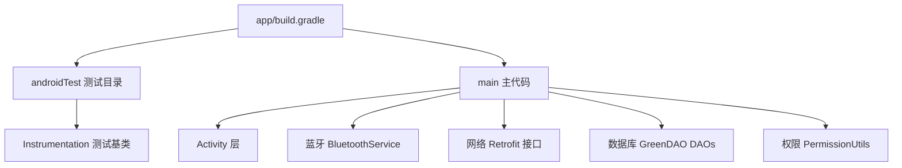
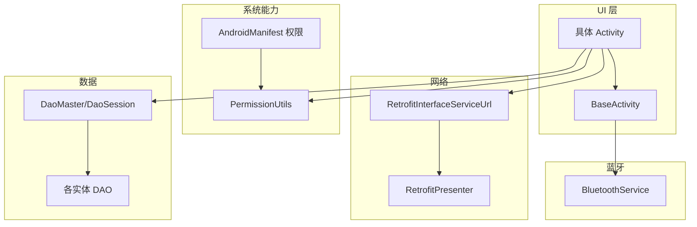
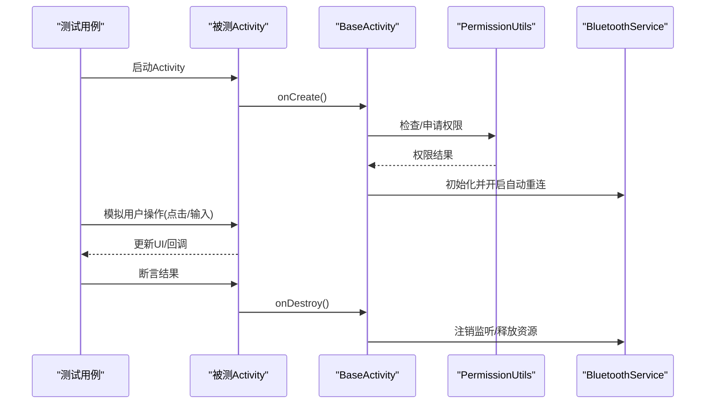
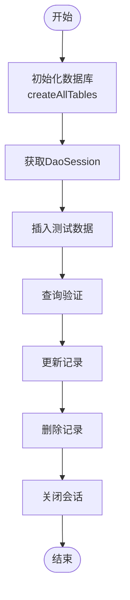
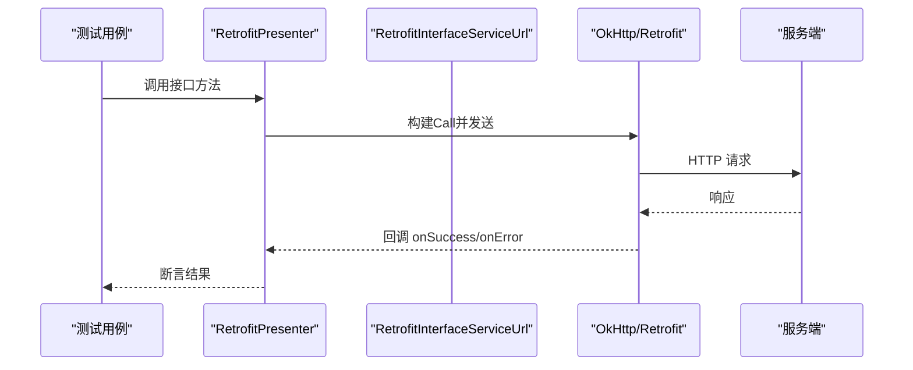
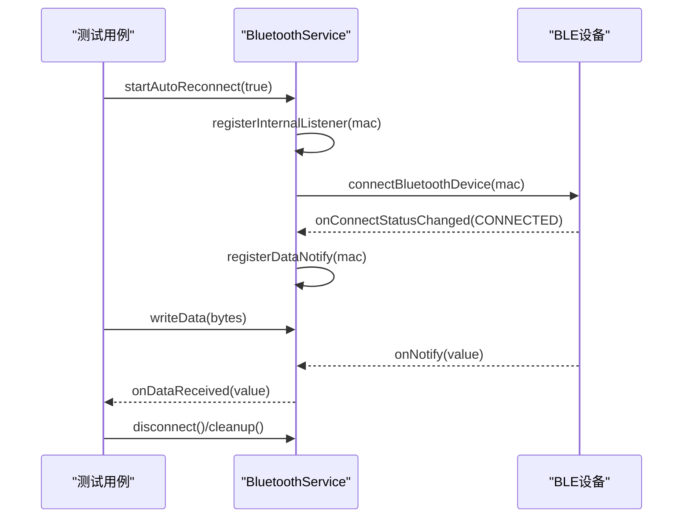
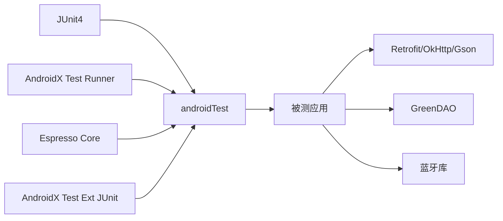

# 集成测试

<cite>
**本文引用的文件**
- [app/build.gradle](file://app/build.gradle)
- [gradle.properties](file://gradle.properties)
- [AndroidManifest.xml](file://app/src/main/AndroidManifest.xml)
- [ExampleInstrumentedTest.java](file://app/src/androidTest/java/com/example/gtj_sd_dg240/ExampleInstrumentedTest.java)
- [BaseActivity.java](file://app/src/main/java/com/example/gtj_sd_dg240/activity/start/BaseActivity.java)
- [PermissionUtils.java](file://app/src/main/java/com/example/gtj_sd_dg240/utils/PermissionUtils.java)
- [BluetoothService.java](file://app/src/main/java/com/example/gtj_sd_dg240/bluetooth/BluetoothService.java)
- [RetrofitInterfaceServiceUrl.java](file://app/src/main/java/com/example/gtj_sd_dg240/net/RetrofitInterfaceServiceUrl.java)
- [RetrofitPresenter.java](file://app/src/main/java/com/example/gtj_sd_dg240/net/RetrofitPresenter.java)
- [DaoMaster.java](file://app/src/main/java/com/example/gtj_sd_dg240/functions/database/greenDao/db/DaoMaster.java)
- [DaoSession.java](file://app/src/main/java/com/example/gtj_sd_dg240/functions/database/greenDao/db/DaoSession.java)
- [ConfigBeanDao.java](file://app/src/main/java/com/example/gtj_sd_dg240/functions/database/greenDao/db/ConfigBeanDao.java)
- [ProjectBeanDao.java](file://app/src/main/java/com/example/gtj_sd_dg240/functions/database/greenDao/db/ProjectBeanDao.java)
- [ZoneBeanDao.java](file://app/src/main/java/com/example/gtj_sd_dg240/functions/database/greenDao/db/ZoneBeanDao.java)
- [RebarMinMaxBeanDao.java](file://app/src/main/java/com/example/gtj_sd_dg240/functions/database/greenDao/db/RebarMinMaxBeanDao.java)
</cite>

## 目录
1. [简介](#简介)
2. [项目结构](#项目结构)
3. [核心组件](#核心组件)
4. [架构总览](#架构总览)
5. [详细组件分析](#详细组件分析)
6. [依赖关系分析](#依赖关系分析)
7. [性能与稳定性考虑](#性能与稳定性考虑)
8. [故障排查指南](#故障排查指南)
9. [结论](#结论)
10. [附录：测试用例模板与清单](#附录测试用例模板与清单)

## 简介
本文件面向需要在真实设备上验证 Android 应用行为的团队，提供基于 Android Instrumentation 的集成测试方案。结合本项目已集成的测试依赖（Espresso、JUnit4、AndroidX Test），覆盖以下关键场景：
- Activity 生命周期与 UI 交互
- 数据库 GreenDAO 读写与迁移
- 网络请求 Retrofit 接口调用
- 蓝牙通信连接、数据收发与重连
- 权限申请与系统能力访问
- 测试数据准备、模拟服务使用、结果断言与报告生成

## 项目结构
- 应用模块位于 app，包含主代码与 androidTest 测试目录；工具库模块 utillibrary 也包含独立测试。
- 构建配置在 app/build.gradle，声明了测试依赖与编译选项。
- 运行时权限与功能开关集中在 AndroidManifest.xml 与 PermissionUtils.java。
- 核心业务包括蓝牙服务、网络层、数据库层与多个 Activity。

图表来源
- [app/build.gradle:86-99](file://app/build.gradle#L86-L99)
- [AndroidManifest.xml:6-79](file://app/src/main/AndroidManifest.xml#L6-L79)

章节来源
- [app/build.gradle:1-145](file://app/build.gradle#L1-L145)
- [gradle.properties:1-36](file://gradle.properties#L1-L36)
- [AndroidManifest.xml:1-182](file://app/src/main/AndroidManifest.xml#L1-L182)

## 核心组件
- 测试框架与依赖
  - JUnit4 运行器与断言
  - AndroidX Test Runner 与 Espresso 用于 UI 自动化
  - 通过 @RunWith(AndroidJUnit4.class) 在真机上执行
- 应用入口与生命周期
  - BaseActivity 统一处理窗口、状态栏、蓝牙自动重连、线程池与资源释放
- 权限管理
  - PermissionUtils 封装多版本权限申请流程，含存储、相机、位置、蓝牙等
- 蓝牙通信
  - BluetoothService 单例，负责连接、断开、数据通知、自动重连与回调分发
- 网络请求
  - RetrofitInterfaceServiceUrl 定义接口；RetrofitPresenter 负责创建 Retrofit/OkHttp 并发起请求
- 数据库
  - GreenDAO 生成的 DaoMaster/DaoSession 与各实体 DAO，支持建表、CRUD

章节来源
- [ExampleInstrumentedTest.java:1-27](file://app/src/androidTest/java/com/example/gtj_sd_dg240/ExampleInstrumentedTest.java#L1-L27)
- [BaseActivity.java:40-98](file://app/src/main/java/com/example/gtj_sd_dg240/activity/start/BaseActivity.java#L40-L98)
- [PermissionUtils.java:19-197](file://app/src/main/java/com/example/gtj_sd_dg240/utils/PermissionUtils.java#L19-L197)
- [BluetoothService.java:16-312](file://app/src/main/java/com/example/gtj_sd_dg240/bluetooth/BluetoothService.java#L16-L312)
- [RetrofitInterfaceServiceUrl.java:1-30](file://app/src/main/java/com/example/gtj_sd_dg240/net/RetrofitInterfaceServiceUrl.java#L1-L30)
- [RetrofitPresenter.java:25-36](file://app/src/main/java/com/example/gtj_sd_dg240/net/RetrofitPresenter.java#L25-L36)
- [DaoMaster.java:1-29](file://app/src/main/java/com/example/gtj_sd_dg240/functions/database/greenDao/db/DaoMaster.java#L1-L29)
- [DaoSession.java:1-36](file://app/src/main/java/com/example/gtj_sd_dg240/functions/database/greenDao/db/DaoSession.java#L1-L36)

## 架构总览
下图展示集成测试中涉及的主要组件与交互路径，涵盖 UI、蓝牙、网络与数据库。

图表来源
- [BaseActivity.java:188-198](file://app/src/main/java/com/example/gtj_sd_dg240/activity/start/BaseActivity.java#L188-L198)
- [BluetoothService.java:76-109](file://app/src/main/java/com/example/gtj_sd_dg240/bluetooth/BluetoothService.java#L76-L109)
- [RetrofitInterfaceServiceUrl.java:16-30](file://app/src/main/java/com/example/gtj_sd_dg240/net/RetrofitInterfaceServiceUrl.java#L16-L30)
- [RetrofitPresenter.java:31-36](file://app/src/main/java/com/example/gtj_sd_dg240/net/RetrofitPresenter.java#L31-L36)
- [DaoMaster.java:19-29](file://app/src/main/java/com/example/gtj_sd_dg240/functions/database/greenDao/db/DaoMaster.java#L19-L29)
- [AndroidManifest.xml:6-79](file://app/src/main/AndroidManifest.xml#L6-L79)

## 详细组件分析

### 真机测试环境搭建与设备配置
- 设备要求
  - 目标 SDK 与最低 SDK 由 defaultConfig 指定，需确保真机系统版本满足要求。
  - 启用开发者模式与 USB 调试，或使用无线调试。
- Gradle 与 Java 环境
  - 通过 gradle.properties 指定 JDK 路径与 JVM 参数，保证构建稳定。
- 权限与特性
  - 在 AndroidManifest.xml 中声明蓝牙、存储、相机、网络等权限；部分权限需在运行时动态申请。
- 运行测试
  - 使用 Android Studio 的 Run/Debug 配置选择 Connected Device，或命令行执行 instrumented test。
  - 首次运行会安装被测应用与测试 APK，并在设备上启动 Instrumentation 进程。

章节来源
- [app/build.gradle:11-17](file://app/build.gradle#L11-L17)
- [gradle.properties:1-6](file://gradle.properties#L1-L6)
- [AndroidManifest.xml:6-79](file://app/src/main/AndroidManifest.xml#L6-L79)

### 权限处理与系统能力
- 权限策略
  - 位置权限用于蓝牙扫描；存储权限用于文件读写；相机权限用于拍照；蓝牙权限分旧版与新版本。
- 运行时申请
  - 通过 PermissionUtils.initPermission 统一申请，内部根据系统版本决定是否需要跳转“所有文件访问”设置。
- 测试建议
  - 在测试前主动触发权限申请流程，或在设备设置中预先授权，避免测试中断。
  - 对拒绝场景增加分支断言，确保 UI 提示与引导逻辑正确。

章节来源
- [PermissionUtils.java:48-119](file://app/src/main/java/com/example/gtj_sd_dg240/utils/PermissionUtils.java#L48-L119)
- [AndroidManifest.xml:14-79](file://app/src/main/AndroidManifest.xml#L14-L79)

### Activity 生命周期与 UI 交互测试
- 生命周期
  - BaseActivity 在 onCreate 中完成窗口配置、ViewBinding、蓝牙服务初始化；onDestroy 中注销监听、关闭线程池。
- UI 自动化
  - 使用 Espresso 定位控件、模拟点击、输入文本、断言显示内容。
- 典型流程
  - 启动目标 Activity -> 等待页面渲染 -> 执行交互 -> 断言结果 -> 清理资源。

图表来源
- [BaseActivity.java:91-98](file://app/src/main/java/com/example/gtj_sd_dg240/activity/start/BaseActivity.java#L91-L98)
- [BaseActivity.java:309-334](file://app/src/main/java/com/example/gtj_sd_dg240/activity/start/BaseActivity.java#L309-L334)
- [PermissionUtils.java:102-119](file://app/src/main/java/com/example/gtj_sd_dg240/utils/PermissionUtils.java#L102-L119)
- [BluetoothService.java:76-109](file://app/src/main/java/com/example/gtj_sd_dg240/bluetooth/BluetoothService.java#L76-L109)

章节来源
- [BaseActivity.java:91-98](file://app/src/main/java/com/example/gtj_sd_dg240/activity/start/BaseActivity.java#L91-L98)
- [BaseActivity.java:309-334](file://app/src/main/java/com/example/gtj_sd_dg240/activity/start/BaseActivity.java#L309-L334)

### 数据库集成测试（GreenDAO）
- 数据库初始化
  - 通过 DaoMaster.createAllTables 建表；使用 DaoSession 获取各实体 DAO。
- 测试要点
  - 插入/查询/更新/删除事务一致性
  - 字段类型与转换器（如曲线数据、列表转换）的正确性
  - 并发写入与读取的性能与锁行为
- 示例流程
  - 准备测试数据 -> 打开数据库会话 -> 执行 CRUD -> 断言结果 -> 关闭会话

图表来源
- [DaoMaster.java:19-29](file://app/src/main/java/com/example/gtj_sd_dg240/functions/database/greenDao/db/DaoMaster.java#L19-L29)
- [DaoSession.java:30-36](file://app/src/main/java/com/example/gtj_sd_dg240/functions/database/greenDao/db/DaoSession.java#L30-L36)
- [ConfigBeanDao.java:15-20](file://app/src/main/java/com/example/gtj_sd_dg240/functions/database/greenDao/db/ConfigBeanDao.java#L15-L20)
- [ProjectBeanDao.java:15-40](file://app/src/main/java/com/example/gtj_sd_dg240/functions/database/greenDao/db/ProjectBeanDao.java#L15-L40)
- [ZoneBeanDao.java:17-23](file://app/src/main/java/com/example/gtj_sd_dg240/functions/database/greenDao/db/ZoneBeanDao.java#L17-L23)
- [RebarMinMaxBeanDao.java:16-22](file://app/src/main/java/com/example/gtj_sd_dg240/functions/database/greenDao/db/RebarMinMaxBeanDao.java#L16-L22)

章节来源
- [DaoMaster.java:19-29](file://app/src/main/java/com/example/gtj_sd_dg240/functions/database/greenDao/db/DaoMaster.java#L19-L29)
- [DaoSession.java:30-36](file://app/src/main/java/com/example/gtj_sd_dg240/functions/database/greenDao/db/DaoSession.java#L30-L36)

### 网络请求集成测试（Retrofit）
- 接口定义
  - RetrofitInterfaceServiceUrl 定义了上传数据、查询委托列表与分页查询接口。
- 客户端配置
  - RetrofitPresenter 创建 Retrofit 实例，注入 Gson 转换器与 OkHttp 客户端。
- 测试要点
  - 成功响应解析、错误码处理、超时与重试策略
  - 网络不可用时的降级与提示
- 示例流程
  - 构造请求体 -> 发起异步请求 -> 断言回调结果 -> 校验本地缓存或 UI 更新

图表来源
- [RetrofitInterfaceServiceUrl.java:16-30](file://app/src/main/java/com/example/gtj_sd_dg240/net/RetrofitInterfaceServiceUrl.java#L16-L30)
- [RetrofitPresenter.java:31-36](file://app/src/main/java/com/example/gtj_sd_dg240/net/RetrofitPresenter.java#L31-L36)

章节来源
- [RetrofitInterfaceServiceUrl.java:16-30](file://app/src/main/java/com/example/gtj_sd_dg240/net/RetrofitInterfaceServiceUrl.java#L16-L30)
- [RetrofitPresenter.java:31-36](file://app/src/main/java/com/example/gtj_sd_dg240/net/RetrofitPresenter.java#L31-L36)

### 蓝牙通信集成测试
- 服务模型
  - BluetoothService 为单例，维护连接状态、MAC 地址、重连定时器与回调列表。
- 关键能力
  - 自动重连、连接状态监听、数据通知注册与分发、写数据、断开与清理。
- 测试要点
  - 连接建立与断开、数据收发时序、异常断开后的重连、内存泄漏防护（监听器注销）。
- 示例流程
  - 启动服务 -> 注册监听 -> 连接设备 -> 发送指令 -> 接收数据 -> 断言 -> 断开与清理

图表来源
- [BluetoothService.java:76-109](file://app/src/main/java/com/example/gtj_sd_dg240/bluetooth/BluetoothService.java#L76-L109)
- [BluetoothService.java:127-159](file://app/src/main/java/com/example/gtj_sd_dg240/bluetooth/BluetoothService.java#L127-L159)
- [BluetoothService.java:172-198](file://app/src/main/java/com/example/gtj_sd_dg240/bluetooth/BluetoothService.java#L172-L198)
- [BluetoothService.java:200-234](file://app/src/main/java/com/example/gtj_sd_dg240/bluetooth/BluetoothService.java#L200-L234)
- [BluetoothService.java:280-310](file://app/src/main/java/com/example/gtj_sd_dg240/bluetooth/BluetoothService.java#L280-L310)

章节来源
- [BluetoothService.java:16-312](file://app/src/main/java/com/example/gtj_sd_dg240/bluetooth/BluetoothService.java#L16-L312)

### 测试数据准备与模拟服务
- 数据准备
  - 数据库：使用 DAO 批量插入测试数据，或使用种子数据脚本。
  - 网络：可借助 Mock Server 或拦截器替换 baseUrl，返回固定响应。
  - 蓝牙：可使用蓝牙仿真设备或配对真实设备，提前保存 MAC 到 SP。
- 模拟服务
  - 通过替换 Retrofit 的 OkHttpClient 添加日志与拦截器，便于调试。
  - 在测试中控制蓝牙连接状态与数据流，验证 UI 与业务逻辑。

章节来源
- [RetrofitPresenter.java:31-36](file://app/src/main/java/com/example/gtj_sd_dg240/net/RetrofitPresenter.java#L31-L36)
- [BluetoothService.java:54-74](file://app/src/main/java/com/example/gtj_sd_dg240/bluetooth/BluetoothService.java#L54-L74)

### 测试结果验证与报告生成
- 断言策略
  - UI：使用 Espresso 断言可见性、文本、状态。
  - 数据：断言数据库记录数量、关键字段值。
  - 网络：断言回调分支、响应体结构与错误码。
  - 蓝牙：断言连接状态变化、数据回调次数与内容。
- 报告与日志
  - 使用 Android Studio 测试报告查看失败详情与堆栈。
  - 结合 Logger/Logcat 输出关键步骤，便于问题定位。
  - 可在测试中导出数据库快照或网络日志到外部存储，辅助分析。

章节来源
- [ExampleInstrumentedTest.java:17-25](file://app/src/androidTest/java/com/example/gtj_sd_dg240/ExampleInstrumentedTest.java#L17-L25)
- [RetrofitPresenter.java:25-36](file://app/src/main/java/com/example/gtj_sd_dg240/net/RetrofitPresenter.java#L25-L36)

## 依赖关系分析
- 测试依赖
  - JUnit4、AndroidX Test Runner、Espresso Core、AndroidX Test Ext JUnit。
- 运行时依赖
  - AndroidX AppCompat、ConstraintLayout、RecyclerView
  - Retrofit、OkHttp、Gson Converter
  - GreenDAO 及其升级助手
  - 蓝牙库（inuker.bluetooth.library）
  - 工具库（utilcodex、logger）

图表来源
- [app/build.gradle:94-99](file://app/build.gradle#L94-L99)
- [app/build.gradle:115-130](file://app/build.gradle#L115-L130)

章节来源
- [app/build.gradle:94-99](file://app/build.gradle#L94-L99)
- [app/build.gradle:115-130](file://app/build.gradle#L115-L130)

## 性能与稳定性考虑
- 构建与运行
  - 启用并行构建与缓存，减少测试执行时间。
  - 合理设置 JVM 内存与 GC 参数，避免 OOM。
- 测试执行
  - 避免在主线程进行耗时操作，使用后台线程或协程。
  - 对蓝牙与网络请求设置超时与重试上限，防止阻塞。
- 资源管理
  - 确保在测试结束时释放监听器、关闭数据库会话、断开蓝牙连接。
  - 避免内存泄漏，特别是在长生命周期服务中。

章节来源
- [gradle.properties:4-16](file://gradle.properties#L4-L16)
- [BaseActivity.java:309-334](file://app/src/main/java/com/example/gtj_sd_dg240/activity/start/BaseActivity.java#L309-L334)
- [BluetoothService.java:301-310](file://app/src/main/java/com/example/gtj_sd_dg240/bluetooth/BluetoothService.java#L301-L310)

## 故障排查指南
- 权限相关
  - 若蓝牙扫描失败，检查位置权限是否授予；Android 11+ 检查“所有文件访问”权限。
  - 存储读写失败时，确认目标目录与权限策略。
- 蓝牙相关
  - 连接失败：检查 MAC 是否正确、设备是否在线、权限是否齐全。
  - 数据未收到：确认已注册数据通知与回调，检查 UUID 与服务特征。
- 网络相关
  - 请求失败：检查 baseUrl、网络状态、超时与重试配置。
  - 响应解析错误：核对 JSON 结构与转换器配置。
- 数据库相关
  - 建表失败：检查 schema 版本与迁移逻辑。
  - 查询为空：确认插入事务是否提交、索引与字段映射是否正确。
- 日志与报告
  - 使用 Logger 输出关键路径；在测试中捕获异常并打印堆栈。
  - 通过 Android Studio 测试报告定位失败用例与原因。

章节来源
- [PermissionUtils.java:102-169](file://app/src/main/java/com/example/gtj_sd_dg240/utils/PermissionUtils.java#L102-L169)
- [BluetoothService.java:127-198](file://app/src/main/java/com/example/gtj_sd_dg240/bluetooth/BluetoothService.java#L127-L198)
- [RetrofitPresenter.java:31-36](file://app/src/main/java/com/example/gtj_sd_dg240/net/RetrofitPresenter.java#L31-L36)
- [DaoMaster.java:19-29](file://app/src/main/java/com/example/gtj_sd_dg240/functions/database/greenDao/db/DaoMaster.java#L19-L29)

## 结论
本项目已具备完善的集成测试基础：测试依赖齐全、权限与系统能力完备、核心组件职责清晰。通过在真机上执行 Instrumentation 测试，可有效覆盖 Activity 生命周期、数据库操作、网络请求与蓝牙通信等关键场景。建议按本指南逐步完善用例库，形成稳定的自动化回归体系，并结合日志与报告快速定位问题。

## 附录：测试用例模板与清单
- Activity 生命周期与 UI 交互
  - 启动目标 Activity，断言页面元素可见
  - 模拟点击与输入，断言 UI 状态变化
  - 切换屏幕方向，断言状态保持
- 数据库集成测试
  - 插入多条记录，查询验证数量与字段
  - 更新与删除后断言一致性
  - 并发写入与读取，验证无冲突
- 网络接口测试
  - 成功响应：断言数据解析与 UI 更新
  - 失败响应：断言错误处理与提示
  - 超时与重试：断言行为符合预期
- 蓝牙通信测试
  - 连接建立与断开：断言状态变化
  - 数据收发：断言回调内容与时序
  - 异常重连：断言自动重连机制有效
- 权限与系统能力
  - 权限申请流程：断言提示与引导
  - 拒绝权限：断言降级逻辑与提示
  - 系统能力可用性：断言功能开关与回退

[本节为通用指导，不直接分析具体文件]