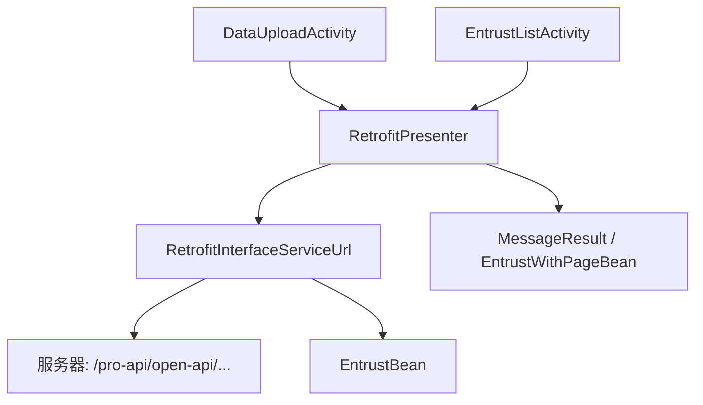
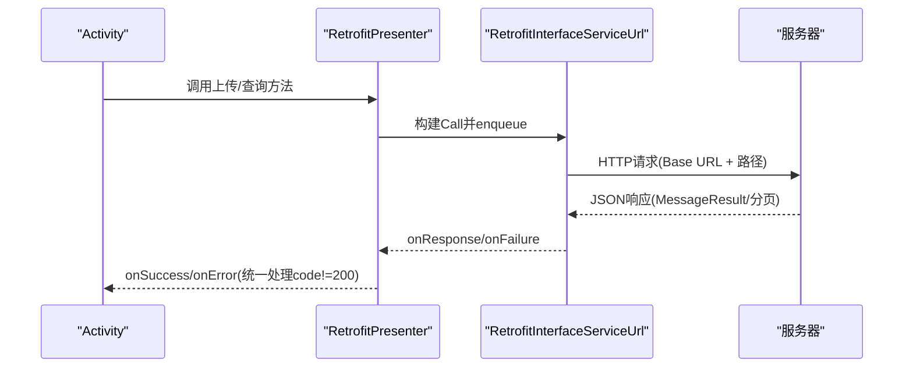
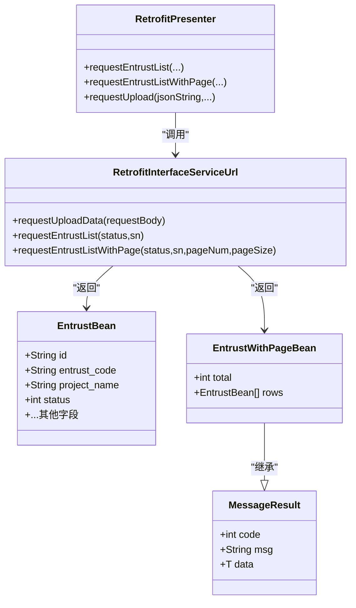

# API接口定义

<cite>
**本文引用的文件**
- [RetrofitInterfaceServiceUrl.java](file://app/src/main/java/com/example/gtj_sd_dg240/net/RetrofitInterfaceServiceUrl.java)
- [RetrofitPresenter.java](file://app/src/main/java/com/example/gtj_sd_dg240/net/RetrofitPresenter.java)
- [MessageResult.java](file://app/src/main/java/com/example/gtj_sd_dg240/net/MessageResult.java)
- [EntrustBean.java](file://app/src/main/java/com/example/gtj_sd_dg240/model/EntrustBean.java)
- [EntrustWithPageBean.java](file://app/src/main/java/com/example/gtj_sd_dg240/model/EntrustWithPageBean.java)
- [StaticConstant.java](file://app/src/main/java/com/example/gtj_sd_dg240/StaticConstant.java)
- [DataUploadActivity.java](file://app/src/main/java/com/example/gtj_sd_dg240/activity/data/DataUploadActivity.java)
- [EntrustListActivity.java](file://app/src/main/java/com/example/gtj_sd_dg240/activity/testing/EntrustListActivity.java)
</cite>

## 目录
1. [简介](#简介)
2. [项目结构](#项目结构)
3. [核心组件](#核心组件)
4. [架构总览](#架构总览)
5. [详细接口说明](#详细接口说明)
6. [依赖关系分析](#依赖关系分析)
7. [性能与可靠性](#性能与可靠性)
8. [故障排查指南](#故障排查指南)
9. [结论](#结论)
10. [附录](#附录)

## 简介
本文件为混凝土电杆检测客户端的API接口文档，聚焦于 RetrofitInterfaceServiceUrl 中定义的HTTP端点，包括：
- 数据上报接口
- 委托列表查询接口
- 分页查询委托列表接口

文档涵盖每个接口的URL路径、HTTP方法、请求参数、响应格式、错误码、业务用途、参数校验规则、请求与响应示例（成功与失败场景），以及接口版本管理与向后兼容性建议。

## 项目结构
本项目采用分层组织：
- net层：网络接口定义与调用封装（RetrofitInterfaceServiceUrl、RetrofitPresenter）
- model层：数据模型（EntrustBean、EntrustWithPageBean、MessageResult）
- activity层：页面逻辑与API调用入口（DataUploadActivity、EntrustListActivity）
- 配置常量：基础URL等（StaticConstant）

图表来源
- [RetrofitInterfaceServiceUrl.java:16-29](file://app/src/main/java/com/example/gtj_sd_dg240/net/RetrofitInterfaceServiceUrl.java#L16-L29)
- [RetrofitPresenter.java:31-36](file://app/src/main/java/com/example/gtj_sd_dg240/net/RetrofitPresenter.java#L31-L36)
- [StaticConstant.java:26](file://app/src/main/java/com/example/gtj_sd_dg240/StaticConstant.java#L26)

章节来源
- [StaticConstant.java:26](file://app/src/main/java/com/example/gtj_sd_dg240/StaticConstant.java#L26)
- [RetrofitInterfaceServiceUrl.java:16-29](file://app/src/main/java/com/example/gtj_sd_dg240/net/RetrofitInterfaceServiceUrl.java#L16-L29)
- [RetrofitPresenter.java:31-36](file://app/src/main/java/com/example/gtj_sd_dg240/net/RetrofitPresenter.java#L31-L36)

## 核心组件
- 网络接口定义：RetrofitInterfaceServiceUrl 定义了三个HTTP端点
- 网络调用封装：RetrofitPresenter 负责创建Retrofit实例、发起请求、统一处理成功/失败回调
- 通用响应体：MessageResult<T> 包含 code、msg、data
- 业务模型：EntrustBean（委托单信息）、EntrustWithPageBean（分页结果，继承MessageResult并扩展total、rows）
- 基础URL：StaticConstant.httpUrl 提供统一的Base URL

章节来源
- [RetrofitInterfaceServiceUrl.java:16-29](file://app/src/main/java/com/example/gtj_sd_dg240/net/RetrofitInterfaceServiceUrl.java#L16-L29)
- [RetrofitPresenter.java:31-36](file://app/src/main/java/com/example/gtj_sd_dg240/net/RetrofitPresenter.java#L31-L36)
- [MessageResult.java:3-12](file://app/src/main/java/com/example/gtj_sd_dg240/net/MessageResult.java#L3-L12)
- [EntrustBean.java:5-31](file://app/src/main/java/com/example/gtj_sd_dg240/model/EntrustBean.java#L5-L31)
- [EntrustWithPageBean.java:7-10](file://app/src/main/java/com/example/gtj_sd_dg240/model/EntrustWithPageBean.java#L7-L10)
- [StaticConstant.java:26](file://app/src/main/java/com/example/gtj_sd_dg240/StaticConstant.java#L26)

## 架构总览
客户端通过 Activity 触发业务操作，调用 RetrofitPresenter 进行网络请求；RetrofitPresenter 使用 Retrofit 将请求转发到 RetrofitInterfaceServiceUrl 定义的端点；服务端返回 MessageResult 或分页对象，由 Presenter 统一解析并回调至 Activity。

图表来源
- [RetrofitPresenter.java:61-113](file://app/src/main/java/com/example/gtj_sd_dg240/net/RetrofitPresenter.java#L61-L113)
- [RetrofitInterfaceServiceUrl.java:16-29](file://app/src/main/java/com/example/gtj_sd_dg240/net/RetrofitInterfaceServiceUrl.java#L16-L29)
- [StaticConstant.java:26](file://app/src/main/java/com/example/gtj_sd_dg240/StaticConstant.java#L26)

## 详细接口说明

### 接口一：数据上报
- 业务用途：上报混凝土电杆检测数据（含设备SN、项目信息、电杆尺寸、钢筋厚度测量数据及截图）
- URL路径：/concreteUtilityPolesDetectionResultReported
- HTTP方法：POST
- Base URL：https://tims.sidajiance.com/pro-api/open-api/
- 请求头：无特殊头（客户端未设置）
- 请求体：application/json 字符串，字段来源于 DataUploadActivity 构造的Map序列化
  - SN：设备序列号（来自本地存储）
  - project_name：项目名称（委托单号_项目名称）
  - pole_number：电杆编号
  - pole_type：电杆类型（枚举映射）
  - pole_standard：执行标准（固定值）
  - pole_length：电杆长度
  - pole_bottom_diameter：底部直径
  - pole_top_diameter：顶部直径
  - main_rebar_diameter：主筋直径
  - hooping_diameter：箍筋直径
  - start_time：开始时间
  - pole_data：分段数据数组，每项包含：
    - pole_point：分段标识（如“根部”、“梢部”、“距根部X”）
    - average_thickness0：平均厚度0
    - average_thickness1：平均厚度1
    - point_data：点数据数组，每项包含 thickness0、thickness1
  - imageFile：截图Base64字符串
- 响应体：MessageResult<?>
  - code：状态码（200表示成功）
  - msg：消息文本
  - data：业务数据（具体结构由服务端定义）
- 错误码与处理：
  - code != 200：视为失败，Presenter 将错误信息回传给上层
  - 网络异常：Presenter 捕获并转换为友好提示（如检查网络连接）
- 参数验证规则：
  - SN 必须存在且非空
  - project_name、pole_number、start_time 等关键字段需非空
  - pole_data 至少包含一个分段，point_data 可为空但需符合结构
- 成功示例（JSON示意）：
  - 请求体片段：{"SN":"xxx","project_name":"E001_某项目","pole_number":"P01",...}
  - 响应体：{"code":200,"msg":"成功","data":{...}}
- 失败示例（JSON示意）：
  - 响应体：{"code":400,"msg":"参数缺失","data":null}
- 调用位置参考：
  - 构造请求体与调用：[DataUploadActivity.java:418-458](file://app/src/main/java/com/example/gtj_sd_dg240/activity/data/DataUploadActivity.java#L418-L458)
  - 统一封装调用：[RetrofitPresenter.java:115-141](file://app/src/main/java/com/example/gtj_sd_dg240/net/RetrofitPresenter.java#L115-L141)

章节来源
- [RetrofitInterfaceServiceUrl.java:17-19](file://app/src/main/java/com/example/gtj_sd_dg240/net/RetrofitInterfaceServiceUrl.java#L17-L19)
- [RetrofitPresenter.java:115-141](file://app/src/main/java/com/example/gtj_sd_dg240/net/RetrofitPresenter.java#L115-L141)
- [DataUploadActivity.java:418-458](file://app/src/main/java/com/example/gtj_sd_dg240/activity/data/DataUploadActivity.java#L418-L458)
- [MessageResult.java:3-12](file://app/src/main/java/com/example/gtj_sd_dg240/net/MessageResult.java#L3-L12)

### 接口二：委托列表查询
- 业务用途：根据设备SN和状态获取委托单列表（用于选择委托单）
- URL路径：/polesEntrustManage/queryPolesEntrustManage
- HTTP方法：GET
- Base URL：https://tims.sidajiance.com/pro-api/open-api/
- 请求头：clientId=1941115683107844096（固定）
- 查询参数：
  - status：int，委托状态（0：配置中；1：试验中；2：已完成；3：已超期）
  - sn：String，设备序列号（来自本地存储）
- 响应体：MessageResult<List<EntrustBean>>
  - code：状态码（200表示成功）
  - msg：消息文本
  - data：委托单列表（EntrustBean数组）
- 错误码与处理：
  - code != 200：失败，Presenter 将错误信息回传
  - 网络异常：统一提示
- 参数验证规则：
  - status 取值范围 0-3
  - sn 必须非空
- 成功示例（JSON示意）：
  - 响应体：{"code":200,"msg":"成功","data":[{"id":"...","entrust_code":"...","status":1,...},...]}
- 失败示例（JSON示意）：
  - 响应体：{"code":404,"msg":"未找到委托","data":[]}
- 调用位置参考：
  - 调用封装：[RetrofitPresenter.java:61-86](file://app/src/main/java/com/example/gtj_sd_dg240/net/RetrofitPresenter.java#L61-L86)
  - 页面使用：[EntrustListActivity.java:113-145](file://app/src/main/java/com/example/gtj_sd_dg240/activity/testing/EntrustListActivity.java#L113-L145)

章节来源
- [RetrofitInterfaceServiceUrl.java:21-24](file://app/src/main/java/com/example/gtj_sd_dg240/net/RetrofitInterfaceServiceUrl.java#L21-L24)
- [RetrofitPresenter.java:61-86](file://app/src/main/java/com/example/gtj_sd_dg240/net/RetrofitPresenter.java#L61-L86)
- [EntrustListActivity.java:113-145](file://app/src/main/java/com/example/gtj_sd_dg240/activity/testing/EntrustListActivity.java#L113-L145)
- [EntrustBean.java:5-31](file://app/src/main/java/com/example/gtj_sd_dg240/model/EntrustBean.java#L5-L31)

### 接口三：分页查询委托列表
- 业务用途：按页获取委托单列表（支持下拉刷新与上拉加载更多）
- URL路径：/polesEntrustManage/queryPolesEntrustManageWithPage
- HTTP方法：GET
- Base URL：https://tims.sidajiance.com/pro-api/open-api/
- 请求头：clientId=1941115683107844096（固定）
- 查询参数：
  - status：int，委托状态（同上）
  - sn：String，设备序列号
  - pageNum：int，页码（从1开始）
  - pageSize：int，每页条数（默认10）
- 响应体：EntrustWithPageBean（继承MessageResult）
  - code：状态码（200表示成功）
  - msg：消息文本
  - data：分页对象（实际在子类中扩展）
  - total：总记录数
  - rows：当前页数据（List<EntrustBean>）
- 错误码与处理：
  - code != 200：失败，Presenter 将错误信息回传
  - 网络异常：统一提示
- 参数验证规则：
  - pageNum >= 1
  - pageSize > 0
  - status 取值范围 0-3
  - sn 必须非空
- 成功示例（JSON示意）：
  - 响应体：{"code":200,"msg":"成功","data":{"total":100,"rows":[...]}}
- 失败示例（JSON示意）：
  - 响应体：{"code":400,"msg":"参数错误","data":null}
- 调用位置参考：
  - 调用封装：[RetrofitPresenter.java:88-113](file://app/src/main/java/com/example/gtj_sd_dg240/net/RetrofitPresenter.java#L88-L113)
  - 页面使用：[EntrustListActivity.java:147-194](file://app/src/main/java/com/example/gtj_sd_dg240/activity/testing/EntrustListActivity.java#L147-L194)

章节来源
- [RetrofitInterfaceServiceUrl.java:26-29](file://app/src/main/java/com/example/gtj_sd_dg240/net/RetrofitInterfaceServiceUrl.java#L26-L29)
- [RetrofitPresenter.java:88-113](file://app/src/main/java/com/example/gtj_sd_dg240/net/RetrofitPresenter.java#L88-L113)
- [EntrustListActivity.java:147-194](file://app/src/main/java/com/example/gtj_sd_dg240/activity/testing/EntrustListActivity.java#L147-L194)
- [EntrustWithPageBean.java:7-10](file://app/src/main/java/com/example/gtj_sd_dg240/model/EntrustWithPageBean.java#L7-L10)

## 依赖关系分析
- RetrofitInterfaceServiceUrl 依赖 model 中的 EntrustBean、EntrustWithPageBean
- RetrofitPresenter 依赖 StaticConstant 提供的 Base URL，并使用 Gson 转换器
- Activity 通过 Presenter 间接调用接口，Presenter 统一处理网络异常与业务码

图表来源
- [MessageResult.java:3-12](file://app/src/main/java/com/example/gtj_sd_dg240/net/MessageResult.java#L3-L12)
- [EntrustBean.java:5-31](file://app/src/main/java/com/example/gtj_sd_dg240/model/EntrustBean.java#L5-L31)
- [EntrustWithPageBean.java:7-10](file://app/src/main/java/com/example/gtj_sd_dg240/model/EntrustWithPageBean.java#L7-L10)
- [RetrofitInterfaceServiceUrl.java:16-29](file://app/src/main/java/com/example/gtj_sd_dg240/net/RetrofitInterfaceServiceUrl.java#L16-L29)
- [RetrofitPresenter.java:61-141](file://app/src/main/java/com/example/gtj_sd_dg240/net/RetrofitPresenter.java#L61-L141)

章节来源
- [RetrofitInterfaceServiceUrl.java:16-29](file://app/src/main/java/com/example/gtj_sd_dg240/net/RetrofitInterfaceServiceUrl.java#L16-L29)
- [RetrofitPresenter.java:61-141](file://app/src/main/java/com/example/gtj_sd_dg240/net/RetrofitPresenter.java#L61-L141)
- [MessageResult.java:3-12](file://app/src/main/java/com/example/gtj_sd_dg240/net/MessageResult.java#L3-L12)
- [EntrustBean.java:5-31](file://app/src/main/java/com/example/gtj_sd_dg240/model/EntrustBean.java#L5-L31)
- [EntrustWithPageBean.java:7-10](file://app/src/main/java/com/example/gtj_sd_dg240/model/EntrustWithPageBean.java#L7-L10)

## 性能与可靠性
- 超时配置：读/写/连接超时均为60秒，适合大数据上报与复杂查询
- 重试机制：内置重试拦截器，对连接失败进行自动重试
- 日志输出：启用HttpLoggingInterceptor，便于问题定位
- 分页策略：分页查询默认pageSize=10，减少单次传输体积，提升列表加载速度
- 图片上传：截图以Base64编码传输，注意控制压缩质量以避免过大负载

章节来源
- [RetrofitPresenter.java:38-52](file://app/src/main/java/com/example/gtj_sd_dg240/net/RetrofitPresenter.java#L38-L52)
- [EntrustListActivity.java:147-194](file://app/src/main/java/com/example/gtj_sd_dg240/activity/testing/EntrustListActivity.java#L147-L194)
- [DataUploadActivity.java:418-458](file://app/src/main/java/com/example/gtj_sd_dg240/activity/data/DataUploadActivity.java#L418-L458)

## 故障排查指南
- 常见错误码：
  - code != 200：业务失败，查看msg字段获取具体原因（如参数缺失、权限不足）
  - 网络异常：Presenter 会提示“检查网络连接”，确认设备网络与服务器可达性
- 调试建议：
  - 查看Logcat中“RetrofitLog”输出，核对请求与响应内容
  - 检查本地存储的SN是否有效（bluetooth-name）
  - 对于分页接口，确认pageNum与pageSize是否符合预期
- 常见问题：
  - 未绑定委托单号导致无法上传：需在界面完成委托绑定后再上传
  - 图片过大导致上传缓慢：调整截图压缩比例或分辨率

章节来源
- [RetrofitPresenter.java:61-141](file://app/src/main/java/com/example/gtj_sd_dg240/net/RetrofitPresenter.java#L61-L141)
- [DataUploadActivity.java:404-458](file://app/src/main/java/com/example/gtj_sd_dg240/activity/data/DataUploadActivity.java#L404-L458)

## 结论
本项目通过清晰的接口定义与统一的Presenter封装，实现了数据上报与委托列表查询的分层解耦。所有接口均遵循统一的MessageResult响应规范，便于错误处理与扩展。建议在后续迭代中引入接口版本管理（如URL前缀或Header版本控制），以提升向后兼容性与可维护性。

## 附录

### 接口版本管理与向后兼容性建议
- 版本策略：
  - URL版本化：在Base URL后增加版本号，如 /v1/...，便于多版本并存
  - Header版本控制：通过自定义Header（如 X-API-Version）传递版本信息
- 兼容性考虑：
  - 新增字段时保持可选，避免破坏旧客户端解析
  - 删除或重命名字段时保留兼容字段一段时间，并提供迁移指引
  - 对必填字段进行严格校验，并在响应中给出明确错误信息
- 实施建议：
  - 在RetrofitInterfaceServiceUrl中集中管理版本路径
  - 在RetrofitPresenter中统一注入版本信息
  - 在Activity中根据版本动态调整请求参数或展示逻辑

[本节为概念性内容，不直接分析具体文件]