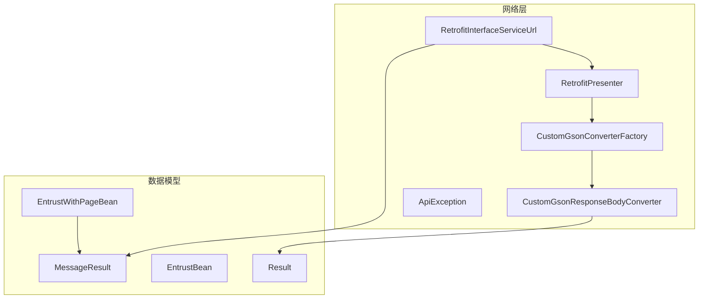
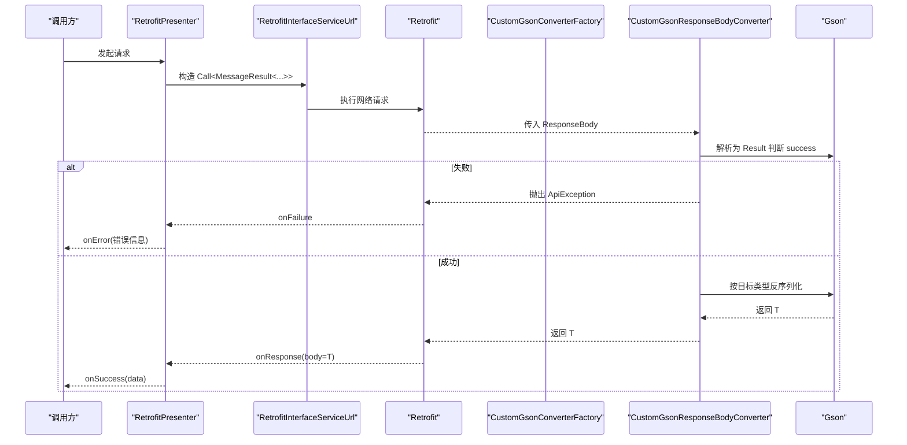
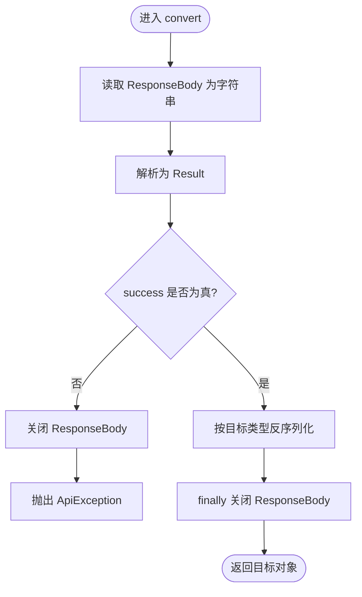
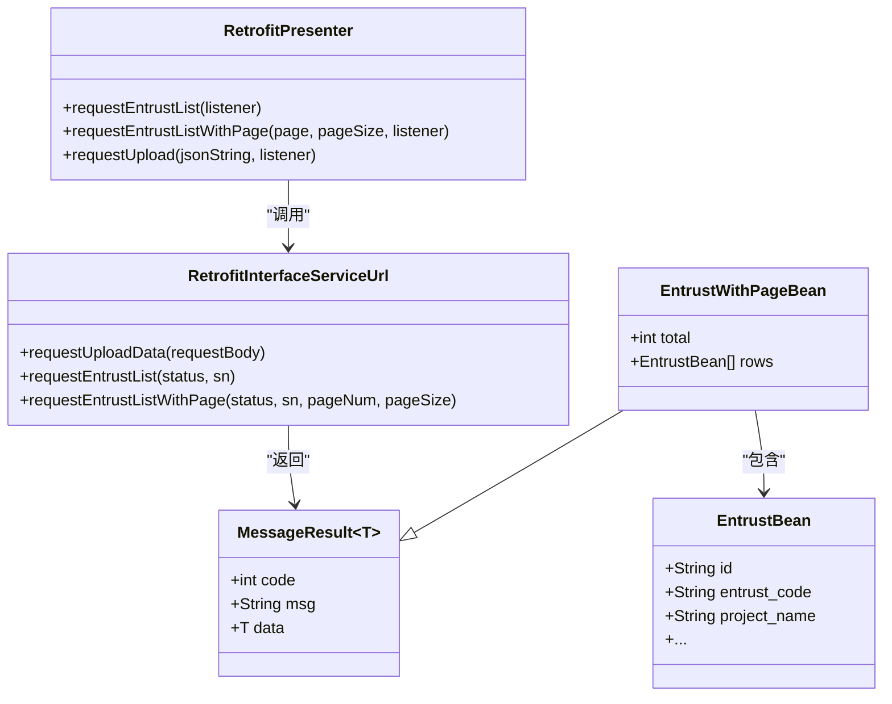
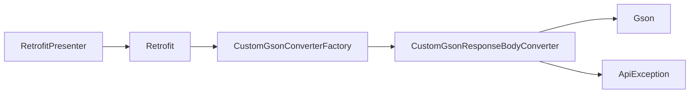

# 数据转换与解析

<cite>
**本文引用的文件**
- [CustomGsonConverterFactory.java](file://app/src/main/java/com/example/gtj_sd_dg240/net/CustomGsonConverterFactory.java)
- [CustomGsonResponseBodyConverter.java](file://app/src/main/java/com/example/gtj_sd_dg240/net/CustomGsonResponseBodyConverter.java)
- [MessageResult.java](file://app/src/main/java/com/example/gtj_sd_dg240/net/MessageResult.java)
- [Result.java](file://app/src/main/java/com/example/gtj_sd_dg240/net/Result.java)
- [ApiException.java](file://app/src/main/java/com/example/gtj_sd_dg240/net/ApiException.java)
- [RetrofitInterfaceServiceUrl.java](file://app/src/main/java/com/example/gtj_sd_dg240/net/RetrofitInterfaceServiceUrl.java)
- [RetrofitPresenter.java](file://app/src/main/java/com/example/gtj_sd_dg240/net/RetrofitPresenter.java)
- [EntrustBean.java](file://app/src/main/java/com/example/gtj_sd_dg240/model/EntrustBean.java)
- [EntrustWithPageBean.java](file://app/src/main/java/com/example/gtj_sd_dg240/model/EntrustWithPageBean.java)
</cite>

## 目录
1. [简介](#简介)
2. [项目结构](#项目结构)
3. [核心组件](#核心组件)
4. [架构总览](#架构总览)
5. [详细组件分析](#详细组件分析)
6. [依赖关系分析](#依赖关系分析)
7. [性能考虑](#性能考虑)
8. [故障排查指南](#故障排查指南)
9. [结论](#结论)
10. [附录](#附录)

## 简介
本文件聚焦于本项目中网络层的数据转换与解析机制，重点说明：
- 自定义转换器 CustomGsonConverterFactory 与 CustomGsonResponseBodyConverter 的职责、调用链与扩展点。
- 统一响应结构 MessageResult 的设计与泛型使用方式。
- JSON 序列化/反序列化的配置现状与可扩展点（日期格式化、空值处理、命名策略、嵌套对象）。
- 数据校验规则与错误处理机制。
- 性能优化建议与内存管理策略。

## 项目结构
与数据转换与解析直接相关的代码集中在 net 包与 model 包中：
- net 包提供 Retrofit 的 Converter 工厂、响应体转换器、统一异常、接口定义与 Presenter 封装。
- model 包定义业务实体与分页结果模型。

图表来源
- [CustomGsonConverterFactory.java:13-33](file://app/src/main/java/com/example/gtj_sd_dg240/net/CustomGsonConverterFactory.java#L13-L33)
- [CustomGsonResponseBodyConverter.java:11-35](file://app/src/main/java/com/example/gtj_sd_dg240/net/CustomGsonResponseBodyConverter.java#L11-L35)
- [RetrofitInterfaceServiceUrl.java:16-29](file://app/src/main/java/com/example/gtj_sd_dg240/net/RetrofitInterfaceServiceUrl.java#L16-L29)
- [RetrofitPresenter.java:31-36](file://app/src/main/java/com/example/gtj_sd_dg240/net/RetrofitPresenter.java#L31-L36)
- [MessageResult.java:3-12](file://app/src/main/java/com/example/gtj_sd_dg240/net/MessageResult.java#L3-L12)
- [EntrustWithPageBean.java:7-10](file://app/src/main/java/com/example/gtj_sd_dg240/model/EntrustWithPageBean.java#L7-L10)
- [Result.java:3-12](file://app/src/main/java/com/example/gtj_sd_dg240/net/Result.java#L3-L12)

章节来源
- [RetrofitPresenter.java:31-36](file://app/src/main/java/com/example/gtj_sd_dg240/net/RetrofitPresenter.java#L31-L36)
- [RetrofitInterfaceServiceUrl.java:16-29](file://app/src/main/java/com/example/gtj_sd_dg240/net/RetrofitInterfaceServiceUrl.java#L16-L29)

## 核心组件
- CustomGsonConverterFactory：为 Retrofit 提供自定义的 ResponseBody 转换器，内部通过 Gson 获取 TypeAdapter 并返回自定义转换器实例。
- CustomGsonResponseBodyConverter：在 convert 阶段读取原始响应字符串，先按 Result 解析以判断 success；若失败则抛出 ApiException；成功则再按目标类型进行反序列化。
- MessageResult<T>：统一响应结构，包含 code、msg、data 三个字段，用于上层对业务状态码的统一处理。
- Result<T>：用于转换器内部快速判断服务端是否成功的轻量包装，包含 success、message、data。
- RetrofitInterfaceServiceUrl：声明式 API 接口，返回值多为 MessageResult 或其子类，便于统一处理。
- EntrustWithPageBean：继承 MessageResult，增加分页字段 total 和 rows，体现嵌套对象与分页数据的组合。

章节来源
- [CustomGsonConverterFactory.java:13-33](file://app/src/main/java/com/example/gtj_sd_dg240/net/CustomGsonConverterFactory.java#L13-L33)
- [CustomGsonResponseBodyConverter.java:11-35](file://app/src/main/java/com/example/gtj_sd_dg240/net/CustomGsonResponseBodyConverter.java#L11-L35)
- [MessageResult.java:3-12](file://app/src/main/java/com/example/gtj_sd_dg240/net/MessageResult.java#L3-L12)
- [Result.java:3-12](file://app/src/main/java/com/example/gtj_sd_dg240/net/Result.java#L3-L12)
- [RetrofitInterfaceServiceUrl.java:16-29](file://app/src/main/java/com/example/gtj_sd_dg240/net/RetrofitInterfaceServiceUrl.java#L16-L29)
- [EntrustWithPageBean.java:7-10](file://app/src/main/java/com/example/gtj_sd_dg240/model/EntrustWithPageBean.java#L7-L10)

## 架构总览
下图展示了从 Retrofit 发起请求到响应体转换、再到上层回调的完整流程，以及统一响应的处理路径。

图表来源
- [RetrofitPresenter.java:61-86](file://app/src/main/java/com/example/gtj_sd_dg240/net/RetrofitPresenter.java#L61-L86)
- [CustomGsonResponseBodyConverter.java:20-35](file://app/src/main/java/com/example/gtj_sd_dg240/net/CustomGsonResponseBodyConverter.java#L20-L35)
- [CustomGsonConverterFactory.java:29-33](file://app/src/main/java/com/example/gtj_sd_dg240/net/CustomGsonConverterFactory.java#L29-L33)

## 详细组件分析

### CustomGsonConverterFactory
- 职责：为 Retrofit 提供 ResponseBody 转换器工厂，基于传入的 Gson 实例创建 TypeAdapter，并返回自定义转换器。
- 关键点：
  - 通过 TypeToken.get(type) 获取运行时泛型类型，确保复杂泛型（如 List<T>）能正确解析。
  - 将 Gson 与适配器传递给 CustomGsonResponseBodyConverter，实现解耦与可测试性。

章节来源
- [CustomGsonConverterFactory.java:13-33](file://app/src/main/java/com/example/gtj_sd_dg240/net/CustomGsonConverterFactory.java#L13-L33)

### CustomGsonResponseBodyConverter
- 职责：在响应体到达时，先以 Result 解析出 success/message，再进行目标类型的反序列化。
- 关键流程：
  - 读取 ResponseBody 为字符串。
  - 解析为 Result，若 success 为 false，关闭流并抛出 ApiException。
  - 否则，使用 TypeAdapter 将同一字符串反序列化为目标类型。
  - 保证 ResponseBody 在 finally 中被关闭，避免资源泄漏。
- 注意：当前实现会两次解析同一字符串（一次 Result，一次目标类型），存在重复解析开销。

图表来源
- [CustomGsonResponseBodyConverter.java:20-35](file://app/src/main/java/com/example/gtj_sd_dg240/net/CustomGsonResponseBodyConverter.java#L20-L35)

章节来源
- [CustomGsonResponseBodyConverter.java:20-35](file://app/src/main/java/com/example/gtj_sd_dg240/net/CustomGsonResponseBodyConverter.java#L20-L35)

### MessageResult 与 Result
- MessageResult<T>：统一响应结构，包含 code、msg、data。上层通过 code 判断业务状态，msg 描述信息，data 承载业务数据。
- Result<T>：转换器内部使用的轻量包装，包含 success、message、data，用于快速判断是否需要抛错。
- 设计优势：
  - 统一错误入口：转换器层面集中处理非成功响应，减少各接口层的重复判断。
  - 泛型复用：上层接口可直接返回 MessageResult<List<EntrustBean>> 等复杂类型，保持类型安全。

章节来源
- [MessageResult.java:3-12](file://app/src/main/java/com/example/gtj_sd_dg240/net/MessageResult.java#L3-L12)
- [Result.java:3-12](file://app/src/main/java/com/example/gtj_sd_dg240/net/Result.java#L3-L12)

### 接口与 Presenter 的使用
- RetrofitInterfaceServiceUrl：定义 GET/POST 接口，返回值多为 MessageResult 或其子类，便于统一处理。
- RetrofitPresenter：封装请求生命周期，处理超时、重试、日志与错误提示；对业务层暴露 onSuccess/onError 回调。

图表来源
- [RetrofitInterfaceServiceUrl.java:16-29](file://app/src/main/java/com/example/gtj_sd_dg240/net/RetrofitInterfaceServiceUrl.java#L16-L29)
- [RetrofitPresenter.java:61-141](file://app/src/main/java/com/example/gtj_sd_dg240/net/RetrofitPresenter.java#L61-L141)
- [MessageResult.java:3-12](file://app/src/main/java/com/example/gtj_sd_dg240/net/MessageResult.java#L3-L12)
- [EntrustWithPageBean.java:7-10](file://app/src/main/java/com/example/gtj_sd_dg240/model/EntrustWithPageBean.java#L7-L10)
- [EntrustBean.java:5-31](file://app/src/main/java/com/example/gtj_sd_dg240/model/EntrustBean.java#L5-L31)

章节来源
- [RetrofitInterfaceServiceUrl.java:16-29](file://app/src/main/java/com/example/gtj_sd_dg240/net/RetrofitInterfaceServiceUrl.java#L16-L29)
- [RetrofitPresenter.java:61-141](file://app/src/main/java/com/example/gtj_sd_dg240/net/RetrofitPresenter.java#L61-L141)

## 依赖关系分析
- Retrofit 构建：RetrofitPresenter 中使用 GsonConverterFactory.create() 作为默认转换器；同时存在自定义转换器工厂，可用于替换或扩展。
- 转换器链：Retrofit -> CustomGsonConverterFactory -> CustomGsonResponseBodyConverter -> Gson -> 目标类型。
- 异常传播：转换器在检测到非成功响应时抛出 ApiException，由上层捕获并转换为业务错误。

图表来源
- [RetrofitPresenter.java:31-36](file://app/src/main/java/com/example/gtj_sd_dg240/net/RetrofitPresenter.java#L31-L36)
- [CustomGsonConverterFactory.java:29-33](file://app/src/main/java/com/example/gtj_sd_dg240/net/CustomGsonConverterFactory.java#L29-L33)
- [CustomGsonResponseBodyConverter.java:20-35](file://app/src/main/java/com/example/gtj_sd_dg240/net/CustomGsonResponseBodyConverter.java#L20-L35)
- [ApiException.java:4-8](file://app/src/main/java/com/example/gtj_sd_dg240/net/ApiException.java#L4-L8)

章节来源
- [RetrofitPresenter.java:31-36](file://app/src/main/java/com/example/gtj_sd_dg240/net/RetrofitPresenter.java#L31-L36)
- [CustomGsonResponseBodyConverter.java:20-35](file://app/src/main/java/com/example/gtj_sd_dg240/net/CustomGsonResponseBodyConverter.java#L20-L35)

## 性能考虑
- 重复解析问题：当前转换器会先将响应体解析为 Result，再解析为目标类型，导致两次字符串解析。建议在后续版本中优化为单次解析或流式解析，以减少 CPU 与内存占用。
- 资源释放：已在 finally 中关闭 ResponseBody，避免内存泄漏；请确保所有分支均正确释放。
- 网络层配置：OkHttpClient 设置了读写与连接超时，并添加了日志拦截器与重试拦截器；合理设置超时与重试次数有助于提升稳定性。
- 缓存与复用：Gson 实例与 OkHttpClient 建议单例化，避免频繁创建带来的开销。
- 大对象处理：对于大数据量列表（如分页 rows），建议结合分页参数控制单次加载量，避免一次性加载过多数据导致 OOM。

[本节为通用性能建议，不直接分析具体文件]

## 故障排查指南
- 常见错误场景：
  - 服务端返回 success=false：转换器会抛出 ApiException，上层需捕获并展示用户友好提示。
  - 网络异常或超时：RetrofitPresenter 中对网络异常进行了消息转换与日志记录，可通过日志定位。
  - 字段映射不一致：若 JSON 字段名与 Java 字段名不一致，需在 Gson 配置中添加命名策略或注解映射。
- 调试建议：
  - 开启 HttpLoggingInterceptor 的 BODY 级别，查看请求与响应报文。
  - 检查 MessageResult.code 与 Result.success 的一致性，确保前后端约定一致。
  - 针对复杂嵌套对象，逐步缩小范围验证 JSON 结构与类型匹配。

章节来源
- [CustomGsonResponseBodyConverter.java:20-35](file://app/src/main/java/com/example/gtj_sd_dg240/net/CustomGsonResponseBodyConverter.java#L20-L35)
- [RetrofitPresenter.java:38-52](file://app/src/main/java/com/example/gtj_sd_dg240/net/RetrofitPresenter.java#L38-L52)
- [ApiException.java:4-8](file://app/src/main/java/com/example/gtj_sd_dg240/net/ApiException.java#L4-L8)

## 结论
- 本项目通过自定义转换器实现了统一的响应体处理与错误抛出，提升了网络层的一致性与可维护性。
- MessageResult 提供了统一的结构与泛型能力，便于在不同接口间复用。
- 当前实现存在重复解析的性能隐患，建议在后续迭代中优化为单次解析或流式处理。
- 建议在 Gson 配置中补充日期格式化、空值处理、命名策略等选项，以满足不同后端规范。

[本节为总结性内容，不直接分析具体文件]

## 附录

### 数据序列化/反序列化配置建议
- 日期格式化：
  - 为 Date/LocalDateTime 等类型注册 TypeAdapter，或使用 GsonBuilder 的 setDateFormat 指定格式。
  - 若后端采用 ISO 8601 或自定义格式，应在转换器入口处统一处理。
- 空值处理：
  - 使用 GsonBuilder 的 serializeNulls()/excludeFieldsWithoutExposeAnnotation() 控制空值行为。
  - 对可选字段可使用 @Nullable 注解配合工具类进行判空。
- 命名策略：
  - 使用 GsonBuilder 的 setFieldNamingPolicy 或 @SerializedName 注解，统一字段命名映射。
- 嵌套对象：
  - 确保嵌套对象的字段与 JSON 结构一致；必要时为嵌套对象也注册 TypeAdapter。
- 字段忽略：
  - 使用 @Expose(false) 或自定义 ExclusionStrategy 忽略敏感或不必要字段。

[本节为通用配置建议，不直接分析具体文件]

### 数据验证规则与错误处理机制
- 服务端侧：
  - 通过 Result.success 与 MessageResult.code 表达整体成功与否与业务状态码。
- 客户端侧：
  - 转换器层：根据 Result.success 决定是否抛出 ApiException。
  - Presenter 层：对网络异常进行统一处理与提示；对业务错误码进行二次校验与提示。
- 建议：
  - 在 Model 层加入基础校验（如必填字段、长度限制），减少无效请求。
  - 对分页参数进行边界检查，防止越界或过大负载。

章节来源
- [CustomGsonResponseBodyConverter.java:20-35](file://app/src/main/java/com/example/gtj_sd_dg240/net/CustomGsonResponseBodyConverter.java#L20-L35)
- [RetrofitPresenter.java:61-141](file://app/src/main/java/com/example/gtj_sd_dg240/net/RetrofitPresenter.java#L61-L141)