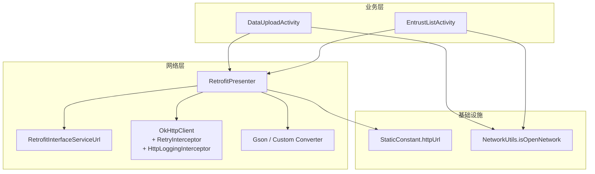
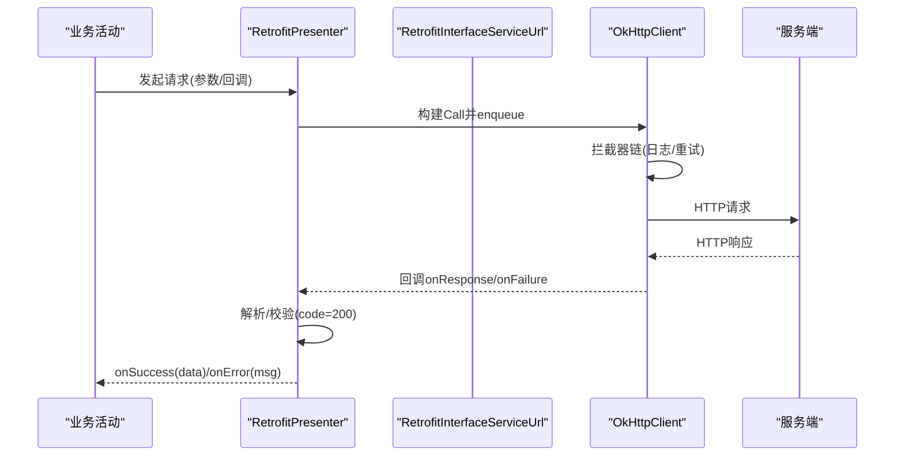
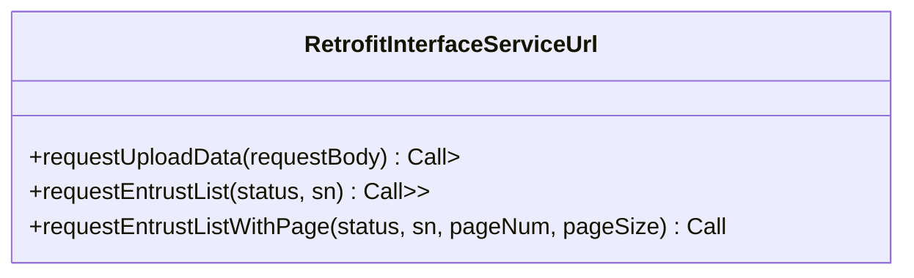
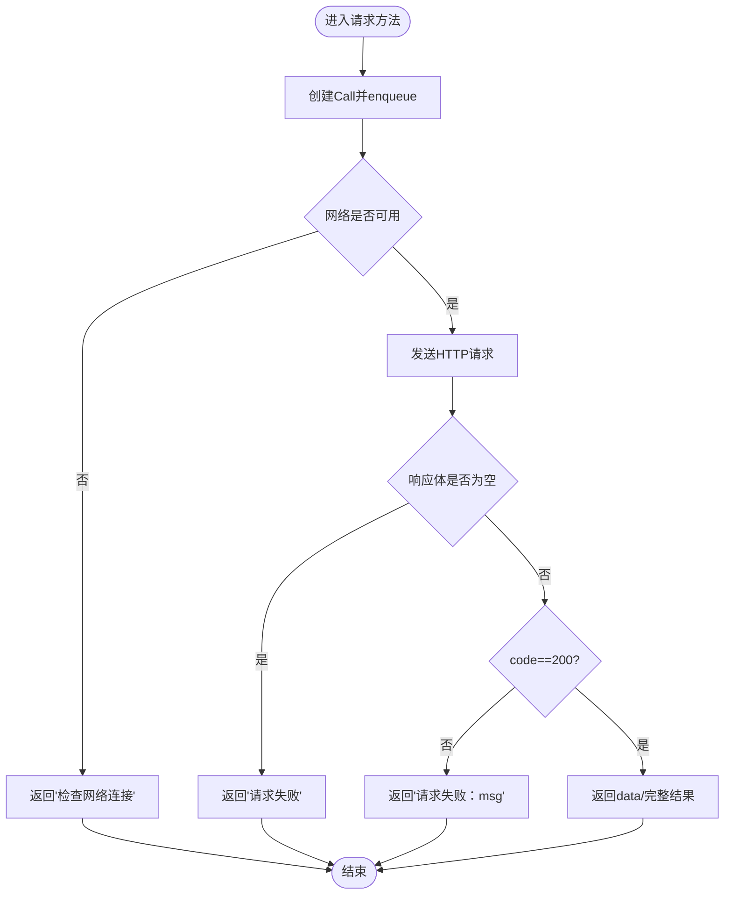
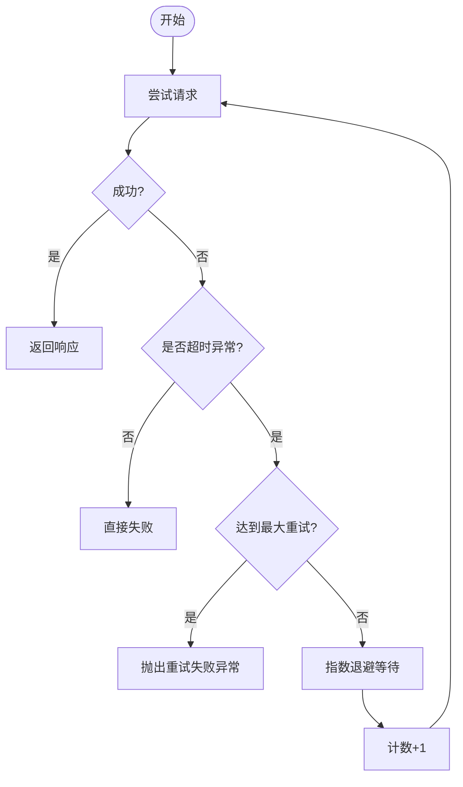
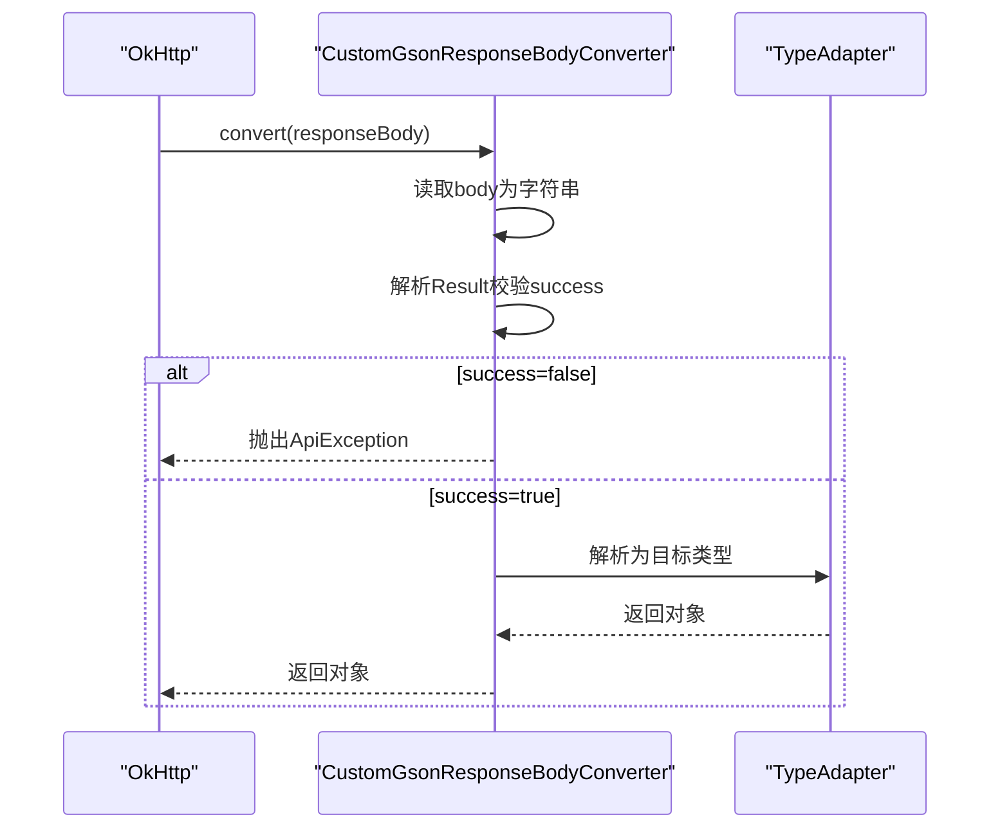
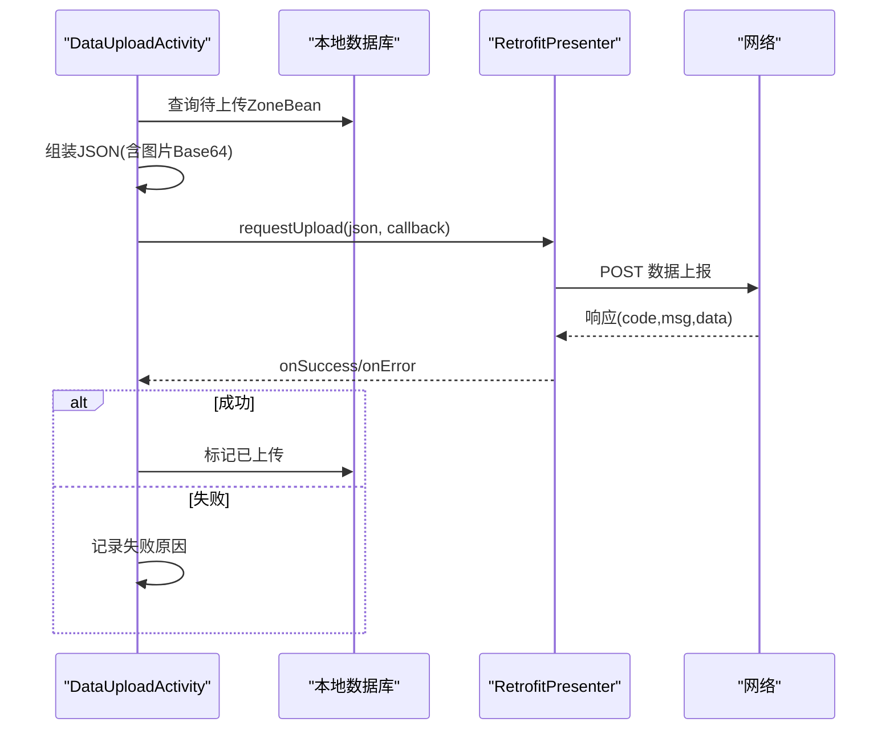
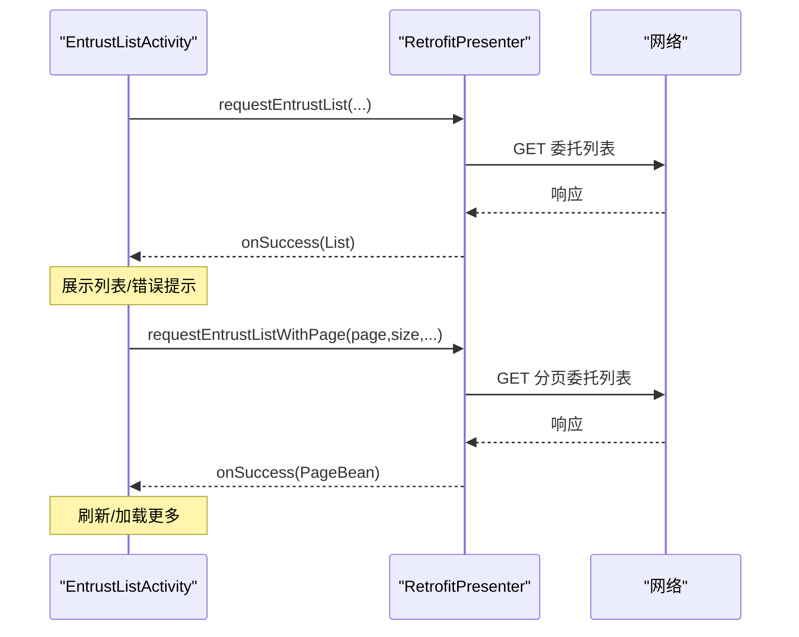
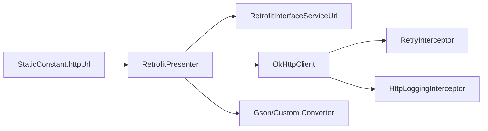

# 网络服务

<cite>
**本文引用的文件**
- [RetrofitInterfaceServiceUrl.java](file://app/src/main/java/com/example/gtj_sd_dg240/net/RetrofitInterfaceServiceUrl.java)
- [RetrofitPresenter.java](file://app/src/main/java/com/example/gtj_sd_dg240/net/RetrofitPresenter.java)
- [RetryInterceptor.java](file://app/src/main/java/com/example/gtj_sd_dg240/net/RetryInterceptor.java)
- [NetworkUtils.java](file://app/src/main/java/com/example/gtj_sd_dg240/net/NetworkUtils.java)
- [ApiException.java](file://app/src/main/java/com/example/gtj_sd_dg240/net/ApiException.java)
- [Result.java](file://app/src/main/java/com/example/gtj_sd_dg240/net/Result.java)
- [MessageResult.java](file://app/src/main/java/com/example/gtj_sd_dg240/net/MessageResult.java)
- [CustomGsonConverterFactory.java](file://app/src/main/java/com/example/gtj_sd_dg240/net/CustomGsonConverterFactory.java)
- [CustomGsonResponseBodyConverter.java](file://app/src/main/java/com/example/gtj_sd_dg240/net/CustomGsonResponseBodyConverter.java)
- [StaticConstant.java](file://app/src/main/java/com/example/gtj_sd_dg240/StaticConstant.java)
- [DataUploadActivity.java](file://app/src/main/java/com/example/gtj_sd_dg240/activity/data/DataUploadActivity.java)
- [EntrustListActivity.java](file://app/src/main/java/com/example/gtj_sd_dg240/activity/testing/EntrustListActivity.java)
</cite>

## 目录
1. [简介](#简介)
2. [项目结构](#项目结构)
3. [核心组件](#核心组件)
4. [架构总览](#架构总览)
5. [详细组件分析](#详细组件分析)
6. [依赖关系分析](#依赖关系分析)
7. [性能考虑](#性能考虑)
8. [故障排查指南](#故障排查指南)
9. [结论](#结论)
10. [附录：API接口规范与安全建议](#附录api接口规范与安全建议)

## 简介
本网络服务模块基于 Retrofit + OkHttp 构建，提供数据上传、委托信息查询（含分页）、远程配置同步与网络状态监控等能力。通过统一的请求封装、响应解析、重试机制与错误处理，为上层业务活动提供稳定可靠的网络访问能力。文档涵盖 HTTP 请求封装、响应解析、重试策略、缓存策略、API 接口规范、认证方法与安全注意事项，并给出异常处理、离线数据同步与性能优化建议。

## 项目结构
网络相关代码集中在 net 包中，配合 activity 层调用 Presenter 完成具体业务：
- API 定义：RetrofitInterfaceServiceUrl
- 客户端装配与调用封装：RetrofitPresenter
- 拦截器与重试：RetryInterceptor
- 响应模型：MessageResult、Result
- 自定义转换器：CustomGsonConverterFactory、CustomGsonResponseBodyConverter
- 网络工具：NetworkUtils
- 常量与基础地址：StaticConstant
- 业务入口：DataUploadActivity（数据上传）、EntrustListActivity（委托列表查询）

图表来源
- [RetrofitPresenter.java:31-52](file://app/src/main/java/com/example/gtj_sd_dg240/net/RetrofitPresenter.java#L31-L52)
- [RetrofitInterfaceServiceUrl.java:16-29](file://app/src/main/java/com/example/gtj_sd_dg240/net/RetrofitInterfaceServiceUrl.java#L16-L29)
- [RetryInterceptor.java:13-59](file://app/src/main/java/com/example/gtj_sd_dg240/net/RetryInterceptor.java#L13-L59)
- [CustomGsonConverterFactory.java:13-34](file://app/src/main/java/com/example/gtj_sd_dg240/net/CustomGsonConverterFactory.java#L13-L34)
- [CustomGsonResponseBodyConverter.java:11-36](file://app/src/main/java/com/example/gtj_sd_dg240/net/CustomGsonResponseBodyConverter.java#L11-L36)
- [StaticConstant.java:26-26](file://app/src/main/java/com/example/gtj_sd_dg240/StaticConstant.java#L26-L26)
- [NetworkUtils.java:6-20](file://app/src/main/java/com/example/gtj_sd_dg240/net/NetworkUtils.java#L6-L20)

章节来源
- [RetrofitPresenter.java:31-52](file://app/src/main/java/com/example/gtj_sd_dg240/net/RetrofitPresenter.java#L31-L52)
- [RetrofitInterfaceServiceUrl.java:16-29](file://app/src/main/java/com/example/gtj_sd_dg240/net/RetrofitInterfaceServiceUrl.java#L16-L29)
- [StaticConstant.java:26-26](file://app/src/main/java/com/example/gtj_sd_dg240/StaticConstant.java#L26-L26)

## 核心组件
- API 接口定义：统一声明 REST 端点、HTTP 方法与参数，便于集中维护。
- 请求封装与执行：RetrofitPresenter 负责创建 Retrofit/OkHttpClient、组装请求、回调分发与错误信息标准化。
- 重试机制：RetryInterceptor 针对 SocketTimeoutException 进行指数退避重试，避免瞬时网络抖动导致失败。
- 响应解析：通过 Gson 及自定义转换器对响应体进行解析，并在业务码不合法时抛出统一异常。
- 网络状态检测：NetworkUtils 提供连接可用性判断，辅助 UI 层做离线提示或降级。
- 常量与基址：StaticConstant 集中管理服务端基地址与全局配置项。

章节来源
- [RetrofitInterfaceServiceUrl.java:16-29](file://app/src/main/java/com/example/gtj_sd_dg240/net/RetrofitInterfaceServiceUrl.java#L16-L29)
- [RetrofitPresenter.java:31-52](file://app/src/main/java/com/example/gtj_sd_dg240/net/RetrofitPresenter.java#L31-L52)
- [RetryInterceptor.java:13-59](file://app/src/main/java/com/example/gtj_sd_dg240/net/RetryInterceptor.java#L13-L59)
- [CustomGsonResponseBodyConverter.java:20-36](file://app/src/main/java/com/example/gtj_sd_dg240/net/CustomGsonResponseBodyConverter.java#L20-L36)
- [NetworkUtils.java:6-20](file://app/src/main/java/com/example/gtj_sd_dg240/net/NetworkUtils.java#L6-L20)
- [StaticConstant.java:26-26](file://app/src/main/java/com/example/gtj_sd_dg240/StaticConstant.java#L26-L26)

## 架构总览
整体采用“活动 -> Presenter -> Retrofit/OkHttp -> 服务器”的分层架构。Presenter 屏蔽底层细节，对外暴露简洁的异步回调接口；拦截器链负责日志、重试与连接失败重试；转换器负责响应体校验与反序列化。

图表来源
- [RetrofitPresenter.java:61-141](file://app/src/main/java/com/example/gtj_sd_dg240/net/RetrofitPresenter.java#L61-L141)
- [RetryInterceptor.java:23-51](file://app/src/main/java/com/example/gtj_sd_dg240/net/RetryInterceptor.java#L23-L51)
- [CustomGsonResponseBodyConverter.java:20-36](file://app/src/main/java/com/example/gtj_sd_dg240/net/CustomGsonResponseBodyConverter.java#L20-L36)

## 详细组件分析

### API 接口设计
- 数据上报：POST 到 concreteUtilityPolesDetectionResultReported，请求体为 JSON。
- 委托列表查询：GET polesEntrustManage/queryPolesEntrustManage，支持按状态与设备序列号过滤。
- 分页委托列表查询：GET polesEntrustManage/queryPolesEntrustManageWithPage，支持分页参数。
- 公共头：clientId 固定值用于标识客户端来源。

图表来源
- [RetrofitInterfaceServiceUrl.java:16-29](file://app/src/main/java/com/example/gtj_sd_dg240/net/RetrofitInterfaceServiceUrl.java#L16-L29)

章节来源
- [RetrofitInterfaceServiceUrl.java:16-29](file://app/src/main/java/com/example/gtj_sd_dg240/net/RetrofitInterfaceServiceUrl.java#L16-L29)

### 请求封装与执行（RetrofitPresenter）
- 单例化 Retrofit 与 OkHttpClient，设置读写与连接超时时间。
- 添加日志拦截器与重试拦截器，启用连接失败自动重试。
- 提供三类请求方法：委托列表、分页委托列表、数据上传。
- 统一错误处理：将网络异常转换为友好提示，并对域名解析失败进行特殊文案处理。

图表来源
- [RetrofitPresenter.java:31-52](file://app/src/main/java/com/example/gtj_sd_dg240/net/RetrofitPresenter.java#L31-L52)
- [RetrofitPresenter.java:61-141](file://app/src/main/java/com/example/gtj_sd_dg240/net/RetrofitPresenter.java#L61-L141)

章节来源
- [RetrofitPresenter.java:31-52](file://app/src/main/java/com/example/gtj_sd_dg240/net/RetrofitPresenter.java#L31-L52)
- [RetrofitPresenter.java:61-141](file://app/src/main/java/com/example/gtj_sd_dg240/net/RetrofitPresenter.java#L61-L141)

### 重试机制（RetryInterceptor）
- 仅对 SocketTimeoutException 触发重试，最大重试次数与初始延迟可配置。
- 使用指数退避策略等待，降低服务器压力并提高成功率。
- 超过最大重试次数后抛出自定义异常，由上层统一捕获处理。

图表来源
- [RetryInterceptor.java:23-51](file://app/src/main/java/com/example/gtj_sd_dg240/net/RetryInterceptor.java#L23-L51)

章节来源
- [RetryInterceptor.java:13-59](file://app/src/main/java/com/example/gtj_sd_dg240/net/RetryInterceptor.java#L13-L59)

### 响应解析与错误处理
- 自定义转换器在反序列化前先读取响应体字符串，解析 Result 对象以校验 success 标志。
- 若业务未成功，关闭流并抛出 ApiException，由上层统一处理。
- 成功后再使用 TypeAdapter 解析目标类型，确保资源释放。

图表来源
- [CustomGsonResponseBodyConverter.java:20-36](file://app/src/main/java/com/example/gtj_sd_dg240/net/CustomGsonResponseBodyConverter.java#L20-L36)
- [ApiException.java:3-9](file://app/src/main/java/com/example/gtj_sd_dg240/net/ApiException.java#L3-L9)

章节来源
- [CustomGsonResponseBodyConverter.java:20-36](file://app/src/main/java/com/example/gtj_sd_dg240/net/CustomGsonResponseBodyConverter.java#L20-L36)
- [ApiException.java:3-9](file://app/src/main/java/com/example/gtj_sd_dg240/net/ApiException.java#L3-L9)

### 数据上传流程（DataUploadActivity）
- 从本地数据库获取待上传区域数据，构造 JSON 请求体（包含设备SN、项目信息、电杆参数、分段厚度数据与截图Base64）。
- 调用 RetrofitPresenter.requestUpload 进行上传，成功后更新本地标记并重试下一条。
- 失败则记录失败原因并继续处理后续数据。

图表来源
- [DataUploadActivity.java:418-458](file://app/src/main/java/com/example/gtj_sd_dg240/activity/data/DataUploadActivity.java#L418-L458)
- [RetrofitPresenter.java:115-141](file://app/src/main/java/com/example/gtj_sd_dg240/net/RetrofitPresenter.java#L115-L141)

章节来源
- [DataUploadActivity.java:418-458](file://app/src/main/java/com/example/gtj_sd_dg240/activity/data/DataUploadActivity.java#L418-L458)
- [RetrofitPresenter.java:115-141](file://app/src/main/java/com/example/gtj_sd_dg240/net/RetrofitPresenter.java#L115-L141)

### 委托信息查询（EntrustListActivity）
- 支持两种模式：全量列表与分页列表。
- 通过 RetrofitPresenter 提供的两个方法分别拉取数据，结合下拉刷新与上拉加载更多实现交互。
- 选择委托后回传结果给上一页面。

图表来源
- [EntrustListActivity.java:113-193](file://app/src/main/java/com/example/gtj_sd_dg240/activity/testing/EntrustListActivity.java#L113-L193)
- [RetrofitPresenter.java:61-113](file://app/src/main/java/com/example/gtj_sd_dg240/net/RetrofitPresenter.java#L61-L113)

章节来源
- [EntrustListActivity.java:113-193](file://app/src/main/java/com/example/gtj_sd_dg240/activity/testing/EntrustListActivity.java#L113-L193)
- [RetrofitPresenter.java:61-113](file://app/src/main/java/com/example/gtj_sd_dg240/net/RetrofitPresenter.java#L61-L113)

### 网络状态监控
- NetworkUtils 提供 isOpenNetwork 方法，基于系统 ConnectivityManager 判断当前网络是否可用。
- 建议在发起网络请求前调用，以便在无网时快速提示用户或走离线流程。

章节来源
- [NetworkUtils.java:6-20](file://app/src/main/java/com/example/gtj_sd_dg240/net/NetworkUtils.java#L6-L20)

## 依赖关系分析
- RetrofitPresenter 依赖 StaticConstant 中的 httpUrl 作为 BaseUrl。
- RetrofitPresenter 通过 Retrofit 生成 RetrofitInterfaceServiceUrl 实例，调用其定义的接口。
- OkHttp 链中包含 HttpLoggingInterceptor 与 RetryInterceptor，并启用 retryOnConnectionFailure。
- 响应解析依赖 Gson 与自定义转换器，统一校验业务码并抛出异常。

图表来源
- [StaticConstant.java:26-26](file://app/src/main/java/com/example/gtj_sd_dg240/StaticConstant.java#L26-L26)
- [RetrofitPresenter.java:31-52](file://app/src/main/java/com/example/gtj_sd_dg240/net/RetrofitPresenter.java#L31-L52)
- [RetryInterceptor.java:13-59](file://app/src/main/java/com/example/gtj_sd_dg240/net/RetryInterceptor.java#L13-L59)
- [CustomGsonConverterFactory.java:13-34](file://app/src/main/java/com/example/gtj_sd_dg240/net/CustomGsonConverterFactory.java#L13-L34)

章节来源
- [RetrofitPresenter.java:31-52](file://app/src/main/java/com/example/gtj_sd_dg240/net/RetrofitPresenter.java#L31-L52)
- [StaticConstant.java:26-26](file://app/src/main/java/com/example/gtj_sd_dg240/StaticConstant.java#L26-L26)

## 性能考虑
- 超时配置：读/写/连接超时均为 60 秒，适合大文件上传与复杂查询场景。
- 重试策略：仅对超时异常进行指数退避重试，避免无界重试造成雪崩。
- 日志级别：生产环境建议降低日志级别以减少 I/O 开销。
- 并发控制：批量上传建议限制并发数，避免阻塞主线程与耗尽连接池。
- 缓存策略：当前未启用 OkHttp 缓存，如需提升重复请求性能可引入 Cache 与条件请求（ETag/Last-Modified）。
- 数据压缩：可在 OkHttp 中添加 Gzip 拦截器减少传输体积。
- 图片上传：截图转 Base64 会增加体积，建议考虑分片上传或先压缩后再上传。

[本节为通用指导，不直接分析具体文件]

## 故障排查指南
- 常见错误分类
  - 网络不可用：使用 NetworkUtils 提前检测，或在 onFailure 中识别并提示“检查网络连接”。
  - 超时重试失败：查看 RetryInterceptor 的重试次数与退避时间，必要时调整参数。
  - 业务码非 200：检查 MessageResult.code 与 msg，定位服务端问题。
  - 域名解析失败：RetrofitPresenter 已将特定异常信息映射为友好提示。
- 日志定位
  - 开启 HttpLoggingInterceptor 的 BODY 级别，观察请求与响应内容。
  - 关注 onFailure 中的堆栈信息，区分网络层与业务层错误。
- 常见问题
  - 上传失败：确认 JSON 字段完整性与图片 Base64 格式正确。
  - 列表为空：检查入参 status 与 sn 是否正确，或服务端是否有数据。
  - 分页异常：确认 page/pageSize 范围与服务端约定一致。

章节来源
- [RetrofitPresenter.java:54-59](file://app/src/main/java/com/example/gtj_sd_dg240/net/RetrofitPresenter.java#L54-L59)
- [RetrofitPresenter.java:61-141](file://app/src/main/java/com/example/gtj_sd_dg240/net/RetrofitPresenter.java#L61-L141)
- [RetryInterceptor.java:23-51](file://app/src/main/java/com/example/gtj_sd_dg240/net/RetryInterceptor.java#L23-L51)
- [NetworkUtils.java:6-20](file://app/src/main/java/com/example/gtj_sd_dg240/net/NetworkUtils.java#L6-L20)

## 结论
该网络服务模块以 Retrofit 为核心，结合 OkHttp 拦截器与自定义转换器，实现了稳定的数据上传与委托信息查询能力。通过统一封装与错误处理，降低了业务层的复杂度。建议在生产环境中完善缓存策略、日志分级与监控埋点，进一步提升可靠性与可观测性。

[本节为总结性内容，不直接分析具体文件]

## 附录：API接口规范与安全建议
- 接口清单
  - 数据上报：POST concreteUtilityPolesDetectionResultReported，请求体为 JSON，包含设备SN、项目信息、电杆参数、分段厚度数据与图片Base64。
  - 委托列表：GET polesEntrustManage/queryPolesEntrustManage，参数 status、sn。
  - 分页委托列表：GET polesEntrustManage/queryPolesEntrustManageWithPage，参数 status、sn、pageNum、pageSize。
- 公共头
  - clientId：固定值，用于标识客户端来源。
- 响应格式
  - 统一包装：MessageResult<T>，包含 code、msg、data。
  - 业务码：code=200 表示成功，其他视为失败。
- 认证与安全
  - 当前使用固定 clientId 作为简单标识，建议升级为 Token/签名机制。
  - 所有通信均通过 HTTPS，注意证书校验与域名白名单。
  - 敏感字段（如图片、设备信息）应进行脱敏或加密传输。
- 错误与重试
  - 网络层：超时异常触发指数退避重试。
  - 业务层：根据 code 与 msg 提示用户或重试。
- 离线与缓存
  - 当前未启用缓存，建议对只读接口（如委托列表）增加缓存策略，提升离线体验。
  - 上传失败的数据应落库并排队重试，保证最终一致性。

章节来源
- [RetrofitInterfaceServiceUrl.java:16-29](file://app/src/main/java/com/example/gtj_sd_dg240/net/RetrofitInterfaceServiceUrl.java#L16-L29)
- [MessageResult.java:1-13](file://app/src/main/java/com/example/gtj_sd_dg240/net/MessageResult.java#L1-L13)
- [Result.java:1-13](file://app/src/main/java/com/example/gtj_sd_dg240/net/Result.java#L1-L13)
- [RetrofitPresenter.java:31-52](file://app/src/main/java/com/example/gtj_sd_dg240/net/RetrofitPresenter.java#L31-L52)