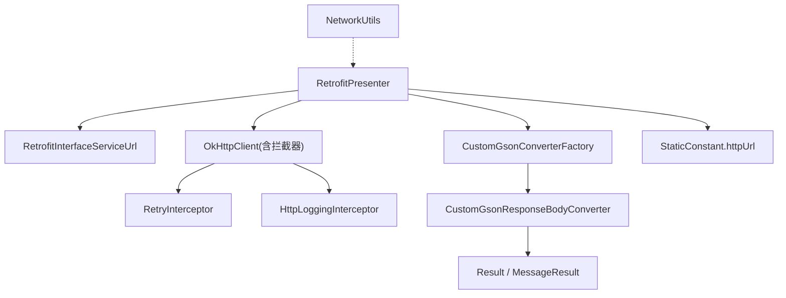
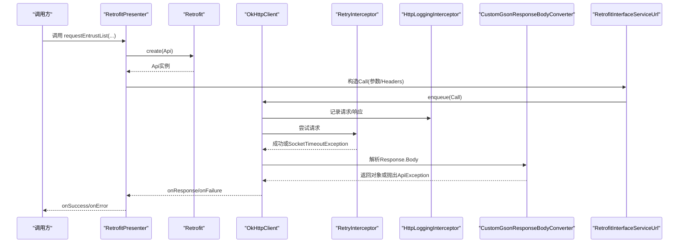
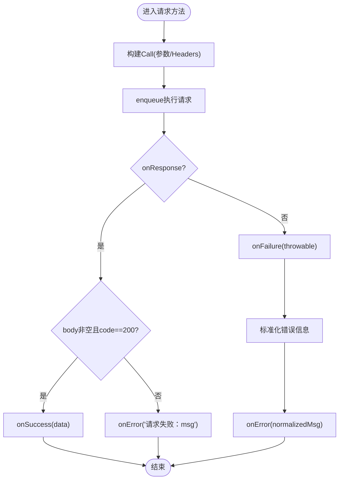
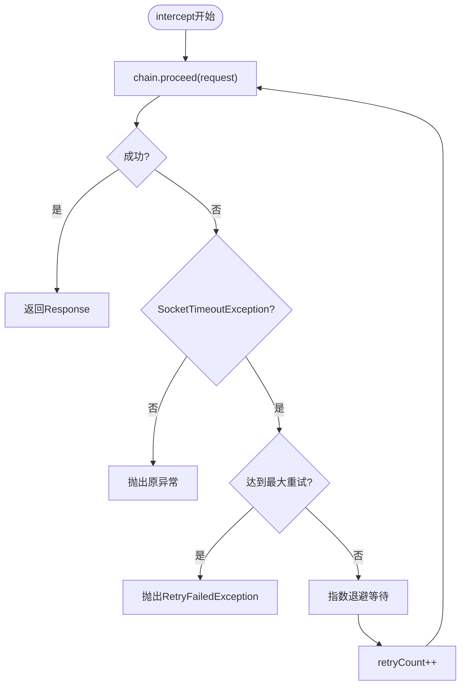
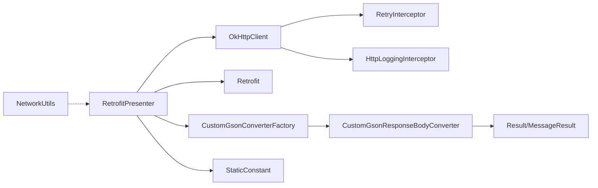

# 请求处理机制

<cite>
**本文引用的文件**
- [RetrofitPresenter.java](file://app/src/main/java/com/example/gtj_sd_dg240/net/RetrofitPresenter.java)
- [NetworkUtils.java](file://app/src/main/java/com/example/gtj_sd_dg240/net/NetworkUtils.java)
- [RetryInterceptor.java](file://app/src/main/java/com/example/gtj_sd_dg240/net/RetryInterceptor.java)
- [RetrofitInterfaceServiceUrl.java](file://app/src/main/java/com/example/gtj_sd_dg240/net/RetrofitInterfaceServiceUrl.java)
- [ApiException.java](file://app/src/main/java/com/example/gtj_sd_dg240/net/ApiException.java)
- [MessageResult.java](file://app/src/main/java/com/example/gtj_sd_dg240/net/MessageResult.java)
- [CustomGsonConverterFactory.java](file://app/src/main/java/com/example/gtj_sd_dg240/net/CustomGsonConverterFactory.java)
- [CustomGsonResponseBodyConverter.java](file://app/src/main/java/com/example/gtj_sd_dg240/net/CustomGsonResponseBodyConverter.java)
- [Result.java](file://app/src/main/java/com/example/gtj_sd_dg240/net/Result.java)
- [StaticConstant.java](file://app/src/main/java/com/example/gtj_sd_dg240/StaticConstant.java)
</cite>

## 目录
1. [简介](#简介)
2. [项目结构](#项目结构)
3. [核心组件](#核心组件)
4. [架构总览](#架构总览)
5. [详细组件分析](#详细组件分析)
6. [依赖关系分析](#依赖关系分析)
7. [性能考量](#性能考量)
8. [故障排查指南](#故障排查指南)
9. [结论](#结论)
10. [附录](#附录)

## 简介
本文件围绕网络请求处理机制展开，重点说明：
- RetrofitPresenter 如何封装网络请求、处理异步回调与管理请求生命周期。
- NetworkUtils 提供的网络工具方法（当前实现为网络状态检测）。
- 请求拦截器 RetryInterceptor 的重试机制、超时配置与日志记录。
- 结合自定义 Gson 转换器实现的统一响应体解析与异常抛出策略。
- 最佳实践与性能优化建议，以及异常处理与错误恢复机制。

## 项目结构
网络层位于 app 模块的 net 包中，主要职责划分如下：
- 接口定义：RetrofitInterfaceServiceUrl 声明 API 端点、请求方法与参数。
- 请求封装：RetrofitPresenter 负责构建 Retrofit/OkHttpClient、发起请求、统一回调处理。
- 拦截器：RetryInterceptor 提供基于超时的重试逻辑；HttpLoggingInterceptor 输出请求/响应日志。
- 数据模型：MessageResult、Result 用于统一响应结构。
- 转换器：CustomGsonConverterFactory + CustomGsonResponseBodyConverter 对响应体进行统一解析与业务校验。
- 工具类：NetworkUtils 提供网络连接可用性检测。
- 常量：StaticConstant 提供基础 URL 等全局配置。

图表来源
- [RetrofitPresenter.java:25-52](file://app/src/main/java/com/example/gtj_sd_dg240/net/RetrofitPresenter.java#L25-L52)
- [RetrofitInterfaceServiceUrl.java:16-30](file://app/src/main/java/com/example/gtj_sd_dg240/net/RetrofitInterfaceServiceUrl.java#L16-L30)
- [RetryInterceptor.java:13-59](file://app/src/main/java/com/example/gtj_sd_dg240/net/RetryInterceptor.java#L13-L59)
- [CustomGsonConverterFactory.java:13-34](file://app/src/main/java/com/example/gtj_sd_dg240/net/CustomGsonConverterFactory.java#L13-L34)
- [CustomGsonResponseBodyConverter.java:11-36](file://app/src/main/java/com/example/gtj_sd_dg240/net/CustomGsonResponseBodyConverter.java#L11-L36)
- [StaticConstant.java:26](file://app/src/main/java/com/example/gtj_sd_dg240/StaticConstant.java#L26)

章节来源
- [RetrofitPresenter.java:25-52](file://app/src/main/java/com/example/gtj_sd_dg240/net/RetrofitPresenter.java#L25-L52)
- [RetrofitInterfaceServiceUrl.java:16-30](file://app/src/main/java/com/example/gtj_sd_dg240/net/RetrofitInterfaceServiceUrl.java#L16-L30)
- [RetryInterceptor.java:13-59](file://app/src/main/java/com/example/gtj_sd_dg240/net/RetryInterceptor.java#L13-L59)
- [CustomGsonConverterFactory.java:13-34](file://app/src/main/java/com/example/gtj_sd_dg240/net/CustomGsonConverterFactory.java#L13-L34)
- [CustomGsonResponseBodyConverter.java:11-36](file://app/src/main/java/com/example/gtj_sd_dg240/net/CustomGsonResponseBodyConverter.java#L11-L36)
- [StaticConstant.java:26](file://app/src/main/java/com/example/gtj_sd_dg240/StaticConstant.java#L26)

## 核心组件
- RetrofitPresenter：单例化 Retrofit 与 OkHttpClient，集中管理请求生命周期、统一回调处理、错误信息标准化。
- RetryInterceptor：针对 SocketTimeoutException 的指数退避重试，失败后抛出自定义异常。
- CustomGsonResponseBodyConverter：在反序列化前检查 Result.success，失败则抛出 ApiException，成功再按目标类型解析。
- NetworkUtils：检测系统网络连接是否可用。
- RetrofitInterfaceServiceUrl：以注解方式声明 HTTP 方法、路径、查询参数与请求头。
- MessageResult/Result：统一响应结构，便于上层判断业务码与消息。

章节来源
- [RetrofitPresenter.java:25-142](file://app/src/main/java/com/example/gtj_sd_dg240/net/RetrofitPresenter.java#L25-L142)
- [RetryInterceptor.java:13-59](file://app/src/main/java/com/example/gtj_sd_dg240/net/RetryInterceptor.java#L13-L59)
- [CustomGsonResponseBodyConverter.java:11-36](file://app/src/main/java/com/example/gtj_sd_dg240/net/CustomGsonResponseBodyConverter.java#L11-L36)
- [NetworkUtils.java:6-20](file://app/src/main/java/com/example/gtj_sd_dg240/net/NetworkUtils.java#L6-L20)
- [RetrofitInterfaceServiceUrl.java:16-30](file://app/src/main/java/com/example/gtj_sd_dg240/net/RetrofitInterfaceServiceUrl.java#L16-L30)
- [MessageResult.java:1-13](file://app/src/main/java/com/example/gtj_sd_dg240/net/MessageResult.java#L1-L13)
- [Result.java:1-13](file://app/src/main/java/com/example/gtj_sd_dg240/net/Result.java#L1-L13)

## 架构总览
整体调用链从 Presenter 发起，经 Retrofit 生成 Call，由 OkHttp 执行并经过拦截器链（重试、日志），再由 Gson 转换器解析响应体，最终通过 Callback 回到 Presenter 的统一回调处理。

图表来源
- [RetrofitPresenter.java:31-52](file://app/src/main/java/com/example/gtj_sd_dg240/net/RetrofitPresenter.java#L31-L52)
- [RetrofitInterfaceServiceUrl.java:16-30](file://app/src/main/java/com/example/gtj_sd_dg240/net/RetrofitInterfaceServiceUrl.java#L16-L30)
- [RetryInterceptor.java:23-51](file://app/src/main/java/com/example/gtj_sd_dg240/net/RetryInterceptor.java#L23-L51)
- [CustomGsonResponseBodyConverter.java:20-36](file://app/src/main/java/com/example/gtj_sd_dg240/net/CustomGsonResponseBodyConverter.java#L20-L36)

## 详细组件分析

### RetrofitPresenter：请求封装与生命周期管理
- 单例化 Retrofit 与 OkHttpClient，避免重复创建带来的资源浪费。
- 设置连接/读取/写入超时时间，启用连接失败自动重试。
- 添加日志拦截器与重试拦截器，统一打印请求/响应体。
- 提供多个便捷方法：
  - 获取委托列表（分页/不分页）
  - 上传数据（JSON Body）
- 统一回调处理：
  - 成功时根据业务 code 判断，调用 onSuccess。
  - 失败时统一包装错误信息，调用 onError。
  - 将特定网络错误（如主机名无地址）转换为友好提示。

图表来源
- [RetrofitPresenter.java:61-142](file://app/src/main/java/com/example/gtj_sd_dg240/net/RetrofitPresenter.java#L61-L142)

章节来源
- [RetrofitPresenter.java:25-142](file://app/src/main/java/com/example/gtj_sd_dg240/net/RetrofitPresenter.java#L25-L142)

### NetworkUtils：网络状态检测
- 通过系统 ConnectivityManager 获取活动网络信息，判断网络是否可用。
- 适用于请求前快速自检，减少无效请求。

章节来源
- [NetworkUtils.java:6-20](file://app/src/main/java/com/example/gtj_sd_dg240/net/NetworkUtils.java#L6-L20)

### RetryInterceptor：重试机制与超时处理
- 捕获 SocketTimeoutException，采用指数退避策略等待后重试。
- 超过最大重试次数后抛出 RetryFailedException，包含最后一次异常原因。
- 注意：该实现仅针对超时进行重试，其他 IO 异常不会触发重试。

图表来源
- [RetryInterceptor.java:23-51](file://app/src/main/java/com/example/gtj_sd_dg240/net/RetryInterceptor.java#L23-L51)

章节来源
- [RetryInterceptor.java:13-59](file://app/src/main/java/com/example/gtj_sd_dg240/net/RetryInterceptor.java#L13-L59)

### 自定义 Gson 转换器：统一响应解析与异常抛出
- CustomGsonConverterFactory 注册到 Retrofit，提供自定义 Converter。
- CustomGsonResponseBodyConverter 先解析为 Result，若 success=false 则抛出 ApiException，否则继续解析为目标类型。
- 配合 MessageResult 作为业务层统一响应结构，Presenter 中依据 code 做二次校验。

章节来源
- [CustomGsonConverterFactory.java:13-34](file://app/src/main/java/com/example/gtj_sd_dg240/net/CustomGsonConverterFactory.java#L13-L34)
- [CustomGsonResponseBodyConverter.java:11-36](file://app/src/main/java/com/example/gtj_sd_dg240/net/CustomGsonResponseBodyConverter.java#L11-L36)
- [Result.java:1-13](file://app/src/main/java/com/example/gtj_sd_dg240/net/Result.java#L1-L13)
- [MessageResult.java:1-13](file://app/src/main/java/com/example/gtj_sd_dg240/net/MessageResult.java#L1-L13)
- [ApiException.java:1-10](file://app/src/main/java/com/example/gtj_sd_dg240/net/ApiException.java#L1-L10)

### RetrofitInterfaceServiceUrl：接口定义与参数编码
- 使用 @GET/@POST 定义端点，@Query 传递查询参数，@Headers 注入固定请求头。
- 所有 URL 拼接由 Retrofit 完成，参数编码由底层 OkHttp/Retrofit 处理。
- 基础 URL 来自 StaticConstant.httpUrl。

章节来源
- [RetrofitInterfaceServiceUrl.java:16-30](file://app/src/main/java/com/example/gtj_sd_dg240/net/RetrofitInterfaceServiceUrl.java#L16-L30)
- [StaticConstant.java:26](file://app/src/main/java/com/example/gtj_sd_dg240/StaticConstant.java#L26)

## 依赖关系分析
- RetrofitPresenter 依赖：
  - Retrofit 与 OkHttp 客户端（含拦截器）
  - Gson 转换器（自定义）
  - 静态常量（基础 URL）
  - 业务模型（委托列表、分页结果等）
- RetryInterceptor 依赖：
  - OkHttp Interceptor 接口
  - 自定义异常 RetryFailedException
- CustomGsonResponseBodyConverter 依赖：
  - Gson 与 TypeAdapter
  - 业务 Result 结构
- NetworkUtils 依赖：
  - Android ConnectivityManager

图表来源
- [RetrofitPresenter.java:25-52](file://app/src/main/java/com/example/gtj_sd_dg240/net/RetrofitPresenter.java#L25-L52)
- [RetryInterceptor.java:13-59](file://app/src/main/java/com/example/gtj_sd_dg240/net/RetryInterceptor.java#L13-L59)
- [CustomGsonConverterFactory.java:13-34](file://app/src/main/java/com/example/gtj_sd_dg240/net/CustomGsonConverterFactory.java#L13-L34)
- [CustomGsonResponseBodyConverter.java:11-36](file://app/src/main/java/com/example/gtj_sd_dg240/net/CustomGsonResponseBodyConverter.java#L11-L36)
- [StaticConstant.java:26](file://app/src/main/java/com/example/gtj_sd_dg240/StaticConstant.java#L26)

章节来源
- [RetrofitPresenter.java:25-52](file://app/src/main/java/com/example/gtj_sd_dg240/net/RetrofitPresenter.java#L25-L52)
- [RetryInterceptor.java:13-59](file://app/src/main/java/com/example/gtj_sd_dg240/net/RetryInterceptor.java#L13-L59)
- [CustomGsonConverterFactory.java:13-34](file://app/src/main/java/com/example/gtj_sd_dg240/net/CustomGsonConverterFactory.java#L13-L34)
- [CustomGsonResponseBodyConverter.java:11-36](file://app/src/main/java/com/example/gtj_sd_dg240/net/CustomGsonResponseBodyConverter.java#L11-L36)
- [StaticConstant.java:26](file://app/src/main/java/com/example/gtj_sd_dg240/StaticConstant.java#L26)

## 性能考量
- 超时配置：连接/读取/写入均设置为较长超时，适合弱网环境但可能影响用户体验，建议按接口特性差异化配置。
- 重试策略：仅对超时进行重试，避免幂等性风险；指数退避降低瞬时拥塞压力。
- 日志级别：BODY 级别会输出完整请求/响应体，生产环境建议按需降级以减少 I/O 开销。
- 转换器：自定义转换器在解析前进行业务校验，减少无效数据上抛，提升健壮性。
- 缓存与复用：Retrofit/OkHttpClient 单例已复用，避免重复初始化开销。

[本节为通用指导，不直接分析具体文件]

## 故障排查指南
- 常见错误分类：
  - 网络不可用：NetworkUtils 可提前检测，避免无效请求。
  - 超时重试失败：RetryInterceptor 超过最大重试后抛出 RetryFailedException，需在上层捕获并提示。
  - 业务失败：CustomGsonResponseBodyConverter 在 Result.success=false 时抛出 ApiException；Presenter 中依据 MessageResult.code 再次判断并返回友好提示。
  - 主机名解析失败：Presenter 将特定错误信息替换为“检查网络连接”。
- 定位手段：
  - 查看 HttpLoggingInterceptor 输出的请求/响应体，确认参数与返回值是否符合预期。
  - 关注 onFailure 中的 throwable 信息，结合重试次数与退避策略分析根因。
- 恢复策略：
  - 对幂等 GET 请求可考虑增加重试；对 POST 上传需谨慎，确保服务端支持幂等或具备去重机制。
  - 在网络不可用时给出明确提示，引导用户切换网络或稍后重试。

章节来源
- [NetworkUtils.java:6-20](file://app/src/main/java/com/example/gtj_sd_dg240/net/NetworkUtils.java#L6-L20)
- [RetryInterceptor.java:23-51](file://app/src/main/java/com/example/gtj_sd_dg240/net/RetryInterceptor.java#L23-L51)
- [CustomGsonResponseBodyConverter.java:20-36](file://app/src/main/java/com/example/gtj_sd_dg240/net/CustomGsonResponseBodyConverter.java#L20-L36)
- [RetrofitPresenter.java:54-84](file://app/src/main/java/com/example/gtj_sd_dg240/net/RetrofitPresenter.java#L54-L84)

## 结论
本项目网络层通过 RetrofitPresenter 统一封装请求、拦截器链增强可靠性与可观测性、自定义转换器保障响应一致性，形成清晰的分层与职责边界。建议在后续迭代中：
- 细化超时与重试策略，区分不同接口的幂等性与重要性。
- 引入更完善的网络状态监听与离线缓存策略。
- 在生产环境调整日志级别，平衡可观测性与性能。
- 完善错误码体系与用户提示文案，提升用户体验。

[本节为总结性内容，不直接分析具体文件]

## 附录
- 关键流程参考：
  - 请求发起与回调：见 [RetrofitPresenter.java:61-142](file://app/src/main/java/com/example/gtj_sd_dg240/net/RetrofitPresenter.java#L61-L142)
  - 重试与超时：见 [RetryInterceptor.java:23-51](file://app/src/main/java/com/example/gtj_sd_dg240/net/RetryInterceptor.java#L23-L51)
  - 响应解析与异常：见 [CustomGsonResponseBodyConverter.java:20-36](file://app/src/main/java/com/example/gtj_sd_dg240/net/CustomGsonResponseBodyConverter.java#L20-L36)
  - 接口定义与参数：见 [RetrofitInterfaceServiceUrl.java:16-30](file://app/src/main/java/com/example/gtj_sd_dg240/net/RetrofitInterfaceServiceUrl.java#L16-L30)
  - 网络状态检测：见 [NetworkUtils.java:6-20](file://app/src/main/java/com/example/gtj_sd_dg240/net/NetworkUtils.java#L6-L20)
  - 基础URL配置：见 [StaticConstant.java:26](file://app/src/main/java/com/example/gtj_sd_dg240/StaticConstant.java#L26)