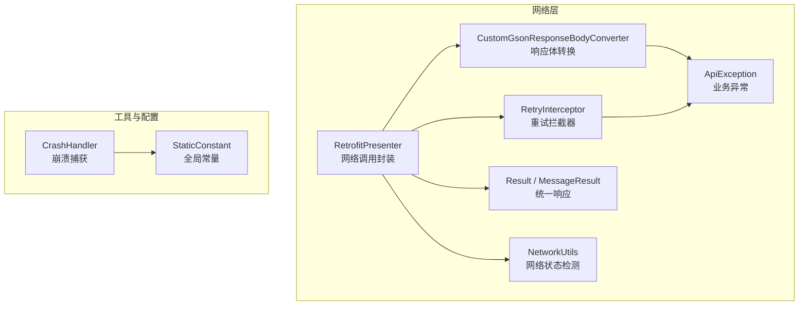
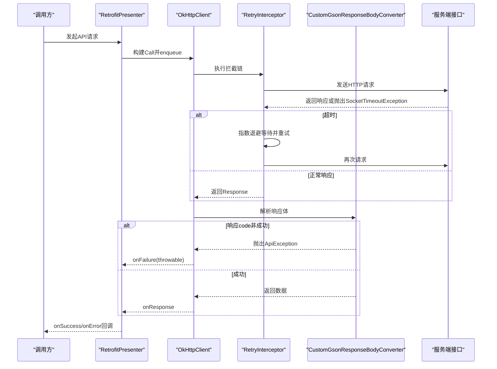
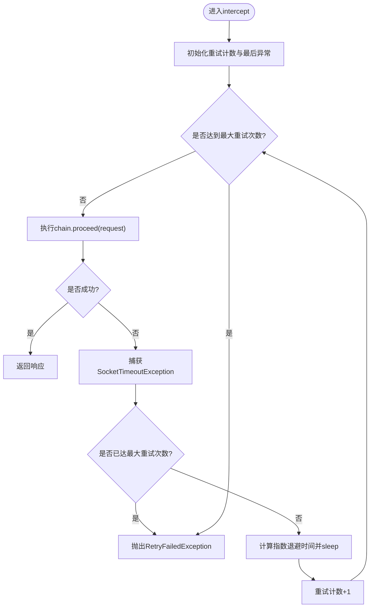
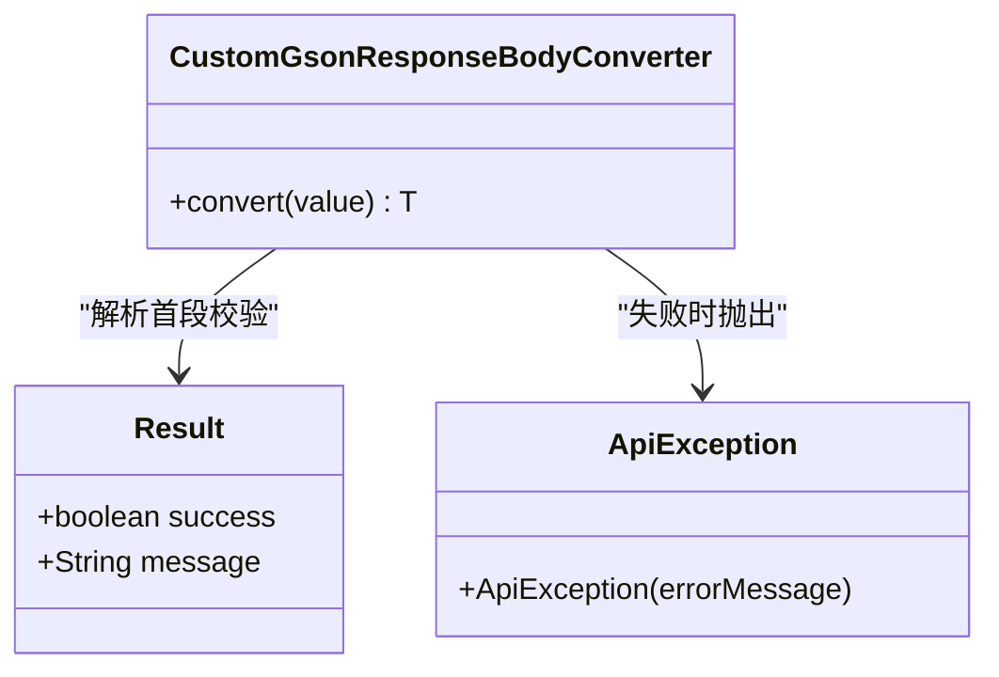
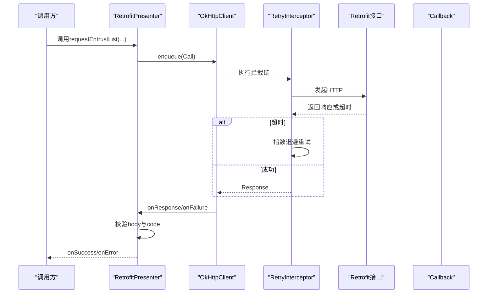
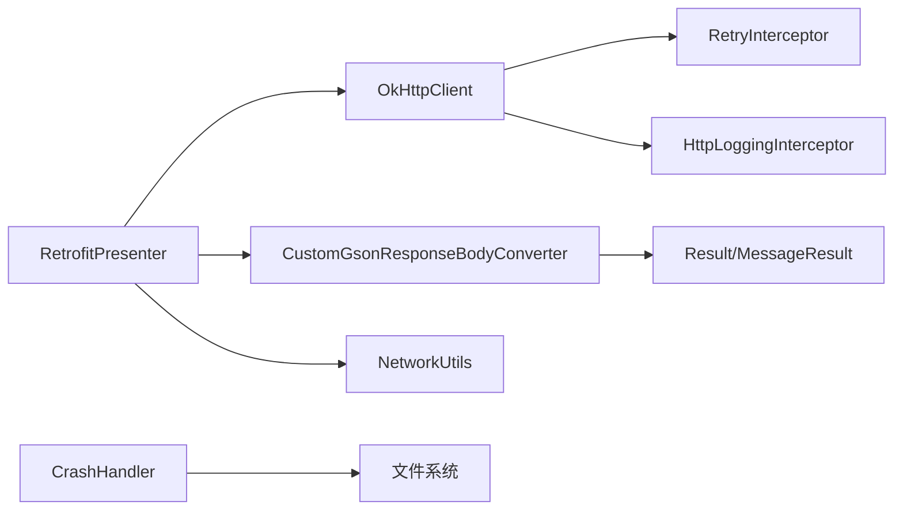

# 错误处理与重试

<cite>
**本文引用的文件**
- [RetryInterceptor.java](file://app/src/main/java/com/example/gtj_sd_dg240/net/RetryInterceptor.java)
- [ApiException.java](file://app/src/main/java/com/example/gtj_sd_dg240/net/ApiException.java)
- [Result.java](file://app/src/main/java/com/example/gtj_sd_dg240/net/Result.java)
- [MessageResult.java](file://app/src/main/java/com/example/gtj_sd_dg240/net/MessageResult.java)
- [RetrofitPresenter.java](file://app/src/main/java/com/example/gtj_sd_dg240/net/RetrofitPresenter.java)
- [NetworkUtils.java](file://app/src/main/java/com/example/gtj_sd_dg240/net/NetworkUtils.java)
- [CustomGsonResponseBodyConverter.java](file://app/src/main/java/com/example/gtj_sd_dg240/net/CustomGsonResponseBodyConverter.java)
- [CrashHandler.java](file://app/src/main/java/com/example/gtj_sd_dg240/utils/CrashHandler.java)
- [StaticConstant.java](file://app/src/main/java/com/example/gtj_sd_dg240/StaticConstant.java)
</cite>

## 目录
1. [简介](#简介)
2. [项目结构](#项目结构)
3. [核心组件](#核心组件)
4. [架构总览](#架构总览)
5. [详细组件分析](#详细组件分析)
6. [依赖关系分析](#依赖关系分析)
7. [性能考量](#性能考量)
8. [故障排查指南](#故障排查指南)
9. [结论](#结论)
10. [附录](#附录)

## 简介
本文件聚焦于网络请求的错误处理与重试机制，围绕以下目标展开：
- 说明 RetryInterceptor 如何实现网络请求的重试逻辑（重试条件、次数限制、退避策略）。
- 解释 ApiException 的异常类型定义与错误信息封装。
- 描述 Result 的设计模式与统一响应格式。
- 提供常见网络错误的处理方案（连接超时、服务器错误、网络不可用等）。
- 包含错误日志记录与用户友好的错误提示机制。

## 项目结构
本项目采用分层组织方式，网络层位于 app/src/main/java/com/example/gtj_sd_dg240/net，包含拦截器、转换器、响应模型、网络调用封装等；工具类位于 utils，包含崩溃捕获与日志输出；常量配置在 StaticConstant。

图表来源
- [RetryInterceptor.java:13-58](file://app/src/main/java/com/example/gtj_sd_dg240/net/RetryInterceptor.java#L13-L58)
- [CustomGsonResponseBodyConverter.java:11-36](file://app/src/main/java/com/example/gtj_sd_dg240/net/CustomGsonResponseBodyConverter.java#L11-L36)
- [ApiException.java:4-9](file://app/src/main/java/com/example/gtj_sd_dg240/net/ApiException.java#L4-L9)
- [Result.java:3-12](file://app/src/main/java/com/example/gtj_sd_dg240/net/Result.java#L3-L12)
- [MessageResult.java:3-12](file://app/src/main/java/com/example/gtj_sd_dg240/net/MessageResult.java#L3-L12)
- [RetrofitPresenter.java:25-52](file://app/src/main/java/com/example/gtj_sd_dg240/net/RetrofitPresenter.java#L25-L52)
- [NetworkUtils.java:6-20](file://app/src/main/java/com/example/gtj_sd_dg240/net/NetworkUtils.java#L6-L20)
- [CrashHandler.java:39-207](file://app/src/main/java/com/example/gtj_sd_dg240/utils/CrashHandler.java#L39-L207)
- [StaticConstant.java:26-33](file://app/src/main/java/com/example/gtj_sd_dg240/StaticConstant.java#L26-L33)

章节来源
- [RetrofitPresenter.java:25-52](file://app/src/main/java/com/example/gtj_sd_dg240/net/RetrofitPresenter.java#L25-L52)
- [StaticConstant.java:26-33](file://app/src/main/java/com/example/gtj_sd_dg240/StaticConstant.java#L26-L33)

## 核心组件
- RetryInterceptor：基于 OkHttp Interceptor 实现的可配置重试逻辑，针对 SocketTimeoutException 进行指数退避重试，并在超过最大重试次数时抛出自定义异常。
- CustomGsonResponseBodyConverter：在响应体解析前检查统一返回码，失败时抛出 ApiException，成功则继续解析为具体数据模型。
- ApiException：运行时异常，用于承载服务端或业务侧的错误消息。
- Result/MessageResult：统一响应包装，Result 用于通用成功/失败标志，MessageResult 用于带 code/msg/data 的结构化响应。
- RetrofitPresenter：封装 Retrofit 客户端创建、OkHttpClient 配置（含重试拦截器、日志、超时）、以及具体的 API 调用与回调处理。
- NetworkUtils：检测设备网络连接是否可用。
- CrashHandler：全局崩溃捕获，收集设备信息与堆栈并持久化，同时展示友好提示。

章节来源
- [RetryInterceptor.java:13-58](file://app/src/main/java/com/example/gtj_sd_dg240/net/RetryInterceptor.java#L13-L58)
- [CustomGsonResponseBodyConverter.java:11-36](file://app/src/main/java/com/example/gtj_sd_dg240/net/CustomGsonResponseBodyConverter.java#L11-L36)
- [ApiException.java:4-9](file://app/src/main/java/com/example/gtj_sd_dg240/net/ApiException.java#L4-L9)
- [Result.java:3-12](file://app/src/main/java/com/example/gtj_sd_dg240/net/Result.java#L3-L12)
- [MessageResult.java:3-12](file://app/src/main/java/com/example/gtj_sd_dg240/net/MessageResult.java#L3-L12)
- [RetrofitPresenter.java:25-52](file://app/src/main/java/com/example/gtj_sd_dg240/net/RetrofitPresenter.java#L25-L52)
- [NetworkUtils.java:6-20](file://app/src/main/java/com/example/gtj_sd_dg240/net/NetworkUtils.java#L6-L20)
- [CrashHandler.java:39-207](file://app/src/main/java/com/example/gtj_sd_dg240/utils/CrashHandler.java#L39-L207)

## 架构总览
下图展示了从发起网络请求到最终回调的完整链路，包括重试、响应校验、异常转换与上层回调。

图表来源
- [RetrofitPresenter.java:38-52](file://app/src/main/java/com/example/gtj_sd_dg240/net/RetrofitPresenter.java#L38-L52)
- [RetryInterceptor.java:23-51](file://app/src/main/java/com/example/gtj_sd_dg240/net/RetryInterceptor.java#L23-L51)
- [CustomGsonResponseBodyConverter.java:20-36](file://app/src/main/java/com/example/gtj_sd_dg240/net/CustomGsonResponseBodyConverter.java#L20-L36)

## 详细组件分析

### RetryInterceptor：重试逻辑、条件与退避策略
- 重试触发条件：仅对 SocketTimeoutException 进行重试。
- 重试次数限制：通过构造参数 maxRetries 控制最大重试次数；循环中 retryCount <= maxRetries。
- 退避策略：指数退避，等待时间为 2^retryCount * retryDelayMs。
- 中断处理：若 Thread.sleep 被中断，恢复中断位并抛出 IOException。
- 失败处理：超过最大重试次数后抛出 RetryFailedException，携带最后一次异常原因。

图表来源
- [RetryInterceptor.java:23-51](file://app/src/main/java/com/example/gtj_sd_dg240/net/RetryInterceptor.java#L23-L51)

章节来源
- [RetryInterceptor.java:13-58](file://app/src/main/java/com/example/gtj_sd_dg240/net/RetryInterceptor.java#L13-L58)

### CustomGsonResponseBodyConverter：响应校验与异常转换
- 将 ResponseBody 转为字符串后，先解析为 Result 以判断 success 标志。
- 若 success 为 false，关闭流并抛出 ApiException，携带 message。
- 若 success 为 true，使用 TypeAdapter 解析为具体泛型 T。

图表来源
- [CustomGsonResponseBodyConverter.java:11-36](file://app/src/main/java/com/example/gtj_sd_dg240/net/CustomGsonResponseBodyConverter.java#L11-L36)
- [Result.java:3-12](file://app/src/main/java/com/example/gtj_sd_dg240/net/Result.java#L3-L12)
- [ApiException.java:4-9](file://app/src/main/java/com/example/gtj_sd_dg240/net/ApiException.java#L4-L9)

章节来源
- [CustomGsonResponseBodyConverter.java:11-36](file://app/src/main/java/com/example/gtj_sd_dg240/net/CustomGsonResponseBodyConverter.java#L11-L36)

### ApiException：异常类型与错误信息封装
- 继承 RuntimeException，便于在任意层级抛出并被上层捕获。
- 构造函数接收 errorMessage，作为统一的错误消息载体。
- 在响应校验失败时被 Converter 抛出，或在业务逻辑中用于表示 API 错误。

章节来源
- [ApiException.java:4-9](file://app/src/main/java/com/example/gtj_sd_dg240/net/ApiException.java#L4-L9)

### Result 与 MessageResult：统一响应格式
- Result：包含 success、message 字段，用于快速判断请求是否成功。
- MessageResult：包含 code、msg、data 字段，用于结构化返回业务结果。
- 两者均提供 toString 便于调试输出。

章节来源
- [Result.java:3-12](file://app/src/main/java/com/example/gtj_sd_dg240/net/Result.java#L3-L12)
- [MessageResult.java:3-12](file://app/src/main/java/com/example/gtj_sd_dg240/net/MessageResult.java#L3-L12)

### RetrofitPresenter：网络调用封装与错误处理
- OkHttpClient 配置：设置读写与连接超时、添加 HttpLoggingInterceptor、添加 RetryInterceptor、启用连接失败重试。
- 请求方法：
  - requestEntrustList：分页列表请求，校验 response.body() 与 code，成功回调 onSuccess，否则 onError。
  - requestEntrustListWithPage：带分页参数的列表请求，同样进行响应校验。
  - requestUpload：上传 JSON 数据，校验响应并回调。
- 错误处理：
  - onFailure 中通过 getStrMessage 将底层异常信息转换为更友好的提示（如“检查网络连接”）。
  - 使用 Logger 记录异常信息，便于问题定位。

图表来源
- [RetrofitPresenter.java:38-52](file://app/src/main/java/com/example/gtj_sd_dg240/net/RetrofitPresenter.java#L38-L52)
- [RetrofitPresenter.java:61-86](file://app/src/main/java/com/example/gtj_sd_dg240/net/RetrofitPresenter.java#L61-L86)
- [RetrofitPresenter.java:88-113](file://app/src/main/java/com/example/gtj_sd_dg240/net/RetrofitPresenter.java#L88-L113)
- [RetrofitPresenter.java:115-141](file://app/src/main/java/com/example/gtj_sd_dg240/net/RetrofitPresenter.java#L115-L141)

章节来源
- [RetrofitPresenter.java:25-52](file://app/src/main/java/com/example/gtj_sd_dg240/net/RetrofitPresenter.java#L25-L52)
- [RetrofitPresenter.java:61-86](file://app/src/main/java/com/example/gtj_sd_dg240/net/RetrofitPresenter.java#L61-L86)
- [RetrofitPresenter.java:88-113](file://app/src/main/java/com/example/gtj_sd_dg240/net/RetrofitPresenter.java#L88-L113)
- [RetrofitPresenter.java:115-141](file://app/src/main/java/com/example/gtj_sd_dg240/net/RetrofitPresenter.java#L115-L141)

### NetworkUtils：网络可用性检测
- 通过 ConnectivityManager 获取当前活动网络并判断是否可用。
- 可在发起请求前进行前置检查，避免无效请求。

章节来源
- [NetworkUtils.java:6-20](file://app/src/main/java/com/example/gtj_sd_dg240/net/NetworkUtils.java#L6-L20)

### CrashHandler：崩溃捕获与日志记录
- 实现 UncaughtExceptionHandler，接管未捕获异常。
- 收集设备信息、堆栈信息，写入文件并通知系统扫描。
- 通过 Toast 提示用户程序崩溃，并启动 CrashMessageActivity 展示详细信息。

章节来源
- [CrashHandler.java:39-207](file://app/src/main/java/com/example/gtj_sd_dg240/utils/CrashHandler.java#L39-L207)

## 依赖关系分析
- RetrofitPresenter 依赖 OkHttpClient，后者装配了 RetryInterceptor 与 HttpLoggingInterceptor。
- CustomGsonResponseBodyConverter 依赖 Gson 与 TypeAdapter，负责响应体解析与错误转换。
- RetryInterceptor 依赖 OkHttp Chain，捕获 SocketTimeoutException 并实施指数退避。
- NetworkUtils 依赖 Android ConnectivityManager，用于网络状态检测。
- CrashHandler 依赖系统异常处理机制与文件系统，用于崩溃日志持久化。

图表来源
- [RetrofitPresenter.java:38-52](file://app/src/main/java/com/example/gtj_sd_dg240/net/RetrofitPresenter.java#L38-L52)
- [RetryInterceptor.java:23-51](file://app/src/main/java/com/example/gtj_sd_dg240/net/RetryInterceptor.java#L23-L51)
- [CustomGsonResponseBodyConverter.java:20-36](file://app/src/main/java/com/example/gtj_sd_dg240/net/CustomGsonResponseBodyConverter.java#L20-L36)
- [NetworkUtils.java:6-20](file://app/src/main/java/com/example/gtj_sd_dg240/net/NetworkUtils.java#L6-L20)
- [CrashHandler.java:156-199](file://app/src/main/java/com/example/gtj_sd_dg240/utils/CrashHandler.java#L156-L199)

章节来源
- [RetrofitPresenter.java:38-52](file://app/src/main/java/com/example/gtj_sd_dg240/net/RetrofitPresenter.java#L38-L52)
- [CrashHandler.java:156-199](file://app/src/main/java/com/example/gtj_sd_dg240/utils/CrashHandler.java#L156-L199)

## 性能考量
- 重试间隔采用指数退避，避免雪崩式重试导致服务器压力增大。
- 超时时间设置为 60 秒，适用于一般网络环境；可根据实际场景调整。
- 日志级别为 BODY，生产环境建议降低日志级别以减少 I/O 开销。
- 建议在发起请求前使用 NetworkUtils 检查网络可用性，减少无效请求。

[本节为通用指导，不直接分析具体文件]

## 故障排查指南
- 连接超时（SocketTimeoutException）：
  - 现象：请求长时间无响应，触发重试。
  - 处理：RetryInterceptor 会进行指数退避重试；若仍失败，上层 onFailure 会收到异常信息并通过 getStrMessage 转换为友好提示。
  - 建议：检查网络质量、服务器负载与超时配置。

- 服务器错误（响应码非成功）：
  - 现象：服务端返回 code != 200 或 success == false。
  - 处理：CustomGsonResponseBodyConverter 抛出 ApiException；RetrofitPresenter 在 onResponse 中校验 code 并回调 onError。
  - 建议：查看服务端日志与错误码含义，必要时增加重试或降级策略。

- 网络不可用：
  - 现象：DNS 解析失败或无网络。
  - 处理：getStrMessage 将底层异常信息映射为“检查网络连接”；NetworkUtils 可用于前置检测。
  - 建议：引导用户开启网络或切换网络类型。

- 崩溃与日志：
  - 现象：应用发生未捕获异常。
  - 处理：CrashHandler 捕获异常、保存堆栈文件、提示用户并跳转详情页面。
  - 建议：结合日志平台与崩溃统计进行分析。

章节来源
- [RetrofitPresenter.java:54-59](file://app/src/main/java/com/example/gtj_sd_dg240/net/RetrofitPresenter.java#L54-L59)
- [RetrofitPresenter.java:61-86](file://app/src/main/java/com/example/gtj_sd_dg240/net/RetrofitPresenter.java#L61-L86)
- [RetrofitPresenter.java:88-113](file://app/src/main/java/com/example/gtj_sd_dg240/net/RetrofitPresenter.java#L88-L113)
- [RetrofitPresenter.java:115-141](file://app/src/main/java/com/example/gtj_sd_dg240/net/RetrofitPresenter.java#L115-L141)
- [NetworkUtils.java:6-20](file://app/src/main/java/com/example/gtj_sd_dg240/net/NetworkUtils.java#L6-L20)
- [CrashHandler.java:105-123](file://app/src/main/java/com/example/gtj_sd_dg240/utils/CrashHandler.java#L105-L123)
- [CrashHandler.java:156-199](file://app/src/main/java/com/example/gtj_sd_dg240/utils/CrashHandler.java#L156-L199)

## 结论
本项目的错误处理与重试机制通过多层协作实现了健壮的网络请求流程：
- RetryInterceptor 提供可控的重试与退避，提升弱网下的成功率。
- CustomGsonResponseBodyConverter 统一校验响应并抛出 ApiException，保证上层错误语义一致。
- RetrofitPresenter 集中管理超时、日志与回调，简化调用方处理。
- NetworkUtils 与 CrashHandler 分别提供网络前置检查与崩溃兜底能力。
- Result/MessageResult 提供清晰的统一响应格式，便于前后端约定与错误提示。

[本节为总结性内容，不直接分析具体文件]

## 附录
- 关键配置位置：
  - 超时与重试：RetrofitPresenter.getOkHttpClient 中设置超时与添加 RetryInterceptor。
  - 日志级别：HttpLoggingInterceptor.Level.BODY。
  - 基础URL：StaticConstant.httpUrl。

章节来源
- [RetrofitPresenter.java:38-52](file://app/src/main/java/com/example/gtj_sd_dg240/net/RetrofitPresenter.java#L38-L52)
- [StaticConstant.java:26-33](file://app/src/main/java/com/example/gtj_sd_dg240/StaticConstant.java#L26-L33)