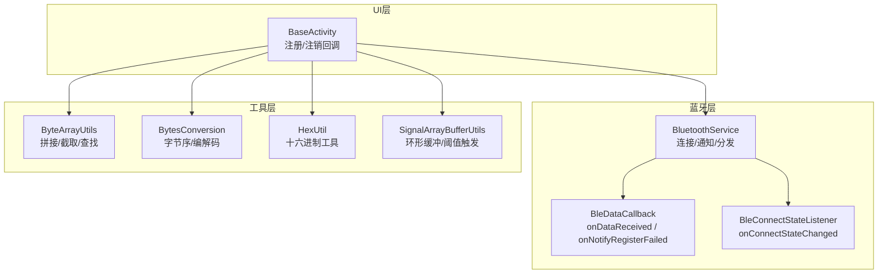
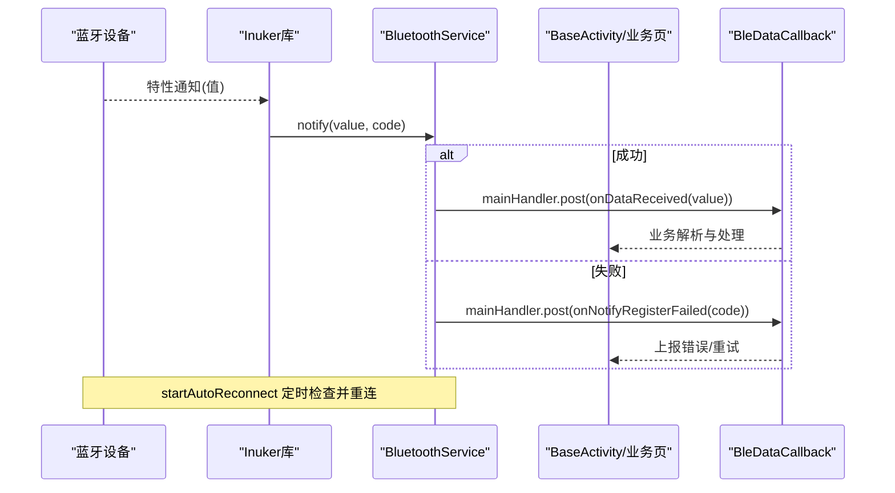
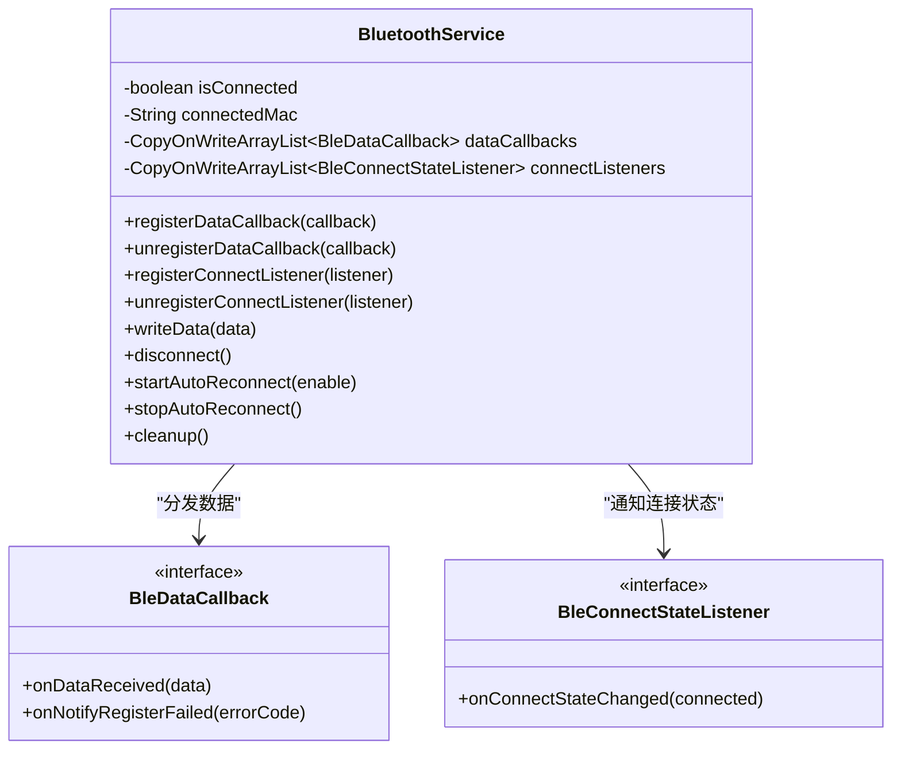
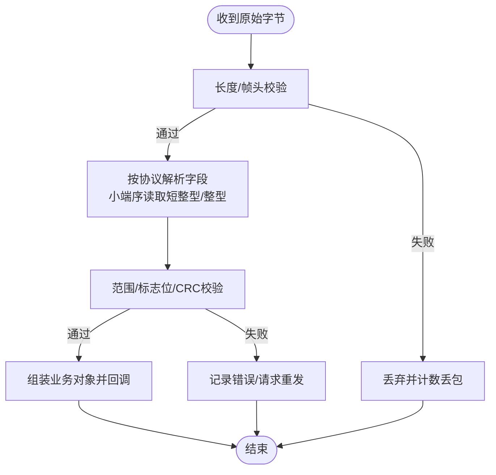
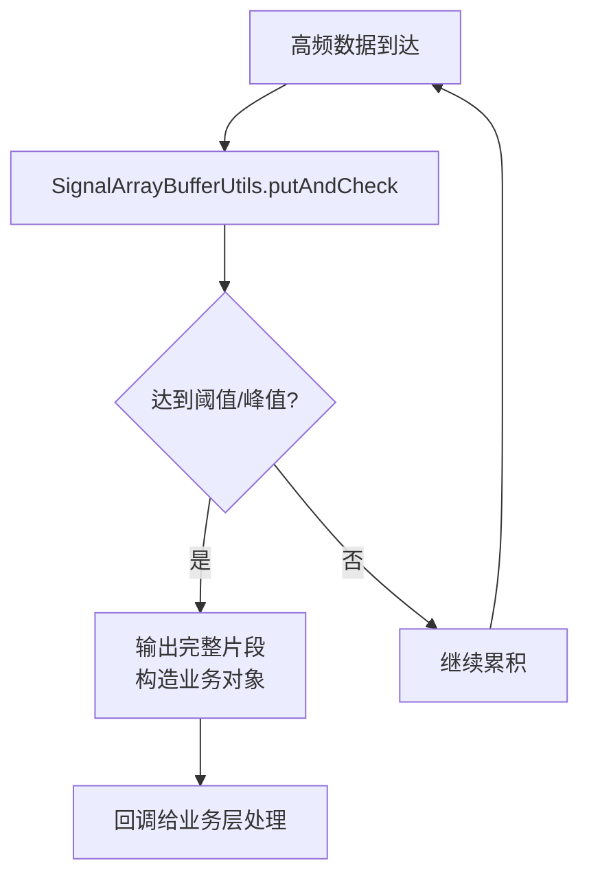
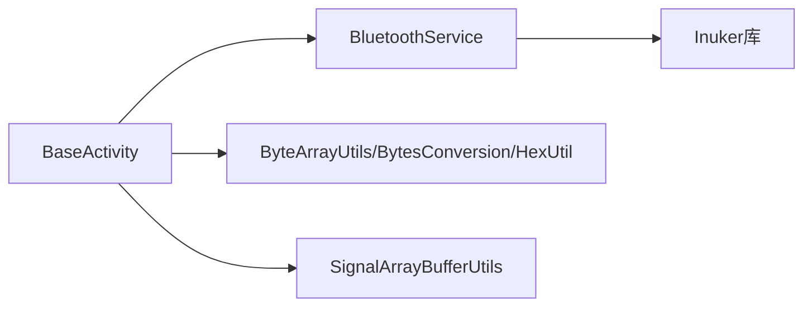

# 数据传输与回调

<cite>
**本文引用的文件**
- [BleDataCallback.java](file://app/src/main/java/com/example/gtj_sd_dg240/bluetooth/BleDataCallback.java)
- [BluetoothService.java](file://app/src/main/java/com/example/gtj_sd_dg240/bluetooth/BluetoothService.java)
- [BleConnectStateListener.java](file://app/src/main/java/com/example/gtj_sd_dg240/bluetooth/BleConnectStateListener.java)
- [BaseActivity.java](file://app/src/main/java/com/example/gtj_sd_dg240/activity/start/BaseActivity.java)
- [ByteArrayUtils.java](file://app/src/main/java/com/example/gtj_sd_dg240/utils/ByteArrayUtils.java)
- [BytesConversion.java](file://app/src/main/java/com/example/gtj_sd_dg240/utils/BytesConversion.java)
- [HexUtil.java](file://app/src/main/java/com/example/gtj_sd_dg240/utils/HexUtil.java)
- [SignalArrayBufferUtils.java](file://app/src/main/java/com/example/gtj_sd_dg240/utils/SignalArrayBufferUtils.java)
</cite>

## 目录
1. [简介](#简介)
2. [项目结构](#项目结构)
3. [核心组件](#核心组件)
4. [架构总览](#架构总览)
5. [详细组件分析](#详细组件分析)
6. [依赖关系分析](#依赖关系分析)
7. [性能考虑](#性能考虑)
8. [故障排查指南](#故障排查指南)
9. [结论](#结论)
10. [附录：数据收发示例与最佳实践](#附录数据收发示例与最佳实践)

## 简介
本文件聚焦于蓝牙数据传输与回调机制，围绕 BleDataCallback 接口设计、数据接收与分发策略、异常处理流程展开，并结合项目中已有的字节工具与缓冲组件，给出数据包解析、字节序处理、数据校验、错误恢复、多线程数据处理、内存缓冲管理、数据丢失检测与重传策略等系统性说明。文档同时提供命令发送、响应处理、批量数据传输与实时数据流处理的参考流程，并涵盖安全性、性能优化与调试方法。

## 项目结构
本项目在蓝牙层采用“服务单例 + 回调列表”的架构：BluetoothService 作为全局单例负责连接、通知注册、数据分发与重连；BleDataCallback 定义数据回调契约；BaseActivity 提供统一的注册/注销入口，便于各业务页面接入。数据解析与转换由 utils 包中的 ByteArrayUtils、BytesConversion、HexUtil 等工具类承担；SignalArrayBufferUtils 用于高频数据的环形缓冲与阈值触发。

图表来源
- [BluetoothService.java:16-31](file://app/src/main/java/com/example/gtj_sd_dg240/bluetooth/BluetoothService.java#L16-L31)
- [BleDataCallback.java:6-18](file://app/src/main/java/com/example/gtj_sd_dg240/bluetooth/BleDataCallback.java#L6-L18)
- [BleConnectStateListener.java:6-12](file://app/src/main/java/com/example/gtj_sd_dg240/bluetooth/BleConnectStateListener.java#L6-L12)
- [BaseActivity.java:272-282](file://app/src/main/java/com/example/gtj_sd_dg240/activity/start/BaseActivity.java#L272-L282)

章节来源
- [BluetoothService.java:16-31](file://app/src/main/java/com/example/gtj_sd_dg240/bluetooth/BluetoothService.java#L16-L31)
- [BaseActivity.java:272-282](file://app/src/main/java/com/example/gtj_sd_dg240/activity/start/BaseActivity.java#L272-L282)

## 核心组件
- BluetoothService：单例服务，封装连接状态、自动重连、数据通知注册与分发、写数据、断开与资源清理。使用主线程 Handler 将回调投递到 UI 线程，保证 UI 安全。
- BleDataCallback：数据回调接口，包含 onDataReceived（原始字节）与 onNotifyRegisterFailed（通知注册失败）。
- BleConnectStateListener：连接状态变化回调，供 UI 显示连接图标等。
- BaseActivity：统一基类，提供 registerBluetoothDataCallback() 与生命周期内注销，简化接入。
- 工具类：
  - ByteArrayUtils：数组拼接、截取、查找、分割、比较、反转、十六进制打印等。
  - BytesConversion：小端序读取 short/int、字符串/十六进制互转、数值编码等。
  - HexUtil：十六进制字符串与字节互转、数值标记位处理等。
  - SignalArrayBufferUtils：固定大小的环形缓冲区，支持阈值判断与峰值检测，输出完整片段。

章节来源
- [BluetoothService.java:16-31](file://app/src/main/java/com/example/gtj_sd_dg240/bluetooth/BluetoothService.java#L16-L31)
- [BleDataCallback.java:6-18](file://app/src/main/java/com/example/gtj_sd_dg240/bluetooth/BleDataCallback.java#L6-L18)
- [BleConnectStateListener.java:6-12](file://app/src/main/java/com/example/gtj_sd_dg240/bluetooth/BleConnectStateListener.java#L6-L12)
- [BaseActivity.java:272-282](file://app/src/main/java/com/example/gtj_sd_dg240/activity/start/BaseActivity.java#L272-L282)
- [ByteArrayUtils.java:19-323](file://app/src/main/java/com/example/gtj_sd_dg240/utils/ByteArrayUtils.java#L19-L323)
- [BytesConversion.java:107-133](file://app/src/main/java/com/example/gtj_sd_dg240/utils/BytesConversion.java#L107-L133)
- [HexUtil.java:5-23](file://app/src/main/java/com/example/gtj_sd_dg240/utils/HexUtil.java#L5-L23)
- [SignalArrayBufferUtils.java:23-66](file://app/src/main/java/com/example/gtj_sd_dg240/utils/SignalArrayBufferUtils.java#L23-L66)

## 架构总览
下图展示从底层蓝牙通知到上层回调分发的时序，以及连接状态监听与重连机制。

图表来源
- [BluetoothService.java:175-198](file://app/src/main/java/com/example/gtj_sd_dg240/bluetooth/BluetoothService.java#L175-L198)
- [BluetoothService.java:203-224](file://app/src/main/java/com/example/gtj_sd_dg240/bluetooth/BluetoothService.java#L203-L224)
- [BaseActivity.java:272-282](file://app/src/main/java/com/example/gtj_sd_dg240/activity/start/BaseActivity.java#L272-L282)

## 详细组件分析

### 蓝牙服务与回调分发
- 单例与线程模型：BluetoothService 通过静态 volatile 实例与 synchronized 初始化保证单例；内部使用主线程 Handler 将回调投递到 UI 线程，避免跨线程更新 UI。
- 连接与通知：
  - 启动自动重连后，若已连接则立即注册数据通知；连接成功时设置状态并注册通知；断开时取消通知并通知所有连接状态监听器。
  - 数据通知回调中遍历 dataCallbacks，逐条在主线程调用 onDataReceived。
  - 通知注册失败时，遍历回调并调用 onNotifyRegisterFailed。
- 写数据与断开：writeData 直接写入当前保存的 MAC；disconnect 主动断开并重置状态；cleanup 停止重连、清空监听与回调集合。

图表来源
- [BluetoothService.java:16-31](file://app/src/main/java/com/example/gtj_sd_dg240/bluetooth/BluetoothService.java#L16-L31)
- [BluetoothService.java:175-198](file://app/src/main/java/com/example/gtj_sd_dg240/bluetooth/BluetoothService.java#L175-L198)
- [BluetoothService.java:239-268](file://app/src/main/java/com/example/gtj_sd_dg240/bluetooth/BluetoothService.java#L239-L268)
- [BleDataCallback.java:6-18](file://app/src/main/java/com/example/gtj_sd_dg240/bluetooth/BleDataCallback.java#L6-L18)
- [BleConnectStateListener.java:6-12](file://app/src/main/java/com/example/gtj_sd_dg240/bluetooth/BleConnectStateListener.java#L6-L12)

章节来源
- [BluetoothService.java:77-122](file://app/src/main/java/com/example/gtj_sd_dg240/bluetooth/BluetoothService.java#L77-L122)
- [BluetoothService.java:127-170](file://app/src/main/java/com/example/gtj_sd_dg240/bluetooth/BluetoothService.java#L127-L170)
- [BluetoothService.java:175-198](file://app/src/main/java/com/example/gtj_sd_dg240/bluetooth/BluetoothService.java#L175-L198)
- [BluetoothService.java:203-224](file://app/src/main/java/com/example/gtj_sd_dg240/bluetooth/BluetoothService.java#L203-L224)
- [BluetoothService.java:239-310](file://app/src/main/java/com/example/gtj_sd_dg240/bluetooth/BluetoothService.java#L239-L310)

### 数据接收与解析流程
- 接收路径：底层 Inuker 库回调 -> BluetoothService.notifyBluetoothDevice -> 遍历 dataCallbacks -> 主线程 post -> BleDataCallback.onDataReceived。
- 解析建议：
  - 使用 ByteArrayUtils 进行帧头/分隔符定位、切片与拼接，适合自定义协议的分帧与粘包处理。
  - 使用 BytesConversion.readShort/readInt 按小端序解析多字节字段。
  - 使用 HexUtil 进行十六进制字符串与字节互转，便于日志与配置。
- 数据验证：
  - 长度校验：依据协议帧长或最小长度过滤无效包。
  - 字段范围校验：如信号值阈值、符号位与量程标志位（可参考 HexUtil 的标记位逻辑）。
  - CRC/校验和：可在 ByteArrayUtils 基础上实现校验和计算与比对。
- 错误恢复：
  - 通知注册失败：onNotifyRegisterFailed 中记录错误码，尝试重新注册通知或提示用户。
  - 断线重连：BluetoothService 自动重连定时器周期性尝试连接，连接成功后重新注册通知。

图表来源
- [BluetoothService.java:175-198](file://app/src/main/java/com/example/gtj_sd_dg240/bluetooth/BluetoothService.java#L175-L198)
- [BytesConversion.java:107-133](file://app/src/main/java/com/example/gtj_sd_dg240/utils/BytesConversion.java#L107-L133)
- [ByteArrayUtils.java:119-187](file://app/src/main/java/com/example/gtj_sd_dg240/utils/ByteArrayUtils.java#L119-L187)
- [HexUtil.java:86-123](file://app/src/main/java/com/example/gtj_sd_dg240/utils/HexUtil.java#L86-L123)

章节来源
- [BluetoothService.java:175-198](file://app/src/main/java/com/example/gtj_sd_dg240/bluetooth/BluetoothService.java#L175-L198)
- [BytesConversion.java:107-133](file://app/src/main/java/com/example/gtj_sd_dg240/utils/BytesConversion.java#L107-L133)
- [ByteArrayUtils.java:119-187](file://app/src/main/java/com/example/gtj_sd_dg240/utils/ByteArrayUtils.java#L119-L187)
- [HexUtil.java:86-123](file://app/src/main/java/com/example/gtj_sd_dg240/utils/HexUtil.java#L86-L123)

### 多线程与内存缓冲
- 线程模型：BluetoothService 使用主线程 Handler 将回调投递到 UI 线程，确保 UI 安全；业务侧可在 BaseActivity 中通过 ExecutorService 将耗时解析放到后台线程，再回主线程更新 UI。
- 内存缓冲：SignalArrayBufferUtils 提供固定大小环形缓冲，适用于高频采样数据的缓存与峰值检测；putAndCheck 在达到阈值或检测到峰值时输出完整片段，减少频繁分配。
- 数据丢失检测：
  - 基于序列号或时间戳的连续性检查，缺失则记录丢包并触发重传或补偿。
  - 结合环形缓冲的 count 与 currentIndex 判断是否覆盖旧数据，必要时扩容或丢弃最旧数据。

图表来源
- [SignalArrayBufferUtils.java:23-66](file://app/src/main/java/com/example/gtj_sd_dg240/utils/SignalArrayBufferUtils.java#L23-L66)
- [BaseActivity.java:181-185](file://app/src/main/java/com/example/gtj_sd_dg240/activity/start/BaseActivity.java#L181-L185)

章节来源
- [SignalArrayBufferUtils.java:23-66](file://app/src/main/java/com/example/gtj_sd_dg240/utils/SignalArrayBufferUtils.java#L23-L66)
- [BaseActivity.java:181-185](file://app/src/main/java/com/example/gtj_sd_dg240/activity/start/BaseActivity.java#L181-L185)

### 数据安全性与健壮性
- 输入校验：对空数组、越界索引、非法字符进行防御性检查，避免崩溃。
- 编码一致性：字符串与字节转换需指定字符集，防止乱码。
- 异常隔离：解析过程捕获异常并降级处理，保证整体链路稳定。
- 权限与隐私：仅访问必要的蓝牙能力，不泄露敏感信息。

章节来源
- [BytesConversion.java:97-99](file://app/src/main/java/com/example/gtj_sd_dg240/utils/BytesConversion.java#L97-L99)
- [ByteArrayUtils.java:24-32](file://app/src/main/java/com/example/gtj_sd_dg240/utils/ByteArrayUtils.java#L24-L32)

## 依赖关系分析
- BluetoothService 依赖 Inuker 蓝牙库进行连接与通知；对外暴露简洁 API。
- BaseActivity 依赖 BluetoothService 完成回调注册与生命周期管理。
- 业务层依赖工具类完成协议解析与数据转换。
- SignalArrayBufferUtils 依赖业务模型对象以承载结果。

图表来源
- [BaseActivity.java:272-282](file://app/src/main/java/com/example/gtj_sd_dg240/activity/start/BaseActivity.java#L272-L282)
- [BluetoothService.java:175-198](file://app/src/main/java/com/example/gtj_sd_dg240/bluetooth/BluetoothService.java#L175-L198)

章节来源
- [BaseActivity.java:272-282](file://app/src/main/java/com/example/gtj_sd_dg240/activity/start/BaseActivity.java#L272-L282)
- [BluetoothService.java:175-198](file://app/src/main/java/com/example/gtj_sd_dg240/bluetooth/BluetoothService.java#L175-L198)

## 性能考虑
- 回调分发：使用 CopyOnWriteArrayList 保证并发安全，但注意在高并发场景下迭代开销；可将热点路径上的解析移至后台线程。
- 内存分配：复用缓冲区与对象池，减少 GC 压力；SignalArrayBufferUtils 已提供固定容量环形缓冲。
- I/O 合并：批量数据尽量合并为一次 write，降低 BLE 传输次数。
- 解析效率：优先使用 ByteBuffer 与小端序读取，避免多次中间对象创建。
- UI 刷新：限制 UI 更新频率，使用节流/防抖策略。

[本节为通用指导，不直接分析具体文件]

## 故障排查指南
- 通知注册失败：
  - 现象：onNotifyRegisterFailed 被调用且返回非零码。
  - 处理：记录错误码，尝试重新注册通知；若持续失败，提示用户检查设备或重启服务。
- 连接不稳定：
  - 现象：频繁断开/重连。
  - 处理：检查 startAutoReconnect 是否启用；确认 MAC 是否正确；查看底层连接状态回调。
- 数据解析异常：
  - 现象：字段解析错误或越界。
  - 处理：使用十六进制打印原始数据；核对协议字节序与偏移；增加长度与范围校验。
- 数据丢失：
  - 现象：序列号不连续或峰值未触发。
  - 处理：统计丢包率；调整环形缓冲大小；增加超时重传或补传机制。

章节来源
- [BluetoothService.java:188-196](file://app/src/main/java/com/example/gtj_sd_dg240/bluetooth/BluetoothService.java#L188-L196)
- [BluetoothService.java:203-224](file://app/src/main/java/com/example/gtj_sd_dg240/bluetooth/BluetoothService.java#L203-L224)
- [ByteArrayUtils.java:297-308](file://app/src/main/java/com/example/gtj_sd_dg240/utils/ByteArrayUtils.java#L297-L308)

## 结论
本项目通过 BluetoothService 统一管理蓝牙连接与数据分发，配合 BleDataCallback 提供清晰的回调契约；BaseActivity 简化了回调注册与生命周期管理；utils 包提供了丰富的字节操作与解析工具，SignalArrayBufferUtils 支撑高频数据的缓冲与阈值触发。建议在业务层完善协议解析、数据校验与重传机制，结合性能优化与调试手段，构建稳定高效的蓝牙数据通道。

[本节为总结，不直接分析具体文件]

## 附录：数据收发示例与最佳实践

### 命令发送与响应处理
- 发送命令：在业务层构造命令字节数组，调用 BluetoothService.writeData 发送。
- 响应处理：在 BleDataCallback.onDataReceived 中根据协议帧头/类型路由到对应处理器，解析字段并更新 UI。
- 超时与重传：为每条命令维护超时计时器，超时未收到响应则重试或上报错误。

章节来源
- [BluetoothService.java:280-287](file://app/src/main/java/com/example/gtj_sd_dg240/bluetooth/BluetoothService.java#L280-L287)
- [BaseActivity.java:272-282](file://app/src/main/java/com/example/gtj_sd_dg240/activity/start/BaseActivity.java#L272-L282)

### 批量数据传输
- 分包策略：将大数据拆分为固定长度的分包，每包携带序号与总数。
- 重组与校验：接收端按序号重组，校验完整性后提交业务处理。
- 流量控制：根据设备处理能力动态调整分包大小与发送间隔。

章节来源
- [ByteArrayUtils.java:19-56](file://app/src/main/java/com/example/gtj_sd_dg240/utils/ByteArrayUtils.java#L19-L56)
- [BytesConversion.java:107-133](file://app/src/main/java/com/example/gtj_sd_dg240/utils/BytesConversion.java#L107-L133)

### 实时数据流处理
- 缓冲与触发：使用 SignalArrayBufferUtils 缓存最近 N 个采样点，达到阈值或检测到峰值时输出完整片段。
- 降采样与滤波：在后台线程进行滤波与降采样，降低 UI 刷新压力。
- 丢包检测：基于时间戳或序列号检测丢包，必要时请求重传或插值补偿。

章节来源
- [SignalArrayBufferUtils.java:23-66](file://app/src/main/java/com/example/gtj_sd_dg240/utils/SignalArrayBufferUtils.java#L23-L66)
- [BaseActivity.java:181-185](file://app/src/main/java/com/example/gtj_sd_dg240/activity/start/BaseActivity.java#L181-L185)

### 调试方法
- 十六进制日志：使用 ByteArrayUtils.toHexString 或 BytesConversion.bytesToHexStr 打印原始数据。
- 协议对照：结合 BytesConversion 的小端序读取方法，逐步验证字段偏移与取值。
- 断点与回放：在回调入口处设置断点，结合日志回放定位问题。

章节来源
- [ByteArrayUtils.java:297-308](file://app/src/main/java/com/example/gtj_sd_dg240/utils/ByteArrayUtils.java#L297-L308)
- [BytesConversion.java:265-290](file://app/src/main/java/com/example/gtj_sd_dg240/utils/BytesConversion.java#L265-L290)