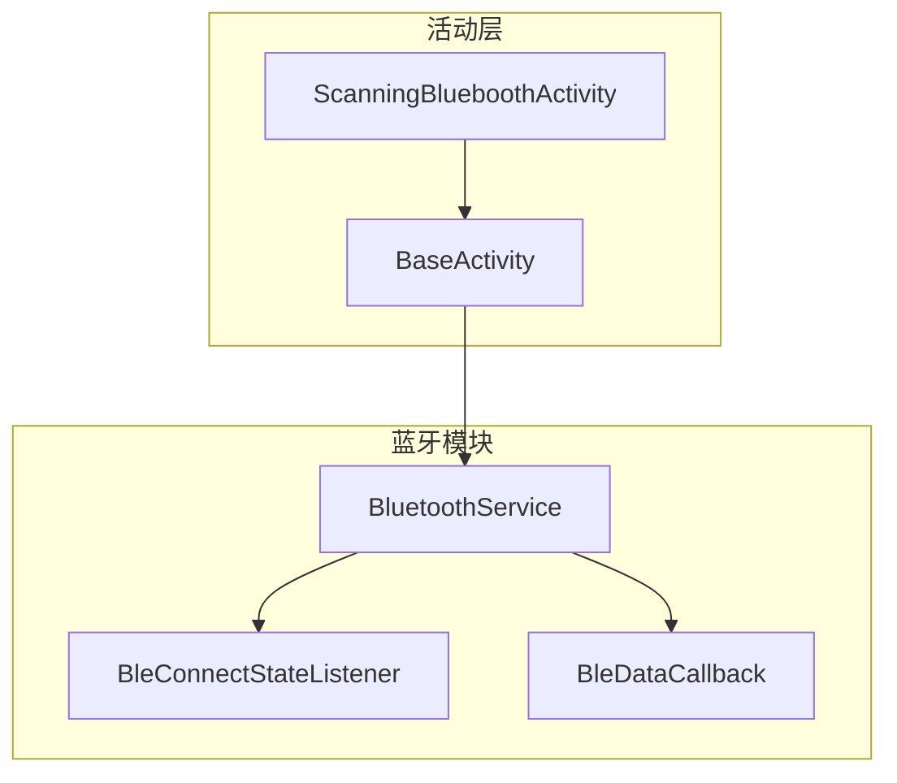
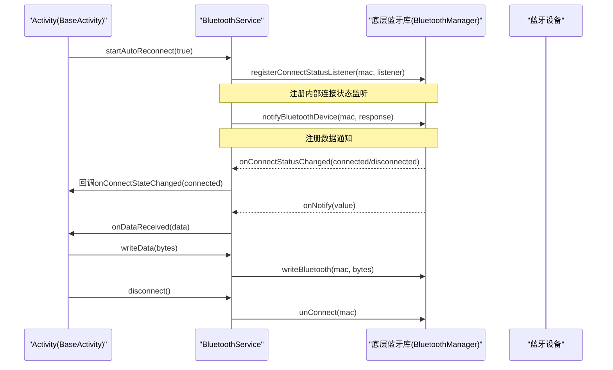
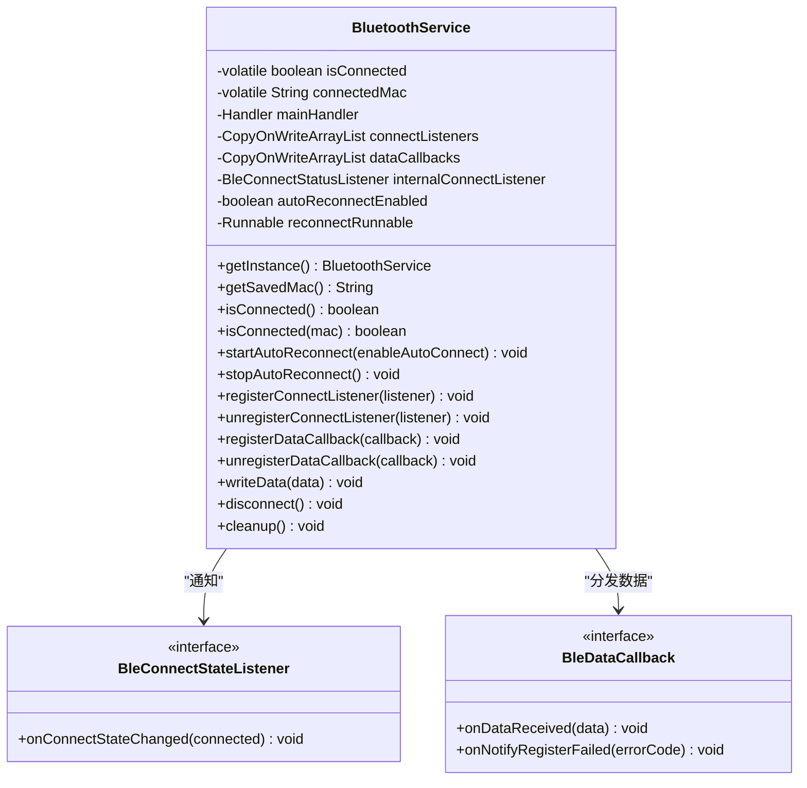
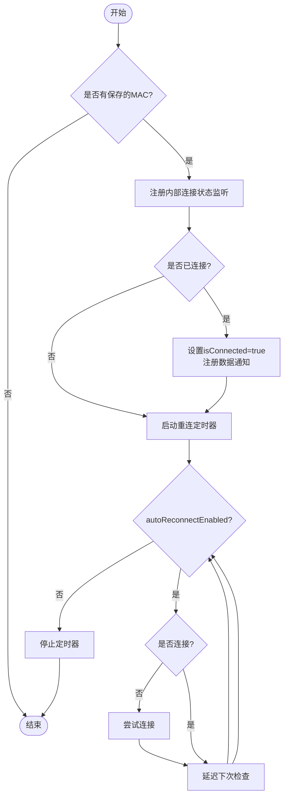
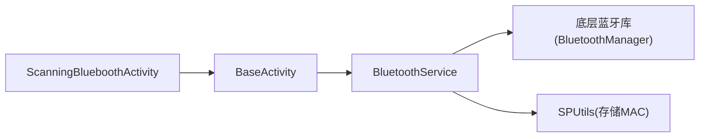

# 蓝牙服务管理

<cite>
**本文引用的文件**
- [BluetoothService.java](file://app/src/main/java/com/example/gtj_sd_dg240/bluetooth/BluetoothService.java)
- [BleConnectStateListener.java](file://app/src/main/java/com/example/gtj_sd_dg240/bluetooth/BleConnectStateListener.java)
- [BleDataCallback.java](file://app/src/main/java/com/example/gtj_sd_dg240/bluetooth/BleDataCallback.java)
- [BaseActivity.java](file://app/src/main/java/com/example/gtj_sd_dg240/activity/start/BaseActivity.java)
- [ScanningBlueboothActivity.java](file://app/src/main/java/com/example/gtj_sd_dg240/activity/setting/ScanningBlueboothActivity.java)
</cite>

## 目录
1. [简介](#简介)
2. [项目结构](#项目结构)
3. [核心组件](#核心组件)
4. [架构总览](#架构总览)
5. [详细组件分析](#详细组件分析)
6. [依赖关系分析](#依赖关系分析)
7. [性能与资源优化](#性能与资源优化)
8. [故障排查指南](#故障排查指南)
9. [结论](#结论)
10. [附录：API使用示例](#附录api使用示例)

## 简介
本文件面向应用中的蓝牙服务管理模块，围绕 BluetoothService 单例模式、连接状态管理、自动重连机制、内存泄漏防护与资源清理策略进行系统化说明。文档同时覆盖服务初始化流程、配置参数设置、错误处理机制、多线程环境下的注意事项与最佳实践，并提供常用 API 调用示例（连接监听器注册、数据回调注册、设备断开、连接状态查询等）。

## 项目结构
蓝牙相关代码集中在 app 模块的 bluetooth 包中，包含服务类与两个回调接口；在 activity 层通过 BaseActivity 统一接入蓝牙状态显示与数据接收，扫描与连接逻辑在 ScanningBlueboothActivity 中实现。

图表来源
- [BluetoothService.java:16-312](file://app/src/main/java/com/example/gtj_sd_dg240/bluetooth/BluetoothService.java#L16-L312)
- [BleConnectStateListener.java:1-13](file://app/src/main/java/com/example/gtj_sd_dg240/bluetooth/BleConnectStateListener.java#L1-L13)
- [BleDataCallback.java:1-19](file://app/src/main/java/com/example/gtj_sd_dg240/bluetooth/BleDataCallback.java#L1-L19)
- [BaseActivity.java:190-336](file://app/src/main/java/com/example/gtj_sd_dg240/activity/start/BaseActivity.java#L190-L336)
- [ScanningBlueboothActivity.java:1-181](file://app/src/main/java/com/example/gtj_sd_dg240/activity/setting/ScanningBlueboothActivity.java#L1-L181)

章节来源
- [BluetoothService.java:16-312](file://app/src/main/java/com/example/gtj_sd_dg240/bluetooth/BluetoothService.java#L16-L312)
- [BaseActivity.java:190-336](file://app/src/main/java/com/example/gtj_sd_dg240/activity/start/BaseActivity.java#L190-L336)
- [ScanningBlueboothActivity.java:1-181](file://app/src/main/java/com/example/gtj_sd_dg240/activity/setting/ScanningBlueboothActivity.java#L1-L181)

## 核心组件
- BluetoothService：蓝牙连接与数据通道的统一入口，提供单例访问、自动重连、连接状态广播、数据通知分发、写数据与断连、资源清理等功能。
- BleConnectStateListener：连接状态变化回调接口，供 UI 或业务层订阅连接事件。
- BleDataCallback：数据回调接口，用于接收蓝牙设备上报的原始字节数据及通知注册失败事件。
- BaseActivity：封装了蓝牙状态监听与数据回调的注册/注销生命周期管理，便于各 Activity 复用。
- ScanningBlueboothActivity：负责设备扫描、选择与连接，并将 MAC 地址持久化以便后续自动重连。

章节来源
- [BluetoothService.java:16-312](file://app/src/main/java/com/example/gtj_sd_dg240/bluetooth/BluetoothService.java#L16-L312)
- [BleConnectStateListener.java:1-13](file://app/src/main/java/com/example/gtj_sd_dg240/bluetooth/BleConnectStateListener.java#L1-L13)
- [BleDataCallback.java:1-19](file://app/src/main/java/com/example/gtj_sd_dg240/bluetooth/BleDataCallback.java#L1-L19)
- [BaseActivity.java:190-336](file://app/src/main/java/com/example/gtj_sd_dg240/activity/start/BaseActivity.java#L190-L336)
- [ScanningBlueboothActivity.java:1-181](file://app/src/main/java/com/example/gtj_sd_dg240/activity/setting/ScanningBlueboothActivity.java#L1-L181)

## 架构总览
BluetoothService 作为中心协调者，基于底层蓝牙库进行连接管理与数据通知。其内部维护主线程 Handler 以安全地更新 UI 和分发回调；使用 CopyOnWriteArrayList 保证监听器列表的并发安全；通过定时器实现周期性自动重连；通过 SPUtils 读取/保存 MAC 地址以实现跨进程/重启后的恢复。

图表来源
- [BluetoothService.java:77-234](file://app/src/main/java/com/example/gtj_sd_dg240/bluetooth/BluetoothService.java#L77-L234)
- [BaseActivity.java:240-282](file://app/src/main/java/com/example/gtj_sd_dg240/activity/start/BaseActivity.java#L240-L282)
- [ScanningBlueboothActivity.java:142-164](file://app/src/main/java/com/example/gtj_sd_dg240/activity/setting/ScanningBlueboothActivity.java#L142-L164)

## 详细组件分析

### BluetoothService：单例、生命周期与线程安全
- 单例模式：采用双重检查锁定 + volatile 保证全局唯一实例与可见性。
- 生命周期：
  - startAutoReconnect：根据保存的 MAC 启动内部监听、若已连接则立即注册数据通知并设置状态，随后启动定时重连任务。
  - stopAutoReconnect：关闭自动重连、移除内部监听。
  - cleanup：停止重连、清空监听器与回调、重置状态，避免内存泄漏。
- 线程安全：
  - 监听器与回调集合使用 CopyOnWriteArrayList，读写并发安全。
  - 所有回调与 UI 更新通过主线程 Handler 派发，避免跨线程直接操作 UI。
- 连接状态：
  - isConnected()/isConnected(mac)：提供全局与按 MAC 的连接状态查询。
  - 内部监听器统一处理连接成功/失败，并在成功时注册数据通知、失败时取消通知。
- 自动重连：
  - 基于 Handler.postDelayed 周期检查连接状态并尝试连接，支持启用/禁用开关。
- 数据通道：
  - registerDataNotify：为指定 MAC 注册数据通知，收到数据后分发给所有注册的 BleDataCallback。
  - writeData：向当前保存的 MAC 发送数据。
  - disconnect：主动断开连接并清理状态。

图表来源
- [BluetoothService.java:16-312](file://app/src/main/java/com/example/gtj_sd_dg240/bluetooth/BluetoothService.java#L16-L312)
- [BleConnectStateListener.java:1-13](file://app/src/main/java/com/example/gtj_sd_dg240/bluetooth/BleConnectStateListener.java#L1-L13)
- [BleDataCallback.java:1-19](file://app/src/main/java/com/example/gtj_sd_dg240/bluetooth/BleDataCallback.java#L1-L19)

章节来源
- [BluetoothService.java:16-312](file://app/src/main/java/com/example/gtj_sd_dg240/bluetooth/BluetoothService.java#L16-L312)

### 连接状态管理与自动重连机制
- 内部监听器：在 startAutoReconnect 中注册，统一处理 STATUS_CONNECTED/STATUS_DISCONNECTED，分别执行数据通知注册/取消、状态同步与监听器通知。
- 自动重连：通过 Handler 定时任务循环检测连接状态，未连接则发起连接请求；支持通过 startAutoReconnect(enable) 控制是否启用。
- 状态一致性：连接成功后更新 isConnected 与 connectedMac；断开时重置状态并取消通知。

图表来源
- [BluetoothService.java:77-234](file://app/src/main/java/com/example/gtj_sd_dg240/bluetooth/BluetoothService.java#L77-L234)

章节来源
- [BluetoothService.java:77-234](file://app/src/main/java/com/example/gtj_sd_dg240/bluetooth/BluetoothService.java#L77-L234)

### 数据回调与监听器管理
- 监听器注册：registerConnectListener 会立即推送当前连接状态，确保新注册者能感知最新状态。
- 数据回调：registerDataCallback 将回调加入线程安全列表；当底层数据到达时，通过主线程分发到所有回调。
- 注销与清理：在 onDestroy 中统一注销监听器与回调，防止内存泄漏。

章节来源
- [BluetoothService.java:236-277](file://app/src/main/java/com/example/gtj_sd_dg240/bluetooth/BluetoothService.java#L236-L277)
- [BaseActivity.java:240-336](file://app/src/main/java/com/example/gtj_sd_dg240/activity/start/BaseActivity.java#L240-L336)

### 资源清理与内存泄漏防护
- 停止定时器：stopReconnectTimer 移除回调并置空引用，避免重复调度与悬挂引用。
- 注销监听：stopAutoReconnect 中注销内部连接状态监听，防止重复注册导致的多份回调。
- 清理方法：cleanup 集中停止重连、清空监听器与回调、重置状态，适合在应用退出或关键路径释放资源时使用。
- 生命周期配合：BaseActivity 在 onDestroy 中注销监听与回调，确保页面销毁时不持有强引用。

章节来源
- [BluetoothService.java:111-170](file://app/src/main/java/com/example/gtj_sd_dg240/bluetooth/BluetoothService.java#L111-L170)
- [BluetoothService.java:226-310](file://app/src/main/java/com/example/gtj_sd_dg240/bluetooth/BluetoothService.java#L226-L310)
- [BaseActivity.java:310-336](file://app/src/main/java/com/example/gtj_sd_dg240/activity/start/BaseActivity.java#L310-L336)

### 服务初始化流程与配置参数
- 初始化入口：在 BaseActivity 中根据标志位决定是否启用自动重连，并通过 BluetoothService.getInstance() 获取实例后调用 startAutoReconnect(true)。
- 配置参数：
  - 自动重连开关：startAutoReconnect(enableAutoConnect) 控制是否启用。
  - 重连间隔：内部常量 RECONNECT_INTERVAL_MS 控制定时检查频率。
  - MAC 地址：从 SPUtils 读取保存的 MAC 作为目标设备标识。
- 数据通道：连接成功后自动注册数据通知，无需业务层手动干预。

章节来源
- [BaseActivity.java:190-198](file://app/src/main/java/com/example/gtj_sd_dg240/activity/start/BaseActivity.java#L190-L198)
- [BluetoothService.java:36-109](file://app/src/main/java/com/example/gtj_sd_dg240/bluetooth/BluetoothService.java#L36-L109)

### 错误处理机制
- 数据通知注册失败：底层返回非零码时，通过 BleDataCallback.onNotifyRegisterFailed 通知上层，便于记录日志或提示用户。
- 连接异常：内部监听器在断开时统一处理，取消数据通知并通知监听器，保持状态一致。
- 界面反馈：连接成功时通过 Toast 提示，提升用户体验。

章节来源
- [BluetoothService.java:172-198](file://app/src/main/java/com/example/gtj_sd_dg240/bluetooth/BluetoothService.java#L172-L198)
- [BluetoothService.java:134-159](file://app/src/main/java/com/example/gtj_sd_dg240/bluetooth/BluetoothService.java#L134-L159)

### 多线程环境下的使用注意事项
- 回调在主线程派发：所有连接状态与数据回调均通过主线程 Handler.post 触发，可直接更新 UI。
- 并发安全：监听器与回调集合使用 CopyOnWriteArrayList，避免并发修改导致的异常。
- 建议：
  - 不要在回调中进行耗时操作，必要时切换到后台线程处理。
  - 在页面销毁时务必注销监听器与回调，避免内存泄漏。
  - 自动重连期间避免频繁手动连接/断开，以免干扰定时器逻辑。

章节来源
- [BluetoothService.java:23-31](file://app/src/main/java/com/example/gtj_sd_dg240/bluetooth/BluetoothService.java#L23-L31)
- [BluetoothService.java:134-185](file://app/src/main/java/com/example/gtj_sd_dg240/bluetooth/BluetoothService.java#L134-L185)

## 依赖关系分析
- BluetoothService 依赖底层蓝牙库进行连接、通知与写数据。
- BaseActivity 依赖 BluetoothService 提供统一的连接状态与数据通道。
- ScanningBlueboothActivity 通过底层蓝牙库扫描与连接设备，并将 MAC 保存到 SP，供 BluetoothService 自动重连使用。

图表来源
- [ScanningBlueboothActivity.java:142-164](file://app/src/main/java/com/example/gtj_sd_dg240/activity/setting/ScanningBlueboothActivity.java#L142-L164)
- [BaseActivity.java:190-282](file://app/src/main/java/com/example/gtj_sd_dg240/activity/start/BaseActivity.java#L190-L282)
- [BluetoothService.java:54-109](file://app/src/main/java/com/example/gtj_sd_dg240/bluetooth/BluetoothService.java#L54-L109)

章节来源
- [ScanningBlueboothActivity.java:142-164](file://app/src/main/java/com/example/gtj_sd_dg240/activity/setting/ScanningBlueboothActivity.java#L142-L164)
- [BaseActivity.java:190-282](file://app/src/main/java/com/example/gtj_sd_dg240/activity/start/BaseActivity.java#L190-L282)
- [BluetoothService.java:54-109](file://app/src/main/java/com/example/gtj_sd_dg240/bluetooth/BluetoothService.java#L54-L109)

## 性能与资源优化
- 减少重复注册：仅在需要时注册数据通知，断开时及时取消，避免无效回调。
- 合理重连间隔：RECONNECT_INTERVAL_MS 可根据实际网络与设备情况调整，避免过于频繁的连接尝试造成电量消耗。
- 批量数据处理：在 BleDataCallback 中对高频数据进行批处理或节流，降低 UI 刷新压力。
- 资源释放：在页面销毁或应用退出时调用 cleanup，确保定时器与监听器被正确释放。

[本节为通用优化建议，不直接分析具体文件]

## 故障排查指南
- 无法收到数据：
  - 确认已调用 startAutoReconnect 且 MAC 已保存。
  - 检查是否在连接成功后触发了数据通知注册。
  - 关注 onNotifyRegisterFailed 的错误码，定位底层问题。
- 自动重连无效：
  - 检查 autoReconnectEnabled 是否被意外关闭。
  - 查看定时器是否被 stopReconnectTimer 提前停止。
- 内存泄漏：
  - 确认在 onDestroy 中注销了连接监听器与数据回调。
  - 避免在回调中持有 Activity 强引用。
- 连接状态不一致：
  - 通过 isConnected()/isConnected(mac) 校验当前状态。
  - 观察内部监听器的回调是否被正确触发。

章节来源
- [BluetoothService.java:172-198](file://app/src/main/java/com/example/gtj_sd_dg240/bluetooth/BluetoothService.java#L172-L198)
- [BluetoothService.java:200-234](file://app/src/main/java/com/example/gtj_sd_dg240/bluetooth/BluetoothService.java#L200-L234)
- [BaseActivity.java:310-336](file://app/src/main/java/com/example/gtj_sd_dg240/activity/start/BaseActivity.java#L310-L336)

## 结论
BluetoothService 以单例为核心，结合主线程回调与并发安全的监听器管理，提供了稳定的蓝牙连接与数据通道能力。通过自动重连与完善的资源清理策略，有效提升了应用的健壮性与可维护性。建议在业务层遵循生命周期管理规范，合理使用 API，以获得更好的用户体验与系统稳定性。

[本节为总结性内容，不直接分析具体文件]

## 附录：API使用示例

- 获取单例并启动自动重连
  - 在 BaseActivity 中根据标志位启用自动重连，并调用 startAutoReconnect(true)。
  - 参考路径：[BaseActivity.java:190-198](file://app/src/main/java/com/example/gtj_sd_dg240/activity/start/BaseActivity.java#L190-L198)

- 注册连接状态监听器
  - 通过 registerConnectListener 订阅连接变化，用于更新 UI 图标或提示。
  - 参考路径：[BaseActivity.java:240-266](file://app/src/main/java/com/example/gtj_sd_dg240/activity/start/BaseActivity.java#L240-L266)

- 注册数据回调
  - 通过 registerDataCallback 接收蓝牙设备上报的数据，并在回调中解析与展示。
  - 参考路径：[BaseActivity.java:268-282](file://app/src/main/java/com/example/gtj_sd_dg240/activity/start/BaseActivity.java#L268-L282)

- 设备断开
  - 调用 disconnect 主动断开当前保存的 MAC 设备连接。
  - 参考路径：[BluetoothService.java:289-299](file://app/src/main/java/com/example/gtj_sd_dg240/bluetooth/BluetoothService.java#L289-L299)

- 连接状态查询
  - 使用 isConnected() 或 isConnected(mac) 查询全局或指定设备的连接状态。
  - 参考路径：[BluetoothService.java:61-74](file://app/src/main/java/com/example/gtj_sd_dg240/bluetooth/BluetoothService.java#L61-L74)

- 发送数据
  - 调用 writeData 向当前保存的 MAC 发送字节数组。
  - 参考路径：[BluetoothService.java:279-287](file://app/src/main/java/com/example/gtj_sd_dg240/bluetooth/BluetoothService.java#L279-L287)

- 设备扫描与连接（辅助）
  - 在 ScanningBlueboothActivity 中扫描设备并连接，成功后保存 MAC 以供自动重连。
  - 参考路径：[ScanningBlueboothActivity.java:89-164](file://app/src/main/java/com/example/gtj_sd_dg240/activity/setting/ScanningBlueboothActivity.java#L89-L164)

章节来源
- [BaseActivity.java:190-282](file://app/src/main/java/com/example/gtj_sd_dg240/activity/start/BaseActivity.java#L190-L282)
- [BluetoothService.java:61-299](file://app/src/main/java/com/example/gtj_sd_dg240/bluetooth/BluetoothService.java#L61-L299)
- [ScanningBlueboothActivity.java:89-164](file://app/src/main/java/com/example/gtj_sd_dg240/activity/setting/ScanningBlueboothActivity.java#L89-L164)