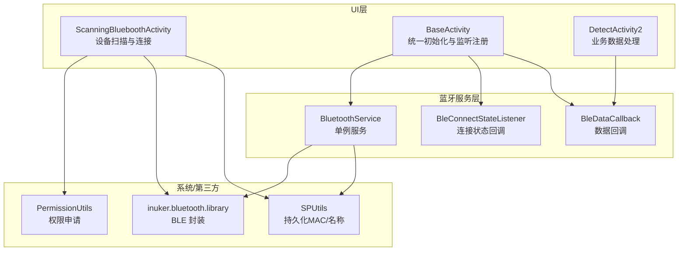
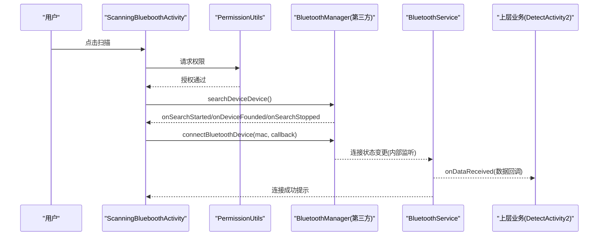
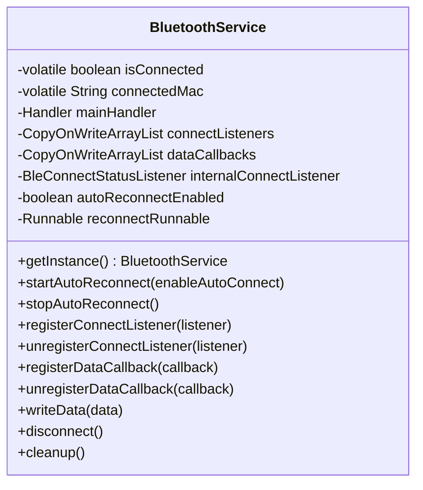
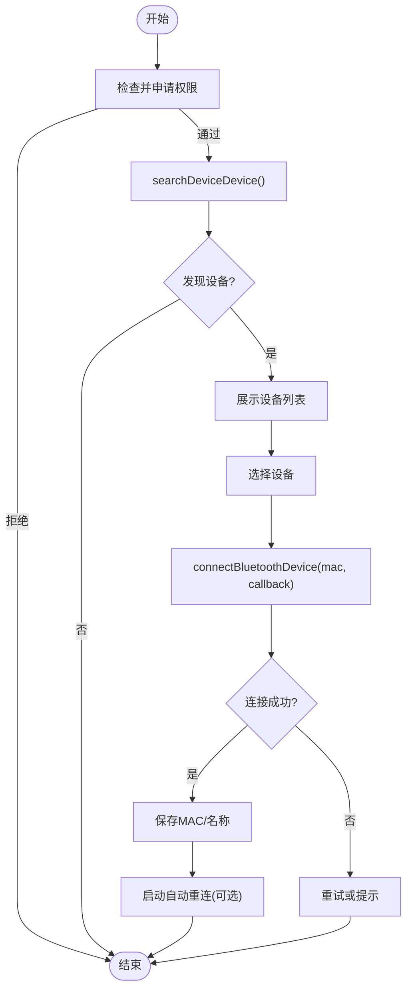
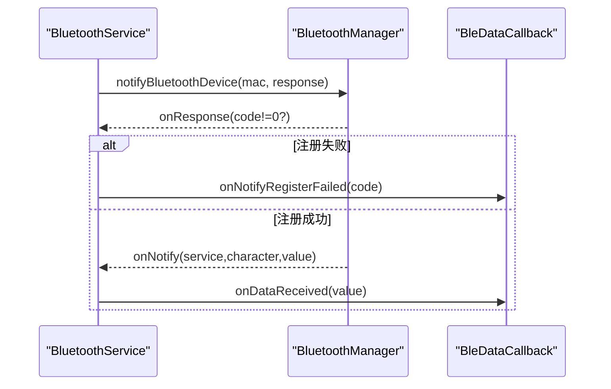
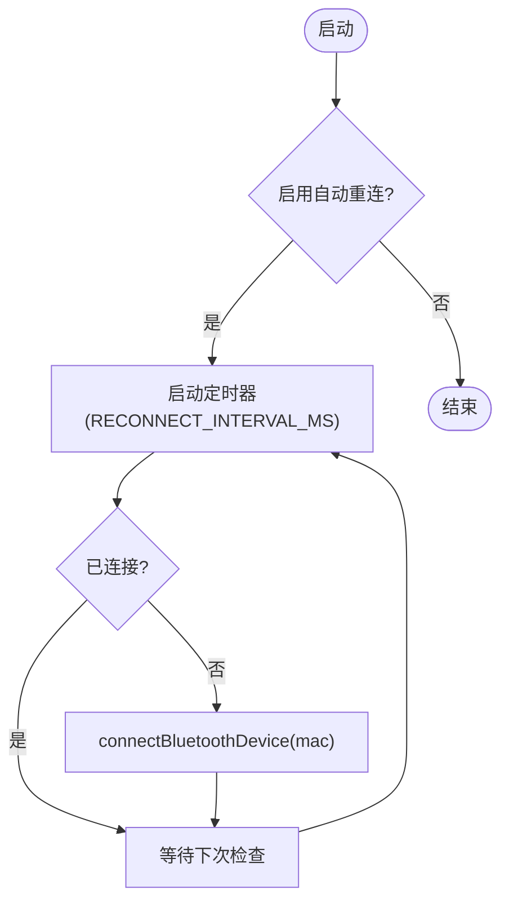
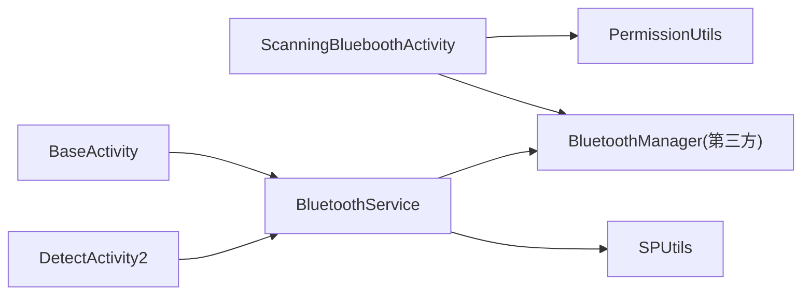

# 蓝牙通信模块

<cite>
**本文引用的文件**
- [BluetoothService.java](file://app/src/main/java/com/example/gtj_sd_dg240/bluetooth/BluetoothService.java)
- [BleDataCallback.java](file://app/src/main/java/com/example/gtj_sd_dg240/bluetooth/BleDataCallback.java)
- [BleConnectStateListener.java](file://app/src/main/java/com/example/gtj_sd_dg240/bluetooth/BleConnectStateListener.java)
- [ScanningBlueboothActivity.java](file://app/src/main/java/com/example/gtj_sd_dg240/activity/setting/ScanningBlueboothActivity.java)
- [BaseActivity.java](file://app/src/main/java/com/example/gtj_sd_dg240/activity/start/BaseActivity.java)
- [PermissionUtils.java](file://app/src/main/java/com/example/gtj_sd_dg240/utils/PermissionUtils.java)
- [BluetoothDeviceBean.java](file://app/src/main/java/com/example/gtj_sd_dg240/model/BluetoothDeviceBean.java)
- [DetectActivity2.java](file://app/src/main/java/com/example/gtj_sd_dg240/activity/testing/DetectActivity2.java)
</cite>

## 目录
1. [简介](#简介)
2. [项目结构](#项目结构)
3. [核心组件](#核心组件)
4. [架构总览](#架构总览)
5. [详细组件分析](#详细组件分析)
6. [依赖关系分析](#依赖关系分析)
7. [性能与稳定性](#性能与稳定性)
8. [故障排查指南](#故障排查指南)
9. [结论](#结论)
10. [附录：API与配置参考](#附录api与配置参考)

## 简介
本模块基于 Android BLE 实现设备扫描、连接管理、数据通知与自动重连，提供统一的单例服务 BluetoothService，封装底层库调用，向上层 Activity 暴露简洁的回调接口。文档覆盖 BLE 通信原理、连接生命周期、数据传输协议（字节流）、状态监控机制、权限管理、设备兼容性与性能优化建议，并提供可操作的 API 使用示例与调试技巧。

## 项目结构
蓝牙相关代码集中在 bluetooth 包，配合 UI 层的扫描页面与基类统一管理连接状态与数据回调。

图表来源
- [ScanningBlueboothActivity.java:89-163](file://app/src/main/java/com/example/gtj_sd_dg240/activity/setting/ScanningBlueboothActivity.java#L89-L163)
- [BaseActivity.java:187-198](file://app/src/main/java/com/example/gtj_sd_dg240/activity/start/BaseActivity.java#L187-L198)
- [BluetoothService.java:20-52](file://app/src/main/java/com/example/gtj_sd_dg240/bluetooth/BluetoothService.java#L20-L52)
- [PermissionUtils.java:57-81](file://app/src/main/java/com/example/gtj_sd_dg240/utils/PermissionUtils.java#L57-L81)

章节来源
- [ScanningBlueboothActivity.java:89-163](file://app/src/main/java/com/example/gtj_sd_dg240/activity/setting/ScanningBlueboothActivity.java#L89-L163)
- [BaseActivity.java:187-198](file://app/src/main/java/com/example/gtj_sd_dg240/activity/start/BaseActivity.java#L187-L198)
- [BluetoothService.java:20-52](file://app/src/main/java/com/example/gtj_sd_dg240/bluetooth/BluetoothService.java#L20-L52)
- [PermissionUtils.java:57-81](file://app/src/main/java/com/example/gtj_sd_dg240/utils/PermissionUtils.java#L57-L81)

## 核心组件
- BluetoothService：单例服务，负责连接状态管理、自动重连、数据通知分发、写操作封装。
- BleConnectStateListener：连接状态变化回调接口。
- BleDataCallback：数据接收与通知注册失败回调接口。
- ScanningBlueboothActivity：设备扫描、选择并连接设备，保存 MAC/名称到本地。
- BaseActivity：统一初始化蓝牙服务、注册连接状态与数据回调，生命周期内注销。
- PermissionUtils：多版本权限申请（位置、存储、相机、蓝牙）。
- BluetoothDeviceBean：设备信息模型（mac/name/选中态）。

章节来源
- [BluetoothService.java:20-52](file://app/src/main/java/com/example/gtj_sd_dg240/bluetooth/BluetoothService.java#L20-L52)
- [BleConnectStateListener.java:6-12](file://app/src/main/java/com/example/gtj_sd_dg240/bluetooth/BleConnectStateListener.java#L6-L12)
- [BleDataCallback.java:6-18](file://app/src/main/java/com/example/gtj_sd_dg240/bluetooth/BleDataCallback.java#L6-L18)
- [ScanningBlueboothActivity.java:89-163](file://app/src/main/java/com/example/gtj_sd_dg240/activity/setting/ScanningBlueboothActivity.java#L89-L163)
- [BaseActivity.java:187-198](file://app/src/main/java/com/example/gtj_sd_dg240/activity/start/BaseActivity.java#L187-L198)
- [PermissionUtils.java:57-81](file://app/src/main/java/com/example/gtj_sd_dg240/utils/PermissionUtils.java#L57-L81)
- [BluetoothDeviceBean.java:5-15](file://app/src/main/java/com/example/gtj_sd_dg240/model/BluetoothDeviceBean.java#L5-L15)

## 架构总览
整体采用“UI 层 + 服务层 + 系统/第三方库”的分层设计：
- UI 层：负责用户交互、展示与业务处理。
- 服务层：BluetoothService 作为单例，屏蔽底层 BLE 细节，提供稳定可靠的连接与数据通道。
- 系统/第三方：inuker.bluetooth.library 提供 BLE 能力；Android 权限框架保证合规访问。

图表来源
- [ScanningBlueboothActivity.java:89-163](file://app/src/main/java/com/example/gtj_sd_dg240/activity/setting/ScanningBlueboothActivity.java#L89-L163)
- [BluetoothService.java:127-159](file://app/src/main/java/com/example/gtj_sd_dg240/bluetooth/BluetoothService.java#L127-L159)
- [DetectActivity2.java:165-169](file://app/src/main/java/com/example/gtj_sd_dg240/activity/testing/DetectActivity2.java#L165-L169)

## 详细组件分析

### BluetoothService 单例模式与连接管理
- 单例实现：双重检查锁定，线程安全获取实例。
- 连接状态：维护 isConnected 与 connectedMac，并通过内部监听器同步底层状态。
- 自动重连：定时任务周期性检测并尝试连接，支持启停控制。
- 数据通知：连接成功后注册 notify，断开时取消，避免内存泄漏。
- 写数据：封装 write 操作，统一从本地读取 MAC。

图表来源
- [BluetoothService.java:20-52](file://app/src/main/java/com/example/gtj_sd_dg240/bluetooth/BluetoothService.java#L20-L52)
- [BluetoothService.java:77-122](file://app/src/main/java/com/example/gtj_sd_dg240/bluetooth/BluetoothService.java#L77-L122)
- [BluetoothService.java:127-198](file://app/src/main/java/com/example/gtj_sd_dg240/bluetooth/BluetoothService.java#L127-L198)
- [BluetoothService.java:200-234](file://app/src/main/java/com/example/gtj_sd_dg240/bluetooth/BluetoothService.java#L200-L234)
- [BluetoothService.java:236-310](file://app/src/main/java/com/example/gtj_sd_dg240/bluetooth/BluetoothService.java#L236-L310)

章节来源
- [BluetoothService.java:20-52](file://app/src/main/java/com/example/gtj_sd_dg240/bluetooth/BluetoothService.java#L20-L52)
- [BluetoothService.java:77-122](file://app/src/main/java/com/example/gtj_sd_dg240/bluetooth/BluetoothService.java#L77-L122)
- [BluetoothService.java:127-198](file://app/src/main/java/com/example/gtj_sd_dg240/bluetooth/BluetoothService.java#L127-L198)
- [BluetoothService.java:200-234](file://app/src/main/java/com/example/gtj_sd_dg240/bluetooth/BluetoothService.java#L200-L234)
- [BluetoothService.java:236-310](file://app/src/main/java/com/example/gtj_sd_dg240/bluetooth/BluetoothService.java#L236-L310)

### 设备扫描与连接流程
- 权限申请：在扫描前通过 PermissionUtils 申请位置、蓝牙等权限。
- 搜索设备：调用 searchDeviceDevice，收集搜索结果去重后展示。
- 连接设备：选择设备后调用 connectBluetoothDevice，成功后保存 MAC/名称。
- 自动重连：若启用，启动定时器周期检查并尝试连接。

图表来源
- [ScanningBlueboothActivity.java:89-163](file://app/src/main/java/com/example/gtj_sd_dg240/activity/setting/ScanningBlueboothActivity.java#L89-L163)
- [PermissionUtils.java:102-119](file://app/src/main/java/com/example/gtj_sd_dg240/utils/PermissionUtils.java#L102-L119)
- [BluetoothService.java:77-122](file://app/src/main/java/com/example/gtj_sd_dg240/bluetooth/BluetoothService.java#L77-L122)

章节来源
- [ScanningBlueboothActivity.java:89-163](file://app/src/main/java/com/example/gtj_sd_dg240/activity/setting/ScanningBlueboothActivity.java#L89-L163)
- [PermissionUtils.java:102-119](file://app/src/main/java/com/example/gtj_sd_dg240/utils/PermissionUtils.java#L102-L119)
- [BluetoothService.java:77-122](file://app/src/main/java/com/example/gtj_sd_dg240/bluetooth/BluetoothService.java#L77-L122)

### 数据回调机制与异常处理
- 数据回调：连接成功后注册 notify，收到数据后在主线程分发至所有注册的 BleDataCallback。
- 注册失败：当通知注册返回非零错误码时，触发 onNotifyRegisterFailed。
- 断开处理：断开时取消通知，更新连接状态并通知监听器。

图表来源
- [BluetoothService.java:172-198](file://app/src/main/java/com/example/gtj_sd_dg240/bluetooth/BluetoothService.java#L172-L198)
- [BleDataCallback.java:6-18](file://app/src/main/java/com/example/gtj_sd_dg240/bluetooth/BleDataCallback.java#L6-L18)

章节来源
- [BluetoothService.java:172-198](file://app/src/main/java/com/example/gtj_sd_dg240/bluetooth/BluetoothService.java#L172-L198)
- [BleDataCallback.java:6-18](file://app/src/main/java/com/example/gtj_sd_dg240/bluetooth/BleDataCallback.java#L6-L18)

### 不同型号设备的适配方案
- 设备识别：通过 MAC 地址与名称区分设备，保存在本地以便后续连接。
- 业务适配：上层根据设备类型或参数进行差异化处理（例如检测算法、显示逻辑）。
- 兼容性：权限与系统版本差异由 PermissionUtils 统一处理，确保在不同 Android 版本上行为一致。

章节来源
- [ScanningBlueboothActivity.java:142-163](file://app/src/main/java/com/example/gtj_sd_dg240/activity/setting/ScanningBlueboothActivity.java#L142-L163)
- [PermissionUtils.java:57-81](file://app/src/main/java/com/example/gtj_sd_dg240/utils/PermissionUtils.java#L57-L81)

### 连接超时与自动重连机制
- 自动重连：BluetoothService 内置定时器，按固定间隔检查连接状态并尝试重连。
- 启停控制：可通过 startAutoReconnect(true/false) 控制是否启用自动重连。
- 资源清理：停止重连时移除回调，防止内存泄漏。

图表来源
- [BluetoothService.java:77-122](file://app/src/main/java/com/example/gtj_sd_dg240/bluetooth/BluetoothService.java#L77-L122)
- [BluetoothService.java:200-234](file://app/src/main/java/com/example/gtj_sd_dg240/bluetooth/BluetoothService.java#L200-L234)

章节来源
- [BluetoothService.java:77-122](file://app/src/main/java/com/example/gtj_sd_dg240/bluetooth/BluetoothService.java#L77-L122)
- [BluetoothService.java:200-234](file://app/src/main/java/com/example/gtj_sd_dg240/bluetooth/BluetoothService.java#L200-L234)

### 信号强度监控（RSSI）
- 当前实现未直接暴露 RSSI 采集与回调。如需增强，可在扫描回调中记录设备 RSSI，或在连接状态监听中扩展信号质量指标。
- 建议在扫描阶段对设备进行信号强度过滤，提升连接成功率与稳定性。

[本节为概念性说明，不直接分析具体文件]

## 依赖关系分析
- UI 层依赖：
  - ScanningBlueboothActivity 依赖 PermissionUtils 与第三方 BLE 库进行扫描与连接。
  - BaseActivity 统一初始化 BluetoothService 并注册监听。
- 服务层依赖：
  - BluetoothService 依赖第三方 BLE 库进行连接、通知与写操作；依赖 SPUtils 持久化 MAC。
- 数据流向：
  - 设备数据经 BLE 通知到达 BluetoothService，再分发到上层业务（如 DetectActivity2）。

图表来源
- [ScanningBlueboothActivity.java:89-163](file://app/src/main/java/com/example/gtj_sd_dg240/activity/setting/ScanningBlueboothActivity.java#L89-L163)
- [BaseActivity.java:187-198](file://app/src/main/java/com/example/gtj_sd_dg240/activity/start/BaseActivity.java#L187-L198)
- [BluetoothService.java:172-198](file://app/src/main/java/com/example/gtj_sd_dg240/bluetooth/BluetoothService.java#L172-L198)

章节来源
- [ScanningBlueboothActivity.java:89-163](file://app/src/main/java/com/example/gtj_sd_dg240/activity/setting/ScanningBlueboothActivity.java#L89-L163)
- [BaseActivity.java:187-198](file://app/src/main/java/com/example/gtj_sd_dg240/activity/start/BaseActivity.java#L187-L198)
- [BluetoothService.java:172-198](file://app/src/main/java/com/example/gtj_sd_dg240/bluetooth/BluetoothService.java#L172-L198)

## 性能与稳定性
- 主线程分发：数据回调通过主线程 Handler 分发，避免 UI 卡顿风险。
- 线程安全：监听器列表使用 CopyOnWriteArrayList，保证并发安全。
- 资源管理：断开连接时取消通知，停止重连时移除回调，减少内存占用。
- 建议优化：
  - 增加连接超时控制，避免长时间阻塞。
  - 对高频数据进行批处理或节流，降低 UI 刷新压力。
  - 在扫描阶段加入 RSSI 阈值过滤，提高连接质量。

[本节提供通用指导，不直接分析具体文件]

## 故障排查指南
- 权限问题：确认已授予位置、蓝牙等权限；若被永久拒绝，引导用户前往设置开启。
- 扫描不到设备：检查蓝牙开关、定位服务、设备可见性与距离。
- 连接失败：查看连接回调与日志；必要时重启蓝牙或重新扫描。
- 数据未到达：检查是否已注册数据回调；确认设备端是否开启通知。
- 自动重连无效：确认已保存 MAC；检查定时器是否被正确启停。

章节来源
- [PermissionUtils.java:152-169](file://app/src/main/java/com/example/gtj_sd_dg240/utils/PermissionUtils.java#L152-L169)
- [BluetoothService.java:127-159](file://app/src/main/java/com/example/gtj_sd_dg240/bluetooth/BluetoothService.java#L127-L159)
- [ScanningBlueboothActivity.java:89-163](file://app/src/main/java/com/example/gtj_sd_dg240/activity/setting/ScanningBlueboothActivity.java#L89-L163)

## 结论
本模块以 BluetoothService 为核心，实现了稳定的 BLE 连接管理与数据通道，结合 UI 层的扫描与连接流程，满足设备接入与数据采集需求。通过权限统一管理与自动重连机制，提升了用户体验与鲁棒性。后续可扩展 RSSI 监控、连接超时控制与更丰富的设备适配策略。

[本节总结性内容，不直接分析具体文件]

## 附录：API与配置参考

### 常用 API 调用示例（路径引用）
- 获取单例与服务启动
  - [BluetoothService.getInstance():43-52](file://app/src/main/java/com/example/gtj_sd_dg240/bluetooth/BluetoothService.java#L43-L52)
  - [startAutoReconnect(true):77-109](file://app/src/main/java/com/example/gtj_sd_dg240/bluetooth/BluetoothService.java#L77-L109)
- 注册连接状态与数据回调
  - [BaseActivity.initBluetoothStatus(...):240-266](file://app/src/main/java/com/example/gtj_sd_dg240/activity/start/BaseActivity.java#L240-L266)
  - [BaseActivity.registerBluetoothDataCallback():268-282](file://app/src/main/java/com/example/gtj_sd_dg240/activity/start/BaseActivity.java#L268-L282)
- 设备扫描与连接
  - [ScanningBlueboothActivity.scanningBlueboothDevice():89-140](file://app/src/main/java/com/example/gtj_sd_dg240/activity/setting/ScanningBlueboothActivity.java#L89-L140)
  - [ScanningBlueboothActivity.connectDevice(...):142-163](file://app/src/main/java/com/example/gtj_sd_dg240/activity/setting/ScanningBlueboothActivity.java#L142-L163)
- 发送数据
  - [BluetoothService.writeData(byte[])](file://app/src/main/java/com/example/gtj_sd_dg240/bluetooth/BluetoothService.java#L280-L287)
- 断开与清理
  - [BluetoothService.disconnect():289-299](file://app/src/main/java/com/example/gtj_sd_dg240/bluetooth/BluetoothService.java#L289-L299)
  - [BluetoothService.cleanup():301-310](file://app/src/main/java/com/example/gtj_sd_dg240/bluetooth/BluetoothService.java#L301-L310)

### 配置参数说明
- 自动重连间隔：RECONNECT_INTERVAL_MS = 2000ms（毫秒）
  - [BluetoothService.java:36-39](file://app/src/main/java/com/example/gtj_sd_dg240/bluetooth/BluetoothService.java#L36-L39)
- 本地存储键名：bluetooth-mac、bluetooth-name
  - [ScanningBlueboothActivity.java:66-68](file://app/src/main/java/com/example/gtj_sd_dg240/activity/setting/ScanningBlueboothActivity.java#L66-L68)
  - [ScanningBlueboothActivity.java:156-159](file://app/src/main/java/com/example/gtj_sd_dg240/activity/setting/ScanningBlueboothActivity.java#L156-L159)

### 调试技巧
- 在连接状态监听中打印状态变化，确认连接生命周期。
- 在数据回调中记录原始字节数组长度与首尾字节，便于协议解析定位问题。
- 使用权限工具类的日志输出，快速定位权限问题。
  - [PermissionUtils.java:152-169](file://app/src/main/java/com/example/gtj_sd_dg240/utils/PermissionUtils.java#L152-L169)

章节来源
- [BluetoothService.java:36-39](file://app/src/main/java/com/example/gtj_sd_dg240/bluetooth/BluetoothService.java#L36-L39)
- [ScanningBlueboothActivity.java:66-68](file://app/src/main/java/com/example/gtj_sd_dg240/activity/setting/ScanningBlueboothActivity.java#L66-L68)
- [ScanningBlueboothActivity.java:156-159](file://app/src/main/java/com/example/gtj_sd_dg240/activity/setting/ScanningBlueboothActivity.java#L156-L159)
- [PermissionUtils.java:152-169](file://app/src/main/java/com/example/gtj_sd_dg240/utils/PermissionUtils.java#L152-L169)