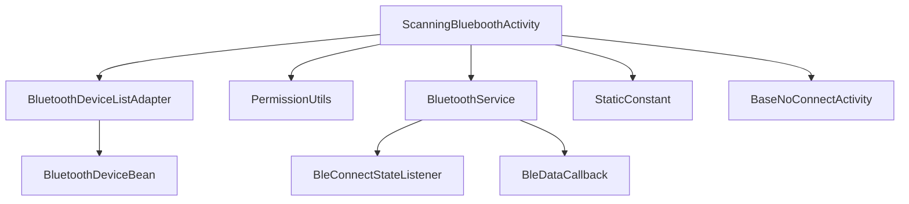
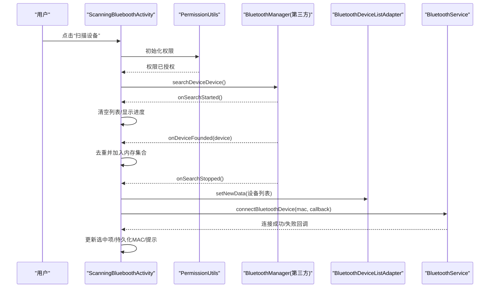
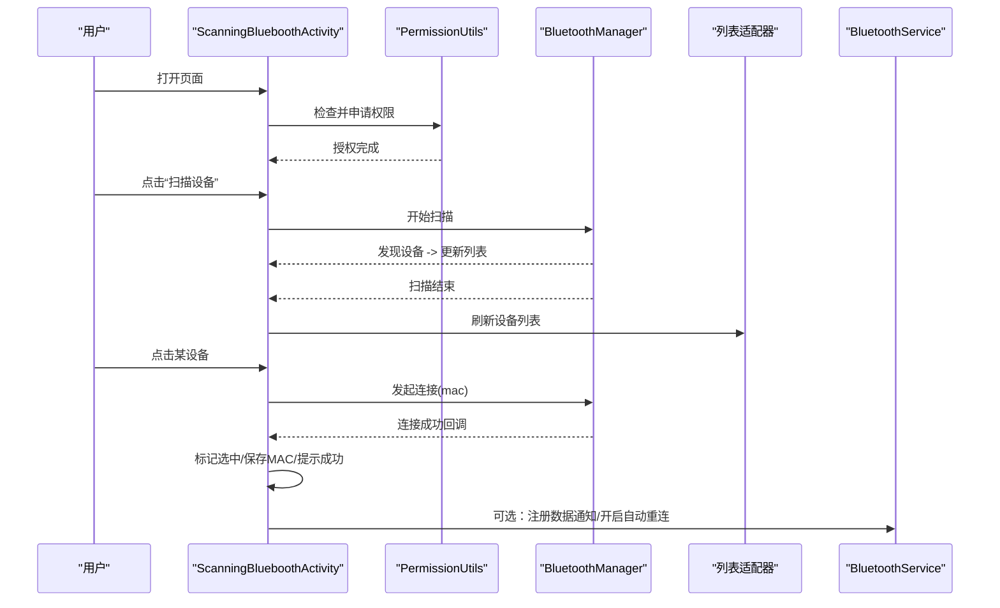
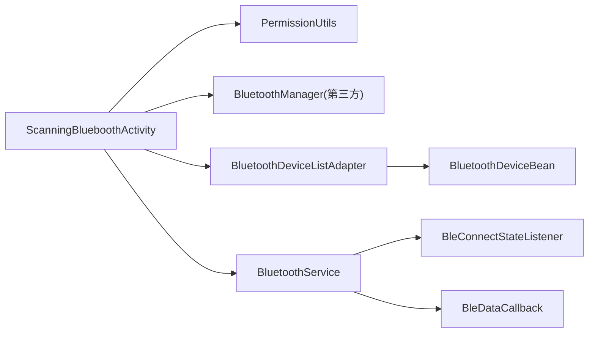

# 设备扫描与连接

<cite>
**本文引用的文件**
- [ScanningBlueboothActivity.java](file://app/src/main/java/com/example/gtj_sd_dg240/activity/setting/ScanningBlueboothActivity.java)
- [BluetoothService.java](file://app/src/main/java/com/example/gtj_sd_dg240/bluetooth/BluetoothService.java)
- [BleConnectStateListener.java](file://app/src/main/java/com/example/gtj_sd_dg240/bluetooth/BleConnectStateListener.java)
- [BleDataCallback.java](file://app/src/main/java/com/example/gtj_sd_dg240/bluetooth/BleDataCallback.java)
- [BluetoothDeviceListAdapter.java](file://app/src/main/java/com/example/gtj_sd_dg240/adapter/BluetoothDeviceListAdapter.java)
- [BluetoothDeviceBean.java](file://app/src/main/java/com/example/gtj_sd_dg240/model/BluetoothDeviceBean.java)
- [PermissionUtils.java](file://app/src/main/java/com/example/gtj_sd_dg240/utils/PermissionUtils.java)
- [StaticConstant.java](file://app/src/main/java/com/example/gtj_sd_dg240/StaticConstant.java)
- [BaseNoConnectActivity.java](file://app/src/main/java/com/example/gtj_sd_dg240/activity/start/BaseNoConnectActivity.java)
- [act_scanning_bluetooth.xml](file://app/src/main/res/layout/act_scanning_bluetooth.xml)
- [item_bluetooth_device_list.xml](file://app/src/main/res/layout/item_bluetooth_device_list.xml)
</cite>

## 目录
1. [简介](#简介)
2. [项目结构](#项目结构)
3. [核心组件](#核心组件)
4. [架构总览](#架构总览)
5. [详细组件分析](#详细组件分析)
6. [依赖关系分析](#依赖关系分析)
7. [性能考虑](#性能考虑)
8. [故障排查指南](#故障排查指南)
9. [结论](#结论)
10. [附录](#附录)

## 简介
本文件围绕BLE设备的扫描、发现、连接建立与连接状态管理，系统化说明 ScanningBlueboothActivity 的实现逻辑、设备列表展示、用户交互流程与连接失败处理。文档覆盖蓝牙权限申请、设备过滤规则、信号强度显示现状与扩展建议、连接超时处理策略，并提供完整的连接流程示例（搜索、选择、连接、反馈）。同时给出不同Android版本的兼容性处理要点与用户体验优化建议。

## 项目结构
- 入口界面：ScanningBlueboothActivity 负责蓝牙扫描、设备列表展示与用户交互。
- 数据层：BluetoothDeviceBean 表示设备信息；BluetoothDeviceListAdapter 负责RecyclerView的绑定与选中态展示。
- 蓝牙服务：BluetoothService 提供单例化的连接状态管理、自动重连、数据通知注册与分发。
- 权限工具：PermissionUtils 统一封装多版本权限申请与引导。
- 常量与基类：StaticConstant 定义UUID等常量；BaseNoConnectActivity 为不自动重连的Activity基类。
- 布局资源：act_scanning_bluetooth.xml 与 item_bluetooth_device_list.xml 定义UI结构与条目样式。

图表来源
- [ScanningBlueboothActivity.java:28-181](file://app/src/main/java/com/example/gtj_sd_dg240/activity/setting/ScanningBlueboothActivity.java#L28-L181)
- [BluetoothDeviceListAdapter.java:11-27](file://app/src/main/java/com/example/gtj_sd_dg240/adapter/BluetoothDeviceListAdapter.java#L11-L27)
- [BluetoothDeviceBean.java:5-35](file://app/src/main/java/com/example/gtj_sd_dg240/model/BluetoothDeviceBean.java#L5-L35)
- [BluetoothService.java:20-312](file://app/src/main/java/com/example/gtj_sd_dg240/bluetooth/BluetoothService.java#L20-L312)
- [BleConnectStateListener.java:6-12](file://app/src/main/java/com/example/gtj_sd_dg240/bluetooth/BleConnectStateListener.java#L6-L12)
- [BleDataCallback.java:6-18](file://app/src/main/java/com/example/gtj_sd_dg240/bluetooth/BleDataCallback.java#L6-L18)
- [StaticConstant.java:67-70](file://app/src/main/java/com/example/gtj_sd_dg240/StaticConstant.java#L67-L70)
- [BaseNoConnectActivity.java:9-16](file://app/src/main/java/com/example/gtj_sd_dg240/activity/start/BaseNoConnectActivity.java#L9-L16)

章节来源
- [ScanningBlueboothActivity.java:28-181](file://app/src/main/java/com/example/gtj_sd_dg240/activity/setting/ScanningBlueboothActivity.java#L28-L181)
- [BluetoothDeviceListAdapter.java:11-27](file://app/src/main/java/com/example/gtj_sd_dg240/adapter/BluetoothDeviceListAdapter.java#L11-L27)
- [BluetoothDeviceBean.java:5-35](file://app/src/main/java/com/example/gtj_sd_dg240/model/BluetoothDeviceBean.java#L5-L35)
- [BluetoothService.java:20-312](file://app/src/main/java/com/example/gtj_sd_dg240/bluetooth/BluetoothService.java#L20-L312)
- [PermissionUtils.java:57-119](file://app/src/main/java/com/example/gtj_sd_dg240/utils/PermissionUtils.java#L57-L119)
- [StaticConstant.java:67-70](file://app/src/main/java/com/example/gtj_sd_dg240/StaticConstant.java#L67-L70)
- [BaseNoConnectActivity.java:9-16](file://app/src/main/java/com/example/gtj_sd_dg240/activity/start/BaseNoConnectActivity.java#L9-L16)

## 核心组件
- ScanningBlueboothActivity
  - 职责：启动蓝牙扫描、收集设备、展示列表、发起连接、保存上次连接设备并自动尝试连接。
  - 关键点：使用第三方库 BluetoothManager.searchDeviceDevice 进行扫描；通过回调更新UI；点击条目或扫描结束自动匹配MAC后连接。
- BluetoothDeviceListAdapter
  - 职责：将设备列表渲染到RecyclerView，支持单选高亮。
- BluetoothDeviceBean
  - 职责：承载设备MAC、名称与选中状态。
- PermissionUtils
  - 职责：按系统版本动态申请位置、存储、相机与蓝牙权限；对Android 11+的特殊存储权限进行引导。
- BluetoothService
  - 职责：单例管理连接状态、自动重连、数据通知注册与分发、断开与清理。
- StaticConstant
  - 职责：定义BLE服务与特征UUID等常量。
- BaseNoConnectActivity
  - 职责：隐藏虚拟按键且不自动重连的Activity基类。

章节来源
- [ScanningBlueboothActivity.java:28-181](file://app/src/main/java/com/example/gtj_sd_dg240/activity/setting/ScanningBlueboothActivity.java#L28-L181)
- [BluetoothDeviceListAdapter.java:11-27](file://app/src/main/java/com/example/gtj_sd_dg240/adapter/BluetoothDeviceListAdapter.java#L11-L27)
- [BluetoothDeviceBean.java:5-35](file://app/src/main/java/com/example/gtj_sd_dg240/model/BluetoothDeviceBean.java#L5-L35)
- [PermissionUtils.java:57-119](file://app/src/main/java/com/example/gtj_sd_dg240/utils/PermissionUtils.java#L57-L119)
- [BluetoothService.java:20-312](file://app/src/main/java/com/example/gtj_sd_dg240/bluetooth/BluetoothService.java#L20-L312)
- [StaticConstant.java:67-70](file://app/src/main/java/com/example/gtj_sd_dg240/StaticConstant.java#L67-L70)
- [BaseNoConnectActivity.java:9-16](file://app/src/main/java/com/example/gtj_sd_dg240/activity/start/BaseNoConnectActivity.java#L9-L16)

## 架构总览
下图展示了从用户触发扫描到设备连接、状态管理与数据通知的整体流程。

图表来源
- [ScanningBlueboothActivity.java:89-164](file://app/src/main/java/com/example/gtj_sd_dg240/activity/setting/ScanningBlueboothActivity.java#L89-L164)
- [BluetoothService.java:20-312](file://app/src/main/java/com/example/gtj_sd_dg240/bluetooth/BluetoothService.java#L20-L312)

## 详细组件分析

### ScanningBlueboothActivity 实现逻辑
- 生命周期与初始化
  - onCreate/setLable/initData：设置标题、按钮文案、语言切换、读取上次连接的MAC与名称并显示。
  - onStart：若列表为空则申请权限并启动扫描。
- 扫描流程
  - 调用 BluetoothManager.searchDeviceDevice，监听开始、发现设备、停止、取消四个阶段。
  - 过滤空名设备，去重后加入内存集合，最终转换为BluetoothDeviceBean列表刷新UI。
- 自动连接
  - 扫描结束后遍历列表，若存在上次保存的MAC则立即尝试连接。
- 用户交互
  - 点击条目触发连接；连接成功后标记选中项并持久化MAC与名称，提示成功。
- 错误与边界
  - 页面销毁/关闭时提前返回，避免后台回调更新UI导致崩溃。
  - 未找到设备或无权限时，需结合权限引导与提示。

章节来源
- [ScanningBlueboothActivity.java:34-87](file://app/src/main/java/com/example/gtj_sd_dg240/activity/setting/ScanningBlueboothActivity.java#L34-L87)
- [ScanningBlueboothActivity.java:89-164](file://app/src/main/java/com/example/gtj_sd_dg240/activity/setting/ScanningBlueboothActivity.java#L89-L164)
- [ScanningBlueboothActivity.java:166-181](file://app/src/main/java/com/example/gtj_sd_dg240/activity/setting/ScanningBlueboothActivity.java#L166-L181)

### 设备列表展示与用户交互
- RecyclerView + BaseQuickAdapter：高效渲染设备列表，支持单选高亮。
- 条目布局：显示设备名与MAC，右侧图标指示选中状态。
- 交互：点击条目即连接；扫描结束后自动匹配并连接上次设备。

章节来源
- [BluetoothDeviceListAdapter.java:11-27](file://app/src/main/java/com/example/gtj_sd_dg240/adapter/BluetoothDeviceListAdapter.java#L11-L27)
- [item_bluetooth_device_list.xml:1-53](file://app/src/main/res/layout/item_bluetooth_device_list.xml#L1-L53)
- [ScanningBlueboothActivity.java:166-171](file://app/src/main/java/com/example/gtj_sd_dg240/activity/setting/ScanningBlueboothActivity.java#L166-L171)

### 蓝牙权限申请与多版本兼容
- 权限清单
  - 位置权限：ACCESS_FINE_LOCATION、ACCESS_COARSE_LOCATION（蓝牙搜索必需）。
  - 存储权限：Android 11+ 需要 MANAGE_EXTERNAL_STORAGE 并跳转系统设置引导；低版本使用传统读写存储权限。
  - 相机权限：CAMERA（应用通用功能）。
  - 蓝牙权限：Android 12+ 需要 BLUETOOTH_SCAN、BLUETOOTH_CONNECT。
- 申请流程
  - initPermission：先检查是否全部授权；若Android 11+未授予所有文件访问权限，弹出对话框引导至设置页。
  - doRequestPermissions：统一申请并处理拒绝/永久拒绝场景，必要时引导至应用详情页。
- 用户体验
  - 明确告知权限用途；提供“继续/取消”和“去设置”操作；记录日志便于排查。

章节来源
- [PermissionUtils.java:57-119](file://app/src/main/java/com/example/gtj_sd_dg240/utils/PermissionUtils.java#L57-L119)
- [PermissionUtils.java:121-197](file://app/src/main/java/com/example/gtj_sd_dg240/utils/PermissionUtils.java#L121-L197)

### 连接建立与状态管理
- 连接建立
  - ScanningBlueboothActivity 在扫描结束后或用户点击条目时调用 BluetoothManager.connectBluetoothDevice，传入MAC与回调。
  - 连接成功后更新选中项、持久化MAC与名称、提示成功。
- 状态管理（BluetoothService）
  - 单例模式维护 isConnected、connectedMac。
  - 内部监听连接状态变化，连接成功时注册数据通知，断开时取消通知。
  - 自动重连：定时检查并尝试连接，可启停。
  - 数据分发：通过 BleDataCallback 将接收到的字节数据分发给订阅者。
  - 断开与清理：提供 disconnect 与 cleanup 方法释放资源。
- 接口契约
  - BleConnectStateListener：连接状态变化回调。
  - BleDataCallback：数据接收与通知注册失败回调。

章节来源
- [ScanningBlueboothActivity.java:142-164](file://app/src/main/java/com/example/gtj_sd_dg240/activity/setting/ScanningBlueboothActivity.java#L142-L164)
- [BluetoothService.java:20-312](file://app/src/main/java/com/example/gtj_sd_dg240/bluetooth/BluetoothService.java#L20-L312)
- [BleConnectStateListener.java:6-12](file://app/src/main/java/com/example/gtj_sd_dg240/bluetooth/BleConnectStateListener.java#L6-L12)
- [BleDataCallback.java:6-18](file://app/src/main/java/com/example/gtj_sd_dg240/bluetooth/BleDataCallback.java#L6-L18)

### 设备过滤规则
- 当前实现
  - 过滤设备名为“NULL”的设备（忽略大小写），避免无效条目进入列表。
  - 基于内存集合去重，防止重复添加。
- 可扩展点
  - 可按设备名前缀、MAC白名单、RSSI阈值等进行进一步过滤。
  - 可在扫描回调中直接过滤，减少后续处理开销。

章节来源
- [ScanningBlueboothActivity.java:103-110](file://app/src/main/java/com/example/gtj_sd_dg240/activity/setting/ScanningBlueboothActivity.java#L103-L110)

### 信号强度显示
- 现状
  - 当前设备列表仅展示设备名与MAC，未显示RSSI（信号强度）。
- 建议方案
  - 在 SearchResult 中获取RSSI，并在 BluetoothDeviceBean 中增加字段。
  - 在适配器中根据RSSI映射为信号格数或dBm数值，提升用户选择体验。
  - 注意：第三方库的搜索结果对象可能包含RSSI，需在扫描回调中读取并传递到UI层。

[本节为概念性建议，不直接分析具体代码]

### 连接超时处理
- 现状
  - 当前未显式实现连接超时控制；连接过程依赖底层库回调。
- 建议方案
  - 在发起连接时启动定时器，若在限定时间内未收到成功回调，则判定超时并提示重试或失败。
  - 结合 BluetoothService 的重连机制，在超时后自动尝试重连或引导用户重新扫描。
  - 在 UI 层显示“连接中...”与“连接超时”的状态反馈，提升可感知性。

[本节为概念性建议，不直接分析具体代码]

### 完整连接流程示例
以下序列图展示从搜索到连接成功的端到端步骤：

图表来源
- [ScanningBlueboothActivity.java:89-164](file://app/src/main/java/com/example/gtj_sd_dg240/activity/setting/ScanningBlueboothActivity.java#L89-L164)
- [BluetoothService.java:20-312](file://app/src/main/java/com/example/gtj_sd_dg240/bluetooth/BluetoothService.java#L20-L312)

## 依赖关系分析
- 模块耦合
  - ScanningBlueboothActivity 依赖 PermissionUtils 进行权限申请，依赖第三方 BluetoothManager 进行扫描与连接，依赖 BluetoothDeviceListAdapter 展示列表。
  - BluetoothService 作为单例集中管理连接状态与数据通知，降低各Activity间的耦合。
- 外部依赖
  - 第三方蓝牙库：com.inuker.bluetooth.library.*（扫描、连接、通知等）。
  - 工具库：blankj.utilcode（SPUtils、ToastUtils、PermissionUtils等）。
- 潜在风险
  - 第三方库回调线程与主线程切换：BluetoothService 使用主线程Handler确保UI安全。
  - 权限变更：Android 11/12/13 权限模型差异较大，需持续适配。

图表来源
- [ScanningBlueboothActivity.java:28-181](file://app/src/main/java/com/example/gtj_sd_dg240/activity/setting/ScanningBlueboothActivity.java#L28-L181)
- [BluetoothService.java:20-312](file://app/src/main/java/com/example/gtj_sd_dg240/bluetooth/BluetoothService.java#L20-L312)

章节来源
- [ScanningBlueboothActivity.java:28-181](file://app/src/main/java/com/example/gtj_sd_dg240/activity/setting/ScanningBlueboothActivity.java#L28-L181)
- [BluetoothService.java:20-312](file://app/src/main/java/com/example/gtj_sd_dg240/bluetooth/BluetoothService.java#L20-L312)

## 性能考虑
- 扫描与列表
  - 在扫描回调中做去重与过滤，减少列表刷新次数。
  - 使用 BaseQuickAdapter 提高渲染效率。
- 连接与重连
  - 自动重连间隔合理（如2秒），避免频繁请求造成耗电与系统限制。
  - 连接成功后及时注册数据通知，断开时及时取消，避免资源泄漏。
- 主线程安全
  - BluetoothService 使用主线程Handler分发状态与数据，保证UI更新安全。

[本节为通用性能建议，不直接分析具体代码]

## 故障排查指南
- 无法扫描
  - 检查位置与蓝牙权限是否已授予；Android 12+ 需额外授予 BLUETOOTH_SCAN/CONNECT。
  - 确认设备蓝牙已开启且处于可被发现状态。
- 扫描不到设备
  - 检查设备名是否为“NULL”被过滤；可增加更严格的过滤条件。
  - 检查设备广播间隔与距离，适当靠近设备。
- 连接失败
  - 检查MAC是否正确；确认设备未被其他应用占用。
  - 结合 BluetoothService 的连接状态监听，判断是底层断开还是未连接。
- 权限问题
  - Android 11+ 需要“所有文件访问权限”，引导用户到设置页开启。
  - 若权限被永久拒绝，引导至应用详情页手动开启。

章节来源
- [PermissionUtils.java:121-197](file://app/src/main/java/com/example/gtj_sd_dg240/utils/PermissionUtils.java#L121-L197)
- [ScanningBlueboothActivity.java:89-164](file://app/src/main/java/com/example/gtj_sd_dg240/activity/setting/ScanningBlueboothActivity.java#L89-L164)
- [BluetoothService.java:127-170](file://app/src/main/java/com/example/gtj_sd_dg240/bluetooth/BluetoothService.java#L127-L170)

## 结论
本项目实现了BLE设备的扫描、发现、列表展示与连接建立，并通过 BluetoothService 统一管理连接状态与数据通知，具备自动重连能力。权限处理覆盖了Android 9-13的多版本差异，提供了良好的用户引导。建议在现有基础上补充RSSI显示与连接超时处理，进一步提升用户体验与健壮性。

[本节为总结性内容，不直接分析具体代码]

## 附录
- BLE服务与特征UUID
  - 服务UUID：USR_SERVICE
  - 通知/写入特征UUID：USR_CHARACTER_NOTIFY / USR_CHARACTER_WRITE
- 布局资源
  - 扫描页面布局：act_scanning_bluetooth.xml
  - 设备条目布局：item_bluetooth_device_list.xml

章节来源
- [StaticConstant.java:67-70](file://app/src/main/java/com/example/gtj_sd_dg240/StaticConstant.java#L67-L70)
- [act_scanning_bluetooth.xml:1-102](file://app/src/main/res/layout/act_scanning_bluetooth.xml#L1-L102)
- [item_bluetooth_device_list.xml:1-53](file://app/src/main/res/layout/item_bluetooth_device_list.xml#L1-L53)