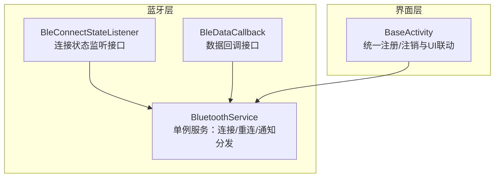
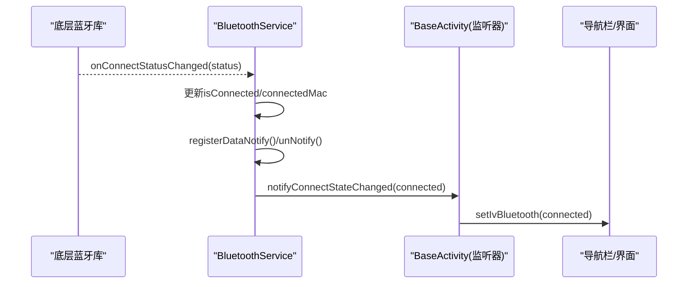
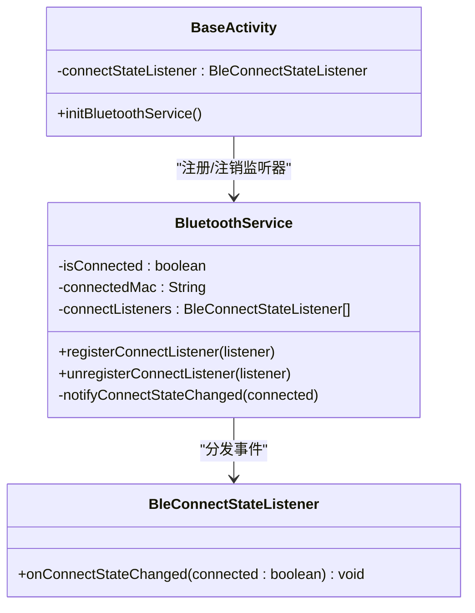
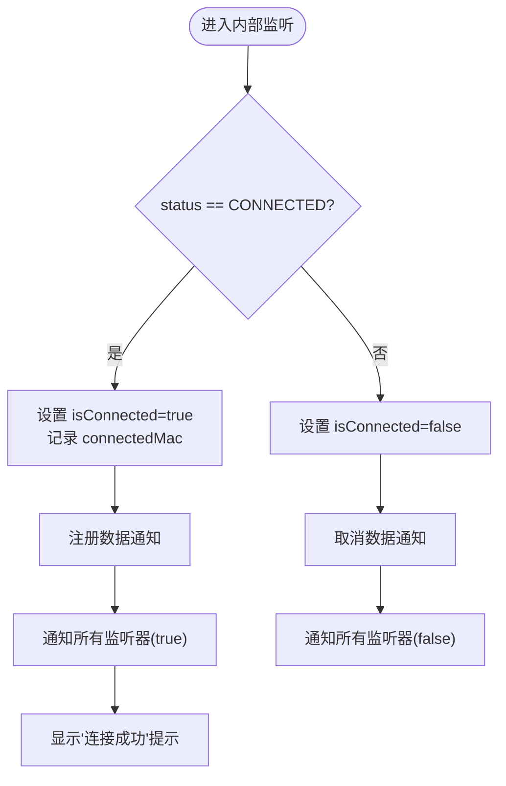
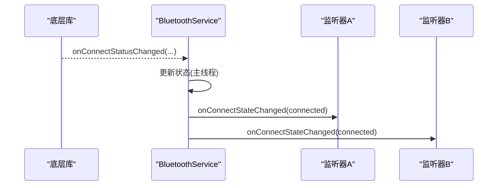
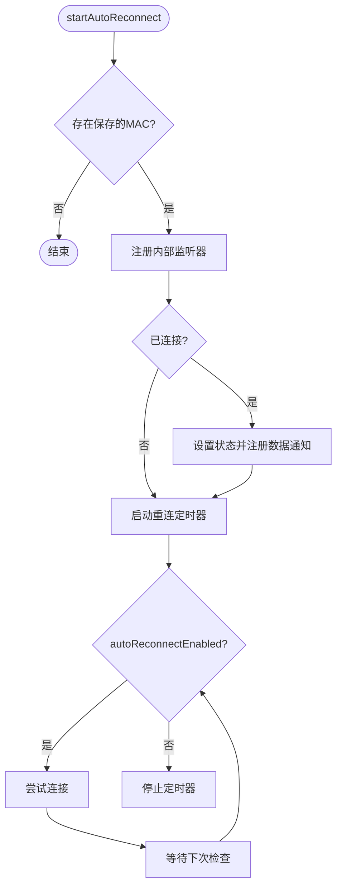
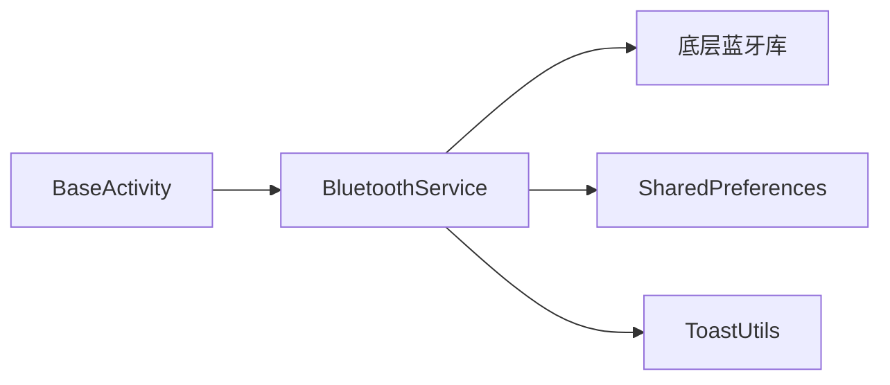
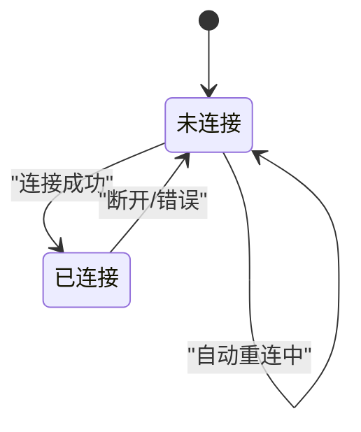

# 连接状态监控

<cite>
**本文引用的文件**
- [BleConnectStateListener.java](file://app/src/main/java/com/example/gtj_sd_dg240/bluetooth/BleConnectStateListener.java)
- [BluetoothService.java](file://app/src/main/java/com/example/gtj_sd_dg240/bluetooth/BluetoothService.java)
- [BleDataCallback.java](file://app/src/main/java/com/example/gtj_sd_dg240/bluetooth/BleDataCallback.java)
- [BaseActivity.java](file://app/src/main/java/com/example/gtj_sd_dg240/activity/start/BaseActivity.java)
- [CrashHandler.java](file://app/src/main/java/com/example/gtj_sd_dg240/utils/CrashHandler.java)
</cite>

## 目录
1. [简介](#简介)
2. [项目结构](#项目结构)
3. [核心组件](#核心组件)
4. [架构总览](#架构总览)
5. [详细组件分析](#详细组件分析)
6. [依赖关系分析](#依赖关系分析)
7. [性能与并发特性](#性能与并发特性)
8. [故障恢复与错误处理](#故障恢复与错误处理)
9. [使用示例与最佳实践](#使用示例与最佳实践)
10. [结论](#结论)

## 简介
本文件围绕蓝牙连接状态监控进行系统化说明，重点覆盖：
- BleConnectStateListener 接口设计与实现方式
- 状态变化检测机制、事件通知流程与状态同步策略
- 连接成功、断开、超时、错误等状态的处理逻辑
- 状态持久化、自动恢复机制、用户提示与日志记录
- 状态机设计、并发安全与故障恢复策略
- 具体监听示例：连接状态变化处理、错误恢复、UI 更新与系统资源管理

## 项目结构
与连接状态监控直接相关的代码集中在蓝牙模块与基础 Activity 中：
- 蓝牙层：定义监听接口、数据回调与统一服务管理
- 基础 Activity：提供统一的注册/注销生命周期管理与 UI 联动

图表来源
- [BleConnectStateListener.java:1-12](file://app/src/main/java/com/example/gtj_sd_dg240/bluetooth/BleConnectStateListener.java#L1-L12)
- [BleDataCallback.java:1-19](file://app/src/main/java/com/example/gtj_sd_dg240/bluetooth/BleDataCallback.java#L1-L19)
- [BluetoothService.java:16-52](file://app/src/main/java/com/example/gtj_sd_dg240/bluetooth/BluetoothService.java#L16-L52)
- [BaseActivity.java:187-266](file://app/src/main/java/com/example/gtj_sd_dg240/activity/start/BaseActivity.java#L187-L266)

章节来源
- [BluetoothService.java:16-52](file://app/src/main/java/com/example/gtj_sd_dg240/bluetooth/BluetoothService.java#L16-L52)
- [BaseActivity.java:187-266](file://app/src/main/java/com/example/gtj_sd_dg240/activity/start/BaseActivity.java#L187-L266)

## 核心组件
- BleConnectStateListener：定义连接状态变化的最小回调契约（已连接/已断开）。
- BluetoothService：单例服务，负责：
  - 内部连接状态监听（基于底层库）
  - 状态同步与广播给所有外部监听器
  - 自动重连定时器与数据通知注册/取消
  - 连接状态持久化（通过 SharedPreferences 保存 MAC）
- BleDataCallback：数据接收与通知注册失败的回调。
- BaseActivity：在 Activity 生命周期内统一注册/注销监听器，并驱动 UI 更新。

章节来源
- [BleConnectStateListener.java:1-12](file://app/src/main/java/com/example/gtj_sd_dg240/bluetooth/BleConnectStateListener.java#L1-L12)
- [BluetoothService.java:16-52](file://app/src/main/java/com/example/gtj_sd_dg240/bluetooth/BluetoothService.java#L16-L52)
- [BleDataCallback.java:1-19](file://app/src/main/java/com/example/gtj_sd_dg240/bluetooth/BleDataCallback.java#L1-L19)
- [BaseActivity.java:187-266](file://app/src/main/java/com/example/gtj_sd_dg240/activity/start/BaseActivity.java#L187-L266)

## 架构总览
整体采用“服务集中管理 + 多监听器订阅”的发布-订阅模式：
- 服务层维护当前连接状态与设备 MAC，并通过主线程 Handler 将状态变更分发给所有注册的监听器。
- 自动重连由定时器驱动，周期性检查连接状态并尝试重连。
- 数据通道在连接成功后注册，断开时取消，避免无效回调。

图表来源
- [BluetoothService.java:127-159](file://app/src/main/java/com/example/gtj_sd_dg240/bluetooth/BluetoothService.java#L127-L159)
- [BluetoothService.java:175-198](file://app/src/main/java/com/example/gtj_sd_dg240/bluetooth/BluetoothService.java#L175-L198)
- [BaseActivity.java:257-266](file://app/src/main/java/com/example/gtj_sd_dg240/activity/start/BaseActivity.java#L257-L266)

## 详细组件分析

### 连接状态监听接口与实现
- 接口职责：仅暴露 onConnectStateChanged(boolean connected)，用于向调用方传递连接/断开事件。
- 实现位置：BluetoothService 作为发布者，维护监听器列表并在状态变化时分发事件；BaseActivity 创建匿名监听器实例并注册到服务。

图表来源
- [BleConnectStateListener.java:1-12](file://app/src/main/java/com/example/gtj_sd_dg240/bluetooth/BleConnectStateListener.java#L1-L12)
- [BluetoothService.java:236-277](file://app/src/main/java/com/example/gtj_sd_dg240/bluetooth/BluetoothService.java#L236-L277)
- [BaseActivity.java:257-266](file://app/src/main/java/com/example/gtj_sd_dg240/activity/start/BaseActivity.java#L257-L266)

章节来源
- [BleConnectStateListener.java:1-12](file://app/src/main/java/com/example/gtj_sd_dg240/bluetooth/BleConnectStateListener.java#L1-L12)
- [BluetoothService.java:236-277](file://app/src/main/java/com/example/gtj_sd_dg240/bluetooth/BluetoothService.java#L236-L277)
- [BaseActivity.java:257-266](file://app/src/main/java/com/example/gtj_sd_dg240/activity/start/BaseActivity.java#L257-L266)

### 状态变化检测机制
- 内部监听器：BluetoothService 通过底层库的连接状态监听器捕获 STATUS_CONNECTED / STATUS_DISCONNECTED。
- 主线程分发：所有状态变更通过 mainHandler.post 切换到主线程，确保 UI 操作安全。
- 数据通道联动：连接成功时注册数据通知；断开时取消通知，避免内存泄漏与无效回调。

图表来源
- [BluetoothService.java:127-159](file://app/src/main/java/com/example/gtj_sd_dg240/bluetooth/BluetoothService.java#L127-L159)
- [BluetoothService.java:175-198](file://app/src/main/java/com/example/gtj_sd_dg240/bluetooth/BluetoothService.java#L175-L198)

章节来源
- [BluetoothService.java:127-159](file://app/src/main/java/com/example/gtj_sd_dg240/bluetooth/BluetoothService.java#L127-L159)
- [BluetoothService.java:175-198](file://app/src/main/java/com/example/gtj_sd_dg240/bluetooth/BluetoothService.java#L175-L198)

### 事件通知流程与状态同步策略
- 事件源：底层库回调 -> 内部监听器 -> 主线程分发 -> 外部监听器集合。
- 同步策略：
  - 使用 volatile 字段保存连接状态与 MAC，保证多线程可见性。
  - 监听器集合使用 CopyOnWriteArrayList，读写并发安全。
  - 注册监听器时立即推送当前状态，确保新注册者不丢失历史状态。

图表来源
- [BluetoothService.java:236-277](file://app/src/main/java/com/example/gtj_sd_dg240/bluetooth/BluetoothService.java#L236-L277)

章节来源
- [BluetoothService.java:236-277](file://app/src/main/java/com/example/gtj_sd_dg240/bluetooth/BluetoothService.java#L236-L277)

### 自动恢复机制与重连策略
- 启动时机：BaseActivity 初始化时根据标志位决定是否启用自动重连。
- 定时检查：每固定间隔检查是否已连接，未连接则发起连接请求。
- 停止条件：显式停止或销毁服务时移除定时器任务。

图表来源
- [BluetoothService.java:77-122](file://app/src/main/java/com/example/gtj_sd_dg240/bluetooth/BluetoothService.java#L77-L122)
- [BluetoothService.java:200-234](file://app/src/main/java/com/example/gtj_sd_dg240/bluetooth/BluetoothService.java#L200-L234)
- [BaseActivity.java:187-198](file://app/src/main/java/com/example/gtj_sd_dg240/activity/start/BaseActivity.java#L187-L198)

章节来源
- [BluetoothService.java:77-122](file://app/src/main/java/com/example/gtj_sd_dg240/bluetooth/BluetoothService.java#L77-L122)
- [BluetoothService.java:200-234](file://app/src/main/java/com/example/gtj_sd_dg240/bluetooth/BluetoothService.java#L200-L234)
- [BaseActivity.java:187-198](file://app/src/main/java/com/example/gtj_sd_dg240/activity/start/BaseActivity.java#L187-L198)

### 状态持久化
- 存储位置：SharedPreferences 保存上次连接的 MAC 地址。
- 读取时机：启动自动重连时读取，若为空则跳过重连流程。
- 建议：可在连接成功/失败时写入最近一次尝试的 MAC，提升恢复成功率。

章节来源
- [BluetoothService.java:54-59](file://app/src/main/java/com/example/gtj_sd_dg240/bluetooth/BluetoothService.java#L54-L59)
- [BluetoothService.java:87-108](file://app/src/main/java/com/example/gtj_sd_dg240/bluetooth/BluetoothService.java#L87-L108)

### 用户提示与日志记录
- 用户提示：连接成功时通过 Toast 提示；错误场景可结合业务扩展提示。
- 日志记录：崩溃收集与异常上报由全局 CrashHandler 负责，便于定位问题。

章节来源
- [BluetoothService.java:134-159](file://app/src/main/java/com/example/gtj_sd_dg240/bluetooth/BluetoothService.java#L134-L159)
- [CrashHandler.java:80-122](file://app/src/main/java/com/example/gtj_sd_dg240/utils/CrashHandler.java#L80-L122)

## 依赖关系分析
- BluetoothService 依赖：
  - 底层蓝牙库：连接状态监听、数据通知、连接/断开控制
  - SharedPreferences：持久化 MAC
  - ToastUtils：用户提示
- BaseActivity 依赖：
  - BluetoothService：注册/注销监听器与数据回调
  - UI 组件：导航栏图标更新

图表来源
- [BaseActivity.java:187-266](file://app/src/main/java/com/example/gtj_sd_dg240/activity/start/BaseActivity.java#L187-L266)
- [BluetoothService.java:1-14](file://app/src/main/java/com/example/gtj_sd_dg240/bluetooth/BluetoothService.java#L1-L14)

章节来源
- [BaseActivity.java:187-266](file://app/src/main/java/com/example/gtj_sd_dg240/activity/start/BaseActivity.java#L187-L266)
- [BluetoothService.java:1-14](file://app/src/main/java/com/example/gtj_sd_dg240/bluetooth/BluetoothService.java#L1-L14)

## 性能与并发特性
- 线程模型：
  - 主线程分发：所有状态变更与 UI 更新在主线程执行，避免竞态与非法跨线程 UI 操作。
  - 定时器：使用 Handler.postDelayed 实现周期检查，避免阻塞主线程。
- 数据结构：
  - CopyOnWriteArrayList：监听器列表读多写少，遍历安全且无锁开销。
  - volatile 状态：保证多线程下状态可见性。
- 资源管理：
  - 断开时及时取消数据通知，防止内存泄漏。
  - 销毁时清理定时器与监听器，释放资源。

章节来源
- [BluetoothService.java:23-40](file://app/src/main/java/com/example/gtj_sd_dg240/bluetooth/BluetoothService.java#L23-L40)
- [BluetoothService.java:175-198](file://app/src/main/java/com/example/gtj_sd_dg240/bluetooth/BluetoothService.java#L175-L198)
- [BluetoothService.java:200-234](file://app/src/main/java/com/example/gtj_sd_dg240/bluetooth/BluetoothService.java#L200-L234)
- [BaseActivity.java:309-335](file://app/src/main/java/com/example/gtj_sd_dg240/activity/start/BaseActivity.java#L309-L335)

## 故障恢复与错误处理
- 连接成功：
  - 更新状态、注册数据通知、通知监听器、用户提示。
- 连接断开：
  - 更新状态、取消数据通知、通知监听器。
- 自动重连：
  - 定时器周期性检查并尝试连接，直到成功或停止。
- 通知注册失败：
  - 当数据通知注册返回非零码时，回调 BleDataCallback.onNotifyRegisterFailed，供上层做降级或重试处理。
- 崩溃与异常：
  - 全局 CrashHandler 收集异常信息并提示，辅助定位问题。

图表来源
- [BluetoothService.java:134-159](file://app/src/main/java/com/example/gtj_sd_dg240/bluetooth/BluetoothService.java#L134-L159)
- [BluetoothService.java:188-198](file://app/src/main/java/com/example/gtj_sd_dg240/bluetooth/BluetoothService.java#L188-L198)
- [BluetoothService.java:200-234](file://app/src/main/java/com/example/gtj_sd_dg240/bluetooth/BluetoothService.java#L200-L234)

章节来源
- [BluetoothService.java:134-159](file://app/src/main/java/com/example/gtj_sd_dg240/bluetooth/BluetoothService.java#L134-L159)
- [BluetoothService.java:188-198](file://app/src/main/java/com/example/gtj_sd_dg240/bluetooth/BluetoothService.java#L188-L198)
- [BluetoothService.java:200-234](file://app/src/main/java/com/example/gtj_sd_dg240/bluetooth/BluetoothService.java#L200-L234)
- [CrashHandler.java:80-122](file://app/src/main/java/com/example/gtj_sd_dg240/utils/CrashHandler.java#L80-L122)

## 使用示例与最佳实践

### 连接状态变化处理
- 在 BaseActivity 中创建 BleConnectStateListener 实例并注册到 BluetoothService。
- 在回调中更新 UI（如导航栏蓝牙图标），并根据需要触发业务逻辑。

章节来源
- [BaseActivity.java:257-266](file://app/src/main/java/com/example/gtj_sd_dg240/activity/start/BaseActivity.java#L257-L266)

### 错误状态恢复
- 利用自动重连机制：在 BaseActivity 初始化时开启自动重连，服务会周期性尝试连接。
- 对数据通知注册失败：实现 BleDataCallback.onNotifyRegisterFailed，进行重试或降级处理。

章节来源
- [BaseActivity.java:187-198](file://app/src/main/java/com/example/gtj_sd_dg240/activity/start/BaseActivity.java#L187-L198)
- [BluetoothService.java:188-198](file://app/src/main/java/com/example/gtj_sd_dg240/bluetooth/BluetoothService.java#L188-L198)

### 用户界面更新
- 在连接状态回调中更新 UI 元素（例如导航栏图标），确保仅在页面可见时更新，避免空指针或无效绘制。

章节来源
- [BaseActivity.java:257-266](file://app/src/main/java/com/example/gtj_sd_dg240/activity/start/BaseActivity.java#L257-L266)

### 系统资源管理
- 在 onDestroy 中注销监听器与数据回调，关闭线程池，取消 Toast，避免内存泄漏与资源占用。

章节来源
- [BaseActivity.java:309-335](file://app/src/main/java/com/example/gtj_sd_dg240/activity/start/BaseActivity.java#L309-L335)

## 结论
该连接状态监控方案以 BluetoothService 为核心，通过内部监听器捕获底层连接事件，并以主线程分发的方式安全地通知所有外部监听器。配合自动重连、状态持久化、数据通道联动与完善的资源管理，实现了高可用、易扩展的蓝牙连接状态监控体系。建议在业务侧充分利用 BaseActivity 提供的统一入口，遵循生命周期管理规范，确保 UI 与资源的正确管理。