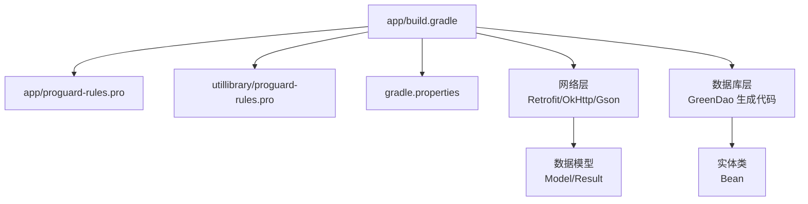
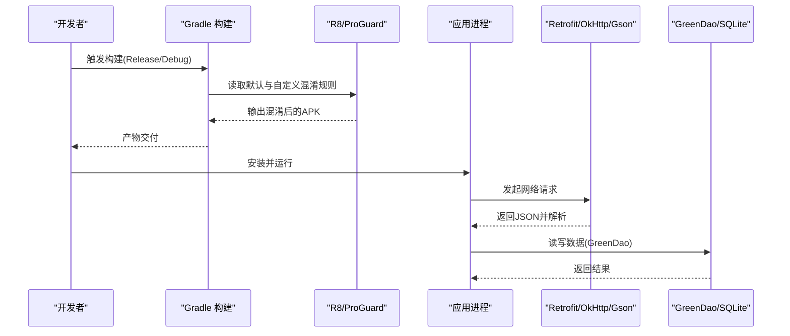
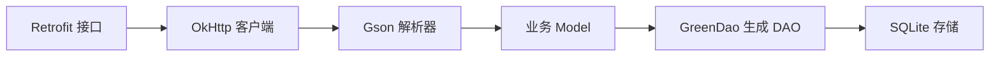

# 代码混淆

<cite>
**本文引用的文件**
- [app/build.gradle](file://app/build.gradle)
- [app/proguard-rules.pro](file://app/proguard-rules.pro)
- [utillibrary/proguard-rules.pro](file://utillibrary/proguard-rules.pro)
- [gradle.properties](file://gradle.properties)
- [RetrofitPresenter.java](file://app/src/main/java/com/example/gtj_sd_dg240/net/RetrofitPresenter.java)
- [RetrofitInterfaceServiceUrl.java](file://app/src/main/java/com/example/gtj_sd_dg240/net/RetrofitInterfaceServiceUrl.java)
- [CustomGsonConverterFactory.java](file://app/src/main/java/com/example/gtj_sd_dg240/net/CustomGsonConverterFactory.java)
- [CustomGsonResponseBodyConverter.java](file://app/src/main/java/com/example/gtj_sd_dg240/net/CustomGsonResponseBodyConverter.java)
- [DaoMaster.java](file://app/src/main/java/com/example/gtj_sd_dg240/functions/database/greenDao/db/DaoMaster.java)
- [DaoSession.java](file://app/src/main/java/com/example/gtj_sd_dg240/functions/database/greenDao/db/DaoSession.java)
- [ProjectBeanDao.java](file://app/src/main/java/com/example/gtj_sd_dg240/functions/database/greenDao/db/ProjectBeanDao.java)
- [ConfigBeanDao.java](file://app/src/main/java/com/example/gtj_sd_dg240/functions/database/greenDao/db/ConfigBeanDao.java)
- [ZoneBeanDao.java](file://app/src/main/java/com/example/gtj_sd_dg240/functions/database/greenDao/db/ZoneBeanDao.java)
- [RebarMinMaxBeanDao.java](file://app/src/main/java/com/example/gtj_sd_dg240/functions/database/greenDao/db/RebarMinMaxBeanDao.java)
- [GreenDaoHelper.java](file://app/src/main/java/com/example/gtj_sd_dg240/storage/GreenDaoHelper.java)
</cite>

## 目录
1. [简介](#简介)
2. [项目结构](#项目结构)
3. [核心组件](#核心组件)
4. [架构总览](#架构总览)
5. [详细组件分析](#详细组件分析)
6. [依赖分析](#依赖分析)
7. [性能考虑](#性能考虑)
8. [故障排查指南](#故障排查指南)
9. [结论](#结论)
10. [附录](#附录)

## 简介
本文件面向本项目（Android）的“代码混淆”主题，系统阐述 ProGuard/R8 的工作原理、配置方式与规则定义方法；结合项目中 Retrofit、GreenDao、Gson 等第三方库的实际使用，给出针对性的混淆配置建议；并提供混淆后的调试技巧与常见问题解决方案。文档同时基于仓库中的构建脚本与实际代码进行说明，确保可落地执行。

## 项目结构
- 应用模块位于 app，包含业务代码、网络层（Retrofit + OkHttp + Gson）、数据库层（GreenDao 生成代码）、工具库（utillibrary）。
- 混淆相关：
  - 构建开关与默认混淆规则引用在 app/build.gradle 中。
  - 自定义混淆规则位于 app/proguard-rules.pro 与 utillibrary/proguard-rules.pro。
  - Gradle 属性 gradle.properties 包含 JVM 与构建优化参数。

图表来源
- [app/build.gradle:28-38](file://app/build.gradle#L28-L38)
- [app/proguard-rules.pro:1-22](file://app/proguard-rules.pro#L1-L22)
- [utillibrary/proguard-rules.pro:1-22](file://utillibrary/proguard-rules.pro#L1-L22)
- [gradle.properties:1-36](file://gradle.properties#L1-L36)

章节来源
- [app/build.gradle:28-38](file://app/build.gradle#L28-L38)
- [app/proguard-rules.pro:1-22](file://app/proguard-rules.pro#L1-L22)
- [utillibrary/proguard-rules.pro:1-22](file://utillibrary/proguard-rules.pro#L1-L22)
- [gradle.properties:1-36](file://gradle.properties#L1-L36)

## 核心组件
- 构建与混淆开关
  - release/debug 均引用了默认的 proguard-android-optimize.txt 与项目自定义规则 proguard-rules.pro。
  - 当前 minifyEnabled 为 false，意味着默认不启用混淆；如需启用，需在对应 buildType 中设置为 true。
- 网络层
  - 使用 Retrofit + OkHttp + Gson 进行网络请求与响应解析。
  - 自定义 Converter 用于统一处理响应体并抛出业务异常。
- 数据库层
  - GreenDao 通过插件自动生成 DaoMaster、DaoSession 与各实体 DAO。
  - 实体类通过注解驱动生成映射与查询逻辑。

章节来源
- [app/build.gradle:28-38](file://app/build.gradle#L28-L38)
- [RetrofitPresenter.java:25-36](file://app/src/main/java/com/example/gtj_sd_dg240/net/RetrofitPresenter.java#L25-L36)
- [CustomGsonConverterFactory.java:13-34](file://app/src/main/java/com/example/gtj_sd_dg240/net/CustomGsonConverterFactory.java#L13-L34)
- [DaoMaster.java:19-29](file://app/src/main/java/com/example/gtj_sd_dg240/functions/database/greenDao/db/DaoMaster.java#L19-L29)
- [DaoSession.java:30-67](file://app/src/main/java/com/example/gtj_sd_dg240/functions/database/greenDao/db/DaoSession.java#L30-L67)

## 架构总览
下图展示了从构建到运行时涉及的关键环节：Gradle 构建阶段读取混淆配置，编译后由 R8/ProGuard 对字节码进行压缩、优化与混淆；运行期网络层与数据库层按约定访问反射或生成的代码。

图表来源
- [app/build.gradle:28-38](file://app/build.gradle#L28-L38)
- [RetrofitPresenter.java:25-36](file://app/src/main/java/com/example/gtj_sd_dg240/net/RetrofitPresenter.java#L25-L36)
- [DaoMaster.java:19-29](file://app/src/main/java/com/example/gtj_sd_dg240/functions/database/greenDao/db/DaoMaster.java#L19-L29)

## 详细组件分析

### 混淆工作原理与配置要点
- 工作流程
  - 构建时，Gradle 调用 R8/ProGuard，依据默认规则与自定义规则对字节码进行压缩、优化、混淆。
  - 若未正确保留反射使用的类/成员，会导致运行时 ClassNotFound/NoSuchMethodException。
- 关键配置位置
  - 构建开关与规则引用：app/build.gradle 的 buildTypes 中设置 minifyEnabled 与 proguardFiles。
  - 自定义规则：app/proguard-rules.pro、utillibrary/proguard-rules.pro。
  - 构建优化：gradle.properties 中的 JVM 与并行构建参数有助于提升构建效率。

章节来源
- [app/build.gradle:28-38](file://app/build.gradle#L28-L38)
- [app/proguard-rules.pro:1-22](file://app/proguard-rules.pro#L1-L22)
- [utillibrary/proguard-rules.pro:1-22](file://utillibrary/proguard-rules.pro#L1-L22)
- [gradle.properties:1-36](file://gradle.properties#L1-L36)

### 混淆规则定义方法（保留类、方法、字段）
- 常见保留场景
  - 反射调用：如 Gson 序列化/反序列化、EventBus 事件类、动态代理等。
  - Android 组件：Activity、Service、BroadcastReceiver、ContentProvider 等需保持声明一致。
  - 第三方库：需要保留其 API 入口、回调接口、注解处理器生成的类等。
- 规则语法要点
  - 保留类：-keep class ... { *; }
  - 保留成员：-keepclassmembers class ... { ... ; }
  - 保留注解：-keepattributes Annotation, Signature, SourceFile, LineNumberTable
  - 忽略警告：-dontwarn ...（谨慎使用，仅对已知安全的三方库）
- 在本项目的落地建议
  - 网络层：保留 Gson 类型适配器、自定义 Converter、以及被 JSON 映射的 Model 类。
  - 数据库层：保留 GreenDao 生成的 DAO 与实体类，避免反射或命名约定失效。
  - 其他：若引入 EventBus、ViewBinding、AIDL、JNI 等，需按需保留。

章节来源
- [CustomGsonConverterFactory.java:13-34](file://app/src/main/java/com/example/gtj_sd_dg240/net/CustomGsonConverterFactory.java#L13-L34)
- [CustomGsonResponseBodyConverter.java:11-36](file://app/src/main/java/com/example/gtj_sd_dg240/net/CustomGsonResponseBodyConverter.java#L11-L36)
- [DaoMaster.java:19-29](file://app/src/main/java/com/example/gtj_sd_dg240/functions/database/greenDao/db/DaoMaster.java#L19-L29)
- [DaoSession.java:30-67](file://app/src/main/java/com/example/gtj_sd_dg240/functions/database/greenDao/db/DaoSession.java#L30-L67)

### 第三方库混淆配置示例（Retrofit、GreenDao、Gson）
- Retrofit/OkHttp/Gson
  - 保留 Gson 类型适配器与自定义 Converter。
  - 保留被 JSON 映射的 Model 类（可通过 @Keep 或规则保留）。
  - 日志拦截器与 OkHttp 内部类通常无需额外保留。
- GreenDao
  - 保留所有生成的 DAO 与实体类。
  - 保留 DaoMaster、DaoSession 及其构造与初始化流程。
  - 若使用升级迁移工具，需保留相关监听与表创建/删除方法。
- 其他常用库（通用建议）
  - EventBus：保留事件类与订阅方法。
  - ViewBinding/DataBinding：保留布局绑定类与变量名。
  - AIDL/JNI：保留接口与 native 方法签名。

章节来源
- [RetrofitInterfaceServiceUrl.java:16-30](file://app/src/main/java/com/example/gtj_sd_dg240/net/RetrofitInterfaceServiceUrl.java#L16-L30)
- [CustomGsonConverterFactory.java:13-34](file://app/src/main/java/com/example/gtj_sd_dg240/net/CustomGsonConverterFactory.java#L13-L34)
- [CustomGsonResponseBodyConverter.java:11-36](file://app/src/main/java/com/example/gtj_sd_dg240/net/CustomGsonResponseBodyConverter.java#L11-L36)
- [DaoMaster.java:19-29](file://app/src/main/java/com/example/gtj_sd_dg240/functions/database/greenDao/db/DaoMaster.java#L19-L29)
- [DaoSession.java:30-67](file://app/src/main/java/com/example/gtj_sd_dg240/functions/database/greenDao/db/DaoSession.java#L30-L67)

### 混淆后的调试技巧
- 保留行号与源码信息
  - 启用 SourceFile、LineNumberTable 以生成可读堆栈。
  - 可选重命名源文件名以隐藏真实路径。
- 生成映射文件
  - 开启混淆后，Gradle 会生成 mapping.txt，用于将混淆后的堆栈还原为原始符号。
- 本地复现问题
  - 使用相同版本与配置的 Release 包进行复现。
  - 借助 mapping.txt 与日志定位具体类与方法。

章节来源
- [app/proguard-rules.pro:15-21](file://app/proguard-rules.pro#L15-L21)
- [app/build.gradle:28-38](file://app/build.gradle#L28-L38)

### 常见问题与解决方案
- 启动崩溃（ClassNotFoundException/NoSuchMethodException）
  - 检查是否遗漏保留反射使用的类/成员。
  - 针对 Gson 序列化的 Model 添加保留规则或使用 @Keep。
- 网络解析失败
  - 确认 Gson 转换器与 Model 未被误删或改名。
  - 检查自定义 Converter 是否被保留。
- 数据库操作异常
  - 确认 GreenDao 生成的 DAO 与实体类未被混淆破坏。
  - 检查表创建/升级逻辑是否完整保留。
- 构建警告过多
  - 对已知安全的三方库使用 -dontwarn 减少噪音，但需谨慎评估风险。

章节来源
- [CustomGsonConverterFactory.java:13-34](file://app/src/main/java/com/example/gtj_sd_dg240/net/CustomGsonConverterFactory.java#L13-L34)
- [CustomGsonResponseBodyConverter.java:11-36](file://app/src/main/java/com/example/gtj_sd_dg240/net/CustomGsonResponseBodyConverter.java#L11-L36)
- [DaoMaster.java:19-29](file://app/src/main/java/com/example/gtj_sd_dg240/functions/database/greenDao/db/DaoMaster.java#L19-L29)
- [DaoSession.java:30-67](file://app/src/main/java/com/example/gtj_sd_dg240/functions/database/greenDao/db/DaoSession.java#L30-L67)

## 依赖分析
- 网络层依赖
  - Retrofit 负责接口定义与请求调度。
  - OkHttp 提供底层 HTTP 客户端与拦截器。
  - Gson 负责 JSON 序列化/反序列化，并通过自定义 Converter 统一处理响应。
- 数据库层依赖
  - GreenDao 插件生成 DAO 与实体映射，运行时通过 DaoMaster/DaoSession 管理会话与事务。
- 混淆影响面
  - 任何通过反射访问的类/成员都需要显式保留。
  - 生成的代码（如 GreenDao）需保持结构与命名约定不被破坏。

图表来源
- [RetrofitInterfaceServiceUrl.java:16-30](file://app/src/main/java/com/example/gtj_sd_dg240/net/RetrofitInterfaceServiceUrl.java#L16-L30)
- [RetrofitPresenter.java:25-36](file://app/src/main/java/com/example/gtj_sd_dg240/net/RetrofitPresenter.java#L25-L36)
- [CustomGsonConverterFactory.java:13-34](file://app/src/main/java/com/example/gtj_sd_dg240/net/CustomGsonConverterFactory.java#L13-L34)
- [DaoMaster.java:19-29](file://app/src/main/java/com/example/gtj_sd_dg240/functions/database/greenDao/db/DaoMaster.java#L19-L29)

章节来源
- [RetrofitInterfaceServiceUrl.java:16-30](file://app/src/main/java/com/example/gtj_sd_dg240/net/RetrofitInterfaceServiceUrl.java#L16-L30)
- [RetrofitPresenter.java:25-36](file://app/src/main/java/com/example/gtj_sd_dg240/net/RetrofitPresenter.java#L25-L36)
- [CustomGsonConverterFactory.java:13-34](file://app/src/main/java/com/example/gtj_sd_dg240/net/CustomGsonConverterFactory.java#L13-L34)
- [DaoMaster.java:19-29](file://app/src/main/java/com/example/gtj_sd_dg240/functions/database/greenDao/db/DaoMaster.java#L19-L29)

## 性能考虑
- 构建性能
  - 启用并行构建与构建缓存可减少构建时间。
  - 合理设置 JVM 内存与 GC 参数，避免 OOM。
- 运行时性能
  - 合理使用 -optimizations 与 -assumenosideeffects 需谨慎，避免副作用误判。
  - 对频繁反射的场景，尽量通过直接调用或接口抽象降低反射开销。

章节来源
- [gradle.properties:1-36](file://gradle.properties#L1-L36)
- [app/build.gradle:28-38](file://app/build.gradle#L28-L38)

## 故障排查指南
- 启用行号与源码信息
  - 在规则文件中启用 SourceFile、LineNumberTable，便于定位问题。
- 使用映射文件还原堆栈
  - 从构建产物中获取 mapping.txt，配合崩溃日志还原原始类名与方法名。
- 逐步缩小范围
  - 临时关闭部分优化或放宽保留规则，验证是否为混淆导致的问题。
- 关注第三方库更新
  - 升级依赖后重新评估混淆规则，避免因 API 变更引发兼容性问题。

章节来源
- [app/proguard-rules.pro:15-21](file://app/proguard-rules.pro#L15-L21)
- [app/build.gradle:28-38](file://app/build.gradle#L28-L38)

## 结论
本项目已具备完整的混淆基础设施：构建脚本引用默认与自定义规则，网络层与数据库层分别基于 Retrofit/Gson 与 GreenDao。为确保混淆安全，应重点保留反射相关的类与成员，尤其是 Gson 映射的 Model、自定义 Converter 以及 GreenDao 生成的 DAO 与实体。建议在发布前充分测试，并结合行号信息与映射文件进行高效排障。

## 附录
- 快速检查清单
  - 确认 minifyEnabled 在目标构建类型中按需开启。
  - 确认所有反射使用的类/成员均已保留。
  - 确认 GreenDao 生成的代码未被破坏。
  - 确认 Gson 转换器与 Model 未被误删。
  - 启用行号信息并生成映射文件。
- 参考实现位置
  - 网络层：Retrofit 接口与 Presenter、Gson 自定义转换器。
  - 数据库层：GreenDao 生成的 DaoMaster、DaoSession 与各 DAO。

章节来源
- [RetrofitInterfaceServiceUrl.java:16-30](file://app/src/main/java/com/example/gtj_sd_dg240/net/RetrofitInterfaceServiceUrl.java#L16-L30)
- [RetrofitPresenter.java:25-36](file://app/src/main/java/com/example/gtj_sd_dg240/net/RetrofitPresenter.java#L25-L36)
- [CustomGsonConverterFactory.java:13-34](file://app/src/main/java/com/example/gtj_sd_dg240/net/CustomGsonConverterFactory.java#L13-L34)
- [CustomGsonResponseBodyConverter.java:11-36](file://app/src/main/java/com/example/gtj_sd_dg240/net/CustomGsonResponseBodyConverter.java#L11-L36)
- [DaoMaster.java:19-29](file://app/src/main/java/com/example/gtj_sd_dg240/functions/database/greenDao/db/DaoMaster.java#L19-L29)
- [DaoSession.java:30-67](file://app/src/main/java/com/example/gtj_sd_dg240/functions/database/greenDao/db/DaoSession.java#L30-L67)
- [ProjectBeanDao.java:18-40](file://app/src/main/java/com/example/gtj_sd_dg240/functions/database/greenDao/db/ProjectBeanDao.java#L18-L40)
- [ConfigBeanDao.java:18-20](file://app/src/main/java/com/example/gtj_sd_dg240/functions/database/greenDao/db/ConfigBeanDao.java#L18-L20)
- [ZoneBeanDao.java:21-23](file://app/src/main/java/com/example/gtj_sd_dg240/functions/database/greenDao/db/ZoneBeanDao.java#L21-L23)
- [RebarMinMaxBeanDao.java:20-22](file://app/src/main/java/com/example/gtj_sd_dg240/functions/database/greenDao/db/RebarMinMaxBeanDao.java#L20-L22)
- [GreenDaoHelper.java:10-42](file://app/src/main/java/com/example/gtj_sd_dg240/storage/GreenDaoHelper.java#L10-L42)