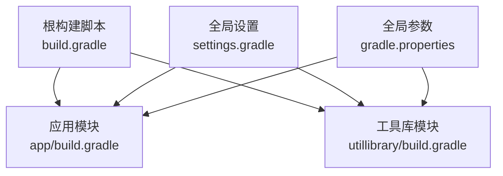
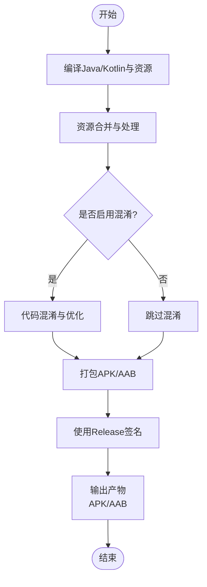
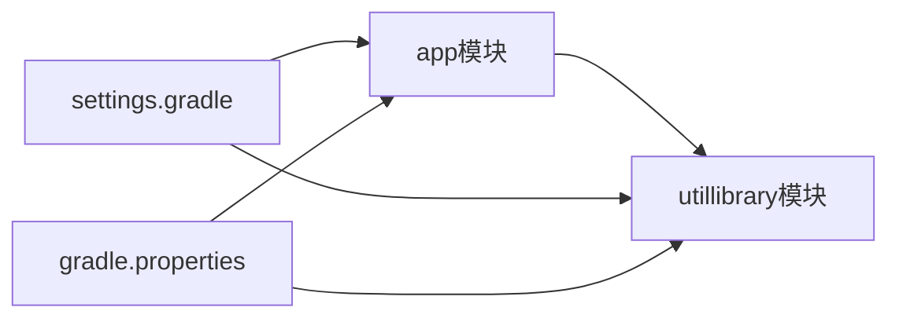

# 发布构建

<cite>
**本文引用的文件**
- [build.gradle](file://build.gradle)
- [app/build.gradle](file://app/build.gradle)
- [gradle.properties](file://gradle.properties)
- [settings.gradle](file://settings.gradle)
- [app/proguard-rules.pro](file://app/proguard-rules.pro)
- [utillibrary/build.gradle](file://utillibrary/build.gradle)
- [app/src/main/AndroidManifest.xml](file://app/src/main/AndroidManifest.xml)
</cite>

## 目录
1. [简介](#简介)
2. [项目结构](#项目结构)
3. [核心组件](#核心组件)
4. [架构总览](#架构总览)
5. [详细组件分析](#详细组件分析)
6. [依赖分析](#依赖分析)
7. [性能考虑](#性能考虑)
8. [故障排查指南](#故障排查指南)
9. [结论](#结论)
10. [附录](#附录)

## 简介
本指南面向需要输出Release版本APK/AAB的开发者与CI工程师，覆盖以下主题：
- Release构建类型配置、优化选项与资源压缩
- APK与AAB格式的区别与选择标准
- 多渠道打包配置方法与自动化构建脚本
- 构建性能优化、增量构建与并行构建技巧
- 签名与产物管理最佳实践

## 项目结构
本项目为多模块Android工程，包含应用模块与工具库模块。根级Gradle脚本统一插件版本，子模块分别定义自身构建类型、签名与依赖。

图表来源
- [build.gradle:1-14](file://build.gradle#L1-L14)
- [settings.gradle:1-42](file://settings.gradle#L1-L42)

章节来源
- [build.gradle:1-14](file://build.gradle#L1-L14)
- [settings.gradle:1-42](file://settings.gradle#L1-L42)

## 核心组件
- 构建类型与签名
  - 应用模块定义了release与debug两种构建类型，并配置了release签名信息。
  - 工具库模块定义了release构建类型，未配置签名（由上层应用统一签名）。
- 编译与特性开关
  - Java版本设置为17；启用ViewBinding与BuildConfig；关闭不必要的特性以减小体积与提升速度。
- 代码混淆与资源裁剪
  - release开启混淆规则引用；当前未启用minify，可按需开启。
- Lint与打包策略
  - 关闭lint对release的检查与报错；排除部分META-INF冲突文件。

章节来源
- [app/build.gradle:19-39](file://app/build.gradle#L19-L39)
- [app/build.gradle:41-76](file://app/build.gradle#L41-L76)
- [utillibrary/build.gradle:16-21](file://utillibrary/build.gradle#L16-L21)
- [app/proguard-rules.pro:1-22](file://app/proguard-rules.pro#L1-L22)

## 架构总览
下图展示从源码到可安装包的构建流程，包括编译、混淆、资源处理、签名与产物生成。

图表来源
- [app/build.gradle:28-39](file://app/build.gradle#L28-L39)
- [app/build.gradle:53-60](file://app/build.gradle#L53-L60)

## 详细组件分析

### 构建类型与签名配置
- 应用模块
  - release构建类型：已配置签名；默认未开启混淆；引用通用与自定义混淆规则。
  - debug构建类型：同样引用混淆规则但关闭混淆；便于调试时保留符号。
- 工具库模块
  - release构建类型：引用混淆规则但未开启混淆；由应用模块统一签名。

建议
- 在正式Release中开启混淆与资源压缩，以获得更小的包体与更强的安全性。
- 将密钥与密码从脚本中移除，改用环境变量或密钥管理服务注入。

章节来源
- [app/build.gradle:19-39](file://app/build.gradle#L19-L39)
- [utillibrary/build.gradle:16-21](file://utillibrary/build.gradle#L16-L21)

### 编译与特性开关
- Java版本：17
- 启用的构建特性：ViewBinding、BuildConfig
- 禁用的特性：AIDL、RenderScript、resValues、shaders（减少编译时间与产物体积）

章节来源
- [app/build.gradle:41-76](file://app/build.gradle#L41-L76)

### 资源与依赖处理
- JNI库打包：禁用旧版JNI打包方式，采用新版打包策略。
- 资源排除：排除第三方库中的重复或冲突META-INF条目，避免打包失败。
- 依赖：应用模块依赖工具库模块，二者均声明各自依赖。

章节来源
- [app/build.gradle:53-60](file://app/build.gradle#L53-L60)
- [app/build.gradle:86-144](file://app/build.gradle#L86-L144)
- [utillibrary/build.gradle:43-51](file://utillibrary/build.gradle#L43-L51)

### 清单与权限
- 应用入口、Activity与Service声明完整。
- 蓝牙、存储、相机、网络等权限按系统版本条件声明。
- FileProvider用于文件分享与安装。

章节来源
- [app/src/main/AndroidManifest.xml:1-182](file://app/src/main/AndroidManifest.xml#L1-L182)

## 依赖分析
- 模块关系
  - app模块依赖utillibrary模块。
- 仓库与插件
  - 通过settings.gradle集中管理仓库与插件源，确保一致性与可维护性。
- Gradle全局参数
  - 启用并行构建、构建缓存、按需配置与VFS监控，显著提升构建速度。

图表来源
- [settings.gradle:1-42](file://settings.gradle#L1-L42)
- [gradle.properties:1-36](file://gradle.properties#L1-L36)

章节来源
- [settings.gradle:1-42](file://settings.gradle#L1-L42)
- [gradle.properties:1-36](file://gradle.properties#L1-L36)

## 性能考虑
- 并行与缓存
  - 已启用并行构建、构建缓存、按需配置与文件系统监视，适合本地与CI环境。
- 增量构建
  - 保持稳定的依赖版本与构建脚本；避免频繁修改defaultConfig与compileSdk。
- 资源与代码优化
  - 建议在Release开启混淆与资源压缩；清理无用资源与依赖。
- JVM与内存
  - 合理设置JVM堆大小与元空间，避免OOM导致构建失败。

章节来源
- [gradle.properties:1-36](file://gradle.properties#L1-L36)
- [app/build.gradle:28-39](file://app/build.gradle#L28-L39)

## 故障排查指南
- 构建失败常见原因
  - 签名配置错误：检查keystore路径、别名与密码是否正确。
  - 依赖冲突：检查META-INF重复条目，必要时在packaging中排除。
  - 权限与清单问题：确认目标SDK与权限声明兼容。
- 定位方法
  - 查看Gradle任务输出与日志；逐步缩小范围至具体模块或依赖。
  - 临时关闭混淆或Lint，快速定位是否为混淆或规则导致的问题。

章节来源
- [app/build.gradle:19-39](file://app/build.gradle#L19-L39)
- [app/build.gradle:53-67](file://app/build.gradle#L53-L67)
- [app/proguard-rules.pro:1-22](file://app/proguard-rules.pro#L1-L22)

## 结论
本项目已具备清晰的模块化结构与基础构建配置。为达到生产级发布要求，建议：
- 在Release中开启混淆与资源压缩，并完善混淆规则。
- 将签名信息外置并通过安全方式注入。
- 引入多渠道与自动化脚本，实现一键构建与产物归档。
- 持续优化构建性能与稳定性，配合CI流水线进行质量门禁。

## 附录

### APK与AAB的区别与选择
- APK
  - 可直接安装到设备；适用于内部测试、私有分发或特定渠道分发。
  - 包体通常更大，因为包含所有ABI与资源。
- AAB
  - Google Play推荐格式；支持动态下发与按需下载，显著减小用户实际下载体积。
  - 不适合直接安装，需通过Play商店或转换工具生成适配设备的APK。
- 选择标准
  - 上架Google Play：必须使用AAB。
  - 企业内部分发或私有渠道：可使用APK；若追求更小体积也可用AAB+分发工具。

[本节为概念说明，不直接分析具体文件]

### 多渠道打包配置方法
- 基于productFlavors的多渠道
  - 在应用模块中定义多个flavor，每个渠道可独立设置applicationIdSuffix、versionNameSuffix、资源与配置。
  - 结合buildTypes可组合出更多变体（如release/debug x 渠道）。
- 基于manifestPlaceholders的动态替换
  - 在清单中使用占位符，在构建时注入不同值（如渠道标识、API Key等）。
- 基于gradle.properties的外部化配置
  - 将渠道相关变量放在外部文件中，便于CI注入与环境隔离。

[本节为概念说明，不直接分析具体文件]

### 自动化构建脚本示例（思路）
- 本地脚本
  - 执行clean、assembleRelease或bundleRelease，输出APK/AAB到指定目录。
  - 校验签名、版本号与构建产物完整性。
- CI流水线
  - 拉取代码、缓存Gradle依赖、执行构建与测试、上传产物与生成变更日志。
  - 使用密钥管理服务注入签名信息，避免明文泄露。

[本节为概念说明，不直接分析具体文件]

### 构建性能优化清单
- 启用并行构建、构建缓存、按需配置与VFS监控（已在gradle.properties中配置）。
- 固定依赖版本，减少解析时间。
- 仅启用必要的构建特性，关闭未使用的功能。
- 合理使用ProGuard/R8，减少包体与启动时间。
- 在CI中缓存Gradle Wrapper与依赖，缩短流水线时间。

章节来源
- [gradle.properties:1-36](file://gradle.properties#L1-L36)
- [app/build.gradle:41-76](file://app/build.gradle#L41-L76)