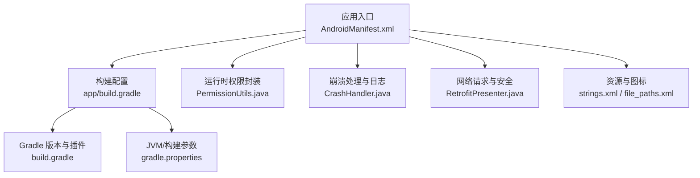
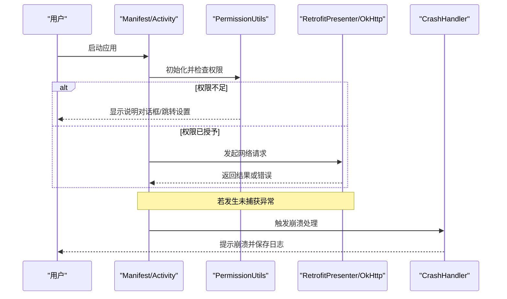
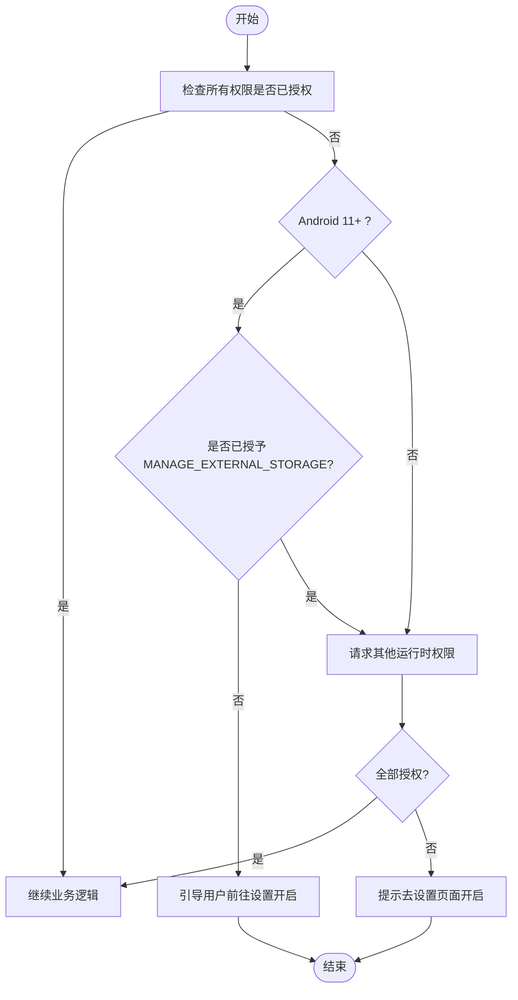
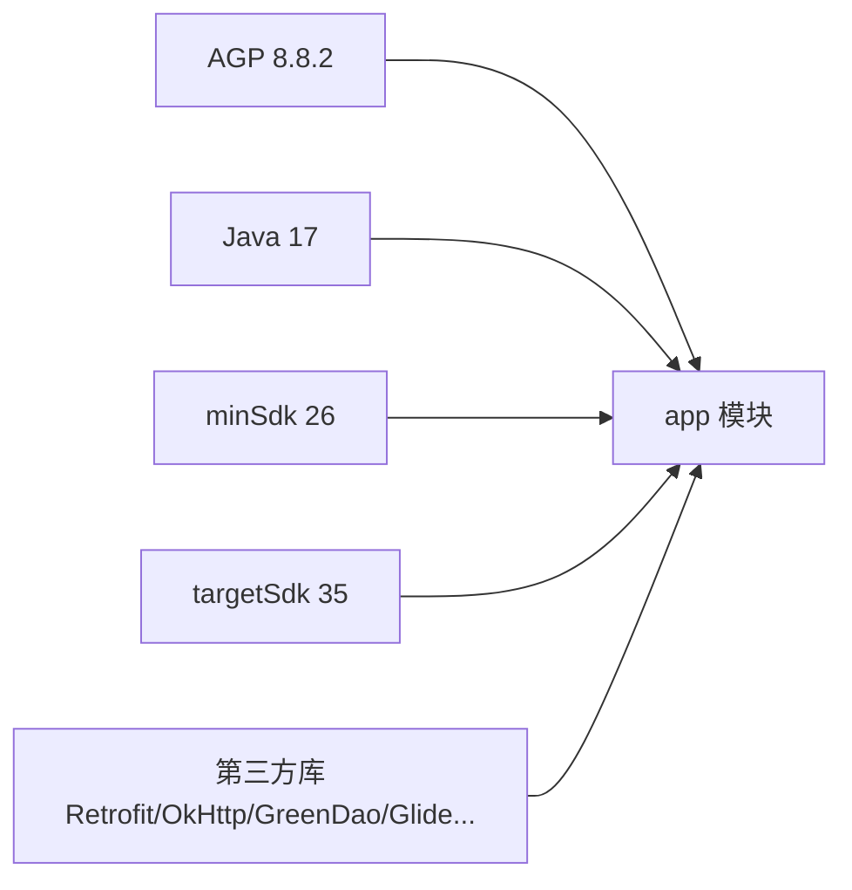

# 应用商店上架

<cite>
**本文引用的文件**
- [AndroidManifest.xml](file://app/src/main/AndroidManifest.xml)
- [app/build.gradle](file://app/build.gradle)
- [build.gradle](file://build.gradle)
- [gradle.properties](file://gradle.properties)
- [PermissionUtils.java](file://app/src/main/java/com/example/gtj_sd_dg240/utils/PermissionUtils.java)
- [CrashHandler.java](file://app/src/main/java/com/example/gtj_sd_dg240/utils/CrashHandler.java)
- [RetrofitPresenter.java](file://app/src/main/java/com/example/gtj_sd_dg240/net/RetrofitPresenter.java)
- [strings.xml](file://app/src/main/res/values/strings.xml)
- [file_paths.xml](file://app/src/main/res/xml/file_paths.xml)
</cite>

## 目录
1. [简介](#简介)
2. [项目结构](#项目结构)
3. [核心组件](#核心组件)
4. [架构总览](#架构总览)
5. [详细组件分析](#详细组件分析)
6. [依赖分析](#依赖分析)
7. [性能与兼容性注意事项](#性能与兼容性注意事项)
8. [上架前检查清单](#上架前检查清单)
9. [常见问题与解决方案](#常见问题与解决方案)
10. [结论](#结论)

## 简介
本指南面向将本项目（混凝土电杆钢筋保护层智能检测系统）上架至 Google Play Store 及其他 Android 应用商店的开发者与发布负责人。内容覆盖：
- 应用信息填写、截图与隐私政策配置
- 权限声明、API 级别与设备兼容性
- 上架前的性能测试、安全扫描与合规性验证
- 常见失败原因与解决思路

## 项目结构
本项目为多模块 Android 工程，主应用位于 app 模块，包含蓝牙、网络、存储、数据库、UI 等能力；工具库 utillibrary 提供通用能力。关键配置集中在 AndroidManifest 与 Gradle 文件中，运行时权限由 PermissionUtils 统一管理，崩溃日志由 CrashHandler 收集。

图表来源
- [AndroidManifest.xml:1-182](file://app/src/main/AndroidManifest.xml#L1-L182)
- [app/build.gradle:1-145](file://app/build.gradle#L1-L145)
- [build.gradle:1-14](file://build.gradle#L1-L14)
- [gradle.properties:1-36](file://gradle.properties#L1-L36)

章节来源
- [AndroidManifest.xml:1-182](file://app/src/main/AndroidManifest.xml#L1-L182)
- [app/build.gradle:1-145](file://app/build.gradle#L1-L145)
- [build.gradle:1-14](file://build.gradle#L1-L14)
- [gradle.properties:1-36](file://gradle.properties#L1-L36)

## 核心组件
- 权限与运行时授权：PermissionUtils 统一封装位置、相机、存储、蓝牙等权限申请流程，适配 Android 11+ 的特殊存储权限与 Android 12+ 的新蓝牙权限。
- 崩溃与日志：CrashHandler 捕获未处理异常，记录设备信息与堆栈，并引导用户反馈。
- 网络与安全：RetrofitPresenter 配置 OkHttp 超时与重试，结合 Manifest 中的明文流量开关进行网络访问控制。
- 应用元数据：strings.xml 定义应用名称；AndroidManifest 中声明启动 Activity、服务、Provider 及各类权限。

章节来源
- [PermissionUtils.java:1-196](file://app/src/main/java/com/example/gtj_sd_dg240/utils/PermissionUtils.java#L1-L196)
- [CrashHandler.java:1-207](file://app/src/main/java/com/example/gtj_sd_dg240/utils/CrashHandler.java#L1-L207)
- [RetrofitPresenter.java:38-59](file://app/src/main/java/com/example/gtj_sd_dg240/net/RetrofitPresenter.java#L38-L59)
- [strings.xml:1-6](file://app/src/main/res/values/strings.xml#L1-L6)
- [AndroidManifest.xml:1-182](file://app/src/main/AndroidManifest.xml#L1-L182)

## 架构总览
下图展示从应用启动到权限检查、网络请求与崩溃处理的总体交互关系。

图表来源
- [AndroidManifest.xml:80-104](file://app/src/main/AndroidManifest.xml#L80-L104)
- [PermissionUtils.java:102-169](file://app/src/main/java/com/example/gtj_sd_dg240/utils/PermissionUtils.java#L102-L169)
- [RetrofitPresenter.java:38-59](file://app/src/main/java/com/example/gtj_sd_dg240/net/RetrofitPresenter.java#L38-L59)
- [CrashHandler.java:74-100](file://app/src/main/java/com/example/gtj_sd_dg240/utils/CrashHandler.java#L74-L100)

## 详细组件分析

### 权限与运行时授权（PermissionUtils）
- 功能要点
  - 动态组合所需权限：位置（蓝牙扫描）、相机、存储（Android 11+ 特殊权限）、蓝牙（Android 12+ 新权限）。
  - 对 Android 11+ 使用 MANAGE_EXTERNAL_STORAGE 的全局文件访问权限，并在需要时引导用户前往系统设置开启。
  - 提供统一的申请与回调机制，拒绝后引导进入应用详情页手动开启。
- 上架影响
  - 需在商店“数据安全”部分如实声明权限用途，并提供隐私政策链接。
  - 对敏感权限（如位置、相机、存储、蓝牙）需确保最小必要原则与清晰的用户提示。

图表来源
- [PermissionUtils.java:57-94](file://app/src/main/java/com/example/gtj_sd_dg240/utils/PermissionUtils.java#L57-L94)
- [PermissionUtils.java:102-169](file://app/src/main/java/com/example/gtj_sd_dg240/utils/PermissionUtils.java#L102-L169)

章节来源
- [PermissionUtils.java:1-196](file://app/src/main/java/com/example/gtj_sd_dg240/utils/PermissionUtils.java#L1-L196)

### 崩溃与日志（CrashHandler）
- 功能要点
  - 全局捕获未处理异常，收集设备信息与堆栈，写入外部存储（受权限控制），并引导用户查看崩溃详情。
- 上架影响
  - 避免在崩溃日志中泄露敏感信息；确保存储路径与权限符合平台规范。
  - 建议接入崩溃上报服务以便持续监控。

章节来源
- [CrashHandler.java:1-207](file://app/src/main/java/com/example/gtj_sd_dg240/utils/CrashHandler.java#L1-L207)

### 网络与安全（RetrofitPresenter + Manifest）
- 功能要点
  - OkHttp 设置读写与连接超时，启用重试与日志拦截器。
  - Manifest 中允许明文流量（usesCleartextTraffic=true），需评估安全风险并按需改为 HTTPS。
- 上架影响
  - Google Play 要求优先使用加密传输；建议在发布版禁用明文流量，仅保留 HTTPS。
  - 在“数据安全”表单中如实描述网络通信与数据处理方式。

章节来源
- [RetrofitPresenter.java:38-59](file://app/src/main/java/com/example/gtj_sd_dg240/net/RetrofitPresenter.java#L38-L59)
- [AndroidManifest.xml:80-91](file://app/src/main/AndroidManifest.xml#L80-L91)

### 应用元数据与资源（strings.xml / file_paths.xml）
- 应用名称：strings.xml 定义了应用中文名称。
- 文件共享：通过 FileProvider 暴露文件路径，便于分享与导出。

章节来源
- [strings.xml:1-6](file://app/src/main/res/values/strings.xml#L1-L6)
- [AndroidManifest.xml:171-180](file://app/src/main/AndroidManifest.xml#L171-L180)
- [file_paths.xml](file://app/src/main/res/xml/file_paths.xml)

## 依赖分析
- 构建与 SDK
  - compileSdk/targetSdk 均为 35，minSdk 为 26，Java 目标版本为 17。
  - Android Gradle Plugin 版本 8.8.2。
- 第三方库
  - AndroidX、Glide、Retrofit/OkHttp、GreenDao、EventBus、PickerView 等。
- 打包与混淆
  - release 与 debug 均启用 ProGuard 规则文件；lint 在 release 构建中不中断。

图表来源
- [app/build.gradle:7-44](file://app/build.gradle#L7-L44)
- [build.gradle:7-10](file://build.gradle#L7-L10)

章节来源
- [app/build.gradle:1-145](file://app/build.gradle#L1-L145)
- [build.gradle:1-14](file://build.gradle#L1-L14)
- [gradle.properties:1-36](file://gradle.properties#L1-L36)

## 性能与兼容性注意事项
- 兼容性与 API 级别
  - minSdk=26，targetSdk=35，满足当前主流商店要求；注意 Android 12+ 蓝牙权限变更已在代码中处理。
- 存储与文件访问
  - Android 11+ 使用 MANAGE_EXTERNAL_STORAGE，需在“数据安全”中说明用途，并确保仅在必要时申请。
- 网络与安全
  - 当前允许明文流量，建议发布版关闭 usesCleartextTraffic，全面使用 HTTPS。
- 构建优化
  - 已启用并行构建与缓存；release 构建可考虑开启代码压缩与资源压缩以提升包体大小与安全性。

[本节为通用指导，无需特定文件引用]

## 上架前检查清单
- 应用信息
  - 应用名称、简短描述、完整描述、分类、关键词、联系方式、网站、隐私政策 URL。
  - 准备高分辨率截图（手机/平板横屏，因应用强制横屏）。
- 权限与隐私
  - 在商店“数据安全”表单逐项勾选并说明用途：位置、相机、存储、蓝牙、网络等。
  - 提供有效的隐私政策链接，明确数据收集、存储、共享与删除方式。
- 技术合规
  - targetSdk 不低于商店最低要求（当前为 35）。
  - 移除或替换不必要的敏感权限；对必须权限提供清晰的用户说明。
  - 关闭明文流量（usesCleartextTraffic=false），仅允许 HTTPS。
  - 确认 FileProvider 正确配置，避免私有目录越权访问。
- 质量与安全
  - 运行 lint/安全检查，修复高危问题。
  - 执行崩溃演练，确保 CrashHandler 正常工作且不泄露敏感信息。
  - 进行性能测试：冷/热启动时间、内存占用、CPU 峰值、电量消耗。
  - 进行兼容性测试：不同 Android 版本、分辨率、厂商 ROM。
- 签名与发布
  - 使用正式签名（keystore）生成 Release APK/AAB；妥善保管密钥。
  - 按商店要求上传 AAB（Google Play 推荐）或 APK（其他渠道）。

[本节为通用指导，无需特定文件引用]

## 常见问题与解决方案
- 权限被拒导致功能不可用
  - 现象：蓝牙搜索、拍照、文件导出失败。
  - 排查：检查 PermissionUtils 的权限组合与 Android 版本分支；确认用户已授权或在设置中开启。
  - 参考实现路径
    - [PermissionUtils.java:57-94](file://app/src/main/java/com/example/gtj_sd_dg240/utils/PermissionUtils.java#L57-L94)
    - [PermissionUtils.java:102-169](file://app/src/main/java/com/example/gtj_sd_dg240/utils/PermissionUtils.java#L102-L169)
- 无法访问外部存储
  - 现象：Android 11+ 无法写入 /sdcard/AppData/。
  - 排查：确认已申请并授予 MANAGE_EXTERNAL_STORAGE；在“数据安全”中说明用途。
  - 参考实现路径
    - [PermissionUtils.java:86-94](file://app/src/main/java/com/example/gtj_sd_dg240/utils/PermissionUtils.java#L86-L94)
- 网络请求失败或报错
  - 现象：无网络提示或超时。
  - 排查：检查网络权限、代理/防火墙；确认服务器可达；查看 OkHttp 超时配置。
  - 参考实现路径
    - [RetrofitPresenter.java:38-59](file://app/src/main/java/com/example/gtj_sd_dg240/net/RetrofitPresenter.java#L38-L59)
- 明文流量被阻止
  - 现象：HTTPS 正常但 HTTP 请求失败。
  - 排查：发布版建议关闭 usesCleartextTraffic，改用 HTTPS。
  - 参考实现路径
    - [AndroidManifest.xml:80-91](file://app/src/main/AndroidManifest.xml#L80-L91)
- 崩溃日志无法导出
  - 现象：崩溃后无法保存日志。
  - 排查：确认存储权限与路径可用；检查 CrashHandler 的文件写入逻辑。
  - 参考实现路径
    - [CrashHandler.java:156-199](file://app/src/main/java/com/example/gtj_sd_dg240/utils/CrashHandler.java#L156-L199)

章节来源
- [PermissionUtils.java:57-169](file://app/src/main/java/com/example/gtj_sd_dg240/utils/PermissionUtils.java#L57-L169)
- [RetrofitPresenter.java:38-59](file://app/src/main/java/com/example/gtj_sd_dg240/net/RetrofitPresenter.java#L38-L59)
- [AndroidManifest.xml:80-91](file://app/src/main/AndroidManifest.xml#L80-L91)
- [CrashHandler.java:156-199](file://app/src/main/java/com/example/gtj_sd_dg240/utils/CrashHandler.java#L156-L199)

## 结论
本项目已具备较完善的权限管理、崩溃处理与网络基础能力。为满足各应用商店的上架要求，建议在发布前完成以下关键工作：
- 完善“数据安全”表单与隐私政策，确保权限声明与实际使用一致。
- 关闭明文流量，采用 HTTPS 保障通信安全。
- 针对 Android 12+ 的蓝牙权限与 Android 11+ 的存储权限进行充分测试。
- 执行性能、安全与兼容性测试，确保用户体验与稳定性。
- 使用正式签名生成 AAB/APK，并按商店规范提交审核。

[本节为总结性内容，无需特定文件引用]