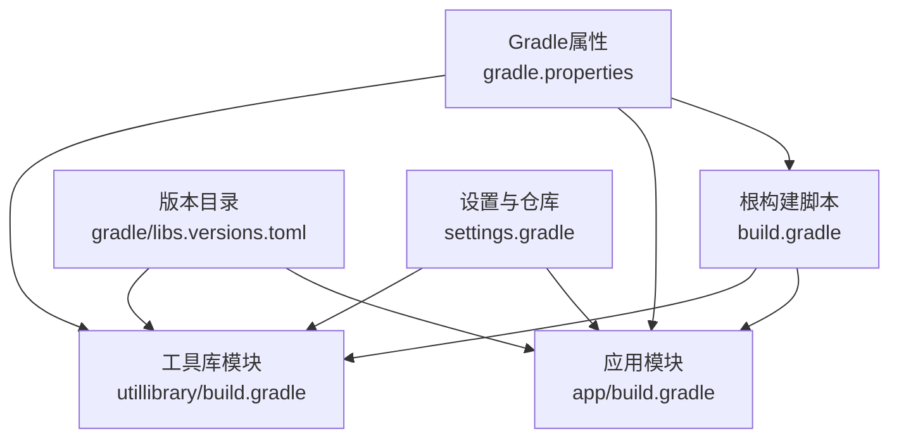
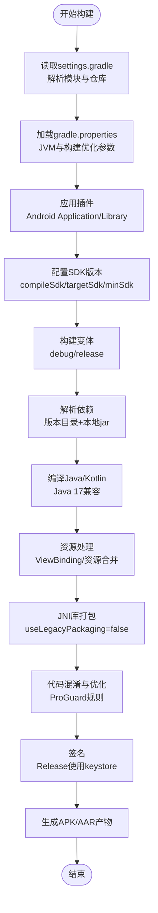
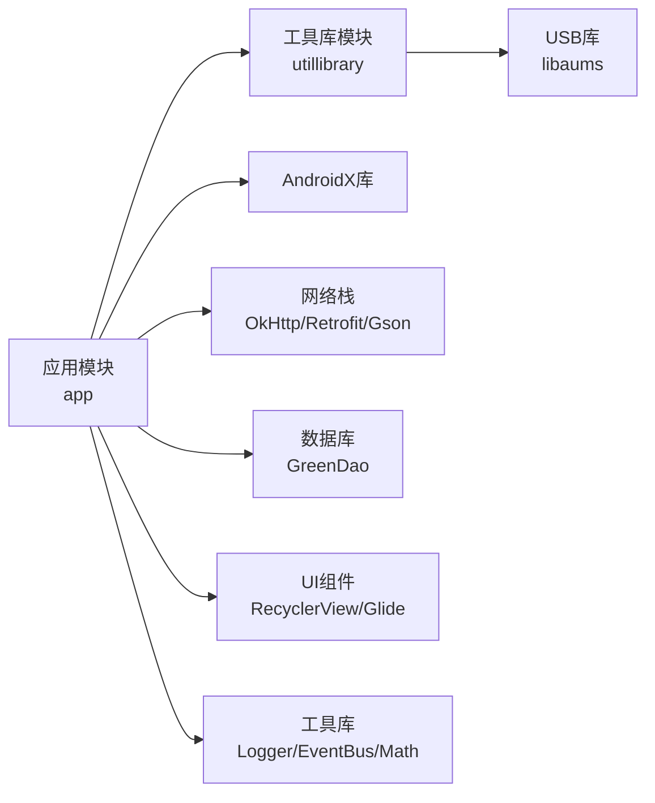

# 构建配置

<cite>
**本文引用的文件**
- [build.gradle](file://build.gradle)
- [app/build.gradle](file://app/build.gradle)
- [utillibrary/build.gradle](file://utillibrary/build.gradle)
- [gradle/libs.versions.toml](file://gradle/libs.versions.toml)
- [gradle.properties](file://gradle.properties)
- [settings.gradle](file://settings.gradle)
- [app/proguard-rules.pro](file://app/proguard-rules.pro)
- [android.keystore.txt](file://android.keystore.txt)
</cite>

## 目录
1. [简介](#简介)
2. [项目结构](#项目结构)
3. [核心组件](#核心组件)
4. [架构总览](#架构总览)
5. [详细组件分析](#详细组件分析)
6. [依赖分析](#依赖分析)
7. [性能考虑](#性能考虑)
8. [故障排查指南](#故障排查指南)
9. [结论](#结论)
10. [附录](#附录)

## 简介
本文件面向Android Gradle构建配置，系统性说明该项目的编译SDK版本、目标/最小SDK版本、Java版本兼容性、依赖管理、插件配置、构建变体与产物输出、资源打包与性能优化选项，并提供最佳实践与常见问题解决方案。内容基于仓库中的Gradle脚本与配置文件进行解读，便于开发者快速定位与调整构建行为。

## 项目结构
该项目为多模块Android工程，包含应用模块与工具库模块：
- 根级构建脚本定义全局插件与清理任务
- 应用模块负责业务逻辑、UI与数据层
- 工具库模块提供通用能力（如USB等）并被应用模块引用
- 统一通过版本目录集中管理第三方库版本
- 通过settings.gradle声明模块与仓库源

**图表来源**
- [build.gradle:1-14](file://build.gradle#L1-L14)
- [app/build.gradle:1-145](file://app/build.gradle#L1-L145)
- [utillibrary/build.gradle:1-51](file://utillibrary/build.gradle#L1-L51)
- [gradle/libs.versions.toml:1-58](file://gradle/libs.versions.toml#L1-L58)
- [settings.gradle:1-42](file://settings.gradle#L1-L42)
- [gradle.properties:1-36](file://gradle.properties#L1-L36)

**章节来源**
- [build.gradle:1-14](file://build.gradle#L1-L14)
- [settings.gradle:1-42](file://settings.gradle#L1-L42)

## 核心组件
- 插件与AGP版本：根脚本声明Android Application/Library插件版本，确保统一的构建环境
- SDK与默认配置：应用与库模块分别声明compileSdk、minSdk、targetSdk及默认包名、版本号
- Java版本兼容：统一使用Java 17作为源码与目标兼容版本
- 构建变体：debug/release两种变体，均启用混淆与签名（release使用独立签名配置）
- 依赖管理：通过版本目录集中管理第三方库版本；应用模块直接声明依赖；工具库模块暴露API供应用使用
- 资源与JNI打包：配置jniLibs目录、排除冗余META-INF资源、关闭传统JNI打包方式
- Lint与构建特性：按需开启ViewBinding、BuildConfig，禁用不必要的构建特性以缩短编译时间

**章节来源**
- [build.gradle:7-10](file://build.gradle#L7-L10)
- [app/build.gradle:7-77](file://app/build.gradle#L7-L77)
- [utillibrary/build.gradle:5-41](file://utillibrary/build.gradle#L5-L41)
- [gradle/libs.versions.toml:1-58](file://gradle/libs.versions.toml#L1-L58)
- [gradle.properties:1-36](file://gradle.properties#L1-L36)

## 架构总览
下图展示构建流程中关键阶段与配置项的交互关系：从Gradle初始化到最终产物生成。

**图表来源**
- [settings.gradle:1-42](file://settings.gradle#L1-L42)
- [gradle.properties:1-36](file://gradle.properties#L1-L36)
- [app/build.gradle:7-77](file://app/build.gradle#L7-L77)
- [utillibrary/build.gradle:5-41](file://utillibrary/build.gradle#L5-L41)

## 详细组件分析

### 基础SDK与默认配置
- compileSdk：应用与库模块均设置为35，保证使用最新平台API
- targetSdk：应用与库模块均设置为35，表示针对该平台进行测试与发布
- minSdk：应用模块为26，库模块为24，体现不同模块对最低系统版本的差异化要求
- 默认配置：applicationId、versionCode、versionName在应用模块中定义；库模块未定义应用ID

建议：
- 保持应用与库的compileSdk一致，避免兼容性问题
- 根据业务需求评估是否提升minSdk至更高版本以简化兼容层

**章节来源**
- [app/build.gradle:11-17](file://app/build.gradle#L11-L17)
- [utillibrary/build.gradle:9-14](file://utillibrary/build.gradle#L9-L14)

### Java版本兼容性
- 源码与目标兼容版本均为Java 17，确保新语言特性与运行时一致性
- gradle.properties中指定了Java Home路径，指向Corretto 17，满足AGP对Java版本的要求

建议：
- 若团队升级JDK，需同步更新gradle.properties中的路径
- 检查第三方库是否支持Java 17，必要时调整依赖或降级策略

**章节来源**
- [app/build.gradle:41-44](file://app/build.gradle#L41-L44)
- [utillibrary/build.gradle:23-26](file://utillibrary/build.gradle#L23-L26)
- [gradle.properties:1-2](file://gradle.properties#L1-L2)

### 构建变体与产物输出
- debug与release变体均启用混淆与优化，并引入自定义ProGuard规则
- release变体使用独立签名配置，debug也配置了签名以便测试安装
- 产物类型：应用模块输出APK；库模块输出AAR（由Android Library插件决定）

建议：
- 生产环境务必启用混淆与资源压缩，结合R8/ProGuard减少包体
- 将敏感信息（如密钥）移出脚本，改用环境变量或安全存储

**章节来源**
- [app/build.gradle:19-39](file://app/build.gradle#L19-L39)
- [utillibrary/build.gradle:16-21](file://utillibrary/build.gradle#L16-L21)
- [app/proguard-rules.pro:1-22](file://app/proguard-rules.pro#L1-L22)

### 依赖管理与版本控制
- 版本目录：通过gradle/libs.versions.toml集中管理第三方库版本，提高可维护性
- 应用模块依赖：包括AndroidX、网络栈（OkHttp/Retrofit）、图片加载（Glide）、数据库（GreenDao）、事件总线（EventBus）、数学库等
- 库模块依赖：包含AppCompat与USB相关库，并通过api暴露给应用模块
- 本地依赖：应用模块包含libs目录下的jar包

建议：
- 优先使用版本目录统一管理，避免重复声明与版本冲突
- 定期扫描依赖漏洞与过时版本，及时升级

**章节来源**
- [gradle/libs.versions.toml:1-58](file://gradle/libs.versions.toml#L1-L58)
- [app/build.gradle:86-144](file://app/build.gradle#L86-L144)
- [utillibrary/build.gradle:43-51](file://utillibrary/build.gradle#L43-L51)

### 插件配置与构建特性
- 插件：Android Application/Library插件版本在根脚本中声明，保证一致性
- GreenDAO插件：应用模块启用GreenDAO代码生成，配置schema版本、包名与生成目录
- 构建特性：应用模块启用ViewBinding与BuildConfig，禁用AIDL、RenderScript、resValues、shaders以减少构建开销

建议：
- 按需开启构建特性，避免不必要的编译步骤
- 对于数据库迁移，合理设置schema版本并使用升级辅助库

**章节来源**
- [build.gradle:7-10](file://build.gradle#L7-L10)
- [app/build.gradle:5-6](file://app/build.gradle#L5-L6)
- [app/build.gradle:69-76](file://app/build.gradle#L69-L76)
- [app/build.gradle:79-84](file://app/build.gradle#L79-L84)

### 资源打包与JNI配置
- jniLibs目录：应用模块将libs设为JNI库源目录
- 打包策略：关闭传统JNI打包方式，采用现代打包机制
- 资源排除：移除冗余的META-INF文件，避免打包冲突

建议：
- 若引入多架构so库，确保按ABI拆分并正确配置
- 定期检查资源冲突，必要时扩展excludes列表

**章节来源**
- [app/build.gradle:47-60](file://app/build.gradle#L47-L60)

### 签名与发布配置
- 签名配置：release变体使用独立签名配置，包含别名、密码、密钥库路径
- 密钥文件：根目录下存在keystore文本记录，但实际密钥库文件应妥善保管
- 调试与发布：debug也配置了签名，便于设备直接安装测试包

建议：
- 将密钥与密码移至安全位置（如CI/CD密钥管理），避免硬编码
- 使用更安全的签名方案（如Android Keystore）

**章节来源**
- [app/build.gradle:19-26](file://app/build.gradle#L19-L26)
- [android.keystore.txt:1-27](file://android.keystore.txt#L1-L27)

### 仓库与模块声明
- 仓库源：settings.gradle中配置Google、Maven Central、阿里云镜像与JitPack，加速依赖下载
- 模块包含：包含app与utillibrary两个模块
- 依赖解析模式：FAIL_ON_PROJECT_REPOS，禁止子模块自行添加仓库，统一由根管理

建议：
- 保留企业内网镜像以提升稳定性
- 谨慎添加外部仓库，避免引入不可控依赖

**章节来源**
- [settings.gradle:1-42](file://settings.gradle#L1-L42)

## 依赖分析
下图展示模块间依赖关系与主要第三方库分类。

**图表来源**
- [app/build.gradle:86-144](file://app/build.gradle#L86-L144)
- [utillibrary/build.gradle:43-51](file://utillibrary/build.gradle#L43-L51)

**章节来源**
- [app/build.gradle:86-144](file://app/build.gradle#L86-L144)
- [utillibrary/build.gradle:43-51](file://utillibrary/build.gradle#L43-L51)

## 性能考虑
- JVM与并行构建：启用并行构建、构建缓存、按需配置与文件系统监视，显著提升增量构建速度
- 非传递R类：启用nonTransitiveRClass减少R类体积与编译时间
- 构建特性开关：禁用AIDL、RenderScript、resValues、shaders等不需要的特性
- 资源与JNI：关闭传统JNI打包，减少打包复杂度
- 混淆与优化：启用ProGuard/R8，减小包体并提升运行性能

建议：
- 在CI环境中启用构建缓存与并行，缩短流水线时间
- 定期分析APK体积，剔除无用资源与依赖

**章节来源**
- [gradle.properties:4-16](file://gradle.properties#L4-L16)
- [gradle.properties:24-36](file://gradle.properties#L24-L36)
- [app/build.gradle:53-60](file://app/build.gradle#L53-L60)
- [app/build.gradle:69-76](file://app/build.gradle#L69-L76)

## 故障排查指南
- 签名失败或证书问题
  - 检查签名配置中的别名、密码与密钥库路径是否正确
  - 确认密钥库文件存在且可读
  - 参考签名配置与密钥记录文件定位问题

- 依赖解析失败或版本冲突
  - 检查版本目录中的版本是否与模块声明一致
  - 确认仓库源可达，必要时切换镜像
  - 使用依赖树分析冲突并统一版本

- 构建缓慢或内存不足
  - 调整JVM参数（堆大小、元空间）
  - 启用并行构建与构建缓存
  - 禁用不必要的构建特性

- JNI或资源冲突
  - 检查jniLibs目录结构与ABI匹配
  - 扩展资源排除规则，避免META-INF冲突

**章节来源**
- [app/build.gradle:19-39](file://app/build.gradle#L19-L39)
- [gradle/libs.versions.toml:1-58](file://gradle/libs.versions.toml#L1-L58)
- [gradle.properties:4-16](file://gradle.properties#L4-L16)
- [app/build.gradle:53-60](file://app/build.gradle#L53-L60)

## 结论
本项目采用现代化的Android Gradle构建配置，统一了插件版本、SDK版本与Java兼容性，通过版本目录集中管理依赖，合理配置构建变体、资源打包与性能优化选项。建议在后续迭代中持续优化依赖版本、强化密钥安全管理，并结合CI/CD实现自动化构建与质量门禁。

## 附录
- 关键配置速查
  - 编译SDK：35
  - 目标SDK：35
  - 最小SDK：应用26 / 库24
  - Java版本：17
  - 构建特性：ViewBinding、BuildConfig启用；AIDL、RenderScript、resValues、shaders禁用
  - 依赖管理：版本目录集中管理
  - 仓库源：Google、Maven Central、阿里云镜像、JitPack

**章节来源**
- [app/build.gradle:7-17](file://app/build.gradle#L7-L17)
- [utillibrary/build.gradle:5-14](file://utillibrary/build.gradle#L5-L14)
- [gradle/libs.versions.toml:1-58](file://gradle/libs.versions.toml#L1-L58)
- [settings.gradle:1-42](file://settings.gradle#L1-L42)