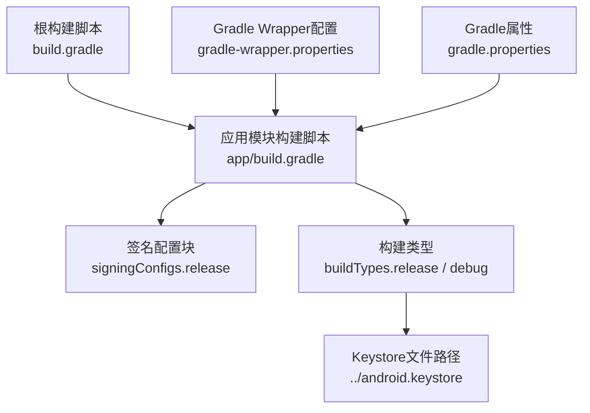
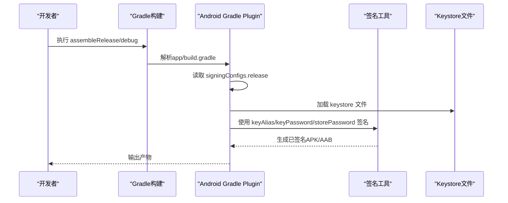
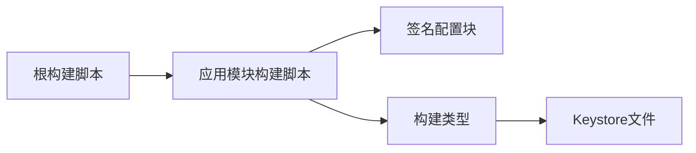
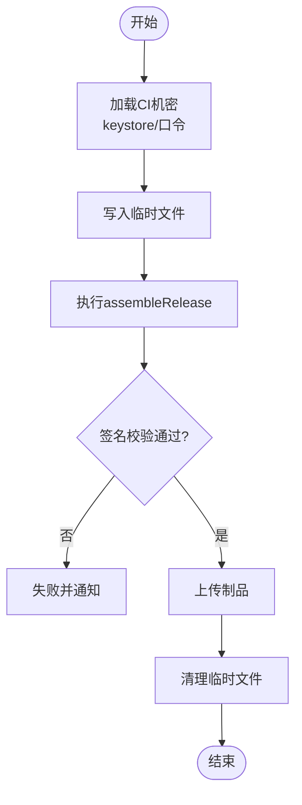

# 签名配置

<cite>
**本文引用的文件**
- [app/build.gradle](file://app/build.gradle)
- [build.gradle](file://build.gradle)
- [gradle.properties](file://gradle.properties)
- [android.keystore.txt](file://android.keystore.txt)
- [gradle/wrapper/gradle-wrapper.properties](file://gradle/wrapper/gradle-wrapper.properties)
</cite>

## 目录
1. [简介](#简介)
2. [项目结构](#项目结构)
3. [核心组件](#核心组件)
4. [架构总览](#架构总览)
5. [详细组件分析](#详细组件分析)
6. [依赖关系分析](#依赖关系分析)
7. [性能与构建优化](#性能与构建优化)
8. [故障排查指南](#故障排查指南)
9. [结论](#结论)
10. [附录：多环境与自动化签名方案](#附录多环境与自动化签名方案)

## 简介
本文件面向Android应用签名与安全发布，结合当前仓库中的Gradle配置与密钥材料，系统说明：
- Android签名的原理与重要性（调试签名 vs 生产签名）
- Keystore的创建、管理与安全存储建议
- 本项目现有签名配置的完整示例与解读
- 多环境签名策略与CI/CD自动化签名流程的实现思路

## 项目结构
与签名相关的核心位置与职责如下：
- app模块的构建脚本集中定义了签名配置与构建类型
- 根级构建脚本管理插件版本与全局任务
- Gradle属性文件用于JVM与构建性能调优
- 密钥生成记录保存在文本文件中，便于追溯与复现

图表来源
- [app/build.gradle:19-38](file://app/build.gradle#L19-L38)
- [build.gradle:7-10](file://build.gradle#L7-L10)
- [gradle/wrapper/gradle-wrapper.properties:1-7](file://gradle/wrapper/gradle-wrapper.properties#L1-L7)
- [gradle.properties:1-36](file://gradle.properties#L1-L36)

章节来源
- [app/build.gradle:1-77](file://app/build.gradle#L1-L77)
- [build.gradle:1-14](file://build.gradle#L1-L14)
- [gradle/wrapper/gradle-wrapper.properties:1-7](file://gradle/wrapper/gradle-wrapper.properties#L1-L7)
- [gradle.properties:1-36](file://gradle.properties#L1-L36)

## 核心组件
- 签名配置块（signingConfigs）
  - 定义release签名所需的别名、密码、密钥库文件路径
  - 供构建类型引用以完成打包签名
- 构建类型（buildTypes）
  - release：启用混淆与ProGuard规则，并绑定release签名
  - debug：当前也绑定了release签名（见下文“现状与风险”）
- 密钥材料与生成记录
  - 密钥别名、有效期、组织信息等记录在文本文件中
  - 密钥库文件位于app模块上级目录，通过相对路径引用

章节来源
- [app/build.gradle:19-38](file://app/build.gradle#L19-L38)
- [android.keystore.txt:1-27](file://android.keystore.txt#L1-L27)

## 架构总览
下图展示了从Gradle构建到签名输出的关键调用链。

图表来源
- [app/build.gradle:19-38](file://app/build.gradle#L19-L38)
- [android.keystore.txt:1-27](file://android.keystore.txt#L1-L27)

## 详细组件分析

### 签名配置块（signingConfigs.release）
- 作用：集中声明release构建所需的签名凭据与密钥库位置
- 关键字段
  - keyAlias：密钥别名
  - keyPassword：密钥口令
  - storeFile：密钥库文件路径（相对或绝对路径）
  - storePassword：密钥库口令
- 在本项目中，该配置被release和debug构建类型同时引用

章节来源
- [app/build.gradle:19-26](file://app/build.gradle#L19-L26)

### 构建类型（buildTypes）
- release
  - 启用混淆与ProGuard规则
  - 绑定signingConfigs.release进行签名
- debug
  - 当前也绑定了signingConfigs.release（与默认行为不同，需评估风险）

章节来源
- [app/build.gradle:28-38](file://app/build.gradle#L28-L38)

### 密钥材料与生成记录（android.keystore.txt）
- 包含密钥生成命令与交互信息，可用于复现实验室或本地环境下的密钥创建过程
- 字段要点
  - 密钥别名：android.keystore
  - 算法与有效期：RSA、较长有效期
  - 组织信息：单位、城市、国家等
  - 口令：命令行交互中设置

章节来源
- [android.keystore.txt:1-27](file://android.keystore.txt#L1-L27)

### Gradle与Java环境
- Gradle Wrapper版本固定，保证团队一致性与可重现构建
- Java版本要求为17+，与编译选项一致

章节来源
- [gradle/wrapper/gradle-wrapper.properties:1-7](file://gradle/wrapper/gradle-wrapper.properties#L1-L7)
- [gradle.properties:1-36](file://gradle.properties#L1-L36)
- [app/build.gradle:41-44](file://app/build.gradle#L41-L44)

## 依赖关系分析
- 构建脚本之间的依赖
  - 根构建脚本引入Android插件版本
  - 应用模块脚本依赖根脚本提供的插件能力
- 签名相关依赖
  - 应用模块脚本依赖外部keystore文件
  - 构建类型依赖签名配置块

图表来源
- [build.gradle:7-10](file://build.gradle#L7-L10)
- [app/build.gradle:19-38](file://app/build.gradle#L19-L38)

章节来源
- [build.gradle:1-14](file://build.gradle#L1-L14)
- [app/build.gradle:1-77](file://app/build.gradle#L1-L77)

## 性能与构建优化
- 并行构建与缓存：已在gradle.properties中启用，有助于提升构建速度
- JVM参数：合理堆大小与GC策略，降低OOM风险
- 按需配置与VFS监控：减少配置阶段开销与文件系统扫描成本

章节来源
- [gradle.properties:4-16](file://gradle.properties#L4-L16)

## 故障排查指南
- 常见错误与定位
  - 找不到keystore文件：检查storeFile路径是否正确（相对路径基于app模块）
  - 口令错误：核对keyPassword与storePassword是否与keystore一致
  - 别名不匹配：确认keyAlias与keystore中实际别名一致
  - 权限问题：确保运行用户有读取keystore的权限
- 快速验证步骤
  - 使用keytool列出keystore内容，校验别名与证书信息
  - 在干净环境下执行一次完整构建，观察是否仍报错
  - 若CI失败，检查环境变量与密钥注入方式

章节来源
- [app/build.gradle:19-38](file://app/build.gradle#L19-L38)
- [android.keystore.txt:1-27](file://android.keystore.txt#L1-L27)

## 结论
- 本项目已具备完整的release签名配置，并在release与debug构建类型中启用
- 密钥生成记录清晰，便于复现与审计
- 建议在后续迭代中完善多环境签名策略与敏感信息保护，避免将明文口令写入脚本

[本节为总结性内容，不直接分析具体文件]

## 附录：多环境与自动化签名方案

### 多环境签名策略
- 开发环境（dev）
  - 使用调试签名或专用开发密钥，便于联调与安装
- 测试环境（qa/staging）
  - 使用内部测试签名，限制分发范围
- 预发布环境（beta）
  - 使用接近生产的签名，但可区分渠道或包名后缀
- 生产环境（release）
  - 使用严格管控的生产密钥，最小化知悉范围，双人复核

实现要点
- 通过Gradle属性或环境变量注入不同环境的签名信息
- 使用条件判断选择对应signingConfig
- 对敏感信息采用加密存储或密钥管理服务

### CI/CD自动化签名流程
- 密钥管理
  - 将keystore与口令作为CI平台的机密变量或密钥管理服务项
  - 构建时动态解密并写入临时目录，构建完成后清理
- 构建步骤
  - 拉取代码与依赖
  - 注入签名信息
  - 执行assembleRelease
  - 上传产物与签名校验
- 回滚与审计
  - 保留每次发布的签名指纹与构建日志
  - 建立制品归档与版本对照表

[此图为概念流程图，不映射具体源码文件]

### 安全最佳实践
- 不在代码仓库中提交真实keystore与口令
- 使用只读权限与最小化访问控制
- 定期轮换密钥与证书，记录变更
- 对构建产物进行完整性校验（如SHA-256）
- 对CI日志脱敏，避免泄露敏感信息

[本节提供通用指导，不直接分析具体文件]