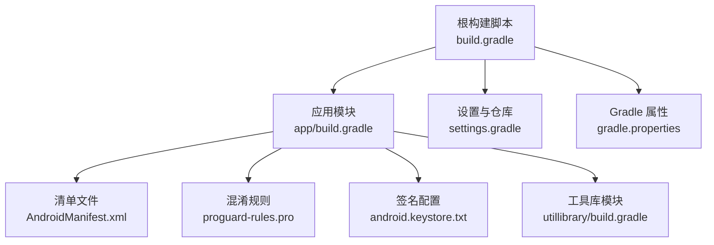
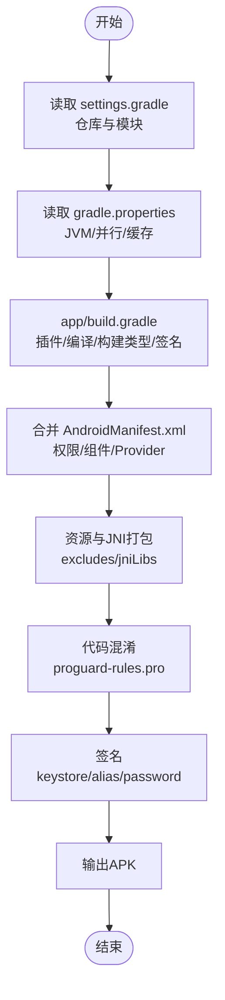
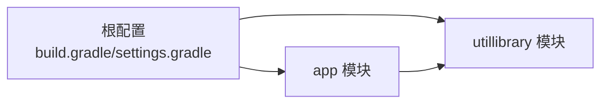

# 部署与发布

<cite>
**本文引用的文件**
- [build.gradle](file://build.gradle)
- [app/build.gradle](file://app/build.gradle)
- [settings.gradle](file://settings.gradle)
- [gradle.properties](file://gradle.properties)
- [android.keystore.txt](file://android.keystore.txt)
- [app/proguard-rules.pro](file://app/proguard-rules.pro)
- [utillibrary/build.gradle](file://utillibrary/build.gradle)
- [app/src/main/AndroidManifest.xml](file://app/src/main/AndroidManifest.xml)
</cite>

## 目录
1. [简介](#简介)
2. [项目结构](#项目结构)
3. [核心组件](#核心组件)
4. [架构总览](#架构总览)
5. [详细组件分析](#详细组件分析)
6. [依赖分析](#依赖分析)
7. [性能考虑](#性能考虑)
8. [故障排查指南](#故障排查指南)
9. [结论](#结论)
10. [附录](#附录)

## 简介
本文件面向生产环境的构建、多渠道打包、代码混淆与签名、发布流程、版本管理、更新机制与应用商店上架，覆盖 Android 平台的合规检查、安全加固、监控与回滚策略。文档基于仓库中的 Gradle 配置、清单文件与混淆规则进行说明，确保可操作且可追溯。

## 项目结构
本项目为多模块 Android 工程，包含应用模块 app 与工具库模块 utillibrary。根级与模块级 Gradle 脚本负责插件、仓库、编译选项、构建类型、签名与资源打包等。清单文件声明权限、入口 Activity、第三方服务与 Provider 等。

图表来源
- [build.gradle:1-14](file://build.gradle#L1-L14)
- [app/build.gradle:1-77](file://app/build.gradle#L1-L77)
- [settings.gradle:1-42](file://settings.gradle#L1-L42)
- [gradle.properties:1-36](file://gradle.properties#L1-L36)
- [app/src/main/AndroidManifest.xml:1-182](file://app/src/main/AndroidManifest.xml#L1-L182)
- [app/proguard-rules.pro:1-22](file://app/proguard-rules.pro#L1-L22)
- [utillibrary/build.gradle:1-51](file://utillibrary/build.gradle#L1-L51)

章节来源
- [build.gradle:1-14](file://build.gradle#L1-L14)
- [app/build.gradle:1-77](file://app/build.gradle#L1-L77)
- [settings.gradle:1-42](file://settings.gradle#L1-L42)
- [gradle.properties:1-36](file://gradle.properties#L1-L36)
- [app/src/main/AndroidManifest.xml:1-182](file://app/src/main/AndroidManifest.xml#L1-L182)

## 核心组件
- 构建系统与插件
  - 根脚本引入 GreenDao Gradle 插件；应用与库模块使用 Android Application/Library 插件。
  - 统一 Java 版本为 17，启用 ViewBinding 与 BuildConfig。
- 构建类型与签名
  - release 与 debug 均引用 ProGuard 规则；release 已配置签名（keystore、别名、密码）。
- 资源与原生库打包
  - jniLibs 通过 sourceSets 指定；resources 排除部分 META-INF 冗余文件。
- 仓库与依赖解析
  - settings 中集中配置 Google、Maven Central、阿里云镜像与 JitPack；依赖解析模式设为严格。
- 清单与权限
  - 声明蓝牙、存储、相机、网络、系统悬浮窗、安装未知来源等权限；配置百度地图服务与 FileProvider。

章节来源
- [build.gradle:1-14](file://build.gradle#L1-L14)
- [app/build.gradle:1-77](file://app/build.gradle#L1-L77)
- [settings.gradle:1-42](file://settings.gradle#L1-L42)
- [app/src/main/AndroidManifest.xml:1-182](file://app/src/main/AndroidManifest.xml#L1-L182)

## 架构总览
下图展示从源码到 APK 的构建与发布关键路径：Gradle 读取设置与属性，应用模块加载插件与依赖，执行编译、混淆、签名与打包，最终产出可分发的 APK。

图表来源
- [settings.gradle:1-42](file://settings.gradle#L1-L42)
- [gradle.properties:1-36](file://gradle.properties#L1-L36)
- [app/build.gradle:1-77](file://app/build.gradle#L1-L77)
- [app/src/main/AndroidManifest.xml:1-182](file://app/src/main/AndroidManifest.xml#L1-L182)
- [app/proguard-rules.pro:1-22](file://app/proguard-rules.pro#L1-L22)

## 详细组件分析

### 构建配置与多渠道打包
- 构建版本与目标平台
  - compileSdk/targetSdk 均为 35，minSdk 为 26；Java 源与目标兼容 17。
- 构建类型
  - release：开启混淆并引用全局与项目级 ProGuard 规则，使用 release 签名。
  - debug：同样引用混淆规则但关闭 minify；debug 也使用 release 签名以便测试签名包。
- 多渠道打包建议
  - 当前未定义 productFlavors。可通过在 app/build.gradle 中添加 flavorDimensions 与多个 flavor 实现多渠道（如不同渠道包名或资源），并在 defaultConfig 中设置公共 versionCode/versionName。
  - 若需按渠道注入配置，可在 flavor 中设置 resValue/buildConfigField，或在清单中使用占位符替换。
- 仓库与依赖
  - 集中式仓库配置避免各模块重复声明；对 AndroidX 与 Google 组有内容过滤以提升解析效率。

章节来源
- [app/build.gradle:7-39](file://app/build.gradle#L7-L39)
- [settings.gradle:1-42](file://settings.gradle#L1-L42)

### 代码混淆与优化
- 混淆开关
  - release 启用 minifyEnabled；debug 关闭。
- 规则文件
  - 引用默认优化规则与项目级 proguard-rules.pro；可按需添加保留类、接口与反射相关规则。
- 调试信息
  - 可选保留行号以利于线上问题定位；生产环境可根据安全策略决定是否重命名源文件名。

章节来源
- [app/build.gradle:28-39](file://app/build.gradle#L28-L39)
- [app/proguard-rules.pro:1-22](file://app/proguard-rules.pro#L1-L22)

### 签名配置与安全
- 签名配置
  - release 构建类型已配置 keystore、别名与密码；debug 也使用同一签名便于联调。
- 密钥管理建议
  - 将 keystore 与密码从仓库移除，改用环境变量或 CI 密钥管理服务注入；避免明文泄露。
- 清单安全项
  - 已声明必要权限与特性；注意敏感权限（如悬浮窗、安装未知来源）仅在业务需要时保留，并按平台版本条件化。

章节来源
- [app/build.gradle:19-39](file://app/build.gradle#L19-L39)
- [android.keystore.txt:1-27](file://android.keystore.txt#L1-L27)
- [app/src/main/AndroidManifest.xml:6-79](file://app/src/main/AndroidManifest.xml#L6-L79)

### 资源与原生库打包
- JNI 库
  - 通过 sourceSets 指定 jniLibs 目录；packaging 中禁用旧版打包方式，减少体积与冲突。
- 资源排除
  - 排除部分 META-INF 文件以避免签名冲突与冗余。

章节来源
- [app/build.gradle:47-60](file://app/build.gradle#L47-L60)

### 清单与权限合规
- 蓝牙与位置
  - 针对 Android 11/12+ 分别声明扫描与连接权限，位置权限用于低版本蓝牙扫描。
- 存储
  - 兼容旧版外部存储读写与新版本作用域存储；必要时申请 MANAGE_EXTERNAL_STORAGE。
- 其他
  - 相机、网络、振动、唤醒锁、录音、悬浮窗、安装未知来源等权限按需声明。
- 组件与服务
  - 主入口 Activity 声明 LAUNCHER/HOME；百度地图服务与 FileProvider 已配置。

章节来源
- [app/src/main/AndroidManifest.xml:6-182](file://app/src/main/AndroidManifest.xml#L6-L182)

### 工具库模块
- 库模块 buildTypes 仅定义 release 并启用混淆；compileSdk 与 Java 版本与主模块一致。
- 依赖中包含 USB 相关库，供主模块调用。

章节来源
- [utillibrary/build.gradle:1-51](file://utillibrary/build.gradle#L1-L51)

## 依赖分析
- 模块关系
  - app 依赖 utillibrary；两者共享根级插件与仓库配置。
- 仓库与解析
  - 通过 settings 统一管理仓库，限制项目内重复声明；Google/AndroidX 优先命中。
- 风险点
  - 第三方库较多，建议在 CI 中执行依赖审计与许可证检查；对存在已知漏洞的版本及时升级。

图表来源
- [build.gradle:1-14](file://build.gradle#L1-L14)
- [settings.gradle:1-42](file://settings.gradle#L1-L42)
- [utillibrary/build.gradle:1-51](file://utillibrary/build.gradle#L1-L51)

章节来源
- [settings.gradle:1-42](file://settings.gradle#L1-L42)
- [app/build.gradle:86-145](file://app/build.gradle#L86-L145)
- [utillibrary/build.gradle:43-51](file://utillibrary/build.gradle#L43-L51)

## 性能考虑
- 构建性能
  - 启用并行构建、构建缓存、按需配置与文件系统监视；JVM 堆与元空间合理分配。
- 运行时优化
  - 启用非传递 R 类减少 R 类大小；按需关闭不必要的 buildFeatures。
- 资源与二进制
  - 排除多余 META-INF；合理使用 jniLibs 与资源压缩。

章节来源
- [gradle.properties:1-36](file://gradle.properties#L1-L36)
- [app/build.gradle:62-77](file://app/build.gradle#L62-L77)
- [app/build.gradle:53-60](file://app/build.gradle#L53-L60)

## 故障排查指南
- 构建失败
  - 检查 Java 版本与 org.gradle.java.home 指向 JDK 17；确认仓库可达与镜像可用。
- 签名错误
  - 核对 keystore 路径、别名与密码；CI 中建议使用密钥注入而非明文。
- 权限与运行时异常
  - 根据目标 SDK 动态请求蓝牙、位置与存储权限；清单中权限与实际使用保持一致。
- 崩溃上报
  - 结合日志与崩溃页面收集上下文，配合混淆后的堆栈映射定位问题。

章节来源
- [gradle.properties:1-6](file://gradle.properties#L1-L6)
- [app/build.gradle:19-39](file://app/build.gradle#L19-L39)
- [app/src/main/AndroidManifest.xml:6-79](file://app/src/main/AndroidManifest.xml#L6-L79)

## 结论
本项目已具备完整的构建、混淆与签名能力，清单与权限覆盖蓝牙、存储、相机与网络等场景。建议在生产环境中完善多渠道配置、密钥安全管理、自动化发布与回滚策略，并结合监控与合规检查提升交付质量与安全性。

## 附录

### 构建与发布流程（推荐）
- 本地构建
  - 清理并构建 release 包：执行 Gradle 任务生成签名 APK。
- 持续集成
  - 在 CI 中拉取代码、解析依赖、执行 lint/单元测试、构建 release、签名并上传制品。
- 多渠道发布
  - 通过 productFlavors 定义渠道，注入渠道标识与差异化资源；批量生成渠道包。
- 应用商店上架
  - 准备截图、描述与隐私政策；提交至目标平台审核；遵循权限最小化与合规要求。

### 版本管理与更新机制
- 版本策略
  - 使用 versionCode 递增与 versionName 语义化版本；在 CI 中自动注入版本号。
- 更新机制
  - 服务端提供版本检测接口；客户端对比版本后提示下载更新；支持增量或全量更新。
- 灰度与回滚
  - 先小范围灰度发布，观察指标稳定后全量；出现问题快速回滚至上一稳定版本。

### 生产环境配置与安全加固
- 生产配置
  - 通过构建变体或环境变量切换后端地址、日志级别与功能开关。
- 安全加固
  - 启用混淆与资源压缩；校验证书指纹；禁止调试与日志输出；敏感数据加密存储。
- 监控与埋点
  - 接入崩溃统计与性能监控；采集关键事件与错误码，建立告警与看板。

### 合规性检查清单
- 权限最小化与必要性说明
- 隐私政策与用户同意流程
- 敏感 API 使用合规（悬浮窗、安装未知来源等）
- 第三方库许可证与漏洞扫描

### 构建脚本与自动化示例（概念）
- 构建命令
  - 构建 release 并签名：执行 Gradle 对应任务生成 APK。
- 自动化步骤
  - 拉取代码 → 解析依赖 → 构建 → 签名 → 产物归档 → 通知与发布。
- 回滚策略
  - 保留历史版本制品；一键回滚至指定版本；发布前执行冒烟测试。