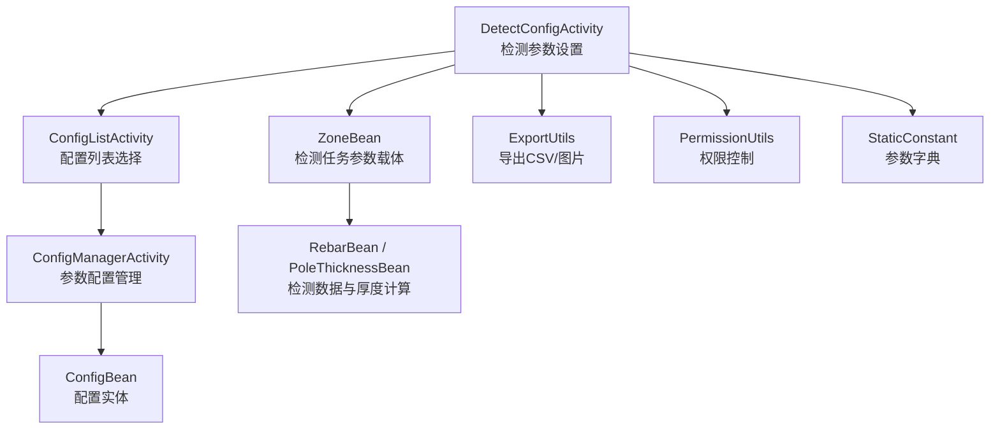
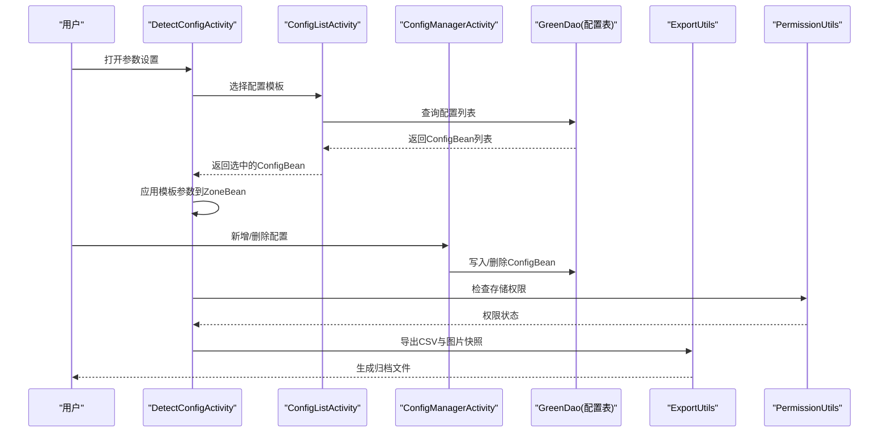
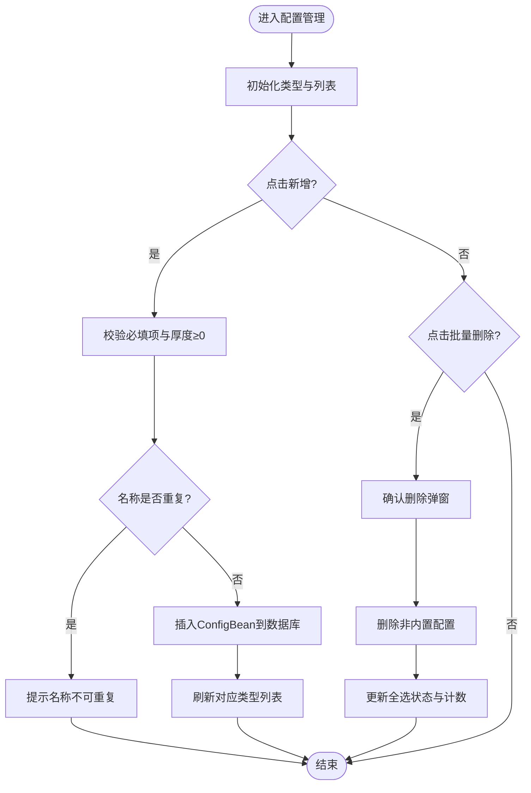
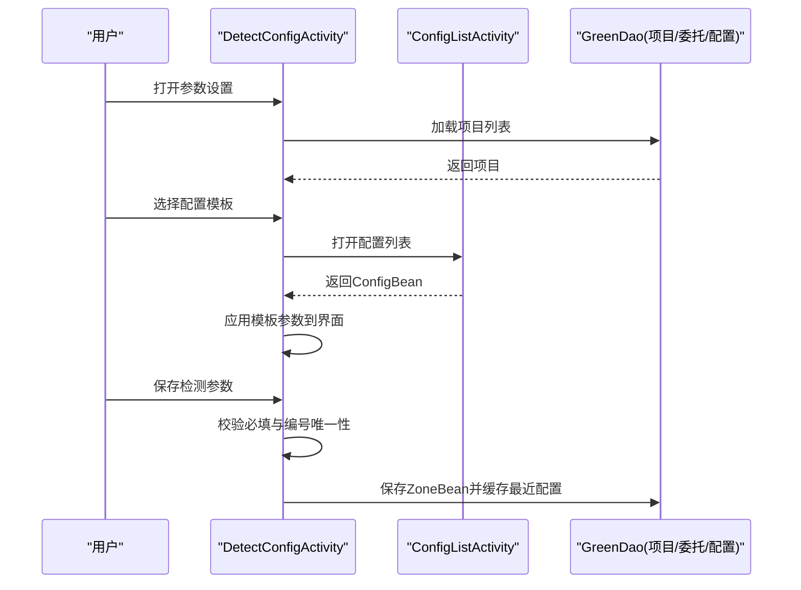
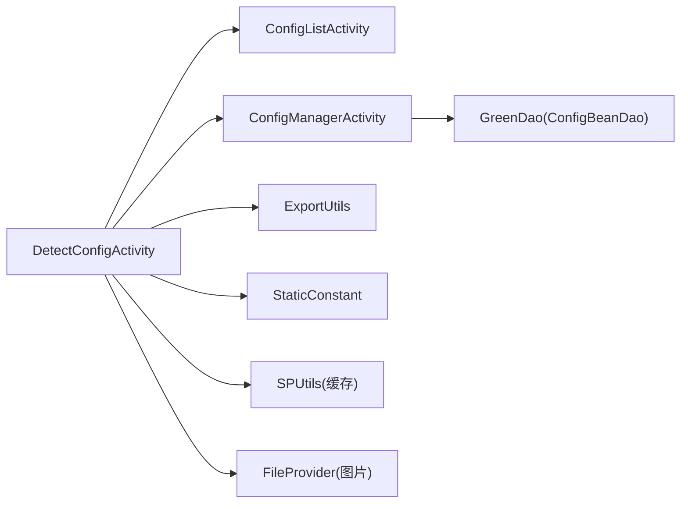

# 参数管理

<cite>
**本文引用的文件**
- [ConfigBean.java](file://app/src/main/java/com/example/gtj_sd_dg240/model/ConfigBean.java)
- [ConfigManagerActivity.java](file://app/src/main/java/com/example/gtj_sd_dg240/activity/testing/ConfigManagerActivity.java)
- [DetectConfigActivity.java](file://app/src/main/java/com/example/gtj_sd_dg240/activity/testing/DetectConfigActivity.java)
- [ConfigListActivity.java](file://app/src/main/java/com/example/gtj_sd_dg240/activity/testing/ConfigListActivity.java)
- [StaticConstant.java](file://app/src/main/java/com/example/gtj_sd_dg240/StaticConstant.java)
- [PoleThicknessBean.java](file://app/src/main/java/com/example/gtj_sd_dg240/model/PoleThicknessBean.java)
- [RebarBean.java](file://app/src/main/java/com/example/gtj_sd_dg240/model/RebarBean.java)
- [CalculatedThicknessUtils.java](file://app/src/main/java/com/example/gtj_sd_dg240/utils/CalculatedThicknessUtils.java)
- [DataExportActivity.java](file://app/src/main/java/com/example/gtj_sd_dg240/activity/data/DataExportActivity.java)
- [ExportUtils.java](file://app/src/main/java/com/example/gtj_sd_dg240/utils/ExportUtils.java)
- [PermissionUtils.java](file://app/src/main/java/com/example/gtj_sd_dg240/utils/PermissionUtils.java)
- [AndroidManifest.xml](file://app/src/main/AndroidManifest.xml)
</cite>

## 目录
1. [简介](#简介)
2. [项目结构](#项目结构)
3. [核心组件](#核心组件)
4. [架构总览](#架构总览)
5. [详细组件分析](#详细组件分析)
6. [依赖关系分析](#依赖关系分析)
7. [性能考虑](#性能考虑)
8. [故障排查指南](#故障排查指南)
9. [结论](#结论)
10. [附录](#附录)

## 简介
本文件围绕“参数管理”主题，系统化说明电杆配置管理、检测参数设置、参数模板管理与参数验证机制。重点覆盖：
- 不同类型电杆的参数配置（普通混凝土电杆、预应力混凝土电杆Y、部分预应力混凝土电杆BY）
- 钢筋规格设置与保护层厚度参数
- 参数继承机制（从模板到具体检测任务）
- 参数冲突检测（名称唯一性、工程内编号唯一性）
- 参数版本管理（通过持久化与选择机制实现）
- 批量导入导出能力（数据导出为CSV与图片快照；内置最小/最大阈值CSV导入）
- 参数模板复制与对比（基于列表选择与详情展示）
- 权限控制（存储、蓝牙等运行时权限）
- 审计日志与恢复机制（结合导出产物与本地持久化）

## 项目结构
参数管理相关代码主要分布在以下模块：
- 模型层：ConfigBean、PoleThicknessBean、RebarBean、ZoneBean（在检测流程中承载参数）
- 界面层：ConfigManagerActivity（配置管理）、DetectConfigActivity（检测参数设置）、ConfigListActivity（配置列表选择）
- 工具层：ExportUtils（导出CSV/图片）、PermissionUtils（权限处理）、CalculatedThicknessUtils（厚度计算）
- 常量与枚举：StaticConstant（电杆类型、结构、规范、钢筋直径等）
- 数据导出：DataExportActivity（批量导出）

图表来源
- [DetectConfigActivity.java:35-70](file://app/src/main/java/com/example/gtj_sd_dg240/activity/testing/DetectConfigActivity.java#L35-L70)
- [ConfigListActivity.java:29-52](file://app/src/main/java/com/example/gtj_sd_dg240/activity/testing/ConfigListActivity.java#L29-L52)
- [ConfigManagerActivity.java:31-59](file://app/src/main/java/com/example/gtj_sd_dg240/activity/testing/ConfigManagerActivity.java#L31-L59)
- [ConfigBean.java:13-64](file://app/src/main/java/com/example/gtj_sd_dg240/model/ConfigBean.java#L13-L64)
- [ExportUtils.java:25-66](file://app/src/main/java/com/example/gtj_sd_dg240/utils/ExportUtils.java#L25-L66)
- [PermissionUtils.java:121-147](file://app/src/main/java/com/example/gtj_sd_dg240/utils/PermissionUtils.java#L121-L147)
- [StaticConstant.java:43-65](file://app/src/main/java/com/example/gtj_sd_dg240/StaticConstant.java#L43-L65)

章节来源
- [DetectConfigActivity.java:35-70](file://app/src/main/java/com/example/gtj_sd_dg240/activity/testing/DetectConfigActivity.java#L35-L70)
- [ConfigManagerActivity.java:31-59](file://app/src/main/java/com/example/gtj_sd_dg240/activity/testing/ConfigManagerActivity.java#L31-L59)
- [ConfigListActivity.java:29-52](file://app/src/main/java/com/example/gtj_sd_dg240/activity/testing/ConfigListActivity.java#L29-L52)
- [StaticConstant.java:43-65](file://app/src/main/java/com/example/gtj_sd_dg240/StaticConstant.java#L43-L65)

## 核心组件
- ConfigBean：电杆配置模板实体，包含电杆名称、长度、根径、梢径、纵筋直径、螺旋筋直径、电杆类型、结构、设计保护层厚度等字段，用于模板化管理与复用。
- DetectConfigActivity：检测参数设置入口，支持选择或新建工程、委托单、加载配置模板、填写检测参数并保存为ZoneBean。
- ConfigManagerActivity：参数配置管理界面，提供新增、删除、按类型筛选、批量操作等功能，维护ConfigBean集合。
- ConfigListActivity：配置列表选择器，用于在检测参数设置时快速选择已有配置模板。
- ExportUtils：将检测参数与结果导出为CSV文本与图片快照，便于归档与审计。
- PermissionUtils：统一封装权限申请与提示，保障导出与存储功能可用。
- StaticConstant：集中定义电杆类型、结构、规范、钢筋直径等参数字典，保证一致性。
- CalculatedThicknessUtils：根据信号与数量范围计算保护层厚度，支撑检测算法。
- PoleThicknessBean/RebarBean：承载厚度计算中间结果与逐点检测结果。

章节来源
- [ConfigBean.java:13-64](file://app/src/main/java/com/example/gtj_sd_dg240/model/ConfigBean.java#L13-L64)
- [DetectConfigActivity.java:35-70](file://app/src/main/java/com/example/gtj_sd_dg240/activity/testing/DetectConfigActivity.java#L35-L70)
- [ConfigManagerActivity.java:31-59](file://app/src/main/java/com/example/gtj_sd_dg240/activity/testing/ConfigManagerActivity.java#L31-L59)
- [ConfigListActivity.java:29-52](file://app/src/main/java/com/example/gtj_sd_dg240/activity/testing/ConfigListActivity.java#L29-L52)
- [ExportUtils.java:25-66](file://app/src/main/java/com/example/gtj_sd_dg240/utils/ExportUtils.java#L25-L66)
- [PermissionUtils.java:121-147](file://app/src/main/java/com/example/gtj_sd_dg240/utils/PermissionUtils.java#L121-L147)
- [StaticConstant.java:43-65](file://app/src/main/java/com/example/gtj_sd_dg240/StaticConstant.java#L43-L65)
- [CalculatedThicknessUtils.java:22-59](file://app/src/main/java/com/example/gtj_sd_dg240/utils/CalculatedThicknessUtils.java#L22-L59)
- [PoleThicknessBean.java:7-39](file://app/src/main/java/com/example/gtj_sd_dg240/model/PoleThicknessBean.java#L7-L39)
- [RebarBean.java:5-25](file://app/src/main/java/com/example/gtj_sd_dg240/model/RebarBean.java#L5-L25)

## 架构总览
参数管理贯穿“模板创建—选择—应用—校验—导出—归档”的完整链路：
- 模板创建与维护：ConfigManagerActivity负责增删改查ConfigBean，按电杆类型分组管理。
- 模板选择与应用：DetectConfigActivity通过ConfigListActivity选择模板，并将模板参数应用到当前检测任务（ZoneBean）。
- 参数校验：创建模板时进行必填项校验与设计厚度≥0校验；保存检测任务时进行工程内电杆编号唯一性校验。
- 参数导出与归档：DataExportActivity+ExportUtils生成CSV与图片快照，形成可审计的归档产物。
- 权限控制：PermissionUtils确保存储与蓝牙等权限满足导出与设备连接需求。

图表来源
- [DetectConfigActivity.java:211-227](file://app/src/main/java/com/example/gtj_sd_dg240/activity/testing/DetectConfigActivity.java#L211-L227)
- [ConfigListActivity.java:67-97](file://app/src/main/java/com/example/gtj_sd_dg240/activity/testing/ConfigListActivity.java#L67-L97)
- [ConfigManagerActivity.java:214-286](file://app/src/main/java/com/example/gtj_sd_dg240/activity/testing/ConfigManagerActivity.java#L214-L286)
- [ExportUtils.java:25-66](file://app/src/main/java/com/example/gtj_sd_dg240/utils/ExportUtils.java#L25-L66)
- [PermissionUtils.java:121-147](file://app/src/main/java/com/example/gtj_sd_dg240/utils/PermissionUtils.java#L121-L147)

## 详细组件分析

### 电杆配置管理（ConfigManagerActivity）
- 功能要点
  - 按电杆类型（普通、预应力Y、部分预应力BY）分组显示配置列表
  - 支持新增配置：必填项校验、设计保护层厚度≥0校验、名称唯一性校验
  - 支持批量删除：勾选后统一删除，且保护系统内置配置不被误删
  - 选中高亮：当前选中配置在列表中突出显示
- 关键流程
  - 初始化：绑定下拉框数据源（类型、结构、钢筋直径、螺旋筋直径），加载三类配置列表
  - 创建：校验输入→查重→构造ConfigBean→插入数据库→刷新列表
  - 删除：确认弹窗→遍历三类列表→非内置配置则删除→更新UI
- 数据流
  - 使用GreenDao访问ConfigBeanDao进行CRUD
  - 通过StaticConstant提供的常量与列表驱动UI选项

图表来源
- [ConfigManagerActivity.java:61-89](file://app/src/main/java/com/example/gtj_sd_dg240/activity/testing/ConfigManagerActivity.java#L61-L89)
- [ConfigManagerActivity.java:214-286](file://app/src/main/java/com/example/gtj_sd_dg240/activity/testing/ConfigManagerActivity.java#L214-L286)
- [ConfigManagerActivity.java:288-331](file://app/src/main/java/com/example/gtj_sd_dg240/activity/testing/ConfigManagerActivity.java#L288-L331)

章节来源
- [ConfigManagerActivity.java:61-89](file://app/src/main/java/com/example/gtj_sd_dg240/activity/testing/ConfigManagerActivity.java#L61-L89)
- [ConfigManagerActivity.java:214-286](file://app/src/main/java/com/example/gtj_sd_dg240/activity/testing/ConfigManagerActivity.java#L214-L286)
- [ConfigManagerActivity.java:288-331](file://app/src/main/java/com/example/gtj_sd_dg240/activity/testing/ConfigManagerActivity.java#L288-L331)
- [StaticConstant.java:43-65](file://app/src/main/java/com/example/gtj_sd_dg240/StaticConstant.java#L43-L65)

### 检测参数设置（DetectConfigActivity）
- 功能要点
  - 支持选择工程、委托单、配置模板
  - 自动同步等径杆的梢径与根径一致
  - 保存时将模板的设计保护层厚度覆盖到任务参数
  - 工程内电杆编号唯一性校验
- 关键流程
  - 初始化：加载项目列表、绑定下拉框数据源、读取上次配置缓存
  - 模板应用：从ConfigListActivity返回的ConfigBean填充界面字段
  - 保存：校验必填→查重→构建ZoneBean→持久化并缓存最近配置
- 参数继承机制
  - 当选择了配置模板时，ZoneBean.designThickness将被模板值覆盖，实现“模板参数优先”的继承策略

图表来源
- [DetectConfigActivity.java:138-155](file://app/src/main/java/com/example/gtj_sd_dg240/activity/testing/DetectConfigActivity.java#L138-L155)
- [DetectConfigActivity.java:211-227](file://app/src/main/java/com/example/gtj_sd_dg240/activity/testing/DetectConfigActivity.java#L211-L227)
- [DetectConfigActivity.java:281-368](file://app/src/main/java/com/example/gtj_sd_dg240/activity/testing/DetectConfigActivity.java#L281-L368)

章节来源
- [DetectConfigActivity.java:138-155](file://app/src/main/java/com/example/gtj_sd_dg240/activity/testing/DetectConfigActivity.java#L138-L155)
- [DetectConfigActivity.java:211-227](file://app/src/main/java/com/example/gtj_sd_dg240/activity/testing/DetectConfigActivity.java#L211-L227)
- [DetectConfigActivity.java:281-368](file://app/src/main/java/com/example/gtj_sd_dg240/activity/testing/DetectConfigActivity.java#L281-L368)

### 参数模板管理（ConfigListActivity）
- 功能要点
  - 按类型筛选配置列表
  - 选中后展示详细信息（名称、类型、结构、尺寸、钢筋直径、设计厚度）
  - 返回选中配置给调用方（DetectConfigActivity）
- 使用场景
  - 作为参数设置的模板选择器，支持快速切换不同模板

章节来源
- [ConfigListActivity.java:67-97](file://app/src/main/java/com/example/gtj_sd_dg240/activity/testing/ConfigListActivity.java#L67-L97)
- [ConfigListActivity.java:99-147](file://app/src/main/java/com/example/gtj_sd_dg240/activity/testing/ConfigListActivity.java#L99-L147)

### 参数验证机制
- 模板创建验证
  - 必填项校验：名称、长度、根径、梢径、类型、结构、钢筋直径、螺旋筋直径、设计厚度
  - 数值校验：设计保护层厚度需≥0
  - 唯一性校验：配置名称不可重复
- 检测任务保存验证
  - 必填项校验：工程、编号、类型、结构、规范、长度、设计厚度、根径、梢径、钢筋直径、螺旋筋直径
  - 工程内编号唯一性：同一工程下电杆编号不能重复

章节来源
- [ConfigManagerActivity.java:214-286](file://app/src/main/java/com/example/gtj_sd_dg240/activity/testing/ConfigManagerActivity.java#L214-L286)
- [DetectConfigActivity.java:281-368](file://app/src/main/java/com/example/gtj_sd_dg240/activity/testing/DetectConfigActivity.java#L281-L368)

### 参数版本管理
- 通过ConfigBean的id主键与持久化存储实现版本管理
- 选择模板即选择特定版本参数，后续检测任务以ZoneBean形式保存，形成“模板版本—任务实例”的关系
- 最近配置缓存：通过SPUtils缓存最近一次配置的ZoneBean，便于快速复用

章节来源
- [ConfigBean.java:13-64](file://app/src/main/java/com/example/gtj_sd_dg240/model/ConfigBean.java#L13-L64)
- [DetectConfigActivity.java:71-93](file://app/src/main/java/com/example/gtj_sd_dg240/activity/testing/DetectConfigActivity.java#L71-L93)
- [DetectConfigActivity.java:366-368](file://app/src/main/java/com/example/gtj_sd_dg240/activity/testing/DetectConfigActivity.java#L366-L368)

### 参数批量导入导出
- 导出
  - DataExportActivity负责批量导出：查询待导出ZoneBean→生成CSV与图片快照→保存到本地与USB
  - ExportUtils.getExportString生成CSV内容，包含工程信息、试验参数、保护层厚度表格
- 导入
  - 启动时导入最小/最大阈值配置：ExportMinMaxBeanUtils读取assets下的RebarMinMax.csv并入库

章节来源
- [DataExportActivity.java:346-471](file://app/src/main/java/com/example/gtj_sd_dg240/activity/data/DataExportActivity.java#L346-L471)
- [ExportUtils.java:25-66](file://app/src/main/java/com/example/gtj_sd_dg240/utils/ExportUtils.java#L25-L66)
- [MainActivity.java:357-379](file://app/src/main/java/com/example/gtj_sd_dg240/activity/MainActivity.java#L357-L379)

### 参数模板复制与对比
- 模板复制
  - 可通过ConfigListActivity选择现有模板，再在DetectConfigActivity中修改后保存为新配置，实现“复制—修改—另存”的工作流
- 模板对比
  - 通过ConfigListActivity的详情展示（名称、类型、结构、尺寸、钢筋直径、设计厚度）进行直观对比

章节来源
- [ConfigListActivity.java:99-147](file://app/src/main/java/com/example/gtj_sd_dg240/activity/testing/ConfigListActivity.java#L99-L147)
- [DetectConfigActivity.java:211-227](file://app/src/main/java/com/example/gtj_sd_dg240/activity/testing/DetectConfigActivity.java#L211-L227)

### 参数权限控制
- 权限声明
  - AndroidManifest.xml声明了蓝牙、位置、存储等权限
- 运行时权限
  - PermissionUtils封装权限申请与提示，引导用户开启“所有文件访问权限”，保障导出功能正常

章节来源
- [AndroidManifest.xml:11-45](file://app/src/main/AndroidManifest.xml#L11-L45)
- [PermissionUtils.java:121-147](file://app/src/main/java/com/example/gtj_sd_dg240/utils/PermissionUtils.java#L121-L147)

### 参数审计日志与恢复机制
- 审计日志
  - 导出CSV与图片快照构成审计证据，包含工程信息、试验参数、保护层厚度明细
- 恢复机制
  - 通过CSV与图片可回溯历史检测任务
  - 最近配置缓存便于快速恢复上次参数

章节来源
- [ExportUtils.java:25-66](file://app/src/main/java/com/example/gtj_sd_dg240/utils/ExportUtils.java#L25-L66)
- [DataExportActivity.java:346-471](file://app/src/main/java/com/example/gtj_sd_dg240/activity/data/DataExportActivity.java#L346-L471)
- [DetectConfigActivity.java:71-93](file://app/src/main/java/com/example/gtj_sd_dg240/activity/testing/DetectConfigActivity.java#L71-L93)

## 依赖关系分析
- 组件耦合
  - DetectConfigActivity依赖ConfigListActivity与ConfigManagerActivity完成模板选择与管理
  - ConfigManagerActivity依赖GreenDao进行配置数据的CRUD
  - DataExportActivity依赖ExportUtils生成导出文件
  - 所有界面依赖StaticConstant提供参数字典
- 外部依赖
  - GreenDao用于数据持久化
  - SPUtils用于本地缓存
  - FileProvider用于安全地保存图片文件

图表来源
- [DetectConfigActivity.java:211-227](file://app/src/main/java/com/example/gtj_sd_dg240/activity/testing/DetectConfigActivity.java#L211-L227)
- [ConfigManagerActivity.java:214-286](file://app/src/main/java/com/example/gtj_sd_dg240/activity/testing/ConfigManagerActivity.java#L214-L286)
- [ExportUtils.java:75-95](file://app/src/main/java/com/example/gtj_sd_dg240/utils/ExportUtils.java#L75-L95)
- [StaticConstant.java:43-65](file://app/src/main/java/com/example/gtj_sd_dg240/StaticConstant.java#L43-L65)

章节来源
- [DetectConfigActivity.java:211-227](file://app/src/main/java/com/example/gtj_sd_dg240/activity/testing/DetectConfigActivity.java#L211-L227)
- [ConfigManagerActivity.java:214-286](file://app/src/main/java/com/example/gtj_sd_dg240/activity/testing/ConfigManagerActivity.java#L214-L286)
- [ExportUtils.java:75-95](file://app/src/main/java/com/example/gtj_sd_dg240/utils/ExportUtils.java#L75-L95)
- [StaticConstant.java:43-65](file://app/src/main/java/com/example/gtj_sd_dg240/StaticConstant.java#L43-L65)

## 性能考虑
- 列表渲染与刷新
  - 使用RecyclerView与适配器按需刷新，避免全量重绘
- 数据导出
  - 批量导出采用异步处理与进度提示，减少UI阻塞
- 厚度计算
  - CalculatedThicknessUtils对信号区间进行快速定位与统计，复杂度与信号点数线性相关

[本节为通用性能建议，不直接分析具体文件]

## 故障排查指南
- 常见问题
  - 导出失败：检查存储权限是否授予，确认路径可写
  - 编号重复：保存前校验工程内编号唯一性，避免冲突
  - 模板未生效：确认已正确选择模板并覆盖ZoneBean.designThickness
- 定位方法
  - 查看导出日志与错误提示
  - 检查GreenDao数据是否正确写入
  - 核对StaticConstant字典是否与UI选项一致

章节来源
- [PermissionUtils.java:121-147](file://app/src/main/java/com/example/gtj_sd_dg240/utils/PermissionUtils.java#L121-L147)
- [DetectConfigActivity.java:281-368](file://app/src/main/java/com/example/gtj_sd_dg240/activity/testing/DetectConfigActivity.java#L281-L368)
- [ExportUtils.java:100-116](file://app/src/main/java/com/example/gtj_sd_dg240/utils/ExportUtils.java#L100-L116)

## 结论
本项目实现了完整的参数管理能力：
- 模板化配置：通过ConfigBean统一管理电杆参数，支持多类型、多结构
- 参数继承：模板参数优先应用于检测任务，确保一致性
- 校验与冲突检测：严格的必填与唯一性校验，降低人为错误
- 版本与归档：通过持久化与导出产物实现版本管理与审计追溯
- 权限与可用性：完善的权限控制保障功能稳定运行

[本节为总结性内容，不直接分析具体文件]

## 附录
- 数据类型与字段说明
  - ConfigBean：配置模板实体，包含电杆名称、长度、根径、梢径、纵筋直径、螺旋筋直径、类型、结构、设计厚度
  - ZoneBean：检测任务参数载体，包含工程、编号、类型、结构、规范、尺寸、钢筋直径、螺旋筋直径、设计厚度、钢筋数据等
  - RebarBean：逐点检测结果，包含位移、左右信号、厚度、部位
  - PoleThicknessBean：厚度计算中间结果，包含信号、补偿值、最终厚度

章节来源
- [ConfigBean.java:13-64](file://app/src/main/java/com/example/gtj_sd_dg240/model/ConfigBean.java#L13-L64)
- [RebarBean.java:5-25](file://app/src/main/java/com/example/gtj_sd_dg240/model/RebarBean.java#L5-L25)
- [PoleThicknessBean.java:7-39](file://app/src/main/java/com/example/gtj_sd_dg240/model/PoleThicknessBean.java#L7-L39)