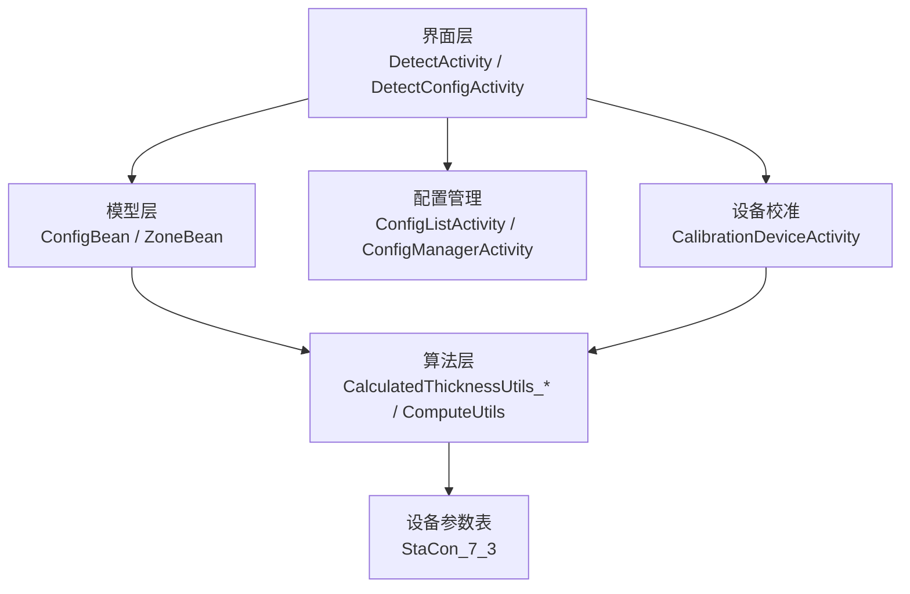
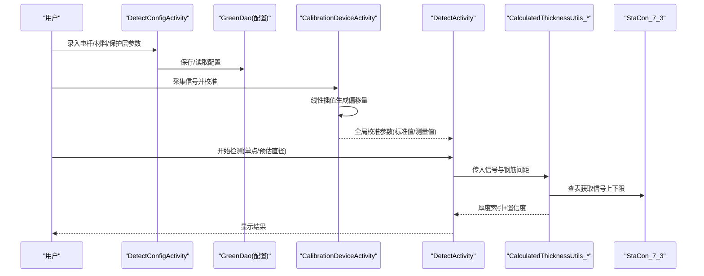
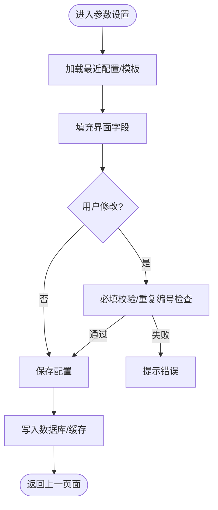
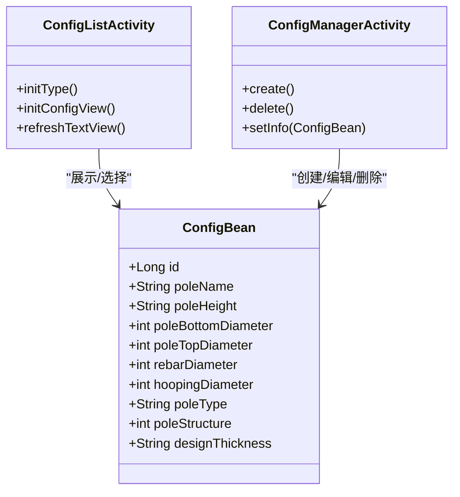
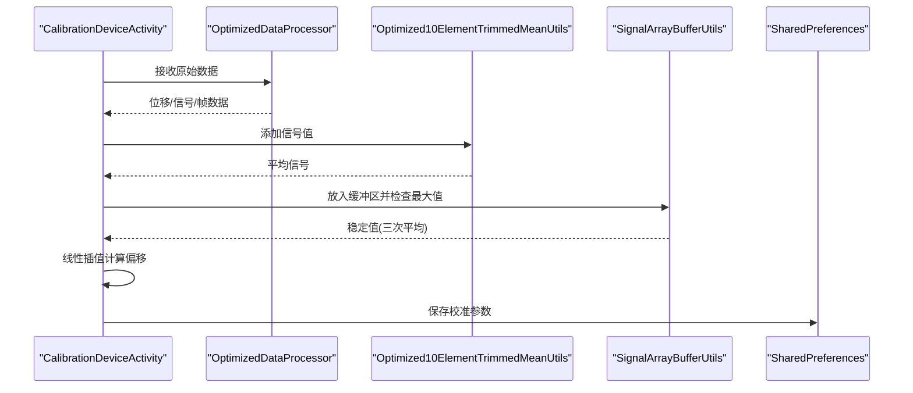
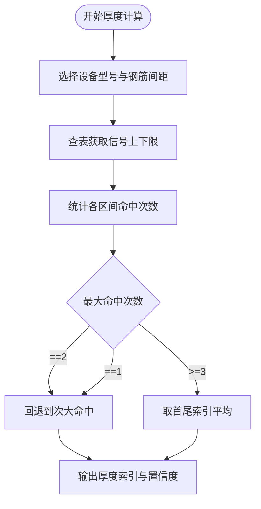
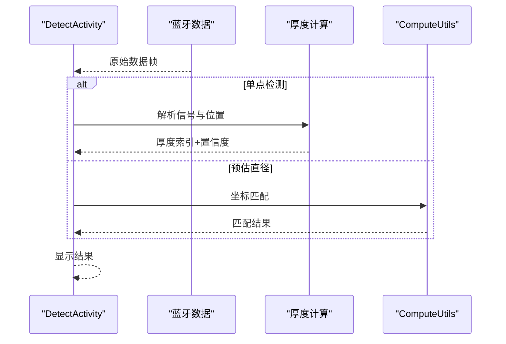
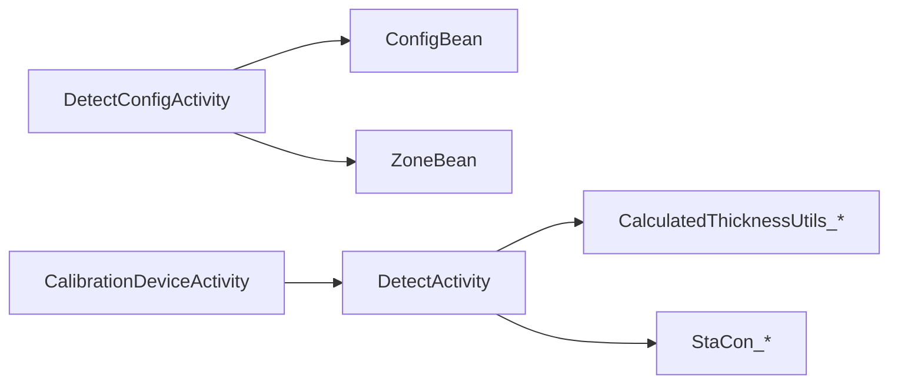

# 检测参数设置

<cite>
**本文引用的文件**
- [DetectConfigActivity.java](file://app/src/main/java/com/example/gtj_sd_dg240/activity/testing/DetectConfigActivity.java)
- [ConfigBean.java](file://app/src/main/java/com/example/gtj_sd_dg240/model/ConfigBean.java)
- [ZoneBean.java](file://app/src/main/java/com/example/gtj_sd_dg240/model/ZoneBean.java)
- [ConfigListActivity.java](file://app/src/main/java/com/example/gtj_sd_dg240/activity/testing/ConfigListActivity.java)
- [ConfigManagerActivity.java](file://app/src/main/java/com/example/gtj_sd_dg240/activity/testing/ConfigManagerActivity.java)
- [CalibrationDeviceActivity.java](file://app/src/main/java/com/example/gtj_sd_dg240/activity/setting/CalibrationDeviceActivity.java)
- [StaCon_7_3.java](file://app/src/main/java/com/example/gtj_sd_dg240/stacon/StaCon_7_3.java)
- [CalculatedThicknessUtils_7_3.java](file://app/src/main/java/com/example/gtj_sd_dg240/utils/CalculatedThicknessUtils_7_3.java)
- [CalculatedThicknessUtils.java](file://app/src/main/java/com/example/gtj_sd_dg240/utils/CalculatedThicknessUtils.java)
- [ComputeUtils.java](file://app/src/main/java/com/example/gtj_sd_dg240/utils/ComputeUtils.java)
- [DetectActivity.java](file://app/src/main/java/com/example/gtj_sd_dg240/activity/testing/DetectActivity.java)
</cite>

## 目录
1. [简介](#简介)
2. [项目结构](#项目结构)
3. [核心组件](#核心组件)
4. [架构总览](#架构总览)
5. [详细组件分析](#详细组件分析)
6. [依赖关系分析](#依赖关系分析)
7. [性能考虑](#性能考虑)
8. [故障排查指南](#故障排查指南)
9. [结论](#结论)
10. [附录](#附录)

## 简介
本文件面向混凝土电杆检测设备（如7.3型、9.3型、10.4型等）的检测参数设置与使用，覆盖以下主题：
- 信号阈值与标定参数：校准标准值与测量值映射、插值补偿
- 滤波与采样：滑动窗口平均、数据缓冲与去抖
- 厚度计算算法：查表匹配、区间计数与取中策略
- 检测模式：单点检测与预估直径模式
- 保护层厚度：设计值输入与校验
- 参数模板与配置管理：预设模板、选择与恢复
- 参数验证与继承：必填校验、工程级默认与设备级默认
- 版本兼容：不同型号设备的参数表与工具类隔离

## 项目结构
本项目采用按功能模块组织的结构，关键路径如下：
- 活动层：检测与配置界面（DetectActivity、DetectConfigActivity、ConfigListActivity、ConfigManagerActivity、CalibrationDeviceActivity）
- 模型层：配置与检测对象（ConfigBean、ZoneBean）
- 设备适配层：不同型号的参数表（StaCon_7_3等）
- 算法层：厚度计算与空间匹配（CalculatedThicknessUtils_*、ComputeUtils）
- 工具层：数据处理与UI辅助（SignalArrayBufferUtils、Optimized10ElementTrimmedMeanUtils等）

图表来源
- [DetectActivity.java:74-106](file://app/src/main/java/com/example/gtj_sd_dg240/activity/testing/DetectActivity.java#L74-L106)
- [DetectConfigActivity.java:49-69](file://app/src/main/java/com/example/gtj_sd_dg240/activity/testing/DetectConfigActivity.java#L49-L69)
- [ConfigListActivity.java:39-52](file://app/src/main/java/com/example/gtj_sd_dg240/activity/testing/ConfigListActivity.java#L39-L52)
- [ConfigManagerActivity.java:48-59](file://app/src/main/java/com/example/gtj_sd_dg240/activity/testing/ConfigManagerActivity.java#L48-L59)
- [CalibrationDeviceActivity.java:52-71](file://app/src/main/java/com/example/gtj_sd_dg240/activity/setting/CalibrationDeviceActivity.java#L52-L71)
- [CalculatedThicknessUtils_7_3.java:17-31](file://app/src/main/java/com/example/gtj_sd_dg240/utils/CalculatedThicknessUtils_7_3.java#L17-L31)
- [StaCon_7_3.java:6-24](file://app/src/main/java/com/example/gtj_sd_dg240/stacon/StaCon_7_3.java#L6-L24)

章节来源
- [DetectActivity.java:74-106](file://app/src/main/java/com/example/gtj_sd_dg240/activity/testing/DetectActivity.java#L74-L106)
- [DetectConfigActivity.java:49-69](file://app/src/main/java/com/example/gtj_sd_dg240/activity/testing/DetectConfigActivity.java#L49-L69)
- [ConfigListActivity.java:39-52](file://app/src/main/java/com/example/gtj_sd_dg240/activity/testing/ConfigListActivity.java#L39-L52)
- [ConfigManagerActivity.java:48-59](file://app/src/main/java/com/example/gtj_sd_dg240/activity/testing/ConfigManagerActivity.java#L48-L59)
- [CalibrationDeviceActivity.java:52-71](file://app/src/main/java/com/example/gtj_sd_dg240/activity/setting/CalibrationDeviceActivity.java#L52-L71)

## 核心组件
- 检测参数配置界面（DetectConfigActivity）：负责工程信息、构件编号、电杆类型/结构/规范、长度、根径/梢径、纵筋/螺旋筋直径、设计保护层厚度等参数的录入与保存；支持从最近配置或模板加载。
- 配置列表与管理（ConfigListActivity、ConfigManagerActivity）：提供按电杆类型筛选、创建/删除配置模板、查看配置详情。
- 设备校准（CalibrationDeviceActivity）：维护“标准值-测量值”的校准曲线，采集信号并计算平均值，保存为全局校准参数。
- 厚度计算（CalculatedThicknessUtils_*）：根据设备型号与钢筋间距组合，查表匹配信号范围，统计命中次数，输出厚度索引与置信度。
- 设备参数表（StaCon_7_3）：定义不同主筋间距与箍筋间距下的信号上下限序列，供厚度计算使用。
- 空间匹配（ComputeUtils）：用于预估直径等场景的空间区域匹配逻辑。

章节来源
- [DetectConfigActivity.java:281-367](file://app/src/main/java/com/example/gtj_sd_dg240/activity/testing/DetectConfigActivity.java#L281-L367)
- [ConfigListActivity.java:67-146](file://app/src/main/java/com/example/gtj_sd_dg240/activity/testing/ConfigListActivity.java#L67-L146)
- [ConfigManagerActivity.java:214-286](file://app/src/main/java/com/example/gtj_sd_dg240/activity/testing/ConfigManagerActivity.java#L214-L286)
- [CalibrationDeviceActivity.java:129-215](file://app/src/main/java/com/example/gtj_sd_dg240/activity/setting/CalibrationDeviceActivity.java#L129-L215)
- [CalculatedThicknessUtils.java:22-59](file://app/src/main/java/com/example/gtj_sd_dg240/utils/CalculatedThicknessUtils.java#L22-L59)
- [StaCon_7_3.java:6-75](file://app/src/main/java/com/example/gtj_sd_dg240/stacon/StaCon_7_3.java#L6-L75)
- [ComputeUtils.java:39-150](file://app/src/main/java/com/example/gtj_sd_dg240/utils/ComputeUtils.java#L39-L150)

## 架构总览
检测参数设置贯穿“配置—校准—检测—计算”的全流程：
- 配置阶段：在DetectConfigActivity中完成构件与材料参数录入，并持久化到数据库；支持从最近一次配置或模板加载。
- 校准阶段：在CalibrationDeviceActivity中采集信号，建立“标准值-测量值”的线性插值映射，保存为全局校准参数。
- 检测阶段：DetectActivity接收蓝牙数据，按模式（单点检测/预估直径）处理；调用厚度计算工具进行厚度推断。
- 计算阶段：CalculatedThicknessUtils_*依据设备型号与钢筋间距组合，查表匹配信号范围，统计命中次数，输出厚度索引与置信度。

图表来源
- [DetectConfigActivity.java:281-367](file://app/src/main/java/com/example/gtj_sd_dg240/activity/testing/DetectConfigActivity.java#L281-L367)
- [CalibrationDeviceActivity.java:129-215](file://app/src/main/java/com/example/gtj_sd_dg240/activity/setting/CalibrationDeviceActivity.java#L129-L215)
- [DetectActivity.java:171-190](file://app/src/main/java/com/example/gtj_sd_dg240/activity/testing/DetectActivity.java#L171-L190)
- [CalculatedThicknessUtils.java:22-59](file://app/src/main/java/com/example/gtj_sd_dg240/utils/CalculatedThicknessUtils.java#L22-L59)
- [StaCon_7_3.java:6-75](file://app/src/main/java/com/example/gtj_sd_dg240/stacon/StaCon_7_3.java#L6-L75)

## 详细组件分析

### 检测参数配置（DetectConfigActivity）
- 功能要点
  - 工程与构件信息：项目名称、构件编号、委托单号
  - 电杆属性：类型、结构、规范、长度、根径/梢径
  - 材料参数：纵筋直径、螺旋筋直径
  - 设计保护层厚度：作为厚度计算的参考基准
  - 参数继承：若存在上次配置，自动填充；可手动调整
  - 参数验证：必填项检查、重复编号检查
  - 模板加载：可从ConfigListActivity选择预设模板回填
- 关键流程
  - 初始化：从Intent或SP加载最近配置
  - 视图绑定：下拉框数据源绑定（结构、规范、钢筋直径、螺旋筋直径）
  - 保存：校验后写入ZoneBean，并持久化到数据库；同时缓存到SP以便下次复用

图表来源
- [DetectConfigActivity.java:71-127](file://app/src/main/java/com/example/gtj_sd_dg240/activity/testing/DetectConfigActivity.java#L71-L127)
- [DetectConfigActivity.java:138-177](file://app/src/main/java/com/example/gtj_sd_dg240/activity/testing/DetectConfigActivity.java#L138-L177)
- [DetectConfigActivity.java:281-367](file://app/src/main/java/com/example/gtj_sd_dg240/activity/testing/DetectConfigActivity.java#L281-L367)

章节来源
- [DetectConfigActivity.java:71-127](file://app/src/main/java/com/example/gtj_sd_dg240/activity/testing/DetectConfigActivity.java#L71-L127)
- [DetectConfigActivity.java:138-177](file://app/src/main/java/com/example/gtj_sd_dg240/activity/testing/DetectConfigActivity.java#L138-L177)
- [DetectConfigActivity.java:281-367](file://app/src/main/java/com/example/gtj_sd_dg240/activity/testing/DetectConfigActivity.java#L281-L367)

### 配置模板与对比（ConfigListActivity、ConfigManagerActivity）
- 功能要点
  - 按电杆类型筛选配置模板（PT/Y/BY）
  - 创建新模板：名称、长度、根径/梢径、纵筋/螺旋筋直径、设计保护层厚度
  - 删除模板：批量选择删除，保护内置模板不被误删
  - 详情展示：模板各参数一览
- 参数对比
  - 通过模板详情视图直观对比不同模板的差异，便于选择合适模板
- 参数恢复
  - 选择模板后回填至DetectConfigActivity，实现快速恢复

图表来源
- [ConfigBean.java:13-64](file://app/src/main/java/com/example/gtj_sd_dg240/model/ConfigBean.java#L13-L64)
- [ConfigListActivity.java:67-146](file://app/src/main/java/com/example/gtj_sd_dg240/activity/testing/ConfigListActivity.java#L67-L146)
- [ConfigManagerActivity.java:214-286](file://app/src/main/java/com/example/gtj_sd_dg240/activity/testing/ConfigManagerActivity.java#L214-L286)

章节来源
- [ConfigListActivity.java:67-146](file://app/src/main/java/com/example/gtj_sd_dg240/activity/testing/ConfigListActivity.java#L67-L146)
- [ConfigManagerActivity.java:214-286](file://app/src/main/java/com/example/gtj_sd_dg240/activity/testing/ConfigManagerActivity.java#L214-L286)
- [ConfigBean.java:13-64](file://app/src/main/java/com/example/gtj_sd_dg240/model/ConfigBean.java#L13-L64)

### 设备校准与信号阈值（CalibrationDeviceActivity）
- 功能要点
  - 校准标准值与测量值：维护两组数组，分别表示标准厚度对应的传感器读数与当前设备实际读数
  - 线性插值补偿：根据当前测量值落在哪个区间，计算偏移量并修正
  - 信号采集与滤波：使用滑动窗口平均（10元素截尾均值）与缓冲区去抖，避免噪声干扰
  - 多次采集取平均：连续三次稳定值求平均，提升稳定性
- 关键流程
  - 初始化：加载已保存的校准参数
  - 数据采集：蓝牙接收原始数据，转换为信号值
  - 滤波与去抖：均值滤波+时间窗清空，防止漂移
  - 保存：将校准参数持久化到SP

图表来源
- [CalibrationDeviceActivity.java:129-215](file://app/src/main/java/com/example/gtj_sd_dg240/activity/setting/CalibrationDeviceActivity.java#L129-L215)
- [CalibrationDeviceActivity.java:300-372](file://app/src/main/java/com/example/gtj_sd_dg240/activity/setting/CalibrationDeviceActivity.java#L300-L372)

章节来源
- [CalibrationDeviceActivity.java:129-215](file://app/src/main/java/com/example/gtj_sd_dg240/activity/setting/CalibrationDeviceActivity.java#L129-L215)
- [CalibrationDeviceActivity.java:300-372](file://app/src/main/java/com/example/gtj_sd_dg240/activity/setting/CalibrationDeviceActivity.java#L300-L372)

### 厚度计算算法（CalculatedThicknessUtils_* 与 StaCon_7_3）
- 算法概述
  - 查表匹配：根据设备型号与钢筋间距组合，选取对应的信号上下限序列
  - 区间计数：对每个区间的信号范围，统计落入该范围的点数
  - 取中策略：优先选择命中次数最多的区间；若多个区间并列，取首尾索引的平均值
  - 输出：厚度索引与置信度（命中次数）
- 复杂度分析
  - 查找区间：O(N)，N为信号序列长度
  - 区间计数：O(M*N)，M为点数，N为区间数
  - 取中：O(K)，K为并列区间数量
- 优化机会
  - 二分查找替代线性扫描（当序列有序时）
  - 增量更新计数（滑动窗口）

图表来源
- [CalculatedThicknessUtils.java:22-59](file://app/src/main/java/com/example/gtj_sd_dg240/utils/CalculatedThicknessUtils.java#L22-L59)
- [CalculatedThicknessUtils.java:79-129](file://app/src/main/java/com/example/gtj_sd_dg240/utils/CalculatedThicknessUtils.java#L79-L129)
- [StaCon_7_3.java:6-75](file://app/src/main/java/com/example/gtj_sd_dg240/stacon/StaCon_7_3.java#L6-L75)

章节来源
- [CalculatedThicknessUtils.java:22-59](file://app/src/main/java/com/example/gtj_sd_dg240/utils/CalculatedThicknessUtils.java#L22-L59)
- [CalculatedThicknessUtils.java:79-129](file://app/src/main/java/com/example/gtj_sd_dg240/utils/CalculatedThicknessUtils.java#L79-L129)
- [StaCon_7_3.java:6-75](file://app/src/main/java/com/example/gtj_sd_dg240/stacon/StaCon_7_3.java#L6-L75)

### 检测模式与预估直径（DetectActivity）
- 检测模式
  - 单点检测：接收F1帧数据，解析位置与左右信号，直接进行厚度计算
  - 预估直径：累积数据流，按固定长度切片处理，用于直径预估
- 预估直径计算
  - 使用ComputeUtils进行空间匹配，判断输入坐标是否落入预设空间区域
- 参数影响
  - 箍筋间距：影响厚度计算所选表格
  - 校准参数：影响信号值的偏移修正
  - 设计保护层厚度：作为参考基准，参与结果解释

图表来源
- [DetectActivity.java:171-190](file://app/src/main/java/com/example/gtj_sd_dg240/activity/testing/DetectActivity.java#L171-L190)
- [ComputeUtils.java:39-150](file://app/src/main/java/com/example/gtj_sd_dg240/utils/ComputeUtils.java#L39-L150)

章节来源
- [DetectActivity.java:171-190](file://app/src/main/java/com/example/gtj_sd_dg240/activity/testing/DetectActivity.java#L171-L190)
- [ComputeUtils.java:39-150](file://app/src/main/java/com/example/gtj_sd_dg240/utils/ComputeUtils.java#L39-L150)

### 参数验证规则与继承机制
- 验证规则
  - 必填项：工程、构件编号、电杆类型/结构/规范、长度、根径/梢径、纵筋/螺旋筋直径、设计保护层厚度
  - 数值校验：设计保护层厚度需≥0
  - 唯一性：同一工程下构件编号不可重复
- 继承机制
  - 最近配置：从SP加载最近一次ZoneBean，自动填充界面
  - 模板继承：从ConfigListActivity选择模板，回填至DetectConfigActivity
  - 设备默认：校准参数默认值可在CalibrationDeviceActivity中重置

章节来源
- [DetectConfigActivity.java:281-367](file://app/src/main/java/com/example/gtj_sd_dg240/activity/testing/DetectConfigActivity.java#L281-L367)
- [ConfigManagerActivity.java:214-286](file://app/src/main/java/com/example/gtj_sd_dg240/activity/testing/ConfigManagerActivity.java#L214-L286)
- [CalibrationDeviceActivity.java:238-298](file://app/src/main/java/com/example/gtj_sd_dg240/activity/setting/CalibrationDeviceActivity.java#L238-L298)

### 参数版本兼容性处理
- 设备型号隔离：不同型号设备（7.3、9.3、10.4等）对应不同的厚度计算工具类（CalculatedThicknessUtils_7_3、CalculatedThicknessUtils_9_3、CalculatedThicknessUtils_10_4等），避免参数混用
- 参数表隔离：设备参数表（StaCon_7_3等）按型号独立维护，确保查表准确性
- 运行时选择：DetectActivity根据设备型号选择对应的厚度计算工具类

章节来源
- [DetectActivity.java:31-41](file://app/src/main/java/com/example/gtj_sd_dg240/activity/testing/DetectActivity.java#L31-L41)
- [CalculatedThicknessUtils_7_3.java:17-31](file://app/src/main/java/com/example/gtj_sd_dg240/utils/CalculatedThicknessUtils_7_3.java#L17-L31)
- [StaCon_7_3.java:6-75](file://app/src/main/java/com/example/gtj_sd_dg240/stacon/StaCon_7_3.java#L6-L75)

## 依赖关系分析
- 界面与模型：DetectConfigActivity依赖ConfigBean与ZoneBean进行参数传递与持久化
- 界面与算法：DetectActivity依赖CalculatedThicknessUtils_*进行厚度计算
- 校准与检测：CalibrationDeviceActivity生成的校准参数被DetectActivity使用
- 设备适配：不同型号设备通过独立的StaCon_*与CalculatedThicknessUtils_*实现参数隔离

图表来源
- [DetectConfigActivity.java:281-367](file://app/src/main/java/com/example/gtj_sd_dg240/activity/testing/DetectConfigActivity.java#L281-L367)
- [DetectActivity.java:31-41](file://app/src/main/java/com/example/gtj_sd_dg240/activity/testing/DetectActivity.java#L31-L41)
- [CalibrationDeviceActivity.java:129-215](file://app/src/main/java/com/example/gtj_sd_dg240/activity/setting/CalibrationDeviceActivity.java#L129-L215)

章节来源
- [DetectConfigActivity.java:281-367](file://app/src/main/java/com/example/gtj_sd_dg240/activity/testing/DetectConfigActivity.java#L281-L367)
- [DetectActivity.java:31-41](file://app/src/main/java/com/example/gtj_sd_dg240/activity/testing/DetectActivity.java#L31-L41)
- [CalibrationDeviceActivity.java:129-215](file://app/src/main/java/com/example/gtj_sd_dg240/activity/setting/CalibrationDeviceActivity.java#L129-L215)

## 性能考虑
- 查表匹配：建议对信号序列进行排序并使用二分查找，降低查找复杂度
- 区间计数：可采用滑动窗口增量更新，减少重复计算
- 滤波与去抖：合理设置窗口大小与时间窗，平衡响应速度与稳定性
- 内存占用：避免频繁创建大对象，复用缓冲区与工具实例

[本节为通用性能建议，不直接分析具体文件]

## 故障排查指南
- 参数未生效
  - 检查是否选择了正确的模板或最近配置
  - 确认校准参数是否正确保存
- 检测结果异常
  - 检查箍筋间距是否与设备实际一致
  - 检查信号是否在有效范围内
- 模板无法删除
  - 内置模板受保护，无法删除
- 校准失败
  - 检查数据采集是否稳定，必要时重新采集

章节来源
- [ConfigManagerActivity.java:288-331](file://app/src/main/java/com/example/gtj_sd_dg240/activity/testing/ConfigManagerActivity.java#L288-L331)
- [CalibrationDeviceActivity.java:300-372](file://app/src/main/java/com/example/gtj_sd_dg240/activity/setting/CalibrationDeviceActivity.java#L300-L372)

## 结论
本系统通过模块化设计实现了检测参数的灵活配置与高效计算：
- 配置管理：支持模板化、继承与恢复，提升操作效率
- 校准机制：线性插值补偿与滤波去抖，保证测量精度
- 厚度算法：查表匹配与区间计数，兼顾准确性与鲁棒性
- 设备兼容：按型号隔离参数表与工具类，确保多设备支持

[本节为总结性内容，不直接分析具体文件]

## 附录
- 相关常量与枚举：电杆类型、结构、规范、钢筋直径等由StaticConstant统一管理
- 数据存储：GreenDao用于配置与检测结果的持久化
- 工具类：StringUtils、SpinnerUtils等提供字符串处理与UI辅助

[本节为补充说明，不直接分析具体文件]