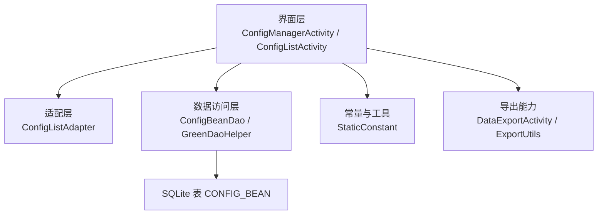
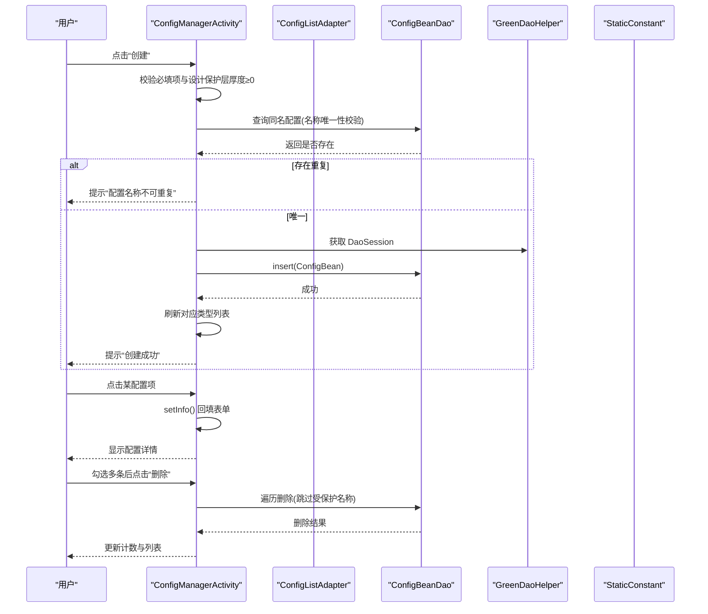
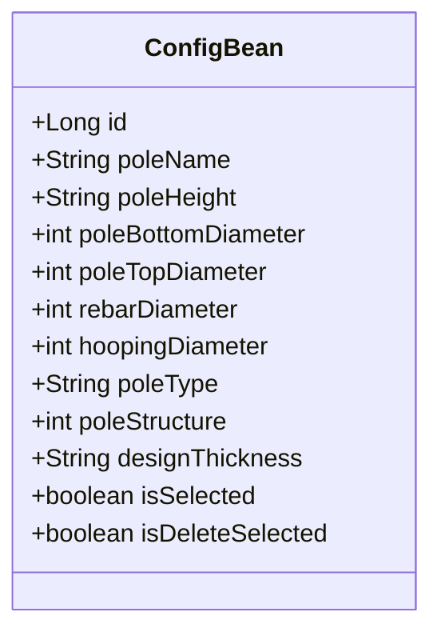
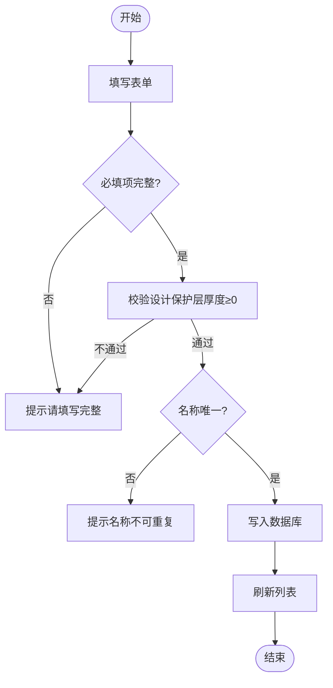
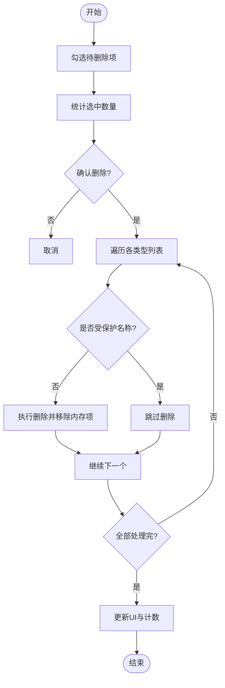
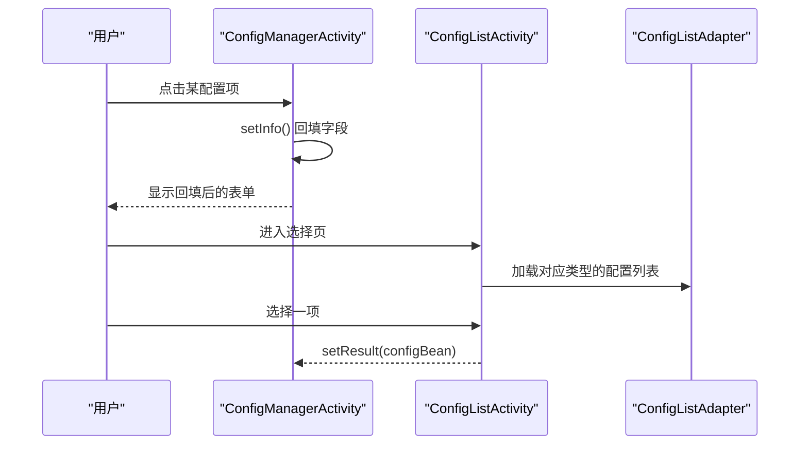
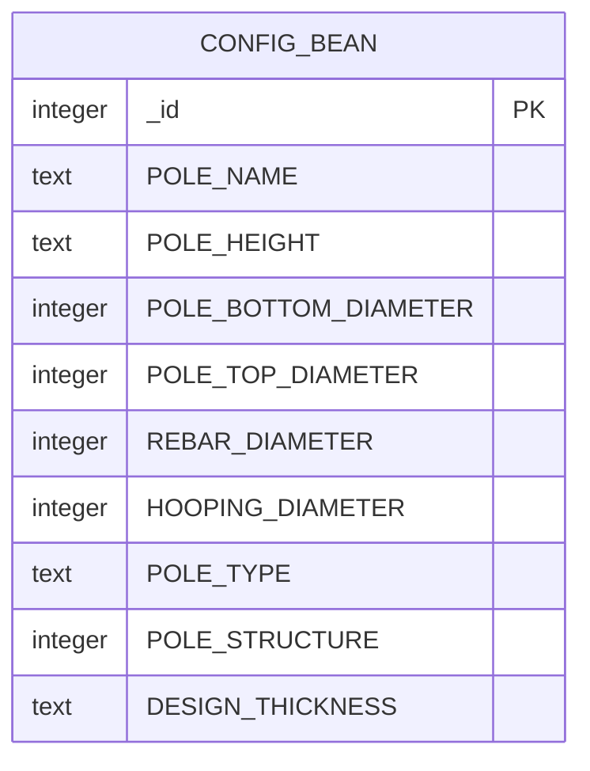
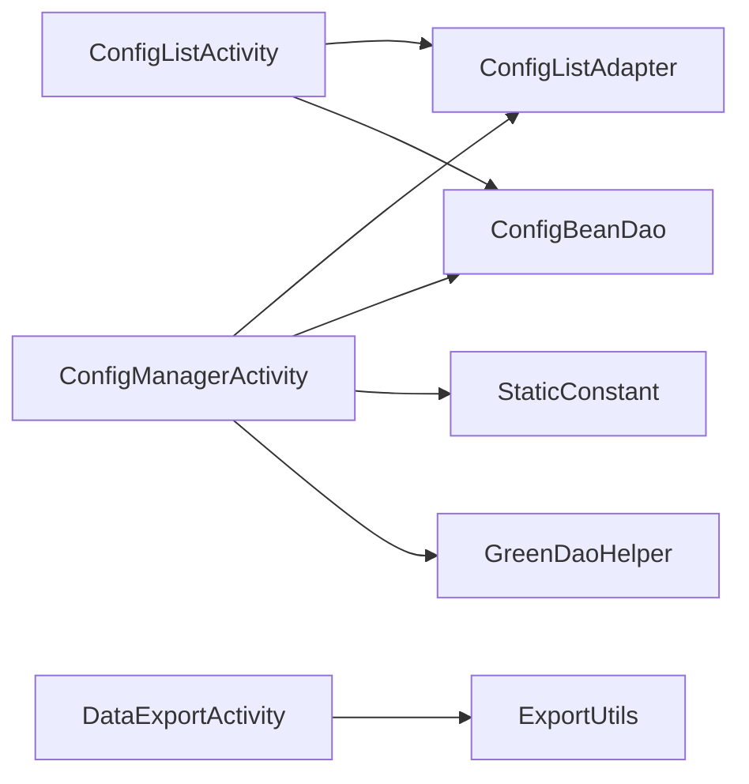

# 电杆配置管理

<cite>
**本文引用的文件**
- [ConfigBean.java](file://app/src/main/java/com/example/gtj_sd_dg240/model/ConfigBean.java)
- [ConfigManagerActivity.java](file://app/src/main/java/com/example/gtj_sd_dg240/activity/testing/ConfigManagerActivity.java)
- [ConfigListActivity.java](file://app/src/main/java/com/example/gtj_sd_dg240/activity/testing/ConfigListActivity.java)
- [ConfigListAdapter.java](file://app/src/main/java/com/example/gtj_sd_dg240/adapter/ConfigListAdapter.java)
- [ConfigBeanDao.java](file://app/src/main/java/com/example/gtj_sd_dg240/functions/database/greenDao/db/ConfigBeanDao.java)
- [GreenDaoHelper.java](file://app/src/main/java/com/example/gtj_sd_dg240/storage/GreenDaoHelper.java)
- [StaticConstant.java](file://app/src/main/java/com/example/gtj_sd_dg240/StaticConstant.java)
- [act_config_manager.xml](file://app/src/main/res/layout/act_config_manager.xml)
- [DataExportActivity.java](file://app/src/main/java/com/example/gtj_sd_dg240/activity/data/DataExportActivity.java)
- [ExportUtils.java](file://app/src/main/java/com/example/gtj_sd_dg240/utils/ExportUtils.java)
</cite>

## 目录
1. [简介](#简介)
2. [项目结构](#项目结构)
3. [核心组件](#核心组件)
4. [架构总览](#架构总览)
5. [详细组件分析](#详细组件分析)
6. [依赖关系分析](#依赖关系分析)
7. [性能考虑](#性能考虑)
8. [故障排查指南](#故障排查指南)
9. [结论](#结论)
10. [附录](#附录)

## 简介
本功能提供混凝土电杆的配置管理能力，支持三类电杆（PT型、Y型、BY型）的参数录入与校验，包括：
- 基础参数：电杆名称、长度、底部直径、顶部直径等
- 结构与材料：电杆结构类型、纵筋直径、螺旋筋直径、设计保护层厚度
- 数据操作：新增、删除（含批量删除）、选择使用；名称唯一性校验
- 模板与导入导出：基于现有数据导出能力，可复用为“配置模板”的创建、复制与导入导出流程
- 持久化与版本：基于 GreenDAO 的本地数据库存储；当前未实现显式版本管理与冲突检测，但可通过命名规范与导出文件进行版本控制

## 项目结构
围绕“电杆配置管理”的核心代码分布在以下模块：
- 模型层：ConfigBean 定义配置实体字段与约束
- 界面层：ConfigManagerActivity（增删改查与批量删除）、ConfigListActivity（选择已保存配置）
- 适配层：ConfigListAdapter 负责列表展示与交互状态
- 数据访问层：ConfigBeanDao + GreenDaoHelper 完成 SQLite 表的 CRUD
- 常量与工具：StaticConstant 提供枚举值与默认配置项；ExportUtils/DataExportActivity 提供数据导出能力（可用于配置模板的导出/导入）

图表来源
- [ConfigManagerActivity.java:32-69](file://app/src/main/java/com/example/gtj_sd_dg240/activity/testing/ConfigManagerActivity.java#L32-L69)
- [ConfigListActivity.java:29-52](file://app/src/main/java/com/example/gtj_sd_dg240/activity/testing/ConfigListActivity.java#L29-L52)
- [ConfigListAdapter.java:14-48](file://app/src/main/java/com/example/gtj_sd_dg240/adapter/ConfigListAdapter.java#L14-L48)
- [ConfigBeanDao.java:18-62](file://app/src/main/java/com/example/gtj_sd_dg240/functions/database/greenDao/db/ConfigBeanDao.java#L18-L62)
- [GreenDaoHelper.java:10-41](file://app/src/main/java/com/example/gtj_sd_dg240/storage/GreenDaoHelper.java#L10-L41)
- [StaticConstant.java:43-65](file://app/src/main/java/com/example/gtj_sd_dg240/StaticConstant.java#L43-L65)
- [DataExportActivity.java:41-62](file://app/src/main/java/com/example/gtj_sd_dg240/activity/data/DataExportActivity.java#L41-L62)
- [ExportUtils.java:20-66](file://app/src/main/java/com/example/gtj_sd_dg240/utils/ExportUtils.java#L20-L66)

章节来源
- [ConfigManagerActivity.java:32-69](file://app/src/main/java/com/example/gtj_sd_dg240/activity/testing/ConfigManagerActivity.java#L32-L69)
- [ConfigListActivity.java:29-52](file://app/src/main/java/com/example/gtj_sd_dg240/activity/testing/ConfigListActivity.java#L29-L52)
- [ConfigListAdapter.java:14-48](file://app/src/main/java/com/example/gtj_sd_dg240/adapter/ConfigListAdapter.java#L14-L48)
- [ConfigBeanDao.java:18-62](file://app/src/main/java/com/example/gtj_sd_dg240/functions/database/greenDao/db/ConfigBeanDao.java#L18-L62)
- [GreenDaoHelper.java:10-41](file://app/src/main/java/com/example/gtj_sd_dg240/storage/GreenDaoHelper.java#L10-L41)
- [StaticConstant.java:43-65](file://app/src/main/java/com/example/gtj_sd_dg240/StaticConstant.java#L43-L65)
- [DataExportActivity.java:41-62](file://app/src/main/java/com/example/gtj_sd_dg240/activity/data/DataExportActivity.java#L41-L62)
- [ExportUtils.java:20-66](file://app/src/main/java/com/example/gtj_sd_dg240/utils/ExportUtils.java#L20-L66)

## 核心组件
- 配置实体 ConfigBean：包含电杆名称、类型、结构、尺寸、钢筋与螺旋筋直径、设计保护层厚度等字段，并提供选中与删除标记用于UI交互
- 配置管理活动 ConfigManagerActivity：负责三类电杆的列表展示、新增、批量删除、选择当前配置并回填表单
- 配置列表活动 ConfigListActivity：用于在业务中从已有配置中选择一条作为当前使用配置
- 适配器 ConfigListAdapter：渲染配置条目，处理单选/多选状态与图标切换
- 数据访问 ConfigBeanDao/GreenDaoHelper：封装 SQLite 表 CONFIG_BEAN 的建表、插入、查询、删除等操作
- 常量 StaticConstant：集中维护电杆类型、结构、钢筋直径、螺旋筋直径、默认配置名等
- 导出 DataExportActivity/ExportUtils：将检测数据导出为 CSV/图片，可复用为“配置模板”的导出/导入方案

章节来源
- [ConfigBean.java:13-68](file://app/src/main/java/com/example/gtj_sd_dg240/model/ConfigBean.java#L13-L68)
- [ConfigManagerActivity.java:204-343](file://app/src/main/java/com/example/gtj_sd_dg240/activity/testing/ConfigManagerActivity.java#L204-L343)
- [ConfigListActivity.java:54-146](file://app/src/main/java/com/example/gtj_sd_dg240/activity/testing/ConfigListActivity.java#L54-L146)
- [ConfigListAdapter.java:14-48](file://app/src/main/java/com/example/gtj_sd_dg240/adapter/ConfigListAdapter.java#L14-L48)
- [ConfigBeanDao.java:48-62](file://app/src/main/java/com/example/gtj_sd_dg240/functions/database/greenDao/db/ConfigBeanDao.java#L48-L62)
- [GreenDaoHelper.java:16-41](file://app/src/main/java/com/example/gtj_sd_dg240/storage/GreenDaoHelper.java#L16-L41)
- [StaticConstant.java:43-65](file://app/src/main/java/com/example/gtj_sd_dg240/StaticConstant.java#L43-L65)
- [DataExportActivity.java:346-470](file://app/src/main/java/com/example/gtj_sd_dg240/activity/data/DataExportActivity.java#L346-L470)
- [ExportUtils.java:20-116](file://app/src/main/java/com/example/gtj_sd_dg240/utils/ExportUtils.java#L20-L116)

## 架构总览
下图展示了从用户操作到数据落库的完整调用链，以及配置选择回传的业务流。

图表来源
- [ConfigManagerActivity.java:214-331](file://app/src/main/java/com/example/gtj_sd_dg240/activity/testing/ConfigManagerActivity.java#L214-L331)
- [ConfigBeanDao.java:48-62](file://app/src/main/java/com/example/gtj_sd_dg240/functions/database/greenDao/db/ConfigBeanDao.java#L48-L62)
- [GreenDaoHelper.java:32-41](file://app/src/main/java/com/example/gtj_sd_dg240/storage/GreenDaoHelper.java#L32-L41)
- [StaticConstant.java:43-65](file://app/src/main/java/com/example/gtj_sd_dg240/StaticConstant.java#L43-L65)

## 详细组件分析

### 配置实体与字段说明
- 基础信息
  - 电杆名称：文本，需唯一
  - 电杆类型：PT/Y/BY 三选一
  - 电杆结构：锥形杆/法兰杆/等径杆
  - 电杆长度：米
  - 底部直径：毫米
  - 顶部直径：毫米
- 材料与构造
  - 纵筋直径：从预设列表选择
  - 螺旋筋直径：从预设列表选择
  - 设计保护层厚度：数值，需≥0
- 交互标记
  - isSelected：是否被选为当前配置
  - isDeleteSelected：是否参与批量删除

图表来源
- [ConfigBean.java:13-68](file://app/src/main/java/com/example/gtj_sd_dg240/model/ConfigBean.java#L13-L68)

章节来源
- [ConfigBean.java:13-68](file://app/src/main/java/com/example/gtj_sd_dg240/model/ConfigBean.java#L13-L68)

### 配置录入与验证流程
- 必填校验：名称、长度、根径、梢径、类型、结构、纵筋直径、螺旋筋直径、设计保护层厚度
- 数值校验：设计保护层厚度必须为非负数
- 唯一性校验：根据名称查询数据库，若已存在则拒绝创建
- 成功后：按类型追加至内存列表并刷新UI

图表来源
- [ConfigManagerActivity.java:214-286](file://app/src/main/java/com/example/gtj_sd_dg240/activity/testing/ConfigManagerActivity.java#L214-L286)

章节来源
- [ConfigManagerActivity.java:214-286](file://app/src/main/java/com/example/gtj_sd_dg240/activity/testing/ConfigManagerActivity.java#L214-L286)

### 批量删除机制
- 支持按类型全选/取消全选，或逐条勾选
- 删除时跳过受保护的默认配置名称集合
- 实时统计已选数量并更新按钮文案

图表来源
- [ConfigManagerActivity.java:288-331](file://app/src/main/java/com/example/gtj_sd_dg240/activity/testing/ConfigManagerActivity.java#L288-L331)
- [StaticConstant.java:65](file://app/src/main/java/com/example/gtj_sd_dg240/StaticConstant.java#L65)

章节来源
- [ConfigManagerActivity.java:288-331](file://app/src/main/java/com/example/gtj_sd_dg240/activity/testing/ConfigManagerActivity.java#L288-L331)
- [StaticConstant.java:65](file://app/src/main/java/com/example/gtj_sd_dg240/StaticConstant.java#L65)

### 配置选择与回填
- 在配置列表中点击某项，将其设为当前配置并回填到表单
- 在配置选择页面（ConfigListActivity）中可选择任意已存配置并返回给调用方

图表来源
- [ConfigManagerActivity.java:333-343](file://app/src/main/java/com/example/gtj_sd_dg240/activity/testing/ConfigManagerActivity.java#L333-L343)
- [ConfigListActivity.java:54-128](file://app/src/main/java/com/example/gtj_sd_dg240/activity/testing/ConfigListActivity.java#L54-L128)

章节来源
- [ConfigManagerActivity.java:333-343](file://app/src/main/java/com/example/gtj_sd_dg240/activity/testing/ConfigManagerActivity.java#L333-L343)
- [ConfigListActivity.java:54-128](file://app/src/main/java/com/example/gtj_sd_dg240/activity/testing/ConfigListActivity.java#L54-L128)

### 配置模板：创建、复制与导入导出
- 创建模板：以“配置名称”区分不同模板，建议采用“规格+等级+用途”的命名约定
- 复制模板：通过“配置列表”选择一条配置，修改必要字段后重新创建为新模板
- 导出模板：利用现有导出能力，将配置相关参数输出为CSV/文本，便于归档与共享
- 导入模板：将导出的CSV/文本解析后，批量生成新的配置记录（需在业务层扩展解析逻辑）

说明：当前仓库提供了通用的数据导出能力（DataExportActivity/ExportUtils），可据此实现“配置模板”的导出与导入流程。

章节来源
- [DataExportActivity.java:346-470](file://app/src/main/java/com/example/gtj_sd_dg240/activity/data/DataExportActivity.java#L346-L470)
- [ExportUtils.java:20-116](file://app/src/main/java/com/example/gtj_sd_dg240/utils/ExportUtils.java#L20-L116)

### 配置数据持久化存储
- 使用 GreenDAO 生成的 ConfigBeanDao 对 SQLite 表 CONFIG_BEAN 进行增删改查
- 通过 GreenDaoHelper 获取 DaoSession，统一生命周期管理
- 表结构包含所有配置字段，主键自增，名称字段用于业务唯一性校验

图表来源
- [ConfigBeanDao.java:48-62](file://app/src/main/java/com/example/gtj_sd_dg240/functions/database/greenDao/db/ConfigBeanDao.java#L48-L62)

章节来源
- [ConfigBeanDao.java:48-62](file://app/src/main/java/com/example/gtj_sd_dg240/functions/database/greenDao/db/ConfigBeanDao.java#L48-L62)
- [GreenDaoHelper.java:16-41](file://app/src/main/java/com/example/gtj_sd_dg240/storage/GreenDaoHelper.java#L16-L41)

### 配置版本管理与冲突检测
- 版本管理：当前未实现显式版本号字段；建议通过“配置名称”或“备注字段”体现版本信息，并在导入时进行比对
- 冲突检测：已实现“配置名称唯一性”校验，避免重复覆盖；建议在导入时增加更细粒度的冲突策略（如保留旧版/覆盖/合并）

章节来源
- [ConfigManagerActivity.java:238-242](file://app/src/main/java/com/example/gtj_sd_dg240/activity/testing/ConfigManagerActivity.java#L238-L242)

## 依赖关系分析
- 界面层依赖适配器与常量，通过 Activity 协调数据操作
- 数据访问层由 GreenDAO 生成，依赖 GreenDaoHelper 提供的会话
- 导出功能独立于配置管理，但可复用其数据结构进行模板导出

图表来源
- [ConfigManagerActivity.java:32-69](file://app/src/main/java/com/example/gtj_sd_dg240/activity/testing/ConfigManagerActivity.java#L32-L69)
- [ConfigListActivity.java:29-52](file://app/src/main/java/com/example/gtj_sd_dg240/activity/testing/ConfigListActivity.java#L29-L52)
- [ConfigListAdapter.java:14-48](file://app/src/main/java/com/example/gtj_sd_dg240/adapter/ConfigListAdapter.java#L14-L48)
- [ConfigBeanDao.java:18-62](file://app/src/main/java/com/example/gtj_sd_dg240/functions/database/greenDao/db/ConfigBeanDao.java#L18-L62)
- [GreenDaoHelper.java:16-41](file://app/src/main/java/com/example/gtj_sd_dg240/storage/GreenDaoHelper.java#L16-L41)
- [DataExportActivity.java:41-62](file://app/src/main/java/com/example/gtj_sd_dg240/activity/data/DataExportActivity.java#L41-L62)
- [ExportUtils.java:20-66](file://app/src/main/java/com/example/gtj_sd_dg240/utils/ExportUtils.java#L20-L66)

章节来源
- [ConfigManagerActivity.java:32-69](file://app/src/main/java/com/example/gtj_sd_dg240/activity/testing/ConfigManagerActivity.java#L32-L69)
- [ConfigListActivity.java:29-52](file://app/src/main/java/com/example/gtj_sd_dg240/activity/testing/ConfigListActivity.java#L29-L52)
- [ConfigListAdapter.java:14-48](file://app/src/main/java/com/example/gtj_sd_dg240/adapter/ConfigListAdapter.java#L14-L48)
- [ConfigBeanDao.java:18-62](file://app/src/main/java/com/example/gtj_sd_dg240/functions/database/greenDao/db/ConfigBeanDao.java#L18-L62)
- [GreenDaoHelper.java:16-41](file://app/src/main/java/com/example/gtj_sd_dg240/storage/GreenDaoHelper.java#L16-L41)
- [DataExportActivity.java:41-62](file://app/src/main/java/com/example/gtj_sd_dg240/activity/data/DataExportActivity.java#L41-L62)
- [ExportUtils.java:20-66](file://app/src/main/java/com/example/gtj_sd_dg240/utils/ExportUtils.java#L20-L66)

## 性能考虑
- 列表渲染：使用 RecyclerView + BaseQuickAdapter，减少不必要的重绘
- 批量删除：逆序遍历删除，避免索引错乱
- 数据库操作：通过 DaoSession 复用连接，减少开销
- 导出任务：后台线程处理耗时IO，避免阻塞UI

[本节为通用指导，无需特定文件引用]

## 故障排查指南
- 创建失败
  - 检查必填项是否为空
  - 检查设计保护层厚度是否为非负数
  - 检查配置名称是否重复
- 删除异常
  - 确认是否选择了至少一项
  - 确认未尝试删除受保护的默认配置名称
- 列表不刷新
  - 确认是否在添加/删除后调用了 notifyDataSetChanged
- 导出为空
  - 确认数据来源是否完整，必要时检查 ZoneBean 数据

章节来源
- [ConfigManagerActivity.java:214-286](file://app/src/main/java/com/example/gtj_sd_dg240/activity/testing/ConfigManagerActivity.java#L214-L286)
- [ConfigManagerActivity.java:288-331](file://app/src/main/java/com/example/gtj_sd_dg240/activity/testing/ConfigManagerActivity.java#L288-L331)
- [DataExportActivity.java:346-470](file://app/src/main/java/com/example/gtj_sd_dg240/activity/data/DataExportActivity.java#L346-L470)

## 结论
本项目实现了完整的电杆配置管理能力，涵盖三类电杆的基础参数录入、结构与材料配置、名称唯一性校验、批量删除与选择使用，并通过 GreenDAO 实现本地持久化。借助现有的导出能力，可快速构建“配置模板”的创建、复制与导入导出流程。后续可在导入阶段增强版本管理与冲突检测策略，以满足更严格的工程管控需求。

[本节为总结，无需特定文件引用]

## 附录
- 配置参数参考来源
  - 电杆类型、结构、钢筋与螺旋筋直径等枚举值来自常量类
- 界面布局
  - 配置管理页面的输入控件与按钮布局见布局文件

章节来源
- [StaticConstant.java:43-65](file://app/src/main/java/com/example/gtj_sd_dg240/StaticConstant.java#L43-L65)
- [act_config_manager.xml:107-549](file://app/src/main/res/layout/act_config_manager.xml#L107-L549)