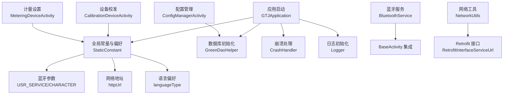
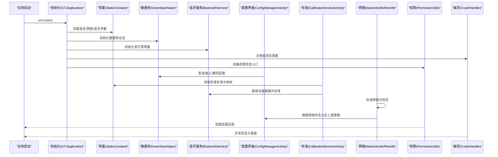
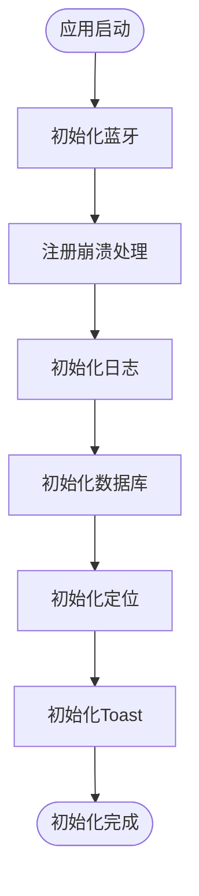
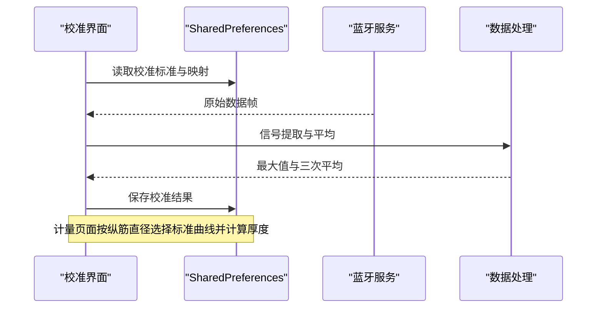
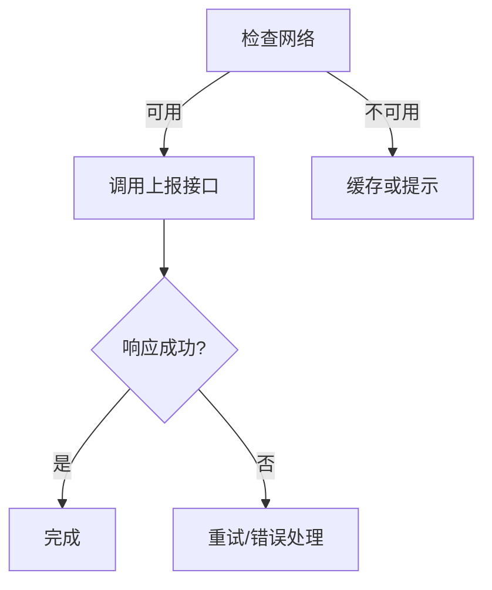
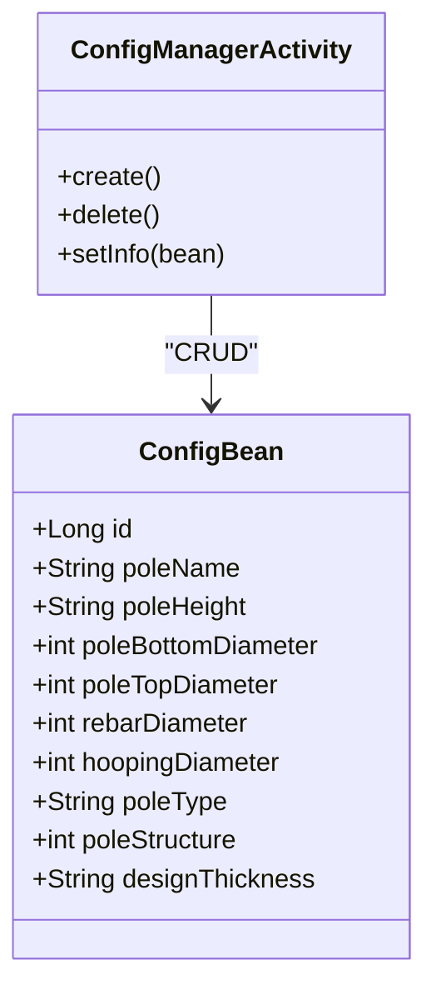
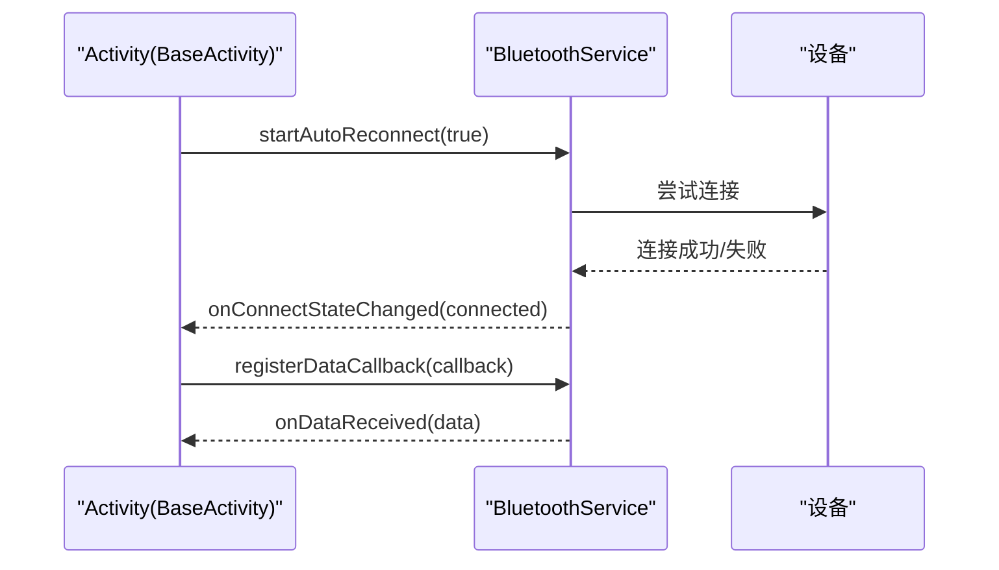
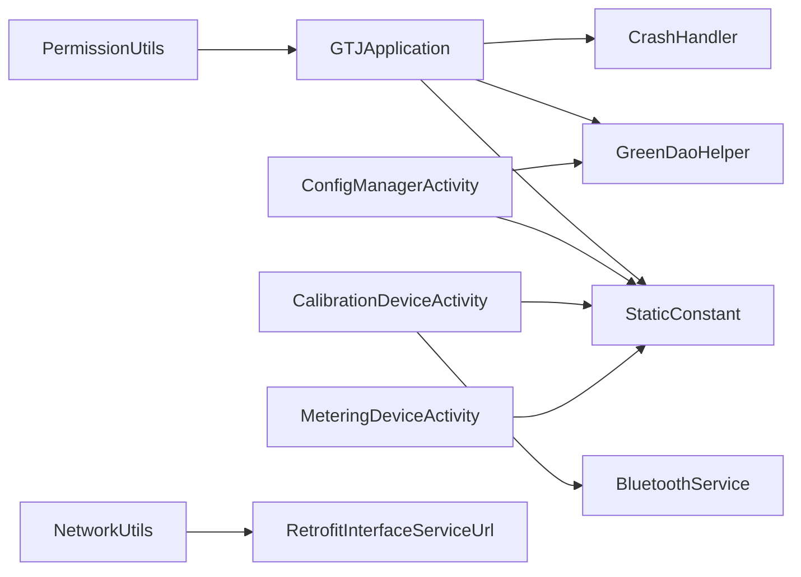

# 系统参数配置

<cite>
**本文引用的文件**
- [GTJApplication.java](file://app/src/main/java/com/example/gtj_sd_dg240/GTJApplication.java)
- [StaticConstant.java](file://app/src/main/java/com/example/gtj_sd_dg240/StaticConstant.java)
- [ConfigBean.java](file://app/src/main/java/com/example/gtj_sd_dg240/model/ConfigBean.java)
- [ConfigManagerActivity.java](file://app/src/main/java/com/example/gtj_sd_dg240/activity/testing/ConfigManagerActivity.java)
- [CalibrationDeviceActivity.java](file://app/src/main/java/com/example/gtj_sd_dg240/activity/setting/CalibrationDeviceActivity.java)
- [MeteringDeviceActivity.java](file://app/src/main/java/com/example/gtj_sd_dg240/activity/setting/MeteringDeviceActivity.java)
- [GreenDaoHelper.java](file://app/src/main/java/com/example/gtj_sd_dg240/storage/GreenDaoHelper.java)
- [CrashHandler.java](file://app/src/main/java/com/example/gtj_sd_dg240/utils/CrashHandler.java)
- [BluetoothService.java](file://app/src/main/java/com/example/gtj_sd_dg240/bluetooth/BluetoothService.java)
- [NetworkUtils.java](file://app/src/main/java/com/example/gtj_sd_dg240/net/NetworkUtils.java)
- [RetrofitInterfaceServiceUrl.java](file://app/src/main/java/com/example/gtj_sd_dg240/net/RetrofitInterfaceServiceUrl.java)
- [PermissionUtils.java](file://app/src/main/java/com/example/gtj_sd_dg240/utils/PermissionUtils.java)
- [BaseActivity.java](file://app/src/main/java/com/example/gtj_sd_dg240/activity/start/BaseActivity.java)
</cite>

## 目录
1. [简介](#简介)
2. [项目结构](#项目结构)
3. [核心组件](#核心组件)
4. [架构总览](#架构总览)
5. [详细组件分析](#详细组件分析)
6. [依赖关系分析](#依赖关系分析)
7. [性能考虑](#性能考虑)
8. [故障排查指南](#故障排查指南)
9. [结论](#结论)
10. [附录](#附录)

## 简介
本文件面向混凝土电杆检测系统的“系统参数配置”能力，覆盖应用全局参数的配置管理、设备校准参数、测量单位与计量设置、语言偏好与主题样式、网络服务与数据库优化、日志与崩溃报告、权限控制、参数备份恢复与同步机制，以及参数初始化、验证与变更生效流程。文档以代码为依据，提供可视化图示与可操作建议，帮助开发者与维护者快速理解并扩展系统参数体系。

## 项目结构
系统参数相关的关键位置与职责如下：
- 应用启动与全局初始化：在 Application 中完成蓝牙、崩溃、日志、数据库、定位、Toast 等初始化。
- 全局常量与偏好：集中定义网络地址、数据库名、语言偏好、蓝牙特征值、默认配置列表等。
- 参数模型与持久化：使用 GreenDAO 的 ConfigBean 存储电杆配置；使用 SharedPreferences 保存校准、计量、语言、蓝牙 MAC 等轻量参数。
- 配置管理界面：提供创建、选择、删除电杆配置的能力，并进行输入校验与去重检查。
- 设备校准与计量：提供校准参数采集、插值计算、结果保存；计量页面根据纵筋直径选择标准曲线并实时显示厚度。
- 蓝牙连接与自动重连：统一管理服务连接状态、数据通知与重连策略。
- 网络与上报：网络可用性检测与 Retrofit 接口定义用于数据上报与查询。
- 权限与崩溃：统一的权限申请与崩溃捕获、日志落盘与提示。

**图表来源**
- [GTJApplication.java:20-41](file://app/src/main/java/com/example/gtj_sd_dg240/GTJApplication.java#L20-L41)
- [StaticConstant.java:26-85](file://app/src/main/java/com/example/gtj_sd_dg240/StaticConstant.java#L26-L85)
- [GreenDaoHelper.java:16-40](file://app/src/main/java/com/example/gtj_sd_dg240/storage/GreenDaoHelper.java#L16-L40)
- [CrashHandler.java:74-99](file://app/src/main/java/com/example/gtj_sd_dg240/utils/CrashHandler.java#L74-L99)
- [BluetoothService.java:20-52](file://app/src/main/java/com/example/gtj_sd_dg240/bluetooth/BluetoothService.java#L20-L52)
- [NetworkUtils.java:12-19](file://app/src/main/java/com/example/gtj_sd_dg240/net/NetworkUtils.java#L12-L19)
- [RetrofitInterfaceServiceUrl.java:16-29](file://app/src/main/java/com/example/gtj_sd_dg240/net/RetrofitInterfaceServiceUrl.java#L16-L29)

**章节来源**
- [GTJApplication.java:20-41](file://app/src/main/java/com/example/gtj_sd_dg240/GTJApplication.java#L20-L41)
- [StaticConstant.java:26-85](file://app/src/main/java/com/example/gtj_sd_dg240/StaticConstant.java#L26-L85)
- [GreenDaoHelper.java:16-40](file://app/src/main/java/com/example/gtj_sd_dg240/storage/GreenDaoHelper.java#L16-L40)

## 核心组件
- 应用初始化（Application）
  - 负责蓝牙初始化、崩溃处理、日志、数据库、定位、Toast 的统一初始化，确保系统参数在进程启动时就绪。
- 全局常量与偏好（StaticConstant）
  - 集中管理网络地址、数据库名、语言类型、蓝牙特征 UUID、默认配置集合等。
- 配置模型（ConfigBean）
  - 描述电杆配置实体，包含名称、尺寸、钢筋直径、保护层厚度、类型与结构等字段，支持 GreenDAO 持久化。
- 配置管理（ConfigManagerActivity）
  - 提供配置的创建、选择、批量删除与校验，保证配置唯一性与完整性。
- 设备校准（CalibrationDeviceActivity）
  - 读取/保存校准标准与映射表，进行信号采集、平均与插值计算，输出标定结果。
- 计量设置（MeteringDeviceActivity）
  - 根据纵筋直径选择标准曲线，对蓝牙返回的信号进行厚度换算并记录。
- 蓝牙服务（BluetoothService）
  - 统一管理连接、数据通知、自动重连与断开清理。
- 网络与上报（NetworkUtils / RetrofitInterfaceServiceUrl）
  - 网络可用性检测与数据上报接口定义。
- 权限与崩溃（PermissionUtils / CrashHandler）
  - 权限申请流程与崩溃信息收集、落盘与提示。

**章节来源**
- [GTJApplication.java:20-41](file://app/src/main/java/com/example/gtj_sd_dg240/GTJApplication.java#L20-L41)
- [StaticConstant.java:26-85](file://app/src/main/java/com/example/gtj_sd_dg240/StaticConstant.java#L26-L85)
- [ConfigBean.java:13-64](file://app/src/main/java/com/example/gtj_sd_dg240/model/ConfigBean.java#L13-L64)
- [ConfigManagerActivity.java:214-286](file://app/src/main/java/com/example/gtj_sd_dg240/activity/testing/ConfigManagerActivity.java#L214-L286)
- [CalibrationDeviceActivity.java:73-110](file://app/src/main/java/com/example/gtj_sd_dg240/activity/setting/CalibrationDeviceActivity.java#L73-L110)
- [MeteringDeviceActivity.java:46-71](file://app/src/main/java/com/example/gtj_sd_dg240/activity/setting/MeteringDeviceActivity.java#L46-L71)
- [BluetoothService.java:20-52](file://app/src/main/java/com/example/gtj_sd_dg240/bluetooth/BluetoothService.java#L20-L52)
- [NetworkUtils.java:12-19](file://app/src/main/java/com/example/gtj_sd_dg240/net/NetworkUtils.java#L12-L19)
- [RetrofitInterfaceServiceUrl.java:16-29](file://app/src/main/java/com/example/gtj_sd_dg240/net/RetrofitInterfaceServiceUrl.java#L16-L29)
- [PermissionUtils.java:102-119](file://app/src/main/java/com/example/gtj_sd_dg240/utils/PermissionUtils.java#L102-L119)
- [CrashHandler.java:74-99](file://app/src/main/java/com/example/gtj_sd_dg240/utils/CrashHandler.java#L74-L99)

## 架构总览
系统参数配置贯穿“初始化—存储—界面—设备—网络—权限—崩溃”全链路。应用启动时完成各子系统初始化；界面层通过 Activity 管理用户交互；设备层通过蓝牙服务与传感器通信；网络层提供数据上报；权限与崩溃保障运行稳定性。

**图表来源**
- [GTJApplication.java:20-41](file://app/src/main/java/com/example/gtj_sd_dg240/GTJApplication.java#L20-L41)
- [StaticConstant.java:26-85](file://app/src/main/java/com/example/gtj_sd_dg240/StaticConstant.java#L26-L85)
- [GreenDaoHelper.java:16-40](file://app/src/main/java/com/example/gtj_sd_dg240/storage/GreenDaoHelper.java#L16-L40)
- [ConfigManagerActivity.java:71-89](file://app/src/main/java/com/example/gtj_sd_dg240/activity/testing/ConfigManagerActivity.java#L71-L89)
- [CalibrationDeviceActivity.java:73-110](file://app/src/main/java/com/example/gtj_sd_dg240/activity/setting/CalibrationDeviceActivity.java#L73-L110)
- [NetworkUtils.java:12-19](file://app/src/main/java/com/example/gtj_sd_dg240/net/NetworkUtils.java#L12-L19)
- [RetrofitInterfaceServiceUrl.java:16-29](file://app/src/main/java/com/example/gtj_sd_dg240/net/RetrofitInterfaceServiceUrl.java#L16-L29)
- [PermissionUtils.java:102-119](file://app/src/main/java/com/example/gtj_sd_dg240/utils/PermissionUtils.java#L102-L119)
- [CrashHandler.java:74-99](file://app/src/main/java/com/example/gtj_sd_dg240/utils/CrashHandler.java#L74-L99)

## 详细组件分析

### 应用全局参数初始化流程
- 初始化顺序
  - 蓝牙：初始化服务与特征值，为后续设备通信做准备。
  - 崩溃：注册全局异常处理器，便于收集设备信息与堆栈。
  - 日志：添加日志适配器，统一日志格式。
  - 数据库：初始化 GreenDAO 会话，供配置与业务数据存取。
  - 定位：设置隐私同意与定位服务实例。
  - Toast：统一样式与位置。
- 关键要点
  - 所有初始化在 Application.onCreate 中执行，确保全局可用。
  - 语言偏好通过 StaticConstant 读写，持久化到 SharedPreferences。

**图表来源**
- [GTJApplication.java:20-41](file://app/src/main/java/com/example/gtj_sd_dg240/GTJApplication.java#L20-L41)

**章节来源**
- [GTJApplication.java:20-41](file://app/src/main/java/com/example/gtj_sd_dg240/GTJApplication.java#L20-L41)

### 设备校准参数与测量单位
- 校准参数
  - 标准值与映射值分别持久化到 SharedPreferences，键分别为“calibration-standard-list”和“calibration-list”。
  - 界面支持默认值恢复与手动填写，保存前进行非空校验。
- 信号处理
  - 接收蓝牙数据后，进行信号提取、均值滤波、最大值采集与三次平均。
  - 使用插值算法将原始信号转换为厚度值。
- 计量设置
  - 根据纵筋直径选择对应标准曲线，实时计算并显示厚度。
  - 计量结果列表持久化到 SharedPreferences，键为“strMeteringDeviceList”。

**图表来源**
- [CalibrationDeviceActivity.java:73-110](file://app/src/main/java/com/example/gtj_sd_dg240/activity/setting/CalibrationDeviceActivity.java#L73-L110)
- [CalibrationDeviceActivity.java:300-372](file://app/src/main/java/com/example/gtj_sd_dg240/activity/setting/CalibrationDeviceActivity.java#L300-L372)
- [MeteringDeviceActivity.java:46-71](file://app/src/main/java/com/example/gtj_sd_dg240/activity/setting/MeteringDeviceActivity.java#L46-L71)
- [MeteringDeviceActivity.java:118-133](file://app/src/main/java/com/example/gtj_sd_dg240/activity/setting/MeteringDeviceActivity.java#L118-L133)

**章节来源**
- [CalibrationDeviceActivity.java:73-110](file://app/src/main/java/com/example/gtj_sd_dg240/activity/setting/CalibrationDeviceActivity.java#L73-L110)
- [CalibrationDeviceActivity.java:300-372](file://app/src/main/java/com/example/gtj_sd_dg240/activity/setting/CalibrationDeviceActivity.java#L300-L372)
- [MeteringDeviceActivity.java:46-71](file://app/src/main/java/com/example/gtj_sd_dg240/activity/setting/MeteringDeviceActivity.java#L46-L71)
- [MeteringDeviceActivity.java:118-133](file://app/src/main/java/com/example/gtj_sd_dg240/activity/setting/MeteringDeviceActivity.java#L118-L133)

### 网络服务配置与数据上报
- 网络可用性检测
  - 通过 NetworkUtils.isOpenNetwork 判断当前网络是否可用。
- 数据上报接口
  - 使用 Retrofit 接口定义上报与查询方法，包含请求体与分页查询参数。
- 建议
  - 在上报前调用网络检测，避免无效请求。
  - 结合权限与崩溃日志，提升问题定位效率。

**图表来源**
- [NetworkUtils.java:12-19](file://app/src/main/java/com/example/gtj_sd_dg240/net/NetworkUtils.java#L12-L19)
- [RetrofitInterfaceServiceUrl.java:16-29](file://app/src/main/java/com/example/gtj_sd_dg240/net/RetrofitInterfaceServiceUrl.java#L16-L29)

**章节来源**
- [NetworkUtils.java:12-19](file://app/src/main/java/com/example/gtj_sd_dg240/net/NetworkUtils.java#L12-L19)
- [RetrofitInterfaceServiceUrl.java:16-29](file://app/src/main/java/com/example/gtj_sd_dg240/net/RetrofitInterfaceServiceUrl.java#L16-L29)

### 数据库优化参数与配置管理
- 数据库初始化
  - 通过 GreenDaoHelper 初始化数据库会话，使用 StaticConstant.DB_NAME 作为数据库名。
- 配置模型
  - ConfigBean 描述电杆配置实体，包含名称、高度、根径、梢径、钢筋直径、螺旋筋直径、类型、结构与保护层厚度。
- 配置管理界面
  - 提供创建、选择、批量删除功能，并在创建前进行非空与重复性校验。
  - 删除时保护内置配置不被误删。

**图表来源**
- [ConfigBean.java:13-64](file://app/src/main/java/com/example/gtj_sd_dg240/model/ConfigBean.java#L13-L64)
- [ConfigManagerActivity.java:214-286](file://app/src/main/java/com/example/gtj_sd_dg240/activity/testing/ConfigManagerActivity.java#L214-L286)
- [ConfigManagerActivity.java:288-331](file://app/src/main/java/com/example/gtj_sd_dg240/activity/testing/ConfigManagerActivity.java#L288-L331)

**章节来源**
- [GreenDaoHelper.java:16-40](file://app/src/main/java/com/example/gtj_sd_dg240/storage/GreenDaoHelper.java#L16-L40)
- [ConfigBean.java:13-64](file://app/src/main/java/com/example/gtj_sd_dg240/model/ConfigBean.java#L13-L64)
- [ConfigManagerActivity.java:214-286](file://app/src/main/java/com/example/gtj_sd_dg240/activity/testing/ConfigManagerActivity.java#L214-L286)
- [ConfigManagerActivity.java:288-331](file://app/src/main/java/com/example/gtj_sd_dg240/activity/testing/ConfigManagerActivity.java#L288-L331)

### 语言偏好与主题样式
- 语言偏好
  - 通过 StaticConstant.setLanguage/getLanguage 读写语言类型，持久化到 SharedPreferences。
- 主题样式
  - 通过 values/styles.xml 与 drawable 资源定义主题；StaticConstant 中 isNeutral 标志可用于切换中性版本。
- 建议
  - 在应用启动时读取语言偏好并应用至界面。
  - 主题切换应触发界面重建以生效。

**章节来源**
- [StaticConstant.java:71-85](file://app/src/main/java/com/example/gtj_sd_dg240/StaticConstant.java#L71-L85)

### 蓝牙连接参数与自动重连
- 蓝牙参数
  - 服务与特征 UUID 在 StaticConstant 中定义，Application 中初始化蓝牙管理器。
- 自动重连
  - BluetoothService 提供自动重连定时器与连接状态监听，支持启用/禁用。
- 基类集成
  - BaseActivity 提供蓝牙状态图标更新与数据回调注册，简化 Activity 接入。

**图表来源**
- [StaticConstant.java:67-70](file://app/src/main/java/com/example/gtj_sd_dg240/StaticConstant.java#L67-L70)
- [GTJApplication.java:20-41](file://app/src/main/java/com/example/gtj_sd_dg240/GTJApplication.java#L20-L41)
- [BluetoothService.java:77-109](file://app/src/main/java/com/example/gtj_sd_dg240/bluetooth/BluetoothService.java#L77-L109)
- [BaseActivity.java:188-198](file://app/src/main/java/com/example/gtj_sd_dg240/activity/start/BaseActivity.java#L188-L198)
- [BaseActivity.java:240-282](file://app/src/main/java/com/example/gtj_sd_dg240/activity/start/BaseActivity.java#L240-L282)

**章节来源**
- [StaticConstant.java:67-70](file://app/src/main/java/com/example/gtj_sd_dg240/StaticConstant.java#L67-L70)
- [GTJApplication.java:20-41](file://app/src/main/java/com/example/gtj_sd_dg240/GTJApplication.java#L20-L41)
- [BluetoothService.java:77-109](file://app/src/main/java/com/example/gtj_sd_dg240/bluetooth/BluetoothService.java#L77-L109)
- [BaseActivity.java:188-198](file://app/src/main/java/com/example/gtj_sd_dg240/activity/start/BaseActivity.java#L188-L198)
- [BaseActivity.java:240-282](file://app/src/main/java/com/example/gtj_sd_dg240/activity/start/BaseActivity.java#L240-L282)

### 系统性能调优参数
- 信号处理优化
  - 使用滑动窗口与均值滤波减少噪声影响。
  - 定时清空缓冲区以避免内存增长。
- 线程与调度
  - 使用 ScheduledExecutorService 定时刷新 UI 与计时器。
- 建议
  - 合理设置缓冲区大小与采样频率，平衡精度与功耗。
  - 在低电量场景降低刷新频率。

**章节来源**
- [CalibrationDeviceActivity.java:119-188](file://app/src/main/java/com/example/gtj_sd_dg240/activity/setting/CalibrationDeviceActivity.java#L119-L188)

### 日志级别设置与错误报告配置
- 日志
  - 在 Application 中添加 AndroidLogAdapter，统一日志格式。
- 崩溃报告
  - CrashHandler 收集设备信息与堆栈，支持写入外部存储并跳转查看。
  - 可通过 StaticConstant.CRASH_DEBUG 控制是否落盘。
- 建议
  - 生产环境关闭冗余日志，保留必要错误信息。
  - 崩溃文件命名包含时间戳，便于回溯。

**章节来源**
- [GTJApplication.java:20-41](file://app/src/main/java/com/example/gtj_sd_dg240/GTJApplication.java#L20-L41)
- [CrashHandler.java:74-99](file://app/src/main/java/com/example/gtj_sd_dg240/utils/CrashHandler.java#L74-L99)
- [CrashHandler.java:156-199](file://app/src/main/java/com/example/gtj_sd_dg240/utils/CrashHandler.java#L156-L199)
- [StaticConstant.java:30-34](file://app/src/main/java/com/example/gtj_sd_dg240/StaticConstant.java#L30-L34)

### 参数备份恢复、同步与权限控制
- 备份与恢复
  - 校准与计量数据通过 SharedPreferences 序列化保存，可在同一设备恢复。
  - 配置数据通过 GreenDAO 持久化，支持导出/导入（需扩展）。
- 同步机制
  - 网络接口支持数据上报与查询，可实现云端同步（需完善业务逻辑）。
- 权限控制
  - PermissionUtils 封装多版本权限申请，包括位置、存储、相机、蓝牙。
  - 针对 Android 11+ 的特殊权限进行引导与处理。

**章节来源**
- [CalibrationDeviceActivity.java:300-372](file://app/src/main/java/com/example/gtj_sd_dg240/activity/setting/CalibrationDeviceActivity.java#L300-L372)
- [MeteringDeviceActivity.java:136-145](file://app/src/main/java/com/example/gtj_sd_dg240/activity/setting/MeteringDeviceActivity.java#L136-L145)
- [RetrofitInterfaceServiceUrl.java:16-29](file://app/src/main/java/com/example/gtj_sd_dg240/net/RetrofitInterfaceServiceUrl.java#L16-L29)
- [PermissionUtils.java:102-119](file://app/src/main/java/com/example/gtj_sd_dg240/utils/PermissionUtils.java#L102-L119)

### 参数验证规则与变更生效机制
- 验证规则
  - 配置创建时必填项校验与非空检查；设计保护层厚度需大于等于 0；配置名称唯一性检查。
  - 校准参数保存前进行非空校验。
- 变更生效
  - 语言偏好立即生效（下次界面构建时读取）。
  - 校准与计量参数在下次数据采集时读取并应用。
  - 蓝牙 MAC 与连接状态由 BluetoothService 实时维护。

**章节来源**
- [ConfigManagerActivity.java:214-286](file://app/src/main/java/com/example/gtj_sd_dg240/activity/testing/ConfigManagerActivity.java#L214-L286)
- [CalibrationDeviceActivity.java:300-372](file://app/src/main/java/com/example/gtj_sd_dg240/activity/setting/CalibrationDeviceActivity.java#L300-L372)
- [StaticConstant.java:71-85](file://app/src/main/java/com/example/gtj_sd_dg240/StaticConstant.java#L71-L85)
- [BluetoothService.java:57-59](file://app/src/main/java/com/example/gtj_sd_dg240/bluetooth/BluetoothService.java#L57-L59)

## 依赖关系分析
- 组件耦合
  - Application 依赖 StaticConstant、GreenDaoHelper、CrashHandler、Logger。
  - 界面层依赖 BluetoothService、SharedPreferences、GreenDAO。
  - 网络层依赖 NetworkUtils 与 Retrofit 接口。
- 外部依赖
  - 蓝牙库、GreenDAO、Retrofit、日志库、权限工具库。
- 潜在风险
  - 循环依赖应避免；蓝牙重连与 UI 更新需在主线程安全执行。
  - 权限不足会导致蓝牙搜索与文件写入失败。

**图表来源**
- [GTJApplication.java:20-41](file://app/src/main/java/com/example/gtj_sd_dg240/GTJApplication.java#L20-L41)
- [StaticConstant.java:26-85](file://app/src/main/java/com/example/gtj_sd_dg240/StaticConstant.java#L26-L85)
- [GreenDaoHelper.java:16-40](file://app/src/main/java/com/example/gtj_sd_dg240/storage/GreenDaoHelper.java#L16-L40)
- [ConfigManagerActivity.java:71-89](file://app/src/main/java/com/example/gtj_sd_dg240/activity/testing/ConfigManagerActivity.java#L71-L89)
- [CalibrationDeviceActivity.java:73-110](file://app/src/main/java/com/example/gtj_sd_dg240/activity/setting/CalibrationDeviceActivity.java#L73-L110)
- [MeteringDeviceActivity.java:46-71](file://app/src/main/java/com/example/gtj_sd_dg240/activity/setting/MeteringDeviceActivity.java#L46-L71)
- [NetworkUtils.java:12-19](file://app/src/main/java/com/example/gtj_sd_dg240/net/NetworkUtils.java#L12-L19)
- [RetrofitInterfaceServiceUrl.java:16-29](file://app/src/main/java/com/example/gtj_sd_dg240/net/RetrofitInterfaceServiceUrl.java#L16-L29)
- [PermissionUtils.java:102-119](file://app/src/main/java/com/example/gtj_sd_dg240/utils/PermissionUtils.java#L102-L119)

**章节来源**
- [GTJApplication.java:20-41](file://app/src/main/java/com/example/gtj_sd_dg240/GTJApplication.java#L20-L41)
- [StaticConstant.java:26-85](file://app/src/main/java/com/example/gtj_sd_dg240/StaticConstant.java#L26-L85)
- [GreenDaoHelper.java:16-40](file://app/src/main/java/com/example/gtj_sd_dg240/storage/GreenDaoHelper.java#L16-L40)
- [ConfigManagerActivity.java:71-89](file://app/src/main/java/com/example/gtj_sd_dg240/activity/testing/ConfigManagerActivity.java#L71-L89)
- [CalibrationDeviceActivity.java:73-110](file://app/src/main/java/com/example/gtj_sd_dg240/activity/setting/CalibrationDeviceActivity.java#L73-L110)
- [MeteringDeviceActivity.java:46-71](file://app/src/main/java/com/example/gtj_sd_dg240/activity/setting/MeteringDeviceActivity.java#L46-L71)
- [NetworkUtils.java:12-19](file://app/src/main/java/com/example/gtj_sd_dg240/net/NetworkUtils.java#L12-L19)
- [RetrofitInterfaceServiceUrl.java:16-29](file://app/src/main/java/com/example/gtj_sd_dg240/net/RetrofitInterfaceServiceUrl.java#L16-L29)
- [PermissionUtils.java:102-119](file://app/src/main/java/com/example/gtj_sd_dg240/utils/PermissionUtils.java#L102-L119)

## 性能考虑
- 信号处理
  - 使用均值滤波与滑动窗口降低噪声，提高测量稳定性。
  - 定时清空缓冲区，防止内存泄漏。
- 线程管理
  - 使用单线程池与 Handler 在主线程更新 UI，避免阻塞。
- 蓝牙重连
  - 固定间隔重连，减少频繁连接造成的功耗与干扰。
- 网络请求
  - 在网络不可用时缓存或延迟上报，避免无效请求。

[本节为通用性能建议，不直接分析具体文件]

## 故障排查指南
- 蓝牙连接失败
  - 检查权限是否授予（位置、蓝牙）。
  - 确认 MAC 地址是否正确保存。
  - 查看连接状态监听与重连定时器是否工作。
- 校准数据异常
  - 检查校准标准与映射是否为空或不完整。
  - 确认信号采集是否稳定，必要时调整采样频率。
- 网络上报失败
  - 使用 NetworkUtils 检测网络可用性。
  - 检查 Retrofit 接口与服务器响应。
- 崩溃与日志
  - 查看崩溃文件路径与内容，定位问题。
  - 调整日志级别以减少噪音。

**章节来源**
- [PermissionUtils.java:102-119](file://app/src/main/java/com/example/gtj_sd_dg240/utils/PermissionUtils.java#L102-L119)
- [BluetoothService.java:77-109](file://app/src/main/java/com/example/gtj_sd_dg240/bluetooth/BluetoothService.java#L77-L109)
- [CalibrationDeviceActivity.java:300-372](file://app/src/main/java/com/example/gtj_sd_dg240/activity/setting/CalibrationDeviceActivity.java#L300-L372)
- [NetworkUtils.java:12-19](file://app/src/main/java/com/example/gtj_sd_dg240/net/NetworkUtils.java#L12-L19)
- [CrashHandler.java:156-199](file://app/src/main/java/com/example/gtj_sd_dg240/utils/CrashHandler.java#L156-L199)

## 结论
本系统通过 Application 统一初始化、StaticConstant 集中管理、GreenDAO 与 SharedPreferences 持久化、BluetoothService 统一蓝牙管理、界面层完善的校验与交互，构建了完整的系统参数配置体系。建议在后续迭代中增强配置导出/导入、云端同步与更细粒度的权限控制，以提升用户体验与系统可靠性。

[本节为总结性内容，不直接分析具体文件]

## 附录
- 关键参数键名
  - 语言偏好：languageType
  - 校准标准：calibration-standard-list
  - 校准映射：calibration-list
  - 计量列表：strMeteringDeviceList
  - 蓝牙 MAC：bluetooth-mac
  - 网络地址：httpUrl
  - 数据库名：DB_NAME
  - 崩溃开关：CRASH_DEBUG
  - 崩溃路径：crashFilePath

**章节来源**
- [StaticConstant.java:26-85](file://app/src/main/java/com/example/gtj_sd_dg240/StaticConstant.java#L26-L85)
- [CalibrationDeviceActivity.java:300-372](file://app/src/main/java/com/example/gtj_sd_dg240/activity/setting/CalibrationDeviceActivity.java#L300-L372)
- [MeteringDeviceActivity.java:136-145](file://app/src/main/java/com/example/gtj_sd_dg240/activity/setting/MeteringDeviceActivity.java#L136-L145)
- [BluetoothService.java:57-59](file://app/src/main/java/com/example/gtj_sd_dg240/bluetooth/BluetoothService.java#L57-L59)