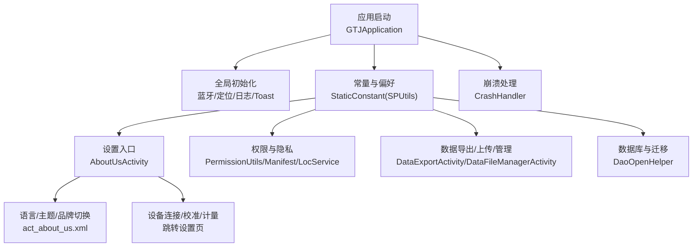
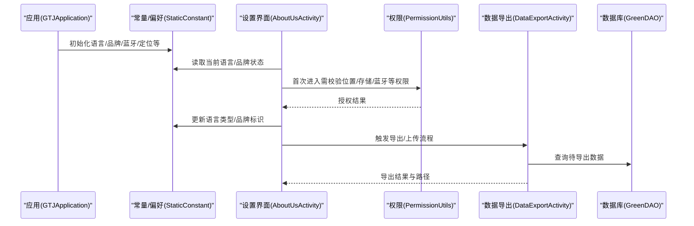
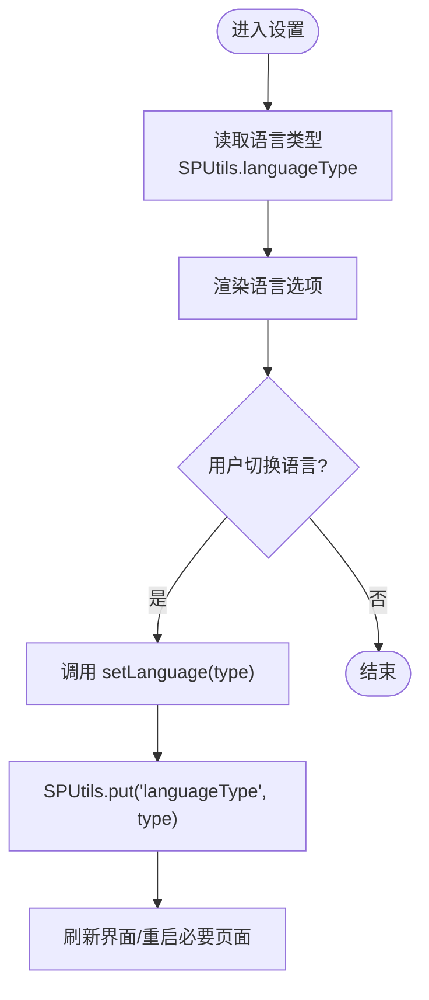
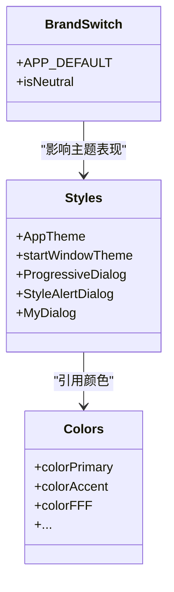
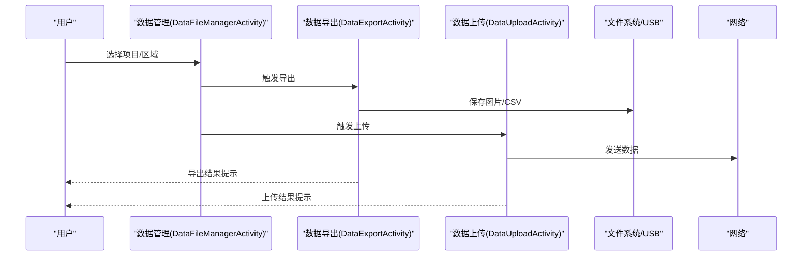
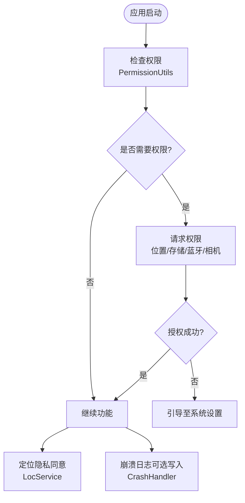
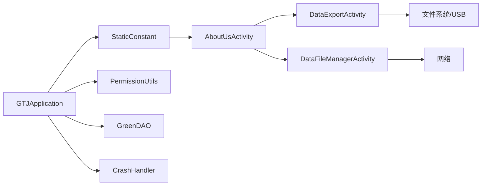

# 用户偏好设置

<cite>
**本文引用的文件**
- [GTJApplication.java](file://app/src/main/java/com/example/gtj_sd_dg240/GTJApplication.java)
- [StaticConstant.java](file://app/src/main/java/com/example/gtj_sd_dg240/StaticConstant.java)
- [AboutUsActivity.java](file://app/src/main/java/com/example/gtj_sd_dg240/activity/about/AboutUsActivity.java)
- [act_about_us.xml](file://app/src/main/res/layout/act_about_us.xml)
- [styles.xml](file://app/src/main/res/values/styles.xml)
- [colors.xml](file://app/src/main/res/values/colors.xml)
- [AndroidManifest.xml](file://app/src/main/AndroidManifest.xml)
- [PermissionUtils.java](file://app/src/main/java/com/example/gtj_sd_dg240/utils/PermissionUtils.java)
- [LocService.java](file://app/src/main/java/com/example/gtj_sd_dg240/utils/LocService.java)
- [DataExportActivity.java](file://app/src/main/java/com/example/gtj_sd_dg240/activity/data/DataExportActivity.java)
- [DataFileManagerActivity.java](file://app/src/main/java/com/example/gtj_sd_dg240/activity/data/DataFileManagerActivity.java)
- [CrashHandler.java](file://app/src/main/java/com/example/gtj_sd_dg240/utils/CrashHandler.java)
- [DaoOpenHelper.java](file://app/src/main/java/com/example/gtj_sd_dg240/storage/DaoOpenHelper.java)
</cite>

## 目录
1. [简介](#简介)
2. [项目结构](#项目结构)
3. [核心组件](#核心组件)
4. [架构总览](#架构总览)
5. [详细组件分析](#详细组件分析)
6. [依赖关系分析](#依赖关系分析)
7. [性能考虑](#性能考虑)
8. [故障排查指南](#故障排查指南)
9. [结论](#结论)
10. [附录](#附录)

## 简介
本文件面向“用户偏好设置”的完整说明，覆盖界面定制、语言设置、主题配置与个人化选项；并扩展至数据同步、备份恢复、多设备共享、默认设置管理、重置与迁移机制；同时涵盖权限管理、隐私设置与安全认证配置。文档基于代码仓库的实际实现进行梳理，确保可操作性与准确性。

## 项目结构
应用采用模块化组织：
- 应用入口与全局初始化：GTJApplication
- 常量与偏好存储：StaticConstant（使用 SPUtils）
- 设置入口与UI：AboutUsActivity + act_about_us.xml
- 主题与样式：styles.xml、colors.xml
- 权限与隐私：PermissionUtils、AndroidManifest.xml、LocService
- 数据导出/上传/管理：DataExportActivity、DataFileManagerActivity
- 崩溃与日志：CrashHandler
- 数据库与迁移：DaoOpenHelper

图表来源
- [GTJApplication.java:18-41](file://app/src/main/java/com/example/gtj_sd_dg240/GTJApplication.java#L18-L41)
- [StaticConstant.java:14-85](file://app/src/main/java/com/example/gtj_sd_dg240/StaticConstant.java#L14-L85)
- [AboutUsActivity.java:26-77](file://app/src/main/java/com/example/gtj_sd_dg240/activity/about/AboutUsActivity.java#L26-L77)
- [act_about_us.xml:50-147](file://app/src/main/res/layout/act_about_us.xml#L50-L147)
- [AndroidManifest.xml:1-90](file://app/src/main/AndroidManifest.xml#L1-L90)
- [PermissionUtils.java:1-196](file://app/src/main/java/com/example/gtj_sd_dg240/utils/PermissionUtils.java#L1-L196)
- [LocService.java:141-200](file://app/src/main/java/com/example/gtj_sd_dg240/utils/LocService.java#L141-L200)
- [DataExportActivity.java:345-470](file://app/src/main/java/com/example/gtj_sd_dg240/activity/data/DataExportActivity.java#L345-L470)
- [DataFileManagerActivity.java:157-340](file://app/src/main/java/com/example/gtj_sd_dg240/activity/data/DataFileManagerActivity.java#L157-L340)
- [CrashHandler.java:74-207](file://app/src/main/java/com/example/gtj_sd_dg240/utils/CrashHandler.java#L74-L207)
- [DaoOpenHelper.java:14-34](file://app/src/main/java/com/example/gtj_sd_dg240/storage/DaoOpenHelper.java#L14-L34)

章节来源
- [GTJApplication.java:18-41](file://app/src/main/java/com/example/gtj_sd_dg240/GTJApplication.java#L18-L41)
- [StaticConstant.java:14-85](file://app/src/main/java/com/example/gtj_sd_dg240/StaticConstant.java#L14-L85)

## 核心组件
- 应用全局初始化：在应用启动时完成蓝牙、崩溃收集、日志、工具库、数据库、定位、Toast等初始化。
- 偏好与常量：通过 StaticConstant 集中管理语言、品牌版本、列表枚举、蓝牙特征值等，并使用 SPUtils 持久化语言设置。
- 设置界面：AboutUsActivity 提供系统设置入口，包含语言选择、界面主题、设备连接、校准与计量等功能入口。
- 权限与隐私：PermissionUtils 统一封装权限申请流程，Manifest 声明所需权限，LocService 提供定位能力与权限检查辅助。
- 数据导出/上传/管理：DataExportActivity 负责将检测结果导出为图片与CSV，支持本地与USB；DataFileManagerActivity 提供项目管理、批量导出/上传/删除。
- 崩溃与日志：CrashHandler 捕获未捕获异常，记录设备信息与堆栈，可选择写入外部存储并引导上报。
- 数据库与迁移：DaoOpenHelper 基于 GreenDAO，提供数据库升级时的表重建策略。

章节来源
- [GTJApplication.java:18-41](file://app/src/main/java/com/example/gtj_sd_dg240/GTJApplication.java#L18-L41)
- [StaticConstant.java:14-85](file://app/src/main/java/com/example/gtj_sd_dg240/StaticConstant.java#L14-L85)
- [AboutUsActivity.java:26-77](file://app/src/main/java/com/example/gtj_sd_dg240/activity/about/AboutUsActivity.java#L26-L77)
- [PermissionUtils.java:1-196](file://app/src/main/java/com/example/gtj_sd_dg240/utils/PermissionUtils.java#L1-L196)
- [AndroidManifest.xml:1-90](file://app/src/main/AndroidManifest.xml#L1-L90)
- [LocService.java:141-200](file://app/src/main/java/com/example/gtj_sd_dg240/utils/LocService.java#L141-L200)
- [DataExportActivity.java:345-470](file://app/src/main/java/com/example/gtj_sd_dg240/activity/data/DataExportActivity.java#L345-L470)
- [DataFileManagerActivity.java:157-340](file://app/src/main/java/com/example/gtj_sd_dg240/activity/data/DataFileManagerActivity.java#L157-L340)
- [CrashHandler.java:74-207](file://app/src/main/java/com/example/gtj_sd_dg240/utils/CrashHandler.java#L74-L207)
- [DaoOpenHelper.java:14-34](file://app/src/main/java/com/example/gtj_sd_dg240/storage/DaoOpenHelper.java#L14-L34)

## 架构总览
下图展示用户偏好设置相关的关键交互路径：从应用启动到设置界面，再到语言/主题/品牌切换与权限管理、数据导出/上传等。

图表来源
- [GTJApplication.java:18-41](file://app/src/main/java/com/example/gtj_sd_dg240/GTJApplication.java#L18-L41)
- [StaticConstant.java:71-85](file://app/src/main/java/com/example/gtj_sd_dg240/StaticConstant.java#L71-L85)
- [AboutUsActivity.java:26-77](file://app/src/main/java/com/example/gtj_sd_dg240/activity/about/AboutUsActivity.java#L26-L77)
- [PermissionUtils.java:102-169](file://app/src/main/java/com/example/gtj_sd_dg240/utils/PermissionUtils.java#L102-L169)
- [DataExportActivity.java:345-470](file://app/src/main/java/com/example/gtj_sd_dg240/activity/data/DataExportActivity.java#L345-L470)

## 详细组件分析

### 语言设置与国际化
- 语言类型由 StaticConstant 维护，并提供 setLanguage/getLanguage 方法，使用 SPUtils 持久化 languageType。
- AboutUsActivity 的布局中包含“语言选择”控件，用于切换语言。
- 建议：在 Activity 创建或 onResume 时根据语言类型重新加载资源或刷新界面。

图表来源
- [StaticConstant.java:71-85](file://app/src/main/java/com/example/gtj_sd_dg240/StaticConstant.java#L71-L85)
- [act_about_us.xml:50-69](file://app/src/main/res/layout/act_about_us.xml#L50-L69)

章节来源
- [StaticConstant.java:71-85](file://app/src/main/java/com/example/gtj_sd_dg240/StaticConstant.java#L71-L85)
- [act_about_us.xml:50-69](file://app/src/main/res/layout/act_about_us.xml#L50-L69)

### 主题配置与界面定制
- 主题样式定义于 styles.xml，颜色定义于 colors.xml，应用主题引用 colorPrimary/colorAccent 等。
- 品牌/版本切换通过 StaticConstant.APP_DEFAULT 控制不同 Logo 与界面元素显示。
- AboutUsActivity 中根据 APP_DEFAULT 动态显示/隐藏特定区域与图标。

图表来源
- [styles.xml:1-43](file://app/src/main/res/values/styles.xml#L1-L43)
- [colors.xml:1-32](file://app/src/main/res/values/colors.xml#L1-L32)
- [StaticConstant.java:14-24](file://app/src/main/java/com/example/gtj_sd_dg240/StaticConstant.java#L14-L24)
- [DataExportActivity.java:64-107](file://app/src/main/java/com/example/gtj_sd_dg240/activity/data/DataExportActivity.java#L64-L107)

章节来源
- [styles.xml:1-43](file://app/src/main/res/values/styles.xml#L1-L43)
- [colors.xml:1-32](file://app/src/main/res/values/colors.xml#L1-L32)
- [StaticConstant.java:14-24](file://app/src/main/java/com/example/gtj_sd_dg240/StaticConstant.java#L14-L24)
- [DataExportActivity.java:64-107](file://app/src/main/java/com/example/gtj_sd_dg240/activity/data/DataExportActivity.java#L64-L107)

### 个人化选项与界面布局偏好
- 品牌/中性版本开关：StaticConstant.isNeutral 控制是否隐藏品牌信息。
- 界面元素可见性：AboutUsActivity 根据 isNeutral 与 APP_DEFAULT 控制布局显示。
- 设备信息显示：AboutUsActivity 在 onResume 中读取蓝牙名称并显示。

章节来源
- [StaticConstant.java:14-24](file://app/src/main/java/com/example/gtj_sd_dg240/StaticConstant.java#L14-L24)
- [AboutUsActivity.java:26-56](file://app/src/main/java/com/example/gtj_sd_dg240/activity/about/AboutUsActivity.java#L26-L56)

### 操作习惯配置
- 检测参数与配置管理：ConfigManagerActivity 提供电杆配置管理，支持增删改查与分类展示。
- 常用操作入口：AboutUsActivity 提供设备连接、校准、计量等快捷入口。

章节来源
- [AboutUsActivity.java:58-77](file://app/src/main/java/com/example/gtj_sd_dg240/activity/about/AboutUsActivity.java#L58-L77)
- [ConfigManagerActivity.java:25-59](file://app/src/main/java/com/example/gtj_sd_dg240/activity/testing/ConfigManagerActivity.java#L25-L59)

### 用户数据同步、偏好备份恢复与多设备共享
- 数据导出：DataExportActivity 将检测结果导出为图片与CSV，支持保存到本地与USB。
- 数据上传：DataUploadActivity 可将数据上传至服务器（需要网络权限）。
- 数据管理：DataFileManagerActivity 提供项目与区域数据的查看、导出、上传与删除。
- 偏好备份：语言等偏好通过 SPUtils 持久化；如需跨设备共享，可结合导出功能将关键配置与数据打包导出，并在目标设备上导入。

图表来源
- [DataFileManagerActivity.java:224-340](file://app/src/main/java/com/example/gtj_sd_dg240/activity/data/DataFileManagerActivity.java#L224-L340)
- [DataExportActivity.java:345-470](file://app/src/main/java/com/example/gtj_sd_dg240/activity/data/DataExportActivity.java#L345-L470)

章节来源
- [DataExportActivity.java:345-470](file://app/src/main/java/com/example/gtj_sd_dg240/activity/data/DataExportActivity.java#L345-L470)
- [DataFileManagerActivity.java:224-340](file://app/src/main/java/com/example/gtj_sd_dg240/activity/data/DataFileManagerActivity.java#L224-L340)

### 默认设置管理、重置与配置迁移
- 默认设置：StaticConstant 提供默认语言、品牌、枚举列表等；SPUtils 提供默认值读取。
- 重置功能：可通过清空 SPUtils 中的 key（如 languageType）恢复默认；或在设置界面增加“恢复默认”按钮。
- 配置迁移：数据库升级通过 DaoOpenHelper.onUpgrade 进行表重建；如需跨版本迁移，可在 onUpgrade 中执行数据转换逻辑。

章节来源
- [StaticConstant.java:14-85](file://app/src/main/java/com/example/gtj_sd_dg240/StaticConstant.java#L14-L85)
- [DaoOpenHelper.java:14-34](file://app/src/main/java/com/example/gtj_sd_dg240/storage/DaoOpenHelper.java#L14-L34)

### 权限管理、隐私设置与安全认证
- 权限声明：AndroidManifest.xml 声明蓝牙、位置、存储、相机、网络、音频、安装等权限。
- 权限申请：PermissionUtils 统一封装权限申请，适配 Android 11+ 的文件访问特殊权限，以及 Android 12+ 的蓝牙扫描/连接权限。
- 隐私设置：LocService 提供定位服务，并在应用启动时设置隐私同意；CrashHandler 可选将崩溃日志写入外部存储。
- 安全认证：设置界面中校准入口通过登录对话框进行简单鉴权，防止误操作。

图表来源
- [AndroidManifest.xml:1-90](file://app/src/main/AndroidManifest.xml#L1-L90)
- [PermissionUtils.java:102-169](file://app/src/main/java/com/example/gtj_sd_dg240/utils/PermissionUtils.java#L102-L169)
- [LocService.java:141-200](file://app/src/main/java/com/example/gtj_sd_dg240/utils/LocService.java#L141-L200)
- [CrashHandler.java:74-207](file://app/src/main/java/com/example/gtj_sd_dg240/utils/CrashHandler.java#L74-L207)

章节来源
- [AndroidManifest.xml:1-90](file://app/src/main/AndroidManifest.xml#L1-L90)
- [PermissionUtils.java:102-169](file://app/src/main/java/com/example/gtj_sd_dg240/utils/PermissionUtils.java#L102-L169)
- [LocService.java:141-200](file://app/src/main/java/com/example/gtj_sd_dg240/utils/LocService.java#L141-L200)
- [CrashHandler.java:74-207](file://app/src/main/java/com/example/gtj_sd_dg240/utils/CrashHandler.java#L74-L207)

## 依赖关系分析
- 应用层依赖：GTJApplication 依赖蓝牙、定位、日志、数据库等子系统。
- 偏好层依赖：StaticConstant 依赖 SPUtils 进行持久化。
- 界面层依赖：AboutUsActivity 依赖 StaticConstant 与 PermissionUtils。
- 数据层依赖：DataExportActivity/DataFileManagerActivity 依赖 GreenDAO 与文件系统/USB。
- 安全层依赖：PermissionUtils 依赖系统权限与 Settings；CrashHandler 依赖文件系统与 Intent。

图表来源
- [GTJApplication.java:18-41](file://app/src/main/java/com/example/gtj_sd_dg240/GTJApplication.java#L18-L41)
- [StaticConstant.java:14-85](file://app/src/main/java/com/example/gtj_sd_dg240/StaticConstant.java#L14-L85)
- [AboutUsActivity.java:26-77](file://app/src/main/java/com/example/gtj_sd_dg240/activity/about/AboutUsActivity.java#L26-L77)
- [DataExportActivity.java:345-470](file://app/src/main/java/com/example/gtj_sd_dg240/activity/data/DataExportActivity.java#L345-L470)
- [DataFileManagerActivity.java:157-340](file://app/src/main/java/com/example/gtj_sd_dg240/activity/data/DataFileManagerActivity.java#L157-L340)
- [CrashHandler.java:74-207](file://app/src/main/java/com/example/gtj_sd_dg240/utils/CrashHandler.java#L74-L207)

章节来源
- [GTJApplication.java:18-41](file://app/src/main/java/com/example/gtj_sd_dg240/GTJApplication.java#L18-L41)
- [StaticConstant.java:14-85](file://app/src/main/java/com/example/gtj_sd_dg240/StaticConstant.java#L14-L85)
- [AboutUsActivity.java:26-77](file://app/src/main/java/com/example/gtj_sd_dg240/activity/about/AboutUsActivity.java#L26-L77)
- [DataExportActivity.java:345-470](file://app/src/main/java/com/example/gtj_sd_dg240/activity/data/DataExportActivity.java#L345-L470)
- [DataFileManagerActivity.java:157-340](file://app/src/main/java/com/example/gtj_sd_dg240/activity/data/DataFileManagerActivity.java#L157-L340)
- [CrashHandler.java:74-207](file://app/src/main/java/com/example/gtj_sd_dg240/utils/CrashHandler.java#L74-L207)

## 性能考虑
- 导出流程：DataExportActivity 使用后台线程处理数据查询与导出，避免阻塞主线程；进度提示提升用户体验。
- 权限申请：PermissionUtils 一次性申请所需权限，减少多次弹窗干扰。
- 数据库操作：GreenDAO 提供高效查询与事务操作，建议在批量删除/插入时使用事务。
- 内存优化：Bitmap 处理注意压缩与回收，避免 OOM。

[本节为通用指导，不直接分析具体文件]

## 故障排查指南
- 权限问题：若蓝牙扫描或文件访问失败，检查 PermissionUtils 的授权流程与系统设置中的“允许访问管理所有文件”。
- 定位问题：确认 LocService 的定位服务已开启且隐私同意已设置。
- 崩溃日志：CrashHandler 会将崩溃信息写入外部存储目录，便于后续分析。
- 数据导出失败：检查存储空间与USB识别状态，确认网络可用（上传场景）。

章节来源
- [PermissionUtils.java:125-169](file://app/src/main/java/com/example/gtj_sd_dg240/utils/PermissionUtils.java#L125-L169)
- [LocService.java:141-200](file://app/src/main/java/com/example/gtj_sd_dg240/utils/LocService.java#L141-L200)
- [CrashHandler.java:156-207](file://app/src/main/java/com/example/gtj_sd_dg240/utils/CrashHandler.java#L156-L207)
- [DataExportActivity.java:421-470](file://app/src/main/java/com/example/gtj_sd_dg240/activity/data/DataExportActivity.java#L421-L470)

## 结论
本应用通过 StaticConstant 与 SPUtils 实现了语言与品牌等偏好的持久化管理；AboutUsActivity 提供了设置入口与个性化选项；PermissionUtils 与 Manifest 共同保障权限与隐私合规；DataExportActivity 与 DataFileManagerActivity 支持数据导出、上传与管理；CrashHandler 与 DaoOpenHelper 分别提供崩溃日志与数据库迁移能力。整体架构清晰，便于扩展与维护。

[本节为总结，不直接分析具体文件]

## 附录
- 建议增强项：
  - 在 AboutUsActivity 中增加“恢复默认设置”按钮，清空 SPUtils 中的关键键值。
  - 增加“偏好导出/导入”功能，将语言、品牌等配置打包导出，便于多设备共享。
  - 完善主题切换逻辑，支持运行时动态切换主题并持久化。
  - 增加更细粒度的权限说明与引导，提升用户理解与授权率。

[本节为建议，不直接分析具体文件]