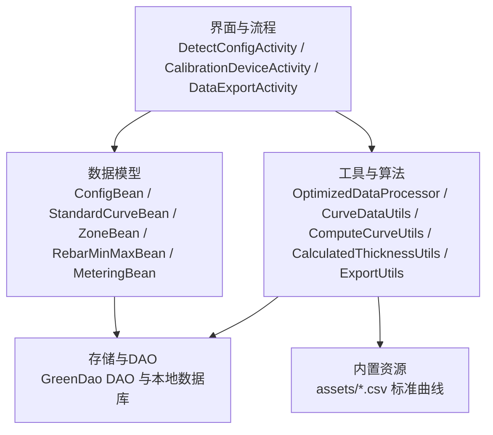
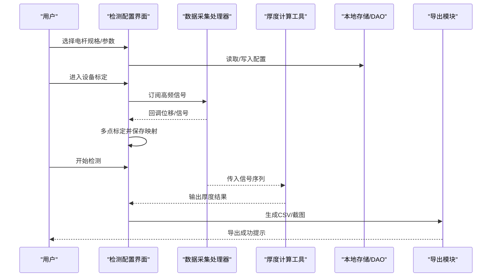
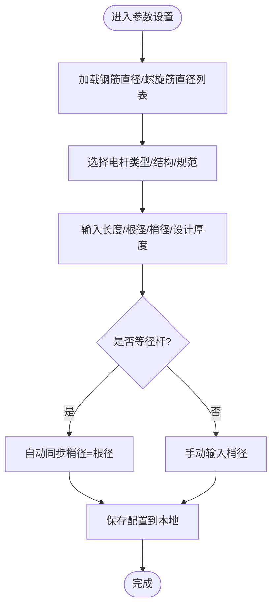
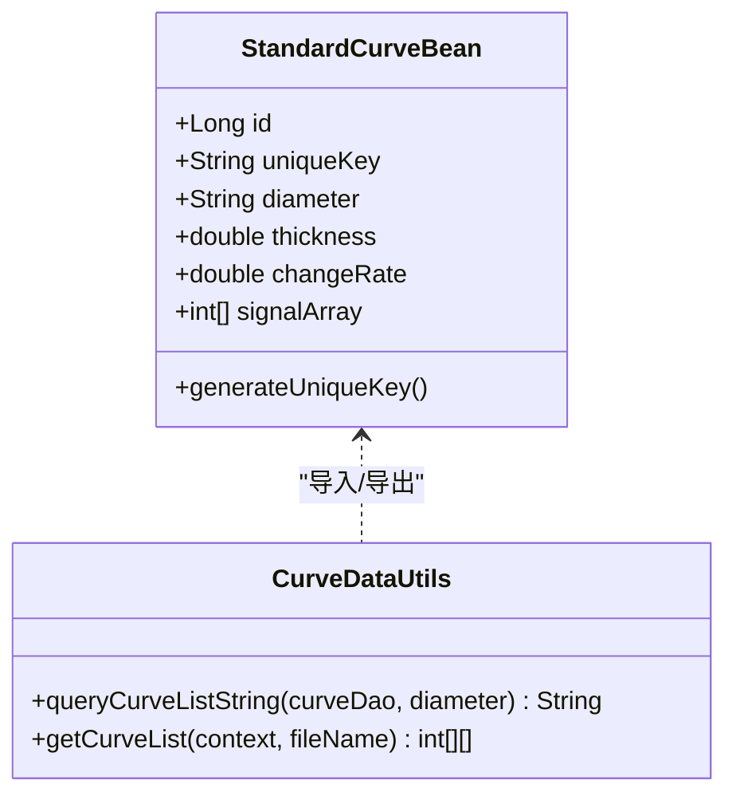
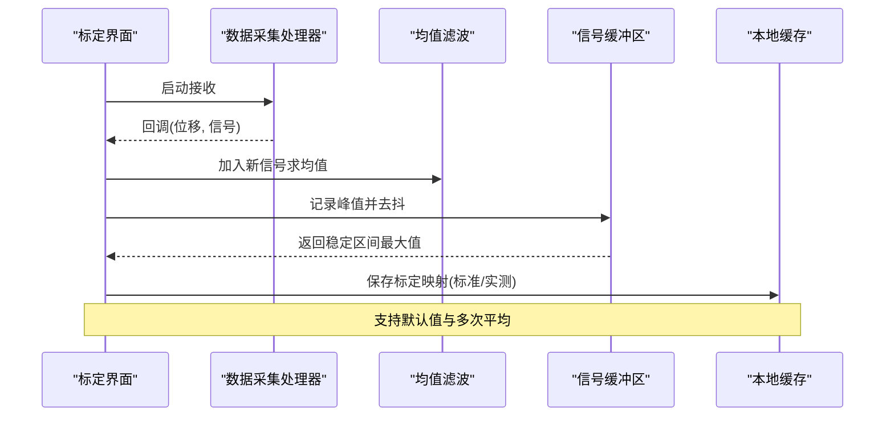
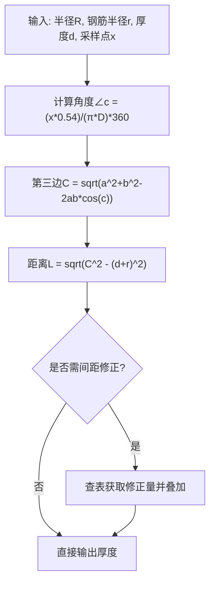
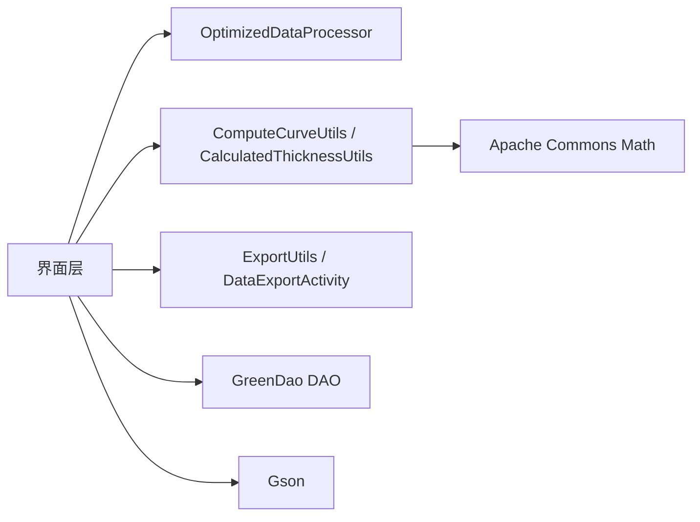

# 测量设备配置

<cite>
**本文引用的文件**
- [StaticConstant.java](file://app/src/main/java/com/example/gtj_sd_dg240/StaticConstant.java)
- [ConfigBean.java](file://app/src/main/java/com/example/gtj_sd_dg240/model/ConfigBean.java)
- [StandardCurveBean.java](file://app/src/main/java/com/example/gtj_sd_dg240/model/StandardCurveBean.java)
- [RebarMinMaxBean.java](file://app/src/main/java/com/example/gtj_sd_dg240/model/RebarMinMaxBean.java)
- [MeteringBean.java](file://app/src/main/java/com/example/gtj_sd_dg240/model/MeteringBean.java)
- [ZoneBean.java](file://app/src/main/java/com/example/gtj_sd_dg240/model/ZoneBean.java)
- [CalibrationDeviceActivity.java](file://app/src/main/java/com/example/gtj_sd_dg240/activity/setting/CalibrationDeviceActivity.java)
- [DetectConfigActivity.java](file://app/src/main/java/com/example/gtj_sd_dg240/activity/testing/DetectConfigActivity.java)
- [ConfigManagerActivity.java](file://app/src/main/java/com/example/gtj_sd_dg240/activity/testing/ConfigManagerActivity.java)
- [OptimizedDataProcessor.java](file://app/src/main/java/com/example/gtj_sd_dg240/utils/OptimizedDataProcessor.java)
- [CurveDataUtils.java](file://app/src/main/java/com/example/gtj_sd_dg240/utils/CurveDataUtils.java)
- [ComputeCurveUtils.java](file://app/src/main/java/com/example/gtj_sd_dg240/utils/ComputeCurveUtils.java)
- [CalculatedThicknessUtils.java](file://app/src/main/java/com/example/gtj_sd_dg240/utils/CalculatedThicknessUtils.java)
- [DataExportActivity.java](file://app/src/main/java/com/example/gtj_sd_dg240/activity/data/DataExportActivity.java)
- [ExportUtils.java](file://app/src/main/java/com/example/gtj_sd_dg240/utils/ExportUtils.java)
</cite>

## 目录
1. [简介](#简介)
2. [项目结构](#项目结构)
3. [核心组件](#核心组件)
4. [架构总览](#架构总览)
5. [详细组件分析](#详细组件分析)
6. [依赖关系分析](#依赖关系分析)
7. [性能与精度](#性能与精度)
8. [故障排查](#故障排查)
9. [结论](#结论)
10. [附录：标准曲线与校准数据管理](#附录：标准曲线与校准数据管理)

## 简介
本文件面向混凝土电杆保护层厚度测量设备的配置与使用，覆盖钢筋直径选择、标准曲线配置、测量参数设置、信号阈值与厚度计算算法、测量模式与采集频率、精度调节、标准曲线管理（导入/导出）、以及设备参数备份恢复。文档同时说明多型号电杆规格支持、自定义曲线配置与测量结果验证机制，帮助现场工程师快速完成设备标定与检测流程。

## 项目结构
本项目采用按功能模块划分的Android工程结构：
- 活动层：负责用户交互与业务流程编排（如检测配置、设备标定、数据导出）
- 模型层：定义配置、标准曲线、测量结果等数据结构
- 工具层：提供数据处理、曲线拟合、导出、蓝牙数据解析等能力
- 资源层：包含内置标准曲线CSV与界面资源

图表来源
- [DetectConfigActivity.java:35-143](file://app/src/main/java/com/example/gtj_sd_dg240/activity/testing/DetectConfigActivity.java#L35-L143)
- [CalibrationDeviceActivity.java:36-187](file://app/src/main/java/com/example/gtj_sd_dg240/activity/setting/CalibrationDeviceActivity.java#L36-L187)
- [DataExportActivity.java:41-117](file://app/src/main/java/com/example/gtj_sd_dg240/activity/data/DataExportActivity.java#L41-L117)
- [CurveDataUtils.java:13-87](file://app/src/main/java/com/example/gtj_sd_dg240/utils/CurveDataUtils.java#L13-L87)

章节来源
- [DetectConfigActivity.java:35-143](file://app/src/main/java/com/example/gtj_sd_dg240/activity/testing/DetectConfigActivity.java#L35-L143)
- [CalibrationDeviceActivity.java:36-187](file://app/src/main/java/com/example/gtj_sd_dg240/activity/setting/CalibrationDeviceActivity.java#L36-L187)
- [DataExportActivity.java:41-117](file://app/src/main/java/com/example/gtj_sd_dg240/activity/data/DataExportActivity.java#L41-L117)

## 核心组件
- 配置与参数
  - 电杆类型、结构、规范、长度、根径/梢径、纵筋与螺旋筋直径、设计保护层厚度等由配置对象承载，并在检测配置界面中编辑与保存
- 标准曲线
  - 以“钢筋直径 + 保护层厚度”为唯一键的标准曲线集合，用于将信号波形映射到厚度；支持从assets导入与导出
- 设备标定
  - 通过多点标定建立原始信号到标准信号的映射表，并持久化至本地缓存
- 数据采集与处理
  - 高频蓝牙数据经生产者-消费者队列缓冲、帧拼接与解析，过滤异常信号后回调上层
- 厚度计算
  - 基于标准曲线匹配或最小二乘拟合的几何距离计算，结合间距与螺旋筋影响进行修正
- 数据导出与备份
  - 生成CSV报告与截图，支持本地与USB导出；配置与曲线可导出便于备份与迁移

章节来源
- [ConfigBean.java:13-64](file://app/src/main/java/com/example/gtj_sd_dg240/model/ConfigBean.java#L13-L64)
- [StandardCurveBean.java:16-65](file://app/src/main/java/com/example/gtj_sd_dg240/model/StandardCurveBean.java#L16-L65)
- [CalibrationDeviceActivity.java:73-187](file://app/src/main/java/com/example/gtj_sd_dg240/activity/setting/CalibrationDeviceActivity.java#L73-L187)
- [OptimizedDataProcessor.java:7-135](file://app/src/main/java/com/example/gtj_sd_dg240/utils/OptimizedDataProcessor.java#L7-L135)
- [ComputeCurveUtils.java:15-141](file://app/src/main/java/com/example/gtj_sd_dg240/utils/ComputeCurveUtils.java#L15-L141)
- [DataExportActivity.java:345-471](file://app/src/main/java/com/example/gtj_sd_dg240/activity/data/DataExportActivity.java#L345-L471)

## 架构总览
系统围绕“配置—标定—采集—计算—导出”的主线展开：
- 配置阶段：在检测配置界面选择电杆规格与参数，加载或创建预设配置
- 标定阶段：进入设备标定界面，采集多点信号并建立映射表
- 采集阶段：蓝牙高频数据入队，线程安全解析，过滤噪声后回调
- 计算阶段：依据标准曲线或几何模型计算保护层厚度
- 导出阶段：生成报告与图像，支持本地与USB导出

图表来源
- [DetectConfigActivity.java:44-143](file://app/src/main/java/com/example/gtj_sd_dg240/activity/testing/DetectConfigActivity.java#L44-L143)
- [CalibrationDeviceActivity.java:112-187](file://app/src/main/java/com/example/gtj_sd_dg240/activity/setting/CalibrationDeviceActivity.java#L112-L187)
- [OptimizedDataProcessor.java:34-135](file://app/src/main/java/com/example/gtj_sd_dg240/utils/OptimizedDataProcessor.java#L34-L135)
- [DataExportActivity.java:345-471](file://app/src/main/java/com/example/gtj_sd_dg240/activity/data/DataExportActivity.java#L345-L471)

## 详细组件分析

### 钢筋直径选择与测量参数设置
- 钢筋直径列表与可选范围由常量集中管理，检测配置界面通过下拉控件绑定该列表
- 检测参数包括电杆类型、结构、规范、长度、根径/梢径、纵筋与螺旋筋直径、设计保护层厚度等
- 支持“等径杆”自动同步梢径与根径，提升输入效率

图表来源
- [DetectConfigActivity.java:138-198](file://app/src/main/java/com/example/gtj_sd_dg240/activity/testing/DetectConfigActivity.java#L138-L198)
- [StaticConstant.java:43-65](file://app/src/main/java/com/example/gtj_sd_dg240/StaticConstant.java#L43-L65)

章节来源
- [DetectConfigActivity.java:138-198](file://app/src/main/java/com/example/gtj_sd_dg240/activity/testing/DetectConfigActivity.java#L138-L198)
- [StaticConstant.java:43-65](file://app/src/main/java/com/example/gtj_sd_dg240/StaticConstant.java#L43-L65)

### 标准曲线配置与管理
- 标准曲线以“钢筋直径 + 保护层厚度”为唯一键，存储信号波形数组
- 支持从assets中的CSV批量导入，导入时校验数据完整性（无空值）
- 支持按直径查询并导出为标准文本格式，便于备份与共享

图表来源
- [StandardCurveBean.java:16-65](file://app/src/main/java/com/example/gtj_sd_dg240/model/StandardCurveBean.java#L16-L65)
- [CurveDataUtils.java:13-87](file://app/src/main/java/com/example/gtj_sd_dg240/utils/CurveDataUtils.java#L13-L87)

章节来源
- [StandardCurveBean.java:16-65](file://app/src/main/java/com/example/gtj_sd_dg240/model/StandardCurveBean.java#L16-L65)
- [CurveDataUtils.java:13-87](file://app/src/main/java/com/example/gtj_sd_dg240/utils/CurveDataUtils.java#L13-L87)

### 设备标定与信号阈值配置
- 标定界面维护两组映射：标准信号与实测信号，支持默认值一键填充
- 实时采集信号并进行均值滤波，取稳定区间的最大值作为单次标定结果，累计三次取平均
- 保存标定映射至本地缓存，供后续信号校正使用
- 数据采集过程中对异常信号进行阈值过滤（例如大于某阈值的信号丢弃）

图表来源
- [CalibrationDeviceActivity.java:112-187](file://app/src/main/java/com/example/gtj_sd_dg240/activity/setting/CalibrationDeviceActivity.java#L112-L187)
- [CalibrationDeviceActivity.java:199-215](file://app/src/main/java/com/example/gtj_sd_dg240/activity/setting/CalibrationDeviceActivity.java#L199-L215)
- [OptimizedDataProcessor.java:122-135](file://app/src/main/java/com/example/gtj_sd_dg240/utils/OptimizedDataProcessor.java#L122-L135)

章节来源
- [CalibrationDeviceActivity.java:112-187](file://app/src/main/java/com/example/gtj_sd_dg240/activity/setting/CalibrationDeviceActivity.java#L112-L187)
- [CalibrationDeviceActivity.java:199-215](file://app/src/main/java/com/example/gtj_sd_dg240/activity/setting/CalibrationDeviceActivity.java#L199-L215)
- [OptimizedDataProcessor.java:122-135](file://app/src/main/java/com/example/gtj_sd_dg240/utils/OptimizedDataProcessor.java#L122-L135)

### 厚度计算算法与多规格支持
- 几何距离法：根据电杆半径、钢筋半径与厚度，利用余弦定理计算行走距离，得到厚度相关指标
- 多项式拟合：对已知坐标点进行二次多项式拟合，生成平滑曲线用于插值
- 间距修正：针对不同主筋间距与螺旋筋间距，提供修正系数表，提高厚度计算精度
- 多规格支持：通过配置对象与常量列表，适配不同电杆类型、结构与尺寸

图表来源
- [ComputeCurveUtils.java:36-112](file://app/src/main/java/com/example/gtj_sd_dg240/utils/ComputeCurveUtils.java#L36-L112)
- [CalculatedThicknessUtils.java:22-59](file://app/src/main/java/com/example/gtj_sd_dg240/utils/CalculatedThicknessUtils.java#L22-L59)
- [RebarMinMaxBean.java:13-76](file://app/src/main/java/com/example/gtj_sd_dg240/model/RebarMinMaxBean.java#L13-L76)

章节来源
- [ComputeCurveUtils.java:36-112](file://app/src/main/java/com/example/gtj_sd_dg240/utils/ComputeCurveUtils.java#L36-L112)
- [CalculatedThicknessUtils.java:22-59](file://app/src/main/java/com/example/gtj_sd_dg240/utils/CalculatedThicknessUtils.java#L22-L59)
- [RebarMinMaxBean.java:13-76](file://app/src/main/java/com/example/gtj_sd_dg240/model/RebarMinMaxBean.java#L13-L76)

### 测量模式、采集频率与精度调节
- 测量模式：支持按区域（根部/梢部/中间段）分段采集，每段内按固定数量采样点统计平均值
- 采集频率：高频蓝牙数据通过阻塞队列缓冲，单线程消费，避免丢包与卡顿
- 精度调节：
  - 信号均值滤波（滑动窗口剔除极端值）
  - 标定映射（多点线性插值校正）
  - 间距修正（主筋间距与螺旋筋间距的影响补偿）
  - 多项式拟合（平滑曲线减少波动）

章节来源
- [OptimizedDataProcessor.java:34-75](file://app/src/main/java/com/example/gtj_sd_dg240/utils/OptimizedDataProcessor.java#L34-L75)
- [CalibrationDeviceActivity.java:129-187](file://app/src/main/java/com/example/gtj_sd_dg240/activity/setting/CalibrationDeviceActivity.java#L129-L187)
- [ComputeCurveUtils.java:121-141](file://app/src/main/java/com/example/gtj_sd_dg240/utils/ComputeCurveUtils.java#L121-L141)

### 标准曲线导入/导出与设备参数备份恢复
- 标准曲线导入：从assets读取CSV，解析为二维数组并校验完整性
- 标准曲线导出：按直径查询数据库，生成可读文本（含厚度与信号序列）
- 设备参数备份：检测配置与标定映射均持久化至本地缓存/数据库，支持重新加载
- 数据导出：生成CSV与截图，支持本地与USB双通道导出

章节来源
- [CurveDataUtils.java:38-87](file://app/src/main/java/com/example/gtj_sd_dg240/utils/CurveDataUtils.java#L38-L87)
- [CurveDataUtils.java:20-36](file://app/src/main/java/com/example/gtj_sd_dg240/utils/CurveDataUtils.java#L20-L36)
- [DataExportActivity.java:345-471](file://app/src/main/java/com/example/gtj_sd_dg240/activity/data/DataExportActivity.java#L345-L471)
- [ExportUtils.java:25-66](file://app/src/main/java/com/example/gtj_sd_dg240/utils/ExportUtils.java#L25-L66)

## 依赖关系分析
- 界面与工具耦合度低：界面仅调用工具方法完成标定、计算与导出
- 数据存储解耦：通过DAO访问数据库，模型与存储分离
- 外部依赖：Apache Commons Math用于多项式拟合；Gson用于JSON序列化

图表来源
- [DetectConfigActivity.java:44-143](file://app/src/main/java/com/example/gtj_sd_dg240/activity/testing/DetectConfigActivity.java#L44-L143)
- [OptimizedDataProcessor.java:7-135](file://app/src/main/java/com/example/gtj_sd_dg240/utils/OptimizedDataProcessor.java#L7-L135)
- [ComputeCurveUtils.java:1-141](file://app/src/main/java/com/example/gtj_sd_dg240/utils/ComputeCurveUtils.java#L1-L141)
- [DataExportActivity.java:345-471](file://app/src/main/java/com/example/gtj_sd_dg240/activity/data/DataExportActivity.java#L345-L471)

章节来源
- [ComputeCurveUtils.java:1-141](file://app/src/main/java/com/example/gtj_sd_dg240/utils/ComputeCurveUtils.java#L1-L141)
- [DataExportActivity.java:345-471](file://app/src/main/java/com/example/gtj_sd_dg240/activity/data/DataExportActivity.java#L345-L471)

## 性能与精度
- 性能优化
  - 生产者-消费者队列缓冲高频蓝牙数据，降低丢包率与UI卡顿
  - 单线程串行处理，避免并发竞争
  - 信号均值滤波与去抖，减少无效数据
- 精度保障
  - 多点标定建立精确的信号映射
  - 间距修正表补偿主筋与螺旋筋影响
  - 多项式拟合平滑曲线，提高插值稳定性
- 建议
  - 定期更新标准曲线与标定映射
  - 在不同温度/湿度环境下复测标定
  - 对异常数据进行人工复核与剔除

[本节为通用指导，不直接分析具体文件]

## 故障排查
- 无法连接设备
  - 检查蓝牙权限与状态，确认设备已配对
- 标定失败或结果不稳定
  - 检查信号阈值过滤是否过严或过松
  - 确认多点标定覆盖完整量程
  - 查看均值滤波窗口大小是否合适
- 导出失败
  - 检查存储空间与USB挂载状态
  - 确认数据完整性（是否有缺失页或空值）
- 曲线导入错误
  - 检查CSV格式与列数，确保无空值

章节来源
- [CalibrationDeviceActivity.java:199-215](file://app/src/main/java/com/example/gtj_sd_dg240/activity/setting/CalibrationDeviceActivity.java#L199-L215)
- [DataExportActivity.java:374-471](file://app/src/main/java/com/example/gtj_sd_dg240/activity/data/DataExportActivity.java#L374-L471)
- [CurveDataUtils.java:50-87](file://app/src/main/java/com/example/gtj_sd_dg240/utils/CurveDataUtils.java#L50-L87)

## 结论
本项目提供了完整的混凝土电杆保护层厚度测量设备配置与数据处理方案。通过标准化的配置管理、多点标定、高频数据采集与稳健的厚度计算算法，满足多规格电杆的检测需求。标准曲线的导入/导出与数据的双通道导出，保障了数据的可追溯性与可迁移性。建议在实际使用中结合环境因素定期标定与复核，以确保测量结果的准确性与一致性。

[本节为总结性内容，不直接分析具体文件]

## 附录：标准曲线与校准数据管理
- 标准曲线管理
  - 导入：从assets读取CSV，解析为二维数组并校验完整性
  - 导出：按直径查询数据库，生成包含厚度与信号序列的文本
- 校准数据管理
  - 标定映射：标准信号与实测信号的多点对应关系，支持默认值与多次平均
  - 持久化：标定结果与检测配置均保存在本地缓存/数据库中，支持重新加载
- 设备参数备份恢复
  - 配置备份：检测配置与标定映射可导出或迁移
  - 恢复流程：重新加载配置与标定映射，即可恢复至上次工作状态

章节来源
- [CurveDataUtils.java:20-87](file://app/src/main/java/com/example/gtj_sd_dg240/utils/CurveDataUtils.java#L20-L87)
- [CalibrationDeviceActivity.java:73-187](file://app/src/main/java/com/example/gtj_sd_dg240/activity/setting/CalibrationDeviceActivity.java#L73-L187)
- [DataExportActivity.java:345-471](file://app/src/main/java/com/example/gtj_sd_dg240/activity/data/DataExportActivity.java#L345-L471)