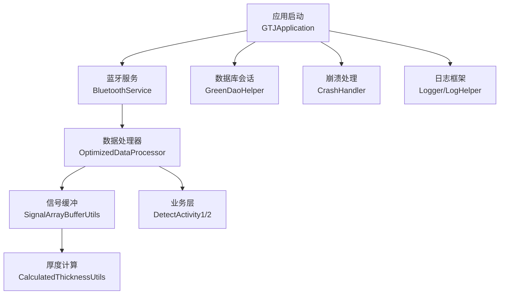
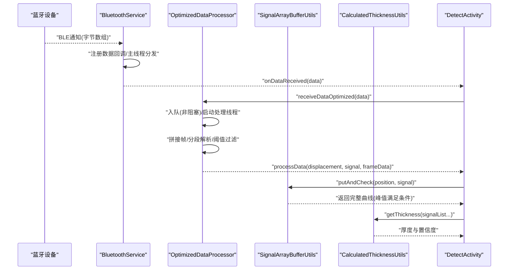
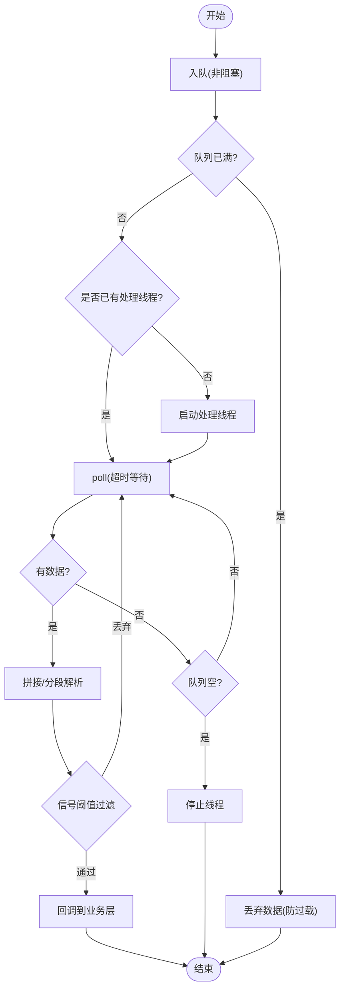
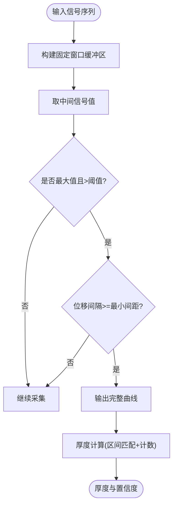
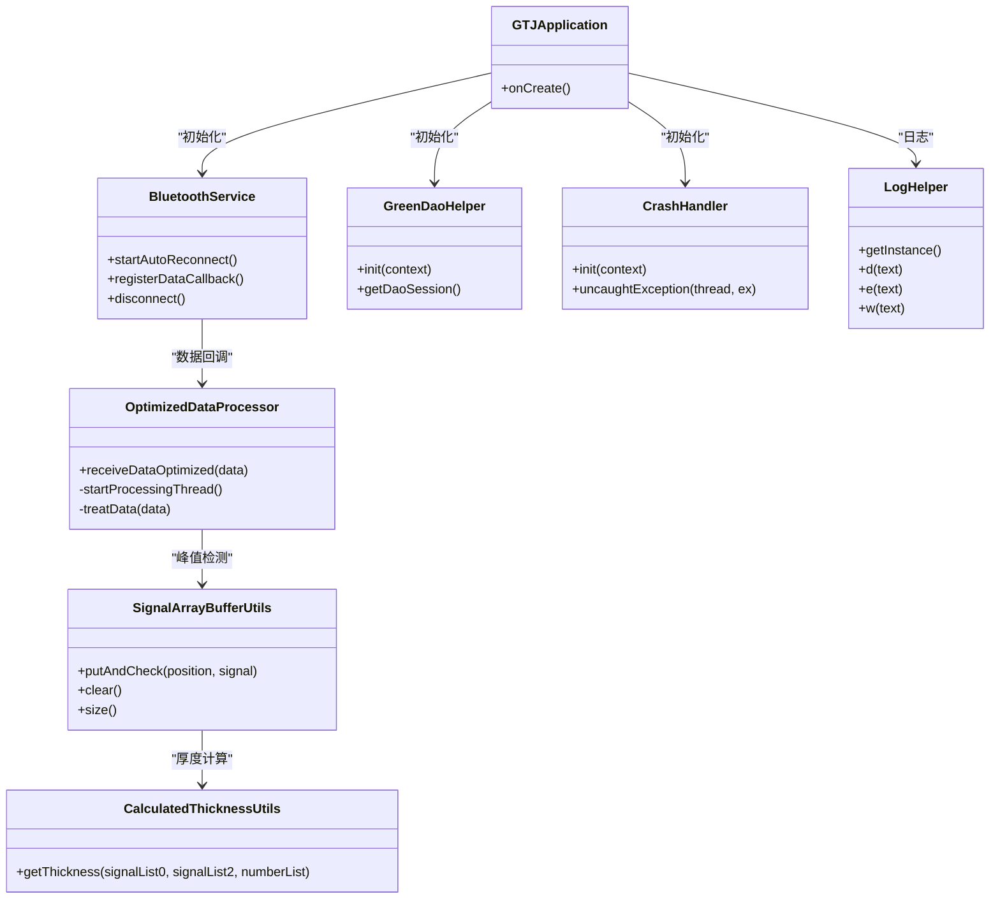

# 系统性能配置

<cite>
**本文引用的文件**
- [GTJApplication.java](file://app/src/main/java/com/example/gtj_sd_dg240/GTJApplication.java)
- [StaticConstant.java](file://app/src/main/java/com/example/gtj_sd_dg240/StaticConstant.java)
- [OptimizedDataProcessor.java](file://app/src/main/java/com/example/gtj_sd_dg240/utils/OptimizedDataProcessor.java)
- [SignalArrayBufferUtils.java](file://app/src/main/java/com/example/gtj_sd_dg240/utils/SignalArrayBufferUtils.java)
- [BluetoothService.java](file://app/src/main/java/com/example/gtj_sd_dg240/bluetooth/BluetoothService.java)
- [CrashHandler.java](file://app/src/main/java/com/example/gtj_sd_dg240/utils/CrashHandler.java)
- [GreenDaoHelper.java](file://app/src/main/java/com/example/gtj_sd_dg240/storage/GreenDaoHelper.java)
- [CalculatedThicknessUtils.java](file://app/src/main/java/com/example/gtj_sd_dg240/utils/CalculatedThicknessUtils.java)
- [BaseActivity.java](file://app/src/main/java/com/example/gtj_sd_dg240/activity/start/BaseActivity.java)
- [DetectActivity1.java](file://app/src/main/java/com/example/gtj_sd_dg240/activity/testing/DetectActivity1.java)
- [DetectActivity2.java](file://app/src/main/java/com/example/gtj_sd_dg240/activity/testing/DetectActivity2.java)
- [LogHelper.java](file://utillibrary/src/main/java/com/blackhao/utillibrary/log/LogHelper.java)
- [BitmapUtils.java](file://app/src/main/java/com/example/gtj_sd_dg240/utils/BitmapUtils.java)
- [DeleteFileUtils.java](file://app/src/main/java/com/example/gtj_sd_dg240/utils/DeleteFileUtils.java)
- [DownloadAppTask.java](file://app/src/main/java/com/example/gtj_sd_dg240/utils/DownloadAppTask.java)
</cite>

## 目录
1. [简介](#简介)
2. [项目结构](#项目结构)
3. [核心组件](#核心组件)
4. [架构总览](#架构总览)
5. [详细组件分析](#详细组件分析)
6. [依赖关系分析](#依赖关系分析)
7. [性能考量与调优](#性能考量与调优)
8. [故障排查指南](#故障排查指南)
9. [结论](#结论)
10. [附录：参数与开关清单](#附录参数与开关清单)

## 简介
本文件面向混凝土电杆检测系统的“系统性能配置”，聚焦以下目标：
- 内存管理优化：队列容量、循环缓冲区、图片缓存策略、数据库会话复用。
- 数据处理线程配置：生产者-消费者模型、定时任务、线程生命周期管理。
- 缓存策略设置：信号缓冲、结果缓存、UI绘制缓存。
- 信号处理算法参数：阈值过滤、采样间隔、峰值判定、厚度计算。
- 数据采样频率与实时性：蓝牙通知回调、轮询周期、主线程调度。
- 电池使用优化：重连间隔、唤醒锁、后台任务节流。
- CPU占用率控制：批量处理、休眠等待、避免频繁GC。
- 存储空间管理：崩溃日志、临时文件清理。
- 监控与调试：日志级别、调试模式、异常恢复机制。
- 设备适配：不同设备性能差异下的资源限制与降级策略。

## 项目结构
应用采用模块化分层组织，关键性能相关代码集中在 utils、bluetooth、storage 以及测试检测 Activity 中：
- 应用初始化：统一初始化蓝牙、崩溃捕获、日志、数据库、定位等。
- 数据采集与处理：蓝牙服务接收数据，经处理器入队并异步解析。
- 信号缓冲与峰值检测：环形缓冲区维护最近窗口数据，识别有效峰值。
- 存储与导出：GreenDao 会话复用，减少数据库连接开销。
- 工具与监控：日志、文件清理、位图缓存、下载任务电源管理。

图表来源
- [GTJApplication.java:20-41](file://app/src/main/java/com/example/gtj_sd_dg240/GTJApplication.java#L20-L41)
- [BluetoothService.java:20-52](file://app/src/main/java/com/example/gtj_sd_dg240/bluetooth/BluetoothService.java#L20-L52)
- [OptimizedDataProcessor.java:7-27](file://app/src/main/java/com/example/gtj_sd_dg240/utils/OptimizedDataProcessor.java#L7-L27)
- [SignalArrayBufferUtils.java:5-21](file://app/src/main/java/com/example/gtj_sd_dg240/utils/SignalArrayBufferUtils.java#L5-L21)
- [GreenDaoHelper.java:10-40](file://app/src/main/java/com/example/gtj_sd_dg240/storage/GreenDaoHelper.java#L10-L40)
- [CrashHandler.java:35-80](file://app/src/main/java/com/example/gtj_sd_dg240/utils/CrashHandler.java#L35-L80)
- [LogHelper.java:18-46](file://utillibrary/src/main/java/com/blackhao/utillibrary/log/LogHelper.java#L18-L46)

章节来源
- [GTJApplication.java:20-41](file://app/src/main/java/com/example/gtj_sd_dg240/GTJApplication.java#L20-L41)
- [StaticConstant.java:26-70](file://app/src/main/java/com/example/gtj_sd_dg240/StaticConstant.java#L26-L70)

## 核心组件
- 应用初始化（GTJApplication）：集中初始化蓝牙、崩溃捕获、日志、数据库、定位、Toast样式。
- 蓝牙服务（BluetoothService）：单例管理连接状态、自动重连、数据通知分发、主线程回调。
- 数据处理器（OptimizedDataProcessor）：生产者-消费者模型，非阻塞入队，子线程拼接帧、分段解析、阈值过滤。
- 信号缓冲（SignalArrayBufferUtils）：固定大小环形缓冲区，维护位移与信号值，检测中间最大值并输出完整曲线。
- 厚度计算（CalculatedThicknessUtils）：基于信号区间匹配与计数，计算保护层厚度及置信度。
- 数据库会话（GreenDaoHelper）：懒加载 DaoMaster/Session，减少重复创建开销。
- 崩溃处理（CrashHandler）：全局异常捕获、设备信息收集、日志落盘、跳转错误页。
- 日志工具（LogHelper）：可配置日志级别、调试开关、分片打印、可选写文件。
- UI缓存（BitmapUtils）：按可用内存比例分配 LruCache，降低重复绘制成本。
- 文件清理（DeleteFileUtils）：递归删除文件或目录，释放存储空间。
- 下载任务（DownloadAppTask）：使用部分唤醒锁保证下载期间CPU不降频，完成后释放。

章节来源
- [GTJApplication.java:20-41](file://app/src/main/java/com/example/gtj_sd_dg240/GTJApplication.java#L20-L41)
- [BluetoothService.java:20-52](file://app/src/main/java/com/example/gtj_sd_dg240/bluetooth/BluetoothService.java#L20-L52)
- [OptimizedDataProcessor.java:7-27](file://app/src/main/java/com/example/gtj_sd_dg240/utils/OptimizedDataProcessor.java#L7-L27)
- [SignalArrayBufferUtils.java:5-21](file://app/src/main/java/com/example/gtj_sd_dg240/utils/SignalArrayBufferUtils.java#L5-L21)
- [CalculatedThicknessUtils.java:9-22](file://app/src/main/java/com/example/gtj_sd_dg240/utils/CalculatedThicknessUtils.java#L9-L22)
- [GreenDaoHelper.java:10-40](file://app/src/main/java/com/example/gtj_sd_dg240/storage/GreenDaoHelper.java#L10-L40)
- [CrashHandler.java:35-80](file://app/src/main/java/com/example/gtj_sd_dg240/utils/CrashHandler.java#L35-L80)
- [LogHelper.java:18-46](file://utillibrary/src/main/java/com/blackhao/utillibrary/log/LogHelper.java#L18-L46)
- [BitmapUtils.java:172-191](file://app/src/main/java/com/example/gtj_sd_dg240/utils/BitmapUtils.java#L172-L191)
- [DeleteFileUtils.java:7-25](file://app/src/main/java/com/example/gtj_sd_dg240/utils/DeleteFileUtils.java#L7-L25)
- [DownloadAppTask.java:117-148](file://app/src/main/java/com/example/gtj_sd_dg240/utils/DownloadAppTask.java#L117-L148)

## 架构总览
系统以蓝牙为数据源，通过服务层统一管理连接与重连；数据进入处理器进行批处理与解析；信号缓冲模块负责窗口化聚合与峰值识别；计算模块输出厚度结果；数据库用于持久化配置与结果；崩溃与日志保障稳定性与可观测性。

图表来源
- [BluetoothService.java:175-198](file://app/src/main/java/com/example/gtj_sd_dg240/bluetooth/BluetoothService.java#L175-L198)
- [OptimizedDataProcessor.java:34-75](file://app/src/main/java/com/example/gtj_sd_dg240/utils/OptimizedDataProcessor.java#L34-L75)
- [SignalArrayBufferUtils.java:23-66](file://app/src/main/java/com/example/gtj_sd_dg240/utils/SignalArrayBufferUtils.java#L23-L66)
- [CalculatedThicknessUtils.java:22-59](file://app/src/main/java/com/example/gtj_sd_dg240/utils/CalculatedThicknessUtils.java#L22-L59)
- [DetectActivity1.java:220-228](file://app/src/main/java/com/example/gtj_sd_dg240/activity/testing/DetectActivity1.java#L220-L228)
- [DetectActivity2.java:165-203](file://app/src/main/java/com/example/gtj_sd_dg240/activity/testing/DetectActivity2.java#L165-L203)

## 详细组件分析

### 数据流与线程模型
- 蓝牙数据接收：BluetoothService 在主线程分发回调，避免跨线程UI更新问题。
- 高吞吐处理：OptimizedDataProcessor 使用 LinkedBlockingQueue 作为缓冲，非阻塞 offer 防止背压阻塞；处理线程 poll 超时退出，空队列时关闭，降低空闲CPU占用。
- 帧拼接与解析：按固定长度分段解析，提取位移与信号值，并进行阈值过滤（如信号过大丢弃）。
- 峰值检测：SignalArrayBufferUtils 维护固定大小的环形缓冲区，当达到窗口大小时检查中间值是否为最大值且满足最小间隔，输出完整曲线。
- 计算与展示：CalculatedThicknessUtils 根据信号区间匹配与计数确定厚度与置信度；UI 层定时刷新或事件驱动更新。

图表来源
- [OptimizedDataProcessor.java:34-75](file://app/src/main/java/com/example/gtj_sd_dg240/utils/OptimizedDataProcessor.java#L34-L75)
- [OptimizedDataProcessor.java:82-133](file://app/src/main/java/com/example/gtj_sd_dg240/utils/OptimizedDataProcessor.java#L82-L133)

章节来源
- [OptimizedDataProcessor.java:34-75](file://app/src/main/java/com/example/gtj_sd_dg240/utils/OptimizedDataProcessor.java#L34-L75)
- [OptimizedDataProcessor.java:82-133](file://app/src/main/java/com/example/gtj_sd_dg240/utils/OptimizedDataProcessor.java#L82-L133)
- [SignalArrayBufferUtils.java:23-66](file://app/src/main/java/com/example/gtj_sd_dg240/utils/SignalArrayBufferUtils.java#L23-L66)

### 信号处理算法参数
- 信号阈值过滤：在解析后对信号值进行上限过滤，避免异常值影响后续计算。
- 峰值判定：环形缓冲区满后，取中间索引的信号值，判断其是否为最大值且大于最小阈值；同时要求相邻峰值位移间隔满足最小间距。
- 厚度计算：根据信号区间上下界匹配，统计命中次数，选择最高置信度区间，计算厚度与置信度。

图表来源
- [SignalArrayBufferUtils.java:23-66](file://app/src/main/java/com/example/gtj_sd_dg240/utils/SignalArrayBufferUtils.java#L23-L66)
- [CalculatedThicknessUtils.java:22-59](file://app/src/main/java/com/example/gtj_sd_dg240/utils/CalculatedThicknessUtils.java#L22-L59)

章节来源
- [SignalArrayBufferUtils.java:23-66](file://app/src/main/java/com/example/gtj_sd_dg240/utils/SignalArrayBufferUtils.java#L23-L66)
- [CalculatedThicknessUtils.java:22-59](file://app/src/main/java/com/example/gtj_sd_dg240/utils/CalculatedThicknessUtils.java#L22-L59)

### 内存管理与缓存策略
- 队列容量：数据处理器使用固定容量的阻塞队列，避免无限增长导致OOM；队列满时直接丢弃新数据，保护系统稳定。
- 环形缓冲区：信号缓冲使用固定大小数组，覆盖旧数据，降低内存占用；仅在满足条件时输出完整曲线。
- 图片缓存：按可用内存的八分之一分配 LruCache，减少重复绘制与GC压力。
- 数据库会话：GreenDaoHelper 懒加载并复用 Session，避免频繁创建带来的内存与I/O开销。

章节来源
- [OptimizedDataProcessor.java:11-13](file://app/src/main/java/com/example/gtj_sd_dg240/utils/OptimizedDataProcessor.java#L11-L13)
- [SignalArrayBufferUtils.java:5-21](file://app/src/main/java/com/example/gtj_sd_dg240/utils/SignalArrayBufferUtils.java#L5-L21)
- [BitmapUtils.java:172-191](file://app/src/main/java/com/example/gtj_sd_dg240/utils/BitmapUtils.java#L172-L191)
- [GreenDaoHelper.java:16-40](file://app/src/main/java/com/example/gtj_sd_dg240/storage/GreenDaoHelper.java#L16-L40)

### 数据处理线程配置与实时性调优
- 生产者-消费者：非阻塞入队 + 子线程消费，解耦采集与处理，提升吞吐。
- 轮询周期：poll 超时时间控制响应延迟；空队列时及时退出线程，降低空闲CPU。
- 主线程调度：蓝牙回调与UI更新通过 Handler 切回主线程，确保界面流畅。
- 定时任务：检测页面使用 ScheduledExecutorService 定期刷新或处理逻辑，避免阻塞主线程。

章节来源
- [OptimizedDataProcessor.java:52-75](file://app/src/main/java/com/example/gtj_sd_dg240/utils/OptimizedDataProcessor.java#L52-L75)
- [BluetoothService.java:175-198](file://app/src/main/java/com/example/gtj_sd_dg240/bluetooth/BluetoothService.java#L175-L198)
- [DetectActivity2.java:171-183](file://app/src/main/java/com/example/gtj_sd_dg240/activity/testing/DetectActivity2.java#L171-L183)

### 电池使用优化与CPU占用率控制
- 自动重连间隔：BluetoothService 使用固定间隔定时器尝试重连，避免频繁连接导致的电量消耗。
- 唤醒锁：下载任务使用 PARTIAL_WAKE_LOCK 保证CPU不降频，完成后释放，平衡可靠性与功耗。
- 线程生命周期：处理线程在空队列时退出，减少常驻线程带来的CPU占用。
- 日志级别：LogHelper 支持调试开关与日志等级，生产环境可降低日志开销。

章节来源
- [BluetoothService.java:36-39](file://app/src/main/java/com/example/gtj_sd_dg240/bluetooth/BluetoothService.java#L36-L39)
- [DownloadAppTask.java:117-148](file://app/src/main/java/com/example/gtj_sd_dg240/utils/DownloadAppTask.java#L117-L148)
- [OptimizedDataProcessor.java:52-75](file://app/src/main/java/com/example/gtj_sd_dg240/utils/OptimizedDataProcessor.java#L52-L75)
- [LogHelper.java:20-46](file://utillibrary/src/main/java/com/blackhao/utillibrary/log/LogHelper.java#L20-L46)

### 存储空间管理
- 崩溃日志：CrashHandler 将崩溃信息写入外部存储指定目录，便于问题回溯。
- 文件清理：DeleteFileUtils 提供文件与目录删除能力，可用于清理临时文件或过期数据。
- 数据库路径：StaticConstant 定义数据库名称，便于统一管理与迁移。

章节来源
- [CrashHandler.java:153-199](file://app/src/main/java/com/example/gtj_sd_dg240/utils/CrashHandler.java#L153-L199)
- [DeleteFileUtils.java:7-25](file://app/src/main/java/com/example/gtj_sd_dg240/utils/DeleteFileUtils.java#L7-L25)
- [StaticConstant.java:28-33](file://app/src/main/java/com/example/gtj_sd_dg240/StaticConstant.java#L28-L33)

### 异常恢复机制
- 全局异常捕获：CrashHandler 接管未捕获异常，收集设备信息与堆栈，保存日志并跳转错误页。
- 蓝牙断开恢复：BluetoothService 监听连接状态变化，断开时取消通知，连接成功时重新注册数据回调。
- 资源释放：BaseActivity 在销毁时注销电池监听、蓝牙监听器，关闭线程池，防止泄漏。

章节来源
- [CrashHandler.java:82-123](file://app/src/main/java/com/example/gtj_sd_dg240/utils/CrashHandler.java#L82-L123)
- [BluetoothService.java:127-159](file://app/src/main/java/com/example/gtj_sd_dg240/bluetooth/BluetoothService.java#L127-L159)
- [BaseActivity.java:309-335](file://app/src/main/java/com/example/gtj_sd_dg240/activity/start/BaseActivity.java#L309-L335)

## 依赖关系分析
- 应用层依赖：
  - GTJApplication 依赖 BluetoothManager、CrashHandler、Logger、GreenDaoHelper、LocService。
  - DetectActivity 依赖 OptimizedDataProcessor、SignalArrayBufferUtils、CalculatedThicknessUtils。
  - BluetoothService 依赖 inuker 蓝牙库、SPUtils、ToastUtils。
- 工具层依赖：
  - LogHelper 依赖 BuildConfig.DEBUG 控制调试开关。
  - BitmapUtils 依赖系统内存信息进行缓存大小估算。
  - DeleteFileUtils 依赖文件系统API。
- 数据层依赖：
  - GreenDaoHelper 依赖 DaoMaster/DaoSession，提供数据库访问能力。

图表来源
- [GTJApplication.java:20-41](file://app/src/main/java/com/example/gtj_sd_dg240/GTJApplication.java#L20-L41)
- [BluetoothService.java:20-52](file://app/src/main/java/com/example/gtj_sd_dg240/bluetooth/BluetoothService.java#L20-L52)
- [OptimizedDataProcessor.java:7-27](file://app/src/main/java/com/example/gtj_sd_dg240/utils/OptimizedDataProcessor.java#L7-L27)
- [SignalArrayBufferUtils.java:5-21](file://app/src/main/java/com/example/gtj_sd_dg240/utils/SignalArrayBufferUtils.java#L5-L21)
- [CalculatedThicknessUtils.java:9-22](file://app/src/main/java/com/example/gtj_sd_dg240/utils/CalculatedThicknessUtils.java#L9-L22)
- [GreenDaoHelper.java:10-40](file://app/src/main/java/com/example/gtj_sd_dg240/storage/GreenDaoHelper.java#L10-L40)
- [CrashHandler.java:35-80](file://app/src/main/java/com/example/gtj_sd_dg240/utils/CrashHandler.java#L35-L80)
- [LogHelper.java:18-46](file://utillibrary/src/main/java/com/blackhao/utillibrary/log/LogHelper.java#L18-L46)

章节来源
- [GTJApplication.java:20-41](file://app/src/main/java/com/example/gtj_sd_dg240/GTJApplication.java#L20-L41)
- [BluetoothService.java:20-52](file://app/src/main/java/com/example/gtj_sd_dg240/bluetooth/BluetoothService.java#L20-L52)
- [OptimizedDataProcessor.java:7-27](file://app/src/main/java/com/example/gtj_sd_dg240/utils/OptimizedDataProcessor.java#L7-L27)
- [SignalArrayBufferUtils.java:5-21](file://app/src/main/java/com/example/gtj_sd_dg240/utils/SignalArrayBufferUtils.java#L5-L21)
- [CalculatedThicknessUtils.java:9-22](file://app/src/main/java/com/example/gtj_sd_dg240/utils/CalculatedThicknessUtils.java#L9-L22)
- [GreenDaoHelper.java:10-40](file://app/src/main/java/com/example/gtj_sd_dg240/storage/GreenDaoHelper.java#L10-L40)
- [CrashHandler.java:35-80](file://app/src/main/java/com/example/gtj_sd_dg240/utils/CrashHandler.java#L35-L80)
- [LogHelper.java:18-46](file://utillibrary/src/main/java/com/blackhao/utillibrary/log/LogHelper.java#L18-L46)

## 性能考量与调优
- 内存管理
  - 调整队列容量：根据设备内存与数据速率，适当增大或减小 LinkedBlockingQueue 容量，平衡丢包率与内存占用。
  - 环形缓冲区大小：根据信号采样频率与峰值检测需求，调整 MAX_SIZE，确保窗口足够捕捉完整波形。
  - 图片缓存比例：可按设备内存动态调整 LruCache 比例，避免过高内存占用。
- 线程与实时性
  - poll 超时：缩短超时可提高实时性但增加CPU；延长超时降低CPU但增加延迟。需根据场景权衡。
  - 定时任务频率：检测页面的定时刷新频率可根据显示需求调整，避免过度刷新导致卡顿。
- 电池与CPU
  - 重连间隔：根据网络环境与设备电量，调整 RECONNECT_INTERVAL_MS，减少无效连接尝试。
  - 唤醒锁：仅在必要时使用 PARTIAL_WAKE_LOCK，并确保及时释放。
- 存储与日志
  - 崩溃日志路径：确保外部存储可用，并定期清理历史日志。
  - 日志级别：生产环境降低日志级别，减少I/O与CPU开销。
- 设备适配
  - 低端设备：降低队列容量、缩小缓冲区、减少UI刷新频率。
  - 高端设备：可适当提高吞吐量与精度，增强实时性与准确性。

[本节为通用指导，不直接分析具体文件]

## 故障排查指南
- 崩溃与异常
  - 查看崩溃日志文件：路径由 StaticConstant.crashFilePath 指定，文件名包含时间与时间戳。
  - 设备信息：CrashHandler 收集 Build 字段与版本信息，便于复现问题。
- 蓝牙连接问题
  - 检查连接状态：BluetoothService 提供 isConnected 与 isConnected(mac) 方法。
  - 重连机制：确认 startAutoReconnect 已启用，RECONNECT_INTERVAL_MS 合理。
- 数据丢失或延迟
  - 队列溢出：若频繁丢弃数据，考虑增大队列容量或优化上游发送频率。
  - 峰值检测失败：检查 SignalArrayBufferUtils 的阈值与间隔参数是否符合实际信号特征。
- 存储不足
  - 清理文件：使用 DeleteFileUtils 删除无用文件或目录。
  - 数据库管理：定期归档或删除历史数据，保持数据库体积可控。

章节来源
- [CrashHandler.java:153-199](file://app/src/main/java/com/example/gtj_sd_dg240/utils/CrashHandler.java#L153-L199)
- [BluetoothService.java:54-74](file://app/src/main/java/com/example/gtj_sd_dg240/bluetooth/BluetoothService.java#L54-L74)
- [SignalArrayBufferUtils.java:23-66](file://app/src/main/java/com/example/gtj_sd_dg240/utils/SignalArrayBufferUtils.java#L23-L66)
- [DeleteFileUtils.java:7-25](file://app/src/main/java/com/example/gtj_sd_dg240/utils/DeleteFileUtils.java#L7-L25)

## 结论
本系统通过生产者-消费者模型、环形缓冲区、固定队列容量与懒加载数据库会话，实现了高效的数据处理与内存管理；结合蓝牙自动重连、定时任务与日志级别控制，兼顾了实时性与能耗；崩溃捕获与文件清理保障了稳定性与空间健康。针对不同设备性能，可通过调整队列容量、缓冲区大小、轮询周期与日志级别实现灵活适配。

[本节为总结，不直接分析具体文件]

## 附录：参数与开关清单
- 队列容量：OptimizedDataProcessor.dataQueue 初始容量，影响吞吐与内存。
- 缓冲区大小：SignalArrayBufferUtils.MAX_SIZE，决定窗口长度与峰值检测灵敏度。
- 信号阈值：OptimizedDataProcessor.processData 中的信号上限过滤，避免异常值。
- 峰值间隔：SignalArrayBufferUtils.effectiveSpacing，控制相邻峰值的最小位移间隔。
- 重连间隔：BluetoothService.RECONNECT_INTERVAL_MS，影响连接恢复速度与能耗。
- 日志级别：LogHelper.LOG_LEVEL 与 IS_DEBUG，控制日志输出与文件写入。
- 崩溃日志开关：StaticConstant.CRASH_DEBUG，决定是否落盘崩溃信息。
- 数据库名称：StaticConstant.DB_NAME，用于统一存储路径与管理。
- 图片缓存比例：BitmapUtils 中按可用内存比例分配 LruCache 大小。
- 唤醒锁：DownloadAppTask 中使用 PARTIAL_WAKE_LOCK 保证下载期间CPU活跃。

章节来源
- [OptimizedDataProcessor.java:11-13](file://app/src/main/java/com/example/gtj_sd_dg240/utils/OptimizedDataProcessor.java#L11-L13)
- [SignalArrayBufferUtils.java:6-8](file://app/src/main/java/com/example/gtj_sd_dg240/utils/SignalArrayBufferUtils.java#L6-L8)
- [OptimizedDataProcessor.java:122-133](file://app/src/main/java/com/example/gtj_sd_dg240/utils/OptimizedDataProcessor.java#L122-L133)
- [BluetoothService.java:36-39](file://app/src/main/java/com/example/gtj_sd_dg240/bluetooth/BluetoothService.java#L36-L39)
- [LogHelper.java:20-46](file://utillibrary/src/main/java/com/blackhao/utillibrary/log/LogHelper.java#L20-L46)
- [StaticConstant.java:30-33](file://app/src/main/java/com/example/gtj_sd_dg240/StaticConstant.java#L30-L33)
- [BitmapUtils.java:172-191](file://app/src/main/java/com/example/gtj_sd_dg240/utils/BitmapUtils.java#L172-L191)
- [DownloadAppTask.java:117-148](file://app/src/main/java/com/example/gtj_sd_dg240/utils/DownloadAppTask.java#L117-L148)