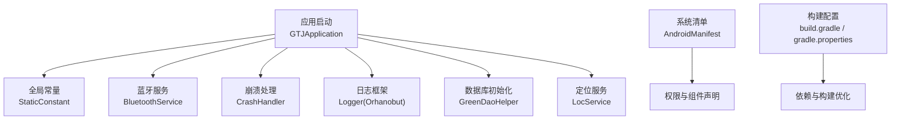
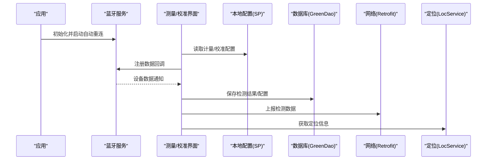
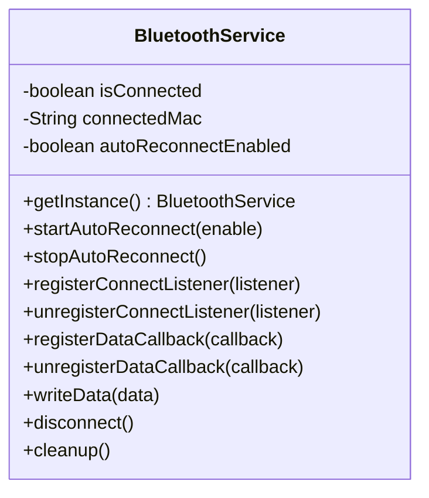
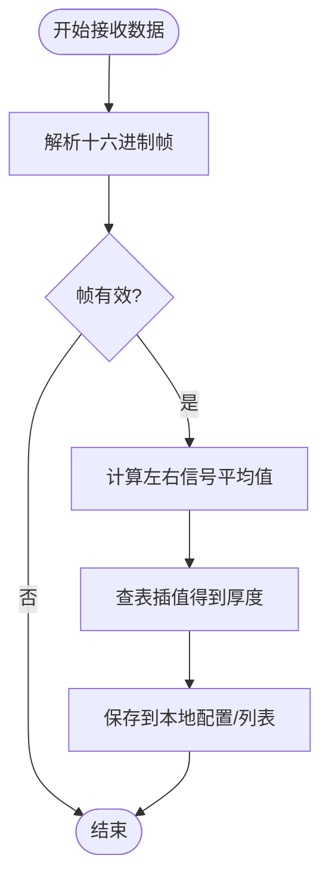
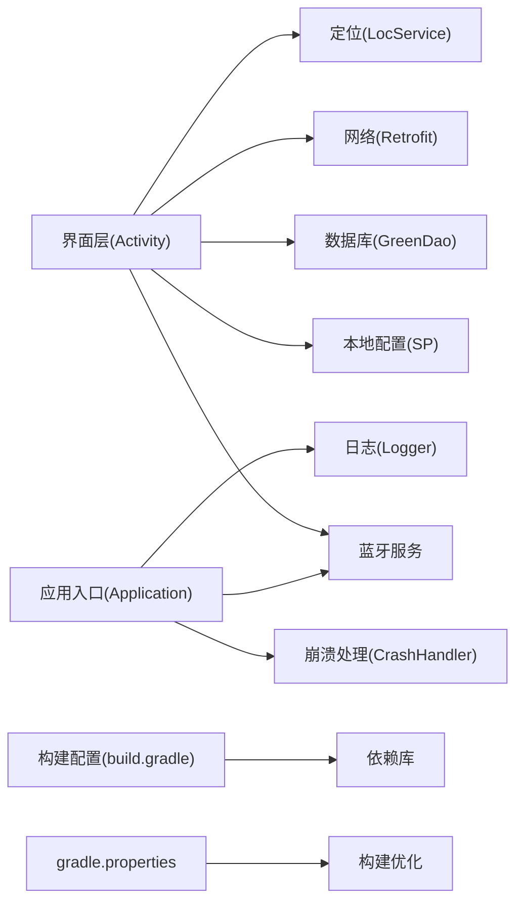

# 系统配置

<cite>
**本文引用的文件**
- [GTJApplication.java](file://app/src/main/java/com/example/gtj_sd_dg240/GTJApplication.java)
- [StaticConstant.java](file://app/src/main/java/com/example/gtj_sd_dg240/StaticConstant.java)
- [AndroidManifest.xml](file://app/src/main/AndroidManifest.xml)
- [build.gradle](file://app/build.gradle)
- [gradle.properties](file://gradle.properties)
- [BluetoothService.java](file://app/src/main/java/com/example/gtj_sd_dg240/bluetooth/BluetoothService.java)
- [NetworkUtils.java](file://app/src/main/java/com/example/gtj_sd_dg240/net/NetworkUtils.java)
- [CrashHandler.java](file://app/src/main/java/com/example/gtj_sd_dg240/utils/CrashHandler.java)
- [GreenDaoHelper.java](file://app/src/main/java/com/example/gtj_sd_dg240/storage/GreenDaoHelper.java)
- [LocService.java](file://app/src/main/java/com/example/gtj_sd_dg240/utils/LocService.java)
- [MeteringDeviceActivity.java](file://app/src/main/java/com/example/gtj_sd_dg240/activity/setting/MeteringDeviceActivity.java)
- [CalibrationDeviceActivity.java](file://app/src/main/java/com/example/gtj_sd_dg240/activity/setting/CalibrationDeviceActivity.java)
- [ConfigBean.java](file://app/src/main/java/com/example/gtj_sd_dg240/model/ConfigBean.java)
- [RetrofitInterfaceServiceUrl.java](file://app/src/main/java/com/example/gtj_sd_dg240/net/RetrofitInterfaceServiceUrl.java)
</cite>

## 目录
1. [简介](#简介)
2. [项目结构](#项目结构)
3. [核心组件](#核心组件)
4. [架构总览](#架构总览)
5. [详细组件分析](#详细组件分析)
6. [依赖关系分析](#依赖关系分析)
7. [性能考虑](#性能考虑)
8. [故障排查指南](#故障排查指南)
9. [结论](#结论)
10. [附录](#附录)

## 简介
本文件为混凝土电杆检测系统的“系统配置”文档，覆盖系统参数、设备连接（蓝牙）、网络与定位、性能调优、日志与崩溃上报、调试开关、系统信息查看、监控与诊断工具、更新管理、插件与扩展接口等。内容基于代码库中的实际实现进行说明，帮助开发者与运维人员正确配置与优化系统。

## 项目结构
- 应用入口与全局初始化：在 Application 中完成蓝牙、崩溃、日志、数据库、定位、Toast 等初始化。
- 常量与全局配置：集中定义蓝牙 UUID、HTTP 地址、数据库名、崩溃开关与路径、语言设置等。
- 权限与组件声明：通过 AndroidManifest 声明蓝牙、存储、相机、网络、定位等服务与权限。
- 构建与依赖：通过 Gradle 配置编译版本、签名、插件、依赖库与打包策略。
- 运行期配置：通过 SharedPreferences 保存设备校准、计量、计量标准等运行时配置。
- 数据层：使用 GreenDao 持久化配置与业务数据。
- 网络层：使用 Retrofit + OkHttp 进行数据上报与查询。
- 定位服务：封装百度定位 SDK，提供定位能力与参数配置。
- 蓝牙通信：统一蓝牙连接、重连、数据通知与回调分发。

**图表来源**
- [GTJApplication.java:20-41](file://app/src/main/java/com/example/gtj_sd_dg240/GTJApplication.java#L20-L41)
- [StaticConstant.java:26-85](file://app/src/main/java/com/example/gtj_sd_dg240/StaticConstant.java#L26-L85)
- [AndroidManifest.xml:1-182](file://app/src/main/AndroidManifest.xml#L1-L182)
- [build.gradle:7-77](file://app/build.gradle#L7-L77)
- [gradle.properties:1-36](file://gradle.properties#L1-L36)

**章节来源**
- [GTJApplication.java:20-41](file://app/src/main/java/com/example/gtj_sd_dg240/GTJApplication.java#L20-L41)
- [StaticConstant.java:26-85](file://app/src/main/java/com/example/gtj_sd_dg240/StaticConstant.java#L26-L85)
- [AndroidManifest.xml:1-182](file://app/src/main/AndroidManifest.xml#L1-L182)
- [build.gradle:7-77](file://app/build.gradle#L7-L77)
- [gradle.properties:1-36](file://gradle.properties#L1-L36)

## 核心组件
- 蓝牙设备管理：单例 BluetoothService 负责连接、自动重连、数据通知与回调分发；支持保存 MAC、状态监听、断开与清理。
- 测量设备配置：计量界面根据纵筋直径选择对应标准表，解析信号并计算保护层厚度；校准界面采集多点信号，维护校准曲线与默认值。
- 系统参数与资源：StaticConstant 集中管理蓝牙 UUID、HTTP 地址、数据库名、崩溃开关与路径、语言偏好等；GreenDaoHelper 管理数据库会话。
- 网络与定位：NetworkUtils 检查网络可用性；LocService 封装百度定位，提供定位模式、频率、坐标类型等参数。
- 日志与崩溃：Orhanobut Logger 用于常规日志；CrashHandler 捕获未处理异常，收集设备信息并写入文件，同时跳转崩溃报告页面。
- 构建与依赖：Gradle 配置编译目标、签名、插件、依赖库与打包策略；gradle.properties 启用并行构建、缓存与按需配置等优化。

**章节来源**
- [BluetoothService.java:20-312](file://app/src/main/java/com/example/gtj_sd_dg240/bluetooth/BluetoothService.java#L20-L312)
- [MeteringDeviceActivity.java:46-147](file://app/src/main/java/com/example/gtj_sd_dg240/activity/setting/MeteringDeviceActivity.java#L46-L147)
- [CalibrationDeviceActivity.java:53-382](file://app/src/main/java/com/example/gtj_sd_dg240/activity/setting/CalibrationDeviceActivity.java#L53-L382)
- [StaticConstant.java:26-85](file://app/src/main/java/com/example/gtj_sd_dg240/StaticConstant.java#L26-L85)
- [GreenDaoHelper.java:16-40](file://app/src/main/java/com/example/gtj_sd_dg240/storage/GreenDaoHelper.java#L16-L40)
- [NetworkUtils.java:6-21](file://app/src/main/java/com/example/gtj_sd_dg240/net/NetworkUtils.java#L6-L21)
- [LocService.java:28-201](file://app/src/main/java/com/example/gtj_sd_dg240/utils/LocService.java#L28-L201)
- [CrashHandler.java:74-208](file://app/src/main/java/com/example/gtj_sd_dg240/utils/CrashHandler.java#L74-L208)
- [build.gradle:7-77](file://app/build.gradle#L7-L77)
- [gradle.properties:1-36](file://gradle.properties#L1-L36)

## 架构总览
系统以 Application 为入口，初始化蓝牙、崩溃、日志、数据库、定位等子系统；UI 层通过 Activity 调用蓝牙服务进行设备通信，结合本地配置（SharedPreferences）与数据库（GreenDao）完成测量与校准；网络层通过 Retrofit 上报数据与获取委托列表；定位服务提供位置信息；构建阶段由 Gradle 管理依赖与优化。

**图表来源**
- [GTJApplication.java:20-41](file://app/src/main/java/com/example/gtj_sd_dg240/GTJApplication.java#L20-L41)
- [BluetoothService.java:77-224](file://app/src/main/java/com/example/gtj_sd_dg240/bluetooth/BluetoothService.java#L77-L224)
- [MeteringDeviceActivity.java:46-147](file://app/src/main/java/com/example/gtj_sd_dg240/activity/setting/MeteringDeviceActivity.java#L46-L147)
- [CalibrationDeviceActivity.java:53-382](file://app/src/main/java/com/example/gtj_sd_dg240/activity/setting/CalibrationDeviceActivity.java#L53-L382)
- [GreenDaoHelper.java:16-40](file://app/src/main/java/com/example/gtj_sd_dg240/storage/GreenDaoHelper.java#L16-L40)
- [RetrofitInterfaceServiceUrl.java:16-30](file://app/src/main/java/com/example/gtj_sd_dg240/net/RetrofitInterfaceServiceUrl.java#L16-L30)
- [LocService.java:151-178](file://app/src/main/java/com/example/gtj_sd_dg240/utils/LocService.java#L151-L178)

## 详细组件分析

### 蓝牙设备管理
- 连接与重连：单例 BluetoothService 维护连接状态与 MAC，支持自动重连定时器；连接成功后注册数据通知，断开时取消通知。
- 数据回调：通过 BleDataCallback 将设备数据分发到多个 UI 或逻辑模块；主线程回调保证 UI 安全。
- 生命周期：提供 disconnect 与 cleanup 方法，确保资源释放与状态重置。
- 配置项：MAC 地址保存在 SharedPreferences；UUID 与服务特征码在 StaticConstant 中集中管理。

**图表来源**
- [BluetoothService.java:20-312](file://app/src/main/java/com/example/gtj_sd_dg240/bluetooth/BluetoothService.java#L20-L312)
- [StaticConstant.java:67-70](file://app/src/main/java/com/example/gtj_sd_dg240/StaticConstant.java#L67-L70)

**章节来源**
- [BluetoothService.java:20-312](file://app/src/main/java/com/example/gtj_sd_dg240/bluetooth/BluetoothService.java#L20-L312)
- [StaticConstant.java:67-70](file://app/src/main/java/com/example/gtj_sd_dg240/StaticConstant.java#L67-L70)

### 测量设备配置
- 计量界面：根据选择的纵筋直径动态加载标准表，解析设备返回的十六进制帧，计算左右信号平均值并映射为保护层厚度；结果实时显示并保存到本地。
- 校准界面：采集多点信号，维护缓冲与均值工具，记录最大值并取三次平均；支持恢复默认校准值与保存自定义校准曲线。
- 配置持久化：计量与校准数据通过 SharedPreferences 序列化保存，便于下次启动恢复。

**图表来源**
- [MeteringDeviceActivity.java:96-147](file://app/src/main/java/com/example/gtj_sd_dg240/activity/setting/MeteringDeviceActivity.java#L96-L147)
- [CalibrationDeviceActivity.java:112-188](file://app/src/main/java/com/example/gtj_sd_dg240/activity/setting/CalibrationDeviceActivity.java#L112-L188)

**章节来源**
- [MeteringDeviceActivity.java:46-147](file://app/src/main/java/com/example/gtj_sd_dg240/activity/setting/MeteringDeviceActivity.java#L46-L147)
- [CalibrationDeviceActivity.java:53-382](file://app/src/main/java/com/example/gtj_sd_dg240/activity/setting/CalibrationDeviceActivity.java#L53-L382)

### 系统参数与资源优化
- 全局常量：StaticConstant 集中管理蓝牙 UUID、HTTP 地址、数据库名、崩溃开关与路径、语言设置等，便于统一修改与维护。
- 数据库：GreenDaoHelper 提供 DaoSession 懒加载，减少重复创建开销；数据库名称在 StaticConstant 中定义。
- 构建优化：gradle.properties 启用并行构建、构建缓存、按需配置与 VFS 监视；build.gradle 配置 Java 版本、签名、插件与依赖。

**章节来源**
- [StaticConstant.java:26-85](file://app/src/main/java/com/example/gtj_sd_dg240/StaticConstant.java#L26-L85)
- [GreenDaoHelper.java:16-40](file://app/src/main/java/com/example/gtj_sd_dg240/storage/GreenDaoHelper.java#L16-L40)
- [gradle.properties:1-36](file://gradle.properties#L1-L36)
- [build.gradle:7-77](file://app/build.gradle#L7-L77)

### 网络配置
- 网络可用性与权限：NetworkUtils 检查当前网络是否可用；AndroidManifest 声明网络相关权限。
- 接口定义：RetrofitInterfaceServiceUrl 定义数据上报与委托列表查询接口，包含请求头与分页参数。
- HTTP 地址：StaticConstant.httpUrl 指定后端 API 基础地址。

**章节来源**
- [NetworkUtils.java:6-21](file://app/src/main/java/com/example/gtj_sd_dg240/net/NetworkUtils.java#L6-L21)
- [RetrofitInterfaceServiceUrl.java:16-30](file://app/src/main/java/com/example/gtj_sd_dg240/net/RetrofitInterfaceServiceUrl.java#L16-L30)
- [AndroidManifest.xml:52-59](file://app/src/main/AndroidManifest.xml#L52-L59)
- [StaticConstant.java:26-26](file://app/src/main/java/com/example/gtj_sd_dg240/StaticConstant.java#L26-L26)

### 定位服务
- 定位封装：LocService 封装百度定位 SDK，提供默认定位选项（坐标系、扫描间隔、是否需要地址/海拔、定位模式等）。
- 控制接口：支持注册/注销监听、启动/停止定位、单次请求、辅助定位开关与热点状态查询。
- 权限要求：AndroidManifest 声明定位相关权限。

**章节来源**
- [LocService.java:28-201](file://app/src/main/java/com/example/gtj_sd_dg240/utils/LocService.java#L28-L201)
- [AndroidManifest.xml:27-29](file://app/src/main/AndroidManifest.xml#L27-L29)

### 日志与崩溃上报
- 日志框架：Orhanobut Logger 在 Application 中初始化，输出格式化日志。
- 崩溃处理：CrashHandler 捕获未处理异常，收集设备信息与堆栈，按开关写入文件并跳转到崩溃报告页面。
- 配置开关：StaticConstant.CRASH_DEBUG 控制是否写崩溃文件；crashFilePath 指定存储路径。

**章节来源**
- [GTJApplication.java:24-28](file://app/src/main/java/com/example/gtj_sd_dg240/GTJApplication.java#L24-L28)
- [CrashHandler.java:74-208](file://app/src/main/java/com/example/gtj_sd_dg240/utils/CrashHandler.java#L74-L208)
- [StaticConstant.java:30-33](file://app/src/main/java/com/example/gtj_sd_dg240/StaticConstant.java#L30-L33)

### 系统信息查看与调试模式
- 系统信息：CrashHandler 在崩溃时收集版本号、Build 字段等信息；可通过崩溃报告页面查看。
- 调试模式：可通过 StaticConstant 与构建配置调整日志级别与崩溃行为；gradle.properties 提供构建期调试优化。

**章节来源**
- [CrashHandler.java:128-151](file://app/src/main/java/com/example/gtj_sd_dg240/utils/CrashHandler.java#L128-L151)
- [StaticConstant.java:30-33](file://app/src/main/java/com/example/gtj_sd_dg240/StaticConstant.java#L30-L33)
- [gradle.properties:1-36](file://gradle.properties#L1-L36)

### 系统更新管理与插件配置
- 安装权限：AndroidManifest 声明安装包权限，支持应用内更新安装流程。
- 插件/扩展：当前仓库未发现明确的插件机制；如需扩展，可在 build.gradle 中添加依赖或通过模块化方式引入。

**章节来源**
- [AndroidManifest.xml:67-69](file://app/src/main/AndroidManifest.xml#L67-L69)
- [build.gradle:86-145](file://app/build.gradle#L86-L145)

### 扩展接口设置
- 蓝牙扩展：BluetoothService 提供回调注册与数据发送接口，便于上层扩展新设备协议。
- 网络扩展：RetrofitInterfaceServiceUrl 可新增接口方法与请求头，适配后端变更。
- 配置模型：ConfigBean 作为配置实体，可扩展更多字段以适应不同电杆规格。

**章节来源**
- [BluetoothService.java:236-287](file://app/src/main/java/com/example/gtj_sd_dg240/bluetooth/BluetoothService.java#L236-L287)
- [RetrofitInterfaceServiceUrl.java:16-30](file://app/src/main/java/com/example/gtj_sd_dg240/net/RetrofitInterfaceServiceUrl.java#L16-L30)
- [ConfigBean.java:13-151](file://app/src/main/java/com/example/gtj_sd_dg240/model/ConfigBean.java#L13-L151)

## 依赖关系分析
- 应用层依赖：Activity 依赖蓝牙服务、本地配置与数据库；网络层依赖 Retrofit 与 OkHttp；定位依赖百度 SDK。
- 构建依赖：Gradle 管理第三方库版本与打包策略；Java 版本与 AndroidX 配置影响兼容性。
- 外部集成：百度地图定位、Orhanobut 日志、Blankj 工具集、GreenDao 数据库。

**图表来源**
- [GTJApplication.java:20-41](file://app/src/main/java/com/example/gtj_sd_dg240/GTJApplication.java#L20-L41)
- [build.gradle:86-145](file://app/build.gradle#L86-L145)
- [gradle.properties:1-36](file://gradle.properties#L1-L36)

**章节来源**
- [build.gradle:86-145](file://app/build.gradle#L86-L145)
- [gradle.properties:1-36](file://gradle.properties#L1-L36)

## 性能考虑
- 构建期优化：启用并行构建、构建缓存、按需配置与 VFS 监视；关闭不必要的构建特性以减少 R 类大小与编译时间。
- 运行期优化：蓝牙数据回调在主线程分发，避免阻塞；校准界面使用定时任务与缓冲工具降低 CPU 占用；数据库会话懒加载减少内存压力。
- 网络优化：OkHttp 与 Retrofit 组合提升并发与复用；可根据需要添加拦截器进行重试与日志记录。
- 定位优化：合理设置扫描间隔与定位模式，平衡精度与功耗。

[本节为通用指导，不直接分析具体文件]

## 故障排查指南
- 蓝牙连接失败：检查权限（蓝牙、位置）、设备 MAC 是否正确、是否已保存；确认 BluetoothService 自动重连是否启用；查看连接状态回调。
- 数据解析错误：核对十六进制帧格式与协议；检查计量/校准标准表是否与设备匹配；确认信号插值逻辑。
- 网络问题：使用 NetworkUtils 检查网络可用性；确认后端地址与接口参数；查看网络权限与证书配置。
- 定位异常：检查定位权限与 SDK 初始化；确认定位模式与扫描间隔；必要时重启定位服务。
- 崩溃与日志：开启崩溃文件写入；查看崩溃报告页面；通过 Orhanobut Logger 输出关键路径日志。

**章节来源**
- [BluetoothService.java:77-224](file://app/src/main/java/com/example/gtj_sd_dg240/bluetooth/BluetoothService.java#L77-L224)
- [MeteringDeviceActivity.java:96-147](file://app/src/main/java/com/example/gtj_sd_dg240/activity/setting/MeteringDeviceActivity.java#L96-L147)
- [NetworkUtils.java:6-21](file://app/src/main/java/com/example/gtj_sd_dg240/net/NetworkUtils.java#L6-L21)
- [LocService.java:151-178](file://app/src/main/java/com/example/gtj_sd_dg240/utils/LocService.java#L151-L178)
- [CrashHandler.java:105-208](file://app/src/main/java/com/example/gtj_sd_dg240/utils/CrashHandler.java#L105-L208)

## 结论
本系统通过集中化的常量管理、统一的蓝牙服务、完善的崩溃与日志机制、以及灵活的构建与依赖配置，提供了稳定的设备通信与数据处理能力。建议在生产环境中合理配置蓝牙重连策略、定位参数与网络超时，并结合日志与崩溃文件进行持续优化与问题定位。

[本节为总结性内容，不直接分析具体文件]

## 附录
- 权限清单：蓝牙、位置、存储、相机、网络、安装权限等在 AndroidManifest 中声明。
- 构建配置：Java 17、AndroidX、GreenDao、Retrofit、OkHttp、Logger、UtilCode 等依赖版本与插件配置。
- 配置模型：ConfigBean 描述电杆配置字段，可用于扩展新的电杆规格与检测参数。

**章节来源**
- [AndroidManifest.xml:1-182](file://app/src/main/AndroidManifest.xml#L1-L182)
- [build.gradle:7-77](file://app/build.gradle#L7-L77)
- [ConfigBean.java:13-151](file://app/src/main/java/com/example/gtj_sd_dg240/model/ConfigBean.java#L13-L151)