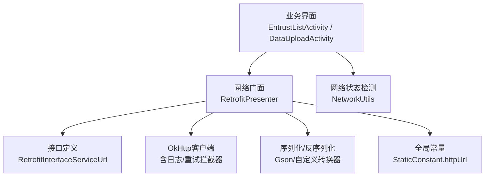
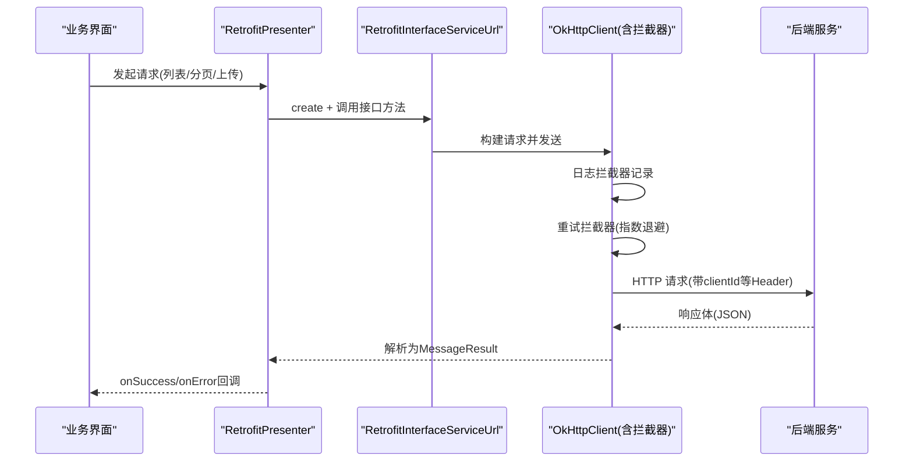
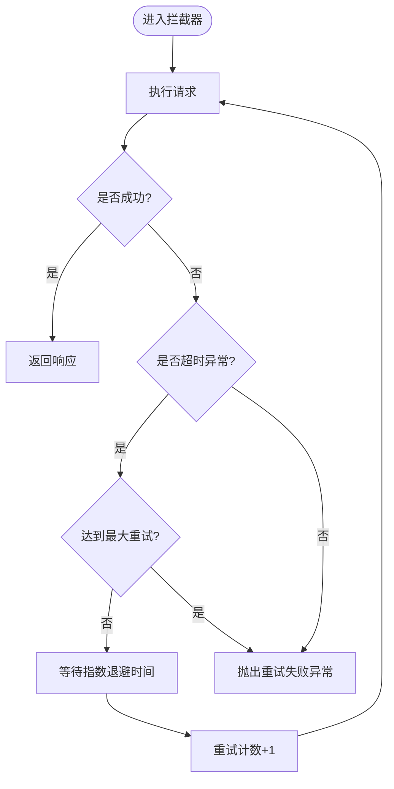
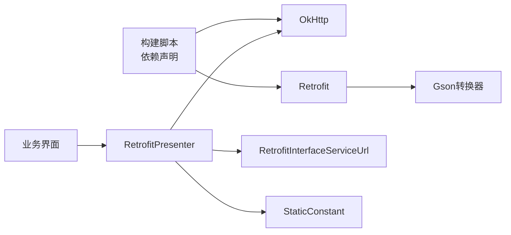

# 网络配置

<cite>
**本文引用的文件**
- [StaticConstant.java](file://app/src/main/java/com/example/gtj_sd_dg240/StaticConstant.java)
- [RetrofitInterfaceServiceUrl.java](file://app/src/main/java/com/example/gtj_sd_dg240/net/RetrofitInterfaceServiceUrl.java)
- [RetrofitPresenter.java](file://app/src/main/java/com/example/gtj_sd_dg240/net/RetrofitPresenter.java)
- [RetryInterceptor.java](file://app/src/main/java/com/example/gtj_sd_dg240/net/RetryInterceptor.java)
- [NetworkUtils.java](file://app/src/main/java/com/example/gtj_sd_dg240/net/NetworkUtils.java)
- [MessageResult.java](file://app/src/main/java/com/example/gtj_sd_dg240/net/MessageResult.java)
- [Result.java](file://app/src/main/java/com/example/gtj_sd_dg240/net/Result.java)
- [ApiException.java](file://app/src/main/java/com/example/gtj_sd_dg240/net/ApiException.java)
- [CustomGsonConverterFactory.java](file://app/src/main/java/com/example/gtj_sd_dg240/net/CustomGsonConverterFactory.java)
- [EntrustListActivity.java](file://app/src/main/java/com/example/gtj_sd_dg240/activity/testing/EntrustListActivity.java)
- [DataUploadActivity.java](file://app/src/main/java/com/example/gtj_sd_dg240/activity/data/DataUploadActivity.java)
- [build.gradle](file://app/build.gradle)
</cite>

## 目录
1. [简介](#简介)
2. [项目结构](#项目结构)
3. [核心组件](#核心组件)
4. [架构总览](#架构总览)
5. [详细组件分析](#详细组件分析)
6. [依赖关系分析](#依赖关系分析)
7. [性能与优化建议](#性能与优化建议)
8. [故障排查指南](#故障排查指南)
9. [结论](#结论)
10. [附录](#附录)

## 简介
本文件为项目的网络配置与集成说明，覆盖服务器地址、API接口、请求参数、超时与重试、错误处理、SSL与代理、网络安全、连接检测、带宽监控、数据传输优化、离线模式与数据同步策略、云端服务集成等。内容基于仓库中实际的网络层实现与调用点整理而成，便于开发者快速定位与调整网络相关配置。

## 项目结构
网络相关代码集中在 app/src/main/java/com/example/gtj_sd_dg240/net 包下，配合业务 Activity 进行调用；基础常量（如服务端 Base URL）在 StaticConstant 中集中管理；构建脚本定义了网络库版本与依赖。

图表来源
- [RetrofitPresenter.java:25-52](file://app/src/main/java/com/example/gtj_sd_dg240/net/RetrofitPresenter.java#L25-L52)
- [RetrofitInterfaceServiceUrl.java:16-29](file://app/src/main/java/com/example/gtj_sd_dg240/net/RetrofitInterfaceServiceUrl.java#L16-L29)
- [StaticConstant.java:26-26](file://app/src/main/java/com/example/gtj_sd_dg240/StaticConstant.java#L26-L26)
- [NetworkUtils.java:6-19](file://app/src/main/java/com/example/gtj_sd_dg240/net/NetworkUtils.java#L6-L19)

章节来源
- [RetrofitPresenter.java:25-52](file://app/src/main/java/com/example/gtj_sd_dg240/net/RetrofitPresenter.java#L25-L52)
- [RetrofitInterfaceServiceUrl.java:16-29](file://app/src/main/java/com/example/gtj_sd_dg240/net/RetrofitInterfaceServiceUrl.java#L16-L29)
- [StaticConstant.java:26-26](file://app/src/main/java/com/example/gtj_sd_dg240/StaticConstant.java#L26-L26)
- [NetworkUtils.java:6-19](file://app/src/main/java/com/example/gtj_sd_dg240/net/NetworkUtils.java#L6-L19)

## 核心组件
- 服务器地址与基础路径：通过静态常量集中管理，便于统一切换环境。
- API 接口声明：使用 Retrofit 注解定义接口方法与请求头、查询参数。
- 网络客户端与拦截器：OkHttp 负责连接、超时、重试与日志记录。
- 结果封装：统一的响应体结构，便于上层统一处理成功与失败分支。
- 网络状态检测：提供系统网络连接可用性判断。
- 业务调用入口：Presenter 封装具体请求方法，Activity 仅关注 UI 与回调。

章节来源
- [StaticConstant.java:26-26](file://app/src/main/java/com/example/gtj_sd_dg240/StaticConstant.java#L26-L26)
- [RetrofitInterfaceServiceUrl.java:16-29](file://app/src/main/java/com/example/gtj_sd_dg240/net/RetrofitInterfaceServiceUrl.java#L16-L29)
- [RetrofitPresenter.java:25-52](file://app/src/main/java/com/example/gtj_sd_dg240/net/RetrofitPresenter.java#L25-L52)
- [MessageResult.java:3-12](file://app/src/main/java/com/example/gtj_sd_dg240/net/MessageResult.java#L3-L12)
- [NetworkUtils.java:6-19](file://app/src/main/java/com/example/gtj_sd_dg240/net/NetworkUtils.java#L6-L19)

## 架构总览
下图展示了从业务界面到网络层的完整调用链，包括请求构造、拦截器处理、超时与重试、以及返回结果的统一处理。

图表来源
- [RetrofitPresenter.java:61-141](file://app/src/main/java/com/example/gtj_sd_dg240/net/RetrofitPresenter.java#L61-L141)
- [RetrofitInterfaceServiceUrl.java:16-29](file://app/src/main/java/com/example/gtj_sd_dg240/net/RetrofitInterfaceServiceUrl.java#L16-L29)
- [RetryInterceptor.java:23-51](file://app/src/main/java/com/example/gtj_sd_dg240/net/RetryInterceptor.java#L23-L51)

## 详细组件分析

### 服务器地址与API接口设置
- 服务器地址：Base URL 由静态常量提供，所有接口均基于该前缀拼接。
- 接口定义：
  - 上报数据：POST 接口，请求体为 JSON。
  - 查询委托列表：GET 接口，携带 clientId 请求头与查询参数。
  - 分页查询委托列表：GET 接口，支持分页参数。
- 请求头：部分接口固定携带 clientId 标识。

章节来源
- [StaticConstant.java:26-26](file://app/src/main/java/com/example/gtj_sd_dg240/StaticConstant.java#L26-L26)
- [RetrofitInterfaceServiceUrl.java:16-29](file://app/src/main/java/com/example/gtj_sd_dg240/net/RetrofitInterfaceServiceUrl.java#L16-L29)

### 网络请求参数与数据模型
- 请求参数：
  - 列表查询：status、sn（设备序列号）。
  - 分页查询：status、sn、pageNum、pageSize。
  - 数据上报：JSON 对象，包含设备信息、杆件信息与图片等。
- 响应模型：统一 MessageResult(code, msg, data)，分页扩展字段 total、rows。

章节来源
- [RetrofitInterfaceServiceUrl.java:16-29](file://app/src/main/java/com/example/gtj_sd_dg240/net/RetrofitInterfaceServiceUrl.java#L16-L29)
- [MessageResult.java:3-12](file://app/src/main/java/com/example/gtj_sd_dg240/net/MessageResult.java#L3-L12)
- [EntrustWithPageBean.java:7-9](file://app/src/main/java/com/example/gtj_sd_dg240/model/EntrustWithPageBean.java#L7-L9)

### 超时设置与重试机制
- 超时配置：读、写、连接超时均为固定秒数，避免长时间阻塞。
- 重试策略：针对 SocketTimeoutException 进行指数退避重试，超过最大次数抛出异常。
- 连接失败重试：启用连接失败自动重试。

图表来源
- [RetryInterceptor.java:23-51](file://app/src/main/java/com/example/gtj_sd_dg240/net/RetryInterceptor.java#L23-L51)
- [RetrofitPresenter.java:38-52](file://app/src/main/java/com/example/gtj_sd_dg240/net/RetrofitPresenter.java#L38-L52)

章节来源
- [RetrofitPresenter.java:38-52](file://app/src/main/java/com/example/gtj_sd_dg240/net/RetrofitPresenter.java#L38-L52)
- [RetryInterceptor.java:23-51](file://app/src/main/java/com/example/gtj_sd_dg240/net/RetryInterceptor.java#L23-L51)

### 错误处理策略
- 网络层错误：将底层异常信息进行友好提示（如“检查网络连接”）。
- 业务层错误：根据响应码与消息统一处理，区分成功与失败分支。
- 异常类型：提供通用异常类用于上层捕获与展示。

章节来源
- [RetrofitPresenter.java:54-59](file://app/src/main/java/com/example/gtj_sd_dg240/net/RetrofitPresenter.java#L54-L59)
- [RetrofitPresenter.java:61-141](file://app/src/main/java/com/example/gtj_sd_dg240/net/RetrofitPresenter.java#L61-L141)
- [ApiException.java:4-9](file://app/src/main/java/com/example/gtj_sd_dg240/net/ApiException.java#L4-L9)

### SSL证书配置与网络安全选项
- HTTPS：Base URL 使用 https 协议，默认启用 TLS。
- 证书校验：未配置自定义 TrustManager，遵循系统默认证书链校验。
- 安全建议：如需私有 CA，可在 OkHttpClient 中注入自定义证书信任管理器；如需禁用主机名校验（仅限测试），需谨慎评估安全风险。

章节来源
- [StaticConstant.java:26-26](file://app/src/main/java/com/example/gtj_sd_dg240/StaticConstant.java#L26-L26)
- [RetrofitPresenter.java:38-52](file://app/src/main/java/com/example/gtj_sd_dg240/net/RetrofitPresenter.java#L38-L52)

### 代理服务器设置
- 当前实现：未在 OkHttpClient 中配置代理。
- 扩展方式：可通过 OkHttpClient.Builder.proxy(...) 设置 HTTP/HTTPS 代理，或在企业环境中结合系统代理策略进行适配。

章节来源
- [RetrofitPresenter.java:38-52](file://app/src/main/java/com/example/gtj_sd_dg240/net/RetrofitPresenter.java#L38-L52)

### 网络连接检测
- 提供系统级网络可用性检测工具，可用于在进入页面或发起请求前快速判断网络状态。

章节来源
- [NetworkUtils.java:6-19](file://app/src/main/java/com/example/gtj_sd_dg240/net/NetworkUtils.java#L6-L19)

### 带宽监控与数据传输优化
- 日志记录：已启用 OkHttp 日志拦截器，可观察请求/响应大小与耗时，辅助带宽分析与问题定位。
- 传输优化建议：
  - 合理分页与按需加载，减少单次数据量。
  - 对图片进行压缩与限流上传。
  - 合并小请求，降低握手开销。
  - 使用缓存策略减少重复请求。

章节来源
- [RetrofitPresenter.java:38-52](file://app/src/main/java/com/example/gtj_sd_dg240/net/RetrofitPresenter.java#L38-L52)

### 离线模式支持与数据同步策略
- 本地存储：应用使用 GreenDao 持久化数据，具备离线可用能力。
- 同步策略：
  - 先本地写入，再尝试上传；上传成功后更新本地标记。
  - 若网络不可用或上传失败，保留本地数据以便后续重试。
- 触发时机：在数据上传界面按批次处理本地待上传数据，逐条提交并反馈结果。

章节来源
- [DataUploadActivity.java:347-458](file://app/src/main/java/com/example/gtj_sd_dg240/activity/data/DataUploadActivity.java#L347-L458)

### 云端服务集成配置
- 接口清单：
  - 上报数据：POST 接口，用于提交检测结果与图片。
  - 查询委托列表：GET 接口，获取任务列表。
  - 分页查询委托列表：GET 接口，支持分页拉取。
- 认证与标识：通过请求头 clientId 标识客户端身份。
- 集成要点：确保 Base URL 指向正确的生产/测试环境；保证设备序列号 sn 正确传递。

章节来源
- [RetrofitInterfaceServiceUrl.java:16-29](file://app/src/main/java/com/example/gtj_sd_dg240/net/RetrofitInterfaceServiceUrl.java#L16-L29)
- [StaticConstant.java:26-26](file://app/src/main/java/com/example/gtj_sd_dg240/StaticConstant.java#L26-L26)

## 依赖关系分析
- 网络库版本：OkHttp 与 Retrofit 及其 Gson 转换器在构建脚本中声明。
- 模块耦合：
  - Presenter 依赖接口定义与常量。
  - 业务界面依赖 Presenter 提供的统一请求方法。
  - 重试与日志作为横切关注点通过拦截器注入。

图表来源
- [build.gradle:115-120](file://app/build.gradle#L115-L120)
- [RetrofitPresenter.java:25-52](file://app/src/main/java/com/example/gtj_sd_dg240/net/RetrofitPresenter.java#L25-L52)
- [RetrofitInterfaceServiceUrl.java:16-29](file://app/src/main/java/com/example/gtj_sd_dg240/net/RetrofitInterfaceServiceUrl.java#L16-L29)
- [StaticConstant.java:26-26](file://app/src/main/java/com/example/gtj_sd_dg240/StaticConstant.java#L26-L26)

章节来源
- [build.gradle:115-120](file://app/build.gradle#L115-L120)
- [RetrofitPresenter.java:25-52](file://app/src/main/java/com/example/gtj_sd_dg240/net/RetrofitPresenter.java#L25-L52)

## 性能与优化建议
- 超时与重试：当前超时与重试策略适用于一般网络环境；在弱网场景可适当增大超时与重试次数，但需平衡用户体验。
- 日志级别：生产环境建议降低日志级别以减少 I/O 开销。
- 数据体积：对图片进行压缩与限制分辨率；对大列表采用分页与懒加载。
- 并发控制：批量上传时注意并发度，避免过多请求导致拥塞。
- 缓存策略：对只读数据增加缓存，减少重复请求。

[本节为通用指导，不直接分析具体文件]

## 故障排查指南
- 常见问题：
  - 无法解析域名：错误信息会被转换为“检查网络连接”，请确认 DNS 与网络连通性。
  - 请求失败：检查响应码与消息，确认服务端状态与参数是否正确。
  - 超时频繁：检查网络质量与服务端响应时间，必要时调整超时与重试参数。
- 定位手段：
  - 查看 OkHttp 日志输出，确认请求与响应内容。
  - 使用 NetworkUtils 在网络发起前检测连接状态。
  - 在业务界面 Toast 中查看错误提示，结合日志定位问题。

章节来源
- [RetrofitPresenter.java:54-59](file://app/src/main/java/com/example/gtj_sd_dg240/net/RetrofitPresenter.java#L54-L59)
- [RetrofitPresenter.java:61-141](file://app/src/main/java/com/example/gtj_sd_dg240/net/RetrofitPresenter.java#L61-L141)
- [NetworkUtils.java:6-19](file://app/src/main/java/com/example/gtj_sd_dg240/net/NetworkUtils.java#L6-L19)

## 结论
本项目网络层以 Retrofit + OkHttp 为核心，集中管理服务器地址与接口定义，提供统一的超时、重试与日志能力，并通过 Presenter 屏蔽底层细节，使业务界面专注于交互与展示。结合本地数据库与上传流程，实现了较好的离线可用性与数据同步能力。建议在生产环境中根据实际网络条件与安全策略对超时、重试、日志级别与证书信任进行调优。

[本节为总结性内容，不直接分析具体文件]

## 附录
- 关键调用示例（以源码路径代替代码片段）：
  - 列表查询：参见 [EntrustListActivity.java:113-145](file://app/src/main/java/com/example/gtj_sd_dg240/activity/testing/EntrustListActivity.java#L113-L145)
  - 分页查询：参见 [EntrustListActivity.java:147-193](file://app/src/main/java/com/example/gtj_sd_dg240/activity/testing/EntrustListActivity.java#L147-L193)
  - 数据上报：参见 [DataUploadActivity.java:418-458](file://app/src/main/java/com/example/gtj_sd_dg240/activity/data/DataUploadActivity.java#L418-L458)

章节来源
- [EntrustListActivity.java:113-193](file://app/src/main/java/com/example/gtj_sd_dg240/activity/testing/EntrustListActivity.java#L113-L193)
- [DataUploadActivity.java:418-458](file://app/src/main/java/com/example/gtj_sd_dg240/activity/data/DataUploadActivity.java#L418-L458)