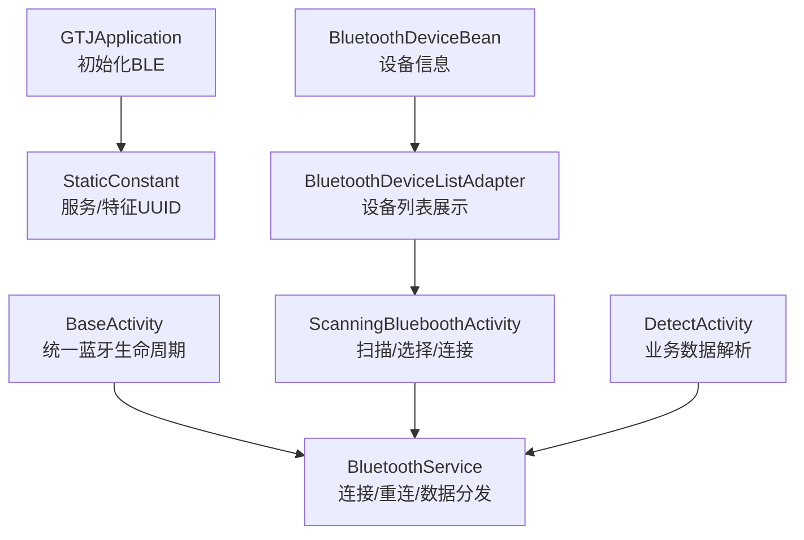
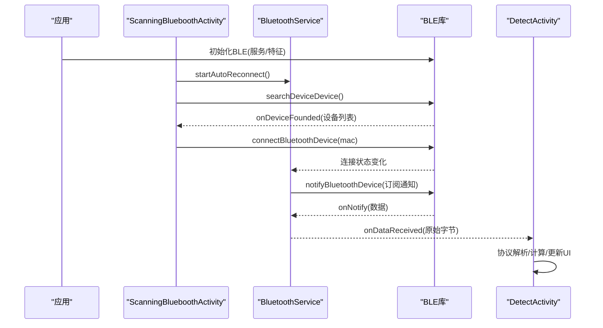
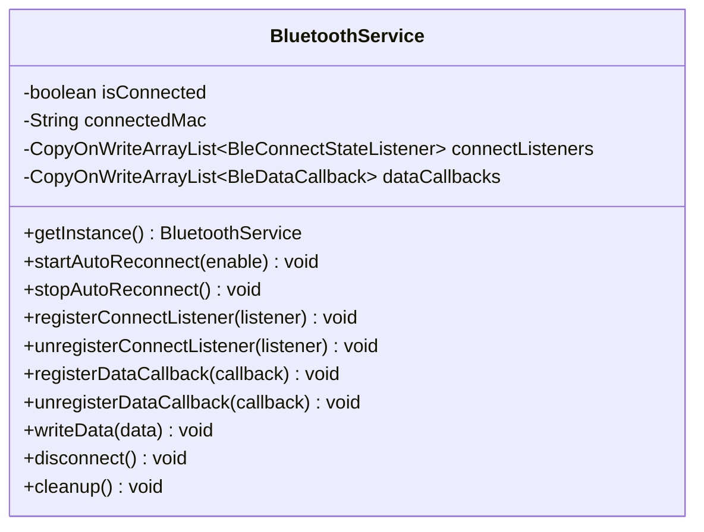
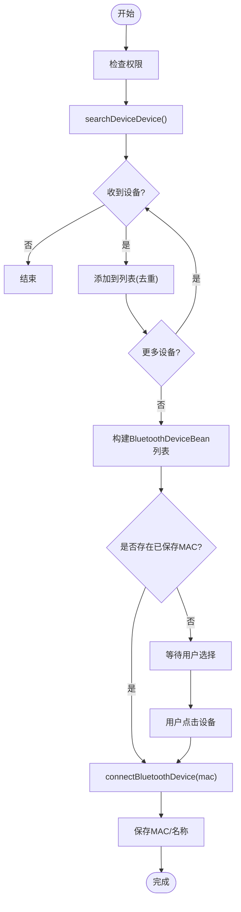
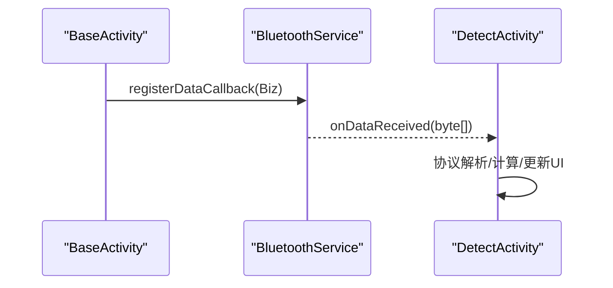
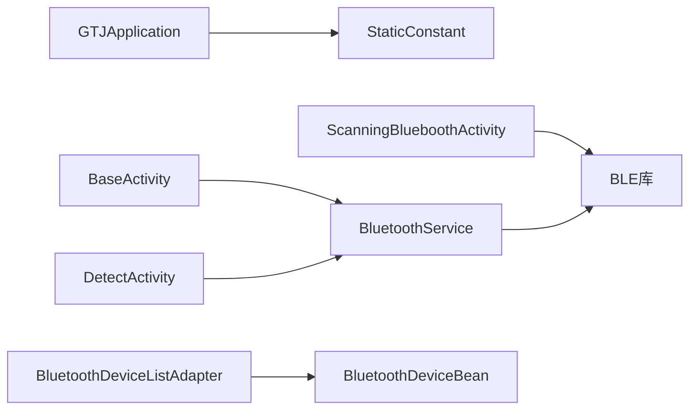

# 设备连接配置

<cite>
**本文引用的文件**
- [BluetoothService.java](file://app/src/main/java/com/example/gtj_sd_dg240/bluetooth/BluetoothService.java)
- [BleConnectStateListener.java](file://app/src/main/java/com/example/gtj_sd_dg240/bluetooth/BleConnectStateListener.java)
- [BleDataCallback.java](file://app/src/main/java/com/example/gtj_sd_dg240/bluetooth/BleDataCallback.java)
- [ScanningBlueboothActivity.java](file://app/src/main/java/com/example/gtj_sd_dg240/activity/setting/ScanningBlueboothActivity.java)
- [BluetoothDeviceListAdapter.java](file://app/src/main/java/com/example/gtj_sd_dg240/adapter/BluetoothDeviceListAdapter.java)
- [BluetoothDeviceBean.java](file://app/src/main/java/com/example/gtj_sd_dg240/model/BluetoothDeviceBean.java)
- [BaseActivity.java](file://app/src/main/java/com/example/gtj_sd_dg240/activity/start/BaseActivity.java)
- [DetectActivity.java](file://app/src/main/java/com/example/gtj_sd_dg240/activity/testing/DetectActivity.java)
- [StaticConstant.java](file://app/src/main/java/com/example/gtj_sd_dg240/StaticConstant.java)
- [GTJApplication.java](file://app/src/main/java/com/example/gtj_sd_dg240/GTJApplication.java)
</cite>

## 目录
1. [简介](#简介)
2. [项目结构](#项目结构)
3. [核心组件](#核心组件)
4. [架构总览](#架构总览)
5. [详细组件分析](#详细组件分析)
6. [依赖关系分析](#依赖关系分析)
7. [性能与稳定性](#性能与稳定性)
8. [故障排查指南](#故障排查指南)
9. [结论](#结论)
10. [附录：协议、数据格式与兼容性](#附录协议数据格式与兼容性)

## 简介
本文件面向设备连接与BLE通信的配置与使用，覆盖蓝牙设备的扫描、配对（系统级）、连接、状态管理、自动重连、多设备支持、设备切换与冲突解决策略；同时说明BLE通信的初始化、通知订阅、数据传输格式解析与错误处理机制。文档还包含设备列表管理、已配对设备显示、连接状态指示等UI交互流程，以及信号强度监控与连接质量评估的建议方案。

## 项目结构
本项目采用分层组织：
- 应用入口与全局初始化：GTJApplication
- 蓝牙服务层：BluetoothService（单例）
- 蓝牙接口定义：BleConnectStateListener、BleDataCallback
- UI层：ScanningBlueboothActivity（扫描与连接）、BaseActivity（统一基类，集成蓝牙生命周期）、DetectActivity（业务数据接收与处理）
- 适配器与模型：BluetoothDeviceListAdapter、BluetoothDeviceBean
- 常量与BLE特征：StaticConstant（服务与特征UUID）

图表来源
- [GTJApplication.java:20-24](file://app/src/main/java/com/example/gtj_sd_dg240/GTJApplication.java#L20-L24)
- [StaticConstant.java:67-70](file://app/src/main/java/com/example/gtj_sd_dg240/StaticConstant.java#L67-L70)
- [BaseActivity.java:187-198](file://app/src/main/java/com/example/gtj_sd_dg240/activity/start/BaseActivity.java#L187-L198)
- [BluetoothService.java:16-52](file://app/src/main/java/com/example/gtj_sd_dg240/bluetooth/BluetoothService.java#L16-L52)
- [ScanningBlueboothActivity.java:89-164](file://app/src/main/java/com/example/gtj_sd_dg240/activity/setting/ScanningBlueboothActivity.java#L89-L164)
- [DetectActivity.java:171-191](file://app/src/main/java/com/example/gtj_sd_dg240/activity/testing/DetectActivity.java#L171-L191)
- [BluetoothDeviceListAdapter.java:11-27](file://app/src/main/java/com/example/gtj_sd_dg240/adapter/BluetoothDeviceListAdapter.java#L11-L27)
- [BluetoothDeviceBean.java:5-35](file://app/src/main/java/com/example/gtj_sd_dg240/model/BluetoothDeviceBean.java#L5-L35)

章节来源
- [GTJApplication.java:20-24](file://app/src/main/java/com/example/gtj_sd_dg240/GTJApplication.java#L20-L24)
- [StaticConstant.java:67-70](file://app/src/main/java/com/example/gtj_sd_dg240/StaticConstant.java#L67-L70)
- [BaseActivity.java:187-198](file://app/src/main/java/com/example/gtj_sd_dg240/activity/start/BaseActivity.java#L187-L198)
- [BluetoothService.java:16-52](file://app/src/main/java/com/example/gtj_sd_dg240/bluetooth/BluetoothService.java#L16-L52)
- [ScanningBlueboothActivity.java:89-164](file://app/src/main/java/com/example/gtj_sd_dg240/activity/setting/ScanningBlueboothActivity.java#L89-L164)
- [DetectActivity.java:171-191](file://app/src/main/java/com/example/gtj_sd_dg240/activity/testing/DetectActivity.java#L171-L191)
- [BluetoothDeviceListAdapter.java:11-27](file://app/src/main/java/com/example/gtj_sd_dg240/adapter/BluetoothDeviceListAdapter.java#L11-L27)
- [BluetoothDeviceBean.java:5-35](file://app/src/main/java/com/example/gtj_sd_dg240/model/BluetoothDeviceBean.java#L5-L35)

## 核心组件
- BluetoothService：单例蓝牙服务，负责连接状态管理、自动重连、数据通知注册与分发、写操作封装。
- BleConnectStateListener：连接状态变化回调接口。
- BleDataCallback：数据回调接口，提供原始字节数据与通知注册失败回调。
- ScanningBlueboothActivity：设备扫描、列表展示、选择并发起连接，持久化MAC与名称。
- BaseActivity：统一基类，集中管理蓝牙服务的启动/停止、监听器注册与数据回调转发。
- DetectActivity：业务层接收蓝牙数据并进行解析与计算。
- StaticConstant：BLE服务与特征UUID定义。
- GTJApplication：应用启动时初始化BLE库与全局参数。

章节来源
- [BluetoothService.java:16-52](file://app/src/main/java/com/example/gtj_sd_dg240/bluetooth/BluetoothService.java#L16-L52)
- [BleConnectStateListener.java:3-12](file://app/src/main/java/com/example/gtj_sd_dg240/bluetooth/BleConnectStateListener.java#L3-L12)
- [BleDataCallback.java:3-18](file://app/src/main/java/com/example/gtj_sd_dg240/bluetooth/BleDataCallback.java#L3-L18)
- [ScanningBlueboothActivity.java:89-164](file://app/src/main/java/com/example/gtj_sd_dg240/activity/setting/ScanningBlueboothActivity.java#L89-L164)
- [BaseActivity.java:187-198](file://app/src/main/java/com/example/gtj_sd_dg240/activity/start/BaseActivity.java#L187-L198)
- [DetectActivity.java:171-191](file://app/src/main/java/com/example/gtj_sd_dg240/activity/testing/DetectActivity.java#L171-L191)
- [StaticConstant.java:67-70](file://app/src/main/java/com/example/gtj_sd_dg240/StaticConstant.java#L67-L70)
- [GTJApplication.java:20-24](file://app/src/main/java/com/example/gtj_sd_dg240/GTJApplication.java#L20-L24)

## 架构总览
整体流程如下：
- 应用启动时初始化BLE库与服务/特征UUID。
- Activity进入时通过BaseActivity启动自动重连服务。
- 用户进入扫描界面进行设备发现，选择设备后发起连接并持久化MAC。
- 连接成功后，服务自动注册数据通知并将数据分发到业务层。
- 业务层按协议解析数据并更新UI或执行计算。

图表来源
- [GTJApplication.java:20-24](file://app/src/main/java/com/example/gtj_sd_dg240/GTJApplication.java#L20-L24)
- [ScanningBlueboothActivity.java:89-164](file://app/src/main/java/com/example/gtj_sd_dg240/activity/setting/ScanningBlueboothActivity.java#L89-L164)
- [BluetoothService.java:77-109](file://app/src/main/java/com/example/gtj_sd_dg240/bluetooth/BluetoothService.java#L77-L109)
- [BluetoothService.java:172-198](file://app/src/main/java/com/example/gtj_sd_dg240/bluetooth/BluetoothService.java#L172-L198)
- [DetectActivity.java:171-191](file://app/src/main/java/com/example/gtj_sd_dg240/activity/testing/DetectActivity.java#L171-L191)

## 详细组件分析

### 蓝牙服务（BluetoothService）
- 单例模式，维护连接状态、当前MAC、监听器集合。
- 自动重连：基于Handler定时检查未连接设备并尝试连接，可启停。
- 内部监听：注册连接状态监听，连接成功时自动订阅通知，断开时取消订阅。
- 数据分发：将底层通知数据分发给所有注册的BleDataCallback。
- 写数据：封装写操作，目标为保存的MAC。
- 资源清理：停止重连、清空监听器、重置状态。

图表来源
- [BluetoothService.java:16-52](file://app/src/main/java/com/example/gtj_sd_dg240/bluetooth/BluetoothService.java#L16-L52)
- [BluetoothService.java:77-109](file://app/src/main/java/com/example/gtj_sd_dg240/bluetooth/BluetoothService.java#L77-L109)
- [BluetoothService.java:124-170](file://app/src/main/java/com/example/gtj_sd_dg240/bluetooth/BluetoothService.java#L124-L170)
- [BluetoothService.java:172-198](file://app/src/main/java/com/example/gtj_sd_dg240/bluetooth/BluetoothService.java#L172-L198)
- [BluetoothService.java:200-234](file://app/src/main/java/com/example/gtj_sd_dg240/bluetooth/BluetoothService.java#L200-L234)
- [BluetoothService.java:236-310](file://app/src/main/java/com/example/gtj_sd_dg240/bluetooth/BluetoothService.java#L236-L310)

章节来源
- [BluetoothService.java:16-52](file://app/src/main/java/com/example/gtj_sd_dg240/bluetooth/BluetoothService.java#L16-L52)
- [BluetoothService.java:77-109](file://app/src/main/java/com/example/gtj_sd_dg240/bluetooth/BluetoothService.java#L77-L109)
- [BluetoothService.java:124-170](file://app/src/main/java/com/example/gtj_sd_dg240/bluetooth/BluetoothService.java#L124-L170)
- [BluetoothService.java:172-198](file://app/src/main/java/com/example/gtj_sd_dg240/bluetooth/BluetoothService.java#L172-L198)
- [BluetoothService.java:200-234](file://app/src/main/java/com/example/gtj_sd_dg240/bluetooth/BluetoothService.java#L200-L234)
- [BluetoothService.java:236-310](file://app/src/main/java/com/example/gtj_sd_dg240/bluetooth/BluetoothService.java#L236-L310)

### 扫描与连接（ScanningBlueboothActivity）
- 权限检查后调用搜索接口，收集设备并去重。
- 搜索完成后构建设备列表，若存在已保存的MAC则自动选中并连接。
- 连接成功后持久化MAC与名称，并提示成功。
- 列表项点击触发连接流程。

图表来源
- [ScanningBlueboothActivity.java:89-164](file://app/src/main/java/com/example/gtj_sd_dg240/activity/setting/ScanningBlueboothActivity.java#L89-L164)

章节来源
- [ScanningBlueboothActivity.java:89-164](file://app/src/main/java/com/example/gtj_sd_dg240/activity/setting/ScanningBlueboothActivity.java#L89-L164)

### 设备列表与模型（BluetoothDeviceListAdapter / BluetoothDeviceBean）
- 列表适配器绑定设备名与MAC，并根据选中状态显示图标。
- 设备模型包含MAC、名称与选中标志，实现equals/hashCode以支持去重。

章节来源
- [BluetoothDeviceListAdapter.java:11-27](file://app/src/main/java/com/example/gtj_sd_dg240/adapter/BluetoothDeviceListAdapter.java#L11-L27)
- [BluetoothDeviceBean.java:5-35](file://app/src/main/java/com/example/gtj_sd_dg240/model/BluetoothDeviceBean.java#L5-L35)

### 基类与数据回调（BaseActivity / DetectActivity）
- BaseActivity在onCreate中根据标志位启动自动重连服务，并提供统一的蓝牙数据回调入口onBluetoothDataReceived。
- DetectActivity重写该回调，对原始字节数据进行协议解析与业务处理（如单点检测与预估直径）。

图表来源
- [BaseActivity.java:187-198](file://app/src/main/java/com/example/gtj_sd_dg240/activity/start/BaseActivity.java#L187-L198)
- [DetectActivity.java:171-191](file://app/src/main/java/com/example/gtj_sd_dg240/activity/testing/DetectActivity.java#L171-L191)

章节来源
- [BaseActivity.java:187-198](file://app/src/main/java/com/example/gtj_sd_dg240/activity/start/BaseActivity.java#L187-L198)
- [DetectActivity.java:171-191](file://app/src/main/java/com/example/gtj_sd_dg240/activity/testing/DetectActivity.java#L171-L191)

## 依赖关系分析
- 应用初始化依赖StaticConstant中的服务与特征UUID。
- 扫描与连接依赖BLE库的搜索与连接接口。
- 数据流从BLE库经BluetoothService分发至业务层。
- 列表展示依赖适配器与设备模型。

图表来源
- [GTJApplication.java:20-24](file://app/src/main/java/com/example/gtj_sd_dg240/GTJApplication.java#L20-L24)
- [StaticConstant.java:67-70](file://app/src/main/java/com/example/gtj_sd_dg240/StaticConstant.java#L67-L70)
- [ScanningBlueboothActivity.java:89-164](file://app/src/main/java/com/example/gtj_sd_dg240/activity/setting/ScanningBlueboothActivity.java#L89-L164)
- [BaseActivity.java:187-198](file://app/src/main/java/com/example/gtj_sd_dg240/activity/start/BaseActivity.java#L187-L198)
- [BluetoothService.java:172-198](file://app/src/main/java/com/example/gtj_sd_dg240/bluetooth/BluetoothService.java#L172-L198)
- [BluetoothDeviceListAdapter.java:11-27](file://app/src/main/java/com/example/gtj_sd_dg240/adapter/BluetoothDeviceListAdapter.java#L11-L27)
- [BluetoothDeviceBean.java:5-35](file://app/src/main/java/com/example/gtj_sd_dg240/model/BluetoothDeviceBean.java#L5-L35)

章节来源
- [GTJApplication.java:20-24](file://app/src/main/java/com/example/gtj_sd_dg240/GTJApplication.java#L20-L24)
- [StaticConstant.java:67-70](file://app/src/main/java/com/example/gtj_sd_dg240/StaticConstant.java#L67-L70)
- [ScanningBlueboothActivity.java:89-164](file://app/src/main/java/com/example/gtj_sd_dg240/activity/setting/ScanningBlueboothActivity.java#L89-L164)
- [BaseActivity.java:187-198](file://app/src/main/java/com/example/gtj_sd_dg240/activity/start/BaseActivity.java#L187-L198)
- [BluetoothService.java:172-198](file://app/src/main/java/com/example/gtj_sd_dg240/bluetooth/BluetoothService.java#L172-L198)
- [BluetoothDeviceListAdapter.java:11-27](file://app/src/main/java/com/example/gtj_sd_dg240/adapter/BluetoothDeviceListAdapter.java#L11-L27)
- [BluetoothDeviceBean.java:5-35](file://app/src/main/java/com/example/gtj_sd_dg240/model/BluetoothDeviceBean.java#L5-L35)

## 性能与稳定性
- 自动重连间隔固定为毫秒级周期，避免频繁连接造成资源占用。
- 使用线程安全的监听器集合，保证并发安全。
- 主线程回调确保UI更新安全。
- 建议在高频数据场景下对解析逻辑进行批处理与节流，减少UI刷新频率。

[本节为通用指导，不直接分析具体文件]

## 故障排查指南
- 连接失败：检查是否已保存MAC、权限是否授予、设备是否可被发现与连接。
- 数据未到达：确认已注册数据回调与通知订阅成功；关注通知注册失败的错误码。
- 重连无效：检查自动重连是否启用、定时器是否被正确清理、设备是否在范围内。
- 设备切换冲突：切换设备前需断开旧连接并清理监听器，避免多设备竞争。

章节来源
- [BluetoothService.java:172-198](file://app/src/main/java/com/example/gtj_sd_dg240/bluetooth/BluetoothService.java#L172-L198)
- [BluetoothService.java:200-234](file://app/src/main/java/com/example/gtj_sd_dg240/bluetooth/BluetoothService.java#L200-L234)
- [ScanningBlueboothActivity.java:89-164](file://app/src/main/java/com/example/gtj_sd_dg240/activity/setting/ScanningBlueboothActivity.java#L89-L164)

## 结论
本项目通过单例蓝牙服务统一管理连接与数据流，结合Activity基类简化了生命周期管理与回调转发；扫描界面提供直观的设备发现与连接流程。自动重连与通知订阅机制提升了连接稳定性。建议在实际使用中完善信号强度监控与连接质量评估，增强用户体验与可靠性。

[本节为总结性内容，不直接分析具体文件]

## 附录：协议、数据格式与兼容性

### BLE通信初始化与特征
- 应用启动时初始化BLE库并指定服务与特征UUID。
- 服务与特征UUID由静态常量定义，用于后续连接与通知订阅。

章节来源
- [GTJApplication.java:20-24](file://app/src/main/java/com/example/gtj_sd_dg240/GTJApplication.java#L20-L24)
- [StaticConstant.java:67-70](file://app/src/main/java/com/example/gtj_sd_dg240/StaticConstant.java#L67-L70)

### 数据传输格式与解析
- 业务层接收原始字节数据后进行协议解析。例如单点检测模式下，数据帧以特定标识开头并按固定长度分段解析。
- 预估直径模式下，数据以固定长度片段累积并逐条处理。

章节来源
- [DetectActivity.java:171-191](file://app/src/main/java/com/example/gtj_sd_dg240/activity/testing/DetectActivity.java#L171-L191)

### 错误处理机制
- 通知注册失败：当底层返回非零错误码时，服务会调用数据回调的错误方法，便于上层记录与提示。
- 连接状态变化：服务在连接/断开时更新状态并通知监听器，便于UI同步。

章节来源
- [BluetoothService.java:172-198](file://app/src/main/java/com/example/gtj_sd_dg240/bluetooth/BluetoothService.java#L172-L198)
- [BluetoothService.java:124-170](file://app/src/main/java/com/example/gtj_sd_dg240/bluetooth/BluetoothService.java#L124-L170)

### 设备兼容性检查
- 通过过滤设备名称不为空且非占位符的设备进行展示，避免无效设备干扰。
- 建议在扫描阶段增加设备类型或厂商白名单校验，提升兼容性。

章节来源
- [ScanningBlueboothActivity.java:104-110](file://app/src/main/java/com/example/gtj_sd_dg240/activity/setting/ScanningBlueboothActivity.java#L104-L110)

### 信号强度监控与连接质量评估
- 当前代码未直接采集RSSI；可在扫描回调中读取信号强度并存储于设备模型，用于列表排序或质量评估。
- 连接质量可通过连接成功率、重连次数、数据丢包率等指标综合评估。

[本节为通用建议，不直接分析具体文件]

### 多设备支持与设备切换策略
- 当前服务聚焦单一MAC的连接与数据流；切换设备时需先断开旧连接，再连接新设备。
- 建议在服务层增加多设备管理能力，包括设备映射、独立状态与数据通道隔离。

章节来源
- [BluetoothService.java:279-299](file://app/src/main/java/com/example/gtj_sd_dg240/bluetooth/BluetoothService.java#L279-L299)
- [ScanningBlueboothActivity.java:142-164](file://app/src/main/java/com/example/gtj_sd_dg240/activity/setting/ScanningBlueboothActivity.java#L142-L164)