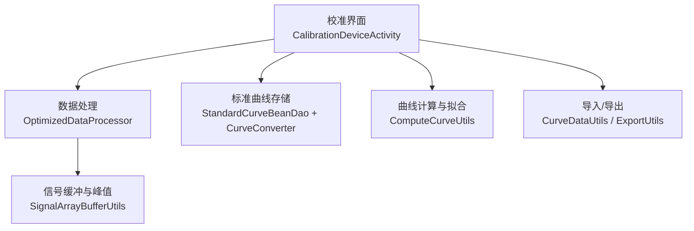
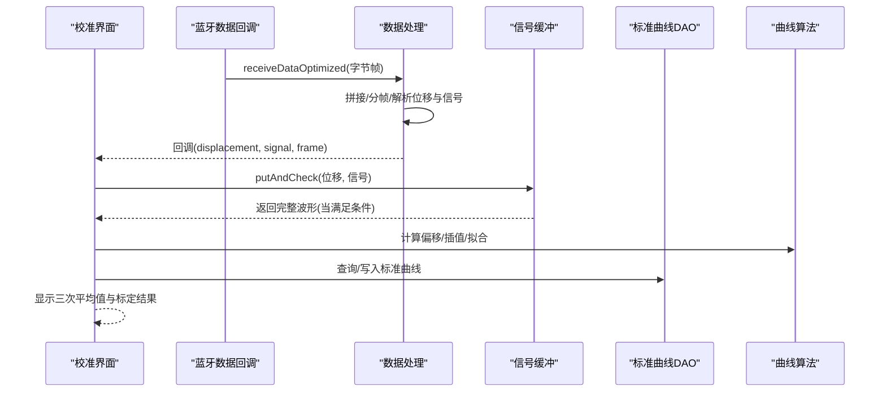
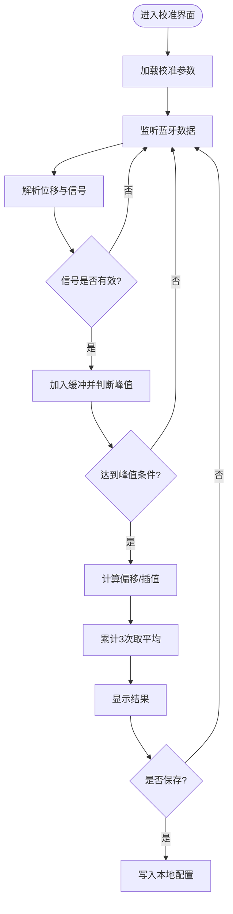
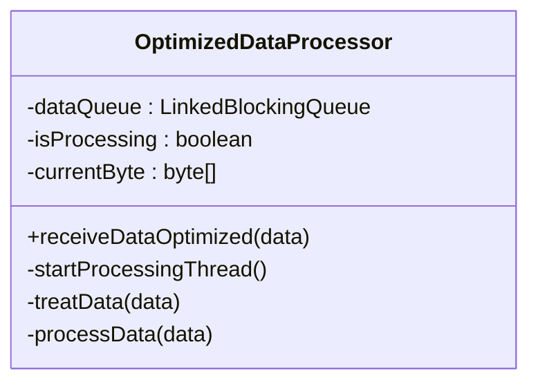
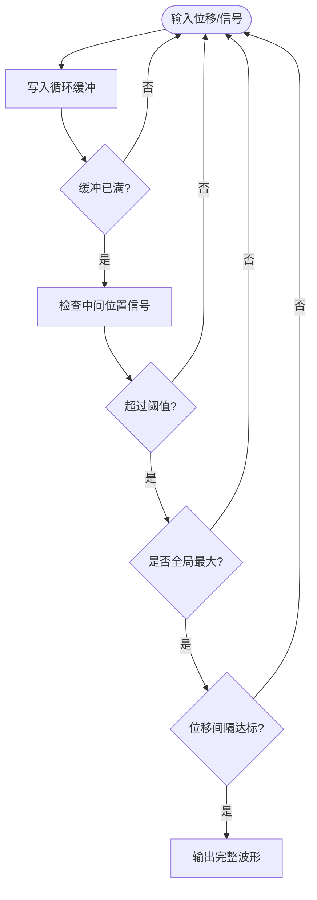
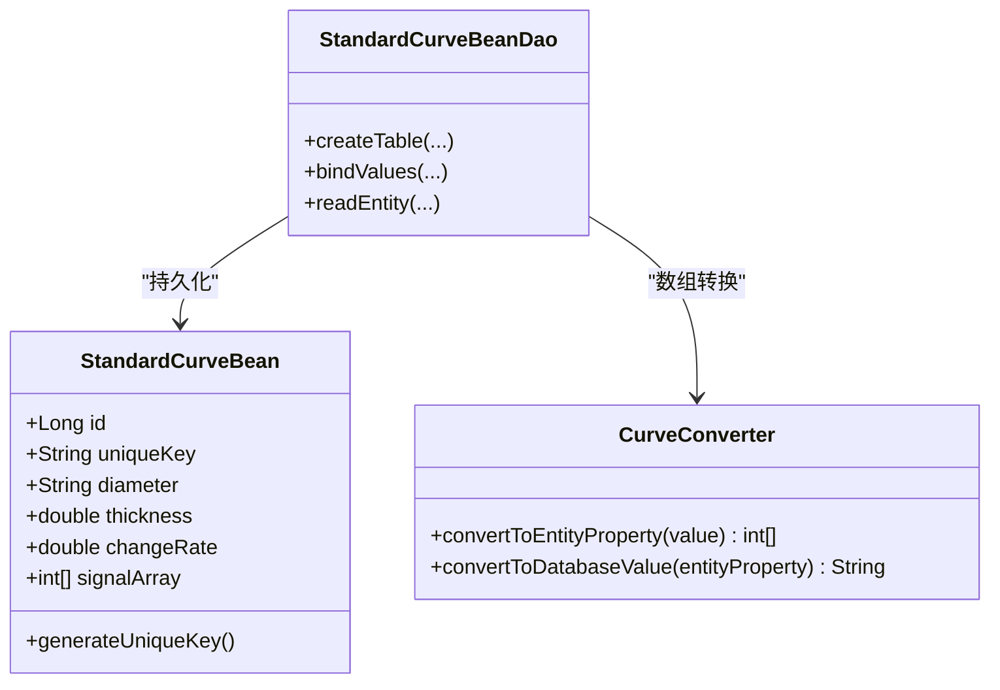
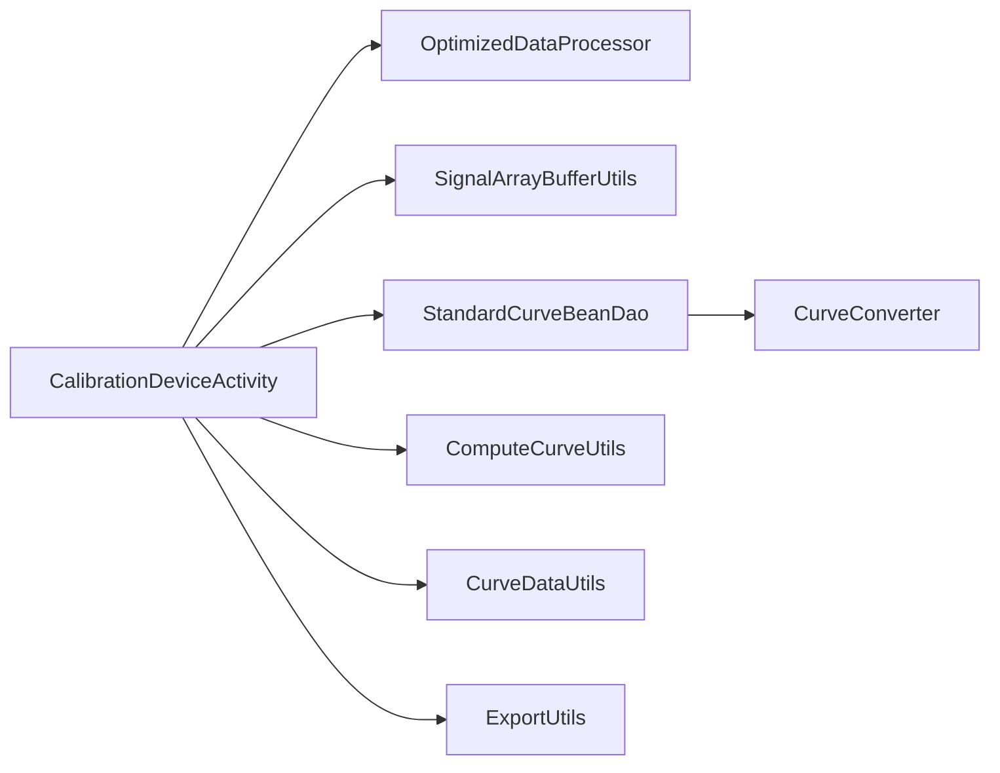

# 设备校准

<cite>
**本文引用的文件**
- [CalibrationDeviceActivity.java](file://app/src/main/java/com/example/gtj_sd_dg240/activity/setting/CalibrationDeviceActivity.java)
- [StandardCurveBean.java](file://app/src/main/java/com/example/gtj_sd_dg240/model/StandardCurveBean.java)
- [StandardCurveBeanDao.java](file://app/src/main/java/com/example/gtj_sd_dg240/functions/database/greenDao/db/StandardCurveBeanDao.java)
- [CurveConverter.java](file://app/src/main/java/com/example/gtj_sd_dg240/storage/CurveConverter.java)
- [CurveDataUtils.java](file://app/src/main/java/com/example/gtj_sd_dg240/utils/CurveDataUtils.java)
- [OptimizedDataProcessor.java](file://app/src/main/java/com/example/gtj_sd_dg240/utils/OptimizedDataProcessor.java)
- [SignalArrayBufferUtils.java](file://app/src/main/java/com/example/gtj_sd_dg240/utils/SignalArrayBufferUtils.java)
- [ComputeCurveUtils.java](file://app/src/main/java/com/example/gtj_sd_dg240/utils/ComputeCurveUtils.java)
- [ExportUtils.java](file://app/src/main/java/com/example/gtj_sd_dg240/utils/ExportUtils.java)
- [CheckDataBean.java](file://app/src/main/java/com/example/gtj_sd_dg240/model/CheckDataBean.java)
- [act_calibration_device.xml](file://app/src/main/res/layout/act_calibration_device.xml)
</cite>

## 目录
1. [简介](#简介)
2. [项目结构](#项目结构)
3. [核心组件](#核心组件)
4. [架构总览](#架构总览)
5. [详细组件分析](#详细组件分析)
6. [依赖关系分析](#依赖关系分析)
7. [性能与精度考量](#性能与精度考量)
8. [故障排查指南](#故障排查指南)
9. [结论](#结论)
10. [附录：工具使用与数据导入导出](#附录工具使用与数据导入导出)

## 简介
本文件面向混凝土电杆检测设备中的“设备校准”功能，系统化说明校准流程、标准曲线管理、校准参数设置、结果验证、数据持久化、状态监控、精度控制、周期管理与异常处理，并提供工具使用、数据导入导出与批量校准的实操指引。文档同时覆盖校准质量保证、记录追溯与证书管理建议，帮助一线人员与研发人员高效完成校准工作。

## 项目结构
校准相关代码主要分布在以下模块：
- 界面与交互：CalibrationDeviceActivity（校准入口与参数维护）
- 数据采集与处理：OptimizedDataProcessor（蓝牙数据解析）、SignalArrayBufferUtils（信号缓冲与峰值检测）
- 模型与存储：StandardCurveBean、StandardCurveBeanDao、CurveConverter（标准曲线实体与数据库存取）
- 算法与工具：ComputeCurveUtils（曲线拟合与几何计算）、CurveDataUtils（标准曲线导入/导出）、ExportUtils（通用导出）
- 布局：act_calibration_device.xml（校准界面布局）

图表来源
- [CalibrationDeviceActivity.java:53-187](file://app/src/main/java/com/example/gtj_sd_dg240/activity/setting/CalibrationDeviceActivity.java#L53-L187)
- [OptimizedDataProcessor.java:34-133](file://app/src/main/java/com/example/gtj_sd_dg240/utils/OptimizedDataProcessor.java#L34-L133)
- [SignalArrayBufferUtils.java:26-66](file://app/src/main/java/com/example/gtj_sd_dg240/utils/SignalArrayBufferUtils.java#L26-L66)
- [StandardCurveBeanDao.java:47-57](file://app/src/main/java/com/example/gtj_sd_dg240/functions/database/greenDao/db/StandardCurveBeanDao.java#L47-L57)
- [CurveConverter.java:9-25](file://app/src/main/java/com/example/gtj_sd_dg240/storage/CurveConverter.java#L9-L25)
- [ComputeCurveUtils.java:15-139](file://app/src/main/java/com/example/gtj_sd_dg240/utils/ComputeCurveUtils.java#L15-L139)
- [CurveDataUtils.java:20-85](file://app/src/main/java/com/example/gtj_sd_dg240/utils/CurveDataUtils.java#L20-L85)
- [ExportUtils.java:25-116](file://app/src/main/java/com/example/gtj_sd_dg240/utils/ExportUtils.java#L25-L116)

章节来源
- [CalibrationDeviceActivity.java:53-187](file://app/src/main/java/com/example/gtj_sd_dg240/activity/setting/CalibrationDeviceActivity.java#L53-L187)
- [act_calibration_device.xml:1-800](file://app/src/main/res/layout/act_calibration_device.xml#L1-L800)

## 核心组件
- 校准界面与参数管理：负责加载/保存校准点（标准主机信号值与本机信号值），提供默认值与一键恢复，实时显示采集到的原始帧与当前标定结果。
- 数据采集与处理：通过蓝牙接收高频数据，按固定长度帧拼接解析，提取位移与信号值，过滤异常大值，回调至上层进行标定计算。
- 信号缓冲与峰值检测：以循环缓冲区收集连续信号，识别中间位置的最大信号并输出完整波形片段，用于后续匹配或校验。
- 标准曲线模型与存储：以实体对象描述不同直径/厚度对应的信号波形，并通过GreenDAO持久化到SQLite；数组字段通过自定义转换器序列化存储。
- 曲线计算与拟合：提供多项式拟合、几何距离计算等工具，可用于生成或修正标准曲线。
- 导入/导出：支持从assets读取CSV标准曲线表，或将数据库中某一直径下的曲线导出为文本；通用导出工具可输出检测记录。

章节来源
- [CalibrationDeviceActivity.java:73-110](file://app/src/main/java/com/example/gtj_sd_dg240/activity/setting/CalibrationDeviceActivity.java#L73-L110)
- [OptimizedDataProcessor.java:34-133](file://app/src/main/java/com/example/gtj_sd_dg240/utils/OptimizedDataProcessor.java#L34-L133)
- [SignalArrayBufferUtils.java:26-66](file://app/src/main/java/com/example/gtj_sd_dg240/utils/SignalArrayBufferUtils.java#L26-L66)
- [StandardCurveBean.java:16-114](file://app/src/main/java/com/example/gtj_sd_dg240/model/StandardCurveBean.java#L16-L114)
- [StandardCurveBeanDao.java:47-57](file://app/src/main/java/com/example/gtj_sd_dg240/functions/database/greenDao/db/StandardCurveBeanDao.java#L47-L57)
- [CurveConverter.java:9-25](file://app/src/main/java/com/example/gtj_sd_dg240/storage/CurveConverter.java#L9-L25)
- [ComputeCurveUtils.java:15-139](file://app/src/main/java/com/example/gtj_sd_dg240/utils/ComputeCurveUtils.java#L15-L139)
- [CurveDataUtils.java:20-85](file://app/src/main/java/com/example/gtj_sd_dg240/utils/CurveDataUtils.java#L20-L85)
- [ExportUtils.java:25-116](file://app/src/main/java/com/example/gtj_sd_dg240/utils/ExportUtils.java#L25-L116)

## 架构总览
校准系统采用“界面-处理-存储-算法”的分层设计：
- 界面层：展示校准点输入、实时数据、三次平均结果，提供默认值与保存操作。
- 处理层：将蓝牙高频数据解帧、去噪、取均值、缓存、峰值判定后回调给界面进行标定换算。
- 存储层：标准曲线以实体+DAO方式持久化，数组字段经转换器序列化为字符串存储。
- 算法层：提供曲线拟合、几何距离计算、CSV导入/导出等能力。

图表来源
- [CalibrationDeviceActivity.java:113-187](file://app/src/main/java/com/example/gtj_sd_dg240/activity/setting/CalibrationDeviceActivity.java#L113-L187)
- [OptimizedDataProcessor.java:34-133](file://app/src/main/java/com/example/gtj_sd_dg240/utils/OptimizedDataProcessor.java#L34-L133)
- [SignalArrayBufferUtils.java:26-66](file://app/src/main/java/com/example/gtj_sd_dg240/utils/SignalArrayBufferUtils.java#L26-L66)
- [StandardCurveBeanDao.java:47-57](file://app/src/main/java/com/example/gtj_sd_dg240/functions/database/greenDao/db/StandardCurveBeanDao.java#L47-L57)
- [ComputeCurveUtils.java:121-139](file://app/src/main/java/com/example/gtj_sd_dg240/utils/ComputeCurveUtils.java#L121-L139)

## 详细组件分析

### 校准界面与参数管理（CalibrationDeviceActivity）
- 初始化：注册蓝牙数据回调、初始化信号缓冲与均值工具、启动定时任务清理缓冲。
- 参数加载/保存：从本地配置读取标准主机信号值与本机信号值列表，填充界面；点击保存时校验完整性并持久化。
- 实时标定：对每个有效信号点进行插值补偿，得到校正后的信号值；每采集到一次稳定峰值即加入统计，满3次取平均显示。
- 默认值：提供两套默认标定值，便于快速恢复。

图表来源
- [CalibrationDeviceActivity.java:73-110](file://app/src/main/java/com/example/gtj_sd_dg240/activity/setting/CalibrationDeviceActivity.java#L73-L110)
- [CalibrationDeviceActivity.java:129-187](file://app/src/main/java/com/example/gtj_sd_dg240/activity/setting/CalibrationDeviceActivity.java#L129-L187)
- [CalibrationDeviceActivity.java:199-215](file://app/src/main/java/com/example/gtj_sd_dg240/activity/setting/CalibrationDeviceActivity.java#L199-L215)
- [CalibrationDeviceActivity.java:300-373](file://app/src/main/java/com/example/gtj_sd_dg240/activity/setting/CalibrationDeviceActivity.java#L300-L373)

章节来源
- [CalibrationDeviceActivity.java:53-187](file://app/src/main/java/com/example/gtj_sd_dg240/activity/setting/CalibrationDeviceActivity.java#L53-L187)
- [CalibrationDeviceActivity.java:217-373](file://app/src/main/java/com/example/gtj_sd_dg240/activity/setting/CalibrationDeviceActivity.java#L217-L373)
- [act_calibration_device.xml:1-800](file://app/src/main/res/layout/act_calibration_device.xml#L1-L800)

### 数据采集与处理（OptimizedDataProcessor）
- 生产者-消费者模式：高频蓝牙数据入队，单线程消费，避免阻塞与重复启动。
- 帧拼接与解析：定位帧头标志，按固定长度切分，提取位移与信号字段，过滤异常大值。
- 回调：将解析结果回传给上层进行标定与显示。

图表来源
- [OptimizedDataProcessor.java:7-133](file://app/src/main/java/com/example/gtj_sd_dg240/utils/OptimizedDataProcessor.java#L7-L133)

章节来源
- [OptimizedDataProcessor.java:34-133](file://app/src/main/java/com/example/gtj_sd_dg240/utils/OptimizedDataProcessor.java#L34-L133)

### 信号缓冲与峰值检测（SignalArrayBufferUtils）
- 循环缓冲区：固定大小缓存位移与信号，支持滑动窗口。
- 峰值判定：在缓冲区满后检查中间位置是否为最大值，且最小信号阈值满足要求，再结合位移间隔去重，输出完整波形片段。
- 线程安全：内部加锁保证并发安全。

图表来源
- [SignalArrayBufferUtils.java:26-66](file://app/src/main/java/com/example/gtj_sd_dg240/utils/SignalArrayBufferUtils.java#L26-L66)
- [SignalArrayBufferUtils.java:83-94](file://app/src/main/java/com/example/gtj_sd_dg240/utils/SignalArrayBufferUtils.java#L83-L94)

章节来源
- [SignalArrayBufferUtils.java:26-66](file://app/src/main/java/com/example/gtj_sd_dg240/utils/SignalArrayBufferUtils.java#L26-L66)

### 标准曲线模型与存储（StandardCurveBean + DAO + Converter）
- 模型：包含钢筋直径、保护层厚度、变化率、信号数组等；唯一键由直径与厚度组合生成。
- 存储：GreenDAO自动生成DAO类，创建表并绑定字段；信号数组通过CurveConverter序列化为字符串存储。
- 查询：可按直径排序获取厚度递增的标准曲线集合。

图表来源
- [StandardCurveBean.java:16-114](file://app/src/main/java/com/example/gtj_sd_dg240/model/StandardCurveBean.java#L16-L114)
- [StandardCurveBeanDao.java:47-57](file://app/src/main/java/com/example/gtj_sd_dg240/functions/database/greenDao/db/StandardCurveBeanDao.java#L47-L57)
- [CurveConverter.java:9-25](file://app/src/main/java/com/example/gtj_sd_dg240/storage/CurveConverter.java#L9-L25)

章节来源
- [StandardCurveBean.java:16-114](file://app/src/main/java/com/example/gtj_sd_dg240/model/StandardCurveBean.java#L16-L114)
- [StandardCurveBeanDao.java:47-57](file://app/src/main/java/com/example/gtj_sd_dg240/functions/database/greenDao/db/StandardCurveBeanDao.java#L47-L57)
- [CurveConverter.java:9-25](file://app/src/main/java/com/example/gtj_sd_dg240/storage/CurveConverter.java#L9-L25)

### 曲线计算与拟合（ComputeCurveUtils）
- 多项式拟合：基于观测点拟合二次曲线，返回系数，用于生成或修正标准曲线。
- 几何计算：根据电杆半径、钢筋半径、保护层厚度计算行走距离与角度，辅助曲线坐标映射。

章节来源
- [ComputeCurveUtils.java:15-139](file://app/src/main/java/com/example/gtj_sd_dg240/utils/ComputeCurveUtils.java#L15-L139)

### 数据导入/导出（CurveDataUtils + ExportUtils）
- 导入：从assets中读取CSV格式的标准曲线表，解析为二维数组并进行空值校验。
- 导出：按直径查询标准曲线，生成可读文本；通用导出工具可将检测记录保存为文件。

章节来源
- [CurveDataUtils.java:20-85](file://app/src/main/java/com/example/gtj_sd_dg240/utils/CurveDataUtils.java#L20-L85)
- [ExportUtils.java:25-116](file://app/src/main/java/com/example/gtj_sd_dg240/utils/ExportUtils.java#L25-L116)

## 依赖关系分析
- CalibrationDeviceActivity 依赖：
  - 数据处理：OptimizedDataProcessor（蓝牙数据解析）
  - 信号缓冲：SignalArrayBufferUtils（峰值检测）
  - 数据存储：StandardCurveBeanDao + CurveConverter（标准曲线持久化）
  - 算法工具：ComputeCurveUtils（曲线拟合/几何计算）
  - 导入导出：CurveDataUtils、ExportUtils
- 耦合性：
  - 界面与处理层通过回调解耦，降低耦合度。
  - 存储层通过DAO与转换器封装，屏蔽底层SQLite细节。
  - 算法工具独立，便于复用与测试。

图表来源
- [CalibrationDeviceActivity.java:113-187](file://app/src/main/java/com/example/gtj_sd_dg240/activity/setting/CalibrationDeviceActivity.java#L113-L187)
- [StandardCurveBeanDao.java:47-57](file://app/src/main/java/com/example/gtj_sd_dg240/functions/database/greenDao/db/StandardCurveBeanDao.java#L47-L57)
- [CurveConverter.java:9-25](file://app/src/main/java/com/example/gtj_sd_dg240/storage/CurveConverter.java#L9-L25)
- [ComputeCurveUtils.java:121-139](file://app/src/main/java/com/example/gtj_sd_dg240/utils/ComputeCurveUtils.java#L121-L139)
- [CurveDataUtils.java:20-85](file://app/src/main/java/com/example/gtj_sd_dg240/utils/CurveDataUtils.java#L20-L85)
- [ExportUtils.java:25-116](file://app/src/main/java/com/example/gtj_sd_dg240/utils/ExportUtils.java#L25-L116)

章节来源
- [CalibrationDeviceActivity.java:113-187](file://app/src/main/java/com/example/gtj_sd_dg240/activity/setting/CalibrationDeviceActivity.java#L113-L187)

## 性能与精度考量
- 性能
  - 高频数据采用无阻塞入队与单线程消费，避免主线程卡顿。
  - 信号缓冲使用循环数组，内存占用固定，峰值检测O(n)扫描但窗口较小。
  - 定时器每2秒清空缓冲，防止长时间累积导致误判。
- 精度
  - 三次采样取平均，提升稳定性。
  - 插值补偿基于标准主机信号值与本机信号值对应关系，减少设备差异带来的偏差。
  - 多项式拟合可用于生成更平滑的标准曲线，提高匹配精度。
- 周期管理建议
  - 建议每次更换探头、环境温湿度显著变化或长期未使用时执行校准。
  - 日常使用前进行快速自检（采集3次峰值，观察波动范围）。
- 异常处理建议
  - 信号过大直接丢弃，避免污染缓冲。
  - 缓冲未满或峰值不达标时不输出结果，确保数据质量。
  - 保存前校验所有必填项，缺失则提示用户补全。

[本节为通用指导，不直接分析具体文件]

## 故障排查指南
- 现象：校准界面无数据或显示为空
  - 检查蓝牙连接与回调是否注册成功。
  - 确认OptimizedDataProcessor是否正确解析帧并回调。
- 现象：峰值检测不稳定
  - 检查SignalArrayBufferUtils阈值与位移间隔参数。
  - 确认采集过程中是否存在抖动或接触不良。
- 现象：保存失败或提示不完整
  - 检查界面各输入框是否填写完整，尤其是标准主机信号值与本机信号值两组数据。
- 现象：标准曲线导入失败
  - 检查assets中CSV文件格式与列数是否符合预期，空值将被视为错误格式。
- 现象：导出文件为空
  - 检查数据库中是否存在对应直径的曲线记录。

章节来源
- [OptimizedDataProcessor.java:122-133](file://app/src/main/java/com/example/gtj_sd_dg240/utils/OptimizedDataProcessor.java#L122-L133)
- [SignalArrayBufferUtils.java:26-66](file://app/src/main/java/com/example/gtj_sd_dg240/utils/SignalArrayBufferUtils.java#L26-L66)
- [CalibrationDeviceActivity.java:300-373](file://app/src/main/java/com/example/gtj_sd_dg240/activity/setting/CalibrationDeviceActivity.java#L300-L373)
- [CurveDataUtils.java:50-85](file://app/src/main/java/com/example/gtj_sd_dg240/utils/CurveDataUtils.java#L50-L85)

## 结论
该设备的校准功能以清晰的界面交互、稳健的数据处理链路、可靠的存储机制与灵活的算法工具为基础，实现了从数据采集、峰值检测、标定计算到标准曲线管理的闭环。通过三次采样平均、插值补偿与多项式拟合等手段，有效提升了校准精度与稳定性。建议在工程实践中结合周期管理与异常处理策略，确保设备长期处于良好校准状态。

[本节为总结，不直接分析具体文件]

## 附录：工具使用与数据导入导出

### 校准工具使用指南
- 进入校准界面：打开“钢筋校准”页面，界面左侧为标准主机信号值与本机信号值对照输入区，右侧为实时数据与结果展示。
- 采集步骤：
  - 确保设备与传感器正常连接。
  - 在待测位置缓慢移动，界面会实时显示原始帧与当前标定结果。
  - 当检测到稳定峰值时，自动累计次数，满3次显示平均值。
- 参数设置：
  - 输入标准主机信号值与本机信号值对应点，点击“保存”写入本地配置。
  - 可使用“默认值”快速恢复预设标定参数。
- 结果验证：
  - 观察三次平均值是否稳定，必要时重新采集或调整参数。

章节来源
- [CalibrationDeviceActivity.java:53-187](file://app/src/main/java/com/example/gtj_sd_dg240/activity/setting/CalibrationDeviceActivity.java#L53-L187)
- [act_calibration_device.xml:1-800](file://app/src/main/res/layout/act_calibration_device.xml#L1-L800)

### 标准曲线数据导入导出
- 导入：
  - 将CSV文件放入assets目录，文件名需与调用一致。
  - 使用CurveDataUtils.getCurveList读取并解析，空值校验通过后返回二维数组。
- 导出：
  - 使用CurveDataUtils.queryCurveListString按直径查询并生成文本。
  - 使用ExportUtils.saveDataFile将内容保存为本地文件。

章节来源
- [CurveDataUtils.java:38-85](file://app/src/main/java/com/example/gtj_sd_dg240/utils/CurveDataUtils.java#L38-L85)
- [ExportUtils.java:100-116](file://app/src/main/java/com/example/gtj_sd_dg240/utils/ExportUtils.java#L100-L116)

### 批量校准建议
- 批量场景可通过脚本或自动化流程：
  - 准备多组标准主机信号值与本机信号值对照表。
  - 依次调用保存逻辑写入本地配置。
  - 对每组数据进行采集与验证，记录三次平均值与波动情况。
- 注意：
  - 批量操作前应备份现有配置，避免误覆盖。
  - 对异常数据进行人工复核，确保校准质量。

[本节为通用指导，不直接分析具体文件]

### 校准质量保证、记录追溯与证书管理
- 质量保证：
  - 严格执行三次采样平均与峰值判定规则。
  - 定期执行标准曲线拟合与更新，确保模型时效性。
- 记录追溯：
  - 保存每次校准的参数、时间戳、采集次数与平均值。
  - 将标准曲线版本与设备编号关联，形成可追溯档案。
- 证书管理：
  - 生成校准证书模板，包含设备信息、校准参数、曲线版本、操作人员与日期。
  - 证书文件与校准记录一并归档，便于审计与复检。

[本节为通用指导，不直接分析具体文件]