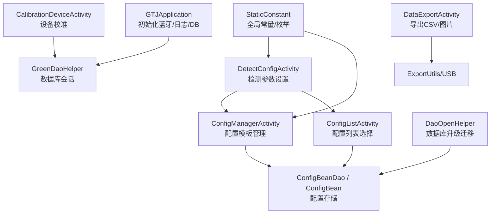
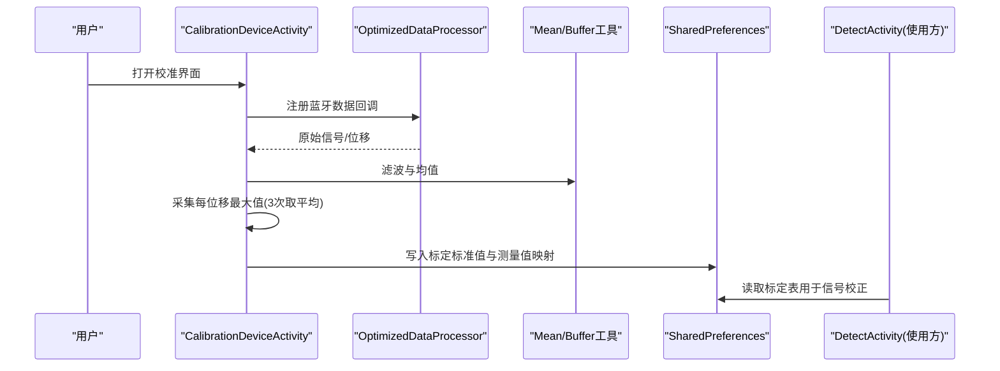
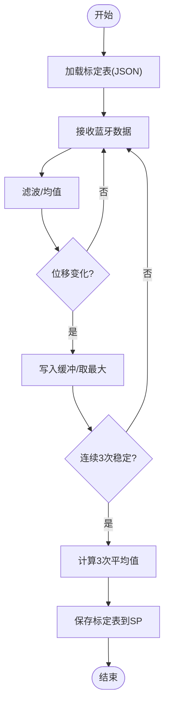
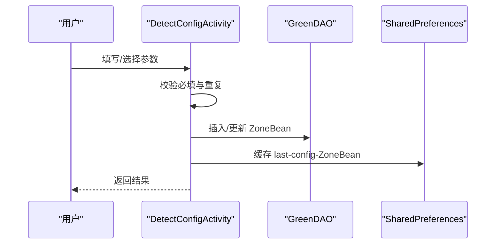
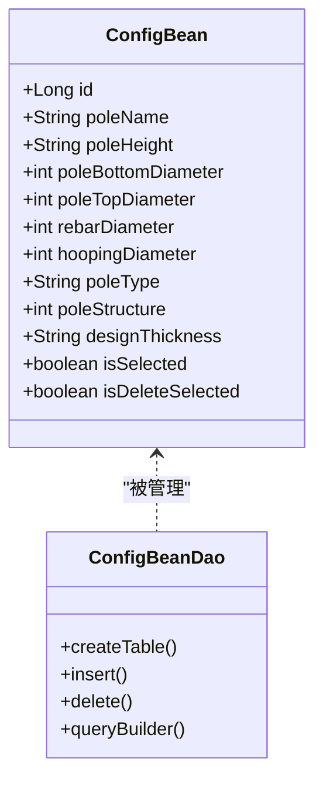
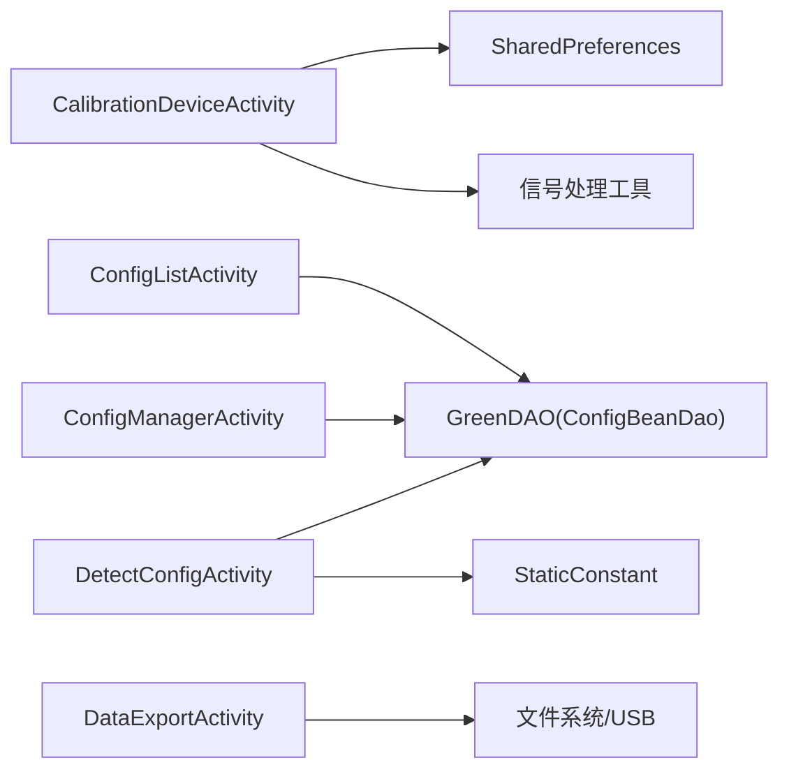

# 配置设置

<cite>
**本文引用的文件**
- [CalibrationDeviceActivity.java](file://app/src/main/java/com/example/gtj_sd_dg240/activity/setting/CalibrationDeviceActivity.java)
- [DetectConfigActivity.java](file://app/src/main/java/com/example/gtj_sd_dg240/activity/testing/DetectConfigActivity.java)
- [ConfigManagerActivity.java](file://app/src/main/java/com/example/gtj_sd_dg240/activity/testing/ConfigManagerActivity.java)
- [ConfigListActivity.java](file://app/src/main/java/com/example/gtj_sd_dg240/activity/testing/ConfigListActivity.java)
- [ConfigBean.java](file://app/src/main/java/com/example/gtj_sd_dg240/model/ConfigBean.java)
- [ConfigBeanDao.java](file://app/src/main/java/com/example/gtj_sd_dg240/functions/database/greenDao/db/ConfigBeanDao.java)
- [GreenDaoHelper.java](file://app/src/main/java/com/example/gtj_sd_dg240/storage/GreenDaoHelper.java)
- [StaticConstant.java](file://app/src/main/java/com/example/gtj_sd_dg240/StaticConstant.java)
- [DataExportActivity.java](file://app/src/main/java/com/example/gtj_sd_dg240/activity/data/DataExportActivity.java)
- [DaoOpenHelper.java](file://app/src/main/java/com/example/gtj_sd_dg240/storage/DaoOpenHelper.java)
- [GTJApplication.java](file://app/src/main/java/com/example/gtj_sd_dg240/GTJApplication.java)
</cite>

## 目录
1. [简介](#简介)
2. [项目结构](#项目结构)
3. [核心组件](#核心组件)
4. [架构总览](#架构总览)
5. [详细组件分析](#详细组件分析)
6. [依赖关系分析](#依赖关系分析)
7. [性能与稳定性](#性能与稳定性)
8. [故障排查指南](#故障排查指南)
9. [结论](#结论)
10. [附录：使用指南](#附录使用指南)

## 简介
本文件面向设备校准、参数配置、用户偏好与系统配置管理，覆盖以下主题：
- 设备校准流程与信号处理
- 检测参数配置与校验
- 配置持久化（SharedPreferences 与 GreenDAO）
- 配置模板管理与批量操作
- 不同设备型号的适配与检测参数调优
- 安全与权限（文件访问、蓝牙）
- 配置导入导出、备份恢复、版本兼容与迁移策略

## 项目结构
与配置相关的关键路径与职责：
- 校准入口与实时信号处理：CalibrationDeviceActivity
- 检测参数设置与选择：DetectConfigActivity
- 配置模板管理（增删改查、批量删除）：ConfigManagerActivity、ConfigListActivity
- 配置数据模型与数据库：ConfigBean、ConfigBeanDao、GreenDaoHelper
- 全局常量与枚举（电杆类型、结构、直径等）：StaticConstant
- 数据导出（CSV/图片）：DataExportActivity
- 数据库升级与迁移：DaoOpenHelper
- 应用初始化（蓝牙、日志、数据库）：GTJApplication

图表来源
- [CalibrationDeviceActivity.java:52-71](file://app/src/main/java/com/example/gtj_sd_dg240/activity/setting/CalibrationDeviceActivity.java#L52-L71)
- [DetectConfigActivity.java:49-69](file://app/src/main/java/com/example/gtj_sd_dg240/activity/testing/DetectConfigActivity.java#L49-L69)
- [ConfigManagerActivity.java:48-59](file://app/src/main/java/com/example/gtj_sd_dg240/activity/testing/ConfigManagerActivity.java#L48-L59)
- [ConfigListActivity.java:39-52](file://app/src/main/java/com/example/gtj_sd_dg240/activity/testing/ConfigListActivity.java#L39-L52)
- [ConfigBeanDao.java:18-37](file://app/src/main/java/com/example/gtj_sd_dg240/functions/database/greenDao/db/ConfigBeanDao.java#L18-L37)
- [GreenDaoHelper.java:16-40](file://app/src/main/java/com/example/gtj_sd_dg240/storage/GreenDaoHelper.java#L16-L40)
- [StaticConstant.java:43-65](file://app/src/main/java/com/example/gtj_sd_dg240/StaticConstant.java#L43-L65)
- [DataExportActivity.java:54-107](file://app/src/main/java/com/example/gtj_sd_dg240/activity/data/DataExportActivity.java#L54-L107)
- [DaoOpenHelper.java:19-33](file://app/src/main/java/com/example/gtj_sd_dg240/storage/DaoOpenHelper.java#L19-L33)
- [GTJApplication.java:20-41](file://app/src/main/java/com/example/gtj_sd_dg240/GTJApplication.java#L20-L41)

章节来源
- [CalibrationDeviceActivity.java:52-71](file://app/src/main/java/com/example/gtj_sd_dg240/activity/setting/CalibrationDeviceActivity.java#L52-L71)
- [DetectConfigActivity.java:49-69](file://app/src/main/java/com/example/gtj_sd_dg240/activity/testing/DetectConfigActivity.java#L49-L69)
- [ConfigManagerActivity.java:48-59](file://app/src/main/java/com/example/gtj_sd_dg240/activity/testing/ConfigManagerActivity.java#L48-L59)
- [ConfigListActivity.java:39-52](file://app/src/main/java/com/example/gtj_sd_dg240/activity/testing/ConfigListActivity.java#L39-L52)
- [ConfigBeanDao.java:18-37](file://app/src/main/java/com/example/gtj_sd_dg240/functions/database/greenDao/db/ConfigBeanDao.java#L18-L37)
- [GreenDaoHelper.java:16-40](file://app/src/main/java/com/example/gtj_sd_dg240/storage/GreenDaoHelper.java#L16-L40)
- [StaticConstant.java:43-65](file://app/src/main/java/com/example/gtj_sd_dg240/StaticConstant.java#L43-L65)
- [DataExportActivity.java:54-107](file://app/src/main/java/com/example/gtj_sd_dg240/activity/data/DataExportActivity.java#L54-L107)
- [DaoOpenHelper.java:19-33](file://app/src/main/java/com/example/gtj_sd_dg240/storage/DaoOpenHelper.java#L19-L33)
- [GTJApplication.java:20-41](file://app/src/main/java/com/example/gtj_sd_dg240/GTJApplication.java#L20-L41)

## 核心组件
- 设备校准模块：负责读取蓝牙数据、信号滤波与平均、采集最大值并计算标定偏移，最终将标定表持久化到 SharedPreferences。
- 检测参数配置：提供工程、委托单、电杆基础信息、钢筋与螺旋筋直径、设计保护层厚度等输入，并进行完整性与重复性校验，保存为 ZoneBean 并缓存最近一次配置。
- 配置模板管理：支持按电杆类型分组创建、选择、批量删除配置模板；内置默认模板集合保护。
- 数据导出：将检测结果导出为 CSV 与截图，支持平板内部存储与 USB 导出。
- 数据库与迁移：GreenDAO 管理配置与检测数据；通过 MigrationHelper 在升级时重建表结构。

章节来源
- [CalibrationDeviceActivity.java:129-187](file://app/src/main/java/com/example/gtj_sd_dg240/activity/setting/CalibrationDeviceActivity.java#L129-L187)
- [DetectConfigActivity.java:281-367](file://app/src/main/java/com/example/gtj_sd_dg240/activity/testing/DetectConfigActivity.java#L281-L367)
- [ConfigManagerActivity.java:214-331](file://app/src/main/java/com/example/gtj_sd_dg240/activity/testing/ConfigManagerActivity.java#L214-L331)
- [DataExportActivity.java:345-470](file://app/src/main/java/com/example/gtj_sd_dg240/activity/data/DataExportActivity.java#L345-L470)
- [DaoOpenHelper.java:19-33](file://app/src/main/java/com/example/gtj_sd_dg240/storage/DaoOpenHelper.java#L19-L33)

## 架构总览
配置与校准的数据流与控制流如下：

图表来源
- [CalibrationDeviceActivity.java:112-187](file://app/src/main/java/com/example/gtj_sd_dg240/activity/setting/CalibrationDeviceActivity.java#L112-L187)
- [DetectActivity2.java:156-163](file://app/src/main/java/com/example/gtj_sd_dg240/activity/testing/DetectActivity2.java#L156-L163)

章节来源
- [CalibrationDeviceActivity.java:112-187](file://app/src/main/java/com/example/gtj_sd_dg240/activity/setting/CalibrationDeviceActivity.java#L112-L187)
- [DetectActivity2.java:156-163](file://app/src/main/java/com/example/gtj_sd_dg240/activity/testing/DetectActivity2.java#L156-L163)

## 详细组件分析

### 设备校准（CalibrationDeviceActivity）
- 功能要点
  - 从 SharedPreferences 加载历史标定表（标准值与测量值映射），回显至界面。
  - 接收蓝牙数据，进行信号滤波与均值处理，按位移分段采集最大值，连续三次稳定后取平均作为该位移的标定值。
  - 支持一键恢复默认标定表或清空非标准标定列。
  - 保存时校验所有字段完整，将两组标定数组序列化为 JSON 存入 SharedPreferences。
- 关键流程
  - 数据采集与处理：定时器清理缓冲、去重位移、记录最大值、语音提示、三测平均。
  - 标定换算：根据当前测量值落入区间，线性插值计算偏移量，得到校正后的信号值。
- 复杂度与性能
  - 信号处理采用滑动窗口与均值滤波，时间复杂度近似 O(N)，内存占用受缓冲区大小控制。
  - 主线程仅做 UI 更新，耗时逻辑在后台线程执行。

图表来源
- [CalibrationDeviceActivity.java:129-187](file://app/src/main/java/com/example/gtj_sd_dg240/activity/setting/CalibrationDeviceActivity.java#L129-L187)
- [CalibrationDeviceActivity.java:300-372](file://app/src/main/java/com/example/gtj_sd_dg240/activity/setting/CalibrationDeviceActivity.java#L300-L372)

章节来源
- [CalibrationDeviceActivity.java:73-110](file://app/src/main/java/com/example/gtj_sd_dg240/activity/setting/CalibrationDeviceActivity.java#L73-L110)
- [CalibrationDeviceActivity.java:129-187](file://app/src/main/java/com/example/gtj_sd_dg240/activity/setting/CalibrationDeviceActivity.java#L129-L187)
- [CalibrationDeviceActivity.java:217-298](file://app/src/main/java/com/example/gtj_sd_dg240/activity/setting/CalibrationDeviceActivity.java#L217-L298)
- [CalibrationDeviceActivity.java:300-372](file://app/src/main/java/com/example/gtj_sd_dg240/activity/setting/CalibrationDeviceActivity.java#L300-L372)

### 检测参数配置（DetectConfigActivity）
- 功能要点
  - 选择工程与委托单，填写电杆编号、长度、根径、梢径、纵筋与螺旋筋直径、设计保护层厚度等。
  - 支持从上次配置快速填充，自动同步等径杆上下径一致。
  - 保存前进行必填项校验、工程下电杆编号唯一性校验。
  - 将 ZoneBean 持久化，并将最近一次配置缓存到 SharedPreferences，便于下次复用。
- 与配置模板联动
  - 可通过“参数配置列表”选择预设模板，回填高度、直径、保护层等字段。

图表来源
- [DetectConfigActivity.java:281-367](file://app/src/main/java/com/example/gtj_sd_dg240/activity/testing/DetectConfigActivity.java#L281-L367)

章节来源
- [DetectConfigActivity.java:71-127](file://app/src/main/java/com/example/gtj_sd_dg240/activity/testing/DetectConfigActivity.java#L71-L127)
- [DetectConfigActivity.java:157-198](file://app/src/main/java/com/example/gtj_sd_dg240/activity/testing/DetectConfigActivity.java#L157-L198)
- [DetectConfigActivity.java:281-367](file://app/src/main/java/com/example/gtj_sd_dg240/activity/testing/DetectConfigActivity.java#L281-L367)

### 配置模板管理（ConfigManagerActivity / ConfigListActivity）
- 功能要点
  - 按电杆类型（普通/预应力Y/部分预应力BY）分组展示与选择。
  - 新建配置：名称、长度、根径、梢径、纵筋与螺旋筋直径、结构、规范、设计保护层厚度。
  - 批量删除：支持全选/多选，但内置默认模板集合不可删除。
  - 列表页用于选择已存在的配置模板并回填到检测参数页。
- 数据模型
  - ConfigBean 描述模板属性，包含 id、poleName、尺寸、直径、类型、结构、设计保护层厚度等。
  - 通过 ConfigBeanDao 进行 CRUD，GreenDaoHelper 提供会话管理。

图表来源
- [ConfigBean.java:13-37](file://app/src/main/java/com/example/gtj_sd_dg240/model/ConfigBean.java#L13-L37)
- [ConfigBeanDao.java:18-37](file://app/src/main/java/com/example/gtj_sd_dg240/functions/database/greenDao/db/ConfigBeanDao.java#L18-L37)

章节来源
- [ConfigManagerActivity.java:71-89](file://app/src/main/java/com/example/gtj_sd_dg240/activity/testing/ConfigManagerActivity.java#L71-L89)
- [ConfigManagerActivity.java:214-331](file://app/src/main/java/com/example/gtj_sd_dg240/activity/testing/ConfigManagerActivity.java#L214-L331)
- [ConfigListActivity.java:67-128](file://app/src/main/java/com/example/gtj_sd_dg240/activity/testing/ConfigListActivity.java#L67-L128)
- [ConfigBean.java:13-37](file://app/src/main/java/com/example/gtj_sd_dg240/model/ConfigBean.java#L13-L37)
- [ConfigBeanDao.java:18-37](file://app/src/main/java/com/example/gtj_sd_dg240/functions/database/greenDao/db/ConfigBeanDao.java#L18-L37)

### 数据导出（DataExportActivity）
- 功能要点
  - 查询选定 ZoneBean 数据，生成 CSV 文本与页面截图。
  - 同时保存到平板内部存储与 USB（若检测到）。
  - 进度反馈与结果汇总弹窗。
- 注意事项
  - 需要外部存储/USB 访问权限；未识别 USB 时会提示。
  - 数据不完整时跳过导出并记录原因。

章节来源
- [DataExportActivity.java:345-470](file://app/src/main/java/com/example/gtj_sd_dg240/activity/data/DataExportActivity.java#L345-L470)

### 数据库与迁移（GreenDaoHelper / DaoOpenHelper）
- GreenDaoHelper 提供 DaoSession 的单例式获取，统一数据库连接生命周期。
- DaoOpenHelper 在 onUpgrade 中通过 MigrationHelper 重建所有表，确保版本升级时的兼容性。

章节来源
- [GreenDaoHelper.java:16-40](file://app/src/main/java/com/example/gtj_sd_dg240/storage/GreenDaoHelper.java#L16-L40)
- [DaoOpenHelper.java:19-33](file://app/src/main/java/com/example/gtj_sd_dg240/storage/DaoOpenHelper.java#L19-L33)

### 全局常量与设备型号适配（StaticConstant）
- 定义电杆类型、结构、规范、钢筋与螺旋筋直径可选集、默认模板名集合等。
- 通过 APP_DEFAULT 切换品牌/中性版本，影响界面 Logo 显示。
- 蓝牙服务与特征 UUID 集中管理，便于多设备适配。

章节来源
- [StaticConstant.java:28-65](file://app/src/main/java/com/example/gtj_sd_dg240/StaticConstant.java#L28-L65)
- [DataExportActivity.java:64-107](file://app/src/main/java/com/example/gtj_sd_dg240/activity/data/DataExportActivity.java#L64-L107)

### 应用初始化（GTJApplication）
- 初始化蓝牙管理器、崩溃捕获、日志、工具类、GreenDAO、定位服务、Toast 样式等。
- 为后续配置与检测流程提供基础设施。

章节来源
- [GTJApplication.java:20-41](file://app/src/main/java/com/example/gtj_sd_dg240/GTJApplication.java#L20-L41)

## 依赖关系分析
- 校准模块依赖：
  - 蓝牙数据回调（由 BaseActivity 封装）
  - 信号处理工具（均值、缓冲）
  - SharedPreferences 持久化标定表
- 配置模块依赖：
  - GreenDAO（ConfigBeanDao）持久化模板
  - StaticConstant 提供枚举与默认模板集合
  - DetectConfigActivity 与 ConfigListActivity/ConfigManagerActivity 协作
- 导出模块依赖：
  - ExportUtils 与 USB 工具
  - BitmapUtils 截图压缩
  - 文件系统权限

图表来源
- [CalibrationDeviceActivity.java:300-372](file://app/src/main/java/com/example/gtj_sd_dg240/activity/setting/CalibrationDeviceActivity.java#L300-L372)
- [DetectConfigActivity.java:281-367](file://app/src/main/java/com/example/gtj_sd_dg240/activity/testing/DetectConfigActivity.java#L281-L367)
- [ConfigManagerActivity.java:214-331](file://app/src/main/java/com/example/gtj_sd_dg240/activity/testing/ConfigManagerActivity.java#L214-L331)
- [ConfigListActivity.java:67-128](file://app/src/main/java/com/example/gtj_sd_dg240/activity/testing/ConfigListActivity.java#L67-L128)
- [DataExportActivity.java:345-470](file://app/src/main/java/com/example/gtj_sd_dg240/activity/data/DataExportActivity.java#L345-L470)

章节来源
- [CalibrationDeviceActivity.java:300-372](file://app/src/main/java/com/example/gtj_sd_dg240/activity/setting/CalibrationDeviceActivity.java#L300-L372)
- [DetectConfigActivity.java:281-367](file://app/src/main/java/com/example/gtj_sd_dg240/activity/testing/DetectConfigActivity.java#L281-L367)
- [ConfigManagerActivity.java:214-331](file://app/src/main/java/com/example/gtj_sd_dg240/activity/testing/ConfigManagerActivity.java#L214-L331)
- [ConfigListActivity.java:67-128](file://app/src/main/java/com/example/gtj_sd_dg240/activity/testing/ConfigListActivity.java#L67-L128)
- [DataExportActivity.java:345-470](file://app/src/main/java/com/example/gtj_sd_dg240/activity/data/DataExportActivity.java#L345-L470)

## 性能与稳定性
- 校准信号处理
  - 使用定时任务与 Handler 分离 UI 与数据处理，避免卡顿。
  - 缓冲区大小固定（如 64），降低内存抖动。
  - 三测平均提升稳定性，减少噪声影响。
- 配置与数据库
  - GreenDAO 提供高效读写；批量删除时逆序遍历避免索引错乱。
  - 升级时使用 MigrationHelper 重建表，保证兼容性。
- 导出
  - 异步任务处理导出流程，UI 保持响应；失败路径有明确提示。

[本节为通用性能讨论，不直接引用具体代码]

## 故障排查指南
- 校准无法保存
  - 检查是否所有标定字段均已填写；缺失会提示“请填写完整”。
  - 确认 SharedPreferences 写入成功（可观察 Toast 提示）。
- 检测参数保存失败
  - 必填项为空或工程未选择会阻止保存。
  - 同一工程下电杆编号重复会被拒绝。
- 配置模板删除受限
  - 内置默认模板集合中的名称不可删除，需手动避开。
- 导出失败
  - 未识别 USB 或未授予文件访问权限会导致导出失败。
  - 数据不完整时跳过导出并记录原因。
- 数据库升级异常
  - 升级时通过 MigrationHelper 重建表；如遇问题可检查表结构与版本。

章节来源
- [CalibrationDeviceActivity.java:300-372](file://app/src/main/java/com/example/gtj_sd_dg240/activity/setting/CalibrationDeviceActivity.java#L300-L372)
- [DetectConfigActivity.java:281-367](file://app/src/main/java/com/example/gtj_sd_dg240/activity/testing/DetectConfigActivity.java#L281-L367)
- [ConfigManagerActivity.java:288-331](file://app/src/main/java/com/example/gtj_sd_dg240/activity/testing/ConfigManagerActivity.java#L288-L331)
- [DataExportActivity.java:345-470](file://app/src/main/java/com/example/gtj_sd_dg240/activity/data/DataExportActivity.java#L345-L470)
- [DaoOpenHelper.java:19-33](file://app/src/main/java/com/example/gtj_sd_dg240/storage/DaoOpenHelper.java#L19-L33)

## 结论
本配置体系以“校准—参数—模板—导出”为主线，结合 SharedPreferences 与 GreenDAO 实现灵活且可靠的配置管理。通过严格的参数校验、批量操作与默认模板保护，保障现场作业效率与数据安全。数据库迁移机制确保版本升级的平滑过渡。建议在生产环境中配合权限引导与错误提示，进一步提升用户体验与鲁棒性。

[本节为总结性内容，不直接引用具体代码]

## 附录：使用指南

### 设备校准流程
- 进入“钢筋校准”，界面会自动加载历史标定表。
- 连接设备并触发测量，按提示采集每个位移的最大值，系统自动三测平均。
- 完成后点击保存，系统将标定表写入 SharedPreferences。
- 如需恢复默认，可使用“默认标定”按钮；如需清空非标准列，使用对应按钮。

章节来源
- [CalibrationDeviceActivity.java:73-110](file://app/src/main/java/com/example/gtj_sd_dg240/activity/setting/CalibrationDeviceActivity.java#L73-L110)
- [CalibrationDeviceActivity.java:217-298](file://app/src/main/java/com/example/gtj_sd_dg240/activity/setting/CalibrationDeviceActivity.java#L217-L298)
- [CalibrationDeviceActivity.java:300-372](file://app/src/main/java/com/example/gtj_sd_dg240/activity/setting/CalibrationDeviceActivity.java#L300-L372)

### 检测参数配置与验证
- 在“参数设置”中选择工程与委托单，填写电杆基本信息与检测参数。
- 系统自动校验必填项与重复编号，通过后保存并缓存最近配置。
- 可从“参数配置列表”选择模板快速回填。

章节来源
- [DetectConfigActivity.java:71-127](file://app/src/main/java/com/example/gtj_sd_dg240/activity/testing/DetectConfigActivity.java#L71-L127)
- [DetectConfigActivity.java:281-367](file://app/src/main/java/com/example/gtj_sd_dg240/activity/testing/DetectConfigActivity.java#L281-L367)
- [ConfigListActivity.java:67-128](file://app/src/main/java/com/example/gtj_sd_dg240/activity/testing/ConfigListActivity.java#L67-L128)

### 配置模板管理与批量操作
- 在“参数配置管理”中按类型查看、新增、选择与批量删除模板。
- 内置默认模板不可删除，防止误操作。
- 新建时需填写完整信息并通过唯一性校验。

章节来源
- [ConfigManagerActivity.java:71-89](file://app/src/main/java/com/example/gtj_sd_dg240/activity/testing/ConfigManagerActivity.java#L71-L89)
- [ConfigManagerActivity.java:214-331](file://app/src/main/java/com/example/gtj_sd_dg240/activity/testing/ConfigManagerActivity.java#L214-L331)

### 配置导入导出与备份恢复
- 导出：在“数据导出”中选择待导出项目，生成 CSV 与截图，支持平板与 USB 双通道。
- 备份恢复：
  - 校准表：通过 SharedPreferences 键名“calibration-standard-list”“calibration-list”进行备份与恢复（JSON 字符串）。
  - 最近配置：通过“last-config-ZoneBean”键进行缓存与恢复。
- 注意：导出需具备相应存储权限；USB 未识别时将提示。

章节来源
- [DataExportActivity.java:345-470](file://app/src/main/java/com/example/gtj_sd_dg240/activity/data/DataExportActivity.java#L345-L470)
- [CalibrationDeviceActivity.java:300-372](file://app/src/main/java/com/example/gtj_sd_dg240/activity/setting/CalibrationDeviceActivity.java#L300-L372)
- [DetectConfigActivity.java:366-367](file://app/src/main/java/com/example/gtj_sd_dg240/activity/testing/DetectConfigActivity.java#L366-L367)

### 版本兼容性与迁移策略
- 数据库升级：通过 DaoOpenHelper.onUpgrade 使用 MigrationHelper 重建所有表，确保新旧版本兼容。
- 建议在升级前备份关键配置（校准表 JSON、ZoneBean 数据），以防重建过程中丢失自定义数据。

章节来源
- [DaoOpenHelper.java:19-33](file://app/src/main/java/com/example/gtj_sd_dg240/storage/DaoOpenHelper.java#L19-L33)