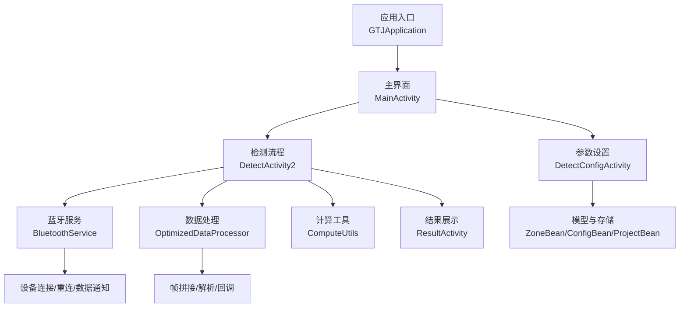
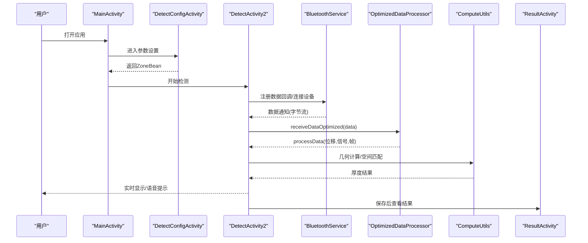
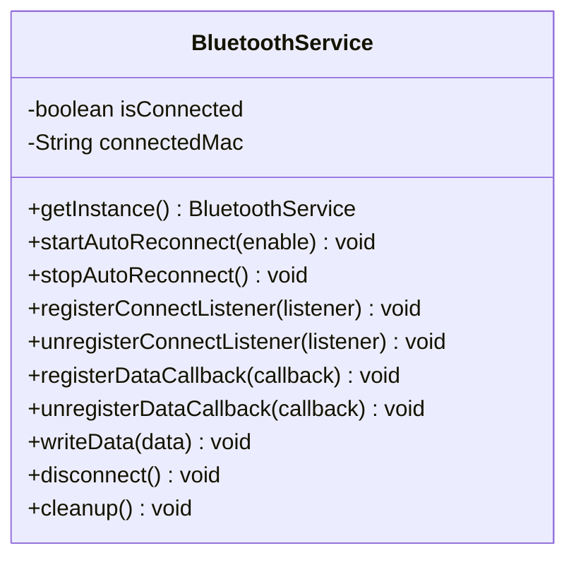
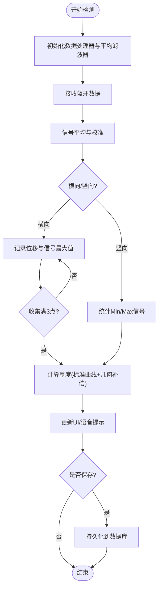
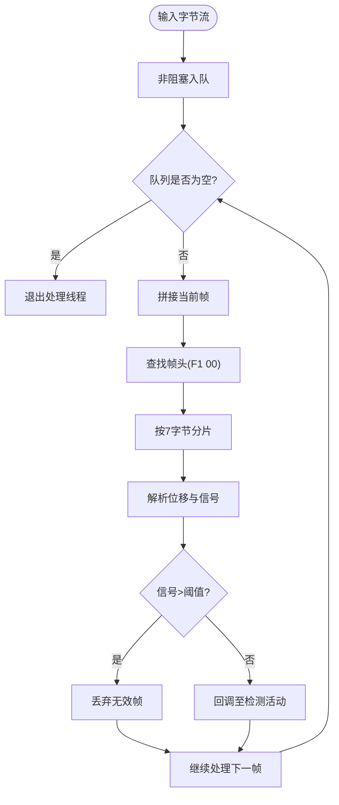
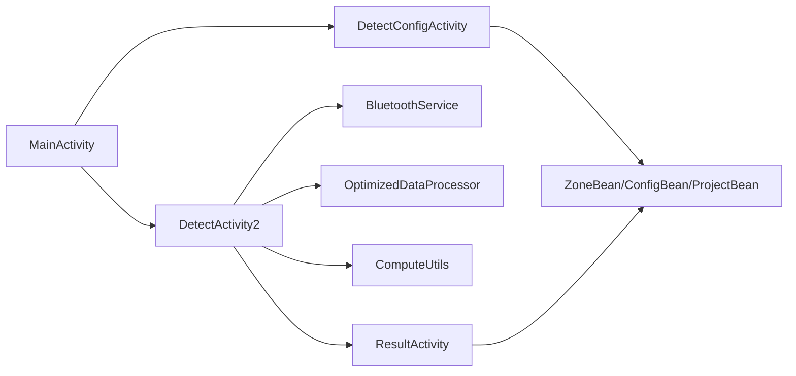

# 应用介绍

<cite>
**本文引用的文件**
- [GTJApplication.java](file://app/src/main/java/com/example/gtj_sd_dg240/GTJApplication.java)
- [StaticConstant.java](file://app/src/main/java/com/example/gtj_sd_dg240/StaticConstant.java)
- [MainActivity.java](file://app/src/main/java/com/example/gtj_sd_dg240/activity/MainActivity.java)
- [StartActivity.java](file://app/src/main/java/com/example/gtj_sd_dg240/activity/start/StartActivity.java)
- [BluetoothService.java](file://app/src/main/java/com/example/gtj_sd_dg240/bluetooth/BluetoothService.java)
- [DetectActivity2.java](file://app/src/main/java/com/example/gtj_sd_dg240/activity/testing/DetectActivity2.java)
- [ResultActivity.java](file://app/src/main/java/com/example/gtj_sd_dg240/activity/testing/ResultActivity.java)
- [OptimizedDataProcessor.java](file://app/src/main/java/com/example/gtj_sd_dg240/utils/OptimizedDataProcessor.java)
- [ComputeUtils.java](file://app/src/main/java/com/example/gtj_sd_dg240/utils/ComputeUtils.java)
- [ZoneBean.java](file://app/src/main/java/com/example/gtj_sd_dg240/model/ZoneBean.java)
- [ConfigBean.java](file://app/src/main/java/com/example/gtj_sd_dg240/model/ConfigBean.java)
- [ProjectBean.java](file://app/src/main/java/com/example/gtj_sd_dg240/model/ProjectBean.java)
- [DetectConfigActivity.java](file://app/src/main/java/com/example/gtj_sd_dg240/activity/testing/DetectConfigActivity.java)
- [strings.xml](file://app/src/main/res/values/strings.xml)
</cite>

## 目录
1. [简介](#简介)
2. [项目结构](#项目结构)
3. [核心组件](#核心组件)
4. [架构总览](#架构总览)
5. [详细组件分析](#详细组件分析)
6. [依赖关系分析](#依赖关系分析)
7. [性能考量](#性能考量)
8. [故障排查指南](#故障排查指南)
9. [结论](#结论)
10. [附录](#附录)

## 简介
本应用为“混凝土电杆钢筋保护层智能检测系统”，面向电力、基建与工程质量检测场景，提供基于蓝牙连接的专业检测设备进行混凝土电杆保护层厚度与相关参数的现场采集、实时计算与结果展示。应用支持多类型电杆（普通、预应力、部分预应力）及多种结构形式（锥形、法兰、等径），内置标准曲线与匹配算法，实现从设备连接到数据采集、实时分析到结果可视化的完整闭环。

- 核心目标：提升现场检测效率与准确性，降低人工误差，提供可追溯的检测数据与可视化报告。
- 主要功能特性：
  - 低功耗蓝牙设备连接与自动重连
  - 高频信号数据的缓冲、拼接与解析
  - 基于标准曲线与几何计算的厚度估算
  - 横向/竖向双模式检测与实时反馈
  - 检测结果可视化与异常提示
  - 项目、委托、配置管理与数据导出
- 适用场景：输电线路、变电站、铁路、公路等基础设施的混凝土电杆保护层厚度抽检与验收。
- 目标用户：质量检测工程师、施工监理、第三方检测机构、运维人员。
- 行业背景与技术优势：
  - 传统方法依赖人工剔凿或离线实验室测试，效率低、破坏性强且难以覆盖全量构件。
  - 本应用通过非破坏性测量、在线校准、实时插值与几何补偿，显著缩短检测周期并提高一致性。

**章节来源**
- [strings.xml:1-6](file://app/src/main/res/values/strings.xml#L1-L6)
- [StaticConstant.java:43-65](file://app/src/main/java/com/example/gtj_sd_dg240/StaticConstant.java#L43-L65)

## 项目结构
应用采用模块化分层组织：
- 入口与应用初始化：应用启动、全局服务初始化、权限与定位、日志与崩溃处理
- 界面层：主页、参数设置、检测页、结果页、数据管理
- 通信层：蓝牙服务封装、连接状态监听、数据回调分发
- 数据处理层：高频数据缓冲、帧拼接、解析、平均滤波与插值计算
- 模型与存储：GreenDAO实体（项目、配置、区段、钢筋等）、本地数据库
- 工具与算法：几何计算、空间匹配、字符串与数组工具

**图表来源**
- [GTJApplication.java:18-41](file://app/src/main/java/com/example/gtj_sd_dg240/GTJApplication.java#L18-L41)
- [MainActivity.java:40-63](file://app/src/main/java/com/example/gtj_sd_dg240/activity/MainActivity.java#L40-L63)
- [DetectActivity2.java:56-116](file://app/src/main/java/com/example/gtj_sd_dg240/activity/testing/DetectActivity2.java#L56-L116)
- [BluetoothService.java:16-52](file://app/src/main/java/com/example/gtj_sd_dg240/bluetooth/BluetoothService.java#L16-L52)
- [OptimizedDataProcessor.java:7-47](file://app/src/main/java/com/example/gtj_sd_dg240/utils/OptimizedDataProcessor.java#L7-L47)
- [ComputeUtils.java:8-61](file://app/src/main/java/com/example/gtj_sd_dg240/utils/ComputeUtils.java#L8-L61)
- [ResultActivity.java:27-63](file://app/src/main/java/com/example/gtj_sd_dg240/activity/testing/ResultActivity.java#L27-L63)

**章节来源**
- [GTJApplication.java:18-41](file://app/src/main/java/com/example/gtj_sd_dg240/GTJApplication.java#L18-L41)
- [MainActivity.java:40-63](file://app/src/main/java/com/example/gtj_sd_dg240/activity/MainActivity.java#L40-L63)

## 核心组件
- 应用入口与初始化：负责蓝牙、崩溃处理、日志、定位、Toast等全局初始化
- 蓝牙服务：单例管理连接、自动重连、数据通知注册与回调分发
- 检测活动：接收蓝牙数据、信号平均与校准、厚度计算、结果刷新与保存
- 数据处理：生产者-消费者队列、帧拼接、边界识别、分片解析与回调
- 计算工具：几何第三边计算、空间匹配与区间判定
- 结果展示：按位置映射显示厚度分布、平均值与异常高亮
- 配置与模型：项目、配置、区段等实体定义与持久化

**章节来源**
- [BluetoothService.java:16-52](file://app/src/main/java/com/example/gtj_sd_dg240/bluetooth/BluetoothService.java#L16-L52)
- [DetectActivity2.java:56-116](file://app/src/main/java/com/example/gtj_sd_dg240/activity/testing/DetectActivity2.java#L56-L116)
- [OptimizedDataProcessor.java:7-47](file://app/src/main/java/com/example/gtj_sd_dg240/utils/OptimizedDataProcessor.java#L7-L47)
- [ComputeUtils.java:8-61](file://app/src/main/java/com/example/gtj_sd_dg240/utils/ComputeUtils.java#L8-L61)
- [ResultActivity.java:27-63](file://app/src/main/java/com/example/gtj_sd_dg240/activity/testing/ResultActivity.java#L27-L63)
- [ZoneBean.java:15-79](file://app/src/main/java/com/example/gtj_sd_dg240/model/ZoneBean.java#L15-L79)
- [ConfigBean.java:13-64](file://app/src/main/java/com/example/gtj_sd_dg240/model/ConfigBean.java#L13-L64)
- [ProjectBean.java:14-48](file://app/src/main/java/com/example/gtj_sd_dg240/model/ProjectBean.java#L14-L48)

## 架构总览
应用整体采用“界面—服务—数据”的分层架构：
- 界面层：MainActivity作为导航中心；DetectActivity2承载检测流程；ResultActivity展示结果；DetectConfigActivity负责参数与工程信息录入
- 服务层：BluetoothService统一蓝牙连接与数据回调；OptimizedDataProcessor负责高频数据缓冲与解析
- 数据层：GreenDAO实体（ZoneBean/ConfigBean/ProjectBean）与本地数据库；静态常量与工具类支撑业务逻辑

**图表来源**
- [MainActivity.java:106-129](file://app/src/main/java/com/example/gtj_sd_dg240/activity/MainActivity.java#L106-L129)
- [DetectConfigActivity.java:229-258](file://app/src/main/java/com/example/gtj_sd_dg240/activity/testing/DetectConfigActivity.java#L229-L258)
- [DetectActivity2.java:165-203](file://app/src/main/java/com/example/gtj_sd_dg240/activity/testing/DetectActivity2.java#L165-L203)
- [BluetoothService.java:172-198](file://app/src/main/java/com/example/gtj_sd_dg240/bluetooth/BluetoothService.java#L172-L198)
- [OptimizedDataProcessor.java:34-47](file://app/src/main/java/com/example/gtj_sd_dg240/utils/OptimizedDataProcessor.java#L34-L47)
- [ComputeUtils.java:36-61](file://app/src/main/java/com/example/gtj_sd_dg240/utils/ComputeUtils.java#L36-L61)
- [ResultActivity.java:39-63](file://app/src/main/java/com/example/gtj_sd_dg240/activity/testing/ResultActivity.java#L39-L63)

## 详细组件分析

### 蓝牙服务（BluetoothService）
- 职责：统一管理设备连接、自动重连、数据通知注册与回调分发
- 关键机制：
  - 单例模式保证全局唯一实例
  - 连接状态监听器在连接/断开时更新状态并触发数据通知
  - 定时器周期性检查并重连，避免频繁操作
  - 线程安全的数据回调列表，确保多线程并发安全
- 使用方式：在检测活动中注册数据回调，并在生命周期结束时清理资源

**图表来源**
- [BluetoothService.java:16-52](file://app/src/main/java/com/example/gtj_sd_dg240/bluetooth/BluetoothService.java#L16-L52)
- [BluetoothService.java:76-122](file://app/src/main/java/com/example/gtj_sd_dg240/bluetooth/BluetoothService.java#L76-L122)
- [BluetoothService.java:172-198](file://app/src/main/java/com/example/gtj_sd_dg240/bluetooth/BluetoothService.java#L172-L198)
- [BluetoothService.java:236-311](file://app/src/main/java/com/example/gtj_sd_dg240/bluetooth/BluetoothService.java#L236-L311)

**章节来源**
- [BluetoothService.java:16-52](file://app/src/main/java/com/example/gtj_sd_dg240/bluetooth/BluetoothService.java#L16-L52)
- [BluetoothService.java:76-122](file://app/src/main/java/com/example/gtj_sd_dg240/bluetooth/BluetoothService.java#L76-L122)
- [BluetoothService.java:172-198](file://app/src/main/java/com/example/gtj_sd_dg240/bluetooth/BluetoothService.java#L172-L198)
- [BluetoothService.java:236-311](file://app/src/main/java/com/example/gtj_sd_dg240/bluetooth/BluetoothService.java#L236-L311)

### 检测流程（DetectActivity2）
- 职责：接收蓝牙数据、信号平均与校准、厚度计算、结果刷新与保存
- 关键流程：
  - 初始化数据处理器与平均滤波器
  - 根据横向/竖向模式分别处理信号
  - 基于标准曲线与几何补偿计算厚度
  - 实时更新UI并语音提示
  - 支持预估直径与异常提示
- 交互：支持删除检测点、保存数据、导出数据、结束检测

**图表来源**
- [DetectActivity2.java:165-203](file://app/src/main/java/com/example/gtj_sd_dg240/activity/testing/DetectActivity2.java#L165-L203)
- [DetectActivity2.java:205-335](file://app/src/main/java/com/example/gtj_sd_dg240/activity/testing/DetectActivity2.java#L205-L335)
- [DetectActivity2.java:339-488](file://app/src/main/java/com/example/gtj_sd_dg240/activity/testing/DetectActivity2.java#L339-L488)
- [DetectActivity2.java:651-745](file://app/src/main/java/com/example/gtj_sd_dg240/activity/testing/DetectActivity2.java#L651-L745)

**章节来源**
- [DetectActivity2.java:165-203](file://app/src/main/java/com/example/gtj_sd_dg240/activity/testing/DetectActivity2.java#L165-L203)
- [DetectActivity2.java:205-335](file://app/src/main/java/com/example/gtj_sd_dg240/activity/testing/DetectActivity2.java#L205-L335)
- [DetectActivity2.java:339-488](file://app/src/main/java/com/example/gtj_sd_dg240/activity/testing/DetectActivity2.java#L339-L488)
- [DetectActivity2.java:651-745](file://app/src/main/java/com/example/gtj_sd_dg240/activity/testing/DetectActivity2.java#L651-L745)

### 数据处理（OptimizedDataProcessor）
- 职责：高频数据缓冲、帧拼接、边界识别、分片解析与回调
- 关键机制：
  - 生产者-消费者模式，使用阻塞队列缓冲数据
  - 帧头识别（F1 00）定位有效帧起始位置
  - 每7字节为一帧，解析位移与信号值
  - 过滤异常信号值，避免无效计算
- 性能：非阻塞入队，空队列时退出处理线程，节省资源

**图表来源**
- [OptimizedDataProcessor.java:34-47](file://app/src/main/java/com/example/gtj_sd_dg240/utils/OptimizedDataProcessor.java#L34-L47)
- [OptimizedDataProcessor.java:52-75](file://app/src/main/java/com/example/gtj_sd_dg240/utils/OptimizedDataProcessor.java#L52-L75)
- [OptimizedDataProcessor.java:82-115](file://app/src/main/java/com/example/gtj_sd_dg240/utils/OptimizedDataProcessor.java#L82-L115)
- [OptimizedDataProcessor.java:122-133](file://app/src/main/java/com/example/gtj_sd_dg240/utils/OptimizedDataProcessor.java#L122-L133)

**章节来源**
- [OptimizedDataProcessor.java:34-47](file://app/src/main/java/com/example/gtj_sd_dg240/utils/OptimizedDataProcessor.java#L34-L47)
- [OptimizedDataProcessor.java:52-75](file://app/src/main/java/com/example/gtj_sd_dg240/utils/OptimizedDataProcessor.java#L52-L75)
- [OptimizedDataProcessor.java:82-115](file://app/src/main/java/com/example/gtj_sd_dg240/utils/OptimizedDataProcessor.java#L82-L115)
- [OptimizedDataProcessor.java:122-133](file://app/src/main/java/com/example/gtj_sd_dg240/utils/OptimizedDataProcessor.java#L122-L133)

### 计算工具（ComputeUtils）
- 职责：几何第三边计算、空间匹配与区间判定
- 应用场景：根据钢筋间距与角度计算弦长，匹配标准空间区间以选择对应厚度曲线
- 特点：针对特定区间扩展匹配规则，提高鲁棒性

**章节来源**
- [ComputeUtils.java:8-61](file://app/src/main/java/com/example/gtj_sd_dg240/utils/ComputeUtils.java#L8-L61)
- [ComputeUtils.java:63-150](file://app/src/main/java/com/example/gtj_sd_dg240/utils/ComputeUtils.java#L63-L150)

### 结果展示（ResultActivity）
- 职责：按位置映射显示厚度分布、平均值与异常高亮
- 关键逻辑：
  - 根据电杆高度与宽度线性插值定位标记位置
  - 显示顶部、底部与中间各点的平均厚度
  - 超出设计范围的结果以高亮颜色提示

**章节来源**
- [ResultActivity.java:39-63](file://app/src/main/java/com/example/gtj_sd_dg240/activity/testing/ResultActivity.java#L39-L63)
- [ResultActivity.java:65-130](file://app/src/main/java/com/example/gtj_sd_dg240/activity/testing/ResultActivity.java#L65-L130)
- [ResultActivity.java:177-275](file://app/src/main/java/com/example/gtj_sd_dg240/activity/testing/ResultActivity.java#L177-L275)

### 配置与模型（DetectConfigActivity / ZoneBean / ConfigBean / ProjectBean）
- 职责：工程、委托、配置信息的录入与管理；数据实体定义与持久化
- 关键能力：
  - 支持项目下拉选择与新建
  - 电杆类型、结构、规范、尺寸等参数配置
  - 编号自增与查重校验
  - 将配置与检测结果关联存储

**章节来源**
- [DetectConfigActivity.java:229-258](file://app/src/main/java/com/example/gtj_sd_dg240/activity/testing/DetectConfigActivity.java#L229-L258)
- [DetectConfigActivity.java:281-367](file://app/src/main/java/com/example/gtj_sd_dg240/activity/testing/DetectConfigActivity.java#L281-L367)
- [ZoneBean.java:15-79](file://app/src/main/java/com/example/gtj_sd_dg240/model/ZoneBean.java#L15-L79)
- [ConfigBean.java:13-64](file://app/src/main/java/com/example/gtj_sd_dg240/model/ConfigBean.java#L13-L64)
- [ProjectBean.java:14-48](file://app/src/main/java/com/example/gtj_sd_dg240/model/ProjectBean.java#L14-L48)

## 依赖关系分析
- 模块耦合：
  - MainActivity依赖DetectConfigActivity与DetectActivity2完成业务流程
  - DetectActivity2依赖BluetoothService与OptimizedDataProcessor进行数据采集与处理
  - 计算工具ComputeUtils被检测活动调用进行厚度估算
  - 结果展示ResultActivity依赖ZoneBean数据进行可视化
- 外部依赖：
  - 蓝牙库用于设备连接与数据通知
  - GreenDAO用于本地数据存储
  - 百度定位SDK用于地理位置获取
  - 日志与崩溃处理库用于稳定性保障

**图表来源**
- [MainActivity.java:106-129](file://app/src/main/java/com/example/gtj_sd_dg240/activity/MainActivity.java#L106-L129)
- [DetectActivity2.java:165-203](file://app/src/main/java/com/example/gtj_sd_dg240/activity/testing/DetectActivity2.java#L165-L203)
- [BluetoothService.java:172-198](file://app/src/main/java/com/example/gtj_sd_dg240/bluetooth/BluetoothService.java#L172-L198)
- [OptimizedDataProcessor.java:34-47](file://app/src/main/java/com/example/gtj_sd_dg240/utils/OptimizedDataProcessor.java#L34-L47)
- [ComputeUtils.java:36-61](file://app/src/main/java/com/example/gtj_sd_dg240/utils/ComputeUtils.java#L36-L61)
- [ResultActivity.java:39-63](file://app/src/main/java/com/example/gtj_sd_dg240/activity/testing/ResultActivity.java#L39-L63)

**章节来源**
- [MainActivity.java:106-129](file://app/src/main/java/com/example/gtj_sd_dg240/activity/MainActivity.java#L106-L129)
- [DetectActivity2.java:165-203](file://app/src/main/java/com/example/gtj_sd_dg240/activity/testing/DetectActivity2.java#L165-L203)
- [BluetoothService.java:172-198](file://app/src/main/java/com/example/gtj_sd_dg240/bluetooth/BluetoothService.java#L172-L198)
- [OptimizedDataProcessor.java:34-47](file://app/src/main/java/com/example/gtj_sd_dg240/utils/OptimizedDataProcessor.java#L34-L47)
- [ComputeUtils.java:36-61](file://app/src/main/java/com/example/gtj_sd_dg240/utils/ComputeUtils.java#L36-L61)
- [ResultActivity.java:39-63](file://app/src/main/java/com/example/gtj_sd_dg240/activity/testing/ResultActivity.java#L39-L63)

## 性能考量
- 高频数据处理：使用阻塞队列与生产者-消费者模式，避免主线程阻塞
- 内存管理：非阻塞入队，空队列时退出处理线程，减少CPU占用
- 信号滤波：十元素截尾均值滤波降低噪声影响
- 计算优化：几何计算与空间匹配预定义区间，减少复杂运算
- UI更新：通过Handler在主线程刷新界面，避免卡顿

[本节为通用性能建议，不直接分析具体文件]

## 故障排查指南
- 设备未连接：检查系统蓝牙设置与MAC地址是否正确；确认已执行设备校准
- 数据为空：确认传感器接触良好；检查信号值是否为0；重试测量
- 结果异常：核对电杆参数与设计厚度；检查标准曲线是否导入；必要时剔凿验证
- 定位失败：检查GPS/网络权限；确认定位服务已开启
- 崩溃与日志：启用崩溃信息存储；查看日志输出定位问题

**章节来源**
- [MainActivity.java:106-129](file://app/src/main/java/com/example/gtj_sd_dg240/activity/MainActivity.java#L106-L129)
- [DetectActivity2.java:508-513](file://app/src/main/java/com/example/gtj_sd_dg240/activity/testing/DetectActivity2.java#L508-L513)
- [GTJApplication.java:20-41](file://app/src/main/java/com/example/gtj_sd_dg240/GTJApplication.java#L20-L41)

## 结论
本应用围绕混凝土电杆保护层厚度检测的核心需求，构建了从设备连接到数据分析再到结果展示的完整流程。通过蓝牙自动化连接、高频数据缓冲与解析、标准曲线与几何计算相结合，实现了高效、准确、可追溯的现场检测体验。未来可进一步扩展更多电杆类型与标准曲线，增强云端同步与报表生成能力。

[本节为总结性内容，不直接分析具体文件]

## 附录
- 术语说明：
  - 位移：传感器滚轮移动距离，用于定位检测点
  - 信号：设备采集的电磁信号强度，用于厚度估算
  - 标准曲线：不同钢筋间距与直径对应的厚度映射表
  - 几何补偿：根据电杆直径与传感器半径进行的修正
- 工作流程要点：
  - 设备连接：系统蓝牙配对与MAC地址保存
  - 数据采集：蓝牙通知接收与帧解析
  - 实时分析：信号平均、校准与厚度计算
  - 结果展示：UI刷新、语音提示与数据保存

[本节为概念性说明，不直接分析具体文件]