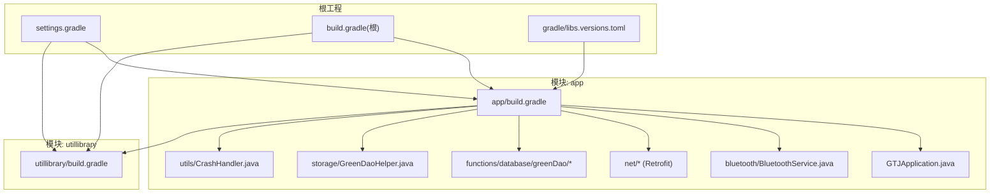
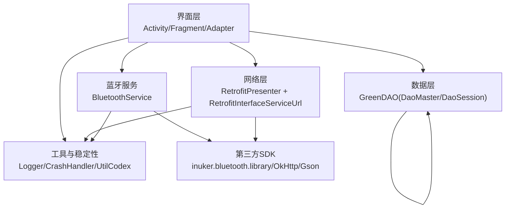
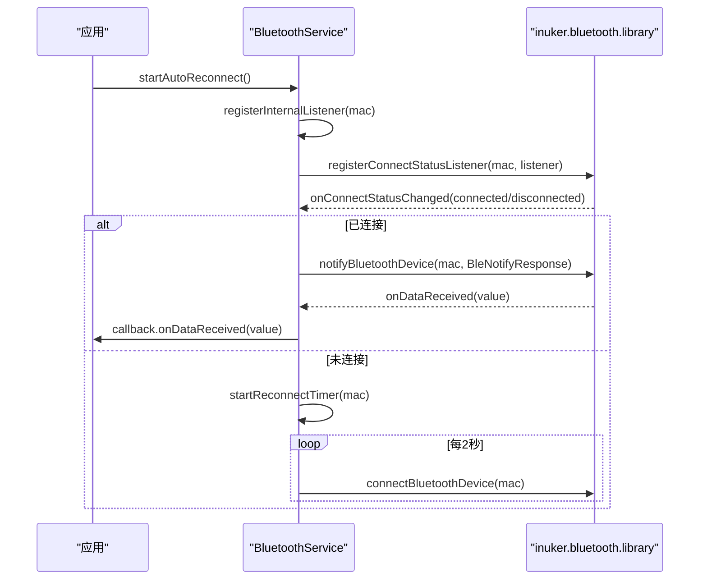
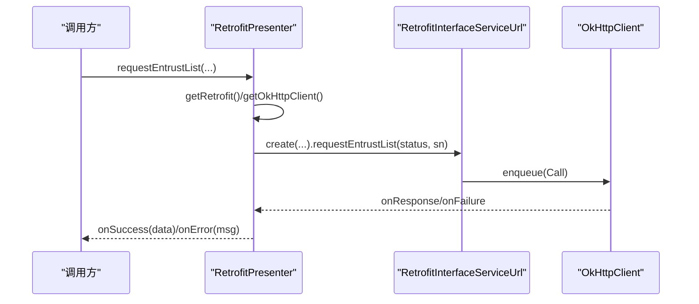
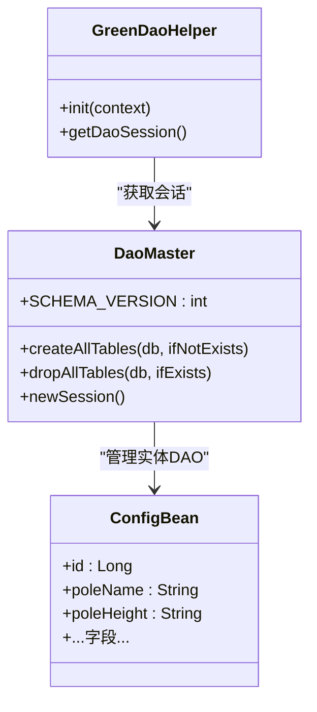
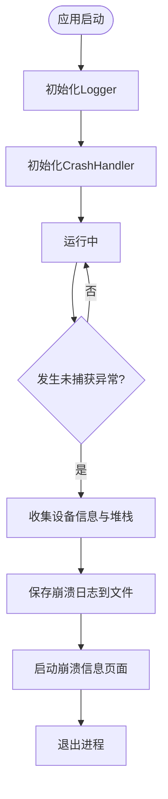
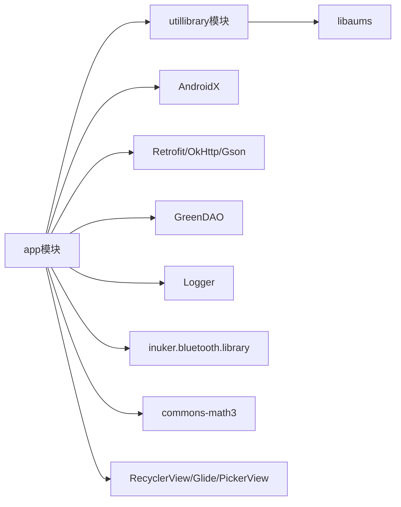

# 技术栈概览

<cite>
**本文引用的文件**
- [app/build.gradle](file://app/build.gradle)
- [build.gradle](file://build.gradle)
- [gradle/libs.versions.toml](file://gradle/libs.versions.toml)
- [settings.gradle](file://settings.gradle)
- [utillibrary/build.gradle](file://utillibrary/build.gradle)
- [GTJApplication.java](file://app/src/main/java/com/example/gtj_sd_dg240/GTJApplication.java)
- [BluetoothService.java](file://app/src/main/java/com/example/gtj_sd_dg240/bluetooth/BluetoothService.java)
- [RetrofitInterfaceServiceUrl.java](file://app/src/main/java/com/example/gtj_sd_dg240/net/RetrofitInterfaceServiceUrl.java)
- [RetrofitPresenter.java](file://app/src/main/java/com/example/gtj_sd_dg240/net/RetrofitPresenter.java)
- [DaoMaster.java](file://app/src/main/java/com/example/gtj_sd_dg240/functions/database/greenDao/db/DaoMaster.java)
- [GreenDaoHelper.java](file://app/src/main/java/com/example/gtj_sd_dg240/storage/GreenDaoHelper.java)
- [ConfigBean.java](file://app/src/main/java/com/example/gtj_sd_dg240/model/ConfigBean.java)
- [CrashHandler.java](file://app/src/main/java/com/example/gtj_sd_dg240/utils/CrashHandler.java)
</cite>

## 目录
1. [简介](#简介)
2. [项目结构](#项目结构)
3. [核心组件](#核心组件)
4. [架构总览](#架构总览)
5. [详细组件分析](#详细组件分析)
6. [依赖关系分析](#依赖关系分析)
7. [性能考量](#性能考量)
8. [故障排查指南](#故障排查指南)
9. [结论](#结论)
10. [附录](#附录)

## 简介
本技术栈概览面向GTJ-SD-DG240项目的Android应用，系统梳理了项目采用的核心技术框架与第三方库，包括：
- Android开发基础（AndroidX、ViewBinding、Java 17）
- 蓝牙通信框架（inuker.bluetooth.library）
- 数据库ORM（GreenDAO）
- 网络请求（Retrofit + OkHttp + Gson）
- 日志记录（Logger）
- 工具与UI组件（UtilCodex、RecyclerView、SmartRefreshLayout、Glide等）

文档同时说明各技术选型的原因与优势、版本兼容性、依赖管理策略，并提供架构图与数据流图，帮助初学者快速上手，也为有经验的开发者提供深入的技术细节。

## 项目结构
项目采用多模块结构：
- app：主应用模块，包含业务逻辑、界面、网络、数据库、蓝牙封装等
- utillibrary：通用工具库模块，提供USB相关能力等

构建配置要点：
- 使用Android Gradle Plugin 8.8.2
- Java 17编译目标
- 启用ViewBinding与BuildConfig
- 统一仓库源（Google、Maven Central、阿里云镜像、JitPack）
- 通过gradle/libs.versions.toml集中管理部分依赖版本

图表来源
- [settings.gradle:1-42](file://settings.gradle#L1-L42)
- [build.gradle:1-14](file://build.gradle#L1-L14)
- [gradle/libs.versions.toml:1-58](file://gradle/libs.versions.toml#L1-L58)
- [app/build.gradle:1-145](file://app/build.gradle#L1-L145)
- [utillibrary/build.gradle:1-51](file://utillibrary/build.gradle#L1-L51)

章节来源
- [settings.gradle:1-42](file://settings.gradle#L1-L42)
- [build.gradle:1-14](file://build.gradle#L1-L14)
- [gradle/libs.versions.toml:1-58](file://gradle/libs.versions.toml#L1-L58)
- [app/build.gradle:1-145](file://app/build.gradle#L1-L145)
- [utillibrary/build.gradle:1-51](file://utillibrary/build.gradle#L1-L51)

## 核心组件
- 应用初始化：在Application中统一初始化蓝牙、崩溃捕获、日志、工具类、数据库、定位服务与Toast样式
- 蓝牙通信：基于inuker.bluetooth.library封装单例服务，负责连接状态管理、自动重连、数据通知分发与写操作
- 网络层：基于Retrofit+OkHttp+Gson，定义接口、统一超时与重试、日志拦截器，封装Presenter进行异步请求
- 数据持久化：基于GreenDAO的实体与DAO生成，提供会话管理与表创建/升级
- 工具与稳定性：崩溃处理、日志输出、常用工具集、UI组件与图片加载

章节来源
- [GTJApplication.java:18-42](file://app/src/main/java/com/example/gtj_sd_dg240/GTJApplication.java#L18-L42)
- [BluetoothService.java:16-312](file://app/src/main/java/com/example/gtj_sd_dg240/bluetooth/BluetoothService.java#L16-L312)
- [RetrofitPresenter.java:25-142](file://app/src/main/java/com/example/gtj_sd_dg240/net/RetrofitPresenter.java#L25-L142)
- [DaoMaster.java:15-109](file://app/src/main/java/com/example/gtj_sd_dg240/functions/database/greenDao/db/DaoMaster.java#L15-L109)
- [GreenDaoHelper.java:10-42](file://app/src/main/java/com/example/gtj_sd_dg240/storage/GreenDaoHelper.java#L10-L42)
- [CrashHandler.java:35-208](file://app/src/main/java/com/example/gtj_sd_dg240/utils/CrashHandler.java#L35-L208)

## 架构总览
整体采用分层架构：
- 表现层：Activity/Fragment/Adapter（不在本节展开）
- 业务层：蓝牙服务、网络Presenter、数据处理工具
- 数据层：GreenDAO本地存储、网络API
- 基础设施：日志、崩溃处理、工具库、蓝牙SDK封装

图表来源
- [BluetoothService.java:16-312](file://app/src/main/java/com/example/gtj_sd_dg240/bluetooth/BluetoothService.java#L16-L312)
- [RetrofitPresenter.java:25-142](file://app/src/main/java/com/example/gtj_sd_dg240/net/RetrofitPresenter.java#L25-L142)
- [RetrofitInterfaceServiceUrl.java:16-30](file://app/src/main/java/com/example/gtj_sd_dg240/net/RetrofitInterfaceServiceUrl.java#L16-L30)
- [DaoMaster.java:15-109](file://app/src/main/java/com/example/gtj_sd_dg240/functions/database/greenDao/db/DaoMaster.java#L15-L109)
- [GreenDaoHelper.java:10-42](file://app/src/main/java/com/example/gtj_sd_dg240/storage/GreenDaoHelper.java#L10-L42)
- [CrashHandler.java:35-208](file://app/src/main/java/com/example/gtj_sd_dg240/utils/CrashHandler.java#L35-L208)

## 详细组件分析

### 蓝牙通信（inuker.bluetooth.library）
- 设计模式：单例服务统一管理连接生命周期
- 功能特性：
  - 自动重连定时器，周期性检测并尝试连接
  - 连接状态监听与数据回调分发（线程安全集合）
  - 读写操作封装，避免重复注册通知
- 关键流程：
  - 启动自动重连 -> 注册内部连接状态监听 -> 已连接则注册数据通知 -> 定时任务轮询
  - 断开时取消通知并通知所有监听器
  - 写数据前校验MAC地址有效性

图表来源
- [BluetoothService.java:76-234](file://app/src/main/java/com/example/gtj_sd_dg240/bluetooth/BluetoothService.java#L76-L234)
- [BluetoothService.java:172-198](file://app/src/main/java/com/example/gtj_sd_dg240/bluetooth/BluetoothService.java#L172-L198)

章节来源
- [BluetoothService.java:16-312](file://app/src/main/java/com/example/gtj_sd_dg240/bluetooth/BluetoothService.java#L16-L312)

### 网络请求（Retrofit + OkHttp + Gson）
- 接口定义：使用注解声明HTTP方法与路径，支持Query参数与Headers
- 客户端配置：
  - 统一设置读写与连接超时
  - 添加日志拦截器打印请求响应体
  - 自定义重试拦截器（次数与间隔）
  - 开启连接失败重试
- Presenter封装：
  - 统一错误处理与消息转换
  - 回调式结果返回，便于上层解耦

图表来源
- [RetrofitPresenter.java:31-52](file://app/src/main/java/com/example/gtj_sd_dg240/net/RetrofitPresenter.java#L31-L52)
- [RetrofitPresenter.java:61-86](file://app/src/main/java/com/example/gtj_sd_dg240/net/RetrofitPresenter.java#L61-L86)
- [RetrofitInterfaceServiceUrl.java:16-30](file://app/src/main/java/com/example/gtj_sd_dg240/net/RetrofitInterfaceServiceUrl.java#L16-L30)

章节来源
- [RetrofitPresenter.java:25-142](file://app/src/main/java/com/example/gtj_sd_dg240/net/RetrofitPresenter.java#L25-L142)
- [RetrofitInterfaceServiceUrl.java:16-30](file://app/src/main/java/com/example/gtj_sd_dg240/net/RetrofitInterfaceServiceUrl.java#L16-L30)

### 数据库ORM（GreenDAO）
- 实体模型：使用注解标注@Entity、@Id、@Unique、@Transient等
- DAO生成：通过Gradle插件自动生成DaoMaster、DaoSession与各实体DAO
- 会话管理：通过GreenDaoHelper懒加载DaoMaster与DaoSession，避免重复创建
- 表管理：提供createAllTables/dropAllTables用于开发与测试

图表来源
- [DaoMaster.java:15-109](file://app/src/main/java/com/example/gtj_sd_dg240/functions/database/greenDao/db/DaoMaster.java#L15-L109)
- [GreenDaoHelper.java:10-42](file://app/src/main/java/com/example/gtj_sd_dg240/storage/GreenDaoHelper.java#L10-L42)
- [ConfigBean.java:13-151](file://app/src/main/java/com/example/gtj_sd_dg240/model/ConfigBean.java#L13-L151)

章节来源
- [DaoMaster.java:15-109](file://app/src/main/java/com/example/gtj_sd_dg240/functions/database/greenDao/db/DaoMaster.java#L15-L109)
- [GreenDaoHelper.java:10-42](file://app/src/main/java/com/example/gtj_sd_dg240/storage/GreenDaoHelper.java#L10-L42)
- [ConfigBean.java:13-151](file://app/src/main/java/com/example/gtj_sd_dg240/model/ConfigBean.java#L13-L151)

### 日志与崩溃处理
- 日志：使用Logger配合PrettyFormatStrategy，统一格式化输出
- 崩溃处理：全局UncaughtException捕获，收集设备信息、保存堆栈到文件、跳转至崩溃信息页面

图表来源
- [GTJApplication.java:20-42](file://app/src/main/java/com/example/gtj_sd_dg240/GTJApplication.java#L20-L42)
- [CrashHandler.java:74-100](file://app/src/main/java/com/example/gtj_sd_dg240/utils/CrashHandler.java#L74-L100)
- [CrashHandler.java:156-206](file://app/src/main/java/com/example/gtj_sd_dg240/utils/CrashHandler.java#L156-L206)

章节来源
- [GTJApplication.java:20-42](file://app/src/main/java/com/example/gtj_sd_dg240/GTJApplication.java#L20-L42)
- [CrashHandler.java:35-208](file://app/src/main/java/com/example/gtj_sd_dg240/utils/CrashHandler.java#L35-L208)

## 依赖关系分析
- 构建与插件：
  - Android Gradle Plugin 8.8.2
  - GreenDAO Gradle插件 3.3.1
- 核心依赖：
  - AndroidX：appcompat、constraintlayout、recyclerview
  - 网络：okhttp 4.12.0、retrofit 2.9.0、converter-gson 2.9.0、logging-interceptor 4.12.0
  - 数据库：greendao 3.3.0、GreenDaoUpgradeHelper v2.2.1
  - 工具：utilcodex 1.31.1、logger 2.2.0、commons-codec 1.18.0
  - UI：BaseRecyclerViewAdapterHelper 2.9.50、SmartRefreshLayout 1.1.3、Glide 4.16.0、Android-PickerView 4.1.9
  - 事件总线：eventbus 3.3.1
  - 数学计算：commons-math3 3.6.1
  - 蓝牙：inuker.bluetooth.library（通过libs引入）
  - USB：libaums 0.7.4（在utillibrary模块）
- 版本管理策略：
  - 根级gradle/libs.versions.toml集中声明部分依赖版本
  - app模块直接声明具体版本，保证与现有代码兼容
  - 多仓库源（Google、Maven Central、阿里云、JitPack）提升下载稳定性

图表来源
- [app/build.gradle:86-144](file://app/build.gradle#L86-L144)
- [utillibrary/build.gradle:43-51](file://utillibrary/build.gradle#L43-L51)
- [gradle/libs.versions.toml:27-53](file://gradle/libs.versions.toml#L27-L53)

章节来源
- [app/build.gradle:86-144](file://app/build.gradle#L86-L144)
- [utillibrary/build.gradle:43-51](file://utillibrary/build.gradle#L43-L51)
- [gradle/libs.versions.toml:27-53](file://gradle/libs.versions.toml#L27-L53)

## 性能考量
- 网络层：
  - 合理设置读写与连接超时，避免长时间阻塞
  - 使用日志拦截器仅在调试阶段开启BODY级别日志，生产环境建议降级为BASIC或关闭
  - 重试机制需结合业务幂等性，避免重复提交
- 蓝牙层：
  - 自动重连间隔适中（当前2秒），可根据设备特性调整
  - 数据通知注册与注销成对出现，避免内存泄漏与资源浪费
- 数据库层：
  - 使用GreenDAO生成的DAO进行批量操作，减少Cursor开销
  - 按需开启事务，降低锁竞争
- 内存与UI：
  - Glide缓存图片，注意占位图与缩放策略
  - RecyclerView使用高效适配器，减少ViewHolder重建

[本节为通用指导，不直接分析具体文件]

## 故障排查指南
- 蓝牙连接问题：
  - 检查MAC地址是否有效且已保存
  - 确认自动重连是否启用，查看连接状态回调
  - 核对UUID与服务特征值是否与设备一致
- 网络请求失败：
  - 检查baseUrl与接口路径是否正确
  - 查看OkHttp日志拦截器输出，确认请求头与参数
  - 关注重试拦截器配置与服务器响应码
- 数据库异常：
  - 确认schema版本与实体变更是否匹配
  - 使用DevOpenHelper在开发环境重建表结构
- 崩溃日志：
  - 查看崩溃文件路径与内容，定位异常堆栈
  - 结合设备信息与版本号复现问题

章节来源
- [BluetoothService.java:76-234](file://app/src/main/java/com/example/gtj_sd_dg240/bluetooth/BluetoothService.java#L76-L234)
- [RetrofitPresenter.java:38-52](file://app/src/main/java/com/example/gtj_sd_dg240/net/RetrofitPresenter.java#L38-L52)
- [DaoMaster.java:74-105](file://app/src/main/java/com/example/gtj_sd_dg240/functions/database/greenDao/db/DaoMaster.java#L74-L105)
- [CrashHandler.java:156-206](file://app/src/main/java/com/example/gtj_sd_dg240/utils/CrashHandler.java#L156-L206)

## 结论
本项目以AndroidX为基础，结合inuker.bluetooth.library实现稳定的蓝牙通信；使用GreenDAO进行高效本地数据存储；通过Retrofit+OkHttp+Gson构建健壮的网络层；借助Logger与CrashHandler提升可观测性与稳定性。模块化设计将通用能力抽离至utillibrary，便于复用与维护。建议在后续迭代中：
- 统一依赖版本管理，逐步迁移至libs.versions.toml
- 优化网络日志级别与重试策略
- 完善蓝牙设备协议适配与错误恢复
- 持续监控崩溃率与性能指标

[本节为总结性内容，不直接分析具体文件]

## 附录
- 构建配置要点：
  - compileSdk/targetSdk 35，minSdk 26
  - Java 17编译目标
  - ViewBinding与BuildConfig启用
  - ProGuard规则与签名配置
- 仓库源：
  - Google、Maven Central、阿里云镜像、JitPack
- 模块依赖：
  - app依赖utillibrary，提供USB能力

章节来源
- [app/build.gradle:7-77](file://app/build.gradle#L7-L77)
- [settings.gradle:1-42](file://settings.gradle#L1-L42)