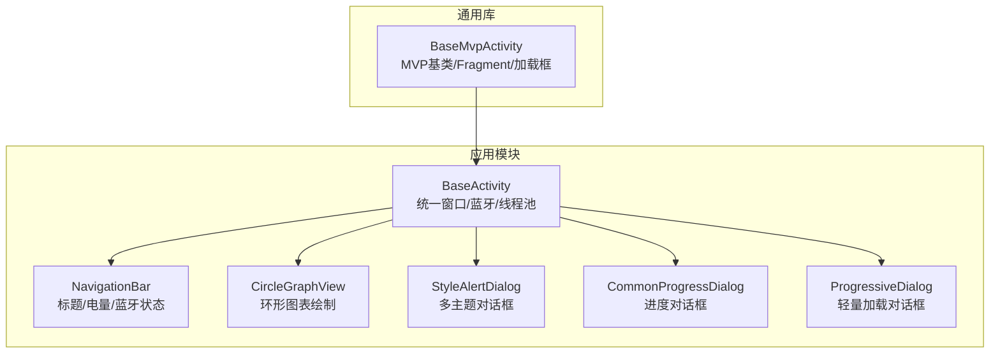
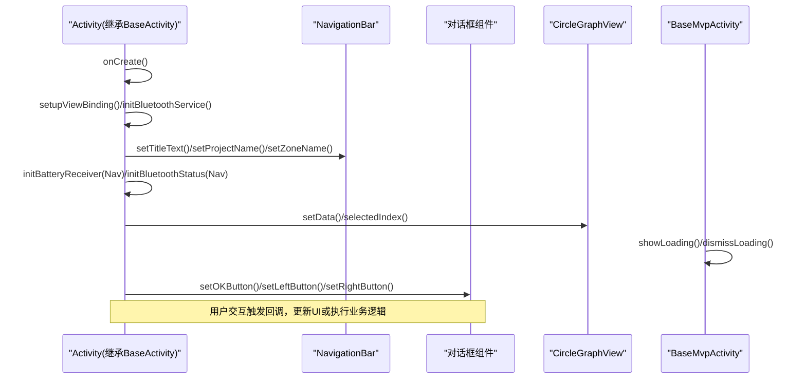
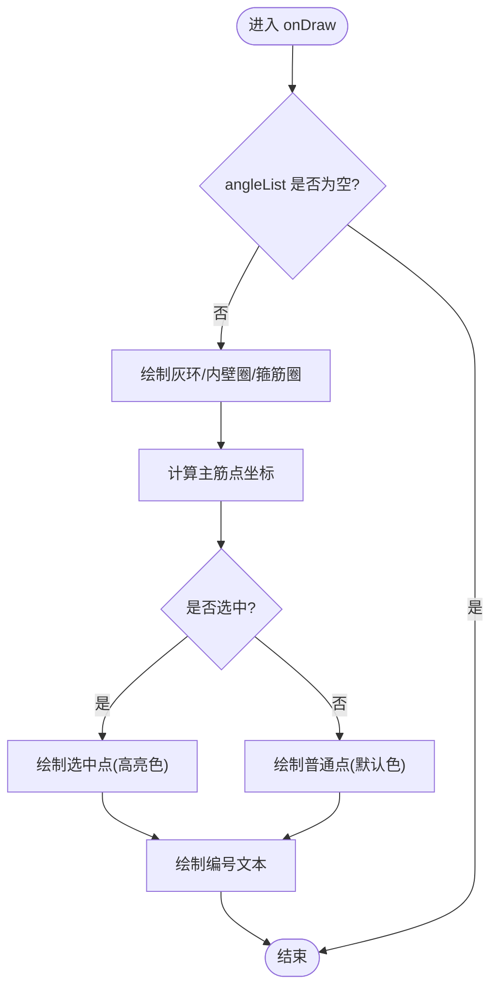
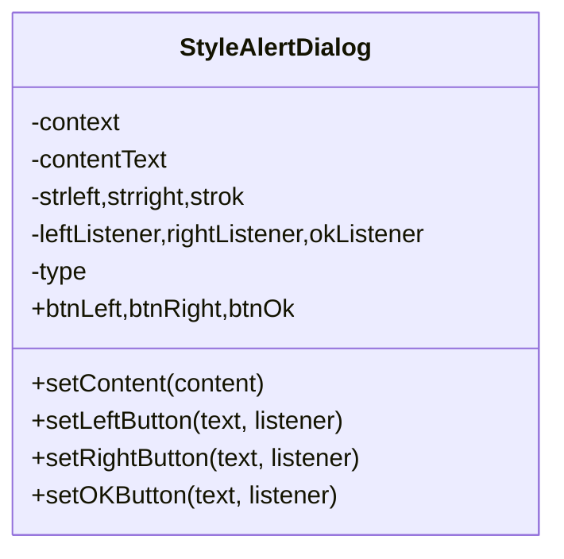
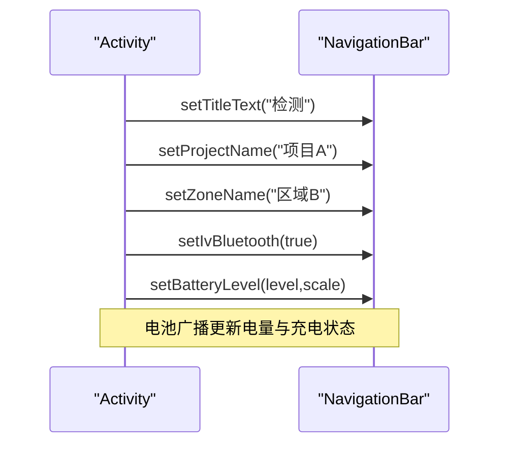
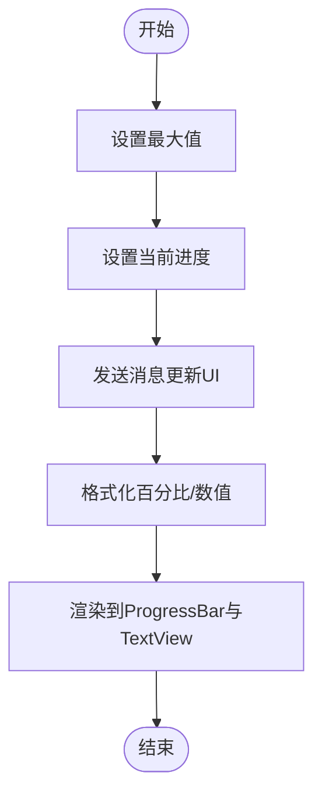
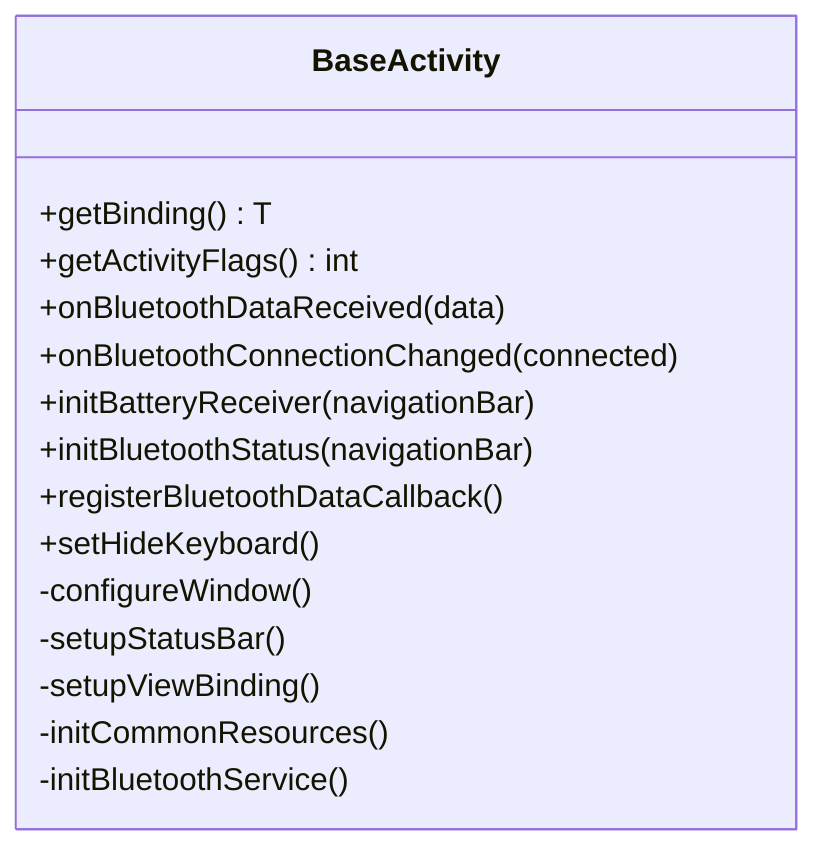
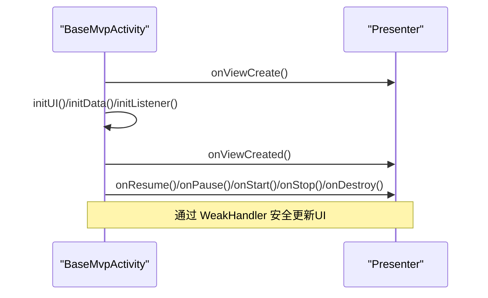
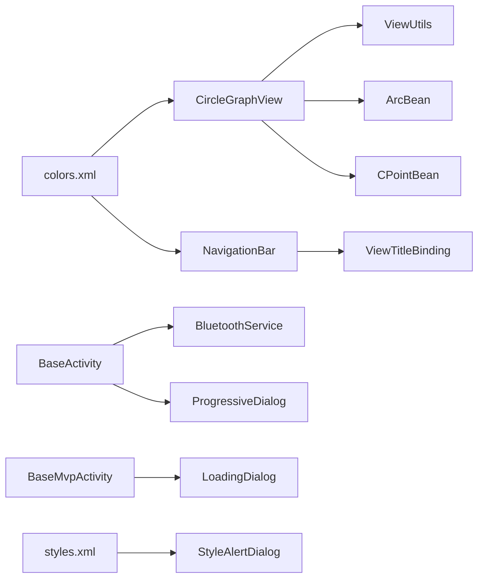

# UI组件

<cite>
**本文引用的文件**
- [CircleGraphView.java](file://app/src/main/java/com/example/gtj_sd_dg240/view/CircleGraphView.java)
- [StyleAlertDialog.java](file://app/src/main/java/com/example/gtj_sd_dg240/view/StyleAlertDialog.java)
- [NavigationBar.java](file://app/src/main/java/com/example/gtj_sd_dg240/view/NavigationBar.java)
- [BaseActivity.java](file://app/src/main/java/com/example/gtj_sd_dg240/activity/start/BaseActivity.java)
- [BaseMvpActivity.java](file://utillibrary/src/main/java/com/blackhao/utillibrary/mvp/BaseMvpActivity.java)
- [CommonProgressDialog.java](file://app/src/main/java/com/example/gtj_sd_dg240/view/CommonProgressDialog.java)
- [ProgressiveDialog.java](file://app/src/main/java/com/example/gtj_sd_dg240/view/ProgressiveDialog.java)
- [ViewUtils.java](file://app/src/main/java/com/example/gtj_sd_dg240/utils/ViewUtils.java)
- [ArcBean.java](file://app/src/main/java/com/example/gtj_sd_dg240/model/ArcBean.java)
- [CPointBean.java](file://app/src/main/java/com/example/gtj_sd_dg240/model/CPointBean.java)
- [styles.xml](file://app/src/main/res/values/styles.xml)
- [colors.xml](file://app/src/main/res/values/colors.xml)
- [view_title.xml](file://app/src/main/res/layout/view_title.xml)
- [common_progress_dialog.xml](file://app/src/main/res/layout/common_progress_dialog.xml)
</cite>

## 目录
1. [简介](#简介)
2. [项目结构](#项目结构)
3. [核心组件](#核心组件)
4. [架构总览](#架构总览)
5. [详细组件分析](#详细组件分析)
6. [依赖关系分析](#依赖关系分析)
7. [性能考虑](#性能考虑)
8. [故障排查指南](#故障排查指南)
9. [结论](#结论)
10. [附录](#附录)

## 简介
本文件为 GTJ-SD-DG240 应用的 UI 组件库提供系统化文档，覆盖自定义 View（CircleGraphView）、对话框（StyleAlertDialog、CommonProgressDialog、ProgressiveDialog）、导航栏（NavigationBar）等核心组件的设计与实现。文档同时阐述 MVP 在 UI 层的应用模式（BaseActivity、BaseMvpActivity），说明数据绑定、状态管理、主题适配、事件处理与动画效果，并提供复用策略、国际化支持、性能优化与扩展定制指南。

## 项目结构
- 视图层：位于 app/src/main/java/com/example/gtj_sd_dg240/view，包含图表、对话框、导航栏等自定义控件。
- 基类与框架：activity.start.BaseActivity 提供统一的窗口、状态栏、蓝牙、线程池、进度提示等能力；utillibrary.mvp.BaseMvpActivity 提供 MVP 基础 Activity 能力（Presenter 生命周期、Fragment 管理、加载框、Toast、状态栏模式）。
- 资源层：res/values 定义主题与颜色；res/layout 提供布局；res/drawable 提供样式背景。
- 模型与工具：model 包承载绘图数据（ArcBean、CPointBean）；utils.ViewUtils 提供几何计算与截图工具。

**图示来源**
- [BaseActivity.java:91-198](file://app/src/main/java/com/example/gtj_sd_dg240/activity/start/BaseActivity.java#L91-L198)
- [NavigationBar.java:32-71](file://app/src/main/java/com/example/gtj_sd_dg240/view/NavigationBar.java#L32-L71)
- [CircleGraphView.java:30-89](file://app/src/main/java/com/example/gtj_sd_dg240/view/CircleGraphView.java#L30-L89)
- [StyleAlertDialog.java:25-83](file://app/src/main/java/com/example/gtj_sd_dg240/view/StyleAlertDialog.java#L25-L83)
- [CommonProgressDialog.java:37-89](file://app/src/main/java/com/example/gtj_sd_dg240/view/CommonProgressDialog.java#L37-L89)
- [ProgressiveDialog.java:12-36](file://app/src/main/java/com/example/gtj_sd_dg240/view/ProgressiveDialog.java#L12-L36)
- [BaseMvpActivity.java:63-103](file://utillibrary/src/main/java/com/blackhao/utillibrary/mvp/BaseMvpActivity.java#L63-L103)

**章节来源**
- [BaseActivity.java:91-198](file://app/src/main/java/com/example/gtj_sd_dg240/activity/start/BaseActivity.java#L91-L198)
- [BaseMvpActivity.java:63-103](file://utillibrary/src/main/java/com/blackhao/utillibrary/mvp/BaseMvpActivity.java#L63-L103)

## 核心组件
- CircleGraphView：基于 Canvas 的环形图表，展示主筋位置与编号，支持选中高亮与动态刷新。
- StyleAlertDialog：可配置主题色（蓝/黄/红）与按钮组合的对话框，支持内容文本与回调。
- NavigationBar：可复用的顶部导航栏，支持标题、项目名、区域名、蓝牙图标、电池电量可视化。
- CommonProgressDialog：带消息、百分比、数值格式的进度对话框。
- ProgressiveDialog：轻量级加载对话框，支持设置内容文本。
- BaseActivity：封装全屏、状态栏适配、ViewBinding、蓝牙自动重连、电池监听、线程池与UI线程Handler。
- BaseMvpActivity：封装MVP生命周期、Fragment替换、加载框、Toast、状态栏模式与弱引用Handler。

**章节来源**
- [CircleGraphView.java:21-127](file://app/src/main/java/com/example/gtj_sd_dg240/view/CircleGraphView.java#L21-L127)
- [StyleAlertDialog.java:15-107](file://app/src/main/java/com/example/gtj_sd_dg240/view/StyleAlertDialog.java#L15-L107)
- [NavigationBar.java:14-116](file://app/src/main/java/com/example/gtj_sd_dg240/view/NavigationBar.java#L14-L116)
- [CommonProgressDialog.java:24-153](file://app/src/main/java/com/example/gtj_sd_dg240/view/CommonProgressDialog.java#L24-L153)
- [ProgressiveDialog.java:12-43](file://app/src/main/java/com/example/gtj_sd_dg240/view/ProgressiveDialog.java#L12-L43)
- [BaseActivity.java:44-335](file://app/src/main/java/com/example/gtj_sd_dg240/activity/start/BaseActivity.java#L44-L335)
- [BaseMvpActivity.java:31-444](file://utillibrary/src/main/java/com/blackhao/utillibrary/mvp/BaseMvpActivity.java#L31-L444)

## 架构总览
- UI 层由 BaseActivity 统一入口，集成 ViewBinding、蓝牙服务、电池监听、线程池与UI线程Handler。
- 业务交互通过 BaseMvpActivity 组织 Presenter 生命周期，配合 Fragment 与加载框进行页面切换与反馈。
- 自定义组件（NavigationBar、CircleGraphView、对话框）作为可复用单元，通过属性方法暴露配置接口。

**图示来源**
- [BaseActivity.java:91-198](file://app/src/main/java/com/example/gtj_sd_dg240/activity/start/BaseActivity.java#L91-L198)
- [NavigationBar.java:73-116](file://app/src/main/java/com/example/gtj_sd_dg240/view/NavigationBar.java#L73-L116)
- [CircleGraphView.java:56-89](file://app/src/main/java/com/example/gtj_sd_dg240/view/CircleGraphView.java#L56-L89)
- [BaseMvpActivity.java:180-244](file://utillibrary/src/main/java/com/blackhao/utillibrary/mvp/BaseMvpActivity.java#L180-L244)
- [StyleAlertDialog.java:85-107](file://app/src/main/java/com/example/gtj_sd_dg240/view/StyleAlertDialog.java#L85-L107)

## 详细组件分析

### CircleGraphView 环形图表
- 设计目标：以环形图展示钢筋分布，标注编号并支持选中高亮。
- 关键特性
  - 数据驱动：setData(size) 初始化角度列表与单位角度，invalidate 触发重绘。
  - 选中态：selectedIndex(index) 标记选中项并刷新。
  - 绘制流程：onLayout 计算中心点与半径；onDraw 绘制灰环、内壁圈、箍筋圈、主筋点与编号。
  - 几何计算：使用 ViewUtils.getCircleArcPoint 将角度转换为坐标。
- 复杂度分析
  - 时间复杂度：绘制 O(n)，n 为主筋数量。
  - 空间复杂度：O(n)，存储 ArcBean 列表。
- 性能建议
  - 避免频繁创建 Paint 对象（已在 initView 中复用）。
  - 大数据量时减少 invalidate 频率，批量更新后统一刷新。
- 主题适配
  - 颜色从 resources 读取，便于全局主题切换。

**图示来源**
- [CircleGraphView.java:86-127](file://app/src/main/java/com/example/gtj_sd_dg240/view/CircleGraphView.java#L86-L127)
- [ViewUtils.java:20-41](file://app/src/main/java/com/example/gtj_sd_dg240/utils/ViewUtils.java#L20-L41)

**章节来源**
- [CircleGraphView.java:21-127](file://app/src/main/java/com/example/gtj_sd_dg240/view/CircleGraphView.java#L21-L127)
- [ViewUtils.java:12-59](file://app/src/main/java/com/example/gtj_sd_dg240/utils/ViewUtils.java#L12-L59)
- [ArcBean.java:1-13](file://app/src/main/java/com/example/gtj_sd_dg240/model/ArcBean.java#L1-L13)
- [CPointBean.java:1-20](file://app/src/main/java/com/example/gtj_sd_dg240/model/CPointBean.java#L1-L20)
- [colors.xml:1-32](file://app/src/main/res/values/colors.xml#L1-L32)

### StyleAlertDialog 主题对话框
- 设计目标：提供可配置主题与按钮组合的对话框，用于确认、提示等操作。
- 关键特性
  - 主题类型：blue/yellow/red，分别设置内容与按钮背景色。
  - 按钮配置：支持 OK、左按钮、右按钮，按需显示与设置点击回调。
  - 内容设置：setContent 设置提示文本。
- 事件处理：通过 setXxxButton 传入 OnClickListener，解耦 UI 与业务逻辑。
- 主题适配：样式来自 styles.xml 的 StyleAlertDialog，背景使用圆角 drawable。

**图示来源**
- [StyleAlertDialog.java:15-107](file://app/src/main/java/com/example/gtj_sd_dg240/view/StyleAlertDialog.java#L15-L107)
- [styles.xml:27-33](file://app/src/main/res/values/styles.xml#L27-L33)

**章节来源**
- [StyleAlertDialog.java:15-107](file://app/src/main/java/com/example/gtj_sd_dg240/view/StyleAlertDialog.java#L15-L107)
- [styles.xml:1-43](file://app/src/main/res/values/styles.xml#L1-L43)

### NavigationBar 导航栏
- 设计目标：统一顶部导航区域，支持品牌 Logo、标题、项目/区域信息、蓝牙状态与电池电量可视化。
- 关键特性
  - 品牌切换：依据 StaticConstant.APP_DEFAULT 显示不同 Logo。
  - 信息展示：setTitleText、setProjectName、setZoneName 控制标题与上下文信息。
  - 设备状态：setIvBluetooth 显示蓝牙连接状态；setivBattery/setBatteryLevel 显示充电状态与电量条。
- 布局绑定：通过 ViewTitleBinding 绑定 view_title.xml 中的元素。

**图示来源**
- [NavigationBar.java:32-116](file://app/src/main/java/com/example/gtj_sd_dg240/view/NavigationBar.java#L32-L116)
- [view_title.xml:1-200](file://app/src/main/res/layout/view_title.xml#L1-L200)

**章节来源**
- [NavigationBar.java:14-116](file://app/src/main/java/com/example/gtj_sd_dg240/view/NavigationBar.java#L14-L116)
- [view_title.xml:1-200](file://app/src/main/res/layout/view_title.xml#L1-L200)

### CommonProgressDialog 进度对话框
- 设计目标：展示下载/处理进度，支持消息、百分比与数值格式化。
- 关键特性
  - 进度更新：setProgress/max 触发 Handler 更新 UI。
  - 格式支持：NumberFormat 百分比格式化；自定义数字格式字符串。
  - 消息显示：setMessage 设置提示文本。
- 生命周期：onStart/onStop 控制进度更新时机。

**图示来源**
- [CommonProgressDialog.java:37-153](file://app/src/main/java/com/example/gtj_sd_dg240/view/CommonProgressDialog.java#L37-L153)
- [common_progress_dialog.xml:1-61](file://app/src/main/res/layout/common_progress_dialog.xml#L1-L61)

**章节来源**
- [CommonProgressDialog.java:24-153](file://app/src/main/java/com/example/gtj_sd_dg240/view/CommonProgressDialog.java#L24-L153)
- [common_progress_dialog.xml:1-61](file://app/src/main/res/layout/common_progress_dialog.xml#L1-L61)

### ProgressiveDialog 轻量加载对话框
- 设计目标：简洁的加载提示，支持设置内容文本。
- 关键特性
  - 样式：ProgressiveDialog 主题透明无遮罩。
  - 显示：show 时根据 contentString 设置文本。

**章节来源**
- [ProgressiveDialog.java:12-43](file://app/src/main/java/com/example/gtj_sd_dg240/view/ProgressiveDialog.java#L12-L43)
- [styles.xml:16-25](file://app/src/main/res/values/styles.xml#L16-L25)

### BaseActivity 统一基类
- 设计目标：统一窗口、状态栏、蓝牙、电池、线程池与UI线程管理。
- 关键特性
  - 窗口配置：全屏、隐藏虚拟按键、保持常亮、密度适配。
  - 状态栏适配：WindowInsets 动态调整 padding，添加状态栏背景。
  - ViewBinding：抽象 getBinding 返回绑定实例。
  - 蓝牙：自动重连、连接状态监听、数据回调注册。
  - 电池：注册广播更新导航栏电量与充电状态。
  - 线程与UI：ExecutorService 线程池、MainLooper Handler。
  - 键盘：可选隐藏软键盘。

**图示来源**
- [BaseActivity.java:44-335](file://app/src/main/java/com/example/gtj_sd_dg240/activity/start/BaseActivity.java#L44-L335)

**章节来源**
- [BaseActivity.java:44-335](file://app/src/main/java/com/example/gtj_sd_dg240/activity/start/BaseActivity.java#L44-L335)

### BaseMvpActivity MVP 基类
- 设计目标：提供 MVP 模式的 Activity 基类，封装 Presenter 生命周期、Fragment 管理、加载框与 Toast。
- 关键特性
  - 生命周期：onCreate/onResume/onPause/onStart/onStop/onDestroy 调用对应 Presenter 方法。
  - 加载框：showLoading/dismissLoading 安全显示与关闭。
  - Fragment：replaceFragment 支持过渡动画与返回栈。
  - 跳转：openActivity/openActivityForResult。
  - 状态栏：translucentStatus/hideStatusBar 与 FULL_SCREEN_STATUS。
  - 线程：WeakHandler 避免内存泄漏。

**图示来源**
- [BaseMvpActivity.java:63-103](file://utillibrary/src/main/java/com/blackhao/utillibrary/mvp/BaseMvpActivity.java#L63-L103)
- [BaseMvpActivity.java:339-372](file://utillibrary/src/main/java/com/blackhao/utillibrary/mvp/BaseMvpActivity.java#L339-L372)
- [BaseMvpActivity.java:423-444](file://utillibrary/src/main/java/com/blackhao/utillibrary/mvp/BaseMvpActivity.java#L423-L444)

**章节来源**
- [BaseMvpActivity.java:31-444](file://utillibrary/src/main/java/com/blackhao/utillibrary/mvp/BaseMvpActivity.java#L31-L444)

## 依赖关系分析
- CircleGraphView 依赖 ViewUtils 进行几何计算，依赖 model.ArcBean/CPointBean 承载数据。
- NavigationBar 依赖 ViewTitleBinding 与 StaticConstant 控制显示逻辑。
- BaseActivity 依赖 BluetoothService、ProgressiveDialog、CustomDensityUtils、OtherUtils。
- BaseMvpActivity 依赖 LoadingDialog、LogHelper、FragmentTransaction。
- 样式与颜色资源被多个组件共享，确保主题一致性。

**图示来源**
- [CircleGraphView.java:10-14](file://app/src/main/java/com/example/gtj_sd_dg240/view/CircleGraphView.java#L10-L14)
- [NavigationBar.java:11-13](file://app/src/main/java/com/example/gtj_sd_dg240/view/NavigationBar.java#L11-L13)
- [BaseActivity.java:26-36](file://app/src/main/java/com/example/gtj_sd_dg240/activity/start/BaseActivity.java#L26-L36)
- [BaseMvpActivity.java:14-16](file://utillibrary/src/main/java/com/blackhao/utillibrary/mvp/BaseMvpActivity.java#L14-L16)
- [styles.xml:27-33](file://app/src/main/res/values/styles.xml#L27-L33)
- [colors.xml:1-32](file://app/src/main/res/values/colors.xml#L1-L32)

**章节来源**
- [CircleGraphView.java:10-14](file://app/src/main/java/com/example/gtj_sd_dg240/view/CircleGraphView.java#L10-L14)
- [NavigationBar.java:11-13](file://app/src/main/java/com/example/gtj_sd_dg240/view/NavigationBar.java#L11-L13)
- [BaseActivity.java:26-36](file://app/src/main/java/com/example/gtj_sd_dg240/activity/start/BaseActivity.java#L26-L36)
- [BaseMvpActivity.java:14-16](file://utillibrary/src/main/java/com/blackhao/utillibrary/mvp/BaseMvpActivity.java#L14-L16)
- [styles.xml:27-33](file://app/src/main/res/values/styles.xml#L27-L33)
- [colors.xml:1-32](file://app/src/main/res/values/colors.xml#L1-L32)

## 性能考虑
- 视图缓存与绘制优化
  - CircleGraphView 复用 Paint 对象，减少分配；仅对必要区域调用 invalidate。
  - 大量数据时合并更新，降低重绘次数。
- 内存管理
  - BaseActivity 在 onDestroy 中注销广播、蓝牙监听器并关闭线程池，防止泄漏。
  - BaseMvpActivity 使用 WeakHandler 避免持有 Activity 引用导致泄漏。
- 渲染优化
  - 使用 WindowInsets 精确控制状态栏高度，避免重复测量。
  - 对话框与进度条使用最小化布局与可见性控制，减少无效绘制。
- I/O 与网络
  - 结合 BaseMvpActivity 的加载框与线程池，避免阻塞 UI 线程。
- 主题与资源
  - 颜色与样式集中管理，减少运行时解析成本。

[本节为通用指导，不直接分析具体文件]

## 故障排查指南
- 图表不显示
  - 检查 setData 是否调用且 size > 0；确认 angleList 非空后再绘制。
  - 参考路径：[CircleGraphView.java:56-89](file://app/src/main/java/com/example/gtj_sd_dg240/view/CircleGraphView.java#L56-L89)
- 对话框按钮无响应
  - 确认 setXxxButton 已设置监听器；检查 type 主题分支是否正确。
  - 参考路径：[StyleAlertDialog.java:44-83](file://app/src/main/java/com/example/gtj_sd_dg240/view/StyleAlertDialog.java#L44-L83)
- 导航栏电量不更新
  - 确认已调用 initBatteryReceiver 并注册广播；检查 setBatteryLevel 参数。
  - 参考路径：[BaseActivity.java:221-238](file://app/src/main/java/com/example/gtj_sd_dg240/activity/start/BaseActivity.java#L221-L238)
- 蓝牙状态不一致
  - 检查 initBluetoothStatus 是否注册监听器；确认 MAC 与连接状态。
  - 参考路径：[BaseActivity.java:244-266](file://app/src/main/java/com/example/gtj_sd_dg240/activity/start/BaseActivity.java#L244-L266)
- 进度对话框卡死
  - 确保在主线程更新 UI；检查 setProgress 与 max 的设置顺序。
  - 参考路径：[CommonProgressDialog.java:108-130](file://app/src/main/java/com/example/gtj_sd_dg240/view/CommonProgressDialog.java#L108-L130)

**章节来源**
- [CircleGraphView.java:56-89](file://app/src/main/java/com/example/gtj_sd_dg240/view/CircleGraphView.java#L56-L89)
- [StyleAlertDialog.java:44-83](file://app/src/main/java/com/example/gtj_sd_dg240/view/StyleAlertDialog.java#L44-L83)
- [BaseActivity.java:221-266](file://app/src/main/java/com/example/gtj_sd_dg240/activity/start/BaseActivity.java#L221-L266)
- [CommonProgressDialog.java:108-130](file://app/src/main/java/com/example/gtj_sd_dg240/view/CommonProgressDialog.java#L108-L130)

## 结论
本 UI 组件库围绕 BaseActivity 与 BaseMvpActivity 构建，提供一致的窗口、蓝牙、电池与 MVP 生命周期管理能力；自定义组件（CircleGraphView、StyleAlertDialog、NavigationBar、进度对话框）具备高内聚、低耦合的特性，便于复用与扩展。通过资源集中管理与合理的性能优化策略，可在不同设备上保持一致的主题与流畅体验。建议在新增页面时优先复用这些组件，并通过属性方法与回调机制完成定制。

[本节为总结，不直接分析具体文件]

## 附录
- 组件复用策略
  - 通过属性方法暴露配置（如 setTitleText、setData、setContent），避免子类重写内部逻辑。
  - 使用 ViewBinding 简化视图查找与类型安全访问。
- 样式定制
  - 在 styles.xml 中定义主题，colors.xml 中集中管理颜色，便于全局切换。
- 国际化支持
  - 文本建议使用 strings.xml 管理；当前组件中部分硬编码文本可迁移至资源文件以提升可维护性。
- 在不同 Activity 中使用组件
  - 继承 BaseActivity 获取统一能力；在 onCreate 中设置 NavigationBar、注册电池与蓝牙监听。
  - 使用 BaseMvpActivity 组织 Presenter，调用 showLoading/dismissLoading 提供反馈。
  - 在需要时引入 CircleGraphView 与对话框组件，通过其 API 进行数据绑定与事件处理。

[本节为通用指导，不直接分析具体文件]