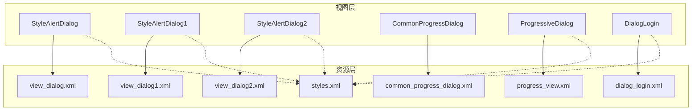
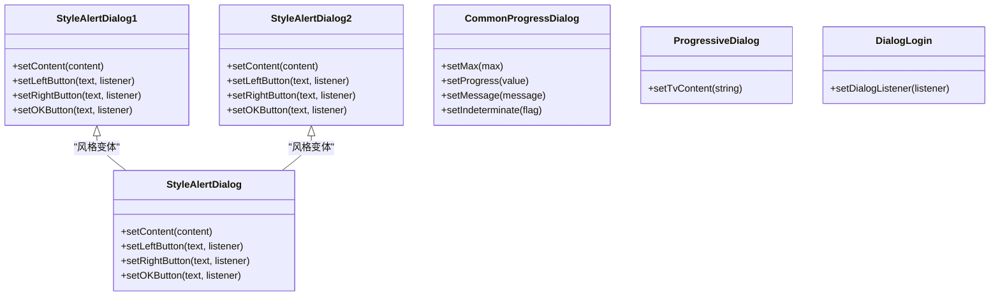
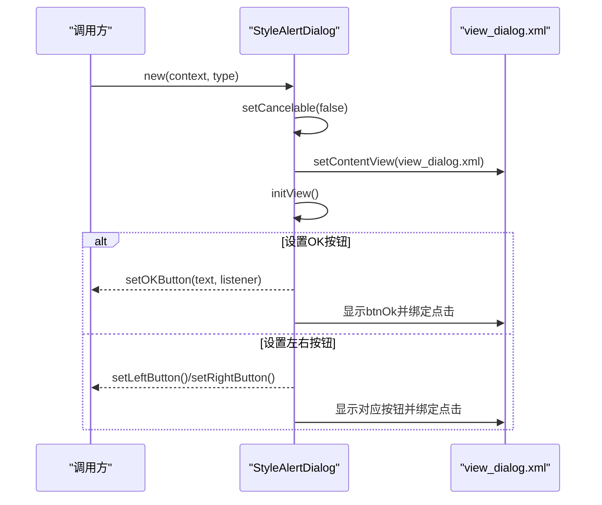
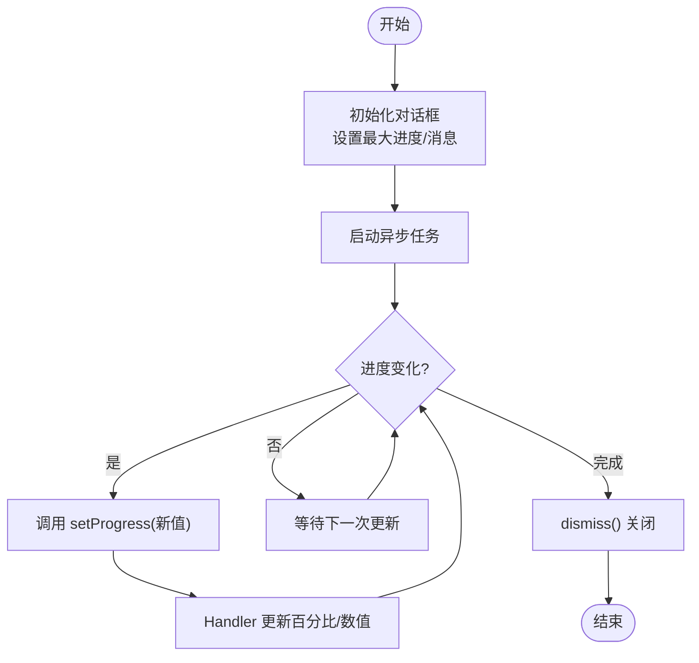
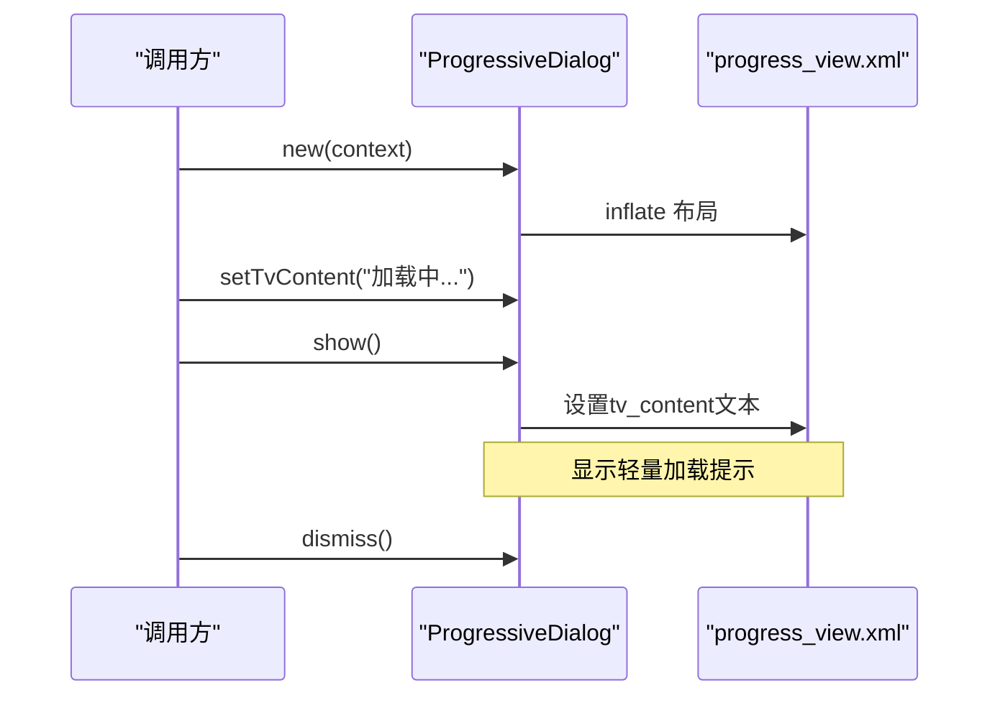
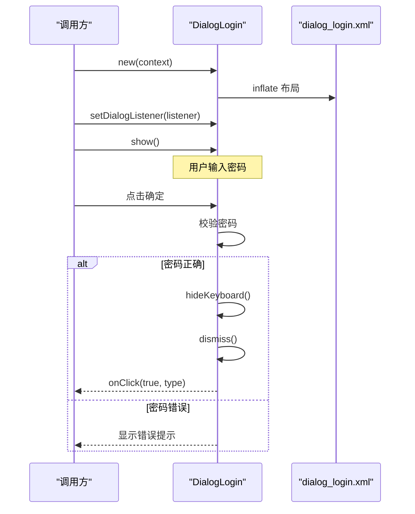
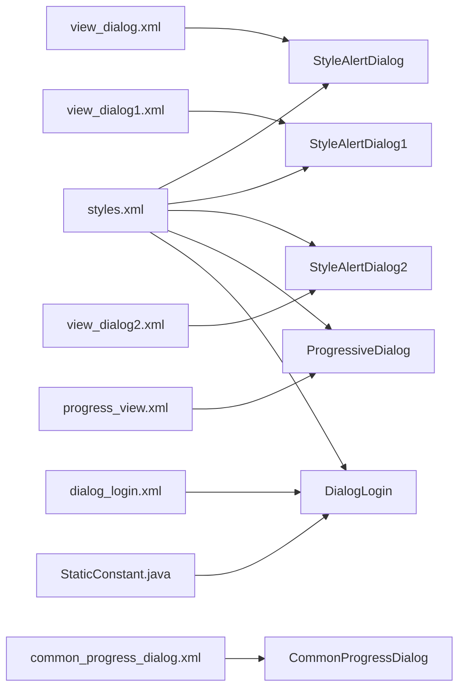

# 对话框组件

<cite>
**本文引用的文件**
- [StyleAlertDialog.java](file://app/src/main/java/com/example/gtj_sd_dg240/view/StyleAlertDialog.java)
- [StyleAlertDialog1.java](file://app/src/main/java/com/example/gtj_sd_dg240/view/StyleAlertDialog1.java)
- [StyleAlertDialog2.java](file://app/src/main/java/com/example/gtj_sd_dg240/view/StyleAlertDialog2.java)
- [CommonProgressDialog.java](file://app/src/main/java/com/example/gtj_sd_dg240/view/CommonProgressDialog.java)
- [ProgressiveDialog.java](file://app/src/main/java/com/example/gtj_sd_dg240/view/ProgressiveDialog.java)
- [DialogLogin.java](file://app/src/main/java/com/example/gtj_sd_dg240/view/DialogLogin.java)
- [view_dialog.xml](file://app/src/main/res/layout/view_dialog.xml)
- [view_dialog1.xml](file://app/src/main/res/layout/view_dialog1.xml)
- [view_dialog2.xml](file://app/src/main/res/layout/view_dialog2.xml)
- [common_progress_dialog.xml](file://app/src/main/res/layout/common_progress_dialog.xml)
- [progress_view.xml](file://app/src/main/res/layout/progress_view.xml)
- [dialog_login.xml](file://app/src/main/res/layout/dialog_login.xml)
- [styles.xml](file://app/src/main/res/values/styles.xml)
- [strings.xml](file://app/src/main/res/values/strings.xml)
- [StaticConstant.java](file://app/src/main/java/com/example/gtj_sd_dg240/StaticConstant.java)
</cite>

## 目录
1. [简介](#简介)
2. [项目结构](#项目结构)
3. [核心组件](#核心组件)
4. [架构总览](#架构总览)
5. [详细组件分析](#详细组件分析)
6. [依赖关系分析](#依赖关系分析)
7. [性能考虑](#性能考虑)
8. [故障排查指南](#故障排查指南)
9. [结论](#结论)
10. [附录：使用示例与扩展指南](#附录使用示例与扩展指南)

## 简介
本文件为 GTJ-SD-DG240 应用的对话框组件提供系统化文档，覆盖以下能力：
- StyleAlertDialog 系列对话框的样式配置、内容布局、按钮事件处理与主题适配。
- CommonProgressDialog 通用进度对话框的使用方法，包括进度更新、百分比显示、消息提示、异步任务集成等。
- ProgressiveDialog 渐进式对话框的状态管理与用户体验设计。
- DialogLogin 登录对话框的表单验证、输入处理与安全考量。
- 生命周期管理、国际化支持、无障碍访问建议与最佳实践。
- 丰富的使用示例与自定义扩展指南。

## 项目结构
对话框相关代码集中在 app 模块的 view 包中，配套布局与样式位于 res 目录：
- Java 类：StyleAlertDialog、StyleAlertDialog1、StyleAlertDialog2、CommonProgressDialog、ProgressiveDialog、DialogLogin
- 布局：view_dialog.xml、view_dialog1.xml、view_dialog2.xml、common_progress_dialog.xml、progress_view.xml、dialog_login.xml
- 样式：styles.xml（定义对话框主题）
- 字符串与常量：strings.xml、StaticConstant.java（用于密码等静态常量）

图表来源
- [StyleAlertDialog.java:15-36](file://app/src/main/java/com/example/gtj_sd_dg240/view/StyleAlertDialog.java#L15-L36)
- [StyleAlertDialog1.java:13-33](file://app/src/main/java/com/example/gtj_sd_dg240/view/StyleAlertDialog1.java#L13-L33)
- [StyleAlertDialog2.java:13-33](file://app/src/main/java/com/example/gtj_sd_dg240/view/StyleAlertDialog2.java#L13-L33)
- [CommonProgressDialog.java:24-49](file://app/src/main/java/com/example/gtj_sd_dg240/view/CommonProgressDialog.java#L24-L49)
- [ProgressiveDialog.java:12-28](file://app/src/main/java/com/example/gtj_sd_dg240/view/ProgressiveDialog.java#L12-L28)
- [DialogLogin.java:22-43](file://app/src/main/java/com/example/gtj_sd_dg240/view/DialogLogin.java#L22-L43)
- [styles.xml:16-41](file://app/src/main/res/values/styles.xml#L16-L41)

章节来源
- [StyleAlertDialog.java:15-108](file://app/src/main/java/com/example/gtj_sd_dg240/view/StyleAlertDialog.java#L15-L108)
- [CommonProgressDialog.java:24-153](file://app/src/main/java/com/example/gtj_sd_dg240/view/CommonProgressDialog.java#L24-L153)
- [ProgressiveDialog.java:12-43](file://app/src/main/java/com/example/gtj_sd_dg240/view/ProgressiveDialog.java#L12-L43)
- [DialogLogin.java:22-79](file://app/src/main/java/com/example/gtj_sd_dg240/view/DialogLogin.java#L22-L79)
- [styles.xml:16-41](file://app/src/main/res/values/styles.xml#L16-L41)

## 核心组件
- StyleAlertDialog 系列：基于 Dialog 的定制确认/提示框，支持多主题色、三按钮模式（取消/确定/仅确定），通过布局与样式实现统一视觉风格。
- CommonProgressDialog：继承 AlertDialog，封装进度条、百分比、消息文本与格式化输出，适合下载/上传等长耗时任务的进度反馈。
- ProgressiveDialog：轻量级加载提示框，采用透明背景与无遮罩层，适合非阻塞式“加载中”提示。
- DialogLogin：密码输入对话框，包含输入校验、键盘隐藏、回调通知等功能，便于在关键操作前进行权限校验。

章节来源
- [StyleAlertDialog.java:15-108](file://app/src/main/java/com/example/gtj_sd_dg240/view/StyleAlertDialog.java#L15-L108)
- [StyleAlertDialog1.java:13-102](file://app/src/main/java/com/example/gtj_sd_dg240/view/StyleAlertDialog1.java#L13-L102)
- [StyleAlertDialog2.java:13-102](file://app/src/main/java/com/example/gtj_sd_dg240/view/StyleAlertDialog2.java#L13-L102)
- [CommonProgressDialog.java:24-153](file://app/src/main/java/com/example/gtj_sd_dg240/view/CommonProgressDialog.java#L24-L153)
- [ProgressiveDialog.java:12-43](file://app/src/main/java/com/example/gtj_sd_dg240/view/ProgressiveDialog.java#L12-L43)
- [DialogLogin.java:22-79](file://app/src/main/java/com/example/gtj_sd_dg240/view/DialogLogin.java#L22-L79)

## 架构总览
对话框组件围绕“样式-布局-交互”三层组织：
- 样式层：styles.xml 定义对话框主题（无边框、圆角背景、透明背景等）。
- 布局层：各 XML 布局定义内容区与按钮区，决定 UI 结构与可访问性基础。
- 交互层：Java 类负责初始化、事件绑定、状态更新与生命周期管理。

图表来源
- [StyleAlertDialog.java:15-108](file://app/src/main/java/com/example/gtj_sd_dg240/view/StyleAlertDialog.java#L15-L108)
- [StyleAlertDialog1.java:13-102](file://app/src/main/java/com/example/gtj_sd_dg240/view/StyleAlertDialog1.java#L13-L102)
- [StyleAlertDialog2.java:13-102](file://app/src/main/java/com/example/gtj_sd_dg240/view/StyleAlertDialog2.java#L13-L102)
- [CommonProgressDialog.java:24-153](file://app/src/main/java/com/example/gtj_sd_dg240/view/CommonProgressDialog.java#L24-L153)
- [ProgressiveDialog.java:12-43](file://app/src/main/java/com/example/gtj_sd_dg240/view/ProgressiveDialog.java#L12-L43)
- [DialogLogin.java:22-79](file://app/src/main/java/com/example/gtj_sd_dg240/view/DialogLogin.java#L22-L79)

## 详细组件分析

### StyleAlertDialog 系列对话框
- 样式配置
  - 通过 styles.xml 中的 StyleAlertDialog 主题设置无边框、圆角背景、浮动窗口等。
  - 根据 type 参数切换主题色（蓝/黄/红），并应用对应渐变背景到按钮。
- 内容布局
  - 使用 view_dialog.xml 作为统一布局，包含内容 TextView 与三个按钮区域（取消/提交/确定）。
  - 按钮默认隐藏，仅在设置文本或监听器时可见。
- 按钮事件处理
  - 提供 setLeftButton/setRightButton/setOKButton 方法，分别绑定点击事件。
  - 当设置了 OK 按钮监听时优先显示单确定模式；否则按左/右按钮顺序显示双按钮模式。
- 生命周期与可取消性
  - 构造函数中设置不可取消（setCancelable(false)），避免误触关闭。
  - onCreate 中完成布局加载与初始化。

图表来源
- [StyleAlertDialog.java:25-83](file://app/src/main/java/com/example/gtj_sd_dg240/view/StyleAlertDialog.java#L25-L83)
- [view_dialog.xml:1-89](file://app/src/main/res/layout/view_dialog.xml#L1-L89)
- [styles.xml:27-33](file://app/src/main/res/values/styles.xml#L27-L33)

章节来源
- [StyleAlertDialog.java:15-108](file://app/src/main/java/com/example/gtj_sd_dg240/view/StyleAlertDialog.java#L15-L108)
- [view_dialog.xml:1-89](file://app/src/main/res/layout/view_dialog.xml#L1-L89)
- [styles.xml:27-33](file://app/src/main/res/values/styles.xml#L27-L33)

### StyleAlertDialog1 / StyleAlertDialog2
- 差异点
  - 两者均继承 Dialog，使用各自布局（view_dialog1.xml、view_dialog2.xml），提供 setContent 与三按钮设置接口。
  - 布局上，view_dialog1.xml 支持滚动内容与双按钮（左/右）加可选确定按钮；view_dialog2.xml 宽度更大，侧重单确定按钮展示。
- 使用场景
  - 需要长文本提示且带左右操作时使用 StyleAlertDialog1。
  - 需要更宽内容区或强调单一确认时使用 StyleAlertDialog2。

章节来源
- [StyleAlertDialog1.java:13-102](file://app/src/main/java/com/example/gtj_sd_dg240/view/StyleAlertDialog1.java#L13-L102)
- [StyleAlertDialog2.java:13-102](file://app/src/main/java/com/example/gtj_sd_dg240/view/StyleAlertDialog2.java#L13-L102)
- [view_dialog1.xml:1-100](file://app/src/main/res/layout/view_dialog1.xml#L1-L100)
- [view_dialog2.xml:1-65](file://app/src/main/res/layout/view_dialog2.xml#L1-L65)

### CommonProgressDialog 通用进度对话框
- 功能特性
  - 进度条：支持设置最大值与当前进度，支持不确定模式。
  - 百分比与数值：通过 Handler 更新百分比与“已用/总量”数值，支持格式化。
  - 消息提示：setMessage 可设置顶部提示信息。
  - 生命周期：onStart/onStop 标记是否已开始，确保进度更新时机正确。
- 使用方法
  - 创建实例后，调用 setMax 设置上限，setProgress 更新进度，setMessage 设置提示文案。
  - 在后台任务中周期性调用 setProgress 以驱动 UI 更新。
  - 任务完成后调用 dismiss 关闭对话框。
- 异步任务集成建议
  - 使用线程或协程执行耗时任务，在主线程回调中更新进度。
  - 注意在 onStop 中暂停或清理更新逻辑，避免内存泄漏。

图表来源
- [CommonProgressDialog.java:43-153](file://app/src/main/java/com/example/gtj_sd_dg240/view/CommonProgressDialog.java#L43-L153)
- [common_progress_dialog.xml:1-61](file://app/src/main/res/layout/common_progress_dialog.xml#L1-L61)

章节来源
- [CommonProgressDialog.java:24-153](file://app/src/main/java/com/example/gtj_sd_dg240/view/CommonProgressDialog.java#L24-L153)
- [common_progress_dialog.xml:1-61](file://app/src/main/res/layout/common_progress_dialog.xml#L1-L61)

### ProgressiveDialog 渐进式对话框
- 状态管理
  - 构造时设置透明背景、无遮罩层、可取消性策略。
  - show() 时根据 contentString 设置内容文本。
- 用户体验设计
  - 轻量提示，不阻断用户操作，适合“加载中...”等短暂反馈。
  - 布局使用 progress_view.xml，包含旋转进度图标与提示文本。
- 使用建议
  - 在发起网络请求或本地计算前显示，完成后立即 dismiss。
  - 避免长时间显示，防止用户困惑。

图表来源
- [ProgressiveDialog.java:12-43](file://app/src/main/java/com/example/gtj_sd_dg240/view/ProgressiveDialog.java#L12-L43)
- [progress_view.xml:1-37](file://app/src/main/res/layout/progress_view.xml#L1-L37)
- [styles.xml:16-25](file://app/src/main/res/values/styles.xml#L16-L25)

章节来源
- [ProgressiveDialog.java:12-43](file://app/src/main/java/com/example/gtj_sd_dg240/view/ProgressiveDialog.java#L12-L43)
- [progress_view.xml:1-37](file://app/src/main/res/layout/progress_view.xml#L1-L37)
- [styles.xml:16-25](file://app/src/main/res/values/styles.xml#L16-L25)

### DialogLogin 登录对话框
- 表单验证与输入处理
  - 获取密码输入框文本，清空输入框，比较与静态常量中的密码。
  - 若匹配成功，隐藏键盘、关闭对话框并通过回调返回结果与类型。
  - 若失败，显示错误提示。
- 安全考虑
  - 密码存储在静态常量中，生产环境应改为服务端校验或加密存储。
  - 输入类型为密码模式，限制长度，避免明文泄露。
- 生命周期与可取消性
  - 使用 MyDialog 主题，透明背景，悬浮窗口。
  - 左侧按钮直接关闭对话框，右侧按钮执行校验逻辑。

图表来源
- [DialogLogin.java:22-79](file://app/src/main/java/com/example/gtj_sd_dg240/view/DialogLogin.java#L22-L79)
- [dialog_login.xml:1-84](file://app/src/main/res/layout/dialog_login.xml#L1-L84)
- [StaticConstant.java:34-35](file://app/src/main/java/com/example/gtj_sd_dg240/StaticConstant.java#L34-L35)

章节来源
- [DialogLogin.java:22-79](file://app/src/main/java/com/example/gtj_sd_dg240/view/DialogLogin.java#L22-L79)
- [dialog_login.xml:1-84](file://app/src/main/res/layout/dialog_login.xml#L1-L84)
- [StaticConstant.java:34-35](file://app/src/main/java/com/example/gtj_sd_dg240/StaticConstant.java#L34-L35)

## 依赖关系分析
- 样式依赖：所有对话框均依赖 styles.xml 中的主题定义，确保一致的视觉风格。
- 布局依赖：每个对话框类与其对应的布局文件强耦合，修改布局需同步调整控件 ID 与逻辑。
- 常量依赖：DialogLogin 依赖 StaticConstant 中的密码常量，便于集中管理。
- 第三方库：DialogLogin 使用 ToastUtils 进行提示，属于外部依赖，需在构建脚本中引入。

图表来源
- [styles.xml:16-41](file://app/src/main/res/values/styles.xml#L16-L41)
- [view_dialog.xml:1-89](file://app/src/main/res/layout/view_dialog.xml#L1-L89)
- [view_dialog1.xml:1-100](file://app/src/main/res/layout/view_dialog1.xml#L1-L100)
- [view_dialog2.xml:1-65](file://app/src/main/res/layout/view_dialog2.xml#L1-L65)
- [common_progress_dialog.xml:1-61](file://app/src/main/res/layout/common_progress_dialog.xml#L1-L61)
- [progress_view.xml:1-37](file://app/src/main/res/layout/progress_view.xml#L1-L37)
- [dialog_login.xml:1-84](file://app/src/main/res/layout/dialog_login.xml#L1-L84)
- [StaticConstant.java:34-35](file://app/src/main/java/com/example/gtj_sd_dg240/StaticConstant.java#L34-L35)

章节来源
- [styles.xml:16-41](file://app/src/main/res/values/styles.xml#L16-L41)
- [StaticConstant.java:34-35](file://app/src/main/java/com/example/gtj_sd_dg240/StaticConstant.java#L34-L35)

## 性能考虑
- 避免频繁创建对话框：复用实例或在必要时才创建，减少内存分配。
- 进度更新频率：CommonProgressDialog 的进度更新应在主线程进行，但避免过高频率导致 UI 卡顿。
- 资源占用：ProgressiveDialog 使用透明背景与无遮罩层，渲染开销较低，适合短时提示。
- 生命周期管理：在 onStop 中停止进度更新，防止后台继续刷新造成浪费。

[本节为通用指导，不直接分析具体文件]

## 故障排查指南
- 对话框无法显示
  - 检查是否在 Activity/Fragment 的上下文创建对话框。
  - 确认布局文件中控件 ID 与 Java 代码中 findViewById 一致。
- 进度不更新
  - 确认 setProgress 在主线程调用。
  - 检查 onStart 是否被触发以启用更新逻辑。
- 登录校验无效
  - 核对 StaticConstant 中的密码常量是否正确。
  - 确认输入框类型为密码模式且未开启自动填充泄露风险。
- 样式异常
  - 检查 styles.xml 中主题是否被正确引用。
  - 确认布局背景与颜色资源存在。

章节来源
- [CommonProgressDialog.java:141-153](file://app/src/main/java/com/example/gtj_sd_dg240/view/CommonProgressDialog.java#L141-L153)
- [DialogLogin.java:57-71](file://app/src/main/java/com/example/gtj_sd_dg240/view/DialogLogin.java#L57-L71)
- [styles.xml:16-41](file://app/src/main/res/values/styles.xml#L16-L41)

## 结论
本项目的对话框组件通过统一的样式与布局实现了高度可定制的 UI 体验，覆盖了提示、进度、加载与登录等常见场景。建议在后续迭代中：
- 将密码校验迁移至服务端或加密存储，提升安全性。
- 完善国际化与无障碍支持，提升可访问性与多语言体验。
- 对进度更新进行节流与合并，优化性能。
- 增加更多主题与布局变体，满足多样化业务需求。

[本节为总结性内容，不直接分析具体文件]

## 附录：使用示例与扩展指南
- 使用 StyleAlertDialog
  - 创建实例并设置内容、按钮与监听器，根据业务选择蓝色/黄色/红色主题。
  - 参考路径：[StyleAlertDialog.java:25-108](file://app/src/main/java/com/example/gtj_sd_dg240/view/StyleAlertDialog.java#L25-L108)，[view_dialog.xml:1-89](file://app/src/main/res/layout/view_dialog.xml#L1-L89)
- 使用 CommonProgressDialog
  - 设置最大值与消息，循环调用 setProgress 更新进度，完成后 dismiss。
  - 参考路径：[CommonProgressDialog.java:43-153](file://app/src/main/java/com/example/gtj_sd_dg240/view/CommonProgressDialog.java#L43-L153)，[common_progress_dialog.xml:1-61](file://app/src/main/res/layout/common_progress_dialog.xml#L1-L61)
- 使用 ProgressiveDialog
  - 显示轻量加载提示，设置内容文本，任务完成后关闭。
  - 参考路径：[ProgressiveDialog.java:12-43](file://app/src/main/java/com/example/gtj_sd_dg240/view/ProgressiveDialog.java#L12-L43)，[progress_view.xml:1-37](file://app/src/main/res/layout/progress_view.xml#L1-L37)
- 使用 DialogLogin
  - 设置监听器，处理密码校验结果，隐藏键盘并关闭对话框。
  - 参考路径：[DialogLogin.java:22-79](file://app/src/main/java/com/example/gtj_sd_dg240/view/DialogLogin.java#L22-L79)，[dialog_login.xml:1-84](file://app/src/main/res/layout/dialog_login.xml#L1-L84)
- 主题与样式扩展
  - 在 styles.xml 中添加新主题，并在对话框构造中引用。
  - 参考路径：[styles.xml:16-41](file://app/src/main/res/values/styles.xml#L16-L41)
- 国际化与无障碍
  - 将硬编码文本移至 strings.xml，并按语言切换。
  - 为关键控件添加 contentDescription，提升读屏支持。
  - 参考路径：[strings.xml:1-6](file://app/src/main/res/values/strings.xml#L1-L6)

章节来源
- [StyleAlertDialog.java:25-108](file://app/src/main/java/com/example/gtj_sd_dg240/view/StyleAlertDialog.java#L25-L108)
- [CommonProgressDialog.java:43-153](file://app/src/main/java/com/example/gtj_sd_dg240/view/CommonProgressDialog.java#L43-L153)
- [ProgressiveDialog.java:12-43](file://app/src/main/java/com/example/gtj_sd_dg240/view/ProgressiveDialog.java#L12-L43)
- [DialogLogin.java:22-79](file://app/src/main/java/com/example/gtj_sd_dg240/view/DialogLogin.java#L22-L79)
- [styles.xml:16-41](file://app/src/main/res/values/styles.xml#L16-L41)
- [strings.xml:1-6](file://app/src/main/res/values/strings.xml#L1-L6)