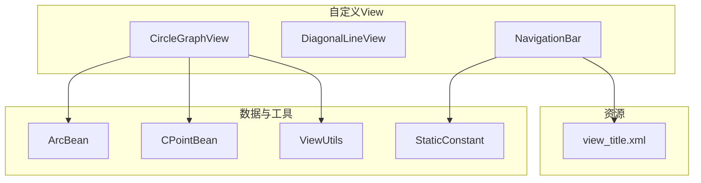
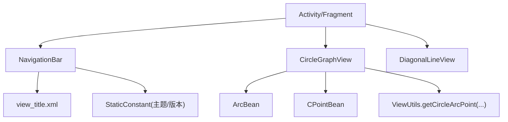
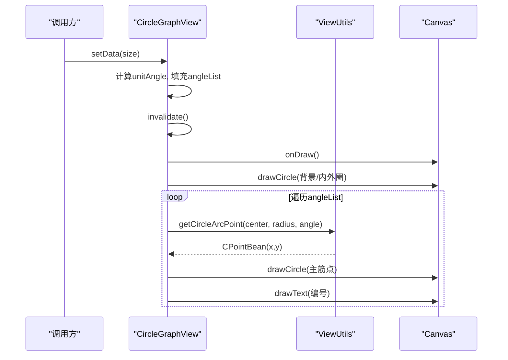
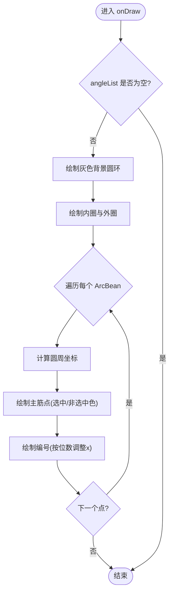
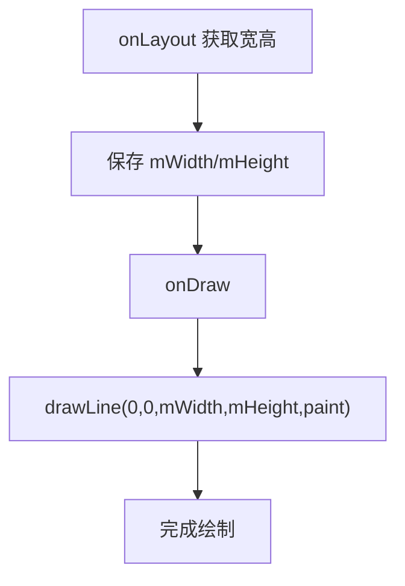
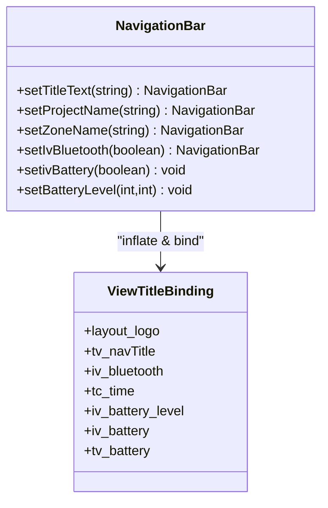
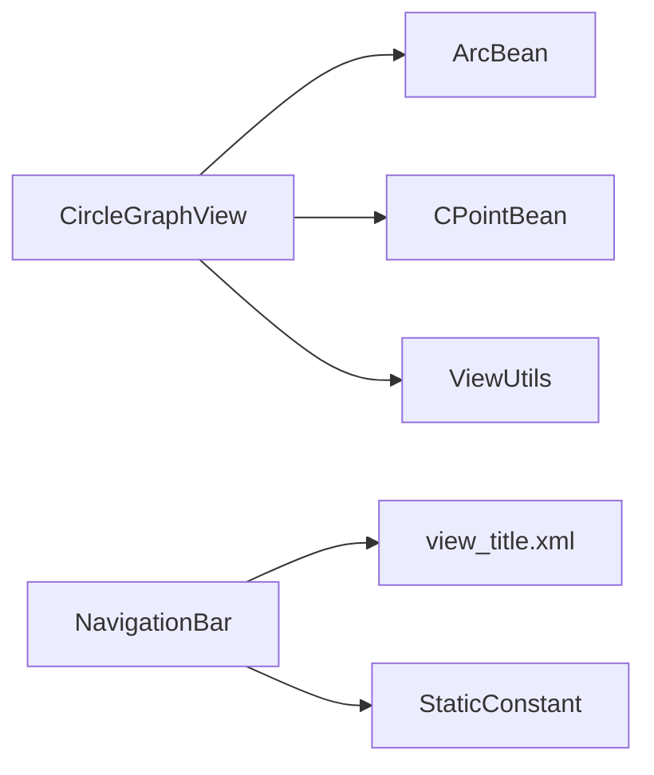

# 自定义View组件

<cite>
**本文引用的文件**
- [CircleGraphView.java](file://app/src/main/java/com/example/gtj_sd_dg240/view/CircleGraphView.java)
- [DiagonalLineView.java](file://app/src/main/java/com/example/gtj_sd_dg240/view/DiagonalLineView.java)
- [NavigationBar.java](file://app/src/main/java/com/example/gtj_sd_dg240/view/NavigationBar.java)
- [view_title.xml](file://app/src/main/res/layout/view_title.xml)
- [ViewUtils.java](file://app/src/main/java/com/example/gtj_sd_dg240/utils/ViewUtils.java)
- [ArcBean.java](file://app/src/main/java/com/example/gtj_sd_dg240/model/ArcBean.java)
- [CPointBean.java](file://app/src/main/java/com/example/gtj_sd_dg240/model/CPointBean.java)
- [StaticConstant.java](file://app/src/main/java/com/example/gtj_sd_dg240/StaticConstant.java)
</cite>

## 目录
1. [简介](#简介)
2. [项目结构](#项目结构)
3. [核心组件](#核心组件)
4. [架构总览](#架构总览)
5. [详细组件分析](#详细组件分析)
6. [依赖关系分析](#依赖关系分析)
7. [性能考虑](#性能考虑)
8. [故障排查指南](#故障排查指南)
9. [结论](#结论)
10. [附录：使用示例与最佳实践](#附录使用示例与最佳实践)

## 简介
本文件面向GTJ-SD-DG240应用中的三个自定义View组件，提供从实现原理到使用方法的完整说明，重点覆盖：
- CircleGraphView圆形图表绘制组件：Canvas绘图API、数据绑定、选中态交互、布局计算等。
- DiagonalLineView斜线视图：绘制逻辑与配置项。
- NavigationBar导航栏：布局管理、主题适配、状态展示（蓝牙、电量）等。

同时补充自定义View生命周期、触摸事件处理、响应式适配、性能优化（硬件加速、内存优化）等高级特性，并给出具体使用示例与最佳实践。

## 项目结构
自定义View位于 app/src/main/java/com/example/gtj_sd_dg240/view 包下，配套的数据模型在 model 包，工具方法在 utils 包，导航栏的布局在 res/layout/view_title.xml。

**图示来源**
- [CircleGraphView.java:21-128](file://app/src/main/java/com/example/gtj_sd_dg240/view/CircleGraphView.java#L21-L128)
- [DiagonalLineView.java:16-47](file://app/src/main/java/com/example/gtj_sd_dg240/view/DiagonalLineView.java#L16-L47)
- [NavigationBar.java:14-117](file://app/src/main/java/com/example/gtj_sd_dg240/view/NavigationBar.java#L14-L117)
- [ArcBean.java:1-13](file://app/src/main/java/com/example/gtj_sd_dg240/model/ArcBean.java#L1-L13)
- [CPointBean.java:1-20](file://app/src/main/java/com/example/gtj_sd_dg240/model/CPointBean.java#L1-L20)
- [ViewUtils.java:12-59](file://app/src/main/java/com/example/gtj_sd_dg240/utils/ViewUtils.java#L12-L59)
- [view_title.xml:1-200](file://app/src/main/res/layout/view_title.xml#L1-L200)
- [StaticConstant.java:14-87](file://app/src/main/java/com/example/gtj_sd_dg240/StaticConstant.java#L14-L87)

**章节来源**
- [CircleGraphView.java:21-128](file://app/src/main/java/com/example/gtj_sd_dg240/view/CircleGraphView.java#L21-L128)
- [DiagonalLineView.java:16-47](file://app/src/main/java/com/example/gtj_sd_dg240/view/DiagonalLineView.java#L16-L47)
- [NavigationBar.java:14-117](file://app/src/main/java/com/example/gtj_sd_dg240/view/NavigationBar.java#L14-L117)
- [view_title.xml:1-200](file://app/src/main/res/layout/view_title.xml#L1-L200)

## 核心组件
- CircleGraphView：基于Canvas绘制的环形图表，支持动态数据设置、选中高亮、多圈层绘制与编号标注。
- DiagonalLineView：简单对角线绘制，用于装饰或分割。
- NavigationBar：组合型容器，封装标题、Logo切换、项目/区域信息、蓝牙图标、时间与电量显示，支持多品牌主题。

**章节来源**
- [CircleGraphView.java:21-128](file://app/src/main/java/com/example/gtj_sd_dg240/view/CircleGraphView.java#L21-L128)
- [DiagonalLineView.java:16-47](file://app/src/main/java/com/example/gtj_sd_dg240/view/DiagonalLineView.java#L16-L47)
- [NavigationBar.java:14-117](file://app/src/main/java/com/example/gtj_sd_dg240/view/NavigationBar.java#L14-L117)

## 架构总览
下图展示了三个自定义View与其依赖的关系，以及它们在界面中的角色。

**图示来源**
- [CircleGraphView.java:21-128](file://app/src/main/java/com/example/gtj_sd_dg240/view/CircleGraphView.java#L21-L128)
- [ViewUtils.java:12-59](file://app/src/main/java/com/example/gtj_sd_dg240/utils/ViewUtils.java#L12-L59)
- [ArcBean.java:1-13](file://app/src/main/java/com/example/gtj_sd_dg240/model/ArcBean.java#L1-L13)
- [CPointBean.java:1-20](file://app/src/main/java/com/example/gtj_sd_dg240/model/CPointBean.java#L1-L20)
- [NavigationBar.java:14-117](file://app/src/main/java/com/example/gtj_sd_dg240/view/NavigationBar.java#L14-L117)
- [view_title.xml:1-200](file://app/src/main/res/layout/view_title.xml#L1-L200)
- [StaticConstant.java:14-87](file://app/src/main/java/com/example/gtj_sd_dg240/StaticConstant.java#L14-L87)

## 详细组件分析

### CircleGraphView 圆形图表绘制组件
- 职责与能力
  - 根据传入数量动态生成等分角度点，绘制多层圆环与主筋点位及编号。
  - 支持选中态切换，刷新重绘。
  - 通过工具类计算圆周坐标，保证不同尺寸下的自适应。
- 关键流程
  - 初始化：读取颜色、创建Paint、设置抗锯齿、字号与描边宽度。
  - 布局阶段：计算中心点与半径，为后续绘制准备几何参数。
  - 数据绑定：setData(size) 清空旧数据、计算单位角度、填充ArcBean列表并触发重绘。
  - 交互：selectedIndex(index) 更新选中状态并触发重绘。
  - 绘制：onDraw中调用drawCircle，依次绘制背景圆环、内外圈、主筋点与编号。
- Canvas API 使用要点
  - drawCircle：绘制多层同心圆，形成外壁圈、箍筋圈、内壁圈等视觉效果。
  - drawText：在主筋点内侧标注编号，按数字位数微调x偏移以保证居中。
  - Paint：统一启用抗锯齿，区分描边与填充样式，合理设置StrokeWidth与TextSize。
- 数据模型
  - ArcBean：包含编号number、角度arcAngle、是否isSelected。
  - CPointBean：二维坐标点，配合ViewUtils计算圆周位置。
- 动画效果
  - 当前实现未内置动画；如需入场动画可结合ValueAnimator对unitAngle或半径进行插值，并在每帧invalidate()重绘。
- 触摸事件
  - 当前未实现onTouchEvent；可在onLayout后缓存各点坐标与半径范围，在onTouchEvent中判断点击落入哪个扇区，从而调用selectedIndex并invalidate。
- 响应式与适配
  - onLayout中根据宽高计算centerPoint与circleRadius，确保在不同屏幕密度与尺寸下正确缩放。
  - 文本与点大小通过dp转换，保证视觉一致性。

**图示来源**
- [CircleGraphView.java:56-128](file://app/src/main/java/com/example/gtj_sd_dg240/view/CircleGraphView.java#L56-L128)
- [ViewUtils.java:19-41](file://app/src/main/java/com/example/gtj_sd_dg240/utils/ViewUtils.java#L19-L41)

**章节来源**
- [CircleGraphView.java:21-128](file://app/src/main/java/com/example/gtj_sd_dg240/view/CircleGraphView.java#L21-L128)
- [ArcBean.java:1-13](file://app/src/main/java/com/example/gtj_sd_dg240/model/ArcBean.java#L1-L13)
- [CPointBean.java:1-20](file://app/src/main/java/com/example/gtj_sd_dg240/model/CPointBean.java#L1-L20)
- [ViewUtils.java:12-59](file://app/src/main/java/com/example/gtj_sd_dg240/utils/ViewUtils.java#L12-L59)

#### 绘制流程图（算法级）

**图示来源**
- [CircleGraphView.java:86-128](file://app/src/main/java/com/example/gtj_sd_dg240/view/CircleGraphView.java#L86-L128)
- [ViewUtils.java:19-41](file://app/src/main/java/com/example/gtj_sd_dg240/utils/ViewUtils.java#L19-L41)

### DiagonalLineView 斜线视图
- 职责与能力
  - 在自身范围内绘制一条从左上到右下的直线，常用于装饰条或分隔线。
- 绘制逻辑
  - onLayout阶段记录宽高，onDraw阶段使用drawLine绘制对角线。
  - Paint开启抗锯齿，设置为描边模式，白色线条，线宽1像素。
- 配置选项
  - 可通过外部修改Paint属性（如颜色、线宽），或在子类重写onDraw扩展更多样式。
- 使用场景
  - 作为头部左侧装饰条，配合背景色块提升视觉层次。

**图示来源**
- [DiagonalLineView.java:25-45](file://app/src/main/java/com/example/gtj_sd_dg240/view/DiagonalLineView.java#L25-L45)

**章节来源**
- [DiagonalLineView.java:16-47](file://app/src/main/java/com/example/gtj_sd_dg240/view/DiagonalLineView.java#L16-L47)

### NavigationBar 导航栏
- 职责与能力
  - 组合多个子控件，统一管理标题、Logo、项目/区域信息、蓝牙图标、时间与电量显示。
  - 根据StaticConstant中的APP_DEFAULT与isNeutral控制Logo可见性与主题风格。
  - 提供链式API设置标题、项目名、区域名、蓝牙图标显隐、电量百分比与进度条长度。
- 布局管理
  - 通过ViewTitleBinding加载view_title.xml，将子视图暴露给Java代码进行控制。
  - 使用RelativeLayout与LinearLayout组合，保证标题居中、右侧元素对齐。
- 主题适配
  - 依据StaticConstant.APP_DEFAULT切换不同Logo与分隔线显示，支持中性版本隐藏Logo。
- 事件处理
  - 当前未内置点击事件；可在布局文件中为各ImageView添加onClick，或在NavigationBar中暴露回调接口供上层注册。
- 电池显示
  - setBatteryLevel根据rawlevel/scale计算百分比，动态调整进度条宽度，并切换电量图标与文字显示。

**图示来源**
- [NavigationBar.java:14-117](file://app/src/main/java/com/example/gtj_sd_dg240/view/NavigationBar.java#L14-L117)
- [view_title.xml:1-200](file://app/src/main/res/layout/view_title.xml#L1-L200)

**章节来源**
- [NavigationBar.java:14-117](file://app/src/main/java/com/example/gtj_sd_dg240/view/NavigationBar.java#L14-L117)
- [view_title.xml:1-200](file://app/src/main/res/layout/view_title.xml#L1-L200)
- [StaticConstant.java:14-87](file://app/src/main/java/com/example/gtj_sd_dg240/StaticConstant.java#L14-L87)

## 依赖关系分析
- CircleGraphView
  - 依赖ArcBean与CPointBean描述数据与坐标。
  - 依赖ViewUtils进行圆周坐标计算。
  - 依赖ContextCompat与SizeUtils进行颜色与尺寸转换。
- DiagonalLineView
  - 仅依赖Paint与Canvas，无复杂外部依赖。
- NavigationBar
  - 依赖view_title.xml布局与StaticConstant主题常量。
  - 通过ViewTitleBinding访问子视图。

**图示来源**
- [CircleGraphView.java:21-128](file://app/src/main/java/com/example/gtj_sd_dg240/view/CircleGraphView.java#L21-L128)
- [ArcBean.java:1-13](file://app/src/main/java/com/example/gtj_sd_dg240/model/ArcBean.java#L1-L13)
- [CPointBean.java:1-20](file://app/src/main/java/com/example/gtj_sd_dg240/model/CPointBean.java#L1-L20)
- [ViewUtils.java:12-59](file://app/src/main/java/com/example/gtj_sd_dg240/utils/ViewUtils.java#L12-L59)
- [NavigationBar.java:14-117](file://app/src/main/java/com/example/gtj_sd_dg240/view/NavigationBar.java#L14-L117)
- [view_title.xml:1-200](file://app/src/main/res/layout/view_title.xml#L1-L200)
- [StaticConstant.java:14-87](file://app/src/main/java/com/example/gtj_sd_dg240/StaticConstant.java#L14-L87)

**章节来源**
- [CircleGraphView.java:21-128](file://app/src/main/java/com/example/gtj_sd_dg240/view/CircleGraphView.java#L21-L128)
- [NavigationBar.java:14-117](file://app/src/main/java/com/example/gtj_sd_dg240/view/NavigationBar.java#L14-L117)

## 性能考虑
- 硬件加速
  - 这些View主要使用基础Canvas操作（drawCircle、drawLine、drawText），默认硬件加速即可满足需求。若出现异常闪烁或兼容性问题，可在父容器或Manifest中按需关闭硬件加速。
- 内存优化
  - Paint对象在initView中创建一次并复用，避免重复分配。
  - 数据集合angleList在setData时clear并重建，注意避免频繁创建大量临时对象；可将计算结果缓存以减少GC压力。
- 绘制效率
  - 仅在数据变化或交互时调用invalidate，避免不必要的重绘。
  - 对于大量点的绘制，可考虑合并绘制路径或使用离屏缓冲（需权衡内存）。
- 文本与尺寸
  - 使用dp转px保证多密度一致；文本大小与点半径已固定dp值，可根据实际UI规范调整。

[本节为通用性能建议，不直接分析具体文件]

## 故障排查指南
- 图表不显示
  - 检查是否调用了setData(size)，且size大于0；确认angleList非空后再绘制。
  - 确认onLayout已执行，centerPoint与circleRadius已正确计算。
- 选中态无效
  - 调用selectedIndex(index)后必须触发invalidate；确保index在有效范围内。
- 导航栏Logo不显示
  - 检查StaticConstant.isNeutral与APP_DEFAULT配置；确认对应Logo ImageView visibility设置正确。
- 电量显示异常
  - 确保传入的rawlevel与scale均为正数；否则计算结果为0会导致进度条不可见。

**章节来源**
- [CircleGraphView.java:56-74](file://app/src/main/java/com/example/gtj_sd_dg240/view/CircleGraphView.java#L56-L74)
- [NavigationBar.java:95-115](file://app/src/main/java/com/example/gtj_sd_dg240/view/NavigationBar.java#L95-L115)
- [StaticConstant.java:14-87](file://app/src/main/java/com/example/gtj_sd_dg240/StaticConstant.java#L14-L87)

## 结论
- CircleGraphView提供了灵活的环形图表绘制能力，适合展示等分数据与选中态；通过工具类实现了坐标计算的解耦。
- DiagonalLineView简洁高效，适用于装饰性线条。
- NavigationBar封装了常见的导航栏功能，支持多品牌主题与电量展示，便于复用与扩展。
- 建议在需要动画与交互的场景中补充手势处理与过渡动画，以提升用户体验。

[本节为总结性内容，不直接分析具体文件]

## 附录：使用示例与最佳实践
- 在XML中使用
  - 在布局中声明自定义View，例如在头部装饰区域加入DiagonalLineView。
  - 在页面顶部加入NavigationBar，并通过其API设置标题、项目名、区域名与电量。
- 在Activity/Fragment中使用
  - 获取CircleGraphView实例后，调用setData(size)设置数据点数，再根据需要调用selectedIndex(index)设置选中项。
  - 如需点击选择，可在CircleGraphView中实现onTouchEvent，计算点击位置对应的索引并更新状态。
- 最佳实践
  - 将数据变更集中管理，减少多次invalidate；必要时使用requestLayout+invalidate组合确保布局与绘制同步。
  - 对频繁更新的图表，考虑使用双缓冲或Path合并绘制以降低开销。
  - 主题与文案通过StaticConstant与资源文件统一管理，便于维护与扩展。

[本节为使用指导，不直接分析具体文件]