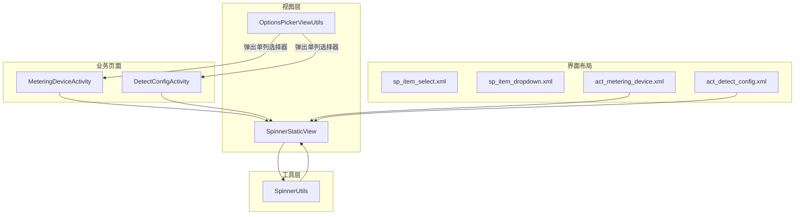
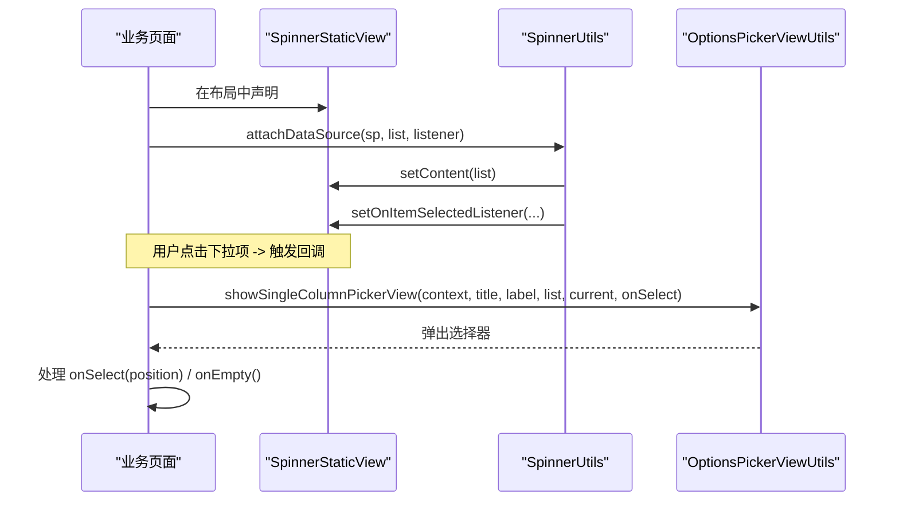
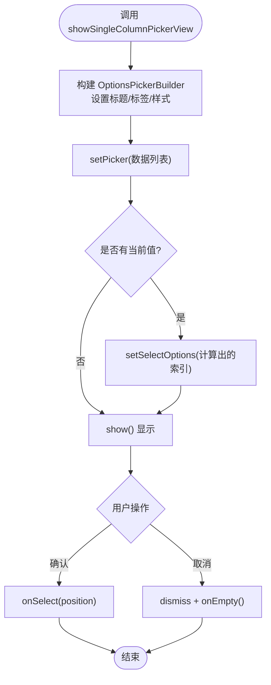
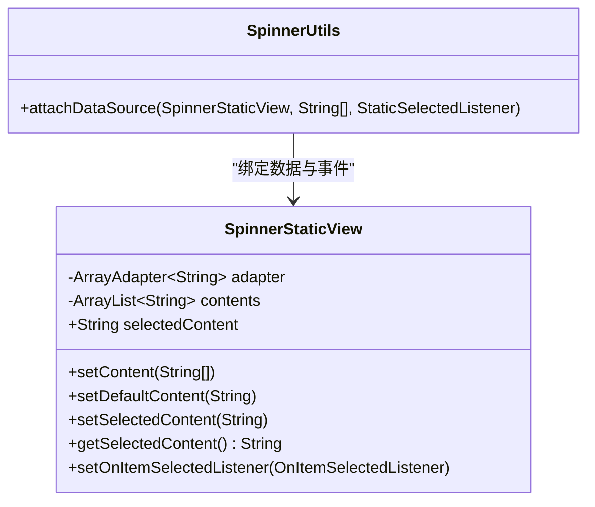
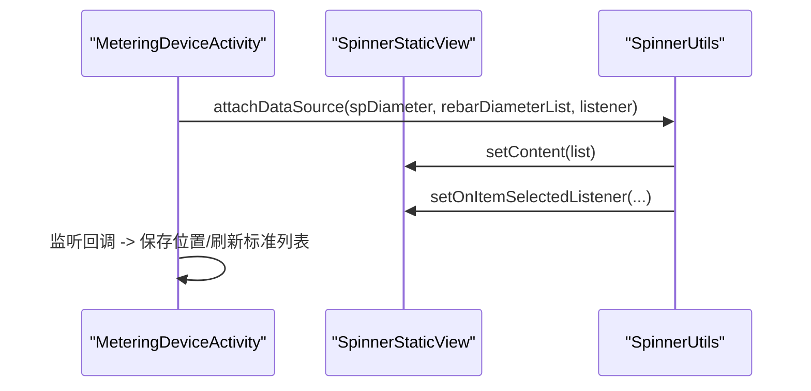
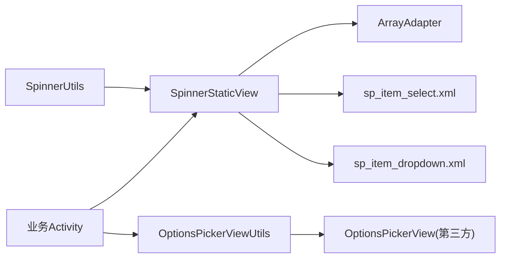

# 选择器组件

<cite>
**本文引用的文件**
- [OptionsPickerViewUtils.java](file://app/src/main/java/com/example/gtj_sd_dg240/view/OptionsPickerViewUtils.java)
- [SpinnerStaticView.java](file://app/src/main/java/com/example/gtj_sd_dg240/view/SpinnerStaticView.java)
- [SpinnerUtils.java](file://app/src/main/java/com/example/gtj_sd_dg240/utils/SpinnerUtils.java)
- [sp_item_select.xml](file://app/src/main/res/layout/sp_item_select.xml)
- [sp_item_dropdown.xml](file://app/src/main/res/layout/sp_item_dropdown.xml)
- [MeteringDeviceActivity.java](file://app/src/main/java/com/example/gtj_sd_dg240/activity/setting/MeteringDeviceActivity.java)
- [DetectConfigActivity.java](file://app/src/main/java/com/example/gtj_sd_dg240/activity/testing/DetectConfigActivity.java)
- [act_metering_device.xml](file://app/src/main/res/layout/act_metering_device.xml)
- [act_detect_config.xml](file://app/src/main/res/layout/act_detect_config.xml)
</cite>

## 目录
1. [简介](#简介)
2. [项目结构](#项目结构)
3. [核心组件](#核心组件)
4. [架构总览](#架构总览)
5. [详细组件分析](#详细组件分析)
6. [依赖关系分析](#依赖关系分析)
7. [性能考虑](#性能考虑)
8. [故障排查指南](#故障排查指南)
9. [结论](#结论)
10. [附录：使用示例与扩展指南](#附录使用示例与扩展指南)

## 简介
本文件面向 GTJ-SD-DG240 应用中的“选择器组件”，聚焦两类实现：
- OptionsPickerViewUtils：基于第三方库封装的单列选项选择器，提供标题、标签、主题色、确定/取消等配置能力，并支持“清空”回调。
- SpinnerStaticView：继承自 AppCompatSpinner 的静态下拉选择器，内置数据源绑定、默认项设置、选中事件包装，配合 SpinnerUtils 简化接入。

文档将说明其实现原理、数据绑定、事件回调、样式定制、性能优化、无障碍交互建议，以及在不同业务场景（设备选择、参数配置、区域选择）下的使用方法与扩展方式。

## 项目结构
选择器相关代码集中在 view 与 utils 包中，布局资源在 res/layout 下；具体使用位于 setting 与 testing 模块的 Activity 中。

图表来源
- [SpinnerStaticView.java:15-79](file://app/src/main/java/com/example/gtj_sd_dg240/view/SpinnerStaticView.java#L15-L79)
- [SpinnerUtils.java:7-21](file://app/src/main/java/com/example/gtj_sd_dg240/utils/SpinnerUtils.java#L7-L21)
- [sp_item_select.xml:1-12](file://app/src/main/res/layout/sp_item_select.xml#L1-L12)
- [sp_item_dropdown.xml:1-9](file://app/src/main/res/layout/sp_item_dropdown.xml#L1-L9)
- [act_metering_device.xml:47-70](file://app/src/main/res/layout/act_metering_device.xml#L47-L70)
- [act_detect_config.xml:117-154](file://app/src/main/res/layout/act_detect_config.xml#L117-L154)

章节来源
- [SpinnerStaticView.java:15-79](file://app/src/main/java/com/example/gtj_sd_dg240/view/SpinnerStaticView.java#L15-L79)
- [SpinnerUtils.java:7-21](file://app/src/main/java/com/example/gtj_sd_dg240/utils/SpinnerUtils.java#L7-L21)
- [act_metering_device.xml:47-70](file://app/src/main/res/layout/act_metering_device.xml#L47-L70)
- [act_detect_config.xml:117-154](file://app/src/main/res/layout/act_detect_config.xml#L117-L154)

## 核心组件
- OptionsPickerViewUtils：封装 OptionsPickerView 的创建与展示，支持单列数据、标题、标签、颜色、行高、文本大小、是否对话框模式等；提供两种回调接口：仅返回位置或同时支持“清空”操作。
- SpinnerStaticView：对 AppCompatSpinner 的轻量封装，提供 setContent/setDefaultContent/getSelectedContent 等方法，内部维护 ArrayAdapter，并提供自定义 OnItemSelectedListener 以暴露选中项内容。
- SpinnerUtils：统一的数据源绑定与事件转发工具，减少 Activity 中重复的 setOnItemSelectedListener 逻辑。

章节来源
- [OptionsPickerViewUtils.java:12-90](file://app/src/main/java/com/example/gtj_sd_dg240/view/OptionsPickerViewUtils.java#L12-L90)
- [SpinnerStaticView.java:15-79](file://app/src/main/java/com/example/gtj_sd_dg240/view/SpinnerStaticView.java#L15-L79)
- [SpinnerUtils.java:7-21](file://app/src/main/java/com/example/gtj_sd_dg240/utils/SpinnerUtils.java#L7-L21)

## 架构总览
选择器在应用中的调用链路如下：
- 页面通过布局引入 SpinnerStaticView，并通过 SpinnerUtils.attachDataSource 绑定数据与监听。
- 需要弹出式选择时，调用 OptionsPickerViewUtils.showSingleColumnPickerView 展示单列选择器，并在回调中更新状态。

图表来源
- [SpinnerUtils.java:13-20](file://app/src/main/java/com/example/gtj_sd_dg240/utils/SpinnerUtils.java#L13-L20)
- [SpinnerStaticView.java:32-74](file://app/src/main/java/com/example/gtj_sd_dg240/view/SpinnerStaticView.java#L32-L74)
- [OptionsPickerViewUtils.java:24-77](file://app/src/main/java/com/example/gtj_sd_dg240/view/OptionsPickerViewUtils.java#L24-L77)

## 详细组件分析

### OptionsPickerViewUtils 分析
- 功能要点
  - 单列选择器构建：标题、标签、提交/取消文案、颜色、行高、内容字号、是否对话框模式等均可配置。
  - 初始选中项计算：根据传入的 currentString 在列表中查找对应索引，作为默认选中。
  - 回调设计：提供两个接口
    - OnSelectListener1：仅返回选中项位置。
    - OnSelectListener2：除位置外，还支持“清空”回调（取消按钮点击）。
- 关键流程
  - 构建 OptionsPickerBuilder -> 设置样式与标签 -> setPicker(stringList) -> setSelectOptions(index) -> 显示。
  - 取消按钮点击时，dismiss 并可选执行清空逻辑。

图表来源
- [OptionsPickerViewUtils.java:24-77](file://app/src/main/java/com/example/gtj_sd_dg240/view/OptionsPickerViewUtils.java#L24-L77)
- [OptionsPickerViewUtils.java:79-90](file://app/src/main/java/com/example/gtj_sd_dg240/view/OptionsPickerViewUtils.java#L79-L90)

章节来源
- [OptionsPickerViewUtils.java:12-90](file://app/src/main/java/com/example/gtj_sd_dg240/view/OptionsPickerViewUtils.java#L12-L90)

### SpinnerStaticView 分析
- 功能要点
  - 数据源管理：setContent 清空旧数据并重建 ArrayAdapter，设置下拉与展开项布局。
  - 默认项设置：setDefaultContent 根据字符串匹配设置选中项。
  - 选中事件包装：对外暴露自定义 OnItemSelectedListener，内部持有 selectedContent。
- 性能与可维护性
  - 每次 setContent 会重建 adapter，避免复用导致的错位问题。
  - 通过统一的事件包装，简化上层 Activity 的监听逻辑。

图表来源
- [SpinnerStaticView.java:15-79](file://app/src/main/java/com/example/gtj_sd_dg240/view/SpinnerStaticView.java#L15-L79)
- [SpinnerUtils.java:7-21](file://app/src/main/java/com/example/gtj_sd_dg240/utils/SpinnerUtils.java#L7-L21)

章节来源
- [SpinnerStaticView.java:15-79](file://app/src/main/java/com/example/gtj_sd_dg240/view/SpinnerStaticView.java#L15-L79)
- [SpinnerUtils.java:7-21](file://app/src/main/java/com/example/gtj_sd_dg240/utils/SpinnerUtils.java#L7-L21)

### 布局与样式
- sp_item_select.xml：定义 Spinner 展开时的单项布局（背景、内边距、文字大小与颜色等）。
- sp_item_dropdown.xml：定义下拉列表项布局（高度、内边距、文字大小与颜色等）。
- 通过 SpinnerStaticView.setContent 指定这两个布局，实现统一的视觉风格。

章节来源
- [sp_item_select.xml:1-12](file://app/src/main/res/layout/sp_item_select.xml#L1-L12)
- [sp_item_dropdown.xml:1-9](file://app/src/main/res/layout/sp_item_dropdown.xml#L1-L9)

### 业务页面集成示例
- 计量设备页（MeteringDeviceActivity）
  - 使用 SpinnerUtils.attachDataSource 为直径选择器绑定数据与监听，并根据选择结果刷新标准列表与测量结果。
- 参数配置页（DetectConfigActivity）
  - 多处使用 SpinnerStaticView 进行工程名称、适用范围、电杆结构、钢筋直径、螺旋筋直径等选择，结合 setSelection 与 defaultContent 完成初始化与回显。

图表来源
- [MeteringDeviceActivity.java:52-61](file://app/src/main/java/com/example/gtj_sd_dg240/activity/setting/MeteringDeviceActivity.java#L52-L61)
- [SpinnerUtils.java:13-20](file://app/src/main/java/com/example/gtj_sd_dg240/utils/SpinnerUtils.java#L13-L20)
- [SpinnerStaticView.java:32-74](file://app/src/main/java/com/example/gtj_sd_dg240/view/SpinnerStaticView.java#L32-L74)

章节来源
- [MeteringDeviceActivity.java:52-61](file://app/src/main/java/com/example/gtj_sd_dg240/activity/setting/MeteringDeviceActivity.java#L52-L61)
- [DetectConfigActivity.java:138-155](file://app/src/main/java/com/example/gtj_sd_dg240/activity/testing/DetectConfigActivity.java#L138-L155)

## 依赖关系分析
- SpinnerStaticView 依赖 AndroidX AppCompatSpinner 与系统 ArrayAdapter。
- SpinnerUtils 依赖 SpinnerStaticView，用于统一数据绑定与事件转发。
- OptionsPickerViewUtils 依赖第三方 OptionsPickerView（com.bigkoo.pickerview），用于弹出式选择器。
- 布局资源 sp_item_select.xml 与 sp_item_dropdown.xml 被 SpinnerStaticView 的 Adapter 引用。
- 业务页面通过布局引用 SpinnerStaticView，并在 Activity 中完成数据绑定与事件处理。

图表来源
- [SpinnerStaticView.java:32-41](file://app/src/main/java/com/example/gtj_sd_dg240/view/SpinnerStaticView.java#L32-L41)
- [SpinnerUtils.java:13-20](file://app/src/main/java/com/example/gtj_sd_dg240/utils/SpinnerUtils.java#L13-L20)
- [OptionsPickerViewUtils.java:24-48](file://app/src/main/java/com/example/gtj_sd_dg240/view/OptionsPickerViewUtils.java#L24-L48)

章节来源
- [SpinnerStaticView.java:32-41](file://app/src/main/java/com/example/gtj_sd_dg240/view/SpinnerStaticView.java#L32-L41)
- [OptionsPickerViewUtils.java:24-48](file://app/src/main/java/com/example/gtj_sd_dg240/view/OptionsPickerViewUtils.java#L24-L48)

## 性能考虑
- SpinnerStaticView
  - 数据量较大时，建议在 Activity 中缓存数据列表，避免频繁重建；必要时可使用分页或懒加载策略。
  - setContent 会重建 ArrayAdapter，若需动态更新，尽量合并多次变更后再一次性 setData。
  - 下拉项布局 sp_item_dropdown.xml 保持简洁，避免复杂嵌套与过多绘制开销。
- OptionsPickerViewUtils
  - 单列选择器适合较小数据集；若数据量大，建议在上层做搜索过滤或分页。
  - 合理设置 lineSpacingMultiplier 与 text size，避免重绘压力过大。
- 通用建议
  - 避免在主线程进行耗时数据准备，可在后台线程组装数据后切换至主线程设置。
  - 对于频繁更新的场景，考虑使用 RecyclerView 替代 Spinner 以提升滚动性能。

[本节为通用指导，不直接分析具体文件]

## 故障排查指南
- 选择器无数据或显示空白
  - 检查是否在 setContent 之前正确传入非空列表；确认布局文件中已声明 SpinnerStaticView。
  - 参考：[SpinnerStaticView.java:32-41](file://app/src/main/java/com/example/gtj_sd_dg240/view/SpinnerStaticView.java#L32-L41)
- 默认项未生效
  - 确保调用 setDefaultContent 前已 setContent；字符串需与列表项完全一致。
  - 参考：[SpinnerStaticView.java:43-51](file://app/src/main/java/com/example/gtj_sd_dg240/view/SpinnerStaticView.java#L43-L51)
- 事件未触发或选中值未更新
  - 确认已通过 SpinnerUtils.attachDataSource 绑定监听；或在 Activity 中正确获取 selectedContent。
  - 参考：[SpinnerUtils.java:13-20](file://app/src/main/java/com/example/gtj_sd_dg240/utils/SpinnerUtils.java#L13-L20)、[SpinnerStaticView.java:61-74](file://app/src/main/java/com/example/gtj_sd_dg240/view/SpinnerStaticView.java#L61-L74)
- 弹出选择器取消后未清空
  - 使用 OnSelectListener2 的 onEmpty 回调处理清空逻辑。
  - 参考：[OptionsPickerViewUtils.java:51-77](file://app/src/main/java/com/example/gtj_sd_dg240/view/OptionsPickerViewUtils.java#L51-L77)

章节来源
- [SpinnerStaticView.java:32-74](file://app/src/main/java/com/example/gtj_sd_dg240/view/SpinnerStaticView.java#L32-L74)
- [SpinnerUtils.java:13-20](file://app/src/main/java/com/example/gtj_sd_dg240/utils/SpinnerUtils.java#L13-L20)
- [OptionsPickerViewUtils.java:51-77](file://app/src/main/java/com/example/gtj_sd_dg240/view/OptionsPickerViewUtils.java#L51-L77)

## 结论
本项目在选择器方面提供了两套互补方案：
- SpinnerStaticView 适用于表单内的静态下拉选择，具备简洁的数据绑定与事件包装，便于在多个页面复用。
- OptionsPickerViewUtils 适用于弹窗式单列选择，具备丰富的样式配置与清空回调，适合快速构建选择界面。
两者均具备良好的可扩展性与可定制性，能够满足设备选择、参数配置、区域选择等常见业务场景。

[本节为总结，不直接分析具体文件]

## 附录：使用示例与扩展指南

### 使用示例
- 设备选择（计量设备页）
  - 通过 SpinnerUtils.attachDataSource 绑定直径列表，并在回调中更新标准列表与测量结果。
  - 参考：[MeteringDeviceActivity.java:52-61](file://app/src/main/java/com/example/gtj_sd_dg240/activity/setting/MeteringDeviceActivity.java#L52-L61)
- 参数配置（检测配置页）
  - 使用 SpinnerStaticView 配置工程名称、适用范围、电杆结构、钢筋直径、螺旋筋直径等，并通过 setSelection/defaultContent 完成初始化与回显。
  - 参考：[DetectConfigActivity.java:138-155](file://app/src/main/java/com/example/gtj_sd_dg240/activity/testing/DetectConfigActivity.java#L138-L155)
- 区域选择（概念示例）
  - 可将地区层级数据拆分为多列，或使用多级联动逻辑（如省市区）在 Activity 中维护依赖关系，再交由 SpinnerStaticView 展示。

章节来源
- [MeteringDeviceActivity.java:52-61](file://app/src/main/java/com/example/gtj_sd_dg240/activity/setting/MeteringDeviceActivity.java#L52-L61)
- [DetectConfigActivity.java:138-155](file://app/src/main/java/com/example/gtj_sd_dg240/activity/testing/DetectConfigActivity.java#L138-L155)

### 扩展与定制
- 样式定制
  - 修改 sp_item_select.xml 与 sp_item_dropdown.xml 以适配品牌风格。
  - 参考：[sp_item_select.xml:1-12](file://app/src/main/res/layout/sp_item_select.xml#L1-L12)、[sp_item_dropdown.xml:1-9](file://app/src/main/res/layout/sp_item_dropdown.xml#L1-L9)
- 行为扩展
  - 在 SpinnerStaticView 中增加多选、搜索过滤、禁用项等功能。
  - 在 OptionsPickerViewUtils 中增加多级联动、异步加载、国际化等能力。
- 无障碍增强（建议）
  - 手势操作：确保下拉项可点击且反馈清晰。
  - 键盘导航：为 Spinner 启用 focusable/focusableInTouchMode，使 Tab/方向键可导航。
  - 屏幕阅读器：为选择器添加 contentDescription，为每个选项提供可读文本。
  - 参考布局中的 focusable 属性设置：[act_detect_config.xml:57-98](file://app/src/main/res/layout/act_detect_config.xml#L57-L98)

章节来源
- [act_detect_config.xml:57-98](file://app/src/main/res/layout/act_detect_config.xml#L57-L98)