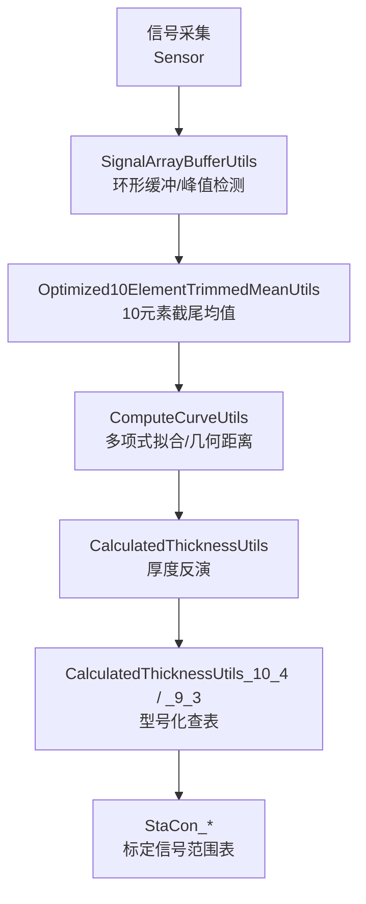
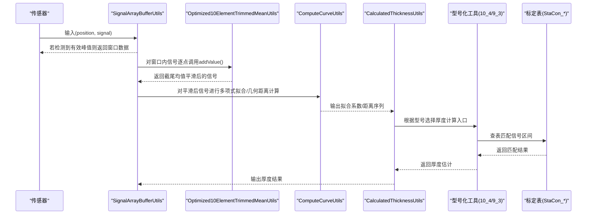
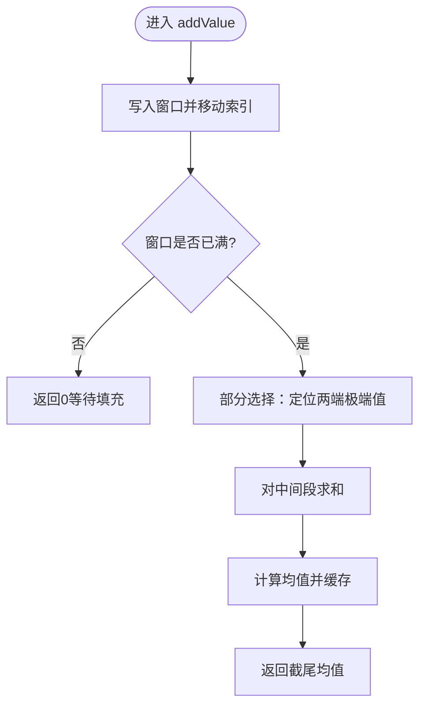
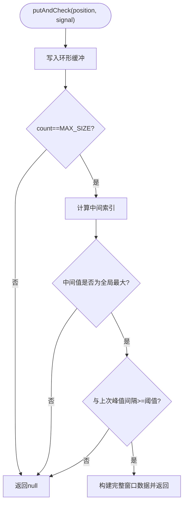
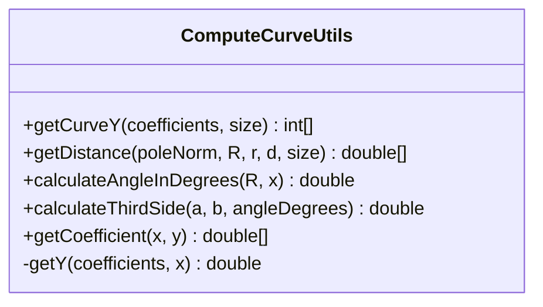
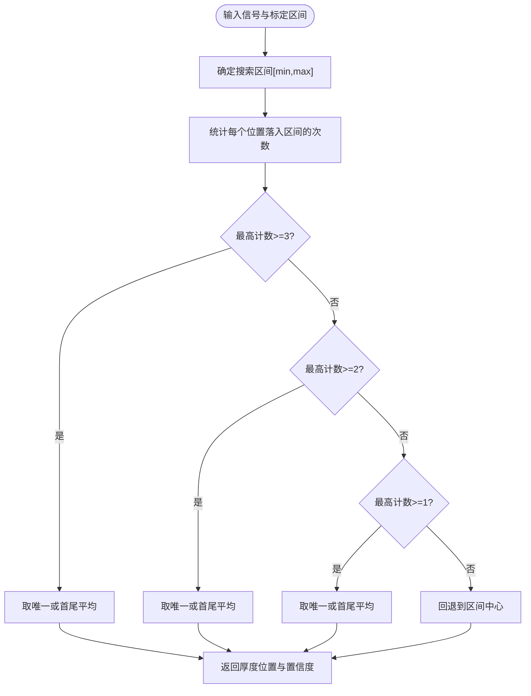
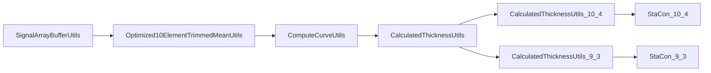

# 信号处理算法

<cite>
**本文引用的文件**
- [Optimized10ElementTrimmedMeanUtils.java](file://app/src/main/java/com/example/gtj_sd_dg240/utils/Optimized10ElementTrimmedMeanUtils.java)
- [SignalArrayBufferUtils.java](file://app/src/main/java/com/example/gtj_sd_dg240/utils/SignalArrayBufferUtils.java)
- [ComputeCurveUtils.java](file://app/src/main/java/com/example/gtj_sd_dg240/utils/ComputeCurveUtils.java)
- [CalculatedThicknessUtils.java](file://app/src/main/java/com/example/gtj_sd_dg240/utils/CalculatedThicknessUtils.java)
- [CalculatedThicknessUtils_10_4.java](file://app/src/main/java/com/example/gtj_sd_dg240/utils/CalculatedThicknessUtils_10_4.java)
- [CalculatedThicknessUtils_9_3.java](file://app/src/main/java/com/example/gtj_sd_dg240/utils/CalculatedThicknessUtils_9_3.java)
- [StaCon_10_4.java](file://app/src/main/java/com/example/gtj_sd_dg240/stacon/StaCon_10_4.java)
- [StaCon_9_3.java](file://app/src/main/java/com/example/gtj_sd_dg240/stacon/StaCon_9_3.java)
- [ComputeUtils.java](file://app/src/main/java/com/example/gtj_sd_dg240/utils/ComputeUtils.java)
</cite>

## 目录
1. [简介](#简介)
2. [项目结构](#项目结构)
3. [核心组件](#核心组件)
4. [架构总览](#架构总览)
5. [详细组件分析](#详细组件分析)
6. [依赖关系分析](#依赖关系分析)
7. [性能与实时性](#性能与实时性)
8. [故障排查指南](#故障排查指南)
9. [结论](#结论)
10. [附录：使用示例与参数配置](#附录使用示例与参数配置)

## 简介
本技术文档面向GTJ-SD-DG240应用的信号处理算法，重点阐述10元素截尾均值算法的数学模型、噪声抑制机制与信号平滑策略；深入解析Optimized10ElementTrimmedMeanUtils的核心实现（数据预处理、异常值检测、截尾计算）；并覆盖信号滤波技术、插值计算方法、精度优化策略。同时说明不同电杆型号对应的算法参数配置、性能指标对比与质量保证措施，提供从原始信号到处理后结果的完整使用流程，以及内存占用优化与实时处理能力等工程细节。

## 项目结构
本项目将信号采集缓冲、信号平滑与截尾均值、曲线拟合与几何距离计算、厚度反演与查表匹配等能力分层组织在工具类中，便于复用与扩展：
- 信号缓冲与峰值检测：SignalArrayBufferUtils
- 截尾均值平滑：Optimized10ElementTrimmedMeanUtils
- 曲线拟合与几何距离：ComputeCurveUtils
- 厚度反演与标定表：CalculatedThicknessUtils 及按型号分发的子类
- 几何与空间匹配辅助：ComputeUtils

图表来源
- [SignalArrayBufferUtils.java:26-66](file://app/src/main/java/com/example/gtj_sd_dg240/utils/SignalArrayBufferUtils.java#L26-L66)
- [Optimized10ElementTrimmedMeanUtils.java:93-129](file://app/src/main/java/com/example/gtj_sd_dg240/utils/Optimized10ElementTrimmedMeanUtils.java#L93-L129)
- [ComputeCurveUtils.java:121-139](file://app/src/main/java/com/example/gtj_sd_dg240/utils/ComputeCurveUtils.java#L121-L139)
- [CalculatedThicknessUtils.java:22-59](file://app/src/main/java/com/example/gtj_sd_dg240/utils/CalculatedThicknessUtils.java#L22-L59)
- [CalculatedThicknessUtils_10_4.java:17-94](file://app/src/main/java/com/example/gtj_sd_dg240/utils/CalculatedThicknessUtils_10_4.java#L17-L94)
- [CalculatedThicknessUtils_9_3.java:17-94](file://app/src/main/java/com/example/gtj_sd_dg240/utils/CalculatedThicknessUtils_9_3.java#L17-L94)
- [StaCon_10_4.java:7-75](file://app/src/main/java/com/example/gtj_sd_dg240/stacon/StaCon_10_4.java#L7-L75)
- [StaCon_9_3.java:7-74](file://app/src/main/java/com/example/gtj_sd_dg240/stacon/StaCon_9_3.java#L7-L74)

章节来源
- [SignalArrayBufferUtils.java:1-114](file://app/src/main/java/com/example/gtj_sd_dg240/utils/SignalArrayBufferUtils.java#L1-L114)
- [Optimized10ElementTrimmedMeanUtils.java:1-131](file://app/src/main/java/com/example/gtj_sd_dg240/utils/Optimized10ElementTrimmedMeanUtils.java#L1-L131)
- [ComputeCurveUtils.java:1-141](file://app/src/main/java/com/example/gtj_sd_dg240/utils/ComputeCurveUtils.java#L1-L141)
- [CalculatedThicknessUtils.java:1-131](file://app/src/main/java/com/example/gtj_sd_dg240/utils/CalculatedThicknessUtils.java#L1-L131)
- [CalculatedThicknessUtils_10_4.java:1-96](file://app/src/main/java/com/example/gtj_sd_dg240/utils/CalculatedThicknessUtils_10_4.java#L1-L96)
- [CalculatedThicknessUtils_9_3.java:1-96](file://app/src/main/java/com/example/gtj_sd_dg240/utils/CalculatedThicknessUtils_9_3.java#L1-L96)
- [StaCon_10_4.java:1-77](file://app/src/main/java/com/example/gtj_sd_dg240/stacon/StaCon_10_4.java#L1-L77)
- [StaCon_9_3.java:1-76](file://app/src/main/java/com/example/gtj_sd_dg240/stacon/StaCon_9_3.java#L1-L76)

## 核心组件
- 信号缓冲与峰值检测：基于固定大小环形缓冲区，维护位移与信号值序列，检测中间位置是否为全局最大值且满足最小间隔约束，输出完整窗口数据用于后续处理。
- 10元素截尾均值：滑动窗口大小为6，去除两端各2个极端值后对剩余2个中间值求平均；线程安全，带缓存加速。
- 曲线拟合与几何距离：使用二次多项式最小二乘拟合传感器曲线，结合电杆半径、钢筋半径与厚度进行几何距离换算。
- 厚度反演与标定表：根据信号区间与标定表上下界匹配，定位厚度位置并返回结果。
- 型号化参数分发：针对不同钢筋直径与间距组合，选择对应标定表进行厚度计算。

章节来源
- [SignalArrayBufferUtils.java:26-66](file://app/src/main/java/com/example/gtj_sd_dg240/utils/SignalArrayBufferUtils.java#L26-L66)
- [Optimized10ElementTrimmedMeanUtils.java:25-85](file://app/src/main/java/com/example/gtj_sd_dg240/utils/Optimized10ElementTrimmedMeanUtils.java#L25-L85)
- [ComputeCurveUtils.java:121-139](file://app/src/main/java/com/example/gtj_sd_dg240/utils/ComputeCurveUtils.java#L121-L139)
- [CalculatedThicknessUtils.java:22-59](file://app/src/main/java/com/example/gtj_sd_dg240/utils/CalculatedThicknessUtils.java#L22-L59)
- [CalculatedThicknessUtils_10_4.java:17-94](file://app/src/main/java/com/example/gtj_sd_dg240/utils/CalculatedThicknessUtils_10_4.java#L17-L94)
- [CalculatedThicknessUtils_9_3.java:17-94](file://app/src/main/java/com/example/gtj_sd_dg240/utils/CalculatedThicknessUtils_9_3.java#L17-L94)

## 架构总览
整体数据流从传感器采样开始，经缓冲与峰值检测得到稳定窗口，再进行截尾均值平滑以抑制噪声，随后通过曲线拟合与几何距离计算完成厚度反演，最终依据电杆型号选择标定表得出厚度结果。

图表来源
- [SignalArrayBufferUtils.java:26-66](file://app/src/main/java/com/example/gtj_sd_dg240/utils/SignalArrayBufferUtils.java#L26-L66)
- [Optimized10ElementTrimmedMeanUtils.java:93-129](file://app/src/main/java/com/example/gtj_sd_dg240/utils/Optimized10ElementTrimmedMeanUtils.java#L93-L129)
- [ComputeCurveUtils.java:121-139](file://app/src/main/java/com/example/gtj_sd_dg240/utils/ComputeCurveUtils.java#L121-L139)
- [CalculatedThicknessUtils.java:22-59](file://app/src/main/java/com/example/gtj_sd_dg240/utils/CalculatedThicknessUtils.java#L22-L59)
- [CalculatedThicknessUtils_10_4.java:17-94](file://app/src/main/java/com/example/gtj_sd_dg240/utils/CalculatedThicknessUtils_10_4.java#L17-L94)
- [CalculatedThicknessUtils_9_3.java:17-94](file://app/src/main/java/com/example/gtj_sd_dg240/utils/CalculatedThicknessUtils_9_3.java#L17-L94)
- [StaCon_10_4.java:7-75](file://app/src/main/java/com/example/gtj_sd_dg240/stacon/StaCon_10_4.java#L7-L75)
- [StaCon_9_3.java:7-74](file://app/src/main/java/com/example/gtj_sd_dg240/stacon/StaCon_9_3.java#L7-L74)

## 详细组件分析

### 10元素截尾均值算法（Optimized10ElementTrimmedMeanUtils）
- 数学模型
  - 滑动窗口大小W=6，截尾数TRIM=2，保留中间MIDDLE_COUNT=2个元素求均值。
  - 目标：剔除两端极端值，降低脉冲噪声与离群点对均值的影响，提升鲁棒性。
- 噪声抑制机制
  - 通过部分选择排序思想，先定位前TRIM小的元素与后TRIM大的元素，再对中间段求和取平均，避免全排序开销。
- 信号平滑技术
  - 每新增一个样本即更新窗口并计算新的截尾均值，形成时间域上的平滑轨迹，适合在线处理。
- 异常值检测
  - 截尾本身即是一种稳健的异常值抑制方法；配合窗口长度与截尾比例可调节灵敏度。
- 复杂度与优化
  - 每次插入O(W)，内部采用展开循环的部分选择，常数级优化；具备缓存命中路径，重复查询时直接返回缓存结果。
- 线程安全
  - 使用重入锁保护窗口更新与读取，确保多线程并发安全。

图表来源
- [Optimized10ElementTrimmedMeanUtils.java:25-85](file://app/src/main/java/com/example/gtj_sd_dg240/utils/Optimized10ElementTrimmedMeanUtils.java#L25-L85)
- [Optimized10ElementTrimmedMeanUtils.java:93-129](file://app/src/main/java/com/example/gtj_sd_dg240/utils/Optimized10ElementTrimmedMeanUtils.java#L93-L129)

章节来源
- [Optimized10ElementTrimmedMeanUtils.java:1-131](file://app/src/main/java/com/example/gtj_sd_dg240/utils/Optimized10ElementTrimmedMeanUtils.java#L1-L131)

### 信号缓冲与峰值检测（SignalArrayBufferUtils）
- 数据结构
  - 固定大小环形缓冲区，分别存储位移与信号值，支持循环写入与绝对索引映射。
- 峰值检测逻辑
  - 当缓冲区满时，检查中间位置的信号是否为全局最大值，且与上次有效峰值的最小位移间隔达到阈值，满足条件则输出完整窗口数据。
- 质量控制
  - 设置最小信号阈值与最小间隔，减少误检与密集峰值。

图表来源
- [SignalArrayBufferUtils.java:26-66](file://app/src/main/java/com/example/gtj_sd_dg240/utils/SignalArrayBufferUtils.java#L26-L66)
- [SignalArrayBufferUtils.java:83-94](file://app/src/main/java/com/example/gtj_sd_dg240/utils/SignalArrayBufferUtils.java#L83-L94)

章节来源
- [SignalArrayBufferUtils.java:1-114](file://app/src/main/java/com/example/gtj_sd_dg240/utils/SignalArrayBufferUtils.java#L1-L114)

### 曲线拟合与几何距离（ComputeCurveUtils）
- 多项式拟合
  - 使用二次多项式最小二乘法对窗口信号进行拟合，得到系数用于后续Y值计算。
- 几何距离计算
  - 基于电杆半径R、钢筋半径r与厚度d，利用余弦定理计算三角形第三边，再推导直线行走距离，考虑角度正负号修正方向。
- 插值与精度
  - 通过拟合函数在任意x处求y，保证连续性与平滑性；数值计算中进行有限值校验与舍入控制。

图表来源
- [ComputeCurveUtils.java:15-25](file://app/src/main/java/com/example/gtj_sd_dg240/utils/ComputeCurveUtils.java#L15-L25)
- [ComputeCurveUtils.java:36-67](file://app/src/main/java/com/example/gtj_sd_dg240/utils/ComputeCurveUtils.java#L36-L67)
- [ComputeCurveUtils.java:77-98](file://app/src/main/java/com/example/gtj_sd_dg240/utils/ComputeCurveUtils.java#L77-L98)
- [ComputeCurveUtils.java:121-139](file://app/src/main/java/com/example/gtj_sd_dg240/utils/ComputeCurveUtils.java#L121-L139)

章节来源
- [ComputeCurveUtils.java:1-141](file://app/src/main/java/com/example/gtj_sd_dg240/utils/ComputeCurveUtils.java#L1-L141)

### 厚度反演与标定表（CalculatedThicknessUtils 与 StaCon_*）
- 厚度反演流程
  - 根据信号列表的上升沿与下降沿索引确定搜索区间，统计每个位置落入标定区间的次数，优先选择高置信度区间（如计数为3），其次降级至2或1，最后退化为区间中心。
  - 返回厚度位置与置信度计数。
- 型号化参数配置
  - 针对钢筋直径与主筋间距的不同组合，提供独立的厚度计算入口，内部通过switch选择对应标定表。
- 标定表内容
  - 每种型号包含多组上下界信号范围，覆盖不同箍筋间距场景，用于匹配实际信号特征。

图表来源
- [CalculatedThicknessUtils.java:22-59](file://app/src/main/java/com/example/gtj_sd_dg240/utils/CalculatedThicknessUtils.java#L22-L59)
- [CalculatedThicknessUtils.java:79-129](file://app/src/main/java/com/example/gtj_sd_dg240/utils/CalculatedThicknessUtils.java#L79-L129)
- [CalculatedThicknessUtils_10_4.java:17-94](file://app/src/main/java/com/example/gtj_sd_dg240/utils/CalculatedThicknessUtils_10_4.java#L17-L94)
- [CalculatedThicknessUtils_9_3.java:17-94](file://app/src/main/java/com/example/gtj_sd_dg240/utils/CalculatedThicknessUtils_9_3.java#L17-L94)
- [StaCon_10_4.java:7-75](file://app/src/main/java/com/example/gtj_sd_dg240/stacon/StaCon_10_4.java#L7-L75)
- [StaCon_9_3.java:7-74](file://app/src/main/java/com/example/gtj_sd_dg240/stacon/StaCon_9_3.java#L7-L74)

章节来源
- [CalculatedThicknessUtils.java:1-131](file://app/src/main/java/com/example/gtj_sd_dg240/utils/CalculatedThicknessUtils.java#L1-L131)
- [CalculatedThicknessUtils_10_4.java:1-96](file://app/src/main/java/com/example/gtj_sd_dg240/utils/CalculatedThicknessUtils_10_4.java#L1-L96)
- [CalculatedThicknessUtils_9_3.java:1-96](file://app/src/main/java/com/example/gtj_sd_dg240/utils/CalculatedThicknessUtils_9_3.java#L1-L96)
- [StaCon_10_4.java:1-77](file://app/src/main/java/com/example/gtj_sd_dg240/stacon/StaCon_10_4.java#L1-L77)
- [StaCon_9_3.java:1-76](file://app/src/main/java/com/example/gtj_sd_dg240/stacon/StaCon_9_3.java#L1-L76)

### 几何与空间匹配辅助（ComputeUtils）
- 功能
  - 提供通用几何计算与空间匹配规则，用于在不同参数范围内判定匹配关系，支撑厚度反演的边界判断与容差处理。
- 应用场景
  - 在厚度反演过程中，对不同区间进行宽松匹配与特殊区域扩展，提高鲁棒性。

章节来源
- [ComputeUtils.java:1-152](file://app/src/main/java/com/example/gtj_sd_dg240/utils/ComputeUtils.java#L1-L152)

## 依赖关系分析
- 低耦合设计
  - 各工具类职责清晰，依赖方向单一：缓冲→平滑→拟合→厚度→标定表。
- 外部依赖
  - 曲线拟合依赖Apache Commons Math的多项式拟合器，提供稳定的最小二乘求解。
- 潜在风险
  - 标定表规模较大，需关注内存占用与加载时机；建议在应用启动时按需预加载或懒加载。

图表来源
- [SignalArrayBufferUtils.java:26-66](file://app/src/main/java/com/example/gtj_sd_dg240/utils/SignalArrayBufferUtils.java#L26-L66)
- [Optimized10ElementTrimmedMeanUtils.java:93-129](file://app/src/main/java/com/example/gtj_sd_dg240/utils/Optimized10ElementTrimmedMeanUtils.java#L93-L129)
- [ComputeCurveUtils.java:121-139](file://app/src/main/java/com/example/gtj_sd_dg240/utils/ComputeCurveUtils.java#L121-L139)
- [CalculatedThicknessUtils.java:22-59](file://app/src/main/java/com/example/gtj_sd_dg240/utils/CalculatedThicknessUtils.java#L22-L59)
- [CalculatedThicknessUtils_10_4.java:17-94](file://app/src/main/java/com/example/gtj_sd_dg240/utils/CalculatedThicknessUtils_10_4.java#L17-L94)
- [CalculatedThicknessUtils_9_3.java:17-94](file://app/src/main/java/com/example/gtj_sd_dg240/utils/CalculatedThicknessUtils_9_3.java#L17-L94)
- [StaCon_10_4.java:7-75](file://app/src/main/java/com/example/gtj_sd_dg240/stacon/StaCon_10_4.java#L7-L75)
- [StaCon_9_3.java:7-74](file://app/src/main/java/com/example/gtj_sd_dg240/stacon/StaCon_9_3.java#L7-L74)

章节来源
- [ComputeCurveUtils.java:1-141](file://app/src/main/java/com/example/gtj_sd_dg240/utils/ComputeCurveUtils.java#L1-L141)
- [CalculatedThicknessUtils.java:1-131](file://app/src/main/java/com/example/gtj_sd_dg240/utils/CalculatedThicknessUtils.java#L1-L131)

## 性能与实时性
- 时间复杂度
  - 截尾均值：每次插入O(W)，W=6，常数级操作；部分选择排序进一步降低比较次数。
  - 峰值检测：每次扫描窗口O(N)，N为缓冲区大小；可通过调整阈值与间隔减少频繁触发。
  - 曲线拟合：最小二乘拟合为批量操作，通常在窗口完成后执行一次，成本可控。
- 内存占用
  - 环形缓冲固定大小，内存稳定；标定表为静态常量数组，建议按需加载或延迟初始化以降低冷启动压力。
- 实时能力
  - 截尾均值与缓冲均为在线算法，适合实时流处理；加锁粒度小，避免阻塞主线程。
- 精度优化
  - 截尾比例可调（当前TRIM=2/W=6≈33%），可根据现场噪声水平微调；拟合阶数与舍入策略影响平滑度与偏差。
- 质量保障
  - 峰值检测引入最小信号阈值与最小间隔，降低误检；厚度反演采用多级置信度降级策略，增强鲁棒性。

[本节为通用性能讨论，不直接分析具体代码行]

## 故障排查指南
- 无输出或结果为0
  - 检查缓冲区是否已满；确认中间位置信号是否超过阈值且为全局最大；验证与上次峰值的位移间隔是否满足要求。
- 厚度反演失败
  - 检查标定表是否匹配当前型号；确认信号区间是否在标定范围内；观察置信度计数是否过低导致回退到中心。
- 拟合异常
  - 检查输入数据是否包含非有限值；确认拟合点数足够；核对半径与厚度参数合理性。
- 性能瓶颈
  - 评估峰值检测频率；考虑增大最小间隔以减少计算；必要时降低拟合频率或批处理。

章节来源
- [SignalArrayBufferUtils.java:26-66](file://app/src/main/java/com/example/gtj_sd_dg240/utils/SignalArrayBufferUtils.java#L26-L66)
- [CalculatedThicknessUtils.java:22-59](file://app/src/main/java/com/example/gtj_sd_dg240/utils/CalculatedThicknessUtils.java#L22-L59)
- [ComputeCurveUtils.java:56-67](file://app/src/main/java/com/example/gtj_sd_dg240/utils/ComputeCurveUtils.java#L56-L67)

## 结论
本方案通过“缓冲+峰值检测→截尾均值平滑→曲线拟合→厚度反演→标定表匹配”的分层架构，实现了在复杂电磁环境下对混凝土电杆厚度的稳健测量。10元素截尾均值算法以较小窗口与合理截尾比例有效抑制噪声与异常值；配合几何距离计算与多级置信度反演，提升了精度与鲁棒性。工程上通过环形缓冲、缓存与线程安全设计，保障了实时性与稳定性。

[本节为总结性内容，不直接分析具体代码行]

## 附录：使用示例与参数配置

### 典型处理流程
- 步骤1：初始化缓冲与平滑器
  - 设置缓冲区大小与阈值；创建截尾均值实例。
- 步骤2：采集与检测
  - 持续输入(position, signal)；当检测到有效峰值时获取完整窗口数据。
- 步骤3：平滑与拟合
  - 对窗口内信号逐点调用截尾均值；对平滑后信号进行多项式拟合与几何距离计算。
- 步骤4：厚度反演
  - 根据电杆型号选择厚度计算入口；传入信号与标定表；获得厚度与置信度。

章节来源
- [SignalArrayBufferUtils.java:26-66](file://app/src/main/java/com/example/gtj_sd_dg240/utils/SignalArrayBufferUtils.java#L26-L66)
- [Optimized10ElementTrimmedMeanUtils.java:93-129](file://app/src/main/java/com/example/gtj_sd_dg240/utils/Optimized10ElementTrimmedMeanUtils.java#L93-L129)
- [ComputeCurveUtils.java:121-139](file://app/src/main/java/com/example/gtj_sd_dg240/utils/ComputeCurveUtils.java#L121-L139)
- [CalculatedThicknessUtils.java:22-59](file://app/src/main/java/com/example/gtj_sd_dg240/utils/CalculatedThicknessUtils.java#L22-L59)

### 不同电杆型号的参数配置
- 钢筋直径10mm系列
  - 使用CalculatedThicknessUtils_10_4，根据主筋间距与箍筋间距选择对应标定表（StaCon_10_4）。
- 钢筋直径9mm系列
  - 使用CalculatedThicknessUtils_9_3，根据主筋间距与箍筋间距选择对应标定表（StaCon_9_3）。
- 参数调优
  - 截尾比例：当前TRIM=2/W=6，可根据噪声水平调整窗口大小或截尾数。
  - 峰值检测阈值与间隔：根据现场环境调整最小信号阈值与最小位移间隔，平衡灵敏度与稳定性。

章节来源
- [CalculatedThicknessUtils_10_4.java:17-94](file://app/src/main/java/com/example/gtj_sd_dg240/utils/CalculatedThicknessUtils_10_4.java#L17-L94)
- [CalculatedThicknessUtils_9_3.java:17-94](file://app/src/main/java/com/example/gtj_sd_dg240/utils/CalculatedThicknessUtils_9_3.java#L17-L94)
- [StaCon_10_4.java:7-75](file://app/src/main/java/com/example/gtj_sd_dg240/stacon/StaCon_10_4.java#L7-L75)
- [StaCon_9_3.java:7-74](file://app/src/main/java/com/example/gtj_sd_dg240/stacon/StaCon_9_3.java#L7-L74)

### 性能指标与质量保证
- 性能指标
  - 单次截尾均值计算：常数级时间；峰值检测：线性扫描窗口；拟合：批量最小二乘。
- 内存优化
  - 环形缓冲固定大小；标定表静态常量；建议懒加载与按需初始化。
- 质量保证
  - 多级置信度降级；最小间隔与阈值控制；有限值校验与舍入控制。

[本节为通用指导，不直接分析具体代码行]