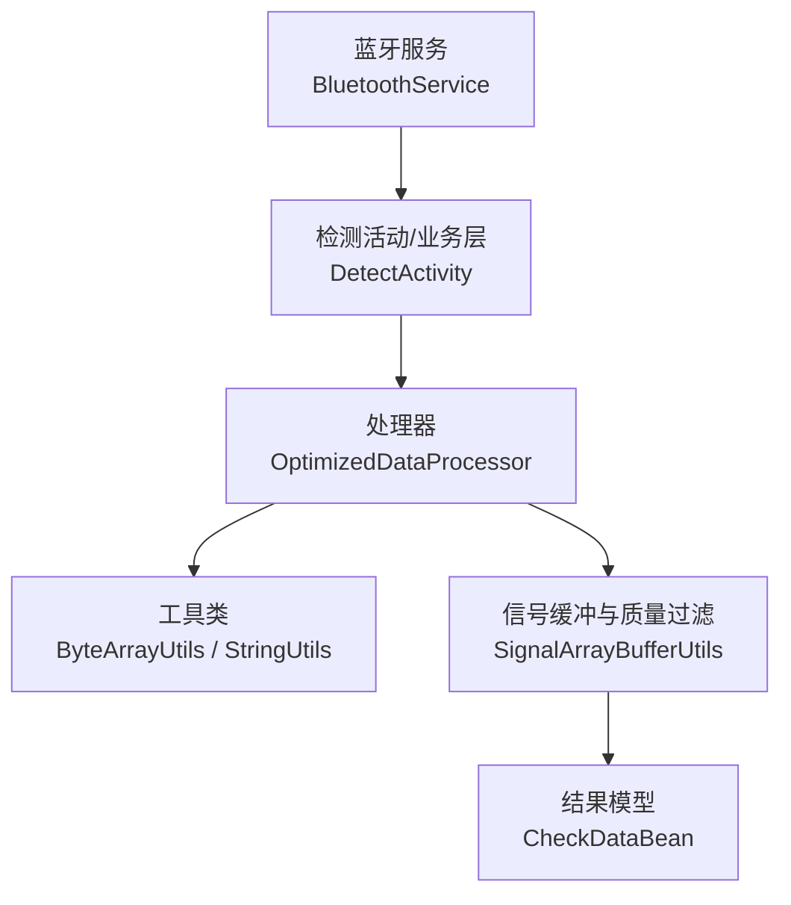
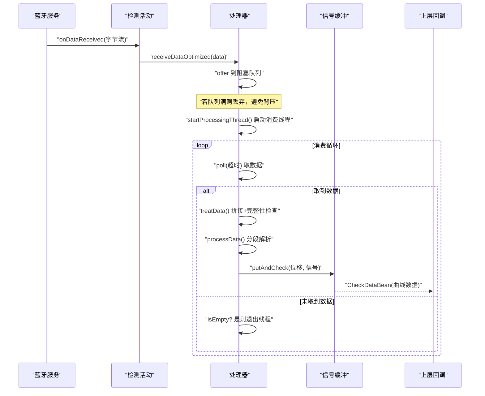
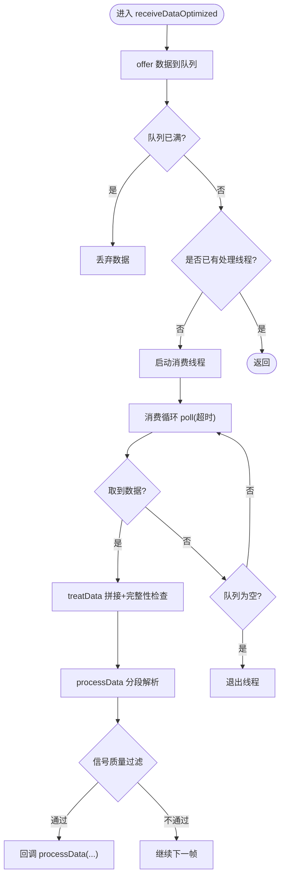
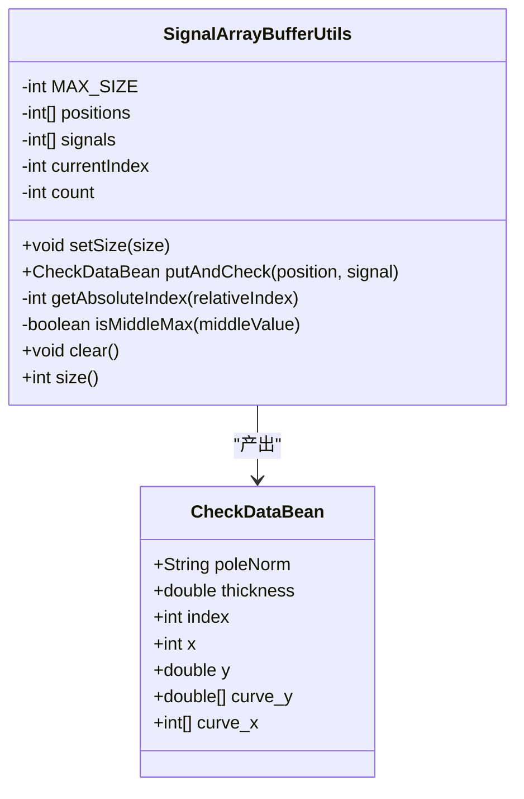
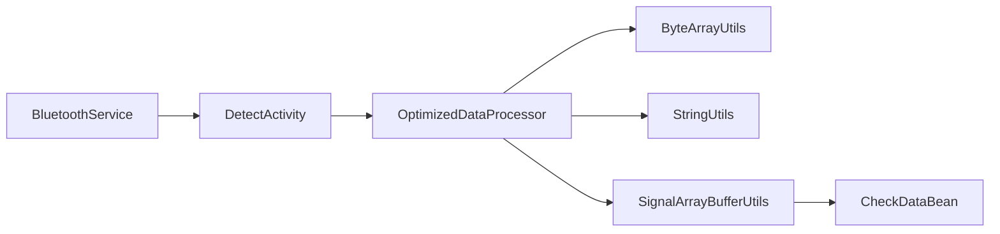

# 处理流水线架构

<cite>
**本文引用的文件**
- [OptimizedDataProcessor.java](file://app/src/main/java/com/example/gtj_sd_dg240/utils/OptimizedDataProcessor.java)
- [SignalArrayBufferUtils.java](file://app/src/main/java/com/example/gtj_sd_dg240/utils/SignalArrayBufferUtils.java)
- [ByteArrayUtils.java](file://app/src/main/java/com/example/gtj_sd_dg240/utils/ByteArrayUtils.java)
- [StringUtils.java](file://app/src/main/java/com/example/gtj_sd_dg240/utils/StringUtils.java)
- [BluetoothService.java](file://app/src/main/java/com/example/gtj_sd_dg240/bluetooth/BluetoothService.java)
- [DetectActivity.java](file://app/src/main/java/com/example/gtj_sd_dg240/activity/testing/DetectActivity.java)
- [CheckDataBean.java](file://app/src/main/java/com/example/gtj_sd_dg240/model/CheckDataBean.java)
- [StaticConstant.java](file://app/src/main/java/com/example/gtj_sd_dg240/StaticConstant.java)
- [Optimized10ElementTrimmedMeanUtils.java](file://app/src/main/java/com/example/gtj_sd_dg240/utils/Optimized10ElementTrimmedMeanUtils.java)
</cite>

## 目录
1. [简介](#简介)
2. [项目结构](#项目结构)
3. [核心组件](#核心组件)
4. [架构总览](#架构总览)
5. [详细组件分析](#详细组件分析)
6. [依赖关系分析](#依赖关系分析)
7. [性能考量](#性能考量)
8. [故障排查指南](#故障排查指南)
9. [结论](#结论)
10. [附录：配置与扩展示例](#附录：配置与扩展示例)

## 简介
本技术文档面向GTJ-SD-DG240应用的数据处理流水线，重点说明基于生产者-消费者模式的高并发数据处理实现。该流水线从蓝牙数据接收开始，经过帧拼接、完整性校验、分段解析、信号提取、质量过滤到结果输出，形成一条稳定高效的处理链。文档同时涵盖线程安全队列、异步处理机制、任务调度策略、高并发优化（线程池管理、资源复用、GC优化）、数据完整性验证、错误恢复与异常处理流程，并提供可操作的配置参数、性能调优建议、监控指标定义以及扩展开发示例。

## 项目结构
- 数据入口：蓝牙服务将设备上报的原始字节流通过回调分发至业务层。
- 生产端：业务层调用 OptimizedDataProcessor.receiveDataOptimized 将数据放入阻塞队列。
- 消费端：内部单处理线程持续从队列取数据，进行帧拼接、完整性检查、分段解析、信号提取与质量过滤，最终通过回调接口交付给上层。
- 辅助工具：提供字节数组操作、字符串转换、滑动窗口统计等工具类，支撑流水线各阶段的高效实现。

图表来源
- [BluetoothService.java:175-198](file://app/src/main/java/com/example/gtj_sd_dg240/bluetooth/BluetoothService.java#L175-L198)
- [DetectActivity.java:171-191](file://app/src/main/java/com/example/gtj_sd_dg240/activity/testing/DetectActivity.java#L171-L191)
- [OptimizedDataProcessor.java:34-75](file://app/src/main/java/com/example/gtj_sd_dg240/utils/OptimizedDataProcessor.java#L34-L75)
- [SignalArrayBufferUtils.java:26-66](file://app/src/main/java/com/example/gtj_sd_dg240/utils/SignalArrayBufferUtils.java#L26-L66)
- [CheckDataBean.java:1-33](file://app/src/main/java/com/example/gtj_sd_dg240/model/CheckDataBean.java#L1-L33)

章节来源
- [BluetoothService.java:175-198](file://app/src/main/java/com/example/gtj_sd_dg240/bluetooth/BluetoothService.java#L175-L198)
- [DetectActivity.java:171-191](file://app/src/main/java/com/example/gtj_sd_dg240/activity/testing/DetectActivity.java#L171-L191)
- [OptimizedDataProcessor.java:34-75](file://app/src/main/java/com/example/gtj_sd_dg240/utils/OptimizedDataProcessor.java#L34-L75)
- [SignalArrayBufferUtils.java:26-66](file://app/src/main/java/com/example/gtj_sd_dg240/utils/SignalArrayBufferUtils.java#L26-L66)
- [CheckDataBean.java:1-33](file://app/src/main/java/com/example/gtj_sd_dg240/model/CheckDataBean.java#L1-L33)

## 核心组件
- 生产者-消费者处理器：OptimizedDataProcessor
  - 使用无界/有界阻塞队列作为缓冲区，采用非阻塞入队避免阻塞上游；当队列满时丢弃数据以保护系统稳定性。
  - 单处理线程消费队列，循环取数并执行帧拼接与解析，空队列时退出以避免常驻线程占用资源。
  - 通过回调接口 DataProcessor.processData 将位移、信号值与帧数据传递给上层。
- 信号缓冲与质量过滤：SignalArrayBufferUtils
  - 使用固定大小的环形缓冲区存储最近N个（如61）位移-信号对。
  - 在缓冲区满后，计算中间位置信号是否为最大值且超过阈值，满足条件且位移间隔达标则输出完整曲线数据。
- 工具类：
  - ByteArrayUtils：高效的字节数组拼接、截取、查找、分割等操作，减少临时对象创建。
  - StringUtils：十六进制转换、数值格式化、插值计算等。
- 蓝牙服务：BluetoothService
  - 统一管理连接状态、自动重连、数据通知注册与分发，确保数据回调在主线程安全更新UI。
- 检测活动：DetectActivity
  - 接收蓝牙数据回调，按协议解析显示或进入预估直径模式，驱动处理流水线的启动与展示。

章节来源
- [OptimizedDataProcessor.java:7-133](file://app/src/main/java/com/example/gtj_sd_dg240/utils/OptimizedDataProcessor.java#L7-L133)
- [SignalArrayBufferUtils.java:5-114](file://app/src/main/java/com/example/gtj_sd_dg240/utils/SignalArrayBufferUtils.java#L5-L114)
- [ByteArrayUtils.java:24-115](file://app/src/main/java/com/example/gtj_sd_dg240/utils/ByteArrayUtils.java#L24-L115)
- [StringUtils.java:269-280](file://app/src/main/java/com/example/gtj_sd_dg240/utils/StringUtils.java#L269-L280)
- [BluetoothService.java:175-198](file://app/src/main/java/com/example/gtj_sd_dg240/bluetooth/BluetoothService.java#L175-L198)
- [DetectActivity.java:171-191](file://app/src/main/java/com/example/gtj_sd_dg240/activity/testing/DetectActivity.java#L171-L191)

## 架构总览
下图展示了从蓝牙接收到结果输出的完整流水线时序，包括帧拼接、完整性校验、分段解析、信号提取与质量过滤的关键步骤。

图表来源
- [BluetoothService.java:175-198](file://app/src/main/java/com/example/gtj_sd_dg240/bluetooth/BluetoothService.java#L175-L198)
- [OptimizedDataProcessor.java:34-133](file://app/src/main/java/com/example/gtj_sd_dg240/utils/OptimizedDataProcessor.java#L34-L133)
- [SignalArrayBufferUtils.java:26-66](file://app/src/main/java/com/example/gtj_sd_dg240/utils/SignalArrayBufferUtils.java#L26-L66)

## 详细组件分析

### 生产者-消费者处理器（OptimizedDataProcessor）
- 线程安全队列：使用 LinkedBlockingQueue 作为缓冲，容量为固定大小，防止内存无限增长。
- 非阻塞入队：offer 方式快速失败，避免在高吞吐场景下阻塞上游导致丢包或卡顿。
- 单线程消费：简化同步复杂度，降低锁竞争；当队列为空时主动退出，释放线程资源。
- 帧拼接与完整性校验：维护 currentByte 累积数据，扫描帧头标志位（例如特定字节序列），定位有效帧起始位置，必要时丢弃无效前缀。
- 分段解析：按固定帧长（例如7字节）切分，提取位移与信号字段，并进行基础质量过滤（如信号阈值）。
- 回调输出：通过 DataProcessor 接口将结构化数据交给上层，便于解耦与扩展。

图表来源
- [OptimizedDataProcessor.java:34-133](file://app/src/main/java/com/example/gtj_sd_dg240/utils/OptimizedDataProcessor.java#L34-L133)

章节来源
- [OptimizedDataProcessor.java:34-133](file://app/src/main/java/com/example/gtj_sd_dg240/utils/OptimizedDataProcessor.java#L34-L133)

### 信号缓冲与质量过滤（SignalArrayBufferUtils）
- 环形缓冲区：固定大小存储最近N个位移-信号对，索引循环更新，避免频繁分配。
- 质量判定：缓冲区满后，计算中间位置信号是否为全局最大值且大于阈值；若满足且位移间隔达到有效间距，则输出完整曲线。
- 线程安全：使用 synchronized 保证 putAndCheck 的原子性。
- 输出模型：构造 CheckDataBean，包含曲线x/y数组，供上层渲染或进一步分析。

图表来源
- [SignalArrayBufferUtils.java:5-114](file://app/src/main/java/com/example/gtj_sd_dg240/utils/SignalArrayBufferUtils.java#L5-L114)
- [CheckDataBean.java:1-33](file://app/src/main/java/com/example/gtj_sd_dg240/model/CheckDataBean.java#L1-L33)

章节来源
- [SignalArrayBufferUtils.java:26-66](file://app/src/main/java/com/example/gtj_sd_dg240/utils/SignalArrayBufferUtils.java#L26-L66)
- [CheckDataBean.java:1-33](file://app/src/main/java/com/example/gtj_sd_dg240/model/CheckDataBean.java#L1-L33)

### 蓝牙数据接入（BluetoothService）
- 单例管理：统一生命周期，避免重复注册与资源泄漏。
- 自动重连：定时检查连接状态，断开后尝试重连，提升鲁棒性。
- 数据分发：注册BLE通知回调，将收到的字节流通过主线程分发到所有已注册的数据回调，确保UI线程安全。

章节来源
- [BluetoothService.java:17-52](file://app/src/main/java/com/example/gtj_sd_dg240/bluetooth/BluetoothService.java#L17-L52)
- [BluetoothService.java:175-198](file://app/src/main/java/com/example/gtj_sd_dg240/bluetooth/BluetoothService.java#L175-L198)
- [BluetoothService.java:203-234](file://app/src/main/java/com/example/gtj_sd_dg240/bluetooth/BluetoothService.java#L203-L234)

### 检测活动（DetectActivity）
- 数据接收：在 onBluetoothDataReceived 中根据检测类型处理数据，单点检测直接解析显示，预估直径模式进行累积与分段显示。
- 交互控制：绑定按钮事件，初始化校准列表与UI控件，驱动检测流程。

章节来源
- [DetectActivity.java:171-191](file://app/src/main/java/com/example/gtj_sd_dg240/activity/testing/DetectActivity.java#L171-L191)

## 依赖关系分析
- 低耦合设计：处理器通过接口 DataProcessor 与上层解耦，便于替换不同处理逻辑。
- 工具类复用：ByteArrayUtils 与 StringUtils 被多处使用，减少重复代码与潜在不一致。
- 蓝牙服务与业务层分离：BluetoothService 仅负责连接与数据分发，业务逻辑集中在活动与处理器中。

图表来源
- [BluetoothService.java:175-198](file://app/src/main/java/com/example/gtj_sd_dg240/bluetooth/BluetoothService.java#L175-L198)
- [OptimizedDataProcessor.java:34-133](file://app/src/main/java/com/example/gtj_sd_dg240/utils/OptimizedDataProcessor.java#L34-L133)
- [SignalArrayBufferUtils.java:26-66](file://app/src/main/java/com/example/gtj_sd_dg240/utils/SignalArrayBufferUtils.java#L26-L66)

章节来源
- [OptimizedDataProcessor.java:34-133](file://app/src/main/java/com/example/gtj_sd_dg240/utils/OptimizedDataProcessor.java#L34-L133)
- [SignalArrayBufferUtils.java:26-66](file://app/src/main/java/com/example/gtj_sd_dg240/utils/SignalArrayBufferUtils.java#L26-L66)
- [BluetoothService.java:175-198](file://app/src/main/java/com/example/gtj_sd_dg240/bluetooth/BluetoothService.java#L175-L198)

## 性能考量
- 线程池管理
  - 当前实现使用单线程消费队列，适合简单场景与低延迟需求；在高并发或多阶段处理场景，建议引入固定大小线程池（如 ThreadPoolExecutor）以并行化解析、滤波、输出等阶段，提高吞吐。
  - 合理设置核心线程数与最大线程数，避免上下文切换开销过大。
- 资源复用
  - 使用固定容量的环形缓冲区与预分配数组，减少GC压力。
  - 字节数组操作尽量使用 System.arraycopy 与切片方法，避免不必要的拷贝。
- GC优化
  - 限制临时对象创建，如在帧解析过程中复用缓冲区。
  - 合理设置队列容量，避免过多堆积导致内存峰值升高。
- 背压与丢包策略
  - offer 非阻塞入队在队列满时丢弃数据，保障系统响应性；可根据业务需求调整队列大小或增加丢弃计数用于监控。
- 监控指标
  - 队列长度、丢弃次数、处理耗时（平均/分位）、信号质量通过率、帧完整性命中率、线程活跃数。
- 配置参数建议
  - 队列容量：根据设备数据速率与处理能力设定，常见范围 500-5000。
  - 信号阈值：依据传感器特性与现场环境调整，避免噪声误报。
  - 缓冲区大小：典型值为 61，可根据采集频率与显示粒度调整。
  - 超时时间：poll 超时建议 5-20ms，平衡延迟与CPU占用。

[本节为通用性能指导，不直接分析具体文件]

## 故障排查指南
- 数据丢失
  - 现象：部分帧未被处理。
  - 可能原因：队列满导致丢弃；帧头匹配失败导致无法定位有效帧。
  - 排查：检查队列容量与丢弃计数；确认帧头标志位与协议一致性。
- 处理线程未退出
  - 现象：后台线程常驻。
  - 可能原因：队列未清空或轮询逻辑未正确判断空队列。
  - 排查：确认 poll 超时与 isEmpty 判断逻辑；确保业务停止时清理队列。
- 信号质量差
  - 现象：输出曲线噪声大或误检。
  - 可能原因：信号阈值过低；缓冲区大小不合适；位移间隔判断过宽。
  - 排查：调整阈值与缓冲区大小；结合现场标定优化参数。
- 蓝牙连接不稳定
  - 现象：数据中断或频繁重连。
  - 可能原因：设备距离远、干扰强；重连策略过于激进。
  - 排查：检查信号强度；调整重连间隔与自动重连开关。

章节来源
- [OptimizedDataProcessor.java:34-133](file://app/src/main/java/com/example/gtj_sd_dg240/utils/OptimizedDataProcessor.java#L34-L133)
- [SignalArrayBufferUtils.java:26-66](file://app/src/main/java/com/example/gtj_sd_dg240/utils/SignalArrayBufferUtils.java#L26-L66)
- [BluetoothService.java:203-234](file://app/src/main/java/com/example/gtj_sd_dg240/bluetooth/BluetoothService.java#L203-L234)

## 结论
本流水线通过生产者-消费者模式实现了高并发、低延迟的数据处理，具备帧级完整性校验与信号质量过滤能力。借助工具类的资源复用与合理的队列策略，系统在移动端环境下保持了较好的稳定性与性能。未来可通过引入线程池、多阶段并行、更精细的监控与自适应参数调节进一步提升吞吐与鲁棒性。

[本节为总结性内容，不直接分析具体文件]

## 附录：配置与扩展示例

### 流水线配置参数
- 队列容量：影响吞吐与内存占用，建议根据实际数据速率与设备性能调优。
- 信号阈值：决定噪声过滤强度，需结合标定数据与现场环境确定。
- 缓冲区大小：影响曲线分辨率与实时性，常用值为 61。
- 超时时间：poll 超时影响延迟与CPU占用，建议 5-20ms。
- 自动重连间隔：蓝牙重连策略，建议 1-3秒。

章节来源
- [StaticConstant.java:67-70](file://app/src/main/java/com/example/gtj_sd_dg240/StaticConstant.java#L67-L70)
- [BluetoothService.java:203-234](file://app/src/main/java/com/example/gtj_sd_dg240/bluetooth/BluetoothService.java#L203-L234)

### 扩展处理步骤
- 新增过滤器：在 OptimizeDataProcessor.processData 之后插入自定义过滤逻辑，例如基于 Optimized10ElementTrimmedMeanUtils 的稳健均值滤波。
- 替换回调实现：实现 DataProcessor 接口，将处理结果写入数据库、网络上传或本地缓存。
- 多阶段并行：将解析、滤波、输出分别交由不同线程处理，通过队列串联，提高整体吞吐。

章节来源
- [OptimizedDataProcessor.java:122-133](file://app/src/main/java/com/example/gtj_sd_dg240/utils/OptimizedDataProcessor.java#L122-L133)
- [Optimized10ElementTrimmedMeanUtils.java:93-129](file://app/src/main/java/com/example/gtj_sd_dg240/utils/Optimized10ElementTrimmedMeanUtils.java#L93-L129)

### 自定义数据过滤器
- 基于稳健统计：使用 Optimized10ElementTrimmedMeanUtils 去除极端值，提升信号稳定性。
- 基于阈值与区间：结合位移间隔与信号幅度，剔除异常点。
- 基于历史趋势：维护滑动窗口，检测突变与漂移，动态调整阈值。

章节来源
- [Optimized10ElementTrimmedMeanUtils.java:93-129](file://app/src/main/java/com/example/gtj_sd_dg240/utils/Optimized10ElementTrimmedMeanUtils.java#L93-L129)
- [SignalArrayBufferUtils.java:26-66](file://app/src/main/java/com/example/gtj_sd_dg240/utils/SignalArrayBufferUtils.java#L26-L66)

### 优化处理性能
- 线程池替代单线程：在高吞吐场景下，使用固定线程池并行处理解析、滤波、输出，注意线程间数据传递的序列化成本。
- 减少对象分配：复用缓冲区与数组，避免频繁创建临时对象。
- 监控与告警：记录关键指标（队列长度、丢弃次数、处理耗时），设置阈值告警，及时发现问题。

[本节为通用优化建议，不直接分析具体文件]