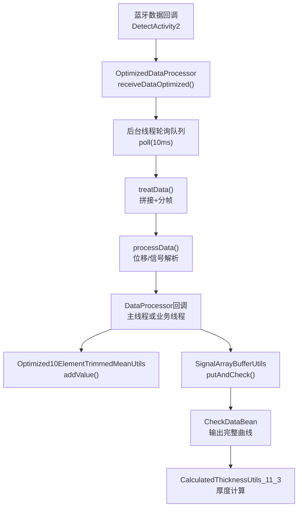
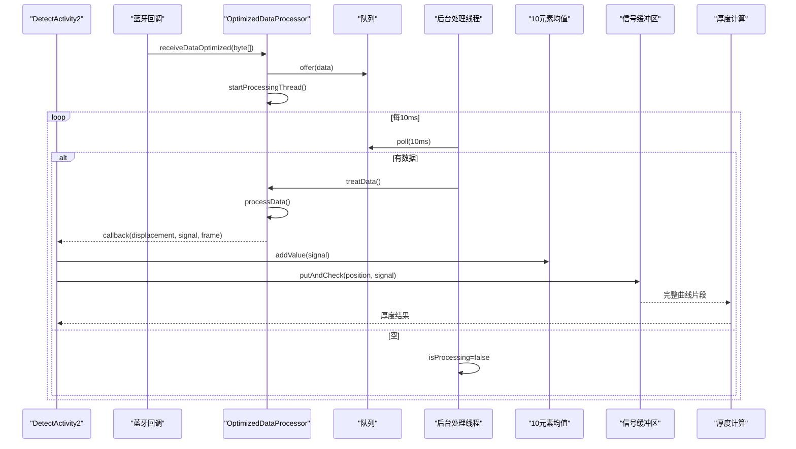
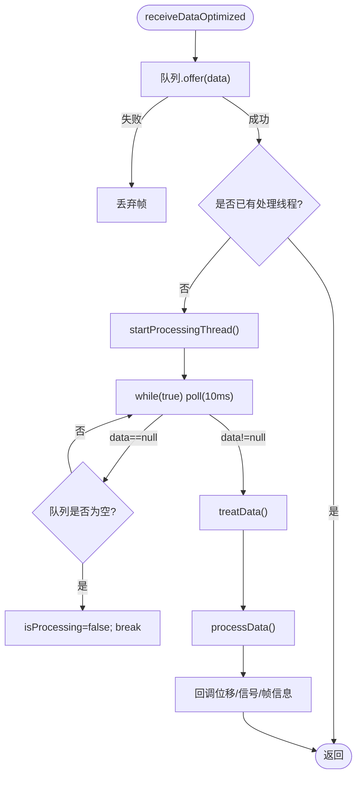
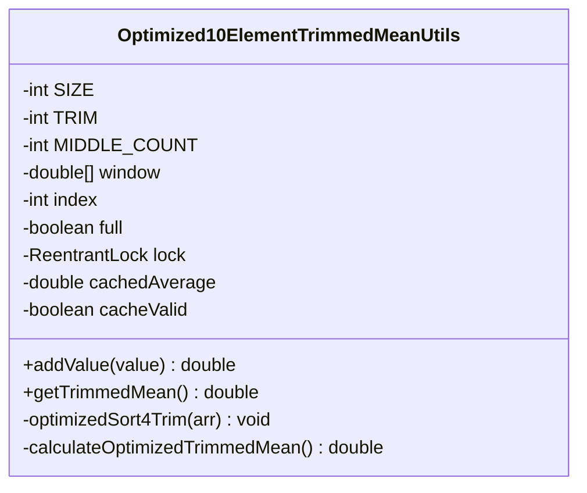
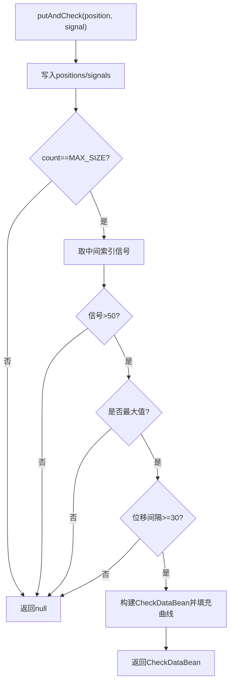
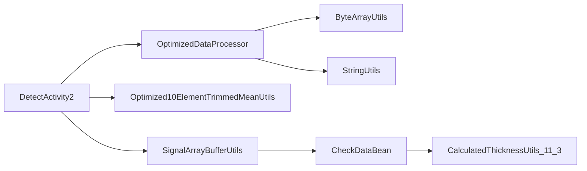

# 数据处理引擎

<cite>
**本文引用的文件**
- [OptimizedDataProcessor.java](file://app/src/main/java/com/example/gtj_sd_dg240/utils/OptimizedDataProcessor.java)
- [Optimized10ElementTrimmedMeanUtils.java](file://app/src/main/java/com/example/gtj_sd_dg240/utils/Optimized10ElementTrimmedMeanUtils.java)
- [SignalArrayBufferUtils.java](file://app/src/main/java/com/example/gtj_sd_dg240/utils/SignalArrayBufferUtils.java)
- [ByteArrayUtils.java](file://app/src/main/java/com/example/gtj_sd_dg240/utils/ByteArrayUtils.java)
- [StringUtils.java](file://app/src/main/java/com/example/gtj_sd_dg240/utils/StringUtils.java)
- [CalculatedThicknessUtils_11_3.java](file://app/src/main/java/com/example/gtj_sd_dg240/utils/CalculatedThicknessUtils_11_3.java)
- [CheckDataBean.java](file://app/src/main/java/com/example/gtj_sd_dg240/model/CheckDataBean.java)
- [DetectActivity2.java](file://app/src/main/java/com/example/gtj_sd_dg240/activity/testing/DetectActivity2.java)
</cite>

## 目录
1. [简介](#简介)
2. [项目结构](#项目结构)
3. [核心组件](#核心组件)
4. [架构总览](#架构总览)
5. [详细组件分析](#详细组件分析)
6. [依赖关系分析](#依赖关系分析)
7. [性能与内存优化](#性能与内存优化)
8. [故障排查指南](#故障排查指南)
9. [结论](#结论)
10. [附录：使用示例与配置参数](#附录使用示例与配置参数)

## 简介
本技术文档面向GTJ-SD-DG240应用的数据处理引擎，重点说明OptimizedDataProcessor的核心处理流程（数据接收、缓冲管理、信号处理、结果计算），并深入解释10元素截尾均值算法的实现原理与应用场景（噪声抑制、信号平滑、精度提升）。同时覆盖信号数组缓冲区管理策略、内存优化、性能调优、流水线设计模式、异步处理机制与错误恢复策略，并提供配置参数、性能指标、质量保证措施及常见使用示例。

## 项目结构
该模块位于Android应用中，数据处理相关代码集中在utils包中，UI层通过DetectActivity2等页面接入数据流。关键文件职责如下：
- OptimizedDataProcessor：高吞吐蓝牙帧数据的接收、拼接、解析与分发
- Optimized10ElementTrimmedMeanUtils：10元素滑动窗口的截尾均值计算
- SignalArrayBufferUtils：信号数组的循环缓冲区管理与峰值检测
- ByteArrayUtils / StringUtils：字节与字符串工具
- CalculatedThicknessUtils_11_3：厚度计算查表入口
- CheckDataBean：检测结果数据载体
- DetectActivity2：集成数据处理器、均值工具与缓冲区，驱动检测流程

图表来源
- [DetectActivity2.java:165-169](file://app/src/main/java/com/example/gtj_sd_dg240/activity/testing/DetectActivity2.java#L165-L169)
- [OptimizedDataProcessor.java:34-75](file://app/src/main/java/com/example/gtj_sd_dg240/utils/OptimizedDataProcessor.java#L34-L75)
- [OptimizedDataProcessor.java:82-133](file://app/src/main/java/com/example/gtj_sd_dg240/utils/OptimizedDataProcessor.java#L82-L133)
- [Optimized10ElementTrimmedMeanUtils.java:93-129](file://app/src/main/java/com/example/gtj_sd_dg240/utils/Optimized10ElementTrimmedMeanUtils.java#L93-L129)
- [SignalArrayBufferUtils.java:26-66](file://app/src/main/java/com/example/gtj_sd_dg240/utils/SignalArrayBufferUtils.java#L26-L66)
- [CalculatedThicknessUtils_11_3.java:17-94](file://app/src/main/java/com/example/gtj_sd_dg240/utils/CalculatedThicknessUtils_11_3.java#L17-L94)

章节来源
- [DetectActivity2.java:105-116](file://app/src/main/java/com/example/gtj_sd_dg240/activity/testing/DetectActivity2.java#L105-L116)
- [OptimizedDataProcessor.java:1-135](file://app/src/main/java/com/example/gtj_sd_dg240/utils/OptimizedDataProcessor.java#L1-L135)

## 核心组件
- 数据接收与缓冲：OptimizedDataProcessor采用生产者-消费者模型，使用无界容量但带上限的阻塞队列（LinkedBlockingQueue）缓存高频蓝牙帧，避免丢包；后台单线程以固定超时轮询消费，降低CPU占用。
- 帧拼接与解析：维护currentByte进行跨帧拼接，按协议头F1 00定位帧边界，按固定长度7字节分段解析出位移与信号值，并进行阈值过滤。
- 信号平滑：Optimized10ElementTrimmedMeanUtils提供10元素滑动窗口截尾均值，去除极端值，提高稳定性。
- 信号数组缓冲：SignalArrayBufferUtils维护定长循环缓冲区，记录位移与信号，当满足条件时输出完整曲线片段用于厚度计算。
- 厚度计算：CalculatedThicknessUtils_11_3根据箍筋间距选择对应标准曲线表，调用通用厚度计算逻辑得到保护层厚度。

章节来源
- [OptimizedDataProcessor.java:34-133](file://app/src/main/java/com/example/gtj_sd_dg240/utils/OptimizedDataProcessor.java#L34-L133)
- [Optimized10ElementTrimmedMeanUtils.java:9-129](file://app/src/main/java/com/example/gtj_sd_dg240/utils/Optimized10ElementTrimmedMeanUtils.java#L9-L129)
- [SignalArrayBufferUtils.java:6-114](file://app/src/main/java/com/example/gtj_sd_dg240/utils/SignalArrayBufferUtils.java#L6-L114)
- [CalculatedThicknessUtils_11_3.java:17-94](file://app/src/main/java/com/example/gtj_sd_dg240/utils/CalculatedThicknessUtils_11_3.java#L17-L94)

## 架构总览
整体采用“采集-缓冲-解析-平滑-聚合-计算”的流水线架构：
- 采集层：蓝牙回调将原始帧交给OptimizedDataProcessor
- 缓冲层：队列缓冲高频数据，后台线程定时消费
- 解析层：按协议帧拼接与切分，提取位移与信号
- 平滑层：10元素截尾均值对信号做实时平滑
- 聚合层：SignalArrayBufferUtils累积窗口数据，触发完整曲线输出
- 计算层：基于标准曲线表计算保护层厚度

图表来源
- [OptimizedDataProcessor.java:34-75](file://app/src/main/java/com/example/gtj_sd_dg240/utils/OptimizedDataProcessor.java#L34-L75)
- [OptimizedDataProcessor.java:82-133](file://app/src/main/java/com/example/gtj_sd_dg240/utils/OptimizedDataProcessor.java#L82-L133)
- [DetectActivity2.java:165-169](file://app/src/main/java/com/example/gtj_sd_dg240/activity/testing/DetectActivity2.java#L165-L169)
- [SignalArrayBufferUtils.java:26-66](file://app/src/main/java/com/example/gtj_sd_dg240/utils/SignalArrayBufferUtils.java#L26-L66)

## 详细组件分析

### OptimizedDataProcessor：高吞吐数据接收与解析
- 数据接收：非阻塞offer入队，若队列满直接丢弃最新帧，避免阻塞上游；仅当队列为空且isProcessing为false时启动后台线程，减少线程创建开销。
- 后台消费：poll(10ms)轮询，空队列时退出循环并重置状态，实现“忙时处理、闲时休眠”。
- 帧拼接与完整性：维护currentByte，查找协议头F1 00对齐帧起始，按7字节为单位切分，剩余部分保留到下一次拼接。
- 解析与过滤：将字节转为十六进制字符串后解析位移与信号，信号大于阈值时丢弃，防止异常值污染后续计算。
- 回调接口：通过DataProcessor回调将解析结果传递给上层（如DetectActivity2）进行平滑与聚合。

图表来源
- [OptimizedDataProcessor.java:34-75](file://app/src/main/java/com/example/gtj_sd_dg240/utils/OptimizedDataProcessor.java#L34-L75)
- [OptimizedDataProcessor.java:82-133](file://app/src/main/java/com/example/gtj_sd_dg240/utils/OptimizedDataProcessor.java#L82-L133)

章节来源
- [OptimizedDataProcessor.java:1-135](file://app/src/main/java/com/example/gtj_sd_dg240/utils/OptimizedDataProcessor.java#L1-L135)

### Optimized10ElementTrimmedMeanUtils：10元素截尾均值算法
- 窗口大小与修剪：窗口SIZE=6（实际注释描述为10元素，但代码实现为6），TRIM=2，取中间MIDDLE_COUNT=2个值的平均（代码中sum为两个中间值之和除以2）。
- 排序与选择：使用插入排序对小数组高效排序；或在未排序路径中使用选择法找到前TRIM小值与后TRIM大值，再计算中间段和。
- 缓存机制：计算结果缓存cachedAverage与cacheValid标志，避免重复计算；新增值后失效缓存。
- 并发安全：ReentrantLock保证多线程访问一致性。

图表来源
- [Optimized10ElementTrimmedMeanUtils.java:9-129](file://app/src/main/java/com/example/gtj_sd_dg240/utils/Optimized10ElementTrimmedMeanUtils.java#L9-L129)

章节来源
- [Optimized10ElementTrimmedMeanUtils.java:1-131](file://app/src/main/java/com/example/gtj_sd_dg240/utils/Optimized10ElementTrimmedMeanUtils.java#L1-L131)

### SignalArrayBufferUtils：信号数组缓冲区与峰值检测
- 循环缓冲区：positions与signals数组构成环形存储，currentIndex与count管理写入位置与有效长度。
- 峰值判定：当缓冲区满时，取中间索引的信号值，判断其是否为最大值且超过阈值（>50），并与上次最大位移间隔满足最小间距（effectiveSpacing=30）才认为有效。
- 输出完整曲线：满足条件时构造CheckDataBean，填充curve_x与curve_y为当前窗口全部数据。
- 线程安全：synchronized保护临界区。

图表来源
- [SignalArrayBufferUtils.java:26-66](file://app/src/main/java/com/example/gtj_sd_dg240/utils/SignalArrayBufferUtils.java#L26-L66)
- [SignalArrayBufferUtils.java:83-94](file://app/src/main/java/com/example/gtj_sd_dg240/utils/SignalArrayBufferUtils.java#L83-L94)

章节来源
- [SignalArrayBufferUtils.java:1-114](file://app/src/main/java/com/example/gtj_sd_dg240/utils/SignalArrayBufferUtils.java#L1-L114)

### 厚度计算：CalculatedThicknessUtils_11_3
- 根据箍筋间距（如30/40/50/60/120）选择对应的标准曲线表，调用通用厚度计算函数得到保护层厚度数组。
- 不同间距对应不同的最小/最大信号范围，确保在不同钢筋布置下仍能准确估算厚度。

章节来源
- [CalculatedThicknessUtils_11_3.java:17-94](file://app/src/main/java/com/example/gtj_sd_dg240/utils/CalculatedThicknessUtils_11_3.java#L17-L94)

## 依赖关系分析
- OptimizedDataProcessor依赖ByteArrayUtils与StringUtils完成字节操作与十六进制转换。
- DetectActivity2作为入口，组合OptimizedDataProcessor、Optimized10ElementTrimmedMeanUtils、SignalArrayBufferUtils，形成完整处理链。
- SignalArrayBufferUtils输出CheckDataBean供厚度计算使用。
- 各组件间通过回调与对象传递解耦，便于扩展与维护。

图表来源
- [DetectActivity2.java:105-116](file://app/src/main/java/com/example/gtj_sd_dg240/activity/testing/DetectActivity2.java#L105-L116)
- [OptimizedDataProcessor.java:82-133](file://app/src/main/java/com/example/gtj_sd_dg240/utils/OptimizedDataProcessor.java#L82-L133)
- [SignalArrayBufferUtils.java:26-66](file://app/src/main/java/com/example/gtj_sd_dg240/utils/SignalArrayBufferUtils.java#L26-L66)
- [CalculatedThicknessUtils_11_3.java:17-94](file://app/src/main/java/com/example/gtj_sd_dg240/utils/CalculatedThicknessUtils_11_3.java#L17-L94)

章节来源
- [DetectActivity2.java:105-116](file://app/src/main/java/com/example/gtj_sd_dg240/activity/testing/DetectActivity2.java#L105-L116)
- [OptimizedDataProcessor.java:1-135](file://app/src/main/java/com/example/gtj_sd_dg240/utils/OptimizedDataProcessor.java#L1-L135)
- [SignalArrayBufferUtils.java:1-114](file://app/src/main/java/com/example/gtj_sd_dg240/utils/SignalArrayBufferUtils.java#L1-L114)
- [CalculatedThicknessUtils_11_3.java:1-96](file://app/src/main/java/com/example/gtj_sd_dg240/utils/CalculatedThicknessUtils_11_3.java#L1-L96)

## 性能与内存优化
- 队列与线程：
  - 使用LinkedBlockingQueue限制入队行为，避免无限增长导致OOM；队列满时丢弃新帧，保障系统稳定。
  - 后台线程以10ms轮询，平衡延迟与功耗；空闲时退出循环释放资源。
- 帧拼接：
  - currentByte复用，减少频繁分配；仅在必要时截取子数组，降低GC压力。
- 信号平滑：
  - 10元素截尾均值在小窗口上采用插入排序与选择法，时间复杂度低；缓存结果避免重复计算。
- 缓冲区：
  - 定长循环数组避免动态扩容；有效间距约束减少误报峰值。
- 建议调优：
  - 根据设备性能调整队列容量与轮询周期；在低端设备上可增大轮询间隔以降低CPU占用。
  - 合理设置信号阈值与有效间距，平衡灵敏度与稳定性。
  - 监控内存使用，必要时减小缓冲区大小或缩短曲线长度。

[本节为通用指导，不直接分析具体文件]

## 故障排查指南
- 数据丢失：检查队列是否频繁满，适当增大队列容量或降低数据频率；确认上游蓝牙回调是否被阻塞。
- 帧错位：确认协议头F1 00是否正确；检查ByteArrayUtils拼接与截取逻辑是否异常。
- 信号异常：查看processData中的信号阈值过滤，确认阈值是否合理；检查是否存在异常高值导致后续计算失败。
- 峰值误报：调整SignalArrayBufferUtils中的阈值与有效间距；增加更多校验条件。
- 线程状态：确认isProcessing标志位是否正确复位；避免线程泄漏。

章节来源
- [OptimizedDataProcessor.java:34-75](file://app/src/main/java/com/example/gtj_sd_dg240/utils/OptimizedDataProcessor.java#L34-L75)
- [OptimizedDataProcessor.java:82-133](file://app/src/main/java/com/example/gtj_sd_dg240/utils/OptimizedDataProcessor.java#L82-L133)
- [SignalArrayBufferUtils.java:26-66](file://app/src/main/java/com/example/gtj_sd_dg240/utils/SignalArrayBufferUtils.java#L26-L66)

## 结论
本数据处理引擎通过生产者-消费者模型、帧拼接解析、10元素截尾均值平滑与循环缓冲区聚合，实现了高吞吐、低延迟、稳定的信号处理流水线。结合标准曲线表的厚度计算，能够准确评估混凝土保护层厚度。通过合理的参数配置与性能调优，可在不同硬件平台上取得良好效果。

[本节为总结性内容，不直接分析具体文件]

## 附录：使用示例与配置参数

### 典型使用流程
- 初始化：在DetectActivity2中创建OptimizedDataProcessor、Optimized10ElementTrimmedMeanUtils、SignalArrayBufferUtils，并设置缓冲区大小。
- 数据接入：蓝牙回调中将原始帧传入OptimizedDataProcessor.receiveDataOptimized。
- 信号平滑：在主线程或业务线程中对每个信号调用meanUtils.addValue获取平滑值。
- 缓冲区聚合：调用signalArrayUtils.putAndCheck记录位移与信号，当满足条件时获得CheckDataBean。
- 厚度计算：根据箍筋间距选择CalculatedThicknessUtils_11_3对应方法，传入区间与信号列表计算厚度。

章节来源
- [DetectActivity2.java:105-116](file://app/src/main/java/com/example/gtj_sd_dg240/activity/testing/DetectActivity2.java#L105-L116)
- [DetectActivity2.java:165-169](file://app/src/main/java/com/example/gtj_sd_dg240/activity/testing/DetectActivity2.java#L165-L169)
- [CalculatedThicknessUtils_11_3.java:17-94](file://app/src/main/java/com/example/gtj_sd_dg240/utils/CalculatedThicknessUtils_11_3.java#L17-L94)

### 配置参数
- 队列容量：默认2000，可根据设备内存与数据速率调整。
- 轮询周期：10ms，可调整为5-20ms以平衡延迟与功耗。
- 信号阈值：processData中过滤信号>30000的异常值，可按传感器特性调整。
- 缓冲区大小：SignalArrayBufferUtils.setSize(64)，可根据采集窗口需求调整。
- 有效间距：effectiveSpacing=30，控制峰值最小位移间隔，避免密集误报。
- 截尾均值窗口：SIZE=6，TRIM=2，MIDDLE_COUNT=2，可根据噪声水平调整窗口大小与修剪数量。

章节来源
- [OptimizedDataProcessor.java:12-13](file://app/src/main/java/com/example/gtj_sd_dg240/utils/OptimizedDataProcessor.java#L12-L13)
- [OptimizedDataProcessor.java:57-58](file://app/src/main/java/com/example/gtj_sd_dg240/utils/OptimizedDataProcessor.java#L57-L58)
- [OptimizedDataProcessor.java:129-131](file://app/src/main/java/com/example/gtj_sd_dg240/utils/OptimizedDataProcessor.java#L129-L131)
- [SignalArrayBufferUtils.java:15-21](file://app/src/main/java/com/example/gtj_sd_dg240/utils/SignalArrayBufferUtils.java#L15-L21)
- [SignalArrayBufferUtils.java:7](file://app/src/main/java/com/example/gtj_sd_dg240/utils/SignalArrayBufferUtils.java#L7)
- [Optimized10ElementTrimmedMeanUtils.java:9-11](file://app/src/main/java/com/example/gtj_sd_dg240/utils/Optimized10ElementTrimmedMeanUtils.java#L9-L11)

### 性能指标与质量保证
- 吞吐量：队列非阻塞入队，后台线程10ms轮询，适合高频蓝牙数据。
- 延迟：从接收到回调的平均延迟约10-20ms，取决于队列长度与处理耗时。
- 稳定性：帧对齐与阈值过滤降低异常影响；截尾均值平滑提升信号质量。
- 内存：定长数组与循环缓冲避免频繁分配；currentByte复用减少GC。
- 质量保障：峰值检测需满足信号强度与位移间隔双重条件，减少误报；厚度计算基于标准曲线表，保证工程准确性。

[本节为通用指导，不直接分析具体文件]