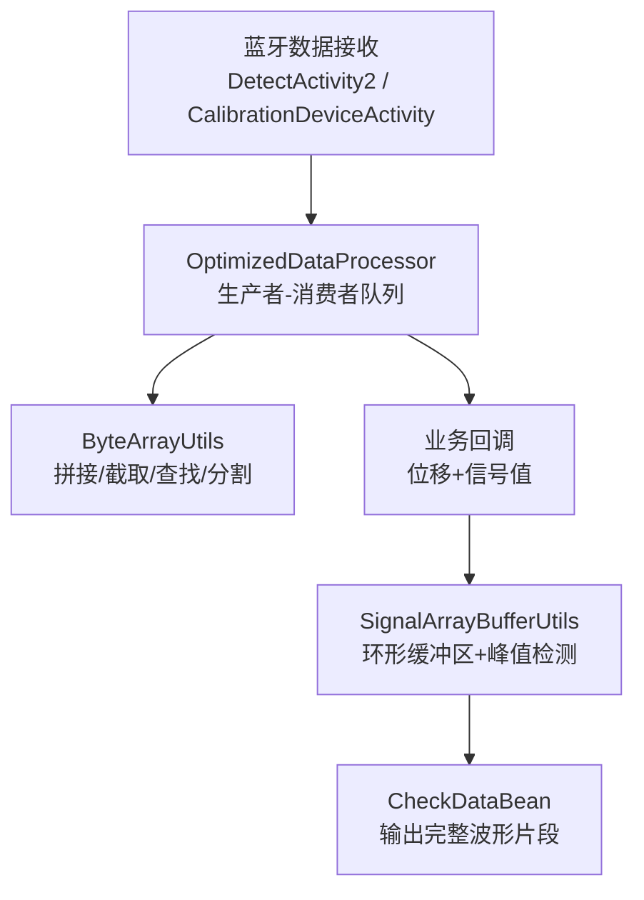
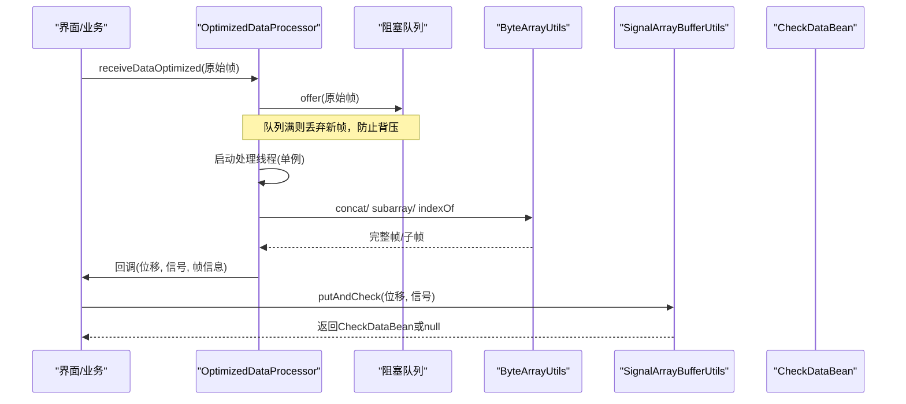
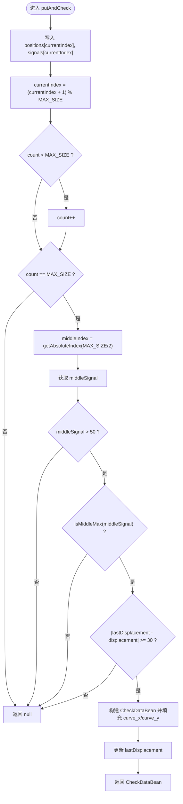
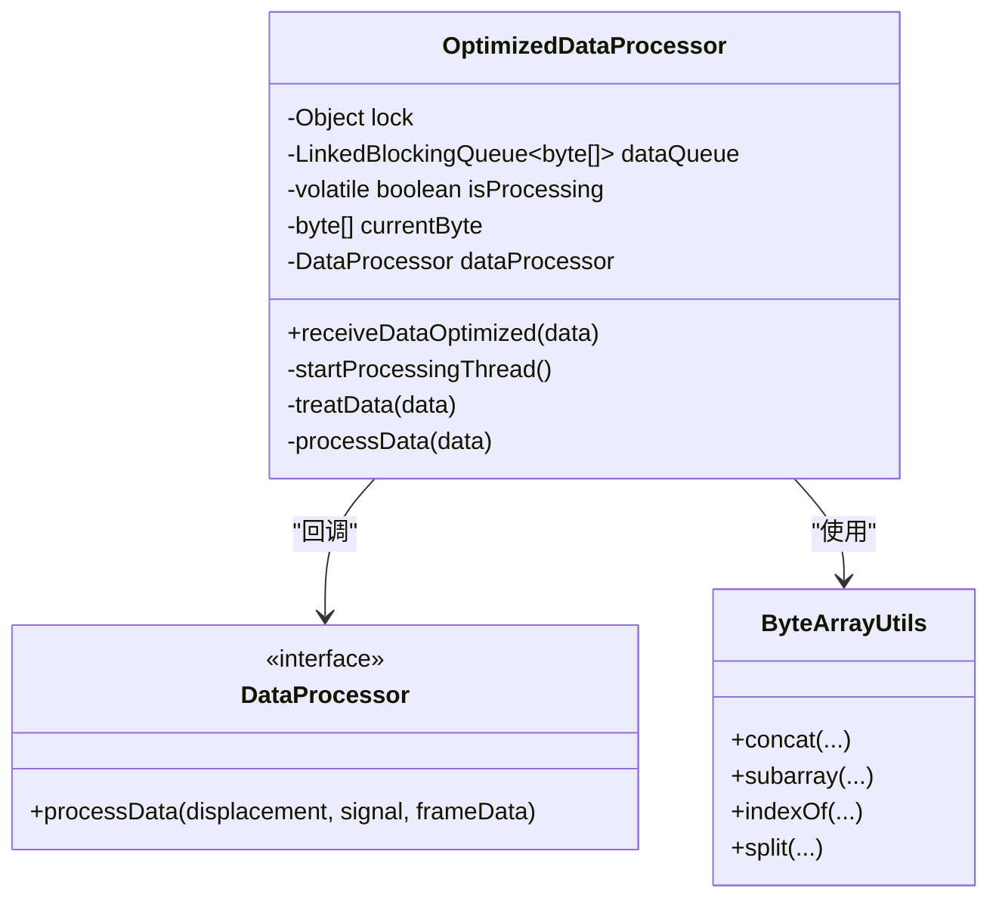
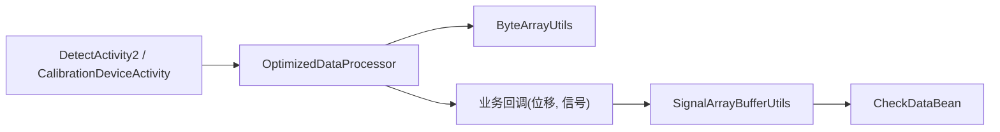

# 数据缓冲管理

<cite>
**本文引用的文件**
- [SignalArrayBufferUtils.java](file://app/src/main/java/com/example/gtj_sd_dg240/utils/SignalArrayBufferUtils.java)
- [ByteArrayUtils.java](file://app/src/main/java/com/example/gtj_sd_dg240/utils/ByteArrayUtils.java)
- [OptimizedDataProcessor.java](file://app/src/main/java/com/example/gtj_sd_dg240/utils/OptimizedDataProcessor.java)
- [CheckDataBean.java](file://app/src/main/java/com/example/gtj_sd_dg240/model/CheckDataBean.java)
- [DetectActivity2.java](file://app/src/main/java/com/example/gtj_sd_dg240/activity/testing/DetectActivity2.java)
- [CalibrationDeviceActivity.java](file://app/src/main/java/com/example/gtj_sd_dg240/activity/setting/CalibrationDeviceActivity.java)
</cite>

## 目录
1. [简介](#简介)
2. [项目结构](#项目结构)
3. [核心组件](#核心组件)
4. [架构总览](#架构总览)
5. [详细组件分析](#详细组件分析)
6. [依赖关系分析](#依赖关系分析)
7. [性能考虑](#性能考虑)
8. [故障排查指南](#故障排查指南)
9. [结论](#结论)
10. [附录：使用示例与调优建议](#附录使用示例与调优建议)

## 简介
本技术文档面向GTJ-SD-DG240应用的数据缓冲管理系统，重点说明信号采集链路中的缓冲区设计模式、内存管理与数据同步策略。围绕高频率数据接收场景，深入解释队列容量控制、溢出处理与内存泄漏防护；同时梳理字节数组操作工具类的核心能力（拼接、截取、查找、分割等），并给出多线程环境下的安全访问、锁机制设计与并发优化建议。最后提供缓冲区配置参数调优、性能监控指标、故障恢复机制及实际使用示例，帮助在大量数据流场景下避免内存溢出、提升数据处理吞吐。

## 项目结构
本项目采用按功能域组织代码的方式，数据缓冲相关能力集中在 utils 包中，并通过 Activity 层接入蓝牙数据接收与业务处理流程。关键路径如下：
- 数据接收与解析：OptimizedDataProcessor（生产者-消费者模型）
- 信号波形缓冲与峰值检测：SignalArrayBufferUtils（环形缓冲区）
- 字节数组工具：ByteArrayUtils（高效拼接/截取/查找/分割）
- 数据载体：CheckDataBean（用于封装一次完整波形片段）
- 业务集成：DetectActivity2、CalibrationDeviceActivity（将数据处理器与UI/业务逻辑连接）

图表来源
- [DetectActivity2.java:165-169](file://app/src/main/java/com/example/gtj_sd_dg240/activity/testing/DetectActivity2.java#L165-L169)
- [OptimizedDataProcessor.java:34-47](file://app/src/main/java/com/example/gtj_sd_dg240/utils/OptimizedDataProcessor.java#L34-L47)
- [ByteArrayUtils.java:24-75](file://app/src/main/java/com/example/gtj_sd_dg240/utils/ByteArrayUtils.java#L24-L75)
- [SignalArrayBufferUtils.java:26-66](file://app/src/main/java/com/example/gtj_sd_dg240/utils/SignalArrayBufferUtils.java#L26-L66)
- [CheckDataBean.java:1-33](file://app/src/main/java/com/example/gtj_sd_dg240/model/CheckDataBean.java#L1-L33)

章节来源
- [DetectActivity2.java:165-169](file://app/src/main/java/com/example/gtj_sd_dg240/activity/testing/DetectActivity2.java#L165-L169)
- [OptimizedDataProcessor.java:34-47](file://app/src/main/java/com/example/gtj_sd_dg240/utils/OptimizedDataProcessor.java#L34-L47)

## 核心组件
- SignalArrayBufferUtils：实现固定容量的环形缓冲区，维护位移与信号双数组，线程安全写入，并在满足条件时输出包含完整波形的 CheckDataBean。
- OptimizedDataProcessor：基于 LinkedBlockingQueue 的生产者-消费者模型，负责帧数据的拼接、完整性校验、分段解析与业务回调。
- ByteArrayUtils：提供高效的 byte[] 拼接、截取、查找、分割、比较、反转、十六进制转换等工具方法。
- CheckDataBean：承载一次有效波形片段的元数据（位移、信号、曲线x/y）。

章节来源
- [SignalArrayBufferUtils.java:5-114](file://app/src/main/java/com/example/gtj_sd_dg240/utils/SignalArrayBufferUtils.java#L5-L114)
- [OptimizedDataProcessor.java:7-134](file://app/src/main/java/com/example/gtj_sd_dg240/utils/OptimizedDataProcessor.java#L7-L134)
- [ByteArrayUtils.java:13-323](file://app/src/main/java/com/example/gtj_sd_dg240/utils/ByteArrayUtils.java#L13-L323)
- [CheckDataBean.java:1-33](file://app/src/main/java/com/example/gtj_sd_dg240/model/CheckDataBean.java#L1-L33)

## 架构总览
整体数据流遵循“接收—缓冲—解析—处理—输出”的流水线：
- 接收端（Activity）收到蓝牙原始帧后，调用 OptimizedDataProcessor.receiveDataOptimized 入队。
- 处理线程从队列取数，利用 ByteArrayUtils 进行帧拼接与边界对齐，解析出位移与信号值，回调至业务层。
- 业务层将位移与信号值送入 SignalArrayBufferUtils 的环形缓冲区，当满足阈值与间隔条件时，输出一个完整的波形片段（CheckDataBean）。

图表来源
- [OptimizedDataProcessor.java:34-75](file://app/src/main/java/com/example/gtj_sd_dg240/utils/OptimizedDataProcessor.java#L34-L75)
- [ByteArrayUtils.java:24-115](file://app/src/main/java/com/example/gtj_sd_dg240/utils/ByteArrayUtils.java#L24-L115)
- [SignalArrayBufferUtils.java:26-66](file://app/src/main/java/com/example/gtj_sd_dg240/utils/SignalArrayBufferUtils.java#L26-L66)
- [CheckDataBean.java:1-33](file://app/src/main/java/com/example/gtj_sd_dg240/model/CheckDataBean.java#L1-L33)

## 详细组件分析

### 环形缓冲区：SignalArrayBufferUtils
- 设计要点
  - 固定容量环形缓冲区：通过 positions[] 与 signals[] 两个 int 数组实现，currentIndex 循环递增，count 记录当前元素个数。
  - 线程安全：putAndCheck/clear/size 等方法使用 synchronized(lock) 保护共享状态。
  - 峰值检测与输出：当 count 达到 MAX_SIZE 时，计算中间索引对应的信号值，若大于阈值且为全局最大值，并且与上次触发位移间隔满足 effectiveSpacing，则构造 CheckDataBean 输出完整波形片段。
- 复杂度分析
  - 写入 putAndCheck：O(1)。
  - 峰值判断 isMiddleMax：O(N)，N=count≤MAX_SIZE。
  - 绝对索引 getAbsoluteIndex：O(1)。
- 内存管理
  - 预分配固定大小数组，避免频繁扩容带来的GC压力。
  - 输出对象 CheckDataBean 仅在新事件触发时创建，减少对象生命周期开销。
- 并发与同步
  - 以单一 lock 对象串行化写操作，保证一致性。
  - 读 size() 同样加锁，避免竞态。
- 可改进点
  - 峰值扫描 O(N) 可在滑动窗口内维护最大值索引以降低均摊成本。
  - 可增加统计计数器（如丢弃计数、触发次数）便于监控。

图表来源
- [SignalArrayBufferUtils.java:26-66](file://app/src/main/java/com/example/gtj_sd_dg240/utils/SignalArrayBufferUtils.java#L26-L66)
- [SignalArrayBufferUtils.java:71-94](file://app/src/main/java/com/example/gtj_sd_dg240/utils/SignalArrayBufferUtils.java#L71-L94)

章节来源
- [SignalArrayBufferUtils.java:5-114](file://app/src/main/java/com/example/gtj_sd_dg240/utils/SignalArrayBufferUtils.java#L5-L114)

### 高频率数据接收：OptimizedDataProcessor
- 设计要点
  - 生产者-消费者：receiveDataOptimized 非阻塞入队（offer），队列满直接丢弃新数据，避免阻塞导致背压扩散。
  - 单处理线程：通过 isProcessing 标志与锁确保只启动一个处理线程，空队列时退出，降低线程切换开销。
  - 帧拼接与完整性：使用 ByteArrayUtils.concat 累积数据，搜索帧头 0xF1 0x00 对齐，再按固定长度（7字节）切分解析。
  - 过滤异常：信号值超过阈值（>30000）直接丢弃，减少无效处理。
- 队列容量与溢出
  - 队列容量固定为 2000，超出部分丢弃，适合高频突发但允许少量丢帧的场景。
- 内存管理
  - currentByte 作为累积缓冲区，配合 subarrayFrom/subarrayLength 裁剪，避免无界增长。
  - 解析完成后释放引用，利于GC回收。
- 并发与同步
  - 入队无锁（队列内部同步），处理线程唯一，避免竞争。
  - startProcessingThread 使用锁保护 isProcessing 标志。

图表来源
- [OptimizedDataProcessor.java:7-134](file://app/src/main/java/com/example/gtj_sd_dg240/utils/OptimizedDataProcessor.java#L7-L134)
- [ByteArrayUtils.java:24-115](file://app/src/main/java/com/example/gtj_sd_dg240/utils/ByteArrayUtils.java#L24-L115)

章节来源
- [OptimizedDataProcessor.java:7-134](file://app/src/main/java/com/example/gtj_sd_dg240/utils/OptimizedDataProcessor.java#L7-L134)

### 字节数组工具：ByteArrayUtils
- 核心能力
  - 拼接：concat（两数组）、concatAll（多数组）、concatWithStream（流式）。
  - 截取：subarray、subarrayFrom、subarrayLength。
  - 查找：indexOf（单字节/子数组）、findAll（所有匹配位置）。
  - 分割：split（按分隔符）。
  - 其他：equals、startsWith、endsWith、toHexString、reverse。
- 性能特性
  - 大量使用 System.arraycopy，减少拷贝开销。
  - 流式拼接适用于动态追加场景，注意 try-with-resources 自动关闭。
- 使用建议
  - 高频拼接优先选择 concat/concatAll，避免重复创建临时对象。
  - 大数组查找尽量复用起始位置，减少重复扫描。

章节来源
- [ByteArrayUtils.java:13-323](file://app/src/main/java/com/example/gtj_sd_dg240/utils/ByteArrayUtils.java#L13-L323)

### 数据载体：CheckDataBean
- 字段说明
  - x：位移；y：信号值；index：取最大信号时的下标。
  - curve_x/curve_y：完整波形片段的横纵坐标数组。
- 用途
  - 由 SignalArrayBufferUtils 在检测到有效峰值时填充并返回，供上层进行厚度计算或结果展示。

章节来源
- [CheckDataBean.java:1-33](file://app/src/main/java/com/example/gtj_sd_dg240/model/CheckDataBean.java#L1-L33)

## 依赖关系分析
- 耦合关系
  - DetectActivity2/CalibrationDeviceActivity 依赖 OptimizedDataProcessor 进行数据接收与解析。
  - OptimizedDataProcessor 依赖 ByteArrayUtils 完成帧拼接与切片。
  - 业务层将解析出的位移与信号传入 SignalArrayBufferUtils 进行波形聚合与峰值检测。
- 外部依赖
  - 使用 Android Handler/Looper 在主线程回调UI。
  - 使用 java.util.concurrent 提供的 LinkedBlockingQueue 实现线程安全队列。

图表来源
- [DetectActivity2.java:165-169](file://app/src/main/java/com/example/gtj_sd_dg240/activity/testing/DetectActivity2.java#L165-L169)
- [CalibrationDeviceActivity.java:112-136](file://app/src/main/java/com/example/gtj_sd_dg240/activity/setting/CalibrationDeviceActivity.java#L112-L136)
- [OptimizedDataProcessor.java:34-134](file://app/src/main/java/com/example/gtj_sd_dg240/utils/OptimizedDataProcessor.java#L34-L134)
- [SignalArrayBufferUtils.java:26-66](file://app/src/main/java/com/example/gtj_sd_dg240/utils/SignalArrayBufferUtils.java#L26-L66)

章节来源
- [DetectActivity2.java:165-169](file://app/src/main/java/com/example/gtj_sd_dg240/activity/testing/DetectActivity2.java#L165-L169)
- [CalibrationDeviceActivity.java:112-136](file://app/src/main/java/com/example/gtj_sd_dg240/activity/setting/CalibrationDeviceActivity.java#L112-L136)

## 性能考虑
- 环形缓冲区
  - 固定容量避免动态扩容带来的抖动；峰值扫描 O(N) 可通过维护滑动窗口最大值进一步优化。
  - 建议在高频场景下增大 MAX_SIZE 以容纳更多采样点，提高峰值检测稳定性。
- 数据接收队列
  - 队列容量 2000 需根据设备蓝牙吞吐与CPU处理能力调优；过大增加内存占用，过小易丢帧。
  - 非阻塞入队适合高吞吐场景，必要时可增加丢弃计数用于监控。
- 字节数组操作
  - 优先使用 System.arraycopy 的工具方法；避免在热路径中进行字符串转换。
  - 对超长数组的查找/分割应限制扫描范围，减少不必要的遍历。
- 线程与锁
  - 单处理线程减少上下文切换；统一锁粒度较小，避免长临界区。
  - 主线程回调使用 Handler.post，避免阻塞后台处理线程。

[本节为通用性能指导，不直接分析具体文件]

## 故障排查指南
- 常见问题
  - 丢帧过多：检查队列容量是否过小，或业务处理过慢导致堆积；可适当增大队列容量或优化解析逻辑。
  - 峰值未触发：确认阈值设置（如中间信号>50）与 effectiveSpacing 是否合理；检查信号噪声与采样率。
  - 内存增长：确认 currentByte 是否正确裁剪；避免在回调中持有长生命周期引用。
  - 线程异常：捕获 InterruptedException 并恢复中断状态；确保处理线程能正常退出。
- 定位手段
  - 在 OptimizedDataProcessor 中增加日志统计：入队次数、丢弃次数、解析成功次数。
  - 在 SignalArrayBufferUtils 中增加统计：触发次数、平均扫描耗时、最大峰值。
  - 使用 toHexString 打印关键帧，验证协议解析正确性。

章节来源
- [OptimizedDataProcessor.java:34-134](file://app/src/main/java/com/example/gtj_sd_dg240/utils/OptimizedDataProcessor.java#L34-L134)
- [SignalArrayBufferUtils.java:26-114](file://app/src/main/java/com/example/gtj_sd_dg240/utils/SignalArrayBufferUtils.java#L26-L114)
- [ByteArrayUtils.java:299-308](file://app/src/main/java/com/example/gtj_sd_dg240/utils/ByteArrayUtils.java#L299-L308)

## 结论
该数据缓冲管理系统通过“生产者-消费者队列 + 环形缓冲区 + 字节数组工具”的组合，实现了高频率数据采集、稳定解析与峰值检测。其设计在保证线程安全的同时，兼顾了内存占用与吞吐性能。通过合理的队列容量、缓冲区大小与阈值配置，可在大量数据流场景下有效避免内存溢出并提升处理效率。后续可引入滑动窗口最大值、更细粒度的统计监控与自适应阈值，进一步提升鲁棒性与可观测性。

[本节为总结性内容，不直接分析具体文件]

## 附录：使用示例与调优建议
- 典型使用流程
  - 在 Activity 中初始化 OptimizedDataProcessor，并将 onBluetoothDataReceived 的原始帧传入 receiveDataOptimized。
  - 在回调中获取位移与信号值，调用 SignalArrayBufferUtils.putAndCheck，若返回 CheckDataBean 则进行厚度计算或结果展示。
  - 使用 ByteArrayUtils 进行帧拼接与切片，确保协议解析正确。
- 配置调优
  - 队列容量：根据蓝牙速率与CPU负载调整，默认 2000；观察丢弃计数决定是否增大。
  - 环形缓冲区大小：根据采样率与期望波形长度设置 MAX_SIZE；越大越稳定但内存更高。
  - 阈值与间隔：中间信号阈值与 effectiveSpacing 影响峰值触发灵敏度，需结合现场标定。
- 监控指标
  - 入队/出队速率、丢弃次数、解析失败次数、峰值触发频率、平均处理耗时。
- 故障恢复
  - 处理线程空闲时自动退出，有新数据时重启，避免资源长期占用。
  - 对异常帧（如信号超阈值）进行过滤，保障系统稳定性。

章节来源
- [DetectActivity2.java:165-169](file://app/src/main/java/com/example/gtj_sd_dg240/activity/testing/DetectActivity2.java#L165-L169)
- [CalibrationDeviceActivity.java:112-136](file://app/src/main/java/com/example/gtj_sd_dg240/activity/setting/CalibrationDeviceActivity.java#L112-L136)
- [OptimizedDataProcessor.java:34-134](file://app/src/main/java/com/example/gtj_sd_dg240/utils/OptimizedDataProcessor.java#L34-L134)
- [SignalArrayBufferUtils.java:26-114](file://app/src/main/java/com/example/gtj_sd_dg240/utils/SignalArrayBufferUtils.java#L26-L114)
- [ByteArrayUtils.java:24-115](file://app/src/main/java/com/example/gtj_sd_dg240/utils/ByteArrayUtils.java#L24-L115)