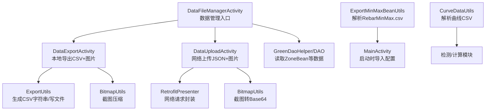
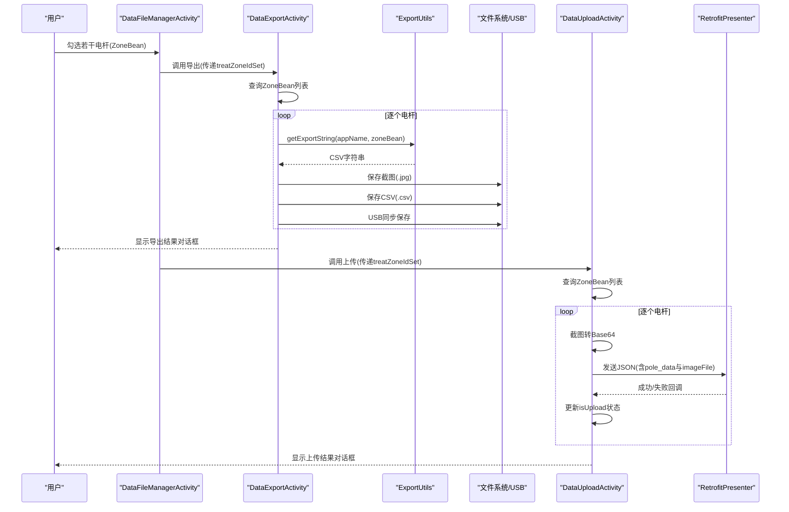
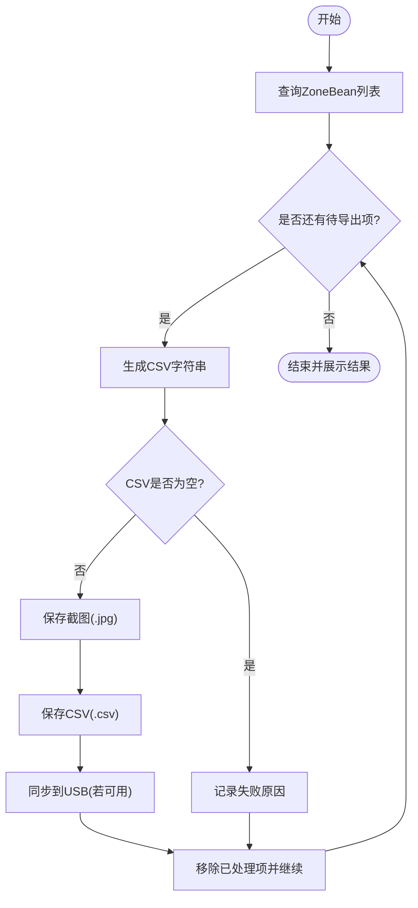
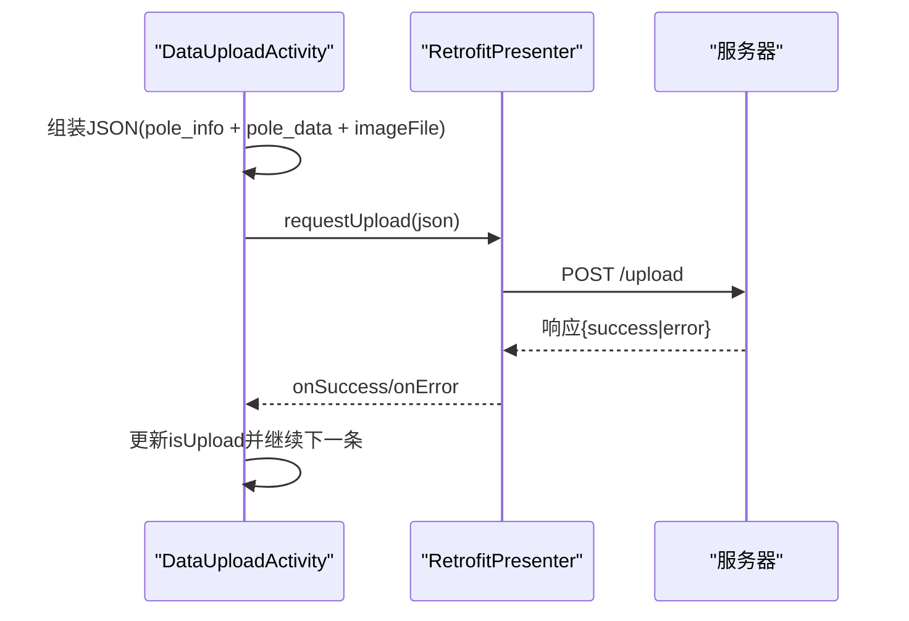
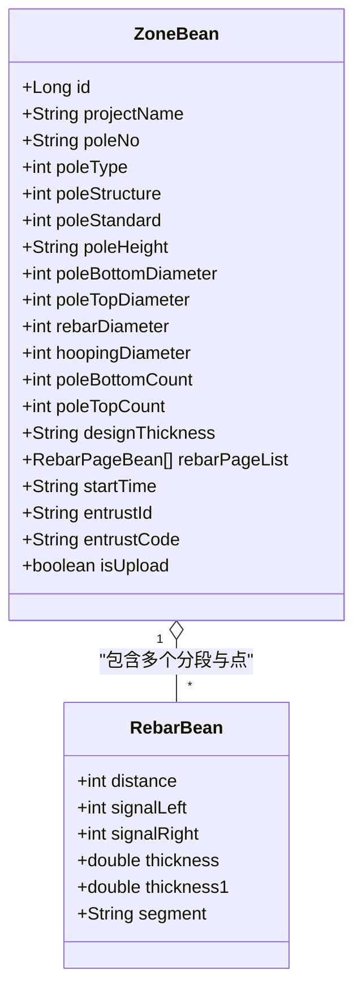
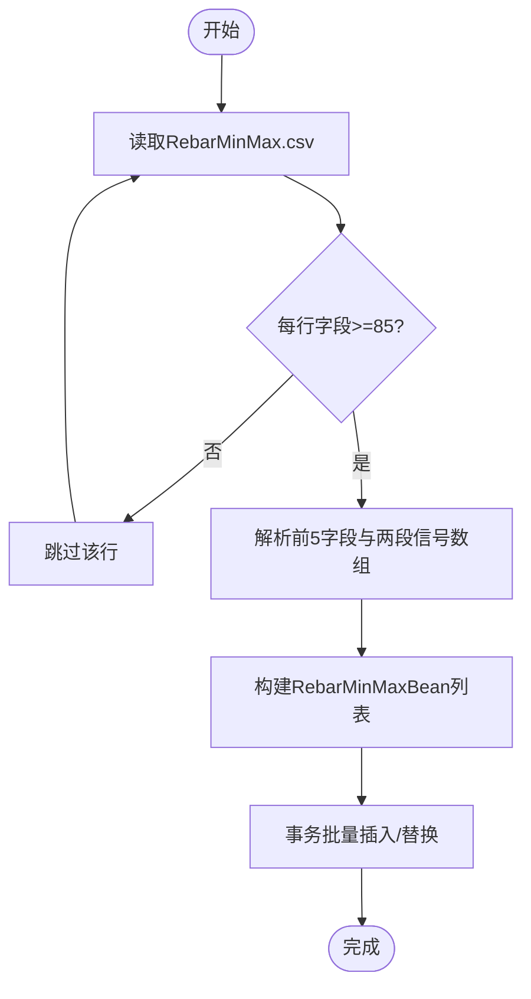
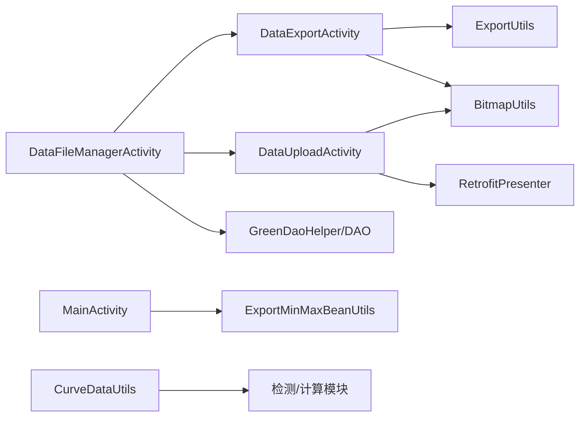

# 数据导入导出

<cite>
**本文引用的文件**   
- [DataExportActivity.java](file://app/src/main/java/com/example/gtj_sd_dg240/activity/data/DataExportActivity.java)
- [DataUploadActivity.java](file://app/src/main/java/com/example/gtj_sd_dg240/activity/data/DataUploadActivity.java)
- [DataFileManagerActivity.java](file://app/src/main/java/com/example/gtj_sd_dg240/activity/data/DataFileManagerActivity.java)
- [ExportUtils.java](file://app/src/main/java/com/example/gtj_sd_dg240/utils/ExportUtils.java)
- [ExportMinMaxBeanUtils.java](file://app/src/main/java/com/example/gtj_sd_dg240/utils/ExportMinMaxBeanUtils.java)
- [CurveDataUtils.java](file://app/src/main/java/com/example/gtj_sd_dg240/utils/CurveDataUtils.java)
- [ZoneBean.java](file://app/src/main/java/com/example/gtj_sd_dg240/model/ZoneBean.java)
- [RebarBean.java](file://app/src/main/java/com/example/gtj_sd_dg240/model/RebarBean.java)
- [MainActivity.java](file://app/src/main/java/com/example/gtj_sd_dg240/activity/MainActivity.java)
- [RebarMinMax.csv](file://app/src/main/assets/RebarMinMax.csv)
</cite>

## 目录
1. [简介](#简介)
2. [项目结构](#项目结构)
3. [核心组件](#核心组件)
4. [架构总览](#架构总览)
5. [详细组件分析](#详细组件分析)
6. [依赖关系分析](#依赖关系分析)
7. [性能与大数据处理](#性能与大数据处理)
8. [故障排查指南](#故障排查指南)
9. [结论](#结论)
10. [附录：CSV格式规范与映射规则](#附录csv格式规范与映射规则)

## 简介
本文件面向GTJ-SD-DG240应用的数据导入导出能力，聚焦以下目标：
- CSV文件格式规范、字段映射与转换逻辑
- 批量数据处理机制（分块、内存优化、错误恢复）
- 数据验证与清洗流程（格式检查、完整性校验、异常处理）
- 导出功能实现细节（模板定制、格式化输出、多格式支持）
- 导入配置选项（分隔符、编码、跳过行等）
- 大数据量处理的体验优化（异步、进度、断点续传建议）
- 安全机制（加密、签名、防篡改）的实现建议

## 项目结构
数据导入导出相关代码主要分布在 activity.data 包与 utils 工具类中，配合 model 层数据模型与 assets 中的示例CSV。

图表来源
- [DataFileManagerActivity.java:62-81](file://app/src/main/java/com/example/gtj_sd_dg240/activity/data/DataFileManagerActivity.java#L62-L81)
- [DataExportActivity.java:346-471](file://app/src/main/java/com/example/gtj_sd_dg240/activity/data/DataExportActivity.java#L346-L471)
- [DataUploadActivity.java:348-484](file://app/src/main/java/com/example/gtj_sd_dg240/activity/data/DataUploadActivity.java#L348-L484)
- [ExportUtils.java:25-116](file://app/src/main/java/com/example/gtj_sd_dg240/utils/ExportUtils.java#L25-L116)
- [ExportMinMaxBeanUtils.java:34-69](file://app/src/main/java/com/example/gtj_sd_dg240/utils/ExportMinMaxBeanUtils.java#L34-L69)
- [CurveDataUtils.java:38-86](file://app/src/main/java/com/example/gtj_sd_dg240/utils/CurveDataUtils.java#L38-L86)
- [MainActivity.java:357-379](file://app/src/main/java/com/example/gtj_sd_dg240/activity/MainActivity.java#L357-L379)

章节来源
- [DataFileManagerActivity.java:62-81](file://app/src/main/java/com/example/gtj_sd_dg240/activity/data/DataFileManagerActivity.java#L62-L81)
- [DataExportActivity.java:346-471](file://app/src/main/java/com/example/gtj_sd_dg240/activity/data/DataExportActivity.java#L346-L471)
- [DataUploadActivity.java:348-484](file://app/src/main/java/com/example/gtj_sd_dg240/activity/data/DataUploadActivity.java#L348-L484)
- [ExportUtils.java:25-116](file://app/src/main/java/com/example/gtj_sd_dg240/utils/ExportUtils.java#L25-L116)
- [ExportMinMaxBeanUtils.java:34-69](file://app/src/main/java/com/example/gtj_sd_dg240/utils/ExportMinMaxBeanUtils.java#L34-L69)
- [CurveDataUtils.java:38-86](file://app/src/main/java/com/example/gtj_sd_dg240/utils/CurveDataUtils.java#L38-L86)
- [MainActivity.java:357-379](file://app/src/main/java/com/example/gtj_sd_dg240/activity/MainActivity.java#L357-L379)

## 核心组件
- DataFileManagerActivity：数据管理入口，负责选择待处理电杆（ZoneBean），触发导出或上传。
- DataExportActivity：将选中的 ZoneBean 导出为CSV和截图，保存到平板存储与USB。
- DataUploadActivity：将选中数据打包为JSON并上传图片，通过网络上传至服务器。
- ExportUtils：构建CSV文本、保存图片和CSV文件到本地路径。
- ExportMinMaxBeanUtils：从assets的RebarMinMax.csv解析最小/最大信号数组，用于初始化或校准。
- CurveDataUtils：从assets的曲线CSV解析二维数组，供检测算法使用。
- 数据模型：ZoneBean、RebarBean 承载工程信息与钢筋测量结果。

章节来源
- [DataFileManagerActivity.java:62-81](file://app/src/main/java/com/example/gtj_sd_dg240/activity/data/DataFileManagerActivity.java#L62-L81)
- [DataExportActivity.java:346-471](file://app/src/main/java/com/example/gtj_sd_dg240/activity/data/DataExportActivity.java#L346-L471)
- [DataUploadActivity.java:348-484](file://app/src/main/java/com/example/gtj_sd_dg240/activity/data/DataUploadActivity.java#L348-L484)
- [ExportUtils.java:25-116](file://app/src/main/java/com/example/gtj_sd_dg240/utils/ExportUtils.java#L25-L116)
- [ExportMinMaxBeanUtils.java:34-69](file://app/src/main/java/com/example/gtj_sd_dg240/utils/ExportMinMaxBeanUtils.java#L34-L69)
- [CurveDataUtils.java:38-86](file://app/src/main/java/com/example/gtj_sd_dg240/utils/CurveDataUtils.java#L38-L86)
- [ZoneBean.java:15-55](file://app/src/main/java/com/example/gtj_sd_dg240/model/ZoneBean.java#L15-L55)
- [RebarBean.java:5-25](file://app/src/main/java/com/example/gtj_sd_dg240/model/RebarBean.java#L5-L25)

## 架构总览
数据流从用户选择开始，经数据库查询、数据组装、格式转换、落盘或网络传输，最终反馈结果。

图表来源
- [DataFileManagerActivity.java:235-339](file://app/src/main/java/com/example/gtj_sd_dg240/activity/data/DataFileManagerActivity.java#L235-L339)
- [DataExportActivity.java:346-471](file://app/src/main/java/com/example/gtj_sd_dg240/activity/data/DataExportActivity.java#L346-L471)
- [ExportUtils.java:25-116](file://app/src/main/java/com/example/gtj_sd_dg240/utils/ExportUtils.java#L25-L116)
- [DataUploadActivity.java:348-484](file://app/src/main/java/com/example/gtj_sd_dg240/activity/data/DataUploadActivity.java#L348-L484)

## 详细组件分析

### 导出流程（DataExportActivity + ExportUtils）
- 批量查询：根据传入的ID集合查询ZoneBean列表，清理旧项目文件夹，避免历史数据干扰。
- 逐条导出：对每个ZoneBean生成CSV字符串，同时截取当前界面为图片，分别写入平板存储与USB。
- 进度与结果：通过进度对话框展示百分比，完成后汇总每条记录的成功/失败信息。

图表来源
- [DataExportActivity.java:346-471](file://app/src/main/java/com/example/gtj_sd_dg240/activity/data/DataExportActivity.java#L346-L471)
- [ExportUtils.java:25-116](file://app/src/main/java/com/example/gtj_sd_dg240/utils/ExportUtils.java#L25-L116)

章节来源
- [DataExportActivity.java:346-471](file://app/src/main/java/com/example/gtj_sd_dg240/activity/data/DataExportActivity.java#L346-L471)
- [ExportUtils.java:25-116](file://app/src/main/java/com/example/gtj_sd_dg240/utils/ExportUtils.java#L25-L116)

### 上传流程（DataUploadActivity）
- 数据准备：将ZoneBean关键信息、钢筋分段平均厚度与点数据组织为Map，并将截图转为Base64。
- 网络请求：通过RetrofitPresenter发送JSON，成功后更新isUpload标记，便于后续去重或统计。
- 错误处理：捕获网络错误并记录失败原因，保证批量任务不中断。

图表来源
- [DataUploadActivity.java:418-458](file://app/src/main/java/com/example/gtj_sd_dg240/activity/data/DataUploadActivity.java#L418-L458)

章节来源
- [DataUploadActivity.java:348-484](file://app/src/main/java/com/example/gtj_sd_dg240/activity/data/DataUploadActivity.java#L348-L484)

### 数据模型与映射（ZoneBean、RebarBean）
- ZoneBean：包含工程信息（项目名称、电杆编号、规格、设计厚度等）、钢筋分段数据（rebarPageList）。
- RebarBean：单点测量结果（位移、左右信号、两侧厚度、部位段）。
- 导出CSV映射：将工程信息、试验参数、各分段厚度序列与平均值按固定顺序拼接成CSV文本。

图表来源
- [ZoneBean.java:15-55](file://app/src/main/java/com/example/gtj_sd_dg240/model/ZoneBean.java#L15-L55)
- [RebarBean.java:5-25](file://app/src/main/java/com/example/gtj_sd_dg240/model/RebarBean.java#L5-L25)

章节来源
- [ZoneBean.java:15-55](file://app/src/main/java/com/example/gtj_sd_dg240/model/ZoneBean.java#L15-L55)
- [RebarBean.java:5-25](file://app/src/main/java/com/example/gtj_sd_dg240/model/RebarBean.java#L5-L25)

### 导入流程（ExportMinMaxBeanUtils + MainActivity）
- 解析CSV：从assets读取RebarMinMax.csv，按逗号分割，提取前5个字段与两段信号数组（最小/最大），构造RebarMinMaxBean列表。
- 入库策略：先查询唯一键是否存在，存在则复用id，再批量事务插入，提升性能与一致性。

图表来源
- [ExportMinMaxBeanUtils.java:34-69](file://app/src/main/java/com/example/gtj_sd_dg240/utils/ExportMinMaxBeanUtils.java#L34-L69)
- [MainActivity.java:357-379](file://app/src/main/java/com/example/gtj_sd_dg240/activity/MainActivity.java#L357-L379)

章节来源
- [ExportMinMaxBeanUtils.java:34-69](file://app/src/main/java/com/example/gtj_sd_dg240/utils/ExportMinMaxBeanUtils.java#L34-L69)
- [MainActivity.java:357-379](file://app/src/main/java/com/example/gtj_sd_dg240/activity/MainActivity.java#L357-L379)

### 曲线数据导入（CurveDataUtils）
- 解析规则：按逗号分割行，取第2列开始的连续121个值填充二维数组。
- 校验规则：若数组中存在0值，视为无效数据，返回null，防止下游计算出错。

章节来源
- [CurveDataUtils.java:38-86](file://app/src/main/java/com/example/gtj_sd_dg240/utils/CurveDataUtils.java#L38-L86)

## 依赖关系分析
- DataFileManagerActivity 依赖 GreenDao DAO 获取项目与电杆列表，并通过Intent向导出/上传页面传递待处理ID集合。
- DataExportActivity 依赖 ExportUtils 生成CSV与保存图片；依赖 BitmapUtils 进行截图压缩；依赖 USB 辅助类进行U盘写入。
- DataUploadActivity 依赖 RetrofitPresenter 进行网络请求；依赖 BitmapUtils 将截图转为Base64。
- 导入功能依赖 ExportMinMaxBeanUtils 与 CurveDataUtils 解析assets中的CSV资源。

图表来源
- [DataFileManagerActivity.java:62-81](file://app/src/main/java/com/example/gtj_sd_dg240/activity/data/DataFileManagerActivity.java#L62-L81)
- [DataExportActivity.java:346-471](file://app/src/main/java/com/example/gtj_sd_dg240/activity/data/DataExportActivity.java#L346-L471)
- [DataUploadActivity.java:348-484](file://app/src/main/java/com/example/gtj_sd_dg240/activity/data/DataUploadActivity.java#L348-L484)
- [ExportUtils.java:25-116](file://app/src/main/java/com/example/gtj_sd_dg240/utils/ExportUtils.java#L25-L116)
- [ExportMinMaxBeanUtils.java:34-69](file://app/src/main/java/com/example/gtj_sd_dg240/utils/ExportMinMaxBeanUtils.java#L34-L69)
- [CurveDataUtils.java:38-86](file://app/src/main/java/com/example/gtj_sd_dg240/utils/CurveDataUtils.java#L38-L86)

章节来源
- [DataFileManagerActivity.java:62-81](file://app/src/main/java/com/example/gtj_sd_dg240/activity/data/DataFileManagerActivity.java#L62-L81)
- [DataExportActivity.java:346-471](file://app/src/main/java/com/example/gtj_sd_dg240/activity/data/DataExportActivity.java#L346-L471)
- [DataUploadActivity.java:348-484](file://app/src/main/java/com/example/gtj_sd_dg240/activity/data/DataUploadActivity.java#L348-L484)
- [ExportUtils.java:25-116](file://app/src/main/java/com/example/gtj_sd_dg240/utils/ExportUtils.java#L25-L116)
- [ExportMinMaxBeanUtils.java:34-69](file://app/src/main/java/com/example/gtj_sd_dg240/utils/ExportMinMaxBeanUtils.java#L34-L69)
- [CurveDataUtils.java:38-86](file://app/src/main/java/com/example/gtj_sd_dg240/utils/CurveDataUtils.java#L38-L86)

## 性能与大数据处理
- 异步处理：导出与上传均使用后台线程执行耗时操作，UI通过Handler更新进度与结果，避免阻塞主线程。
- 分块处理：按ZoneBean逐项处理，减少单次内存占用；每次处理后移除队列项，控制并发与内存峰值。
- 内存优化：截图后压缩为字节数组，及时释放中间对象；CSV字符串在写入后立即丢弃。
- 错误恢复：每项独立处理，单项失败不影响其他项；失败原因汇总展示，便于定位问题。
- 进度跟踪：基于总数与剩余数量计算百分比，实时反馈给用户。
- 断点续传建议：可在ZoneBean中增加“导出/上传进度”字段，持久化当前处理位置，重启后从断点继续。
- 异步与重试：上传失败可加入指数退避重试策略，结合网络状态检测提升成功率。

章节来源
- [DataExportActivity.java:346-471](file://app/src/main/java/com/example/gtj_sd_dg240/activity/data/DataExportActivity.java#L346-L471)
- [DataUploadActivity.java:348-484](file://app/src/main/java/com/example/gtj_sd_dg240/activity/data/DataUploadActivity.java#L348-L484)

## 故障排查指南
- 无导出数据：检查treatZoneIdSet是否为空；确认数据库查询是否返回有效ZoneBean。
- CSV为空：当rebarPageList为空时，getExportString返回null，需检查数据采集是否完整。
- 文件写入失败：检查外部存储权限与路径创建；USB未识别时跳过U盘写入。
- 上传失败：检查网络连接与服务器响应；记录错误信息以便复现。
- 导入失败：确认CSV行数与字段数满足要求；若存在0值将被判定为无效数据。

章节来源
- [DataExportActivity.java:346-471](file://app/src/main/java/com/example/gtj_sd_dg240/activity/data/DataExportActivity.java#L346-L471)
- [ExportUtils.java:25-116](file://app/src/main/java/com/example/gtj_sd_dg240/utils/ExportUtils.java#L25-L116)
- [DataUploadActivity.java:348-484](file://app/src/main/java/com/example/gtj_sd_dg240/activity/data/DataUploadActivity.java#L348-L484)
- [CurveDataUtils.java:38-86](file://app/src/main/java/com/example/gtj_sd_dg240/utils/CurveDataUtils.java#L38-L86)

## 结论
该应用在数据导入导出方面具备清晰的模块化设计与稳定的批处理能力。导出以CSV与图片为主，上传以JSON与图片为主，均实现了异步、进度与错误恢复。建议在后续版本中增强导入配置的灵活性（分隔符、编码、跳过行）、完善断点续传与安全机制（加密、签名、防篡改），以提升用户体验与数据可靠性。

## 附录：CSV格式规范与映射规则

### 导出CSV（由ExportUtils生成）
- 头部信息：应用名称与“检测记录”，工程信息（工程名称、电杆编号、适用规范），试验参数（电杆类型、结构、长度、根径、梢径、纵筋直径、螺旋筋直径、设计保护层厚度）。
- 数据体：
  - 表头：位置|数量，以及序号1..N与“平均厚度”。
  - 行数据：每个分段（如梢部、根部或其他距根部位置）对应两行，一行记录一侧厚度序列，另一行记录另一侧厚度序列，末尾附加该分段的平均厚度。
- 分隔符：逗号。
- 编码：GBK（导出时将字符串转换为GBK字节数组后写入）。

章节来源
- [ExportUtils.java:25-66](file://app/src/main/java/com/example/gtj_sd_dg240/utils/ExportUtils.java#L25-L66)
- [DataExportActivity.java:426-455](file://app/src/main/java/com/example/gtj_sd_dg240/activity/data/DataExportActivity.java#L426-L455)

### 导入CSV（RebarMinMax.csv）
- 字段顺序：前5列为基本参数（如钢筋直径、电杆直径、间距等），随后为两段信号数组（最小/最大），每段固定长度（例如40）。
- 解析规则：按逗号分割，仅当字段数≥85时解析；提取前5字段与两段信号数组，构造对象后批量入库。
- 校验规则：若解析过程中出现空值或非法数据，跳过该行或整体判定无效。

章节来源
- [ExportMinMaxBeanUtils.java:34-69](file://app/src/main/java/com/example/gtj_sd_dg240/utils/ExportMinMaxBeanUtils.java#L34-L69)
- [RebarMinMax.csv](file://app/src/main/assets/RebarMinMax.csv)

### 曲线CSV（用于检测算法）
- 解析规则：按逗号分割，取第2列开始的连续121个值填充二维数组。
- 校验规则：若数组中存在0值，视为无效数据，返回null。

章节来源
- [CurveDataUtils.java:38-86](file://app/src/main/java/com/example/gtj_sd_dg240/utils/CurveDataUtils.java#L38-L86)

### 数据映射与转换要点
- 工程信息映射：ZoneBean的工程字段直接映射到CSV头部。
- 钢筋数据映射：rebarPageList中的每个分段对应CSV中的一组行，厚度序列按顺序写入，末尾追加平均厚度。
- 编码转换：导出CSV时使用GBK编码，确保兼容特定设备或系统。
- 图片处理：截图压缩后保存为JPEG，上传时转为Base64字符串。

章节来源
- [ExportUtils.java:25-116](file://app/src/main/java/com/example/gtj_sd_dg240/utils/ExportUtils.java#L25-L116)
- [DataExportActivity.java:426-455](file://app/src/main/java/com/example/gtj_sd_dg240/activity/data/DataExportActivity.java#L426-L455)
- [DataUploadActivity.java:418-458](file://app/src/main/java/com/example/gtj_sd_dg240/activity/data/DataUploadActivity.java#L418-L458)