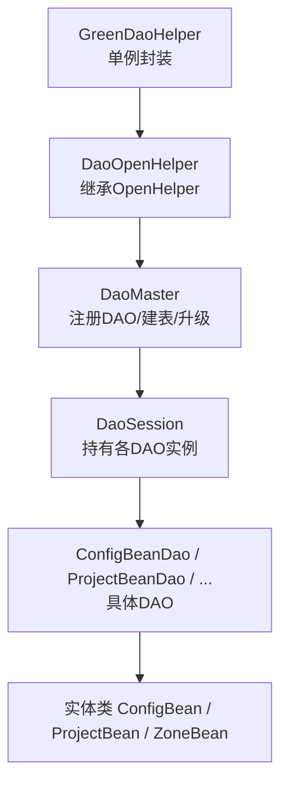
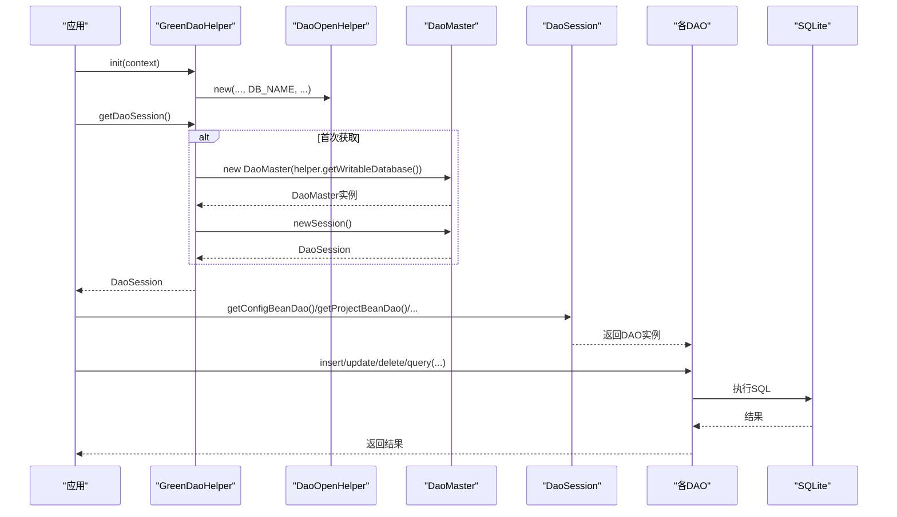
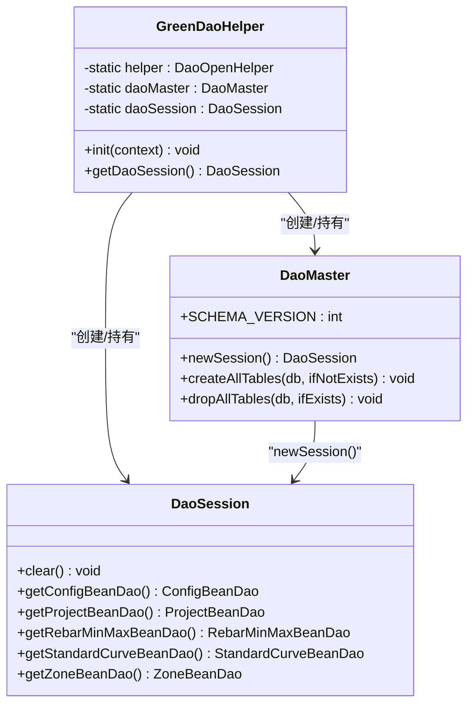
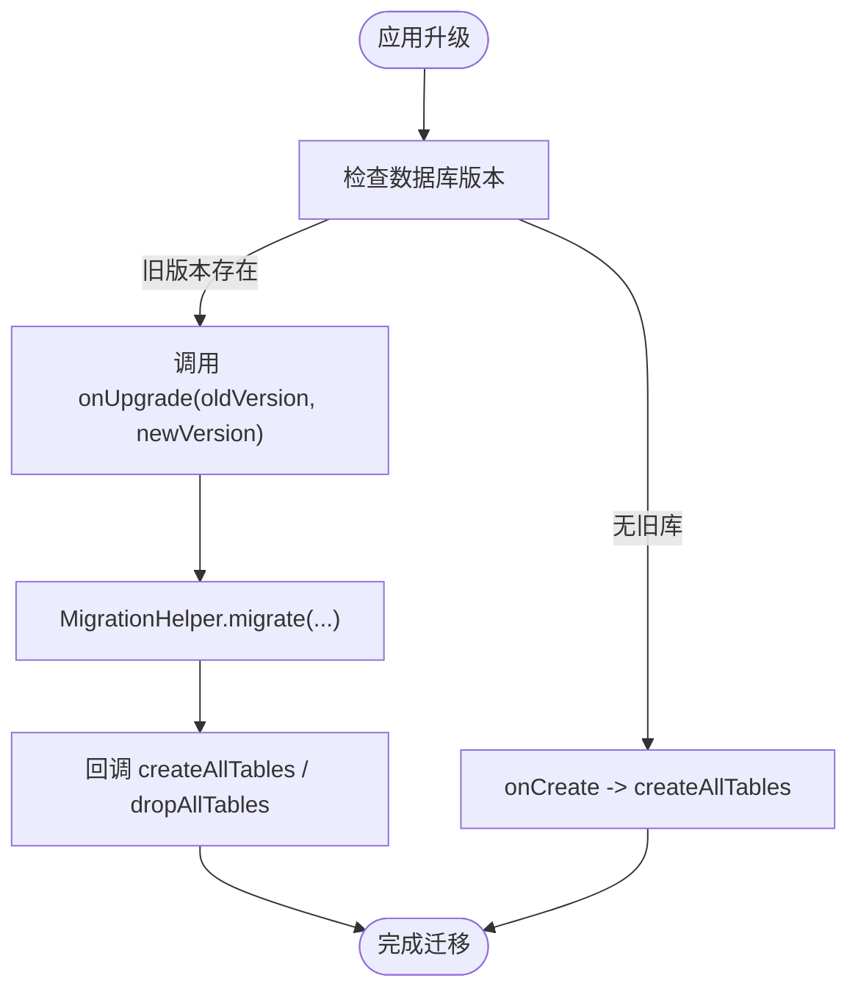
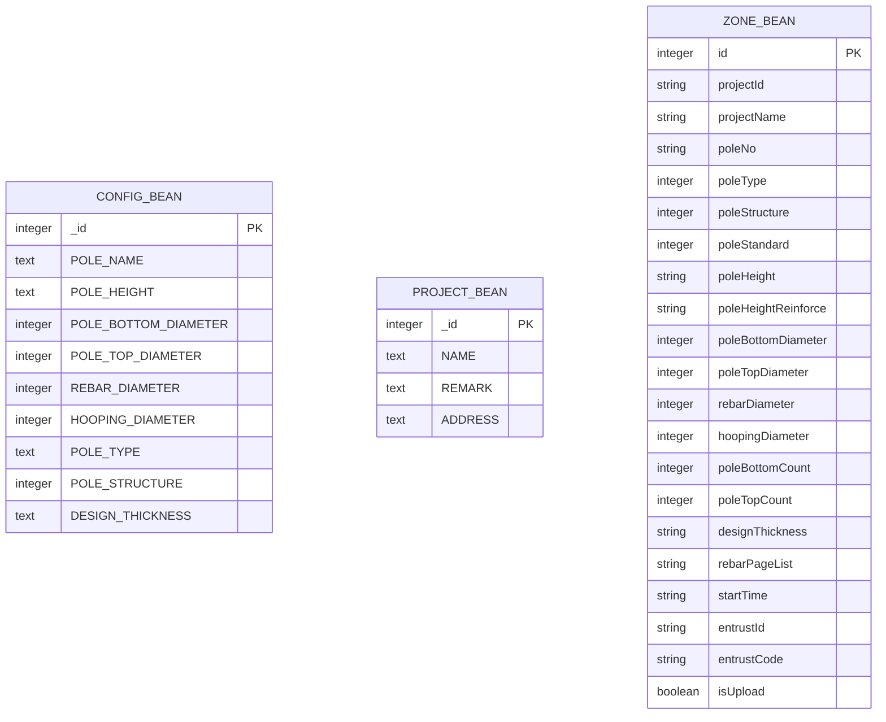
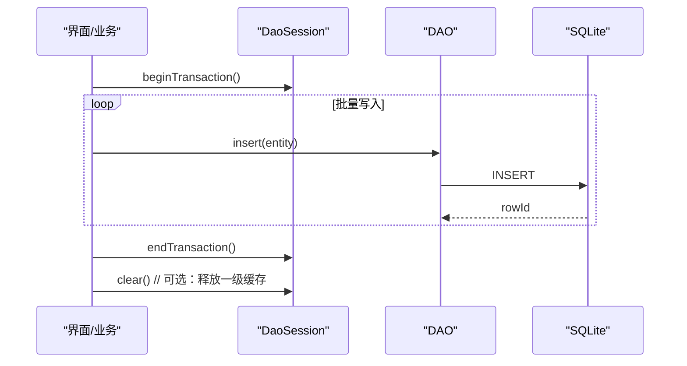
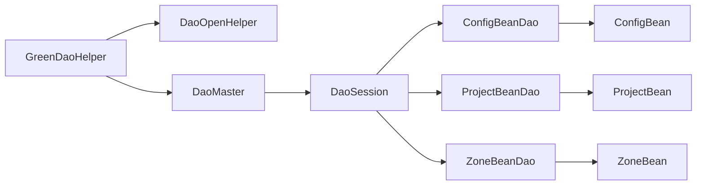

# 数据库操作

<cite>
**本文引用的文件**
- [DaoMaster.java](file://app/src/main/java/com/example/gtj_sd_dg240/functions/database/greenDao/db/DaoMaster.java)
- [DaoSession.java](file://app/src/main/java/com/example/gtj_sd_dg240/functions/database/greenDao/db/DaoSession.java)
- [GreenDaoHelper.java](file://app/src/main/java/com/example/gtj_sd_dg240/storage/GreenDaoHelper.java)
- [DaoOpenHelper.java](file://app/src/main/java/com/example/gtj_sd_dg240/storage/DaoOpenHelper.java)
- [ConfigBeanDao.java](file://app/src/main/java/com/example/gtj_sd_dg240/functions/database/greenDao/db/ConfigBeanDao.java)
- [ProjectBeanDao.java](file://app/src/main/java/com/example/gtj_sd_dg240/functions/database/greenDao/db/ProjectBeanDao.java)
- [ConfigBean.java](file://app/src/main/java/com/example/gtj_sd_dg240/model/ConfigBean.java)
- [ProjectBean.java](file://app/src/main/java/com/example/gtj_sd_dg240/model/ProjectBean.java)
- [ZoneBean.java](file://app/src/main/java/com/example/gtj_sd_dg240/model/ZoneBean.java)
- [StaticConstant.java](file://app/src/main/java/com/example/gtj_sd_dg240/StaticConstant.java)
</cite>

## 目录
1. [简介](#简介)
2. [项目结构](#项目结构)
3. [核心组件](#核心组件)
4. [架构总览](#架构总览)
5. [详细组件分析](#详细组件分析)
6. [依赖关系分析](#依赖关系分析)
7. [性能与优化](#性能与优化)
8. [故障排查指南](#故障排查指南)
9. [结论](#结论)
10. [附录](#附录)

## 简介
本文件面向GTJ-SD-DG240应用中的GreenDao数据库操作能力，围绕初始化配置、会话管理、连接与迁移、数据模型设计、CRUD与事务、查询优化、并发控制、版本迁移与备份恢复等主题，提供从架构到实践的系统化说明。文档基于仓库中实际代码进行分析与归纳，确保内容可追溯、可落地。

## 项目结构
本项目在app模块下通过GreenDao生成DAO层（db包），并通过storage包封装了数据库初始化与会话获取的辅助类；model包定义了实体类，对应数据库表结构。关键路径如下：
- 数据库核心：functions/database/greenDao/db/*
- 数据库封装：storage/*
- 数据模型：model/*
- 常量与配置：StaticConstant.java

图表来源
- [GreenDaoHelper.java:16-40](file://app/src/main/java/com/example/gtj_sd_dg240/storage/GreenDaoHelper.java#L16-L40)
- [DaoOpenHelper.java:14-33](file://app/src/main/java/com/example/gtj_sd_dg240/storage/DaoOpenHelper.java#L14-L33)
- [DaoMaster.java:19-69](file://app/src/main/java/com/example/gtj_sd_dg240/functions/database/greenDao/db/DaoMaster.java#L19-L69)
- [DaoSession.java:30-74](file://app/src/main/java/com/example/gtj_sd_dg240/functions/database/greenDao/db/DaoSession.java#L30-L74)

章节来源
- [GreenDaoHelper.java:16-40](file://app/src/main/java/com/example/gtj_sd_dg240/storage/GreenDaoHelper.java#L16-L40)
- [DaoOpenHelper.java:14-33](file://app/src/main/java/com/example/gtj_sd_dg240/storage/DaoOpenHelper.java#L14-L33)
- [DaoMaster.java:19-69](file://app/src/main/java/com/example/gtj_sd_dg240/functions/database/greenDao/db/DaoMaster.java#L19-L69)
- [DaoSession.java:30-74](file://app/src/main/java/com/example/gtj_sd_dg240/functions/database/greenDao/db/DaoSession.java#L30-L74)

## 核心组件
- GreenDaoHelper：提供全局初始化与单例化的DaoSession获取入口，避免重复创建开销。
- DaoOpenHelper：扩展DaoMaster.OpenHelper，实现onUpgrade逻辑，借助MigrationHelper进行表结构迁移。
- DaoMaster：维护数据库Schema版本、注册所有DAO、统一建表/删表、提供newSession工厂方法。
- DaoSession：持有各DAO实例，管理IdentityScope（一级缓存）生命周期，提供clear释放内存。
- DAO与实体：ConfigBeanDao/ProjectBeanDao/...与ConfigBean/ProjectBean/ZoneBean等一一对应，定义表结构与字段映射。

章节来源
- [GreenDaoHelper.java:16-40](file://app/src/main/java/com/example/gtj_sd_dg240/storage/GreenDaoHelper.java#L16-L40)
- [DaoOpenHelper.java:14-33](file://app/src/main/java/com/example/gtj_sd_dg240/storage/DaoOpenHelper.java#L14-L33)
- [DaoMaster.java:19-69](file://app/src/main/java/com/example/gtj_sd_dg240/functions/database/greenDao/db/DaoMaster.java#L19-L69)
- [DaoSession.java:30-102](file://app/src/main/java/com/example/gtj_sd_dg240/functions/database/greenDao/db/DaoSession.java#L30-L102)
- [ConfigBeanDao.java:18-68](file://app/src/main/java/com/example/gtj_sd_dg240/functions/database/greenDao/db/ConfigBeanDao.java#L18-L68)
- [ProjectBeanDao.java:18-40](file://app/src/main/java/com/example/gtj_sd_dg240/functions/database/greenDao/db/ProjectBeanDao.java#L18-L40)
- [ConfigBean.java:13-37](file://app/src/main/java/com/example/gtj_sd_dg240/model/ConfigBean.java#L13-L37)
- [ProjectBean.java:14-27](file://app/src/main/java/com/example/gtj_sd_dg240/model/ProjectBean.java#L14-L27)
- [ZoneBean.java:15-55](file://app/src/main/java/com/example/gtj_sd_dg240/model/ZoneBean.java#L15-L55)

## 架构总览
下图展示了从应用启动到数据访问的关键调用链：初始化→获取会话→执行DAO操作。

图表来源
- [GreenDaoHelper.java:16-40](file://app/src/main/java/com/example/gtj_sd_dg240/storage/GreenDaoHelper.java#L16-L40)
- [DaoMaster.java:50-69](file://app/src/main/java/com/example/gtj_sd_dg240/functions/database/greenDao/db/DaoMaster.java#L50-L69)
- [DaoSession.java:30-74](file://app/src/main/java/com/example/gtj_sd_dg240/functions/database/greenDao/db/DaoSession.java#L30-L74)

## 详细组件分析

### 初始化与会话管理（GreenDaoHelper + DaoMaster + DaoSession）
- 初始化：GreenDaoHelper.init(context)创建DaoOpenHelper并保存引用，后续通过helper.getWritableDatabase()获取底层数据库。
- 单例策略：DaoMaster与DaoSession在GreenDaoHelper中以静态字段缓存，避免重复创建带来的资源浪费。
- 会话创建：DaoMaster.newSession()默认使用Session级别的IdentityScopeType，便于对象级缓存与去重。
- 内存管理：DaoSession.clear()会清空各DAO对应的IdentityScope，适合在长生命周期场景或批量操作后主动释放。

图表来源
- [GreenDaoHelper.java:10-40](file://app/src/main/java/com/example/gtj_sd_dg240/storage/GreenDaoHelper.java#L10-L40)
- [DaoMaster.java:19-69](file://app/src/main/java/com/example/gtj_sd_dg240/functions/database/greenDao/db/DaoMaster.java#L19-L69)
- [DaoSession.java:30-102](file://app/src/main/java/com/example/gtj_sd_dg240/functions/database/greenDao/db/DaoSession.java#L30-L102)

章节来源
- [GreenDaoHelper.java:16-40](file://app/src/main/java/com/example/gtj_sd_dg240/storage/GreenDaoHelper.java#L16-L40)
- [DaoMaster.java:50-69](file://app/src/main/java/com/example/gtj_sd_dg240/functions/database/greenDao/db/DaoMaster.java#L50-L69)
- [DaoSession.java:30-82](file://app/src/main/java/com/example/gtj_sd_dg240/functions/database/greenDao/db/DaoSession.java#L30-L82)

### 数据库版本迁移（DaoOpenHelper + MigrationHelper）
- 自定义OpenHelper：DaoOpenHelper继承DaoMaster.OpenHelper，重写onUpgrade。
- 迁移策略：使用MigrationHelper.migrate(...)，在重建表时回调DaoMaster.createAllTables/dropAllTables，并传入需要迁移的DAO类型集合。
- 开发模式：DaoMaster.DevOpenHelper在升级时直接删除所有表并重建，仅用于开发调试。

图表来源
- [DaoOpenHelper.java:19-33](file://app/src/main/java/com/example/gtj_sd_dg240/storage/DaoOpenHelper.java#L19-L33)
- [DaoMaster.java:22-38](file://app/src/main/java/com/example/gtj_sd_dg240/functions/database/greenDao/db/DaoMaster.java#L22-L38)

章节来源
- [DaoOpenHelper.java:19-33](file://app/src/main/java/com/example/gtj_sd_dg240/storage/DaoOpenHelper.java#L19-L33)
- [DaoMaster.java:90-106](file://app/src/main/java/com/example/gtj_sd_dg240/functions/database/greenDao/db/DaoMaster.java#L90-L106)

### 数据模型设计与映射
- 实体与表映射：每个@Entity标注的类对应一张表，由生成的*Dao类负责建表语句与字段绑定。
- 主键与唯一性：例如ConfigBean.id为自增主键且@Unique；ZoneBean.id同样为自增主键且@Unique。
- 复杂字段转换：ZoneBean.rebarPageList通过@Convert与RebarBeanConverter将List序列化为字符串存储。
- 非持久化字段：@Transient标记的字段不参与数据库映射，常用于UI状态或临时计算。

图表来源
- [ConfigBeanDao.java:48-68](file://app/src/main/java/com/example/gtj_sd_dg240/functions/database/greenDao/db/ConfigBeanDao.java#L48-L68)
- [ProjectBeanDao.java:18-40](file://app/src/main/java/com/example/gtj_sd_dg240/functions/database/greenDao/db/ProjectBeanDao.java#L18-L40)
- [ZoneBean.java:15-55](file://app/src/main/java/com/example/gtj_sd_dg240/model/ZoneBean.java#L15-L55)

章节来源
- [ConfigBean.java:13-37](file://app/src/main/java/com/example/gtj_sd_dg240/model/ConfigBean.java#L13-L37)
- [ProjectBean.java:14-27](file://app/src/main/java/com/example/gtj_sd_dg240/model/ProjectBean.java#L14-L27)
- [ZoneBean.java:15-55](file://app/src/main/java/com/example/gtj_sd_dg240/model/ZoneBean.java#L15-L55)
- [ConfigBeanDao.java:48-68](file://app/src/main/java/com/example/gtj_sd_dg240/functions/database/greenDao/db/ConfigBeanDao.java#L48-L68)
- [ProjectBeanDao.java:18-40](file://app/src/main/java/com/example/gtj_sd_dg240/functions/database/greenDao/db/ProjectBeanDao.java#L18-L40)

### CRUD与事务、并发控制
- 基本操作：通过DaoSession获取具体DAO实例，调用insert/save/update/delete等方法完成CRUD。
- 批量插入：建议在同一事务内多次insert或使用DAO提供的批量API（如insertInTx/saveInTx），减少事务切换开销。
- 事务管理：使用session.beginTransaction()/endTransaction()包裹多条写操作，保证原子性与一致性。
- 并发访问：Android SQLite默认支持多读单写；建议在业务层对写操作串行化（如使用单一工作线程或同步块），避免并发写入冲突。
- 缓存策略：DaoSession默认开启Session级IdentityScope，相同主键的对象会被复用，注意在大量读取后及时clear以避免内存膨胀。

图表来源
- [DaoSession.java:30-82](file://app/src/main/java/com/example/gtj_sd_dg240/functions/database/greenDao/db/DaoSession.java#L30-L82)
- [DaoMaster.java:50-69](file://app/src/main/java/com/example/gtj_sd_dg240/functions/database/greenDao/db/DaoMaster.java#L50-L69)

章节来源
- [DaoSession.java:30-82](file://app/src/main/java/com/example/gtj_sd_dg240/functions/database/greenDao/db/DaoSession.java#L30-L82)
- [DaoMaster.java:50-69](file://app/src/main/java/com/example/gtj_sd_dg240/functions/database/greenDao/db/DaoMaster.java#L50-L69)

### 查询优化与最佳实践
- 条件查询：使用DAO的QueryBuilder构建WHERE条件，避免全表扫描。
- 分页查询：结合limit/offset或游标分页，减少一次性加载的数据量。
- 索引优化：对频繁过滤/排序的列建立索引（可在实体注解或SQL中定义），提升查询性能。
- 只读查询：对于只读场景可使用read-only事务或关闭不必要的缓存。
- 结果集处理：尽量按需取数，避免将大结果集全部装入内存。

[本节为通用实践指导，不直接分析特定文件]

### 高级功能：版本迁移、备份恢复、完整性校验
- 版本迁移：参考DaoOpenHelper.onUpgrade，使用MigrationHelper在升级时重建表并回填数据。
- 备份恢复：可通过SQLite的ATTACH DATABASE或拷贝数据库文件实现备份与恢复（需确保进程独占或加锁）。
- 完整性校验：启用PRAGMA foreign_keys=ON，并在必要时运行PRAGMA integrity_check验证数据库一致性。

[本节为通用实践指导，不直接分析特定文件]

## 依赖关系分析
- GreenDaoHelper依赖DaoOpenHelper与DaoMaster，负责生命周期与单例管理。
- DaoMaster依赖各DAO类，集中管理建表/删表与DAO注册。
- DaoSession依赖各DAO实例，并提供IdentityScope管理与DAO访问入口。
- 实体类通过注解驱动生成DAO，形成“实体→DAO→表”的强关联。

图表来源
- [GreenDaoHelper.java:10-40](file://app/src/main/java/com/example/gtj_sd_dg240/storage/GreenDaoHelper.java#L10-L40)
- [DaoMaster.java:54-69](file://app/src/main/java/com/example/gtj_sd_dg240/functions/database/greenDao/db/DaoMaster.java#L54-L69)
- [DaoSession.java:30-74](file://app/src/main/java/com/example/gtj_sd_dg240/functions/database/greenDao/db/DaoSession.java#L30-L74)

章节来源
- [GreenDaoHelper.java:10-40](file://app/src/main/java/com/example/gtj_sd_dg240/storage/GreenDaoHelper.java#L10-L40)
- [DaoMaster.java:54-69](file://app/src/main/java/com/example/gtj_sd_dg240/functions/database/greenDao/db/DaoMaster.java#L54-L69)
- [DaoSession.java:30-74](file://app/src/main/java/com/example/gtj_sd_dg240/functions/database/greenDao/db/DaoSession.java#L30-L74)

## 性能与优化
- 会话与缓存
  - 使用GreenDaoHelper的单例DaoSession，避免重复创建。
  - 大批量读写后调用DaoSession.clear()释放IdentityScope，降低内存占用。
- 事务与批处理
  - 将多条写操作放入同一事务，减少磁盘IO与锁竞争。
  - 优先使用批量插入/更新API，提高吞吐。
- 查询优化
  - 合理使用索引与条件查询，避免SELECT *与全表扫描。
  - 分页加载，限制单次结果集大小。
- 并发控制
  - 写操作串行化，避免并发写入导致异常。
  - 读多写少场景可利用SQLite的多读特性。

[本节为通用实践指导，不直接分析特定文件]

## 故障排查指南
- 数据库未创建/表缺失
  - 检查是否在Application或合适时机调用了GreenDaoHelper.init(context)。
  - 确认DaoMaster.SCHEMA_VERSION与实际表结构一致。
- 升级失败/数据丢失
  - 核对DaoOpenHelper.onUpgrade是否正确调用MigrationHelper并传入正确的DAO列表。
  - 开发阶段可使用DevOpenHelper快速重建，但生产环境需谨慎。
- 内存溢出/卡顿
  - 检查是否长时间持有大结果集或未调用clear()释放缓存。
  - 评估是否使用了不当的全表查询或缺少索引。
- 并发写入异常
  - 确认写操作是否被正确串行化，避免多线程同时提交事务。

章节来源
- [DaoMaster.java:90-106](file://app/src/main/java/com/example/gtj_sd_dg240/functions/database/greenDao/db/DaoMaster.java#L90-L106)
- [DaoOpenHelper.java:19-33](file://app/src/main/java/com/example/gtj_sd_dg240/storage/DaoOpenHelper.java#L19-L33)
- [DaoSession.java:76-82](file://app/src/main/java/com/example/gtj_sd_dg240/functions/database/greenDao/db/DaoSession.java#L76-L82)

## 结论
本项目通过GreenDaoHelper统一管理数据库初始化与会话，配合DaoMaster/DaoSession实现了清晰的DAO分层与生命周期管理。数据模型以实体注解驱动，DAO自动生成，简化了CRUD与查询。通过MigrationHelper实现平滑的版本迁移。在生产环境中，建议结合事务批处理、索引优化、分页与缓存清理等手段进一步提升性能与稳定性。

[本节为总结性内容，不直接分析特定文件]

## 附录
- 数据库名称：StaticConstant.DB_NAME = "gtj_anchorbolt.db"
- 主要实体与表：ConfigBean→CONFIG_BEAN；ProjectBean→PROJECT_BEAN；ZoneBean→ZONE_BEAN（含复杂字段rebarPageList的序列化存储）

章节来源
- [StaticConstant.java:28-30](file://app/src/main/java/com/example/gtj_sd_dg240/StaticConstant.java#L28-L30)
- [ConfigBeanDao.java:48-68](file://app/src/main/java/com/example/gtj_sd_dg240/functions/database/greenDao/db/ConfigBeanDao.java#L48-L68)
- [ProjectBeanDao.java:18-40](file://app/src/main/java/com/example/gtj_sd_dg240/functions/database/greenDao/db/ProjectBeanDao.java#L18-L40)
- [ZoneBean.java:15-55](file://app/src/main/java/com/example/gtj_sd_dg240/model/ZoneBean.java#L15-L55)